# Chương 1: Mở rộng hệ thống từ 0 đến hàng triệu người dùng (Scale from Zero to Millions of Users)

## Giới thiệu
Việc mở rộng (scale) một hệ thống để phục vụ hàng triệu người dùng là một hành trình phức tạp, diễn ra liên tục và đòi hỏi sự tinh chỉnh cũng như tối ưu hóa không ngừng. Chương này phác thảo cách bắt đầu từ một thiết lập máy chủ đơn lẻ (Single Server) và từng bước mở rộng kiến trúc để đáp ứng hàng triệu người dùng.

---

## Phần 1: Thiết lập máy chủ đơn lẻ (Single Server Setup)
Ban đầu, toàn bộ các thành phần (ứng dụng web, database, cache) đều chạy chung trên một server duy nhất. 

   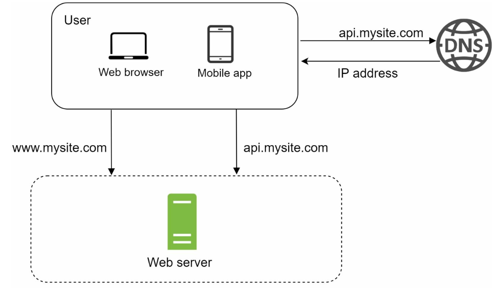

### Luồng xử lý Request (Request Flow)
1. Người dùng truy cập ứng dụng thông qua tên miền (ví dụ: `api.mysite.com`), tên miền này được phân giải thành địa chỉ IP nhờ hệ thống DNS.
2. Địa chỉ IP của Web Server được trả về cho trình duyệt hoặc ứng dụng di động.
3. Các HTTP request được gửi trực tiếp tới Web Server, và server sẽ xử lý rồi trả về phản hồi dưới dạng HTML hoặc JSON.

### Các nguồn lưu lượng truy cập (Traffic Sources)
1. **Ứng dụng Web (Web Applications):** Sử dụng các ngôn ngữ phía server (như Python, Java) để xử lý logic nghiệp vụ (business logic) và các ngôn ngữ phía client (như JavaScript, HTML) để hiển thị giao diện.
2. **Ứng dụng di động (Mobile Applications):** Giao tiếp với Web Server qua giao thức HTTP và sử dụng định dạng JSON để trao đổi dữ liệu gọn nhẹ.

---

## Phần 2: Tách biệt tầng Database (Database Separation)
Khi lượng người dùng tăng lên, database được tách ra một server riêng biệt để cho phép mở rộng độc lập giữa tầng Web (Web Tier) và tầng dữ liệu (Database Tier).

   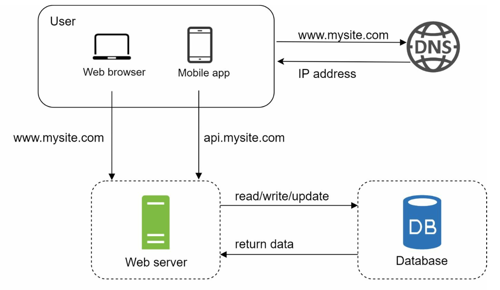

### Lựa chọn Database

1. **Cơ sở dữ liệu quan hệ (Relational Databases - SQL):** Lưu trữ dữ liệu có cấu trúc dưới dạng các bảng. Ví dụ: MySQL, PostgreSQL.
2. **Cơ sở dữ liệu phi quan hệ (Non-Relational Databases - NoSQL):** Phù hợp với dữ liệu phi cấu trúc hoặc các bài toán yêu cầu Latency cực thấp. Các nhóm chính bao gồm:
   - Key-Value Stores
   - Graph Databases
   - Column Stores
   - Document Stores

- NoSQL có thể là lựa chọn phù hợp nếu:
   - Ứng dụng đòi hỏi Latency cực kỳ thấp.
   - Dữ liệu là phi cấu trúc, hoặc không có mối quan hệ ràng buộc phức tạp.
   - Chỉ cần tuần tự hóa (serialize) và giải tuần tự hóa (deserialize) dữ liệu (JSON, XML, YAML, v.v.).
   - Cần lưu trữ một khối lượng dữ liệu khổng lồ.

---

## Phần 3: Mở rộng theo chiều dọc và chiều ngang (Vertical vs Horizontal Scaling)
### Mở rộng theo chiều dọc (Vertical Scaling / Scale Up)
- Bổ sung thêm tài nguyên phần cứng (CPU, RAM) vào server hiện có.
- Bị giới hạn bởi ngưỡng phần cứng vật lý và không có tính dự phòng (redundancy).

### Mở rộng theo chiều ngang (Horizontal Scaling / Scale Out)
- Bổ sung thêm nhiều server mới vào cụm (pool), rất phù hợp cho các hệ thống quy mô lớn.
- Sử dụng một Load Balancer để điều phối và phân tải request giữa các server.
---

## Phần 4: Load Balancer

   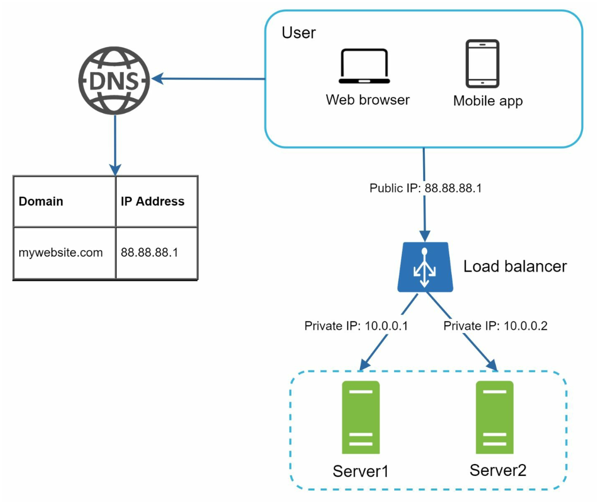

**Load Balancer** chịu trách nhiệm phân phối lưu lượng truy cập (traffic) đồng đều giữa nhiều server. Các lợi ích chính bao gồm:
1. Tính dự phòng (Redundancy): Nếu một server gặp sự cố và ngừng hoạt động, traffic sẽ tự động được điều hướng sang server khác.
   - Nếu Server 1 ngừng hoạt động, toàn bộ traffic sẽ được chuyển hướng sang Server 2.
2. Khả năng mở rộng (Scalability): Dễ dàng bổ sung thêm server vào cụm khi lưu lượng truy cập tăng đột biến (traffic spikes).
   - Nếu lưu lượng truy cập website tăng nhanh, ta chỉ cần thêm các server mới vào sau Load Balancer để gánh phần tải tăng thêm.

---

## Phần 5: Sao chép dữ liệu Database (Database Replication)

   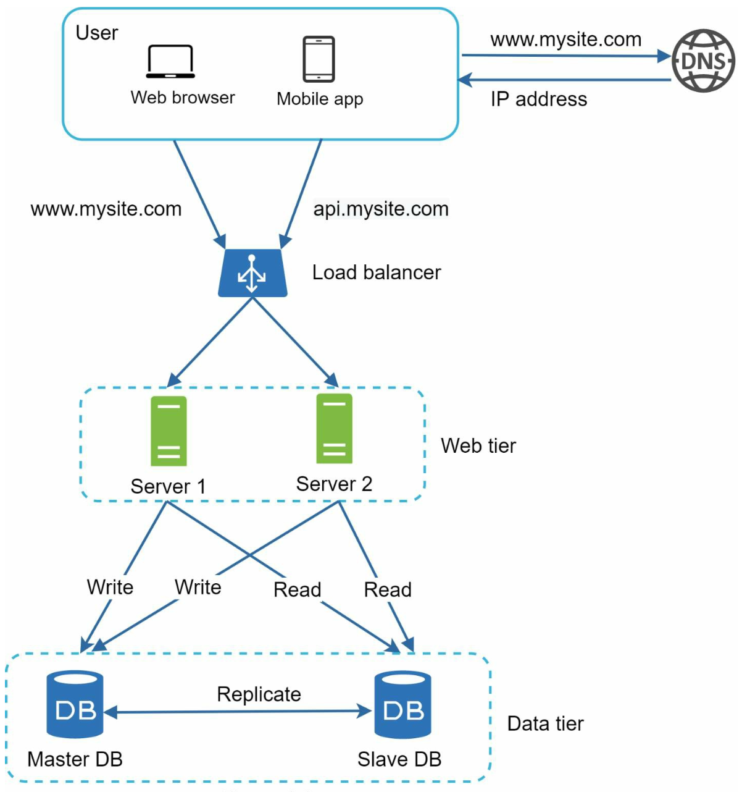

### Mô hình Master-Slave
- **Master Database:** Chịu trách nhiệm xử lý toàn bộ các thao tác ghi (write operations).
   - Mọi câu lệnh làm thay đổi dữ liệu như `insert`, `delete`, hoặc `update` đều bắt buộc phải gửi tới Master Database.
- **Slave Databases:** Chịu trách nhiệm xử lý các thao tác đọc (read operations), giúp cải thiện hiệu năng và độ tin cậy.
   - Vì tỷ lệ đọc/ghi (read/write ratio) trong hầu hết các ứng dụng đều nghiêng nhiều về phía đọc, số lượng Slave Database trong hệ thống thường nhiều hơn số lượng Master Database.

### Lợi ích
1. Cải thiện hiệu năng nhờ xử lý song song các truy vấn đọc trên nhiều node.
2. Đảm bảo tính sẵn sàng cao (High Availability) và độ tin cậy của dữ liệu nhờ cơ chế dự phòng.

### Xử lý sự cố (Failure Handling)
- Nếu hệ thống chỉ có một Slave Database duy nhất và node này bị sập, các thao tác đọc sẽ tạm thời được điều hướng về Master Database.
- Trường hợp có nhiều Slave Database, các truy vấn đọc sẽ được chuyển hướng sang các Slave Database đang hoạt động bình thường khác, đồng thời một database server mới sẽ được khởi tạo để thay thế node bị lỗi.
- Nếu Master Database bị sập, một Slave Database sẽ được bầu chọn và nâng cấp (promote) lên làm Master mới.
- Trên môi trường production, dữ liệu ở Slave Database được chọn có thể chưa được đồng bộ mới nhất, do đó cần chạy các script phục hồi dữ liệu (data recovery scripts) để bù đắp phần dữ liệu thiếu (các phương pháp như Multi-master hoặc Circular Replication có thể hỗ trợ giải quyết vấn đề này).

---

## Phần 6: Caching
**Cache** lưu trữ các dữ liệu thường xuyên được truy cập ngay trên bộ nhớ (RAM) để giảm tải cho database. Tầng Cache (Cache Tier) đóng vai trò là một lớp lưu trữ dữ liệu tạm thời với tốc độ truy xuất nhanh hơn rất nhiều so với database. 

   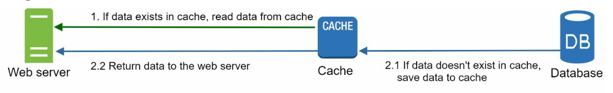

### Các lưu ý khi sử dụng Caching
1. **Trường hợp sử dụng (Use case):** Nên cân nhắc dùng Cache khi dữ liệu được đọc thường xuyên nhưng ít khi thay đổi.
2. **Chính sách hết hạn (Expiration Policies):** Khi dữ liệu trong cache hết hạn (TTL), nó sẽ bị xóa khỏi bộ nhớ. Nếu không thiết lập thời gian hết hạn, dữ liệu sẽ nằm vĩnh viễn trong RAM.
3. **Tính nhất quán (Consistency):** Đảm bảo dữ liệu trong database và trong cache luôn đồng bộ với nhau. Sự thiếu nhất quán (inconsistency) có thể xảy ra do thao tác cập nhật database và cập nhật cache không nằm trong cùng một giao dịch nguyên tử (single transaction).
4. **Giảm thiểu rủi ro sự cố (Mitigating failures):** Một Cache Server đơn lẻ có thể trở thành Điểm lỗi đơn (Single Point of Failure - SPOF). Do đó, khuyến nghị triển khai nhiều Cache Server phân tán trên các trung tâm dữ liệu (Data Center) khác nhau để tránh SPOF.
5. **Chính sách trục xuất (Eviction Policies):** Khi bộ nhớ cache đầy, một số dữ liệu cũ cần phải bị đẩy ra để giải phóng vùng nhớ cho dữ liệu mới. LRU (Least Recently Used) là thuật toán trục xuất cache phổ biến nhất.

---

## Phần 7: Mạng phân phối nội dung (Content Delivery Network - CDN)
**CDN** giúp cải thiện tốc độ tải trang bằng cách lưu cache các nội dung tĩnh (hình ảnh, CSS, JavaScript, video) trên hệ thống các server phân tán ở nhiều vị trí địa lý khác nhau.

   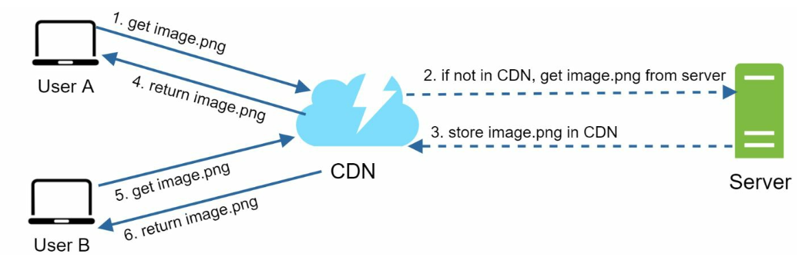

### Luồng hoạt động (Workflow)
1. Người dùng gửi request lấy nội dung tĩnh tới CDN server gần nhất về mặt địa lý.
2. Nếu nội dung chưa có sẵn trên CDN (Cache Miss), CDN sẽ tải nội dung đó từ Origin Server về, lưu vào cache của nó và trả về cho người dùng.

### Các lưu ý khi sử dụng CDN
1. **Chi phí (Cost):** CDN thường được vận hành bởi các nhà cung cấp bên thứ ba và tính phí dựa trên dung lượng dữ liệu truyền vào/ra (data transfer).
2. **Thời gian hết hạn Cache (Cache Expiry):** Thời gian sống (TTL) của cache trên CDN không nên quá dài (dữ liệu bị cũ) nhưng cũng không nên quá ngắn (làm giảm tỷ lệ Cache Hit và tăng tải cho Origin Server).
3. **Cơ chế dự phòng CDN (CDN Fallback):** Nếu CDN gặp sự cố gián đoạn tạm thời, phía client cần có khả năng phát hiện lỗi và tự động chuyển sang tải tài nguyên trực tiếp từ Origin Server.
4. **Vô hiệu hóa file trong Cache (Invalidating files):** Khi file gốc có cập nhật mới trước khi hết hạn TTL, cần chủ động xóa (invalidate) bản cũ trên CDN hoặc sử dụng kỹ thuật đánh phiên bản cho URL (object versioning) để trỏ tới file mới.

---

## Phần 8: Tầng Web phi trạng thái (Stateless Web Tier)
Bằng cách tách dữ liệu phiên làm việc (session data) ra khỏi Web Server và lưu vào một kho dữ liệu dùng chung (shared datastore như Redis hoặc NoSQL), các Web Server sẽ trở thành Stateless. Điều này mang lại các lợi ích:
1. Mở rộng theo chiều ngang (Horizontal Scaling) dễ dàng hơn rất nhiều.
2. Hỗ trợ cơ chế Auto-scaling tự động thêm/bớt server linh hoạt theo lưu lượng truy cập thực tế.

   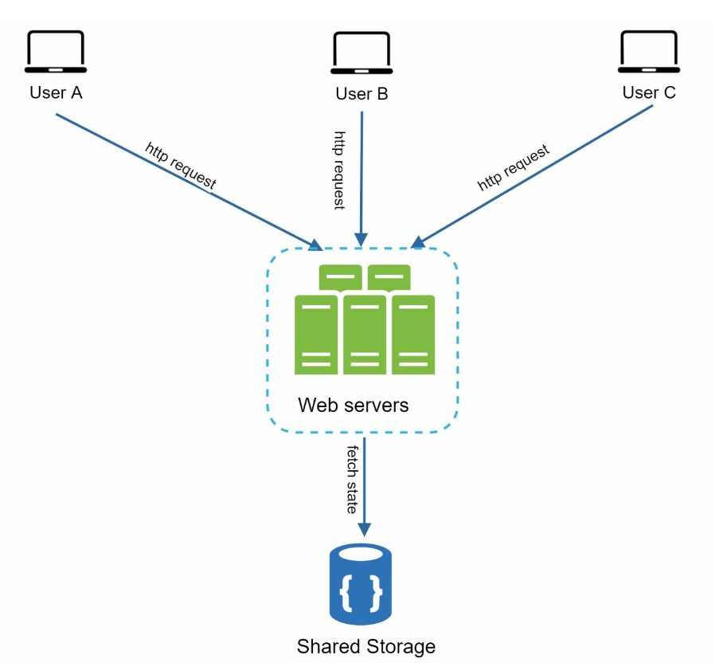

---

## Phần 9: Thiết lập đa trung tâm dữ liệu (Multi-Data Center Setup)
Triển khai hệ thống trên nhiều Data Center giúp nâng cao tính sẵn sàng (Availability) và giảm Latency cho người dùng ở các khu vực địa lý khác nhau. Các chiến lược cốt lõi bao gồm:

   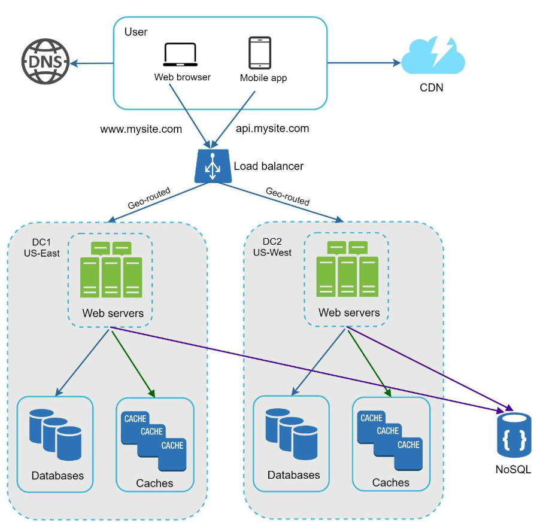

1. **Điều hướng bằng GeoDNS (GeoDNS Routing):** Tự động phân giải tên miền và điều hướng người dùng tới Data Center gần vị trí của họ nhất.
2. **Sao chép dữ liệu (Data Replication):** Đồng bộ dữ liệu xuyên suốt giữa các Data Center để tránh mất mát hoặc sai lệch dữ liệu.

### Các yếu tố cần lưu ý
- **Điều hướng lưu lượng (Traffic redirection):** Cần các công cụ hiệu quả (như GeoDNS) để định tuyến lưu lượng truy cập về đúng Data Center đang hoạt động tốt.
- **Đồng bộ hóa dữ liệu (Data synchronization):** Chiến lược phổ biến là sao chép dữ liệu bất đồng bộ (asynchronous replication) giữa nhiều Data Center.
- **Kiểm thử và triển khai (Test and deployment):** Các công cụ CI/CD và tự động hóa triển khai đóng vai trò sống còn để đảm bảo mã nguồn và cấu hình dịch vụ luôn đồng nhất trên tất cả các Data Center.

---

## Phần 10: Message Queue
**Message Queue** là một thành phần lưu trữ bền vững (durable component) nằm trong bộ nhớ hoặc đĩa, hỗ trợ giao tiếp bất đồng bộ (asynchronous communication) giữa các dịch vụ. Nó đóng vai trò như một bộ đệm (buffer) và phân phối các tác vụ xử lý bất đồng bộ.

   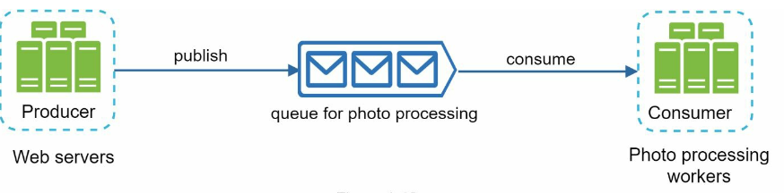

- Các dịch vụ đầu vào, gọi là **Producers/Publishers**, khởi tạo message và đẩy (publish) chúng vào Message Queue.
- Các dịch vụ xử lý phía sau, gọi là **Consumers/Subscribers**, kết nối tới queue để lấy message ra và thực thi các tác vụ tương ứng.

---

## Phần 11: Logging, Metrics và Tự động hóa (Automation)

   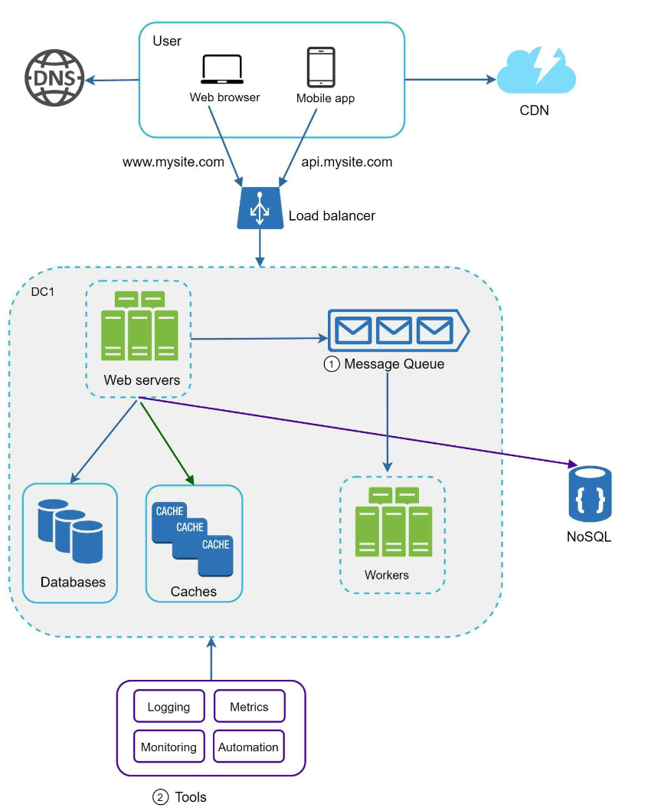

### Tầm quan trọng
1. **Logging:** Theo dõi nhật ký lỗi (error logs) và tình trạng hoạt động của hệ thống để phục vụ việc debug.
2. **Metrics:** Cung cấp số liệu chi tiết về hiệu năng hệ thống (CPU, RAM, QPS) cũng như hành vi người dùng (DAU, tỷ lệ giữ chân).
3. **Automation:** Chuẩn hóa và tự động hóa quy trình kiểm thử, triển khai (CI/CD) và mở rộng hệ thống, giúp tăng năng suất kỹ sư và giảm sai sót do con người.

---

## Phần 12: Mở rộng quy mô Database (Database Scaling)
### Mở rộng theo chiều dọc (Vertical Scaling)
- Nâng cấp thêm tài nguyên phần cứng cho database server nhưng luôn bị giới hạn bởi rào cản vật lý và chi phí đắt đỏ.
- Có nhiều nhược điểm:
   - Rủi ro SPOF (Single Point of Failure) cao hơn.
   - Chi phí tổng thể cho phần cứng cấu hình khủng là rất lớn.

### Mở rộng theo chiều ngang (Horizontal Scaling / Sharding)

   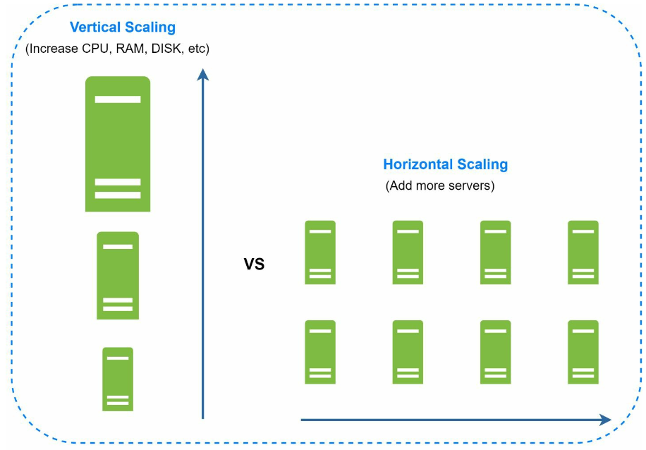

- Chia nhỏ dữ liệu ra nhiều phân mảnh (Shards) dựa trên một khóa phân mảnh (Sharding Key, ví dụ: `user_id`).
   - Sharding tách một database khổng lồ thành các phần nhỏ hơn, độc lập và dễ quản lý hơn gọi là các **Shard**.
   - Mỗi Shard đều có chung cấu trúc bảng (schema), nhưng tập dữ liệu thực tế lưu trên từng Shard là hoàn toàn riêng biệt.
- **Sharding Key** đóng vai trò quyết định khi triển khai chiến lược Sharding. Khi chọn Sharding Key, nguyên tắc quan trọng nhất là phải chọn khóa giúp phân bổ dữ liệu đồng đều giữa các Shard.

#### Các thách thức khi Sharding
1. **Phân mảnh lại dữ liệu (Resharding data):** Việc Resharding là cần thiết khi:
   - Một Shard đơn lẻ không còn đủ dung lượng lưu trữ do dữ liệu tăng trưởng quá nhanh.
   - Một số Shard bị quá tải hoặc cạn kiệt tài nguyên (shard exhaustion) nhanh hơn các Shard khác do dữ liệu phân bổ không đều.
   - Kỹ thuật **Băm nhất quán (Consistent Hashing)** thường được áp dụng để giải quyết bài toán này.

2. **Bài toán người nổi tiếng (Celebrity problem / Hotspot key):** Lượng truy cập quá lớn đổ dồn vào một Shard cụ thể (chứa dữ liệu của nhiều người nổi tiếng) có thể gây quá tải và làm sập server đó.
   - Để giải quyết, ta có thể phải cấp phát riêng một Shard cho mỗi tài khoản người nổi tiếng hoặc chia nhỏ hơn nữa (further partitioning).

3. **Phép nối và Phi chuẩn hóa (Join and Denormalization):** Một khi database đã được phân mảnh trên nhiều server vật lý, việc thực hiện các truy vấn `JOIN` xuyên qua nhiều Shard trở nên rất phức tạp và tốn kém hiệu năng.
   - Cách giải quyết phổ biến là thực hiện **Phi chuẩn hóa (Denormalization)** cơ sở dữ liệu để các truy vấn có thể lấy đủ dữ liệu ngay trên một bảng duy nhất mà không cần `JOIN`.

---

## Kết luận
### Các điểm cốt lõi cần nhớ (Key Takeaways)
1. Giữ cho tầng Web (Web Tier) luôn ở trạng thái Stateless.
2. Xây dựng cơ chế dự phòng (redundancy) ở mọi tầng kiến trúc.
3. Tận dụng tối đa Caching và CDN để tối ưu hóa hiệu năng đọc.
4. Mở rộng tầng dữ liệu (Data Tier) bằng kỹ thuật Sharding.
5. Tách biệt sự phụ thuộc (decouple) giữa các thành phần bằng Message Queue để tăng tính linh hoạt.

Chương này cung cấp một nền tảng vững chắc để thiết kế và xây dựng các hệ thống có khả năng mở rộng cao, sẵn sàng phục vụ hàng triệu người dùng.
