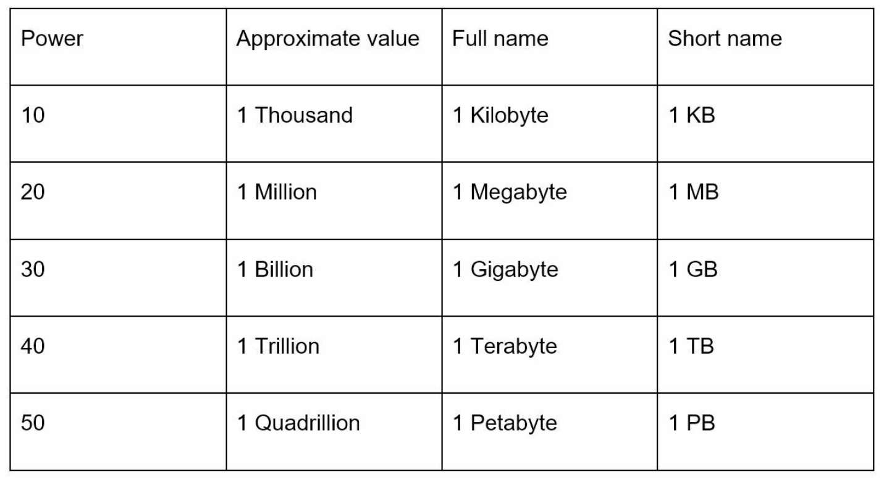

# Chương 2: Ước lượng sơ bộ (Back-of-the-Envelope Estimation)

## Giới thiệu
**Ước lượng sơ bộ (Back-of-the-envelope estimation)** là một kỹ năng tối quan trọng trong các buổi phỏng vấn System Design. Kỹ năng này bao gồm việc thực hiện các phép tính nhẩm nhanh, mang tính ước chừng để đánh giá dung lượng lưu trữ hoặc hiệu năng của hệ thống. Theo Jeff Dean (Google Senior Fellow), những ước lượng này giúp kiểm chứng xem các phương án thiết kế có đáp ứng được yêu cầu đề ra hay không thông qua việc suy luận giả định kết hợp với các chỉ số hiệu năng chuẩn (performance benchmarks).

Chương này trình bày các khái niệm cốt lõi, phương pháp luận và các ví dụ thực tế để giúp bạn thành thạo kỹ năng ước lượng và đánh giá khả năng mở rộng của hệ thống.

---

## Phần 1: Các khái niệm cốt lõi

### Lũy thừa của 2 (Power of Two)
Hiểu rõ khối lượng dữ liệu biểu diễn dưới dạng lũy thừa của 2 là kiến thức nền tảng bắt buộc:

Kiến thức này giúp thực hiện các phép tính về dung lượng lưu trữ (storage) và băng thông (bandwidth) một cách chính xác và nhanh chóng.

---

### Các con số về Latency mà mọi lập trình viên cần biết
Các chỉ số Latency thể hiện thời gian cần thiết để thực hiện những thao tác khác nhau trong hệ thống máy tính. Chúng mang lại góc nhìn trực quan về tương quan hiệu năng giữa các thành phần phần cứng và mạng:

| Thao tác (Operation) | Latency (2020) |
|--------------------------|----------------|
| Truy cập L1 Cache (L1 Cache Access) | 0.5 ns |
| Truy cập L2 Cache (L2 Cache Access) | 7 ns |
| Truy cập bộ nhớ RAM (Main Memory Access) | 100 ns |
| Đọc ngẫu nhiên trên SSD (SSD Random Read) | 150 µs |
| Tìm kiếm ngẫu nhiên trên HDD (HDD Random Seek) | 10 ms |
| Khứ hồi mạng trong cùng Data Center (Round-Trip in Data Center) | 500 µs |
| Truyền gói tin liên khu vực (Inter-Region Data Center) | 150 ms |

**Các đúc kết quan trọng (Key Insights):**
- Bộ nhớ RAM rất nhanh, nhưng ổ cứng (Disk) thì rất chậm.
- Tránh thao tác tìm kiếm trên ổ cứng (Disk Seek) bất cứ khi nào có thể.
- Nên nén dữ liệu (compress data) trước khi truyền qua Internet để tiết kiệm băng thông và giảm thời gian truyền tải.

---

### Các chỉ số về Tính sẵn sàng (Availability Numbers)
Tính sẵn sàng cao (High Availability - HA) đảm bảo hệ thống có thời gian ngừng hoạt động (downtime) ở mức tối thiểu. Độ sẵn sàng thường được đo lường bằng **số lượng chữ số 9 (nines)**:
- **99% (Two Nines):** ~3.65 ngày/năm downtime
- **99.9% (Three Nines):** ~8.8 giờ/năm downtime
- **99.99% (Four Nines):** ~52 phút/năm downtime
- **99.999% (Five Nines):** ~5.3 phút/năm downtime
- **99.9999% (Six Nines):** ~31.56 giây/năm downtime

Các nhà cung cấp hạ tầng đám mây (Cloud Providers) như Amazon, Google và Microsoft thường cam kết SLA (Service Level Agreement) ở mức **99.9% hoặc cao hơn**.

---

## Phần 2: Ví dụ ước lượng thực tế - Tính QPS và dung lượng lưu trữ của Twitter

### Các giả định (Assumptions)
- **300 triệu người dùng hoạt động hàng tháng (MAU - Monthly Active Users).**
- **50% trong số đó hoạt động hàng ngày (DAU - Daily Active Users).**
- **Trung bình số tweet mỗi người dùng đăng trong ngày:** 2 tweets.
- **10% số lượng tweet có đính kèm media (ảnh/video).**
- **Thời gian lưu trữ dữ liệu (Data retention):** 5 năm.

### Các bước tính toán ước lượng (Estimations)
1. **Số lượng truy vấn mỗi giây (Query Per Second - QPS):**
   - DAU = \( 300M \times 50\% = 150M \)
   - Tweets QPS = \( 150M \times 2 \text{ tweets} / 24 \text{ giờ} / 3600 \text{ giây} = \sim 3500 \)
   - Peak QPS (QPS lúc cao điểm) = \( 2 \times 3500 = \sim 7000 \)

2. **Dung lượng lưu trữ Media (Media Storage):**
   - **Kích thước các thành phần của một Tweet:**
     - `tweet_id`: 64 bytes
     - `text`: 140 bytes
     - `media`: 1 MB
   - **Dung lượng lưu trữ Media mỗi ngày:** \( 150M \times 2 \times 10\% \times 1\text{MB} = 30\text{TB / ngày} \)
   - **Tổng dung lượng lưu trữ trong 5 năm:** \( 30\text{TB} \times 365 \times 5 = \sim 55\text{PB} \)

---

## Phần 3: Mẹo ước lượng hiệu quả trong phỏng vấn

### 1. Làm tròn và xấp xỉ (Rounding and Approximation)
Độ chính xác tuyệt đối không phải là mục tiêu quan trọng nhất; người phỏng vấn đánh giá cao tư duy và quy trình tính toán của bạn. Hãy đơn giản hóa các phép tính phức tạp bằng cách làm tròn số. Ví dụ:
- \( 99987 / 9.1 \) có thể được làm tròn xấp xỉ thành \( 100,000 / 10 = 10,000 \).

### 2. Ghi rõ các giả định (Write Down Assumptions)
Luôn ghi chú rõ ràng các con số giả định ra bảng hoặc tài liệu để dễ dàng đối chiếu và điều chỉnh về sau.

### 3. Ghi kèm đơn vị đo lường (Label Units)
Tránh sự nhầm lẫn đáng tiếc bằng cách luôn viết rõ đơn vị đi kèm con số (ví dụ: viết rõ `5 MB` thay vì chỉ viết số `5`).

### 4. Các kịch bản ước lượng phổ biến
- **QPS (Queries Per Second):** Đo lường cường độ lưu lượng truy cập trung bình.
- **Peak QPS:** Tính toán tải hệ thống vào những khung giờ cao điểm.
- **Storage Requirements:** Ước tính tổng nhu cầu lưu trữ dữ liệu trên ổ cứng.
- **Cache Requirements:** Đánh giá dung lượng bộ nhớ RAM cần thiết cho việc caching.
- **Number of Servers:** Tính toán số lượng server vật lý/ảo cần trang bị dựa trên khối lượng công việc (workload).
