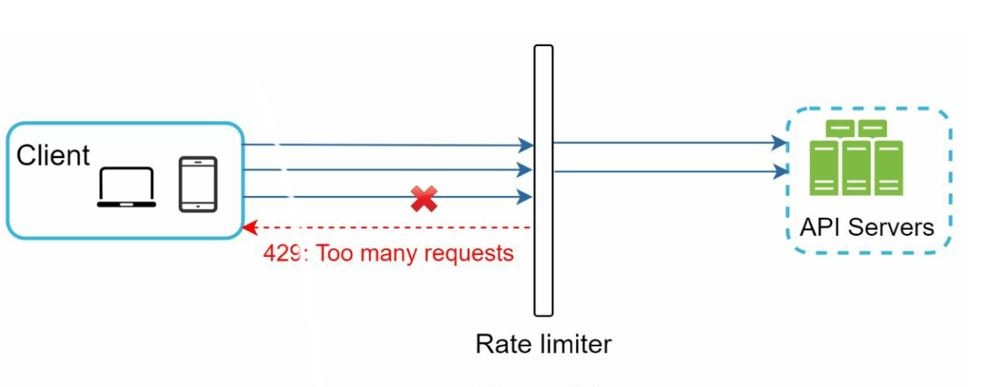
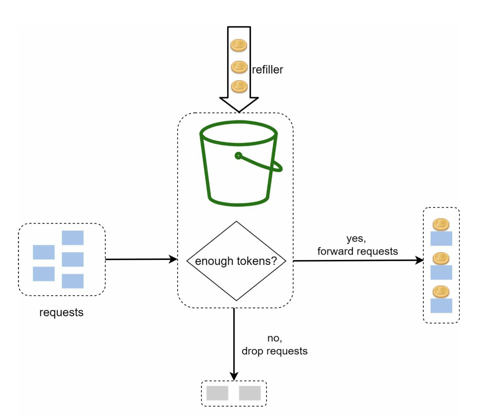
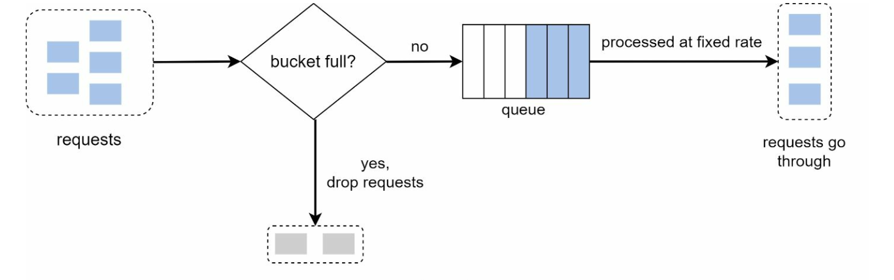
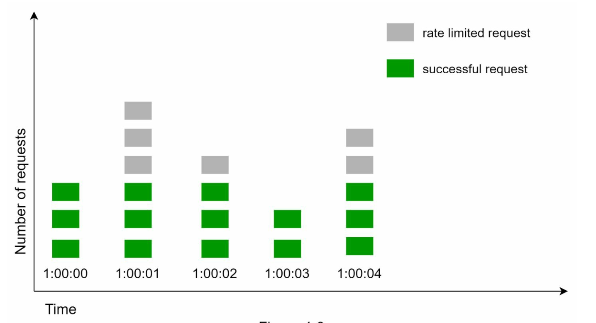
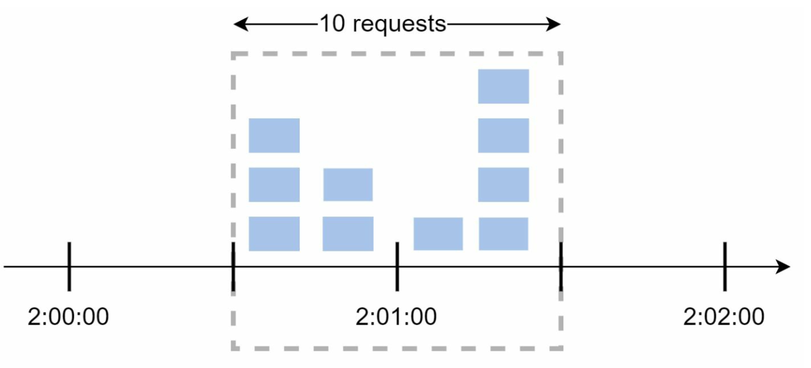
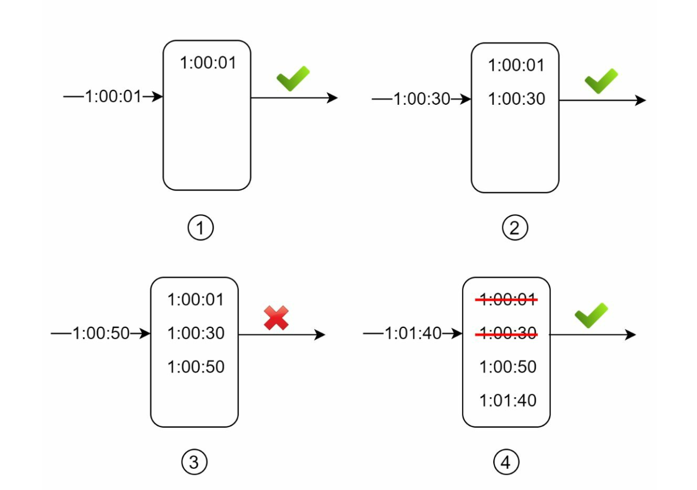
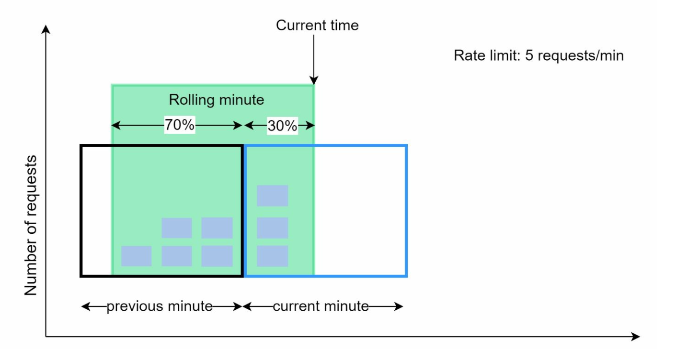
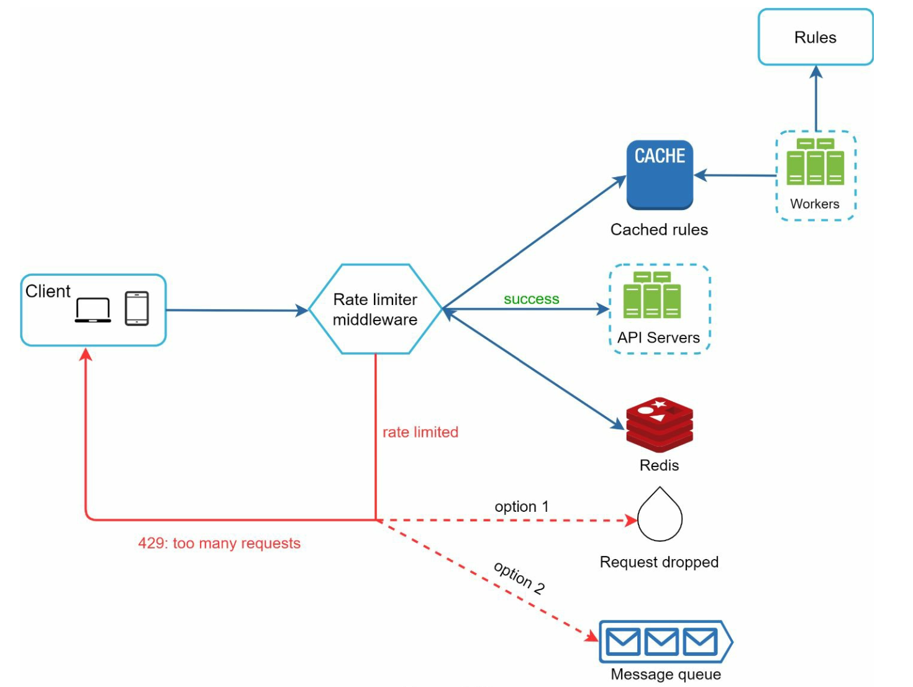

# Chương 4: Thiết kế bộ giới hạn lưu lượng (Design a Rate Limiter)

## Giới thiệu
Chương này đi sâu vào việc thiết kế và triển khai **Rate Limiter** (bộ giới hạn lưu lượng) — một thành phần hệ thống dùng để kiểm soát tốc độ gửi request từ phía client hoặc giữa các service với nhau. Rate Limiter đóng vai trò sống còn trong việc ngăn chặn hành vi lạm dụng (abuse), tối ưu chi phí vận hành và đảm bảo sự ổn định cho tài nguyên server. Các ví dụ thực tế bao gồm giới hạn số bài đăng, số lần tạo tài khoản hoặc số lần nhận thưởng trong một khoảng thời gian nhất định.

## Lợi ích của Rate Limiting
- **Ngăn chặn tấn công từ chối dịch vụ (DoS/DDoS Attacks):** Chặn các request vượt ngưỡng để tránh tình trạng cạn kiệt tài nguyên hệ thống (resource starvation).
- **Giảm thiểu chi phí (Cost Reduction):** Giới hạn các request dư thừa hoặc không cần thiết, đặc biệt quan trọng khi sử dụng các API trả phí của bên thứ ba để tiết kiệm chi phí hạ tầng.
- **Chống quá tải Server (Preventing Overloads):** Lọc bỏ lưu lượng truy cập đột biến từ bot hoặc hành vi cấu hình sai của người dùng nhằm duy trì hiệu năng ổn định cho server.

## Bước 1: Thấu hiểu bài toán (Understanding the Problem)
### Các tính năng chính
- Rate Limiter đặt ở phía server (Server-side API Rate Limiter).
- Hỗ trợ cấu hình linh hoạt nhiều quy tắc giới hạn (throttle rules) khác nhau.
- Đáp ứng hệ thống quy mô lớn chạy trong môi trường phân tán (distributed environments).
- Linh hoạt triển khai dưới dạng một dịch vụ độc lập (standalone service) hoặc tích hợp trực tiếp vào code ứng dụng.
- Trả về thông báo rõ ràng cho phía người dùng khi request bị chặn (throttled).

### Yêu cầu hệ thống
- Giới hạn request chính xác theo ngưỡng đã cấu hình.
- Latency thấp (không làm chậm đáng kể thời gian phản hồi API).
- Tiêu tốn ít bộ nhớ (low memory usage).
- Có khả năng vận hành phân tán (Distributed Rate Limiting) chia sẻ trạng thái giữa nhiều node.
- Xử lý ngoại lệ (exception handling) rõ ràng, minh bạch với client.
- Khả năng chịu lỗi cao (High Fault Tolerance): Nếu Rate Limiter gặp sự cố, hệ thống chính vẫn phải tiếp tục hoạt động bình thường.

## Bước 2: Thiết kế tổng quan (High-Level Design)
### Các vị trí đặt Rate Limiter (Placement Options)

    

1. **Triển khai phía Client (Client-Side Implementation):** Không đáng tin cậy vì gói tin phía client rất dễ bị giả mạo hoặc can thiệp bởi kẻ tấn công.
2. **Triển khai phía Server (Server-Side Implementation):** Được ưu tiên sử dụng nhờ khả năng kiểm soát chặt chẽ và độ tin cậy cao.
3. **Đặt tại tầng Middleware (API Gateway):** Lựa chọn linh hoạt và phổ biến nhất hiện nay, tích hợp Rate Limiting cùng với xác thực (authentication), SSL termination và điều hướng request.

### Nguyên tắc lựa chọn vị trí triển khai
- Đánh giá tech stack hiện tại của hệ thống để chọn phương án tương thích và hiệu quả nhất.
- Lựa chọn thuật toán Rate Limiting phù hợp với đặc thù nghiệp vụ (business needs).
- Nếu kiến trúc hệ thống đang sử dụng Microservices, nên tích hợp trực tiếp Rate Limiter vào tầng **API Gateway**.
- Nếu nguồn lực kỹ thuật hạn chế, nên ưu tiên sử dụng các giải pháp API Gateway thương mại có sẵn thay vì tự xây dựng từ đầu.

## Bước 3: Các thuật toán Rate Limiting (Rate Limiting Algorithms)
### 1. Token Bucket (Xô chứa Token)

  

- **Mô tả:** Các token được nạp vào một "xô" (bucket) theo tốc độ cố định; mỗi request khi đi tới sẽ tiêu tốn 1 token. Nếu còn token thì request được đi qua, nếu xô rỗng thì request bị từ chối.
- **Tham số cấu hình:** Dung lượng xô tối đa (`bucket size`) và tốc độ làm đầy (`refill rate`).
- **Ưu điểm:** Dễ cài đặt, tiết kiệm bộ nhớ, cho phép xử lý các đợt lưu lượng tăng vọt ngắn hạn (traffic bursts).
- **Nhược điểm:** Đòi hỏi việc tinh chỉnh (tuning) hai tham số cấu hình một cách cẩn thận khi có nhiều rule phức tạp.

### 2. Leaking Bucket (Xô rò rỉ)

  

- **Mô tả:** Xử lý các request với tốc độ đầu ra cố định bằng cách sử dụng một hàng đợi FIFO (First-In-First-Out). Nếu hàng đợi đầy, các request mới đến sẽ bị loại bỏ (drop).
- **Ưu điểm:** Tiết kiệm bộ nhớ (nhờ kích thước queue cố định), tốc độ xử lý đầu ra (outflow rate) luôn ổn định, rất phù hợp cho các hệ thống cần tốc độ xử lý đều đặn.
- **Nhược điểm:** Khi có đợt traffic tăng đột biến, các request cũ làm nghẽn hàng đợi khiến các request mới bị trễ hoặc bị đánh rớt.
  

  Ví dụ triển khai thực tế: https://github.com/uber-go/ratelimit

### 3. Fixed Window Counter (Bộ đếm cửa sổ cố định)

  

- **Mô tả:** Chia trục thời gian thành các khoảng cố định (time windows) và sử dụng bộ đếm (counter) cho từng khoảng để giới hạn số lượng request.
- **Ưu điểm:** Đơn giản, dễ hiểu, tiết kiệm bộ nhớ và phù hợp với nhiều bài toán cơ bản.
- **Nhược điểm:** Lưu lượng tăng đột biến ở vùng ranh giới giữa hai cửa sổ thời gian (window edges) có thể khiến tổng số request đi qua vượt quá ngưỡng cho phép.

- Một đợt traffic dồn dập ngay tại rìa giao nhau của hai cửa sổ thời gian có thể làm hệ thống chấp nhận số lượng request gấp đôi hạn mức (quota) quy định.

  

### 4. Sliding Window Log (Nhật ký cửa sổ trượt)

  

- **Mô tả:** Lưu lại dấu thời gian (timestamp) của từng request (thường dùng Sorted Set trong Redis) để tính toán giới hạn dựa trên một cửa sổ thời gian trượt liên tục.
- **Ưu điểm:** Giới hạn lưu lượng cực kỳ chính xác tại mọi thời điểm, khắc phục triệt để lỗi ở ranh giới cửa sổ.
- **Nhược điểm:** Tiêu tốn nhiều bộ nhớ do phải lưu trữ timestamp của tất cả các request (kể cả những request đã bị từ chối).
  

### 5. Sliding Window Counter (Bộ đếm cửa sổ trượt)

  

- **Mô tả:** Kết hợp ưu điểm của Fixed Window Counter và Sliding Window Log bằng cách tính trọng số dựa trên số lượng request của cửa sổ trước đó và cửa sổ hiện tại để làm mượt các đợt tăng đột biến.
- **Ưu điểm:** Tiết kiệm bộ nhớ, xử lý tốt các đợt traffic tăng vọt ở ranh giới thời gian.
- **Nhược điểm:** Là phép tính xấp xỉ (dựa trên giả định request ở cửa sổ trước phân bổ đều), nên không tuyệt đối chính xác 100% nhưng sai số trong thực tế là cực kỳ nhỏ.
  

## Kiến trúc tổng quan (High-Level Architecture)

  

- **Lưu trữ dữ liệu (Data Storage):** Sử dụng bộ nhớ đệm trên RAM (In-memory Cache như **Redis**) để thực hiện các thao tác tăng bộ đếm (`INCR`) và đặt thời gian hết hạn (`EXPIRE`) với tốc độ cực nhanh.
- **Các bước xử lý:**
  1. Client gửi request tới tầng Rate Limiter Middleware.
  2. Middleware kiểm tra bộ đếm (counter) tương ứng trong Redis.
  3. Nếu chưa chạm ngưỡng, request được chuyển tiếp tới API Servers; nếu vượt ngưỡng, hệ thống từ chối request và trả về mã lỗi HTTP `429 Too Many Requests`.

## Các vấn đề nâng cao cần lưu ý (Advanced Considerations)
### Môi trường phân tán (Distributed Environments)
- **Thách thức:** Hiện tượng **Tranh chấp dữ liệu (Race Condition)** khi nhiều luồng đọc/ghi counter cùng lúc, và vấn đề **Đồng bộ hóa (Synchronization)** giữa nhiều Rate Limiter node.
- **Giải pháp:** Sử dụng **Lua script** hoặc cấu trúc dữ liệu **Sorted Set** trong Redis (đảm bảo tính nguyên tử - atomic), thay vì dùng khóa (locks) gây giảm hiệu năng. Sử dụng kho dữ liệu tập trung như Redis Cluster để đồng bộ trạng thái giữa các node.

### Tối ưu hóa hiệu năng (Performance Optimizations)
- Triển khai trên nhiều Data Center (Multi-data center setup) kết hợp điều hướng qua biên mạng (Edge servers) để giảm Latency cho người dùng ở xa.
- Sử dụng mô hình **Tính nhất quán cuối cùng (Eventual Consistency)** khi đồng bộ dữ liệu bộ đếm giữa các khu vực để ưu tiên tốc độ xử lý.

### Giám sát (Monitoring)
- Thu thập số liệu phân tích định kỳ để đánh giá tính hiệu quả của thuật toán và quy tắc giới hạn hiện tại (ví dụ: quy tắc có quá chặt làm chặn nhầm người dùng hợp lệ, hay thuật toán cần chuyển sang Token Bucket để chịu tải sự kiện Flash Sale).
