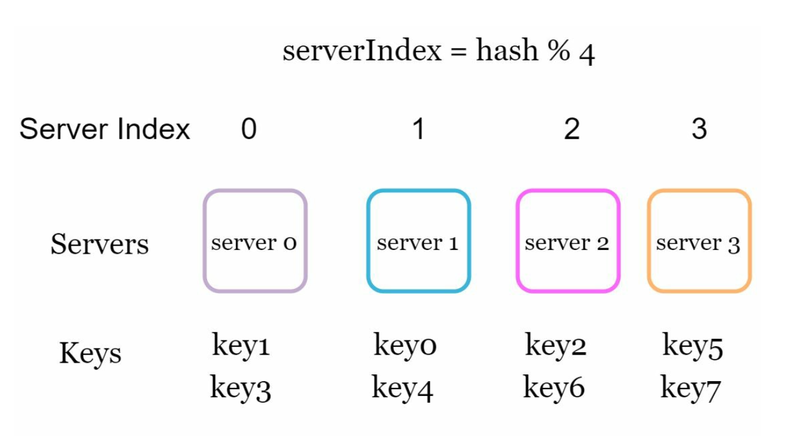
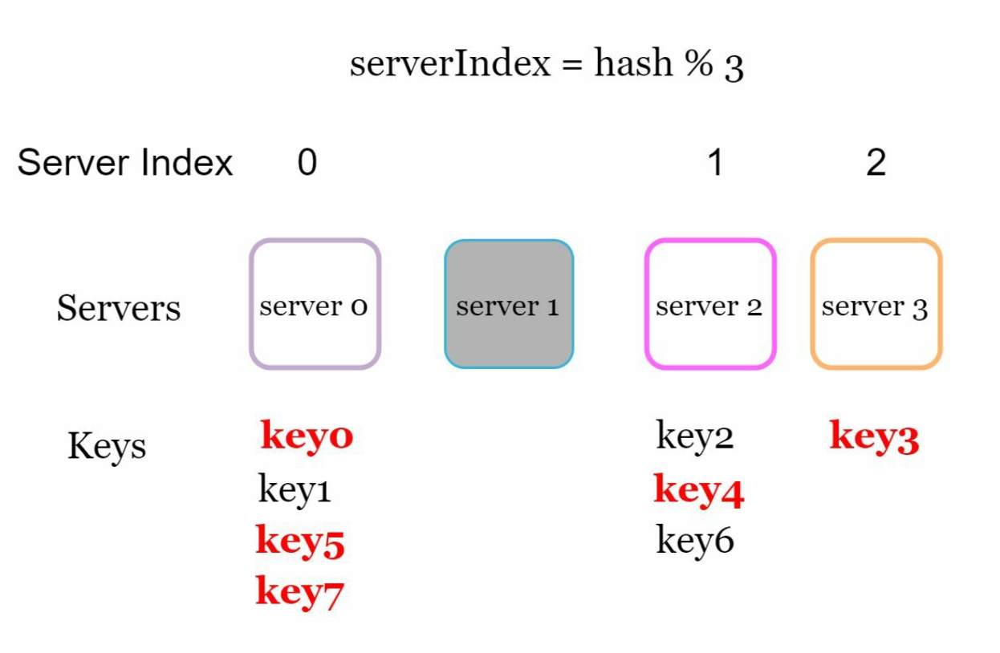
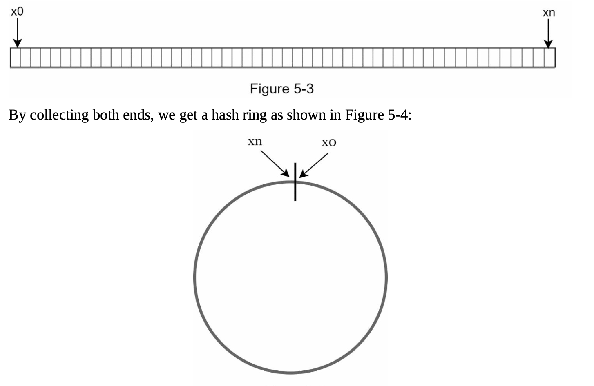
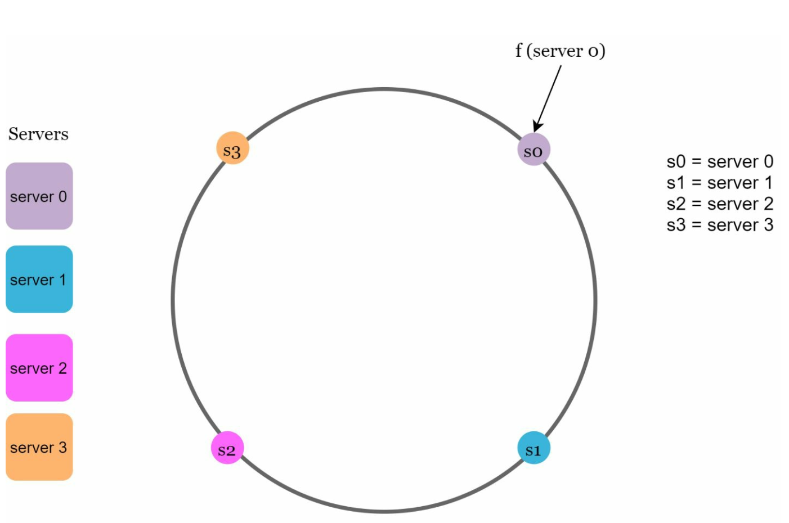
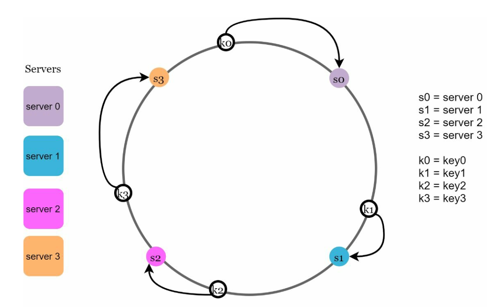
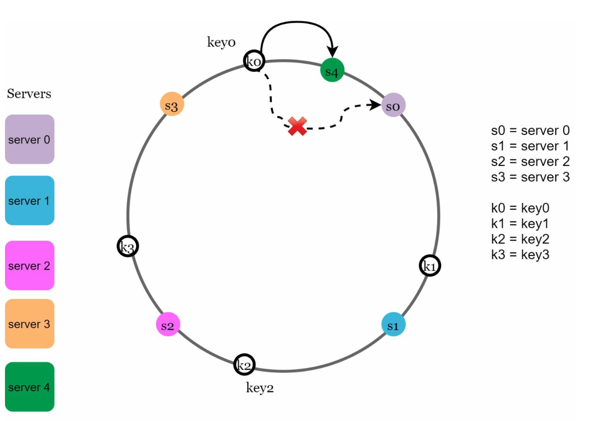
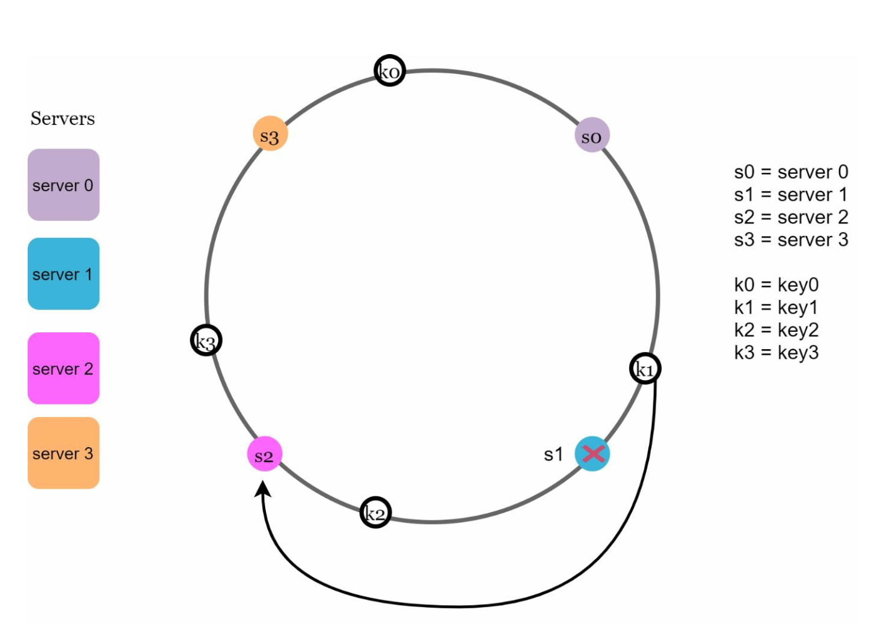
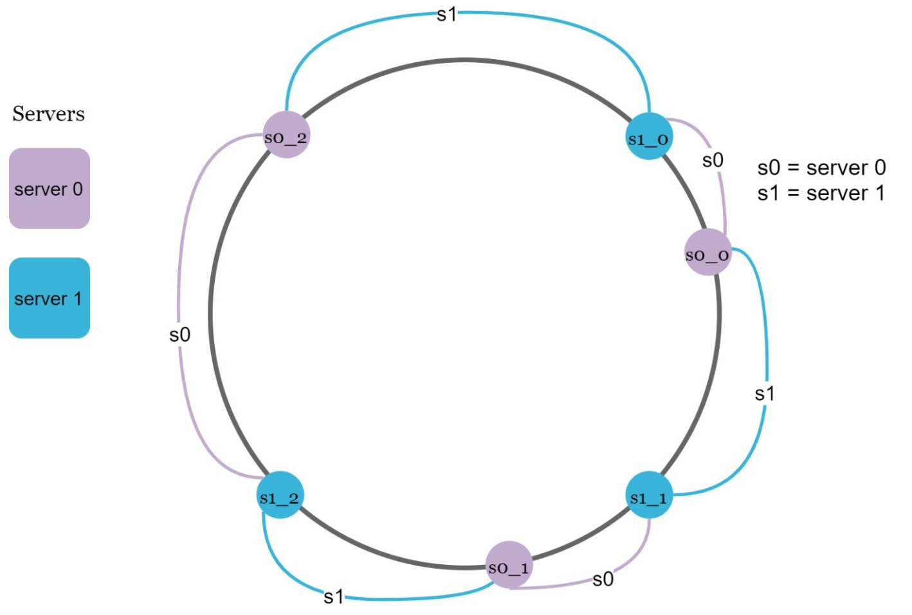
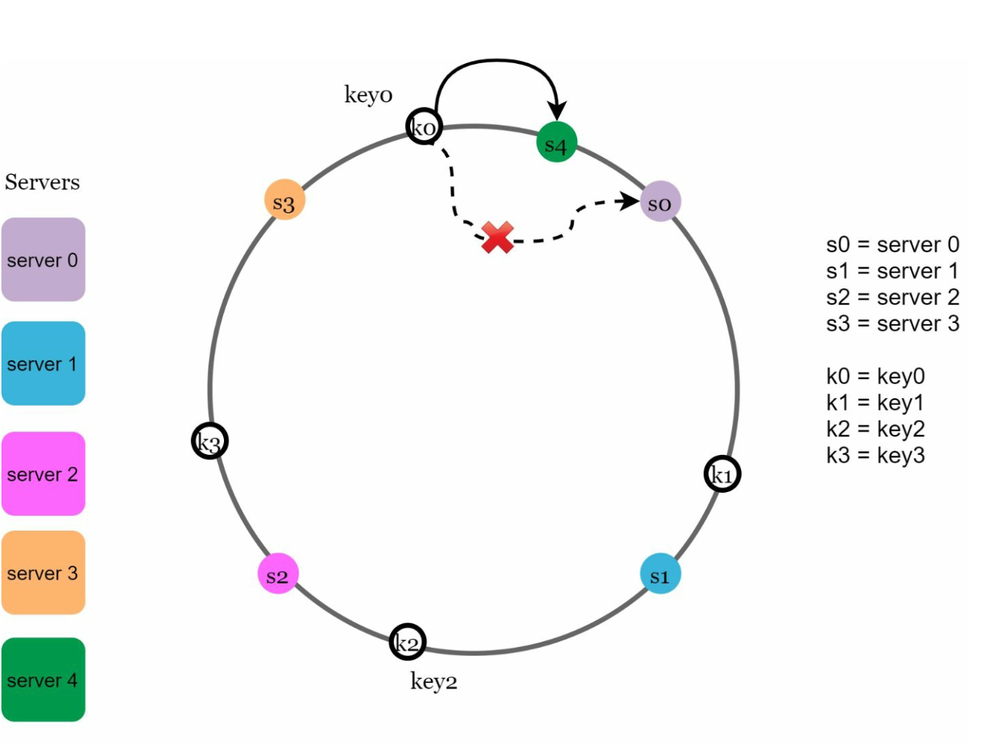
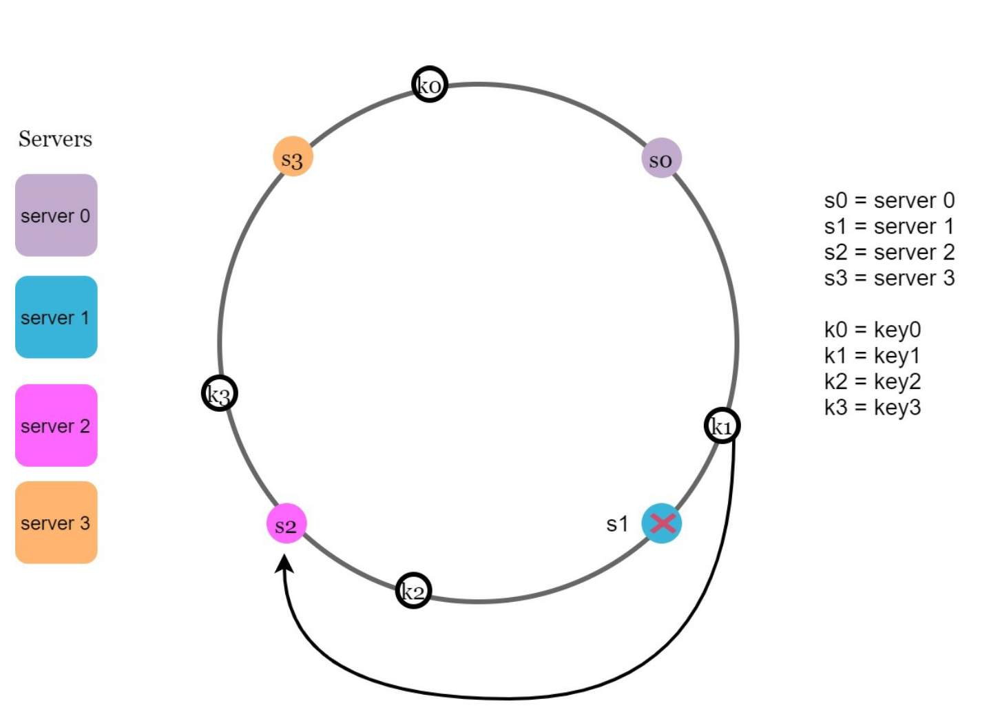

# Chương 5: Thiết kế Băm nhất quán (Design Consistent Hashing)

## Giới thiệu
Chương này khám phá kỹ thuật **Băm nhất quán (Consistent Hashing)** — một phương pháp nền tảng để đạt được khả năng mở rộng theo chiều ngang (Horizontal Scaling) thông qua việc phân phối request và dữ liệu đồng đều giữa các server. Kỹ thuật này giúp giảm thiểu tối đa lượng dữ liệu phải phân bổ lại (redistribution) khi thêm hoặc bớt server, đồng thời đảm bảo tải được chia đều nhằm ngăn chặn tình trạng quá tải cục bộ (server hotspots).

## Bài toán băm lại dữ liệu (The Rehashing Problem)
### Giải thích vấn đề
Trong các phương pháp băm truyền thống sử dụng phép chia lấy dư như `serverIndex = hash(key) % N` (với `N` là số lượng server), việc phân phối lại dữ liệu sẽ trở thành thảm họa mỗi khi số lượng server thay đổi. Cụ thể:
- Khi một server gặp sự cố và bị loại khỏi cụm, hầu hết các key đều bị tính toán lại vị trí server đích, dẫn đến một cơn bão **Cache Miss** đánh sập database phía sau.
- Khi thêm một server mới vào cụm, phần lớn các key cũng bị xáo trộn vị trí một cách không cần thiết.

  

- Phương pháp modulo này chỉ hoạt động tốt khi kích thước cụm server (`N`) là cố định. Tuy nhiên, trong thực tế vận hành hệ thống phân tán, việc thêm mới hoặc gỡ bỏ server diễn ra rất thường xuyên.

  

### Vấn đề cốt lõi
Việc hầu hết các key bị ánh xạ lại mỗi khi số lượng server thay đổi gây ra sự kém hiệu quả nghiêm trọng và làm quá tải toàn hệ thống.

## Băm nhất quán (Consistent Hashing)
### Định nghĩa
**Consistent Hashing** là kỹ thuật băm đảm bảo rằng khi có một server được thêm vào hoặc gỡ bỏ khỏi cụm, chỉ có một phần nhỏ các key (trung bình chỉ khoảng `k/N` key, với `k` là tổng số key và `N` là số lượng phân vùng/server) cần được ánh xạ lại. Điều này giảm thiểu tối đa sự xáo trộn và tăng cường khả năng mở rộng của hệ thống.

### Các khái niệm cốt lõi
1. **Không gian băm và Vòng băm (Hash Space and Hash Ring):** Không gian đầu ra của hàm băm tạo thành một dải liên tục, ví dụ từ `0` đến `2^160 - 1` (khi sử dụng hàm băm SHA-1). Bằng cách nối điểm đầu và điểm cuối của dải này lại với nhau, ta thu được một **Vòng băm (Hash Ring)**.
    

    
    

- Sử dụng cùng một hàm băm `f` (không dùng phép chia lấy dư `%`), ta ánh xạ các server lên trên vòng băm dựa vào địa chỉ IP hoặc tên định danh của từng server.  

    

    
    

1. **Tra cứu Server lưu trữ Key (Server Lookup)**
- Để xác định một key thuộc về server nào, từ vị trí băm của key đó trên vòng tròn, ta di chuyển theo chiều kim đồng hồ (clockwise) cho đến khi gặp server đầu tiên.

  

  
  

2. **Thêm và gỡ bỏ Server (Adding and Removing Servers)**
- Khi thêm một server mới, chỉ có các key nằm lân cận trước vị trí của server mới mới cần được chuyển sang nó. Chỉ một phần nhỏ tổng số key bị ảnh hưởng.
  
  

  
  

- Khi gỡ bỏ một server, chỉ có các key nằm trong khoảng do server đó quản lý mới bị ảnh hưởng. Toàn bộ số key của server bị gỡ bỏ sẽ được chuyển giao cho server kế tiếp theo chiều kim đồng hồ.

  

  
  

## Thách thức và Giải pháp
### Hai vấn đề lớn của cách tiếp cận cơ bản
1. **Kích thước phân vùng không đồng đều (Uneven Partition Sizes):** Khoảng cách giữa các server trên vòng băm có thể rất chênh lệch, đặc biệt khi thêm hoặc bớt node.
2. **Phân phối Key không đồng đều (Non-uniform Key Distribution):** Một số server có thể phải gánh lượng key nhiều hơn hẳn các server khác (hiện tượng lệch tải).

### Giải pháp: Node ảo (Virtual Nodes)
- Thay vì chỉ ánh xạ mỗi server vật lý vào một điểm duy nhất, mỗi server sẽ được đại diện bởi nhiều **Node ảo (Virtual Nodes)** phân bổ rải rác đều khắp vòng băm.
- Virtual Nodes giúp làm phẳng sự phân bổ key và cân bằng tải hiệu quả. Khi số lượng Virtual Nodes tăng lên, sự phân phối các key càng trở nên đồng đều hơn vì độ lệch chuẩn (standard deviation) của kích thước các phân vùng giảm xuống đáng kể.
   
  

  
  

## Xác định phạm vi các Key bị ảnh hưởng (Affected Keys)
Khi có sự thay đổi về số lượng server trên vòng băm:
- **Khi thêm Server mới (Added Server):** Các key bị ảnh hưởng là những key nằm trong khoảng giữa server mới được thêm vào và server đứng liền trước nó (ngược chiều kim đồng hồ).
  Trong ví dụ dưới đây, `server 4` (`s4`) được thêm vào vòng băm. Phạm vi bị ảnh hưởng bắt đầu từ `s4` (node mới thêm) đi ngược chiều kim đồng hồ cho đến khi gặp server kế tiếp là `s3`. Do đó, chỉ các key nằm giữa `s3` và `s4` mới cần được chuyển giao sang cho `s4`.

  

  
  

- **Khi gỡ bỏ Server (Removed Server):** Các key bị ảnh hưởng là những key nằm giữa server bị gỡ bỏ và server đứng liền trước nó. Trong ví dụ dưới đây, khi `server 1` (`s1`) bị gỡ bỏ, phạm vi bị ảnh hưởng bắt đầu từ `s1` (node bị xóa) đi ngược chiều kim đồng hồ cho đến khi gặp server `s0`. Do đó, các key nằm trong khoảng giữa `s0` và `s1` phải được chuyển giao sang cho server kế tiếp theo chiều kim đồng hồ là `s2`.
   
  

  
  

## Lợi ích của Consistent Hashing
- **Tối thiểu hóa việc di chuyển dữ liệu (Minimized Redistribution):** Chỉ một tỷ lệ nhỏ các key cần được gán lại khi thay đổi quy mô cụm server.
- **Khả năng mở rộng cao (Scalability):** Hỗ trợ mở rộng theo chiều ngang (Horizontal Scaling) một cách mượt mà và tự động.
- **Giảm thiểu điểm nóng (Mitigates Hotspots):** Phân bổ dữ liệu đồng đều hơn nhờ Virtual Nodes, tránh tình trạng quá tải cục bộ trên một vài server.

## Ứng dụng trong thực tế (Real-World Applications)
- **Amazon DynamoDB** (thành phần Partitioning)
- **Apache Cassandra** (phân mảnh dữ liệu qua các node trong cluster)
- **Discord** (điều hướng hàng triệu cuộc hội thoại tới các Elixir server)
- **Akamai CDN** (phân phối nội dung web trên toàn cầu)
- **Google Maglev Network Load Balancer**
