# Chương 6: Thiết kế Key-Value Store (Design a Key-Value Store)

## Giới thiệu
**Key-Value Store** là một loại cơ sở dữ liệu phi quan hệ (NoSQL), nơi dữ liệu được lưu trữ dưới dạng các cặp khóa - giá trị (key-value pairs). Mỗi `key` là một định danh duy nhất và `value` tương ứng sẽ được truy xuất thông qua `key` đó. Chương này trình bày chi tiết cách thiết kế một hệ thống Key-Value Store phân tán có khả năng mở rộng cao và đảm bảo tính sẵn sàng cao (High Availability), hỗ trợ hai thao tác cốt lõi:
- `put(key, value)` để thêm mới hoặc cập nhật dữ liệu.
- `get(key)` để đọc dữ liệu theo khóa.

### Đặc điểm của hệ thống cần thiết kế
- Kích thước mỗi cặp key-value nhỏ (< 10 KB).
- Hỗ trợ lưu trữ dữ liệu lớn (Big Data) với tính sẵn sàng cao và khả năng mở rộng linh hoạt.
- Tự động mở rộng quy mô (Auto-scaling) và cho phép tùy chỉnh mức độ nhất quán (Tunable Consistency).
- Latency thấp.

---

## Key-Value Store trên một máy chủ đơn lẻ (Single Server Key-Value Store)
### Cách triển khai
- Sử dụng một **bảng băm (Hash Table)** để lưu trữ toàn bộ các cặp key-value trực tiếp trong bộ nhớ RAM.
- Các phương pháp tối ưu hóa:
  - Nén dữ liệu (Data compression).
  - Chỉ giữ dữ liệu thường xuyên truy cập trên RAM và đẩy phần dữ liệu ít truy cập xuống ổ cứng (Disk).

### Hạn chế
Dung lượng bộ nhớ và tài nguyên của một server đơn lẻ luôn có giới hạn, do đó bắt buộc phải sử dụng **kiến trúc phân tán (Distributed Approach)** để đáp ứng quy mô dữ liệu lớn.

---

## Hệ thống Key-Value Store phân tán (Distributed Key-Value Store)
Một **Distributed Key-Value Store** chia nhỏ dữ liệu ra nhiều server khác nhau và buộc phải giải quyết bài toán đánh đổi được định nghĩa bởi **Định lý CAP (CAP Theorem)**.

### Định lý CAP (CAP Theorem)
1. **Tính nhất quán (Consistency):** Mọi client đều nhìn thấy cùng một dữ liệu mới nhất tại cùng một thời điểm, bất kể họ kết nối vào node nào.
2. **Tính sẵn sàng (Availability):** Hệ thống luôn trả về phản hồi (không báo lỗi) cho mọi request, ngay cả khi một số node trong cụm đang bị sập.
3. **Khả năng chịu lỗi phân mảnh mạng (Partition Tolerance):** Hệ thống vẫn tiếp tục vận hành bất chấp việc đường truyền mạng giữa các node bị đứt gãy hoặc mất kết nối (Network Partition).

**Sự đánh đổi (Trade-off):** Theo Định lý CAP, một hệ thống phân tán chỉ có thể đạt được tối đa **2 trong 3** yếu tố trên cùng một lúc.

  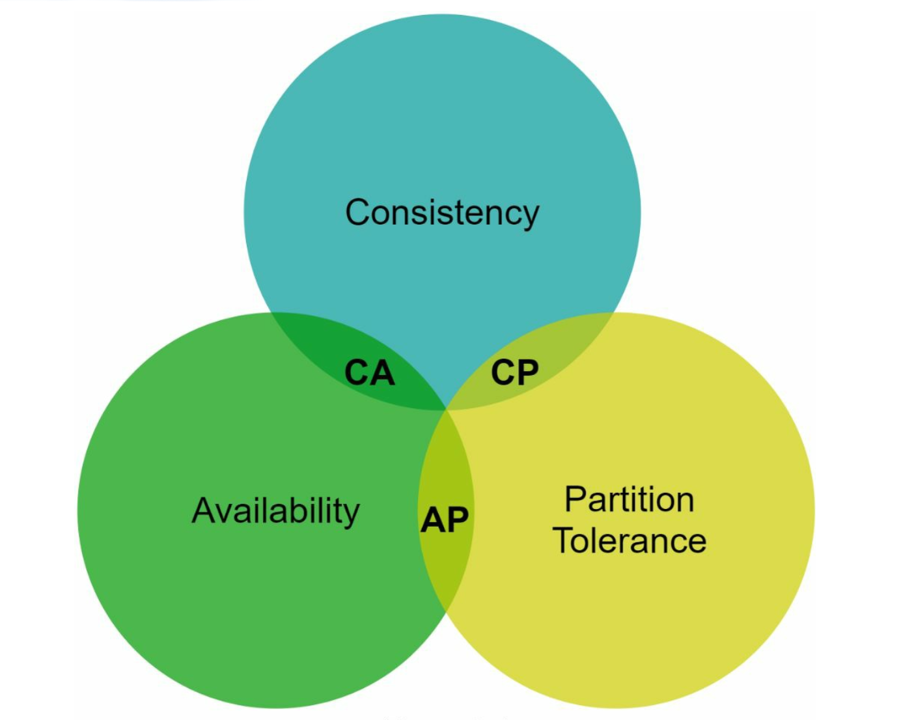

#### Phân loại các hệ thống theo CAP:
- **Hệ thống CP (CP Systems):** Đảm bảo Consistency và Partition Tolerance nhưng hy sinh Availability (ví dụ: các hệ thống lõi ngân hàng).
- **Hệ thống AP (AP Systems):** Đảm bảo Availability và Partition Tolerance nhưng hy sinh Strong Consistency (chấp nhận Eventual Consistency).
- **Hệ thống CA (CA Systems):** Đảm bảo Consistency và Availability nhưng không có khả năng chịu lỗi phân mảnh mạng.

    **Vì sự cố đứt gãy mạng là điều không thể tránh khỏi trong thực tế, bất kỳ hệ thống phân tán nào cũng bắt buộc phải hỗ trợ Partition Tolerance (P). Do đó, hệ thống CA thuần túy không tồn tại trong các ứng dụng phân tán thực tế.**

    Trong hệ thống phân tán, khi xảy ra phân mảnh mạng (Network Partition), ta buộc phải lựa chọn đánh đổi giữa Consistency (C) và Availability (A). Ví dụ, nếu node `n3` bị mất kết nối mạng với `n1` và `n2`, bất kỳ dữ liệu nào được ghi vào `n1` hoặc `n2` sẽ không thể lan truyền sang `n3`. Ngược lại, nếu dữ liệu được ghi vào `n3` mà chưa kịp đồng bộ sang `n1` và `n2`, thì `n1` và `n2` sẽ trả về dữ liệu cũ (stale data).

    

    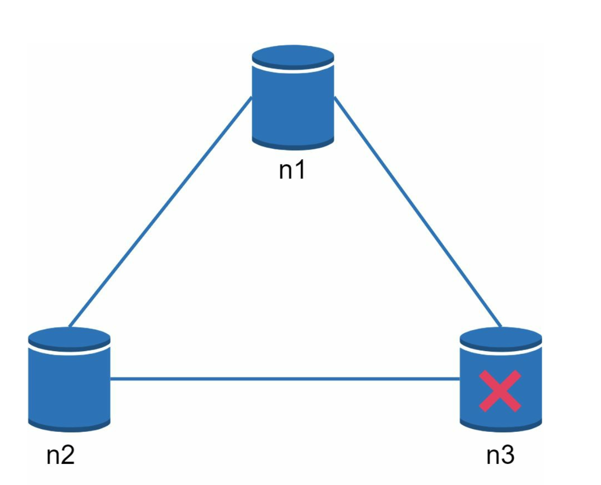
    

    
- Nếu chọn thiết kế **hệ thống CP**, ta phải khóa (block) các thao tác ghi vào `n1` và `n2` để tránh xảy ra sai lệch dữ liệu với `n3`.
- Nếu chọn thiết kế **hệ thống AP**, hệ thống vẫn tiếp tục cho phép đọc trên mọi node dù có thể trả về dữ liệu cũ. Đối với thao tác ghi, `n1` và `n2` vẫn tiếp tục nhận lệnh ghi bình thường, và dữ liệu sẽ được đồng bộ bù sang `n3` ngay khi sự cố mạng được khắc phục.

---

## Các thành phần cốt lõi của hệ thống (System Components)
### 1. Phân vùng dữ liệu (Data Partitioning)
- **Kỹ thuật sử dụng:** Áp dụng **Băm nhất quán (Consistent Hashing)** để phân phối dữ liệu đồng đều qua nhiều server.
- **Ưu điểm:**
  - Tự động mở rộng quy mô (Auto-scaling) mượt mà khi thêm hoặc gỡ bỏ server.
  - Hỗ trợ tính không đồng nhất về phần cứng (Heterogeneity) thông qua các Virtual Nodes: Server có cấu hình mạnh hơn sẽ được gán nhiều Virtual Nodes hơn tương ứng với năng lực xử lý của nó.

### 2. Sao chép dữ liệu (Data Replication)
- Sao chép dữ liệu bất đồng bộ qua `N` server để đảm bảo tính sẵn sàng cao (High Availability) và độ tin cậy.
- `N` server này được chọn bằng cách đi theo chiều kim đồng hồ từ vị trí của key trên vòng băm và lấy `N` server vật lý đầu tiên để lưu các bản sao (replicas). Để tránh trường hợp nhiều Virtual Nodes cùng thuộc một server vật lý hoặc cùng một trung tâm dữ liệu, các bản sao nên được đặt tại các node vật lý và các Data Center độc lập nhau.

    

    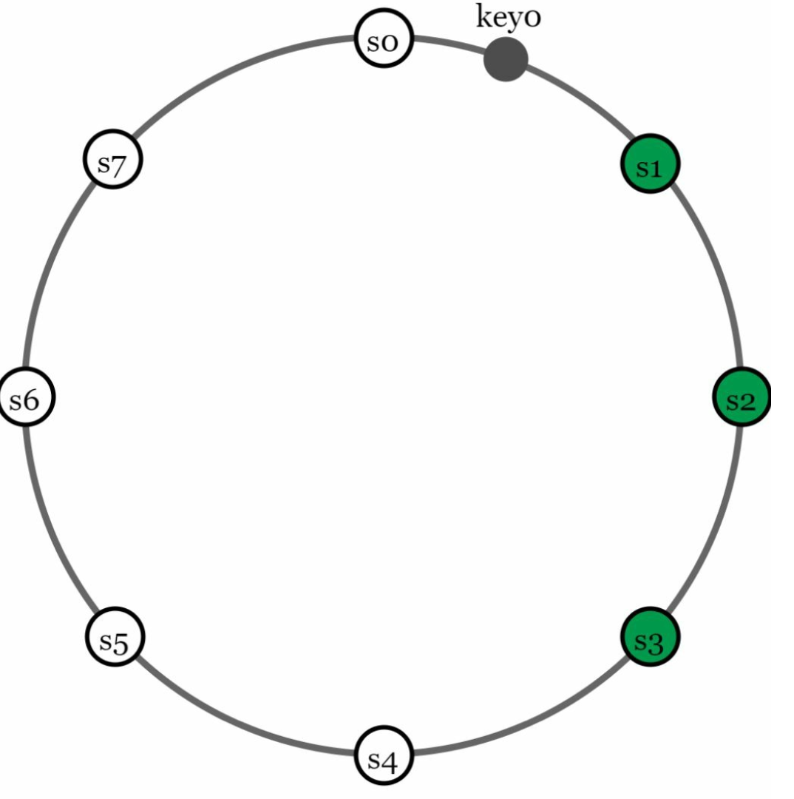
    

### 3. Tính nhất quán dữ liệu (Consistency)
Vì dữ liệu được nhân bản tại nhiều node, nó cần được đồng bộ hóa giữa các replica.
- **Đồng thuận đa số (Quorum Consensus):**
  - `N`: Tổng số lượng bản sao (replicas).
  - `W`: Số lượng xác nhận ghi (Write Quorum). Để một thao tác ghi được coi là thành công, node điều phối (coordinator) phải nhận được phản hồi xác nhận (ACK) từ ít nhất `W` replica.
  - `R`: Số lượng xác nhận đọc (Read Quorum). Để một thao tác đọc được coi là thành công, hệ thống phải chờ phản hồi từ ít nhất `R` replica.
  - **Quy tắc vàng:** `W + R > N` đảm bảo **Tính nhất quán mạnh (Strong Consistency)** vì luôn có ít nhất một node giao nhau chứa dữ liệu mới nhất giữa tập đọc và tập ghi.
  - Việc cấu hình các tham số `W`, `R` và `N` chính là bài toán đánh đổi kinh điển giữa Latency và Consistency. 

    

    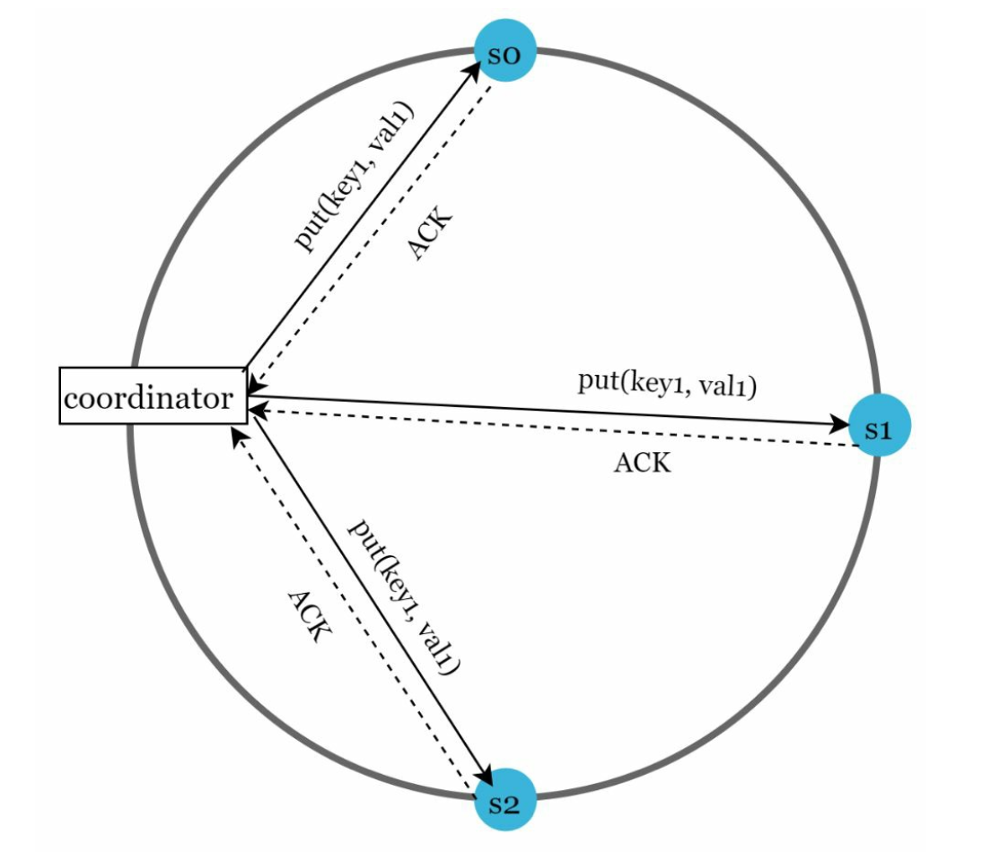
    

    
    - Nếu `R = 1` và `W = N`, hệ thống được tối ưu hóa cho tốc độ đọc cực nhanh (Fast Read).
    - Nếu `W = 1` và `R = N`, hệ thống được tối ưu hóa cho tốc độ ghi cực nhanh (Fast Write).
    - Nếu `W + R > N`, Strong Consistency được đảm bảo (cấu hình phổ biến trong thực tế là `N = 3, W = 2, R = 2`).
    - Nếu `W + R <= N`, Strong Consistency không được đảm bảo (đổi lại Latency thấp hơn).

- **Các mô hình nhất quán (Consistency Models):**
  - **Tính nhất quán mạnh (Strong Consistency):** Mọi thao tác đọc đều luôn trả về giá trị của lần ghi cập nhật mới nhất.
  - **Tính nhất quán yếu (Weak Consistency):** Các thao tác đọc ngay sau đó có thể chưa nhìn thấy được giá trị vừa mới cập nhật.
  - **Tính nhất quán cuối cùng (Eventual Consistency):** Một dạng cụ thể của Weak Consistency; nếu không có thêm cập nhật mới nào, sau một khoảng thời gian đủ dài, mọi bản cập nhật sẽ lan truyền hết và tất cả các replica sẽ hội tụ về cùng một trạng thái dữ liệu đồng nhất.

### 4. Giải quyết xung đột dữ liệu (Inconsistency Resolution)
Replication mang lại tính sẵn sàng cao nhưng lại dẫn đến nguy cơ xung đột dữ liệu giữa các replica khi có cập nhật đồng thời. Kỹ thuật đánh phiên bản (**Versioning**) và **Đồng hồ vector (Vector Clocks)** được sử dụng để giải quyết bài toán này.
- **Đánh phiên bản (Versioning):** 
    - Sử dụng **Vector Clocks** để theo dõi lịch sử phiên bản dữ liệu và phát hiện xung đột.
    - Versioning có nghĩa là coi mỗi lần sửa đổi dữ liệu như một phiên bản mới bất biến (immutable version) của dữ liệu đó.
        

        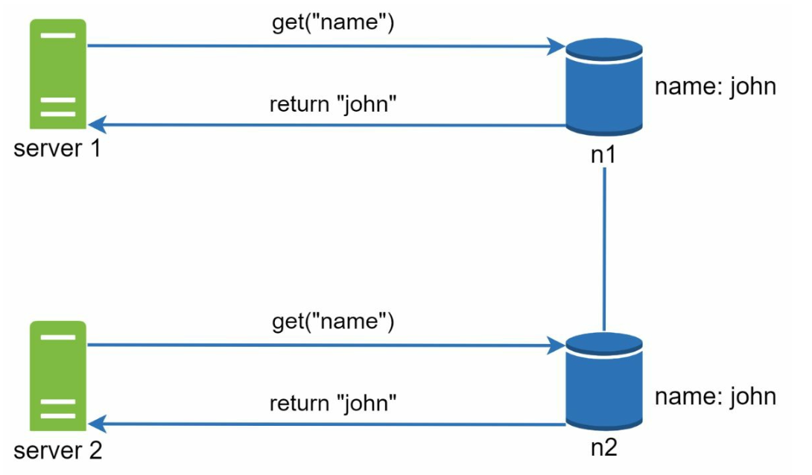
        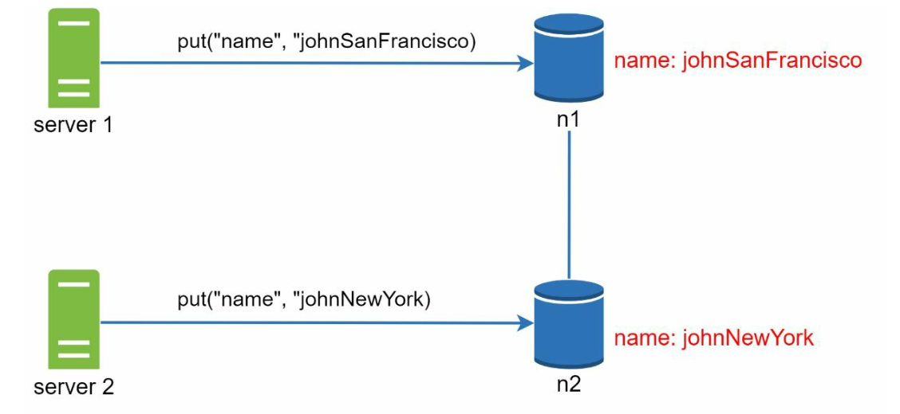
        

    
    - Giả sử Server 1 cập nhật tên người dùng, và cùng lúc đó Server 2 cũng cập nhật tên người dùng này. Hai thay đổi diễn ra đồng thời và độc lập. Lúc này hệ thống xuất hiện hai giá trị xung đột nhau, được gọi là phiên bản `v1` và `v2`.

- **Đồng hồ Vector (Vector Clock)**
    1. **Thiết lập:** Một Vector Clock là một cặp `[server, version]` được gắn kèm với một mục dữ liệu (data item). Nó được dùng để kiểm tra xem một phiên bản là bản tiền nhiệm (precedes), bản kế nhiệm (succeeds), hay đang bị xung đột (in conflict) với các phiên bản khác.
        - Giả sử một Vector Clock được biểu diễn dưới dạng `D([S1, v1], [S2, v2], …, [Sn, vn])`. Khi dữ liệu `D` được ghi vào server `Si`, hệ thống sẽ thực hiện quy tắc cập nhật tương ứng.
        - Trong đó: `D` là dữ liệu; `Si` là định danh của server; `vi` là bộ đếm phiên bản (version counter) của dữ liệu đó tại server `Si`.

    2. **Cập nhật Vector Clock:** Khi một mục dữ liệu được sửa đổi tại server `Si`:
        - Nếu `Si` đã tồn tại trong Vector Clock, hệ thống sẽ tăng bộ đếm `vi` lên 1.
        - Nếu chưa tồn tại, hệ thống sẽ thêm một cặp mới `[Si, 1]` vào trong Vector Clock.

    3. **Phát hiện xung đột (Conflict Detection):**
        - **Không có xung đột:** Phiên bản `X` là tổ tiên (ancestor) của phiên bản `Y` nếu tất cả các bộ đếm trong `X` đều nhỏ hơn hoặc bằng bộ đếm tương ứng trong `Y` (ví dụ `D([s0, 1], [s1, 1])` là tổ tiên của `D([s0, 1], [s1, 2])`).
        - **Có xung đột xảy ra:** Hai phiên bản được coi là anh em song song (siblings / xung đột) nếu tồn tại ít nhất một bộ đếm trong `Y` nhỏ hơn bộ đếm tương ứng trong `X` và ngược lại (ví dụ `D([s0, 1], [s1, 2])` và `D([s0, 2], [s1, 1])`).

    4. **Giải quyết xung đột (Conflict Resolution):** Khi phát hiện xung đột (các phiên bản song song), hệ thống sẽ trả cả hai phiên bản về cho phía client hoặc dựa vào logic nghiệp vụ của ứng dụng để hợp nhất (reconcile) dữ liệu rồi ghi lại phiên bản đã hợp nhất.

        

        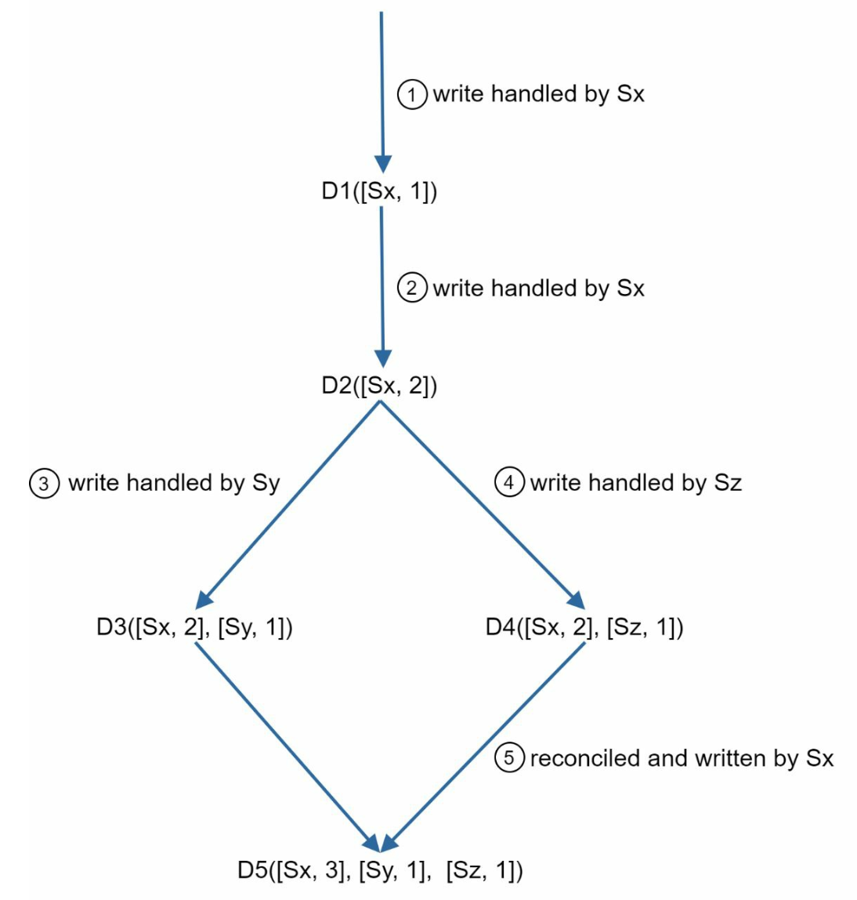
        

- **Thách thức của Vector Clock:**
  - Làm tăng độ phức tạp xử lý cho phía Client (vì client phải cài đặt logic hợp nhất dữ liệu).
  - Kích thước của danh sách `[server: version]` trong Vector Clock có thể phình to nếu có quá nhiều server cùng tham gia cập nhật, đòi hỏi cơ chế cắt tỉa (trimming) các cặp cũ vượt ngưỡng dựa trên timestamp.

### 5. Xử lý sự cố hệ thống (Handling Failures)

#### a. Phát hiện lỗi (Failure Detection)
Trong hệ thống phân tán, việc kết luận một server bị sập chỉ vì một server khác không kết nối được tới nó là chưa đủ cơ sở (do có thể chỉ là lỗi mạng cục bộ). Thông thường cần ít nhất hai nguồn thông tin độc lập cùng xác nhận để đánh dấu một node là đã ngừng hoạt động (down).
- **Giao thức lan truyền (Gossip Protocol):**
    

        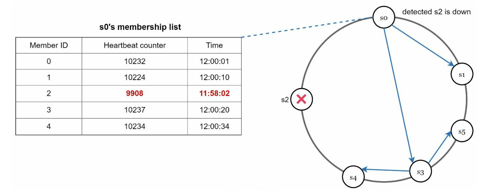
    

    - Mỗi node duy trì một bảng danh sách thành viên (Node Membership List) chứa ID của các node và bộ đếm nhịp tim (heartbeat counter) cùng thời gian cập nhật gần nhất.
    - Mỗi node định kỳ tự tăng bộ đếm heartbeat của chính mình.
    - Mỗi node định kỳ gửi danh sách heartbeat của mình cho một tập các node ngẫu nhiên khác trong cụm.
    - Khi nhận được danh sách, các node sẽ cập nhật bảng của mình theo giá trị mới nhất. Nếu heartbeat của một node không tăng lên sau một khoảng thời gian quy định trước, node đó sẽ bị coi là đã ngoại tuyến (offline).

#### b. Xử lý lỗi tạm thời (Temporary Failures)
- **Đa số linh hoạt (Sloppy Quorum):** Sử dụng các node đang khỏe mạnh kế tiếp để duy trì hoạt động đọc/ghi tạm thời.
        

        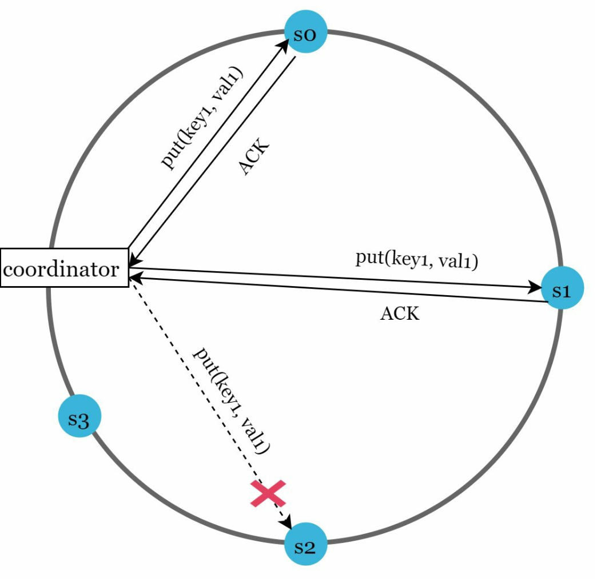
        

    - Sau khi phát hiện có node bị lỗi, hệ thống triển khai cơ chế Sloppy Quorum để nâng cao tính sẵn sàng (Availability).
    - Thay vì áp đặt cứng nhắc quy tắc Quorum trên `N` node cố định ban đầu (và báo lỗi nếu không đủ), hệ thống sẽ chọn `W` server khỏe mạnh đầu tiên cho thao tác ghi và `R` server khỏe mạnh đầu tiên cho thao tác đọc trên vòng băm. 
    - Các server đang offline sẽ tạm thời bị bỏ qua. Một server khỏe mạnh khác sẽ đứng ra nhận và lưu giữ tạm các request thay cho server bị sập.

- **Chuyển giao gợi ý (Hinted Handoff):** Giúp các server bị offline cập nhật bù lại toàn bộ thay đổi sau khi phục hồi.
    - Server xử lý thay sẽ lưu lại dữ liệu kèm theo một ghi chú ("hint") về server đích thực sự đang bị lỗi. Khi server bị sập hoạt động trở lại, dữ liệu tạm sẽ được đẩy trả về (push back) cho nó để khôi phục tính nhất quán dữ liệu.

#### c. Xử lý lỗi vĩnh viễn (Permanent Failures)
- Sử dụng **Giao thức chống phân rã (Anti-entropy protocol)** kết hợp với cấu trúc **Cây băm (Merkle Trees)** để đồng bộ hóa dữ liệu hiệu quả giữa các replica khi một node bị hỏng hẳn hoặc mất đồng bộ lâu ngày.
    Một **Merkle Tree** (hay cây băm) là cấu trúc dữ liệu cho phép phát hiện và khoanh vùng nhanh chóng các phần dữ liệu bị sai lệch giữa các replica mà không cần truyền toàn bộ dữ liệu qua mạng. 

- Cơ chế hoạt động của Merkle Tree:
    1. **Cấu trúc:**
        - ** Các nút lá (Leaf Nodes):** Lưu giá trị băm (hash) của từng khóa hoặc từng khối dữ liệu riêng lẻ.
        - **Các nút cha (Non-Leaf Nodes):** Lưu giá trị băm tổng hợp từ các nút con của nó.
        - **Mã băm gốc (Root Hash):** Đại diện cho trạng thái toàn vẹn của toàn bộ dữ liệu nằm trong cây.

    2. **Quy trình xây dựng một Merkle Tree:**
        - **Bước 1:** Chia không gian khóa (key space) thành các nhóm nhỏ (buckets).
            
            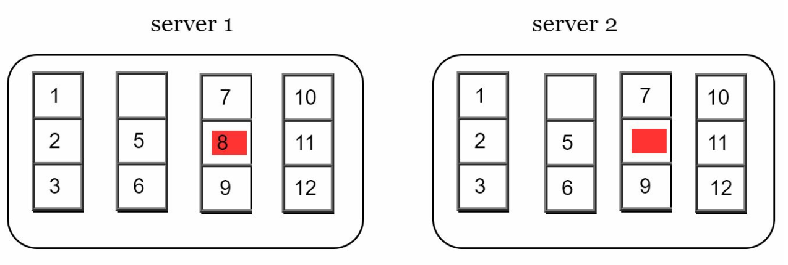

        - **Bước 2:** Băm từng key nằm trong mỗi bucket bằng một hàm băm đồng nhất.

            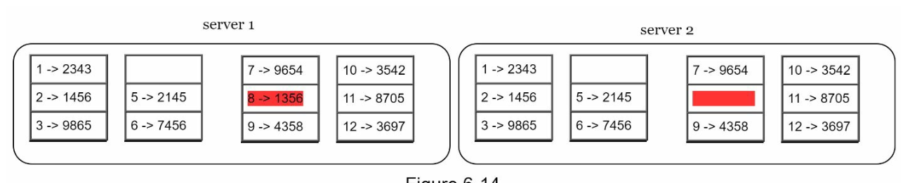

        - **Bước 3:** Gom nhóm và tạo ra một mã băm duy nhất đại diện cho từng bucket.
        
            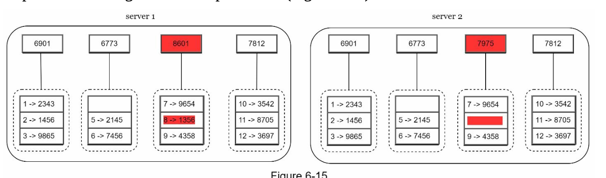

        - **Bước 4:** Kết hợp mã băm của các bucket theo từng cặp từ dưới lên để tính toán các nút cha ở tầng cao hơn, cho đến khi thu được mã băm gốc (Root Hash) trên cùng.

            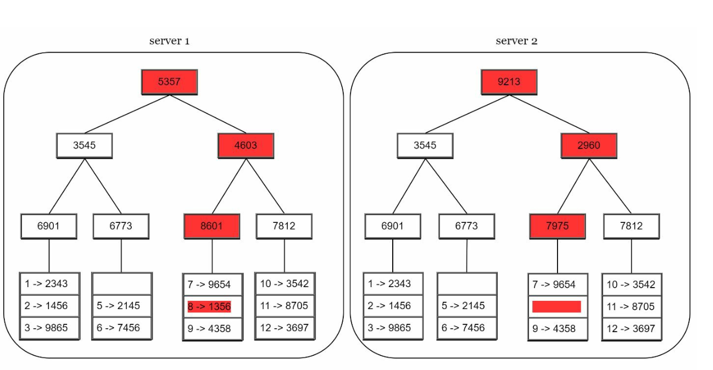

    3. **Quy trình đồng bộ hóa (Synchronization):**
        - Để đối chiếu và đồng bộ hai replica:
            - Đầu tiên, so sánh hai mã **Root Hash** của chúng.
            - Nếu hai Root Hash trùng khớp, dữ liệu trên cả hai replica hoàn toàn giống nhau và không cần làm gì thêm.
            - Nếu hai Root Hash khác nhau, hệ thống sẽ đệ quy so sánh tiếp mã băm của các nhánh con bên trái/phải để đi xuống và chỉ ra chính xác những bucket nào đang bị lệch dữ liệu.
        - Chỉ những bucket bị lệch mới cần được truyền qua mạng để đồng bộ lại.

- Ưu điểm của Merkle Tree:
    - **Hiệu quả cao (Efficiency):** Chỉ đồng bộ đúng phần dữ liệu bị lệch thay vì quét toàn bộ database, giảm thiểu tối đa băng thông mạng.
    - **Khả năng mở rộng (Scalability):** Lượng dữ liệu cần trao đổi để kiểm tra đồng bộ tỉ lệ thuận với phần dữ liệu chênh lệch chứ không phụ thuộc vào tổng dung lượng khổng lồ của database.
    - **Độ tin cậy (Reliability):** Đảm bảo tính nhất quán dữ liệu lâu dài giữa các bản sao.

### 6. Xử lý sự cố sập Trung tâm dữ liệu (Handling Data Center Outages)
- Sao chép dữ liệu xuyên qua nhiều Data Center (Multi-Data Center Replication) ở các khu vực địa lý khác nhau. Nếu một Data Center bị mất điện hoặc đứt cáp mạng hoàn toàn, người dùng vẫn có thể truy cập dữ liệu thông qua các Data Center còn lại.

---

## Luồng Ghi và Luồng Đọc (Write and Read Paths)
### 1. Luồng Ghi (Write Path - Dựa trên kiến trúc của Apache Cassandra)

    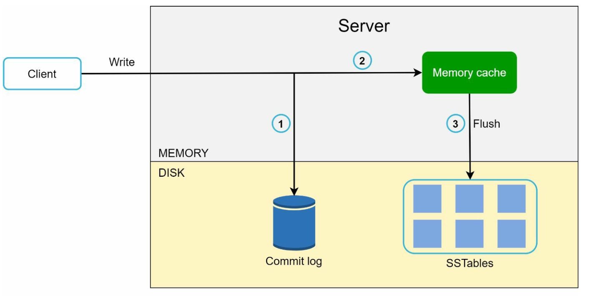

1. Ghi nối tiếp (append-only) thao tác cập nhật vào file **Commit Log** (Write-Ahead Log) trên ổ cứng để đảm bảo tính bền vững (durability) khi mất điện.
2. Lưu dữ liệu vào bộ nhớ đệm trên RAM gọi là **Memory Cache** (`Memtable`).
3. Khi `Memtable` đầy hoặc chạm ngưỡng quy định, dữ liệu sẽ được xả (flush) tuần tự xuống ổ cứng dưới dạng cấu trúc **SSTable** (Sorted String Table — bảng chuỗi đã được sắp xếp).

   

### 2. Luồng Đọc (Read Path)

    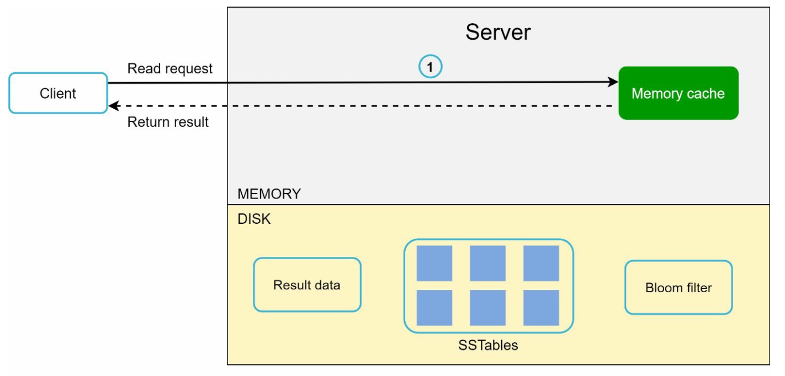
    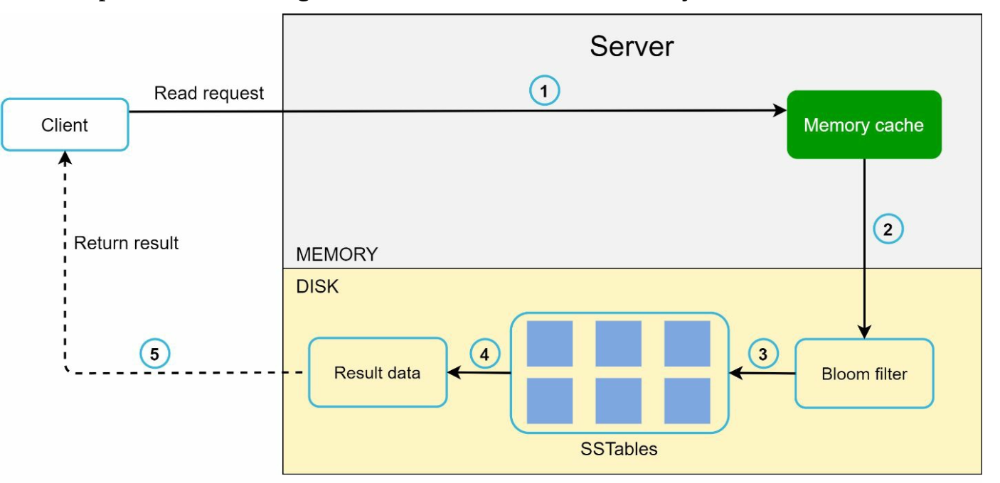

1. Kiểm tra xem dữ liệu có đang nằm trong **Memory Cache** (`Memtable`) hay không. Nếu có, trả về ngay lập tức.
2. Nếu không có trong RAM, hệ thống sử dụng bộ lọc xác suất **Bloom Filter** để kiểm tra nhanh xem key cần tìm có thể đang nằm trong file **SSTable** nào trên ổ cứng (giúp tránh việc phải đọc quét toàn bộ các file SSTable).
3. Đọc từ các SSTable tương ứng để lấy dữ liệu mới nhất và trả kết quả về cho client.

---

## Kiến trúc hoàn chỉnh (Final Architecture)

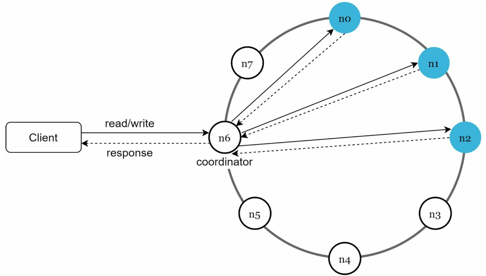

- Client giao tiếp với hệ thống Key-Value Store thông qua hai API đơn giản: `get(key)` và `put(key, value)`.
- Một **Coordinator** là node đóng vai trò như một proxy trung gian điều phối giữa phía Client và các node lưu trữ trong Key-Value Store.
- Các node được phân bổ trên một vòng băm sử dụng kỹ thuật **Consistent Hashing**.
- Hệ thống được thiết kế phi tập trung hoàn toàn (decentralized / peer-to-peer), giúp việc thêm hoặc bớt node diễn ra tự động và mượt mà.
- Dữ liệu được nhân bản (replicated) trên nhiều node khác nhau.
- Không tồn tại **Điểm lỗi đơn (Single Point of Failure - SPOF)** vì mọi node trong cụm đều bình đẳng và đảm nhiệm tập chức năng giống hệt nhau.
