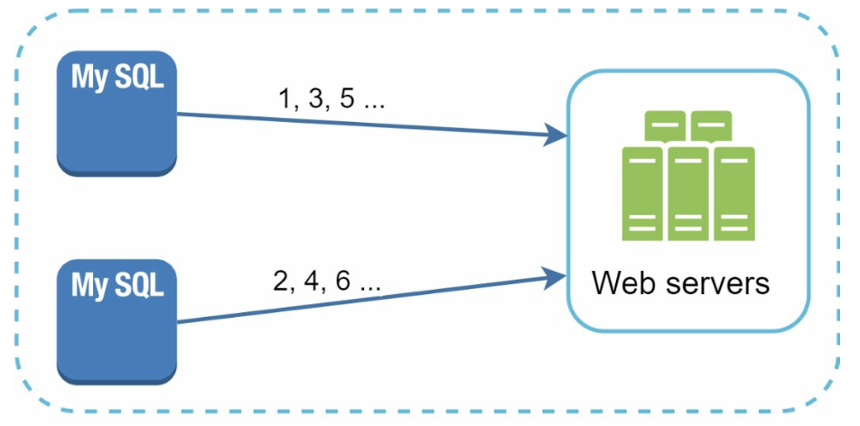
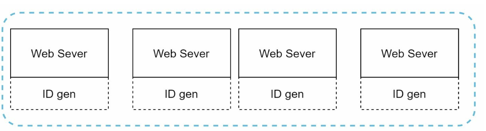
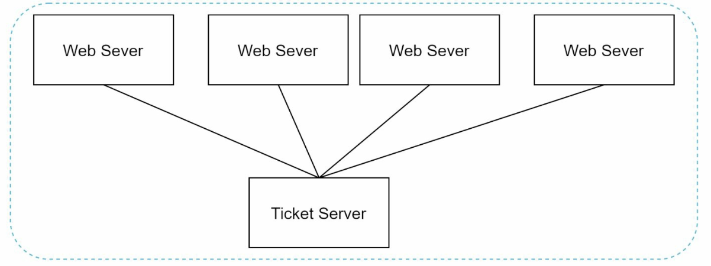
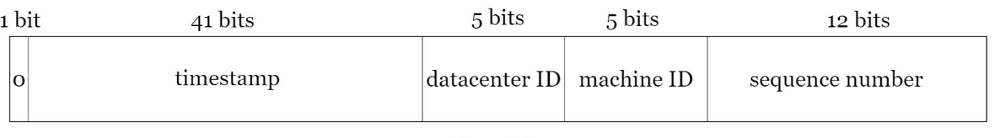
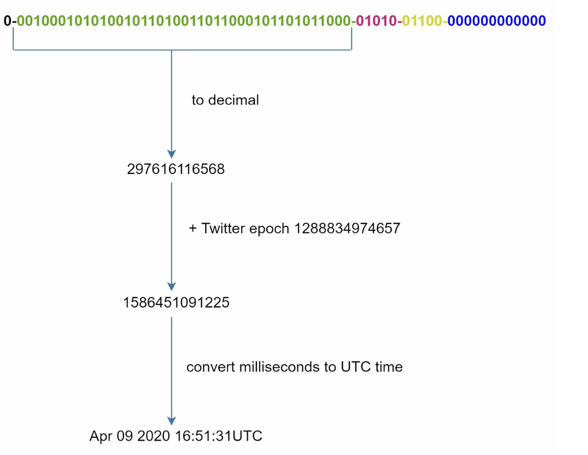

# Chương 7: Thiết kế bộ sinh ID duy nhất trong hệ thống phân tán (Design a Unique ID Generator in Distributed Systems)

## Giới thiệu
Chương này giải quyết bài toán thiết kế một **bộ sinh ID duy nhất (Unique ID Generator)** cho các hệ thống phân tán. Cơ chế `auto_increment` truyền thống của cơ sở dữ liệu quan hệ không còn phù hợp trong môi trường phân tán do độ trễ đồng bộ hóa và giới hạn khả năng mở rộng. Trọng tâm của thiết kế này là tạo ra các ID dạng số 64-bit, duy nhất và có thể sắp xếp theo thời gian, đáp ứng các yêu cầu sau:
- Các ID phải là **duy nhất (unique)** và **có thể sắp xếp theo thứ tự thời gian (sortable by date)**.
- ID chỉ chứa các chữ số và vừa vặn trong kích thước **64-bit**.
- Hệ thống phải có khả năng sinh **hơn 10.000 ID mỗi giây**.

---

## Bước 1: Thấu hiểu bài toán (Understanding the Problem)
### Các yêu cầu cơ bản
- ID phải là duy nhất, chỉ bao gồm chữ số (numerical) và có độ dài tối đa 64-bit.
- Giá trị ID tăng dần theo thời gian nhưng không nhất thiết phải tăng tuần tự từng đơn vị (`+1`).
- ID phải hỗ trợ sắp xếp theo ngày/giờ khởi tạo.
- Hệ thống phải đáp ứng Throughput cao (trên 10.000 ID/giây) với Latency thấp.

---

## Bước 2: Các phương án thiết kế tổng quan (High-Level Design Options)
### 1. Multi-Master Replication
- **Cách tiếp cận:** Sử dụng tính năng `auto_increment` sẵn có của database nhưng thay vì tăng `+1`, mỗi database server sẽ tăng theo bước nhảy bằng `k` (với `k` là tổng số lượng database server đang hoạt động).

    

    
    

- **Nhược điểm:**
  - Rất khó mở rộng quy mô xuyên qua nhiều Data Center.
  - Giá trị ID sinh ra không đảm bảo tăng dần tuyệt đối theo thời gian thực giữa các server khác nhau.
  - Gặp vấn đề lớn về cấu hình bước nhảy mỗi khi cần thêm mới hoặc gỡ bỏ bớt server khỏi cụm.

### 2. UUID (Universally Unique Identifier)
- **Cách tiếp cận:** 
    - Sinh các chuỗi định danh duy nhất có độ dài 128-bit một cách hoàn toàn độc lập trên từng Web Server bằng chuẩn UUID.
    - Các UUID có thể được tạo ra tức thì mà không cần bất kỳ sự phối hợp hay đồng bộ nào giữa các server.

        

        
        

- **Ưu điểm:**
  - Không cần đồng bộ hóa giữa các server, loại bỏ hoàn toàn nút cổ chai mạng.
  - Mở rộng quy mô cực kỳ dễ dàng theo số lượng Web Server.
- **Nhược điểm:**
  - Kích thước 128-bit vượt quá yêu cầu giới hạn 64-bit của đề bài.
  - Không thể sắp xếp theo thứ tự thời gian (đối với chuẩn UUIDv4 phổ biến) và có chứa cả các ký tự chữ cái (non-numeric).

### 3. Ticket Server (Máy chủ cấp vé tập trung)
- **Cách tiếp cận:** Sử dụng một Ticket Server tập trung (ví dụ: một database server có bảng chứa khóa `auto_increment` do Flickr phát triển) để cấp phát các ID số tăng dần cho toàn bộ các Web Server.

    

    
    

- **Ưu điểm:**
  - Dễ triển khai, hoạt động tốt cho các hệ thống quy mô vừa và nhỏ.
  - Sinh ra các ID hoàn toàn là chữ số và có thứ tự.
- **Nhược điểm:**
  - Trở thành **Điểm lỗi đơn (Single Point of Failure - SPOF)**. Nếu Ticket Server sập, toàn bộ các hệ thống phụ thuộc đều bị tê liệt.
  - Nếu dùng nhiều Ticket Server để dự phòng thì lại quay về bài toán khó khăn trong việc đồng bộ hóa như phương án Multi-Master.

### 4. Phương pháp Twitter Snowflake (Twitter Snowflake Approach)
- **Cách tiếp cận:** 

    

      
    

    

      
    

    - Thay vì sinh một số ngẫu nhiên, ta chia nhỏ cấu trúc của một ID 64-bit thành 5 phân đoạn (sections) mang ý nghĩa riêng biệt để đảm bảo tính duy nhất và khả năng mở rộng:
    - **Sign Bit (1 bit):** Luôn có giá trị là `0`, dùng để phân biệt số âm và số dương (giúp ID luôn là số nguyên dương).
    - **Timestamp (41 bits):** Số mili-giây (milliseconds) tính từ một mốc thời gian gốc tự định nghĩa (custom epoch — ví dụ epoch mặc định của Twitter là `1288834974657`, tương ứng với ngày 04/11/2010, 01:42:54 UTC). Với 41 bits, hệ thống có thể hoạt động trong khoảng ~69 năm và đảm bảo các ID sắp xếp chuẩn theo thời gian.
    - **Datacenter ID (5 bits):** Định danh cho tối đa `2^5 = 32` trung tâm dữ liệu (Data Centers).
    - **Machine ID (5 bits):** Định danh cho tối đa `2^5 = 32` máy chủ (machines/workers) bên trong mỗi Data Center.
    - **Sequence Number (12 bits):** Bộ đếm tuần tự cho các ID được sinh ra trên cùng một máy chủ trong cùng một mili-giây, hỗ trợ tối đa `2^12 = 4096` ID mỗi mili-giây trên mỗi máy. Giá trị này sẽ tự động reset về `0` khi bước sang mili-giây tiếp theo.

- **Ưu điểm của Snowflake:**
    - **Khả năng mở rộng vượt trội (Scalability):** Dễ dàng xử lý hàng chục nghìn đến hàng triệu ID mỗi giây trên nhiều server độc lập.
    - **Sắp xếp theo thời gian (Time-Order):** Do phần Timestamp nằm ở các bit trọng số cao nhất (High-order bits), các ID sinh ra tự nhiên đã có thứ tự tăng dần theo thời gian.
    - **Phi tập trung (Decentralization):** Các node tự sinh ID mà không cần gọi qua lại, loại bỏ hoàn toàn SPOF.

## Bước 4: Các vấn đề mở rộng cần lưu ý (Additional Considerations)
### 1. Đồng bộ hóa đồng hồ hệ thống (Clock Synchronization)
- **Thách thức:** Thuật toán Snowflake giả định rằng tất cả các server sinh ID đều có đồng hồ thời gian thực chạy đồng bộ với nhau. Hiện tượng lệch giờ (clock drift) trên các máy chủ vật lý hoặc đa nhân có thể làm sai lệch thứ tự thời gian của ID.
- **Giải pháp:** Sử dụng **Giao thức thời gian mạng (Network Time Protocol - NTP)** để đồng bộ hóa đồng hồ giữa các server và xử lý trường hợp đồng hồ hệ thống bị quay ngược.

### 2. Tinh chỉnh độ dài các phân đoạn bit (Section Length Tuning)
- Tùy thuộc vào bài toán thực tế, ta có thể điều chỉnh lại số lượng bit của từng phần. Ví dụ: nếu hệ thống ít khi có xung đột trong cùng 1ms (Low Concurrency) nhưng cần lưu trữ lâu dài hơn 69 năm, ta có thể giảm số bit của `Sequence Number` và tăng thêm bit cho phần `Timestamp`.

### 3. Tính sẵn sàng cao (High Availability)
- Bộ sinh ID là một thành phần tối quan trọng (mission-critical); vì vậy hệ thống này bắt buộc phải có khả năng chịu lỗi cao thông qua việc triển khai dư thừa nhiều worker node và cơ chế tự động chuyển đổi dự phòng (failover).
