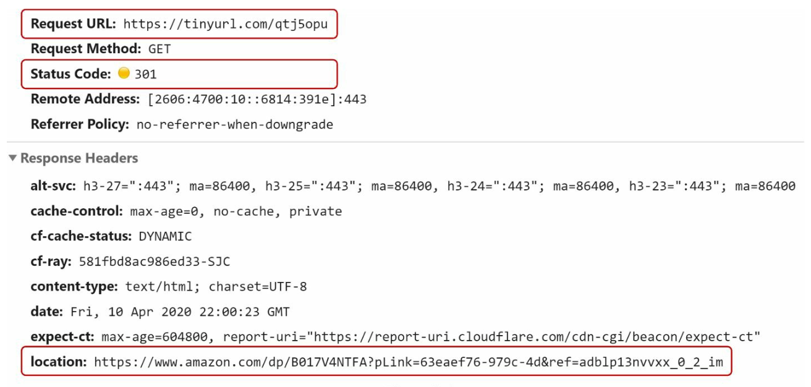
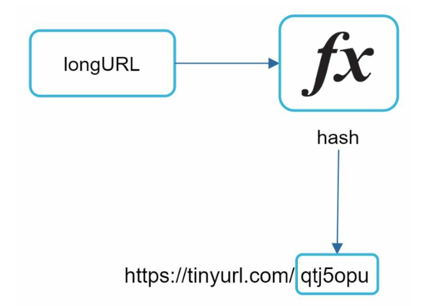
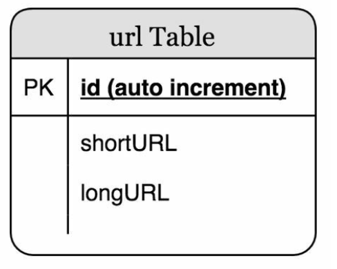
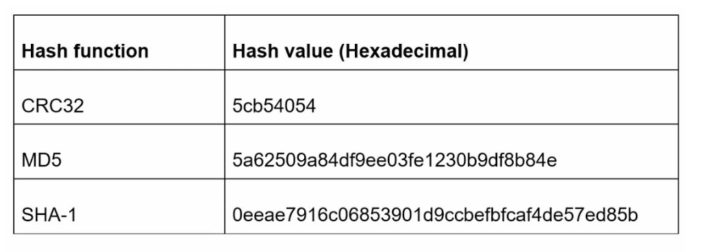
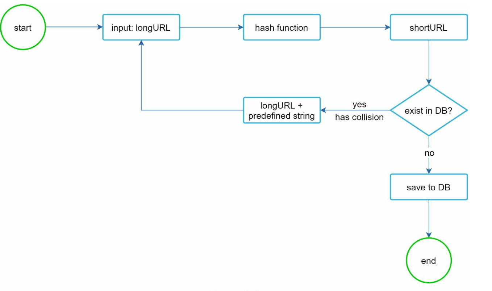
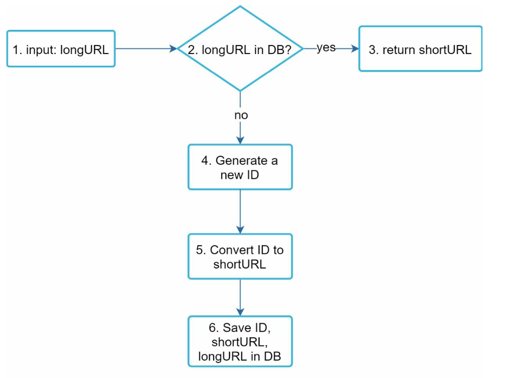
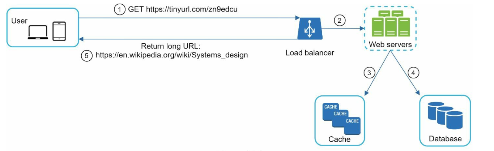

# Chương 8: Thiết kế hệ thống rút gọn URL (Design a URL Shortener)

## Giới thiệu
Chương này thảo luận về cách thiết kế một dịch vụ rút gọn liên kết (URL Shortener) tương tự như TinyURL hay bit.ly. Mục tiêu chính của hệ thống bao gồm **rút gọn URL dài thành chuỗi ngắn**, **chuyển hướng (redirecting)** người dùng về URL gốc và đảm bảo **khả năng mở rộng cao (High Scalability)** để chịu được lưu lượng truy cập lớn.

### Yêu cầu hệ thống
- Các URL rút gọn phải là **duy nhất (unique)** và **ngắn gọn nhất có thể**.
- Xử lý **100 triệu yêu cầu tạo URL rút gọn mỗi ngày** và duy trì lưu trữ trong vòng 10 năm.
- Hỗ trợ **các thao tác đọc hiệu quả** với tỷ lệ Đọc:Ghi (Read-to-Write ratio) là `10:1`.
- Lưu trữ tổng cộng khoảng 365 tỷ bản ghi, đòi hỏi dung lượng lưu trữ xấp xỉ **365 TB** trong 10 năm.

---

## Bước 1: Thiết kế tổng quan (High-Level Design)

### Các API Endpoints
1. **Tạo URL rút gọn (URL Shortening):**  
   - Endpoint: `POST api/v1/data/shorten`  
   - Tham số (Request Body): `{longUrl: longURLString}`  
   - Trả về: `shortURL`

2. **Chuyển hướng URL (URL Redirecting):**  
   - Endpoint: `GET api/v1/shortUrl`  
   - Trả về: Chuyển hướng HTTP sang `longURL` đích.

    

    
    

### Cơ chế chuyển hướng URL (URL Redirection)
- **301 Redirect (Moved Permanently):** Mã phản hồi `301` báo cho trình duyệt biết rằng URL được yêu cầu đã chuyển hướng "vĩnh viễn" sang URL gốc (`longURL`). Trình duyệt sẽ lưu cache kết quả này, và các lần truy cập tiếp theo vào cùng `shortURL` đó sẽ nhảy thẳng tới `longURL` mà không gửi request qua server rút gọn URL nữa (giúp giảm tải cho server).
- **302 Redirect (Found / Moved Temporarily):** Chuyển hướng "tạm thời"; trình duyệt sẽ luôn gửi request tới dịch vụ rút gọn URL trước khi chuyển hướng. Rất hữu ích khi hệ thống cần thu thập dữ liệu phân tích (analytics) như đếm số lượt click, theo dõi nguồn truy cập của người dùng.

### Cơ chế rút gọn URL (URL Shortening)

    

- Sử dụng một **hàm băm (Hash Function)** hoặc bộ chuyển đổi cơ số để tạo ra `shortURL`, ánh xạ các `longURL` sang các chuỗi định danh ngắn gọn duy nhất.
- Hàm ánh xạ phải thỏa mãn các yêu cầu sau:
    - Mỗi `longURL` phải được băm thành một giá trị `hashValue` xác định.
    - Mỗi `hashValue` phải có thể tra cứu ngược lại chính xác `longURL` ban đầu.
    

---

## Bước 2: Đi sâu vào thiết kế chi tiết (Deep Dive into Design)

### Mô hình dữ liệu (Data Model)
Lưu trữ ánh xạ `<shortURL, longURL>` trong cơ sở dữ liệu quan hệ (Relational Database) để tránh tràn bộ nhớ RAM. Cấu trúc bảng (Table Schema) cơ bản bao gồm:
- `id` (Primary Key - khóa chính),
- `shortURL`,
- `longURL`.

    

### Thiết kế hàm băm / Chuyển đổi (Hash Function)
#### 1. Chuyển đổi cơ số 62 (Base 62 Conversion):
- Mã hóa các số nguyên ID sang chuỗi ký tự sử dụng bộ 62 ký tự `[0-9, a-z, A-Z]` (10 chữ số + 26 chữ thường + 26 chữ hoa = **62 ký tự**).
- Chuyển đổi hệ cơ số (Base conversion) là phương pháp phổ biến và hiệu quả nhất cho các hệ thống rút gọn URL. 
- Một ID số duy nhất (sinh bởi bộ Unique ID Generator) sẽ được gán cho mỗi bản ghi và chuyển đổi sang hệ cơ số 62 để tạo thành chuỗi `shortURL`.
- Với độ dài chuỗi là 7 ký tự (`62^7`), hệ thống hỗ trợ tới **3.5 nghìn tỷ (trillion) URL duy nhất**, dư sức đáp ứng yêu cầu 365 tỷ URL trong 10 năm.

**Ví dụ:**  
Chuyển đổi ID `2009215674938` sang hệ Base 62:
- `2009215674938` → `zn9edcu` (tạo thành URL `https://tinyurl.com/zn9edcu`).

#### 2. Băm kết hợp xử lý đụng độ (Hash + Collision Resolution):
- Sử dụng các hàm băm mật mã học hoặc kiểm tra dư thừa phổ biến như CRC32, MD5 hoặc SHA-1.

    

- Vì chuỗi kết quả của MD5 hay SHA-1 quá dài (hơn 7 ký tự), một cách tiếp cận là chỉ cắt lấy **7 ký tự đầu tiên** của chuỗi hash; tuy nhiên, cách này chắc chắn sẽ dẫn đến hiện tượng **đụng độ băm (Hash Collisions)**.
- Để giải quyết đụng độ, hệ thống có thể nối thêm một chuỗi cố định định trước vào `longURL` rồi băm lại đệ quy cho đến khi tìm được chuỗi chưa tồn tại trong DB, nhưng việc truy vấn DB liên tục rất tốn kém.
- Có thể tối ưu bước kiểm tra đụng độ bằng cách sử dụng bộ lọc **Bloom Filter** trên bộ nhớ để tra cứu nhanh xem một `shortURL` đã từng tồn tại hay chưa trước khi chạm tới database.

    

    
    

### So sánh hai phương pháp

- **Băm kết hợp xử lý đụng độ (Hash + Collision Resolution):**
    - Độ dài của `shortURL` luôn cố định (ví dụ: đúng 7 ký tự).
    - Không cần phải xây dựng bộ sinh ID duy nhất (Unique ID Generator).
    - Có thể xảy ra đụng độ (collision) và bắt buộc phải có logic xử lý đụng độ.
    - Không thể đoán trước được `shortURL` kế tiếp vì kết quả không phụ thuộc vào ID tăng dần.

- **Chuyển đổi cơ số 62 (Base 62 Conversion):**
    - Độ dài của `shortURL` không cố định mà tăng dần theo độ lớn của giá trị ID.
    - Bắt buộc phải có một bộ sinh ID duy nhất trong môi trường phân tán (Distributed Unique ID Generator).
    - Hoàn toàn không thể xảy ra đụng độ (Collision is impossible) vì mỗi ID là duy nhất.
    - Nếu ID chỉ tăng tuần tự thêm `1` đơn vị, kẻ xấu rất dễ đoán được `shortURL` tiếp theo (tiềm ẩn rủi ro bảo mật, có thể khắc phục bằng Snowflake hoặc xáo trộn bit).

---

### Luồng tạo URL rút gọn (URL Shortening Flow)

    

1. Người dùng nhập một `longURL` vào hệ thống. Hệ thống kiểm tra xem `longURL` này đã tồn tại trong database hay chưa.
2. Nếu đã tồn tại, lấy lại `shortURL` đã tạo trước đó và trả về cho client.
3. Nếu chưa tồn tại (`longURL` mới):
   - Sinh một ID 64-bit mới thông qua **bộ sinh ID phân tán (Distributed ID Generator)**.
   - Chuyển đổi ID vừa tạo sang chuỗi `shortURL` bằng thuật toán **Base 62**.
   - Lưu bản ghi `<id, shortURL, longURL>` mới vào trong database và trả kết quả về cho người dùng.

---

### Luồng chuyển hướng URL (URL Redirecting Flow)

    

1. Người dùng nhấp chuột vào một đường dẫn `shortURL`.
2. Load Balancer điều hướng request tới một Web Server để tra cứu ánh xạ `<shortURL, longURL>`:
   - Kiểm tra trong **Cache** (như Redis/Memcached) trước để tối ưu tốc độ đọc.
   - Nếu không có trong Cache (Cache Miss), truy vấn vào Database để lấy `longURL` và cập nhật lại vào Cache.
3. Trả về mã HTTP Redirect (`301` hoặc `302`) kèm header `Location: longURL` để chuyển hướng người dùng.

---

## Các vấn đề bổ sung cần lưu ý (Additional Considerations)
### Rate Limiter (Giới hạn lưu lượng)
- Ngăn chặn hành vi spam hoặc tấn công làm cạn kiệt kho URL bằng cách giới hạn số lượng request tạo link theo địa chỉ IP hoặc theo người dùng trong một khoảng thời gian.

### Khả năng mở rộng (Scalability)
1. **Tầng Web (Web Tier):** Thiết kế hoàn toàn Stateless, giúp dễ dàng scale ngang bằng cách thêm hoặc bớt các Web Server.
2. **Tầng Database (Database Tier):** Áp dụng Database Replication (phục vụ tải đọc cao) kết hợp với Sharding để phân tán hàng trăm TB dữ liệu.

### Phân tích dữ liệu (Analytics)
- Tích hợp thu thập dữ liệu sự kiện click (như tỷ lệ click, vị trí địa lý, loại thiết bị, thời gian truy cập) để cung cấp báo cáo thống kê giá trị cho người dùng.

### Tính sẵn sàng cao và Độ tin cậy (High Availability and Reliability)
- Đảm bảo dịch vụ luôn hoạt động ổn định thông qua việc nhân bản dữ liệu và triển khai dự phòng trên nhiều khu vực (Multi-AZ / Multi-Region).
