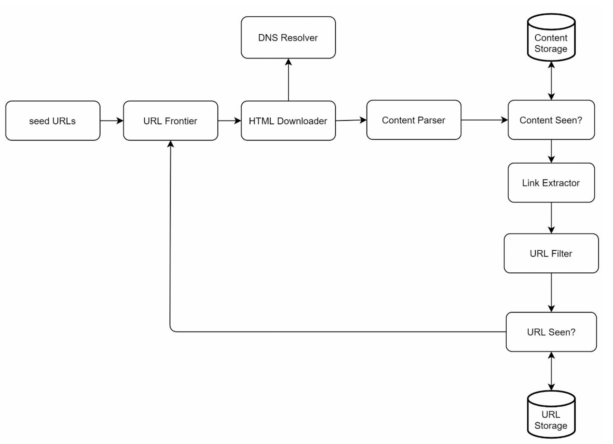
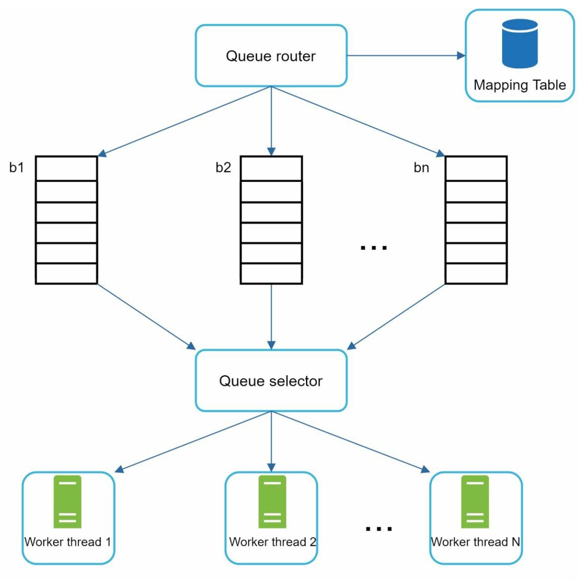
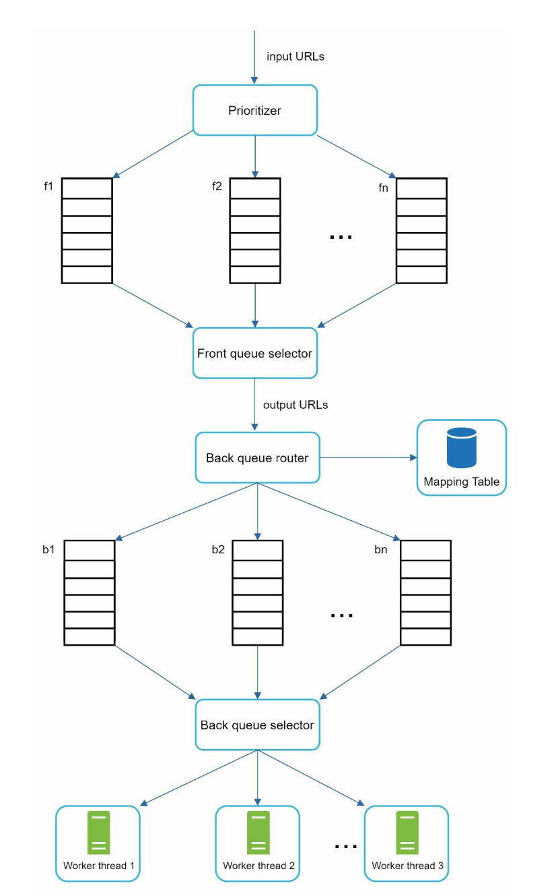
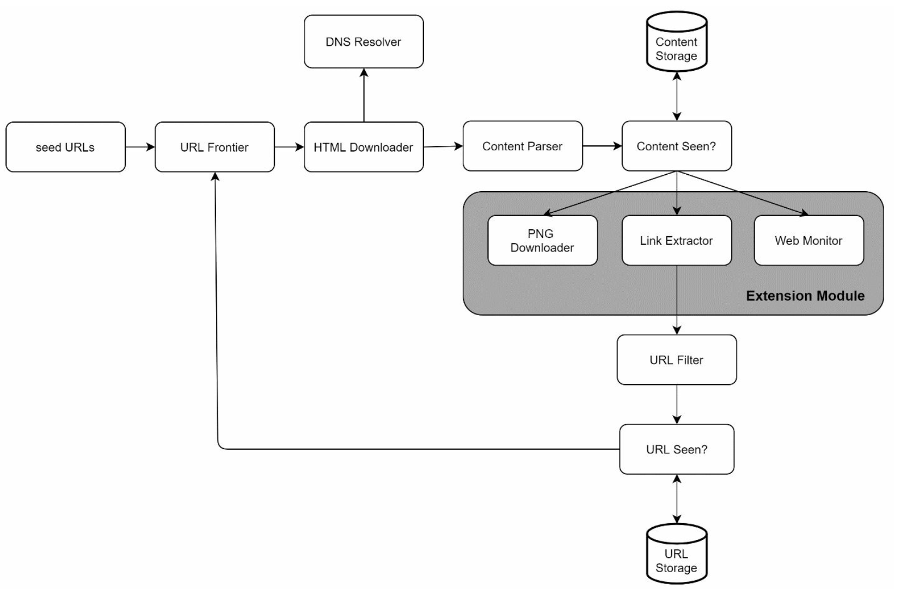

# Chương 9: Thiết kế Web Crawler (Design a Web Crawler)

## Giới thiệu
Một **Web Crawler** (còn được gọi là spider hoặc web robot) là hệ thống dùng để tự động khám phá và thu thập nội dung từ các trang web trên Internet như văn bản HTML, hình ảnh, video. Chương này tập trung vào việc thiết kế một Web Crawler có khả năng mở rộng quy mô lớn phục vụ cho bài toán **lập chỉ mục công cụ tìm kiếm (Search Engine Indexing)**.

### Các ứng dụng thực tế của Web Crawler
1. **Lập chỉ mục công cụ tìm kiếm (Search Engine Indexing):** Thu thập các trang web trên toàn cầu để xây dựng bộ chỉ mục tìm kiếm (ví dụ: Googlebot, Bingbot).
2. **Lưu trữ Web (Web Archiving):** Lưu giữ lịch sử dữ liệu web để tra cứu trong tương lai (ví dụ: Internet Archive Wayback Machine, Thư viện Quốc hội Mỹ).
3. **Khai phá dữ liệu Web (Web Mining):** Trích xuất tri thức và dữ liệu có giá trị từ Internet (ví dụ: các công ty tài chính thu thập báo cáo cổ đông để phân tích thị trường).
4. **Giám sát bản quyền trên Web (Web Monitoring):** Phát hiện các hành vi sao chép lậu, vi phạm bản quyền hoặc thương hiệu trên môi trường mạng.

### Các thách thức trong thiết kế
Một hệ thống Web Crawler tốt phải giải quyết triệt để 4 thách thức lớn:
- **Khả năng mở rộng (Scalability):** Xử lý hàng tỷ trang web bằng cơ chế thu thập song song (parallelization).
- **Tính bền bỉ (Robustness):** Xử lý tốt các mã HTML lỗi, server đích phản hồi chậm/sập, các liên kết độc hại và bẫy lặp vô tận (spider traps).
- **Tính lịch sự (Politeness):** Tránh gửi quá nhiều request dồn dập làm quá tải hoặc đánh sập server của các trang web đích.
- **Khả năng mở rộng tính năng (Extensibility):** Dễ dàng tích hợp thêm module hỗ trợ các định dạng nội dung mới mà không cần sửa đổi kiến trúc cốt lõi.

---

## Bước 1: Thấu hiểu bài toán (Understanding the Problem)

### Các yêu cầu hệ thống
1. Thu thập dữ liệu (crawl) **1 tỷ trang web mỗi tháng** (trung bình ~400 trang/giây, lúc cao điểm Peak QPS ~800 trang/giây).
2. Chỉ tập trung thu thập **nội dung HTML (`HTML-only`)**.
3. Theo dõi được cả các trang web mới xuất hiện lẫn các trang web được cập nhật nội dung.
4. Bỏ qua các nội dung bị trùng lặp (duplicate content).
5. Lưu trữ dữ liệu đã thu thập trong vòng **5 năm**, đòi hỏi tổng dung lượng lưu trữ khoảng **~30 PB**.

---

## Bước 2: Thiết kế tổng quan (High-Level Design)

### Các thành phần chính (Components)

1. **Seed URLs (Các URL hạt giống):** Điểm xuất phát ban đầu cho quá trình crawl.
    - Cần được lựa chọn có chiến lược để giúp crawler có thể lan tỏa và duyệt qua nhiều liên kết nhất có thể.
    - Có thể chọn dựa trên vị trí địa lý/quốc gia của các trang web phổ biến hoặc phân chia theo chủ đề.
    - Chiến lược phổ biến: Chia nhỏ không gian URL theo chủ đề (ví dụ: thể thao, y tế, công nghệ, mua sắm).

2. **URL Frontier:** Thành phần lưu trữ và quản lý danh sách các URL đang chờ được tải về.
   - Về cơ bản hoạt động như một **hàng đợi FIFO (First-In-First-Out Queue)** có phân quyền ưu tiên.

3. **HTML Downloader:** Tải nội dung trang web từ Internet dựa trên các URL được cung cấp bởi URL Frontier.

4. **DNS Resolver:** Phân giải tên miền của URL thành địa chỉ IP tương ứng để HTML Downloader kết nối.

5. **Content Parser:** Kiểm tra tính hợp lệ và phân tích cú pháp (parse) cấu trúc trang HTML vừa tải về.
   - Loại bỏ các trang bị lỗi cấu trúc nghiêm trọng (malformed pages).

6. **Content Seen? (Kiểm tra trùng lặp nội dung):** Phát hiện các trang web có nội dung trùng lặp bằng cách so sánh giá trị băm (hash value) của nội dung hai trang web.

7. **Content Storage:** Lưu trữ các trang HTML xuống ổ cứng (các nội dung phổ biến hoặc đang xử lý được giữ trên bộ nhớ RAM để giảm Latency).

8. **URL Extractor:** Trích xuất tất cả các liên kết (hyperlinks) mới nằm trong trang HTML vừa parse.

9. **URL Filter:** Lọc và loại bỏ các URL nằm trong danh sách đen (blacklisted), các định dạng file không mong muốn hoặc các URL không hợp lệ.

10. **URL Seen? (Kiểm tra trùng lặp URL):** Theo dõi những URL đã từng được duyệt qua hoặc đã nằm trong hàng đợi (thường dùng **Bloom Filter** hoặc Hash Table) để tránh việc xử lý lặp lại cùng một URL.

11. **URL Storage:** Lưu trữ danh sách các URL đã được thu thập.

---

### Luồng hoạt động (Workflow)
1. Đưa danh sách **Seed URLs** ban đầu vào trong **URL Frontier**.
2. **HTML Downloader** lấy các URL từ URL Frontier, phân giải địa chỉ IP thông qua **DNS Resolver** và tải nội dung trang web về.
3. **Content Parser** kiểm tra cú pháp HTML và chuyển nội dung sang bước **Content Seen?**.
4. Nếu nội dung trang web là mới (chưa từng lưu), hệ thống lưu vào **Content Storage** và chuyển tiếp sang **URL Extractor** để bóc tách các đường link bên trong.
5. Các đường link mới đi qua **URL Filter** và **URL Seen?**; những URL hợp lệ và chưa từng xuất hiện sẽ được đẩy ngược vào **URL Frontier** để tiếp tục vòng lặp.

---

## Bước 3: Đi sâu vào các thành phần cốt lõi (Deep Dive into Key Components)
### Thuật toán duyệt đồ thị: DFS hay BFS?
- Toàn bộ mạng lưới Web có thể được hình dung như một đồ thị có hướng (directed graph), trong đó mỗi trang web là một đỉnh (node) và các siêu liên kết (hyperlinks) là các cạnh có hướng (edges).
- Thuật toán **Duyệt theo chiều rộng (BFS - Breadth-First Search)** thường được sử dụng thay vì duyệt theo chiều sâu (DFS), bởi vì độ sâu của các liên kết trên một website có thể rất lớn khiến DFS dễ bị sa lầy vào một nhánh duy nhất.
- Tuy nhiên, BFS thuần túy theo chuẩn FIFO lại phát sinh hai vấn đề: (1) Các link trích xuất từ cùng một trang thường trỏ về chính server đó, nếu tải liên tiếp sẽ gây quá tải server đích (**Impolite**); (2) BFS chuẩn không phân biệt mức độ quan trọng của từng trang web, trong khi thực tế chất lượng và tầm quan trọng của các trang là khác nhau.

### Thiết kế chi tiết URL Frontier
- **Đảm bảo tính lịch sự (Politeness):** 
    - Nguyên tắc: Tại một thời điểm chỉ gửi một request duy nhất tới cùng một host, và luôn chèn một khoảng thời gian nghỉ (delay) giữa hai lần tải liên tiếp tới host đó.
    - Sử dụng một bảng ánh xạ (mapping table) để gom toàn bộ các URL của cùng một hostname vào chung một hàng đợi riêng và gán cho một luồng tải (worker thread) cố định.
    - Mỗi luồng downloader có một hàng đợi FIFO riêng biệt và chỉ tuần tự tải các URL từ hàng đợi đó.

        

    - **Queue router:** Đảm bảo mỗi hàng đợi (`b1, b2, … bn`) chỉ chứa các URL thuộc về cùng một tên miền (host).
    - **Mapping table:** Bảng ánh xạ định tuyến từng host về đúng hàng đợi tương ứng của nó.
    - **Queue selector:** Mỗi Worker Thread được gắn với một hàng đợi FIFO xác định và chỉ lấy URL từ hàng đợi đó. Logic chọn hàng đợi do Queue Selector điều phối.
    - **Worker thread 1 đến N:** Mỗi Worker Thread tải tuần tự từng trang web từ cùng một host, có kèm theo độ trễ (delay) cấu hình sẵn giữa hai tác vụ tải.

- **Quản lý độ ưu tiên (Priority):** 
    - Gán độ ưu tiên cao hơn cho các trang web có giá trị và tầm quan trọng cao (dựa trên các chỉ số như PageRank, lưu lượng truy cập hoặc tần suất cập nhật).

        
    
    - **Prioritizer:** Nhận đầu vào là các URL và tính toán điểm ưu tiên cho từng URL.
    - **Hàng đợi `f1` đến `fn`:** Mỗi hàng đợi tương ứng với một mức độ ưu tiên. Các hàng đợi có mức ưu tiên cao hơn sẽ có xác suất được chọn cao hơn.
    - **Queue selector:** Chọn ngẫu nhiên có trọng số (biased random) từ các hàng đợi phía trước, ưu tiên lấy nhiều hơn từ các hàng đợi độ ưu tiên cao.
    - **Front queues (Các hàng đợi phía trước):** Chịu trách nhiệm quản lý thứ tự ưu tiên (Prioritization).
    - **Back queues (Các hàng đợi phía sau):** Chịu trách nhiệm đảm bảo tính lịch sự (Politeness) đối với từng host.

- **Độ tươi mới của dữ liệu (Freshness):** Lên lịch thu thập lại (recrawl) định kỳ dựa trên lịch sử thay đổi nội dung của trang web và mức độ quan trọng của trang đó.

### Tối ưu hóa HTML Downloader
- **Tuân thủ giao thức `robots.txt` (Robots Exclusion Protocol):** Kiểm tra và tôn trọng các quy tắc cho phép/cấm thu thập dữ liệu được quản trị viên website cấu hình trong file `robots.txt` (lưu cache file này để không phải tải lại nhiều lần).
- **Các kỹ thuật tối ưu hiệu năng:**
  1. **Thu thập phân tán (Distributed Crawling):** Phân bổ công việc crawl qua hàng trăm server để chạy song song.
  2. **Lưu bộ nhớ đệm DNS (DNS Cache):** Duy trì cache phân giải tên miền cục bộ để tránh nút cổ chai khi gọi DNS lookup liên tục.
  3. **Phân bổ theo vị trí địa lý (Locality):** Đặt các server crawl phân tán ở nhiều khu vực địa lý trên thế giới để tải trang từ các web server gần đó nhanh hơn.
  4. **Thiết lập Timeout ngắn (Short Timeout):** Đặt giới hạn thời gian chờ tối đa cho mỗi kết nối để tránh việc các luồng worker bị treo khi gặp server đích phản hồi quá chậm hoặc không phản hồi.

### Tính bền bỉ của hệ thống (Robustness)
1. **Consistent Hashing:** Phân phối tải đồng đều giữa các downloader server và hỗ trợ thêm/bớt node linh hoạt.
2. **Lưu trạng thái và Phục hồi (Save Crawl States):** Lưu trữ dữ liệu URL Frontier xuống đĩa để dễ dàng khởi động lại khi xảy ra sự cố sập nguồn.
3. **Xử lý ngoại lệ (Exception Handling):** Bắt lỗi chặt chẽ để đảm bảo một vài URL dị biệt không thể làm crash toàn bộ hệ thống.
4. **Kiểm tra dữ liệu (Data Validation):** Đảm bảo tính toàn vẹn của dữ liệu thu thập.

### Khả năng mở rộng tính năng (Extensibility)
- Thiết kế theo kiến trúc cắm-và-chạy (plug-in modules) để dễ dàng bổ sung bộ xử lý cho các loại nội dung mới (ví dụ: thêm module `PNG Downloader` để tải ảnh, hoặc module `Web Monitor` để kiểm tra vi phạm bản quyền).

    
---

### Phát hiện và phòng tránh các nội dung có vấn đề
1. **Nội dung trùng lặp (Duplicate Content):** Khoảng 30% trang web trên Internet có nội dung trùng lặp; sử dụng kỹ thuật băm (Hashes / Checksums) để phát hiện và loại bỏ.
2. **Bẫy nhện (Spider Traps):** Các liên kết dẫn vào vòng lặp vô tận (ví dụ: `www.example.com/foo/bar/foo/bar/...`). Phòng tránh bằng cách giới hạn độ dài tối đa của URL và giám sát số lượng trang thu thập từ một domain.
3. **Nhiễu dữ liệu (Data Noise):** Lọc bỏ các nội dung không mang lại giá trị tìm kiếm như quảng cáo, trang spam, các đoạn code ẩn.

---

## Bước 4: Tổng kết (Wrap Up)
### Các điểm cốt lõi cần nhớ (Key Takeaways)
1. Một Web Crawler tốt phải cân bằng được cả 4 yếu tố: khả năng mở rộng (Scalability), tính bền bỉ (Robustness), tính lịch sự (Politeness) và tính dễ mở rộng (Extensibility).
2. Cơ chế **Politeness** giúp bảo vệ các web server đích khỏi bị quá tải, trong khi cơ chế **Priority** đảm bảo các trang web chất lượng cao luôn được thu thập trước.
3. Tối ưu hóa lưu trữ và xử lý lỗi chặt chẽ là chìa khóa để vận hành hệ thống crawl ở quy mô hàng tỷ trang.

### Các vấn đề thảo luận nâng cao (Additional Considerations)
- **Server-Side Rendering (Dynamic Rendering):** Nhiều trang web hiện đại dùng SPA (React/Vue/Angular) sinh nội dung động bằng JavaScript/AJAX; cần chạy trình duyệt ẩn (Headless Browser) để render trang trước khi bóc tách liên kết.
- **Chống Spam (Anti-Spam Measures):** Tích hợp các bộ lọc để loại bỏ các trang rác chất lượng thấp.
- **Database Sharding:** Mở rộng tầng lưu trữ dữ liệu bằng Replication và Sharding.
- **Horizontal Scaling:** Duy trì các crawl server ở trạng thái Stateless để mở rộng quy mô linh hoạt.
- **Phân tích số liệu (Analytics):** Thu thập metrics vận hành để liên tục tinh chỉnh hệ thống.
