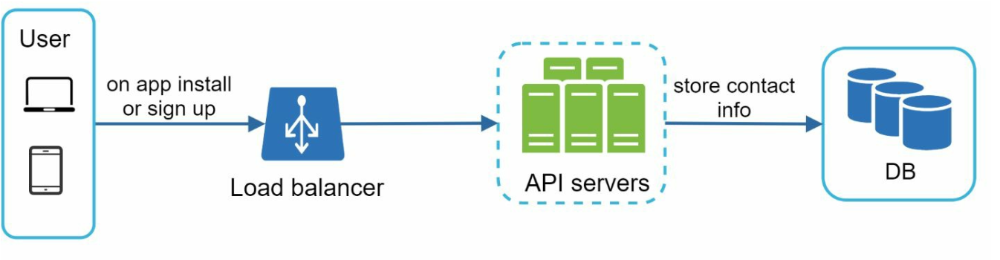
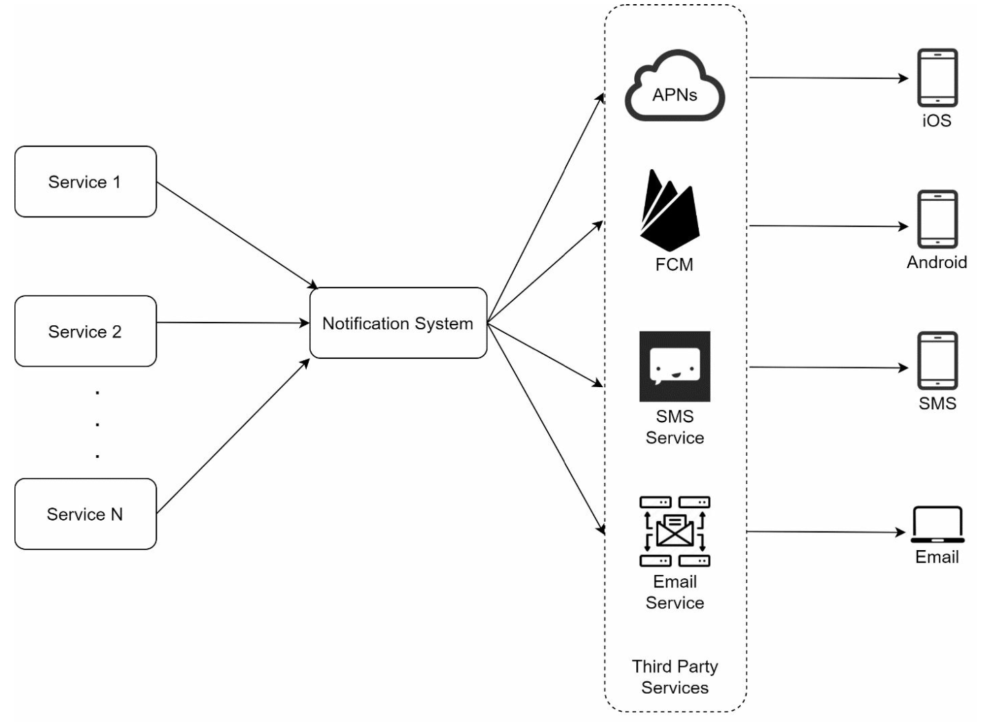
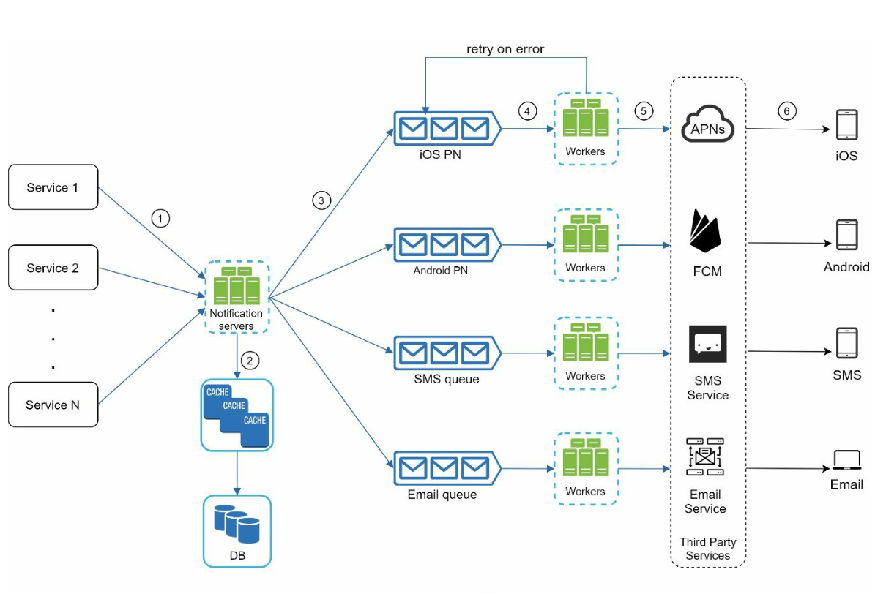
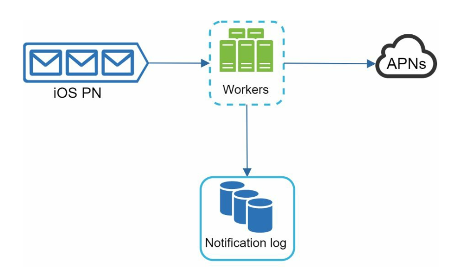
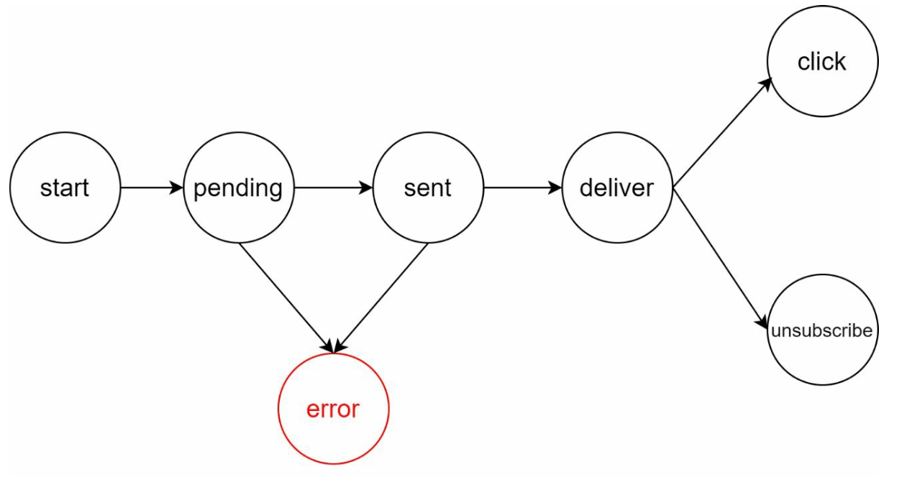
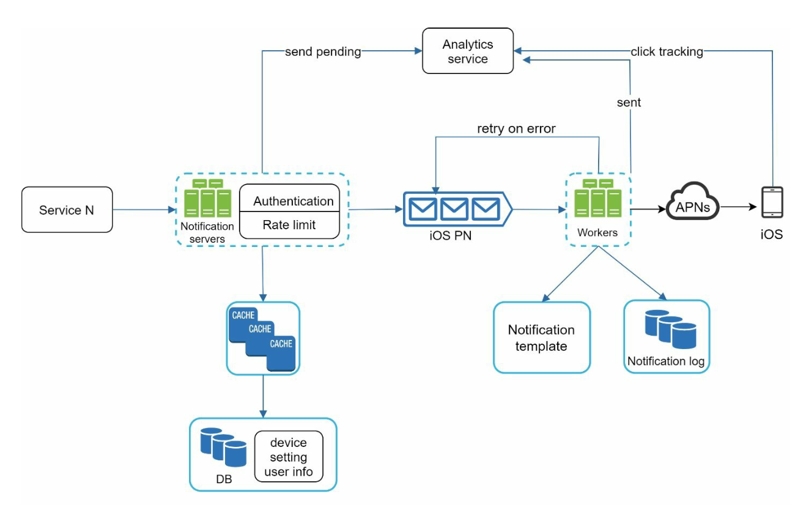

# Chương 10: Thiết kế hệ thống thông báo (Design a Notification System)

## Giới thiệu
Một **hệ thống thông báo (Notification System)** là thành phần không thể thiếu trong các ứng dụng hiện đại, giúp cập nhật kịp thời cho người dùng các thông tin như tin tức sản phẩm mới, sự kiện, chương trình khuyến mãi hay cảnh báo bảo mật. Thông báo thường được gửi qua 3 kênh chính:
1. **Push Notifications** (trên thiết bị di động hoặc máy tính để bàn),
2. **Tin nhắn SMS (SMS Messages)**, và
3. **Email**.

Chương này tập trung vào việc thiết kế một hệ thống thông báo có khả năng mở rộng cao, đáp ứng việc gửi hàng triệu thông báo mỗi ngày.

---

## Bước 1: Thấu hiểu bài toán (Understanding the Problem)
### Yêu cầu hệ thống
- **Các loại thông báo:** Push Notification, SMS và Email.
- **Tốc độ chuyển phát (Delivery):** Hệ thống thời gian thực mềm (Soft real-time system) — thông báo cần được gửi đi càng sớm càng tốt nhưng việc chậm trễ vài giây khi hệ thống chịu tải cao là có thể chấp nhận được.
- **Các nền tảng hỗ trợ:** Thiết bị iOS, thiết bị Android và máy tính (laptop/desktop).
- **Nguồn kích hoạt (Triggers):** Thông báo có thể được kích hoạt từ phía ứng dụng của người dùng (client applications) hoặc được lên lịch tự động từ phía server (scheduled cron jobs).
- **Quy mô (Scale):**
  - **Push Notifications:** 10 triệu thông báo/ngày,
  - **SMS:** 1 triệu tin nhắn/ngày,
  - **Emails:** 5 triệu email/ngày.
- **Hỗ trợ từ chối nhận tin (Opt-out Support):** Người dùng có quyền tắt nhận thông báo đối với từng kênh hoặc từng loại nội dung cụ thể.

---

## Bước 2: Thiết kế tổng quan (High-Level Design)

### Các thành phần chính (Components)

1. **Các kênh gửi thông báo (Notification Types):**
   - **iOS Push Notifications:** Sử dụng dịch vụ **Apple Push Notification Service (APNS)** của Apple.
   - **Android Push Notifications:** Sử dụng dịch vụ **Firebase Cloud Messaging (FCM)** của Google.
   - **Tin nhắn SMS:** Sử dụng các nhà cung cấp dịch vụ cổng SMS bên thứ ba như **Twilio** hoặc **Nexmo**.
   - **Emails:** Sử dụng các dịch vụ gửi email thương mại chuyên dụng như **SendGrid** hoặc **Mailchimp** (để đảm bảo tỷ lệ vào inbox cao và tránh bị đánh dấu spam).

2. **Thu thập thông tin liên hệ (Contact Info Gathering):**
   

      
   

   - Để gửi được thông báo, hệ thống cần thu thập `device token`, số điện thoại hoặc địa chỉ email của người dùng ngay khi họ cài đặt ứng dụng hoặc đăng ký tài khoản lần đầu.
   - Lưu trữ thông tin liên hệ vào Database:
     - **Bảng `device_token`:** Lưu các token thiết bị phục vụ gửi Push Notification (một người dùng có thể có nhiều thiết bị).
     - **Bảng `user`:** Lưu địa chỉ email và số điện thoại định danh của người dùng.

3. **Luồng gửi thông báo cơ bản (Notification Sending Flow):**

   

      
   

   - **Các dịch vụ kích hoạt (Trigger Services - Service 1 đến N):**
      - Phát sinh các sự kiện yêu cầu gửi thông báo (ví dụ: nhắc thanh toán hóa đơn, cập nhật trạng thái giao hàng).
      - Một service ở đây có thể là một Microservice, một Cron Job định kỳ, hoặc một hệ thống phân tán bất kỳ gọi sang hệ thống thông báo.
   - **Notification Server:** 
      - Cung cấp các API nội bộ để các Trigger Services gọi tới khi cần gửi thông báo. 
      - Thực hiện các bước kiểm tra hợp lệ cơ bản (basic validations) đối với địa chỉ email, số điện thoại, payload.
      - Truy vấn Database hoặc Cache để lấy thêm dữ liệu cần thiết nhằm kết xuất (render) nội dung thông báo.
   - **Dịch vụ bên thứ ba (Third-Party Services):** Thực hiện bước chuyển phát cuối cùng tới thiết bị của người dùng (APNS, FCM, Twilio, SendGrid).

     

### Các vấn đề trong thiết kế ban đầu
- **Điểm lỗi đơn (Single Point of Failure - SPOF):** Việc chỉ có một Notification Server duy nhất đồng nghĩa với việc nếu server này sập, toàn bộ dịch vụ thông báo sẽ ngừng hoạt động.
- **Khó mở rộng quy mô (Scalability Issues):** Mọi thứ (Web Server, Database, Cache) đang gom chung trên một cụm, rất khó để scale độc lập từng tầng khi lưu lượng tăng.
- **Điểm nghẽn hiệu năng (Performance Bottlenecks):** Việc dựng nội dung HTML và chờ phản hồi đồng bộ từ các dịch vụ bên thứ ba tiêu tốn nhiều tài nguyên và dễ làm nghẽn hệ thống vào giờ cao điểm.

### Thiết kế cải tiến (Improved Design)

   

      
   

- Tách biệt hoàn toàn Database và Cache ra khỏi Notification Server.
- Áp dụng **mở rộng theo chiều ngang (Horizontal Scaling)** bằng cách bổ sung nhiều Notification Servers tự động co giãn (Auto-scaling).
- Sử dụng **Message Queues** để tách biệt sự phụ thuộc (decouple) giữa các thành phần hệ thống:
   - Message Queues đóng vai trò như bộ đệm (buffer) chịu tải khi có hàng triệu thông báo được bắn ra cùng lúc, đồng thời cô lập lỗi giữa các kênh (nếu kênh SMS bị nghẽn thì kênh iOS Push và Email vẫn chạy bình thường).
- Bổ sung cụm **Workers** chuyên kéo (pull) các sự kiện thông báo từ từng Message Queue tương ứng và gửi tới các dịch vụ bên thứ ba.

   

---

## Bước 3: Đi sâu vào thiết kế chi tiết (Design Deep Dive)

### Đảm bảo độ tin cậy (Reliability)
1. **Chống mất mát dữ liệu (Prevent Data Loss):** 
   

   
   

   - Trong hệ thống thông báo, thông báo có thể bị trễ hoặc gửi lại, nhưng tuyệt đối không được phép bị mất (data loss).
   - Để đảm bảo điều này, các Workers sẽ lưu bền vững dữ liệu và trạng thái thông báo vào một cơ sở dữ liệu gọi là **Notification Log Database** kết hợp với cơ chế tự động thử lại (**Retry mechanism**) khi gửi thất bại.

2. **Chống trùng lặp thông báo (Deduplication):** 
   - Do đặc tính mạng phân tán, cùng một sự kiện thông báo có thể được gửi tới nhiều lần (**At-least-once delivery**).
   - Để tránh làm phiền người dùng bằng các thông báo trùng lặp, khi một sự kiện thông báo đi vào hệ thống, logic **Deduplication** sẽ kiểm tra mã định danh `event_id`. Nếu `event_id` này đã từng được xử lý trước đó, hệ thống sẽ loại bỏ (discard) nó; ngược lại mới tiếp tục quy trình gửi.

### Các thành phần bổ sung quan trọng (Additional Components)
   

   
   

1. **Mẫu thông báo (Notification Templates):** Lưu trữ các khuôn mẫu định dạng sẵn (chỉ cần truyền biến động vào) để đảm bảo tính đồng nhất về giao diện, giảm sai sót và tránh phải viết lại nội dung từ đầu cho mỗi thông báo.
2. **Cài đặt nhận thông báo (Notification Settings):**
   - Kiểm tra xem người dùng có cho phép nhận thông báo (`opt-in` / `opt-out`) trên kênh cụ thể (Push, SMS hay Email) hay không trước khi thực hiện gửi.
   - Được lưu trữ trong bảng cài đặt riêng của người dùng.
3. **Giới hạn tần suất gửi (Rate Limiting):** Giới hạn số lượng thông báo tối đa mà một người dùng phải nhận trong một ngày để tránh gây ức chế dẫn đến việc người dùng tắt hẳn thông báo hoặc gỡ cài đặt ứng dụng.
4. **Cơ chế thử lại (Retry Mechanism):** Nếu dịch vụ bên thứ ba trả về lỗi tạm thời, thông báo sẽ được đẩy lại vào hàng đợi thử lại (Retry Queue). Nếu thử lại nhiều lần vẫn lỗi, sự kiện sẽ được đưa vào Dead-Letter Queue và bắn cảnh báo (alert) cho kỹ sư vận hành.
5. **Giám sát hàng đợi (Monitoring Queues):** Theo dõi sát sao số lượng message đang tồn đọng trong các Queue (Queue length); nếu con số này tăng vọt, cần tự động scale thêm nhiều Worker nodes để giải phóng hàng đợi.
6. **Theo dõi sự kiện tương tác (Event Tracking / Analytics):** Thu thập các chỉ số quan trọng như tổng số thông báo đã gửi, tỷ lệ mở (open rate), tỷ lệ nhấp chuột (click rate) và tỷ lệ hủy đăng ký để đánh giá hiệu quả chiến dịch.

### Bảo mật (Security)
- Đối với các ứng dụng iOS/Android, bắt buộc sử dụng cặp **`AppKey`** và **`AppSecret`** để xác thực các request gọi vào API gửi thông báo, đảm bảo chỉ có các dịch vụ nội bộ hoặc đối tác đã xác thực mới được phép kích hoạt thông báo.

### Luồng gửi thông báo hoàn chỉnh (Updated Notification Flow)

   

   
   

1. Một dịch vụ nghiệp vụ gọi API của **Notification Servers** để yêu cầu gửi thông báo.
2. **Notification Servers** xác thực request (`AppKey`/`AppSecret`), kiểm tra cấu hình người dùng, áp dụng Rate Limiting và lấy thêm metadata (như thông tin thiết bị, Notification Template) từ Cache hoặc Database.
3. Sự kiện thông báo hợp lệ được đóng gói và đẩy vào **Message Queue** tương ứng với từng kênh (iOS, Android, SMS, Email).
4. Các **Workers** kéo sự kiện từ Message Queue, lưu vào **Notification Log**, dựng nội dung từ Template và gọi sang các **Third-Party Services**.
5. Các dịch vụ bên thứ ba chuyển phát thông báo tới thiết bị của người dùng, đồng thời quá trình tương tác được ghi nhận lại vào **Analytics Service**.

---

## Các điểm tối ưu hóa cốt lõi (Key Optimizations)
1. **Horizontal Scaling:** Giữ các Notification Servers ở trạng thái Stateless để dễ dàng mở rộng quy mô xử lý tải đầu vào.
2. **Message Queues:** Tách biệt hoàn toàn khâu tiếp nhận request và khâu gửi thông báo để xử lý mượt mà các đợt lưu lượng tăng đột biến.
3. **Caching:** Lưu cache thông tin người dùng, cấu hình cài đặt và các mẫu thông báo (Templates) để giảm tải cho Database và giảm Latency.
4. **Độ tin cậy và Giám sát:** Kết hợp lưu trữ Notification Log, cơ chế Retry, Deduplication và giám sát độ dài hàng đợi để không bỏ sót bất kỳ thông báo quan trọng nào.
