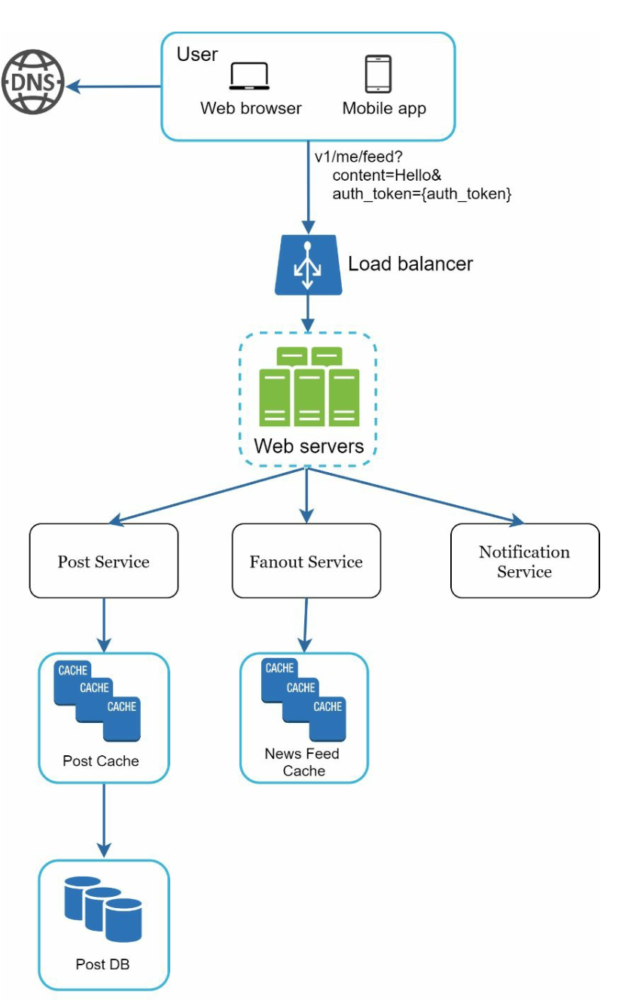
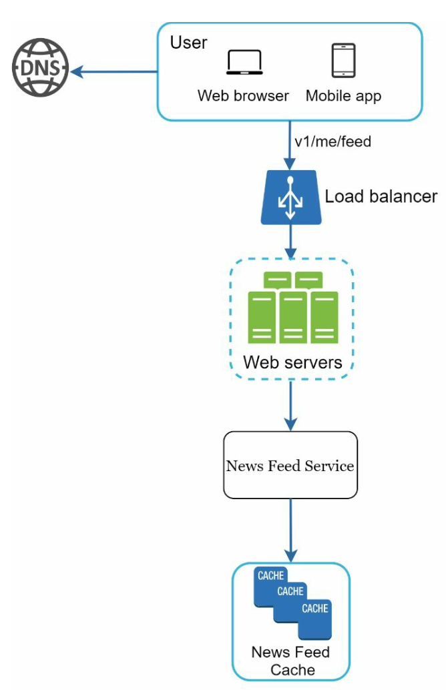
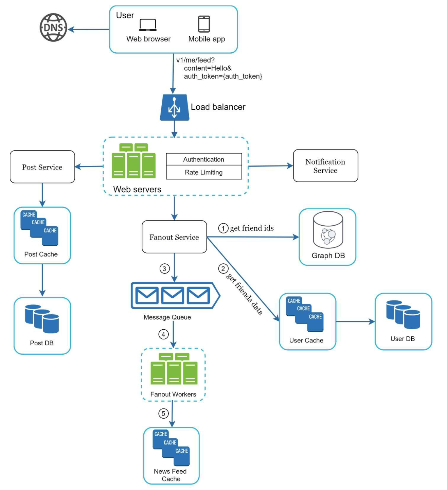
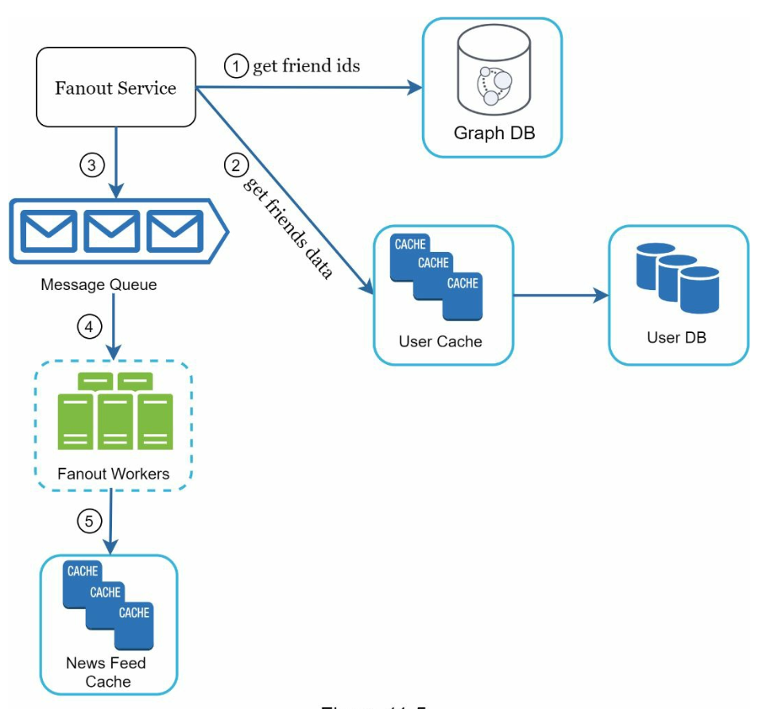
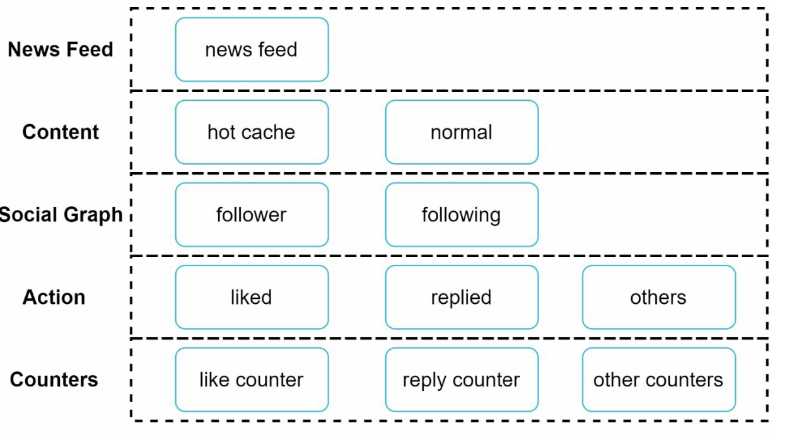

# Chương 11: Thiết kế hệ thống News Feed (Design a News Feed System)

## Giới thiệu
Một **hệ thống News Feed (Bảng tin)** hiển thị danh sách cập nhật liên tục các bài đăng (trạng thái văn bản, hình ảnh, video, liên kết) từ những người mà người dùng kết nối hoặc theo dõi. Các ví dụ điển hình bao gồm News Feed của Facebook, Feed của Instagram hay Timeline của Twitter (X). Chương này đi sâu vào việc thiết kế một hệ thống News Feed có khả năng mở rộng quy mô lớn.

---

## Bước 1: Thấu hiểu bài toán (Understanding the Problem)

### Yêu cầu hệ thống
1. **Nền tảng hỗ trợ:** Hệ thống phục vụ cả ứng dụng Web và ứng dụng di động (Mobile Apps).
2. **Các tính năng cốt lõi:**
   - Người dùng có thể đăng bài viết mới (publish posts).
   - Người dùng có thể xem các bài viết từ bạn bè trên bảng tin cá nhân (News Feed) của mình.
3. **Thứ tự sắp xếp:** Để đơn giản hóa phạm vi thiết kế, các bài viết trên Feed được sắp xếp theo **thứ tự thời gian đảo ngược (reverse chronological order — bài mới nhất hiển thị lên đầu)**.
4. **Quy mô (Scale):**
   - Một người dùng có thể có tối đa 5.000 người bạn.
   - 10 triệu người dùng hoạt động hàng ngày (**10M DAU**).
   - Nội dung bài đăng có thể chứa cả văn bản, hình ảnh và video.

---

## Bước 2: Thiết kế tổng quan (High-Level Design)

### Tổng quan kiến trúc
Thiết kế được chia thành hai luồng nghiệp vụ chính:
1. **Luồng đăng bài (Feed Publishing):** Khi một người dùng đăng bài viết mới, dữ liệu bài viết được ghi vào Database và Cache, sau đó được phân phối (propagate) tới bảng tin của tất cả bạn bè họ.
2. **Luồng tạo và tải bảng tin (News Feed Building / Retrieval):** Khi người dùng mở ứng dụng, hệ thống tổng hợp các bài viết từ bạn bè của họ theo thứ tự thời gian từ mới đến cũ để hiển thị.

---

### Các API của hệ thống News Feed
1. **API Đăng bài (Feed Publishing API):**
   - **Endpoint:** `POST /v1/me/feed`
   - **Tham số:** `content` (nội dung bài viết) và `auth_token` (token xác thực người dùng).

2. **API Tải bảng tin (News Feed Retrieval API):**
   - **Endpoint:** `GET /v1/me/feed`
   - **Tham số:** `auth_token` (token xác thực người dùng).

---

### Luồng đăng bài (Feed Publishing)

   

      
   

1. **Tương tác người dùng:** Người dùng gửi bài đăng mới thông qua API `POST /v1/me/feed`.
2. **Load Balancer:** Phân phối lưu lượng truy cập đồng đều tới các Web Servers.
3. **Web Servers:** Xác thực request, kiểm tra giới hạn lưu lượng và điều hướng request tới các dịch vụ nội bộ.
4. **Post Service:** Lưu trữ nội dung bài viết vào Database và Post Cache.
5. **Fanout Service:** Đẩy (propagate) bài viết mới vào News Feed Cache của từng người bạn.
6. **Notification Service:** Gửi thông báo Push Notification cho bạn bè biết có bài đăng mới.

---

### Luồng xây dựng và tải bảng tin (News Feed Building)

   

      
   

1. **Tương tác người dùng:** Người dùng gửi request lấy bảng tin qua API `GET /v1/me/feed`.
2. **Load Balancer:** Phân tải request tới một trong các Web Servers.
3. **Web Servers:** Chuyển tiếp request tới **News Feed Service**.
4. **News Feed Service:** Truy xuất danh sách các `post_id` từ **News Feed Cache** của người dùng đó, sau đó ghép nối với thông tin chi tiết của bài viết và người đăng để trả về cho client.

   
---

## Bước 3: Đi sâu vào thiết kế chi tiết (Design Deep Dive)

### Đi sâu vào luồng đăng bài (Feed Publishing Deep Dive)
1. **Web Servers:**
   - Xác thực người dùng dựa trên `auth_token` để đảm bảo chỉ người dùng hợp lệ mới được đăng bài.
   - Thực thi **Rate Limiting** nhằm giới hạn số lượng bài đăng trong một khoảng thời gian nhất định để chống spam.

2. **Fanout Service (Dịch vụ khuếch tán bảng tin):**
   Fanout là quá trình phân phối một bài viết của người dùng tới toàn bộ bạn bè/người theo dõi của họ. Có hai mô hình Fanout chính:
   - **Fanout on Write (Khuếch tán lúc ghi / Mô hình Push):** Bảng tin được tính toán sẵn ngay tại thời điểm đăng bài. Bài viết mới được đẩy ngay lập tức vào News Feed Cache của bạn bè.
     - **Ưu điểm:** Bảng tin được cập nhật theo thời gian thực (real-time); tốc độ đọc News Feed của người dùng cực kỳ nhanh vì dữ liệu đã được chuẩn bị sẵn.
     - **Nhược điểm:** Nếu một người dùng có hàng triệu người theo dõi (như người nổi tiếng), việc lấy danh sách và cập nhật cache cho tất cả sẽ mất rất nhiều thời gian và tài nguyên (**បài toán Hotspot / Celebrity problem**). Ngoài ra, việc tính toán sẵn bảng tin cho những người dùng hiếm khi online là sự lãng phí tài nguyên.
   - **Fanout on Read (Khuếch tán lúc đọc / Mô hình Pull):** Bảng tin chỉ được tổng hợp động ngay tại thời điểm người dùng mở ứng dụng và yêu cầu tải News Feed.
     - **Ưu điểm:** Tiết kiệm tài nguyên đối với những người dùng ít hoạt động (inactive users) vì không phải cập nhật cache cho họ; không gặp vấn đề nghẽn cổ chai khi người nổi tiếng đăng bài.
     - **Nhược điểm:** Tốc độ tải News Feed rất chậm vì phải truy vấn và tổng hợp dữ liệu ngay lúc đọc.
   - **Phương pháp lai (Hybrid Approach):** Kết hợp ưu điểm của cả hai mô hình.
     - Sử dụng **Mô hình Push (Fanout on Write)** cho đa số người dùng thông thường để đảm bảo tốc độ đọc nhanh.
     - Sử dụng **Mô hình Pull (Fanout on Read)** đối với những tài khoản người nổi tiếng (Celebrities / người có lượng người theo dõi khổng lồ): bạn bè/người theo dõi của họ sẽ chủ động kéo bài viết mới của người nổi tiếng về khi mở bảng tin, tránh làm quá tải hệ thống lúc người nổi tiếng đăng bài.

        

    Quy trình hoạt động chi tiết của **Fanout Service** như sau:

    1. **Lấy danh sách `friend_ids`:** Truy vấn **Graph Database** (cơ sở dữ liệu đồ thị, rất phù hợp để quản lý mạng lưới quan hệ bạn bè) để lấy danh sách ID bạn bè của người đăng.
    2. **Lọc danh sách bạn bè từ User Cache:** Lấy thông tin cài đặt của người dùng từ Cache để loại bỏ những người bạn đã bị tắt thông báo (muted) hoặc những người nằm ngoài danh sách được phép xem bài viết (selective sharing / quyền riêng tư).
    3. **Đẩy vào Message Queue:** Gửi danh sách bạn bè đã lọc kèm theo `post_id` của bài viết mới vào **Message Queue** để xử lý bất đồng bộ.
    4. **Fanout Workers:** Các Worker kéo dữ liệu từ Message Queue ra và tiến hành cập nhật vào **News Feed Cache**. Lưu ý: Để tiết kiệm tối đa bộ nhớ RAM, News Feed Cache chỉ lưu trữ bảng ánh xạ gồm cặp `<post_id, user_id>` thay vì lưu toàn bộ nội dung bài viết và thông tin người dùng.
    5. **Lưu vào News Feed Cache:** Thêm `post_id` mới vào danh sách bảng tin trong cache của từng người bạn. Hệ thống sẽ đặt một ngưỡng giới hạn kích thước danh sách (ví dụ: chỉ giữ tối đa vài trăm bài viết mới nhất trong cache), vì người dùng thực tế rất hiếm khi cuộn xem lại hàng nghìn bài viết cũ; nhờ đó giảm thiểu nguy cơ Cache Miss và kiểm soát tốt dung lượng RAM.

        

## Đi sâu vào luồng tải bảng tin (News Feed Retrieval Deep Dive)

Ketika người dùng tải bảng tin, các nội dung đa phương tiện (hình ảnh, video) sẽ được tải trực tiếp từ **CDN**, trong khi **News Feed Service** sẽ lấy danh sách `post_id` từ **News Feed Cache**, sau đó truy xuất đầy đủ thông tin từ các tầng Cache chi tiết để dựng thành đối tượng JSON hoàn chỉnh trả về cho client.

### Kiến trúc phân tầng của Cache (Cache Architecture)
Hệ thống Cache là thành phần sống còn của News Feed và được chia thành 5 tầng chuyên biệt:
1. **News Feed Cache:** Chỉ lưu trữ danh sách các `post_id` thuộc bảng tin của từng người dùng.
2. **Content Cache:** Lưu trữ dữ liệu chi tiết của bài viết (các bài viết đang thịnh hành/viral sẽ được tách riêng vào vùng **Hot Cache** để chịu tải đọc cao).
3. **Social Graph Cache:** Lưu trữ dữ liệu đồ thị quan hệ giữa người dùng (`follower` / `following` / `friends`).
4. **Action Cache:** Lưu thông tin về hành động của người dùng đối với một bài viết (ví dụ: người dùng này đã bấm `like`, đã `reply` hay `share` bài viết đó chưa).
5. **Counter Cache:** Lưu các bộ đếm số lượng `like`, số lượt `comment`, số lượng `follower`, số lượng `following`, v.v.

    
---

## Các điểm tối ưu hóa cốt lõi (Key Optimizations)

### Khả năng mở rộng (Scaling)
1. **Mở rộng tầng Database (Database Scaling):**
   - Kết hợp Vertical Scaling và Horizontal Scaling (Sharding).
   - Sử dụng kiến trúc Master-Slave với nhiều Read Replicas để gánh lưu lượng đọc khổng lồ.
2. **Giữ tầng Web phi trạng thái (Stateless Web Tier):** Đảm bảo các Web Server hoàn toàn Stateless để dễ dàng thêm/bớt node tự động.

### Tối ưu Caching
1. Lưu giữ tối đa các dữ liệu thường xuyên truy cập trên bộ nhớ RAM.
2. Chia tách rõ ràng 5 phân tầng Cache kết hợp với CDN cho các tài nguyên tĩnh/media để giảm thiểu Latency và tải cho Database.

### Độ tin cậy (Reliability)
1. **Consistent Hashing:** Áp dụng Băm nhất quán trên cụm Cache và dữ liệu để phân phối tải đồng đều.
2. **Message Queues:** Tách biệt các thành phần trong luồng Fanout để làm mượt tải khi có lượng bài đăng tăng đột biến.

### Giám sát (Monitoring)
1. Theo dõi sát sao các chỉ số vận hành cốt lõi như **QPS** vào giờ cao điểm và **Latency** khi tải News Feed.
2. Giám sát tỷ lệ **Cache Hit Rate** và tốc độ xử lý của **Fanout Workers** để tinh chỉnh hạ tầng kịp thời.
