# Chương 12: Thiết kế hệ thống Chat (Design a Chat System)

## Giới thiệu
Một **hệ thống Chat (Chat System)** cho phép người dùng nhắn tin trao đổi với nhau theo thời gian thực (real-time). Chương này tập trung vào việc thiết kế một ứng dụng nhắn tin kiểu WhatsApp/Messenger/Discord bao gồm các tính năng cốt lõi:
- **Chat cá nhân 1-1 (One-on-One Chat)**
- **Chat nhóm (Group Chat — tối đa 100 thành viên)**
- **Hiển thị trạng thái hoạt động (Online Presence Indicators)**
- **Hỗ trợ đăng nhập và đồng bộ trên nhiều thiết bị (Multiple Device Support)**
- **Thông báo đẩy (Push Notifications)**

Hệ thống được thiết kế để phục vụ quy mô **50 triệu người dùng hoạt động hàng ngày (50M DAU)** và lưu trữ lịch sử tin nhắn vĩnh viễn.

---

## Bước 1: Thấu hiểu bài toán (Understanding the Problem)

### Yêu cầu hệ thống
1. **Tính năng:**
   - Hỗ trợ cả Chat 1-1 và Chat nhóm (nhóm nhỏ tối đa 100 người).
   - Tập trung vào tin nhắn văn bản (độ dài tối đa 100.000 ký tự).
   - Hiển thị trạng thái Online/Offline của bạn bè.
   - Cho phép cùng một tài khoản đăng nhập trên nhiều thiết bị (điện thoại, laptop) cùng lúc.
   - Tích hợp gửi Push Notifications khi người nhận không mở ứng dụng.
2. **Quy mô (Scale):** Thiết kế đáp ứng 50 triệu DAU.
3. **Lưu trữ (Storage):** Lưu trữ toàn bộ lịch sử trò chuyện vĩnh viễn.

---

## Bước 2: Thiết kế tổng quan (High-Level Design)

### Lựa chọn giao thức truyền thông (Communication Protocols)
Trong hệ thống chat, các client không kết nối trực tiếp ngang hàng (P2P) với nhau mà luôn kết nối thông qua **Chat Service** trung tâm.
1. **Phía người gửi (Sender Side):** Người gửi có thể đẩy tin nhắn lên Chat Service bằng giao thức HTTP truyền thống (kết hợp header `keep-alive` để tái sử dụng kết nối TCP và giảm số lần bắt tay TCP handshake).

      

      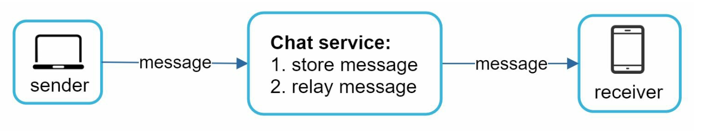    
      

2. **Phía người nhận (Receiver Side):** Vì giao thức HTTP là giao thức do client khởi tạo (client-initiated), server không thể tự ý đẩy tin nhắn mới xuống client một cách đơn giản. Do đó, có 3 kỹ thuật phổ biến để mô phỏng việc server đẩy dữ liệu xuống client:
   - **Polling (Hỏi thăm định kỳ):**
      - Client định kỳ gửi request hỏi server xem có tin nhắn mới hay không.
      - **Nhược điểm:** Rất kém hiệu quả và lãng phí tài nguyên server vì đa số các lần hỏi đều trả về kết quả rỗng (không có tin nhắn mới).

         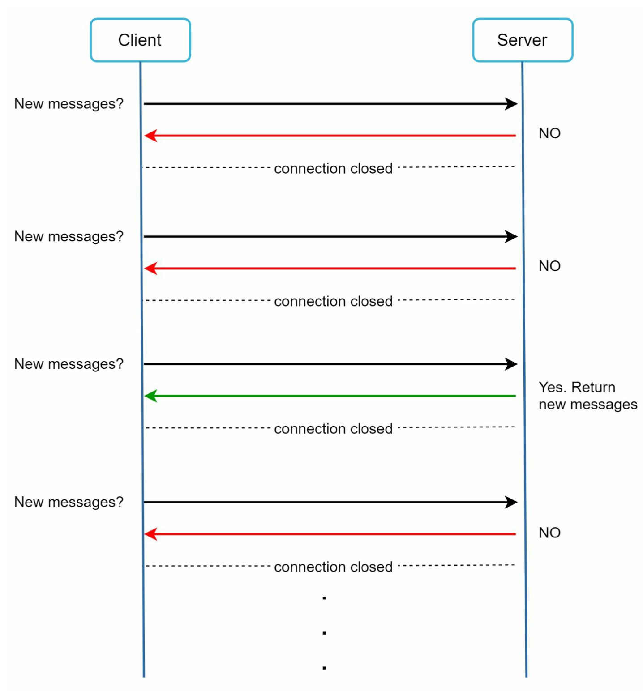    

   - **Long Polling (Hỏi thăm giữ kết nối chờ):** 
      - Client gửi request lên và server sẽ giữ mở kết nối đó (open connection) cho đến khi thực sự có tin nhắn mới xuất hiện hoặc hết thời gian chờ (timeout). Ngay khi nhận được tin nhắn, client lập tức gửi một request Long Polling mới để chờ tiếp.
      - **Nhược điểm:** Người gửi và người nhận có thể kết nối vào hai HTTP server khác nhau; server không biết chính xác client đã ngắt kết nối hay chưa; và vẫn tạo ra nhiều kết nối lặp lại gây lãng phí tài nguyên đối với những người dùng ít nhắn tin.

         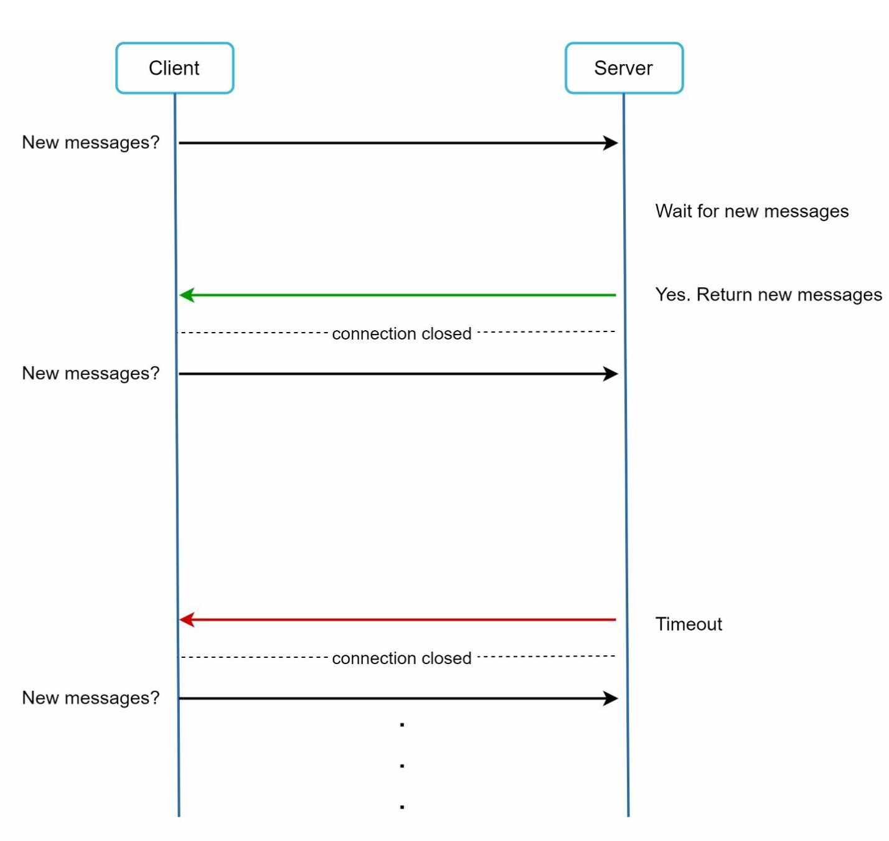

   - **WebSocket:** 
      - Giải pháp tối ưu nhất để gửi các bản cập nhật bất đồng bộ từ server xuống client. Kết nối được khởi tạo từ phía client thông qua quá trình bắt tay HTTP (HTTP handshake), sau đó được nâng cấp (`upgrade`) thành một kết nối **WebSocket hai chiều (bi-directional) và duy trì liên tục (persistent)**.
      - Một khi đã thiết lập, kết nối WebSocket cho phép truyền tải tin nhắn thời gian thực với độ trễ cực thấp cho **cả chiều gửi lẫn chiều nhận**.

         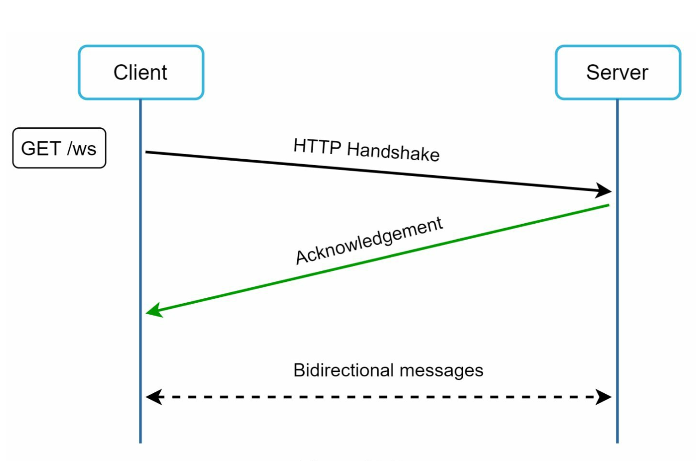    
   
---

### Phân loại các thành phần hệ thống (Components)

   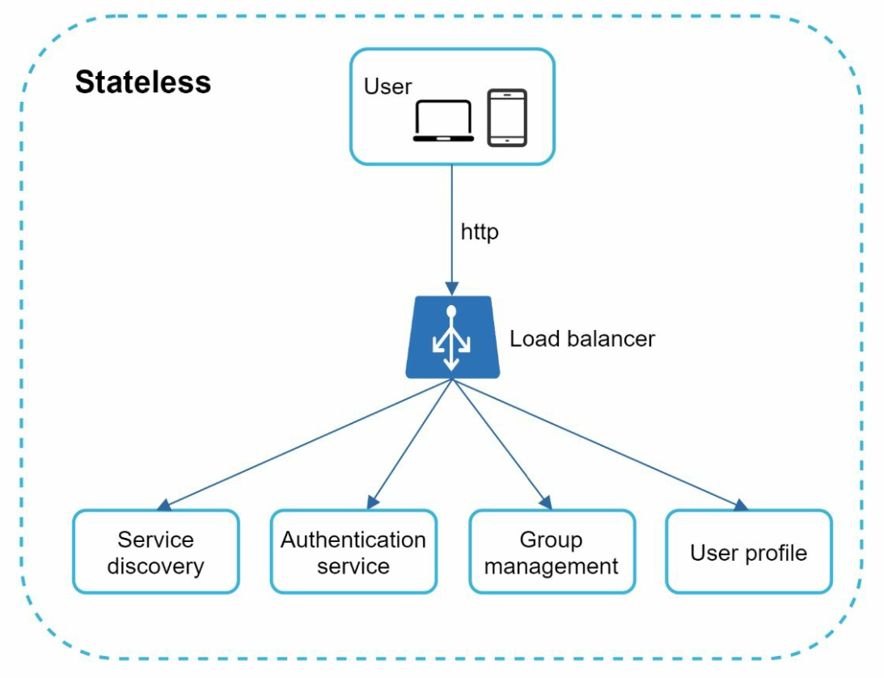    
   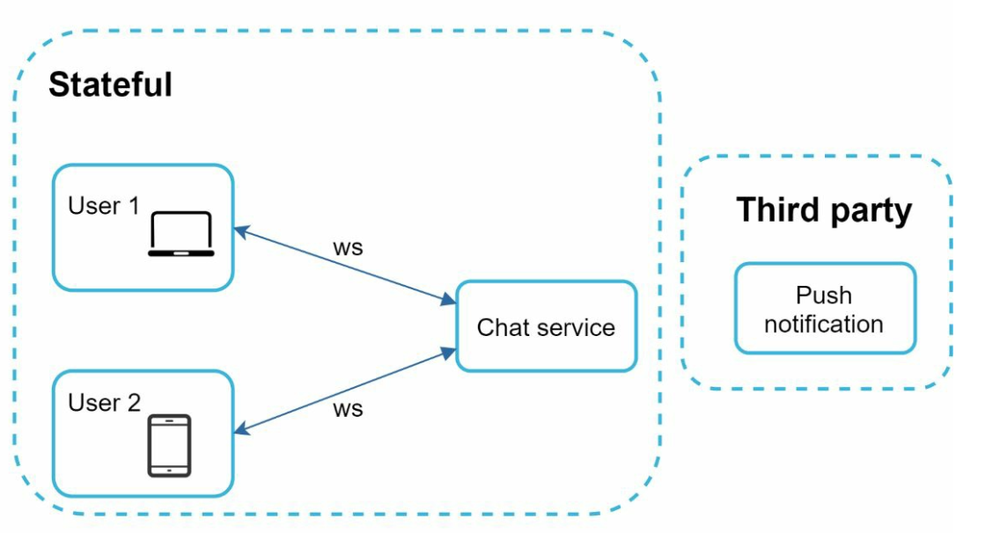

1. **Các dịch vụ phi trạng thái (Stateless Services):**
   - Bao gồm các dịch vụ truyền thống chạy qua HTTP thông thường như: đăng ký, đăng nhập, quản lý hồ sơ người dùng (user profile), danh bạ bạn bè.
   - Đứng sau một Load Balancer và tích hợp với dịch vụ **Service Discovery** để cung cấp cho client danh sách các Chat Server phù hợp nhất để kết nối.
2. **Các dịch vụ có trạng thái (Stateful Services):**
   - Chính là cụm **Chat Servers** và **Presence Servers**. Đây là các dịch vụ Stateful bởi vì mỗi client phải duy trì một kết nối mạng WebSocket cố định, liên tục tới một Chat Server cụ thể (client không tự ý đổi sang Chat Server khác trừ khi server hiện tại bị sập).
   - Chịu trách nhiệm định tuyến, chuyển phát và đồng bộ hóa tin nhắn theo thời gian thực.
3. **Tích hợp bên thứ ba (Third-Party Integration):**
   - Tích hợp với các dịch vụ **Push Notification** (APNS, FCM) để thông báo cho người dùng khi có tin nhắn mới lúc ứng dụng đang chạy ngầm hoặc đã đóng.
   - Xem lại Chương 10 (Thiết kế hệ thống thông báo) để nắm chi tiết cách triển khai tầng này.

---
### Kiến trúc và Lựa chọn cơ sở dữ liệu (Design & Storage)

Client duy trì kết nối WebSocket lâu dài tới một Chat Server để nhắn tin thời gian thực.

      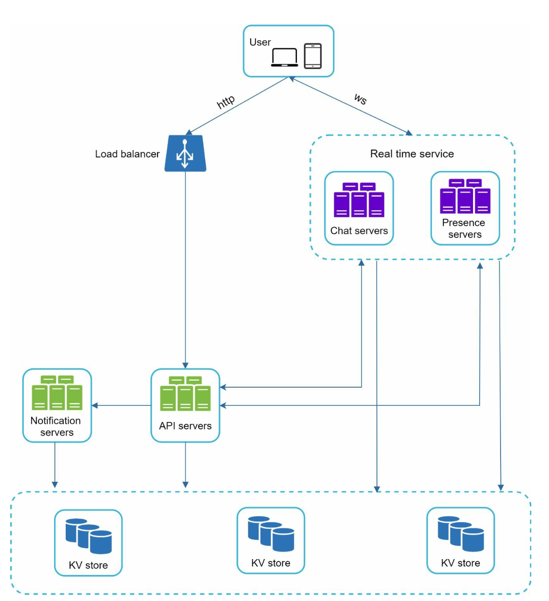 

- **Chat Servers:** Điều phối việc gửi và nhận tin nhắn giữa các người dùng.
- **Presence Servers:** Quản lý trạng thái Online/Offline của người dùng.
- **API Servers:** Xử lý toàn bộ các tác vụ Stateless như đăng nhập, đăng ký, cập nhật thông tin cá nhân.
- **Notification Servers:** Gửi thông báo đẩy (Push Notifications).
- **Key-Value Stores:** Được lựa chọn làm cơ sở dữ liệu chính để lưu trữ lịch sử tin nhắn (chat history) vì các lý do thuyết phục sau:
   - Hỗ trợ mở rộng theo chiều ngang (**Horizontal Scaling**) cực kỳ dễ dàng khi lượng tin nhắn tăng lên hàng tỷ bản ghi mỗi ngày.
   - Cung cấp **Latency cực thấp** khi truy xuất dữ liệu.
   - Các cơ sở dữ liệu quan hệ (RDBMS) xử lý phần "đuôi dài" (long tail) của dữ liệu không tốt: khi bảng và bộ chỉ mục (indexes) phình to khổng lồ, các thao tác truy xuất ngẫu nhiên (random access) như tìm kiếm hoặc nhảy trang lịch sử tin nhắn sẽ rất đắt đỏ.
   - Key-Value / Wide-Column Stores đã được kiểm chứng thực tế bởi các ứng dụng chat quy mô hàng đầu thế giới: **Facebook Messenger** sử dụng HBase và **Discord** sử dụng Cassandra (sau này là ScyllaDB).

Mô hình dữ liệu (Data Models) cho Chat 1-1 và Chat nhóm được thiết kế như sau:
   - Đối với Chat 1-1, khóa chính là `message_id`, vừa giúp định danh duy nhất vừa dùng để xác định thứ tự xuất hiện của các tin nhắn (vì hai tin nhắn có thể gửi trong cùng một mili-giây nên không thể dùng `created_at` để sắp xếp thứ tự chuẩn).
   - Đối với Chat nhóm, khóa chính phức hợp (Composite Primary Key) là cặp `(channel_id, message_id)`, trong đó `channel_id` đồng thời đóng vai trò là **Partition Key** bởi mọi truy vấn trong nhóm chat đều xoay quanh một nhóm cụ thể.
      - Các `message_id` có thể được sinh bằng bộ sinh số thứ tự 64-bit toàn cục như **Snowflake**.
      - Hoặc một cách tiếp cận tối ưu hơn là sử dụng **bộ sinh số thứ tự cục bộ (Local Sequence Number Generator)**: nghĩa là `message_id` chỉ cần duy nhất và tăng dần trong phạm vi của riêng một cuộc trò chuyện 1-1 hoặc một kênh chat nhóm (`channel_id`), giúp dễ triển khai hơn so với đồng bộ ID toàn cục.
      
      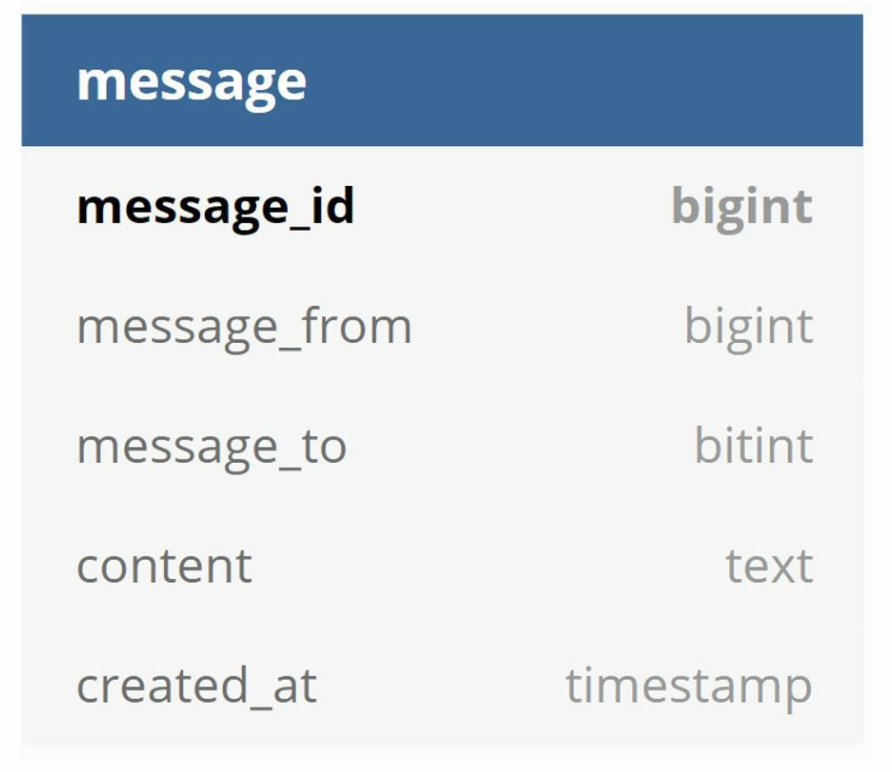   
      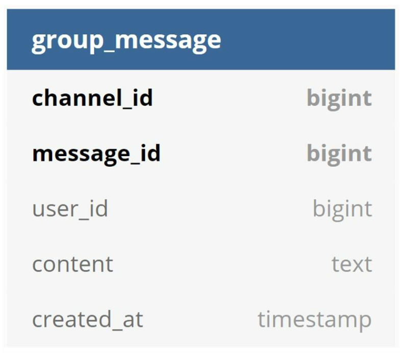   

## Bước 3: Đi sâu vào thiết kế chi tiết (Design Deep Dive)

### Khám phá dịch vụ (Service Discovery)

   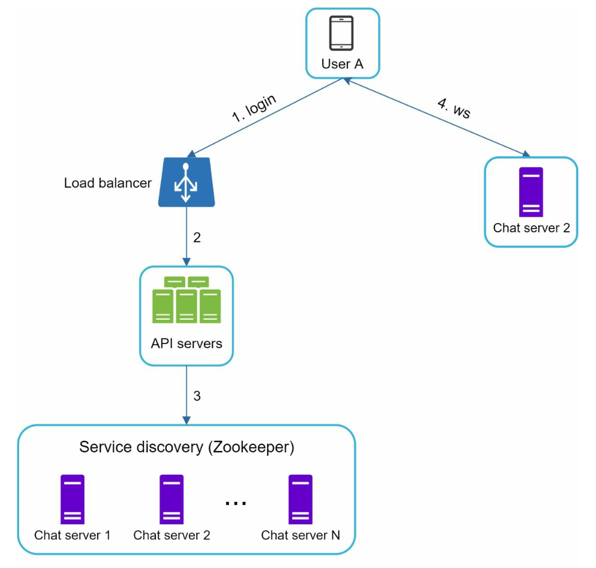   

- Vai trò chính của **Service Discovery** là giới thiệu cho client địa chỉ của **Chat Server tốt nhất** để thiết lập kết nối WebSocket, dựa trên các tiêu chí như vị trí địa lý của người dùng, tải hiện tại (server capacity) của từng server. 
- Hệ thống sử dụng **Apache ZooKeeper** để quản lý danh sách tất cả các Chat Server đang khả dụng và điều phối kết nối cho client.
- Đảm bảo phân phối kết nối đồng đều và giảm thiểu tối đa Latency.

### Các luồng xử lý tin nhắn (Messaging Flows)
#### 1. Luồng Chat 1-1 (One-on-One Chat)

1. `User A` gửi một tin nhắn chat tới `Chat Server 1` qua kết nối WebSocket.
2. `Chat Server 1` lấy một `message_id` mới từ bộ sinh ID, sau đó đẩy tin nhắn vào hàng đợi **Message Sync Queue** và lưu bền vững vào **Key-Value Store**.
3. Nếu `User B` đang **Online**, tin nhắn được chuyển tiếp tới đúng Chat Server mà `User B` đang kết nối (ví dụ `Chat Server 2`), và `Chat Server 2` đẩy thẳng tin nhắn xuống thiết bị của `User B` qua kết nối WebSocket.
4. Nếu `User B` đang **Offline**, tin nhắn được chuyển sang **Notification Servers** để gửi Push Notification tới điện thoại của `User B`.

#### 2. Luồng Chat nhóm nhỏ (Small Group Chat)

   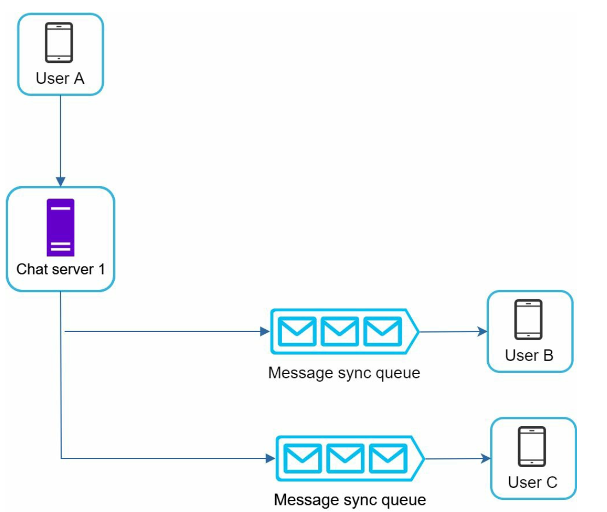  

- Khi `User A` gửi tin nhắn vào nhóm gồm `User B` và `User C`, tin nhắn đó sẽ được sao chép vào **hàng đợi đồng bộ tin nhắn (Message Sync Queue / Inbox)** riêng của từng thành viên (`User B` và `User C`).
- Thiết kế mỗi người nhận có một Inbox riêng giúp:
  - Đơn giản hóa tối đa luồng đồng bộ tin nhắn: mỗi client chỉ cần kiểm tra duy nhất Inbox của chính mình để lấy toàn bộ tin nhắn mới từ mọi cuộc trò chuyện.
  - Với quy mô nhóm nhỏ (dưới 100 thành viên theo yêu cầu đề bài), chi phí lưu trữ bản sao trong Inbox là rất nhỏ và hoàn toàn hợp lý (tuy nhiên với nhóm hàng chục nghìn người như Discord/Slack thì phải đổi sang mô hình đọc chung từ một queue của kênh).

---

#### 3. Đồng bộ hóa tin nhắn giữa nhiều thiết bị (Message Synchronization Across Multiple Devices)

Nhiều người dùng sử dụng đồng thời cả điện thoại và laptop để đăng nhập vào cùng một tài khoản. Làm sao để đồng bộ tin nhắn mượt mà giữa các thiết bị này?
- Mỗi thiết bị đều mở một kết nối WebSocket riêng tới Chat Server.
- Trên mỗi thiết bị sẽ duy trì một biến cục bộ gọi là `cur_max_message_id`, dùng để ghi nhớ ID của tin nhắn mới nhất mà thiết bị đó đã tải về.
- Một tin nhắn trong Key-Value Store được coi là **tin nhắn mới (chưa đồng bộ)** đối với một thiết bị nếu nó thỏa mãn đồng thời 2 điều kiện sau:

   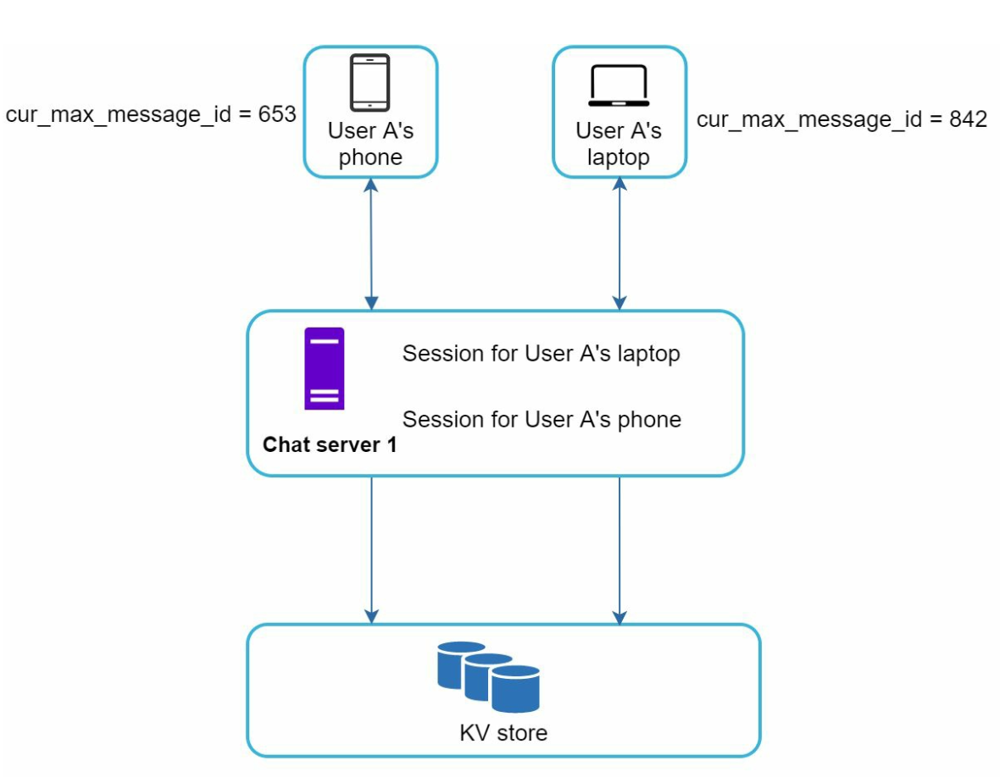  

1. `recipient_id` bằng với `user_id` đang đăng nhập hiện tại.
2. `message_id` trong Key-Value Store lớn hơn giá trị `cur_max_message_id` đang lưu trên thiết bị đó.
- Nhờ lưu `cur_max_message_id` riêng trên từng thiết bị, mọi thiết bị mới đăng nhập hoặc vừa mở lại đều có thể tự động kéo chính xác phần tin nhắn còn thiếu từ Key-Value Store về.

---

### Quản lý trạng thái hoạt động (Online Presence)
1. **Cơ chế nhịp tim (Heartbeat Mechanism):** 
   

      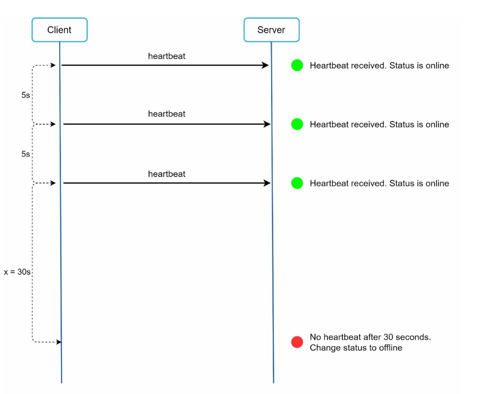 
   

   
   - Do kết nối mạng di động thường xuyên bị chập chờn (ví dụ đi vào thang máy hoặc hầm gửi xe), nếu đánh dấu người dùng Offline ngay lập tức mỗi khi mất kết nối tạm thời rồi lại Online sau vài giây sẽ tạo ra trải nghiệm người dùng rất tệ.
   - Giải pháp: Client định kỳ gửi một sự kiện nhịp tim (**Heartbeat event**) lên **Presence Servers** (ví dụ mỗi 5 giây một lần). 
   - Nếu sau một khoảng thời gian ngưỡng (ví dụ `x = 30` giây) mà Presence Server vẫn không nhận được bất kỳ nhịp tim nào từ client đó, người dùng mới chính thức bị chuyển trạng thái sang **Offline**.

     

2. **Mô hình khuếch tán trạng thái (Fanout Model cho Online Status):** 

   

      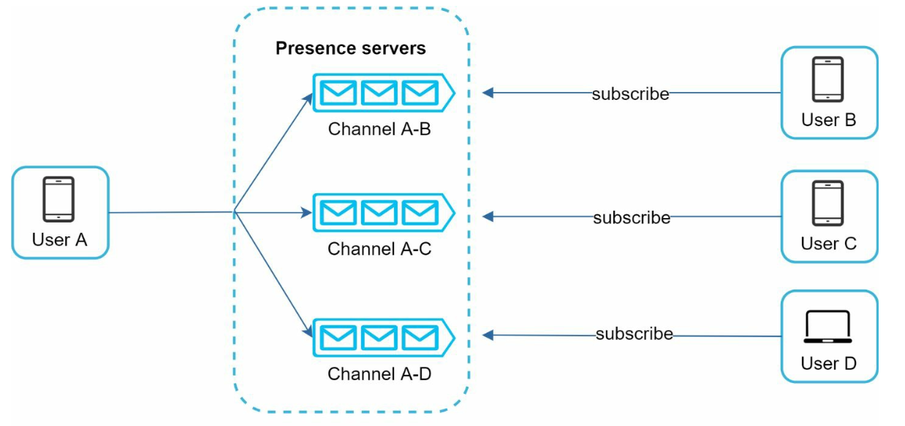 
   

   - Làm sao bạn bè của `User A` biết được khi nào `User A` thay đổi trạng thái Online/Offline? Hệ thống áp dụng mô hình **Publish-Subscribe (Pub/Sub)**, trong đó mỗi cặp bạn bè sẽ duy trì một kênh (channel) lắng nghe trạng thái.
   - Khi trạng thái của `User A` thay đổi, Presence Server sẽ publish sự kiện đó vào các kênh `A-B`, `A-C` và `A-D`. 
   - `User B`, `User C` và `User D` đang subscribe các kênh tương ứng sẽ nhận được cập nhật trạng thái theo thời gian thực qua WebSocket.
   - Mô hình Pub/Sub này rất hiệu quả cho các nhóm nhỏ hoặc số lượng bạn bè vừa phải. Đối với các nhóm lớn hàng nghìn người, việc bắn sự kiện trạng thái cho tất cả sẽ gây nghẽn mạng, do đó hệ thống nên chuyển sang cơ chế chỉ kiểm tra trạng thái Online khi người dùng mở danh sách thành viên nhóm hoặc làm mới thủ công.

---

## Các vấn đề mở rộng và nâng cao (Additional Considerations)
### Khả năng mở rộng (Scalability)
- **Horizontal Scaling:** Mở rộng độc lập cụm Stateless API Servers và cụm Stateful Chat/Presence Servers khi lượng người dùng tăng.
- **Load Balancing & Service Discovery:** Phân phối đều các kết nối WebSocket qua ZooKeeper.
- **Caching:** Cache thông tin hồ sơ người dùng, danh sách bạn bè và các tin nhắn gần nhất để giảm tải cho Database.

### Xử lý sự cố (Error Handling)
- **Cơ chế thử lại (Retry Mechanisms):** Xử lý lỗi gửi tin nhắn bằng hàng đợi và cơ chế thử lại tự động.
- **Xử lý khi Chat Server bị sập (Server Failures):** Nếu một Chat Server đang giữ hàng chục nghìn kết nối WebSocket bị sập, ZooKeeper sẽ cập nhật danh sách và điều hướng các client đó kết nối lại (reconnect) sang các Chat Server khỏe mạnh khác.

### Hướng mở rộng tính năng trong tương lai (Future Extensions)
1. **Hỗ trợ tập tin Media (Ảnh/Video):** Các file media có dung lượng lớn nên không truyền trực tiếp qua Chat Server; thay vào đó hãy nén ở phía client, upload lên Cloud Storage (S3) kết hợp CDN và chỉ gửi đường dẫn (URL) hoặc thumbnail qua kênh chat.
2. **Mã hóa đầu cuối (End-to-End Encryption - E2EE):** Giống như WhatsApp/Signal, đảm bảo chỉ có người gửi và thiết bị của người nhận mới có khóa giải mã nội dung tin nhắn.
3. **Lưu bộ nhớ đệm phía Client (Client-Side Caching):** Lưu cache dữ liệu người dùng và lịch sử tin nhắn ngay trên thiết bị để giảm băng thông truyền tải và mở ứng dụng tức thì.
4. **Tối ưu hóa tốc độ tải toàn cầu:** Sử dụng mạng lưới biên/proxy phân tán theo địa lý (như Flannel của Slack) để lưu cache dữ liệu phiên làm việc gần người dùng nhất.
