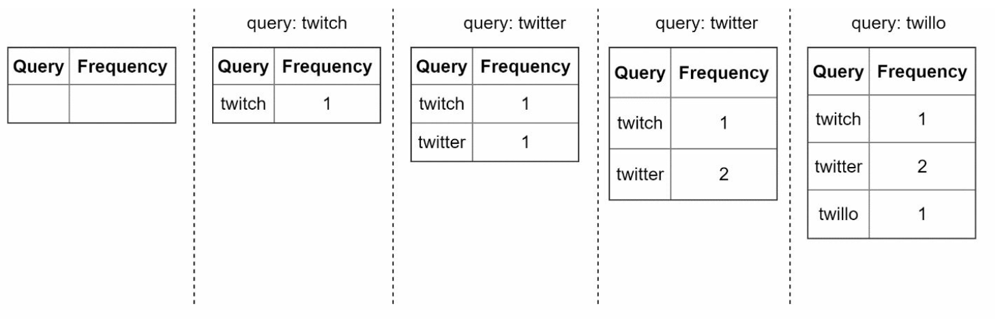
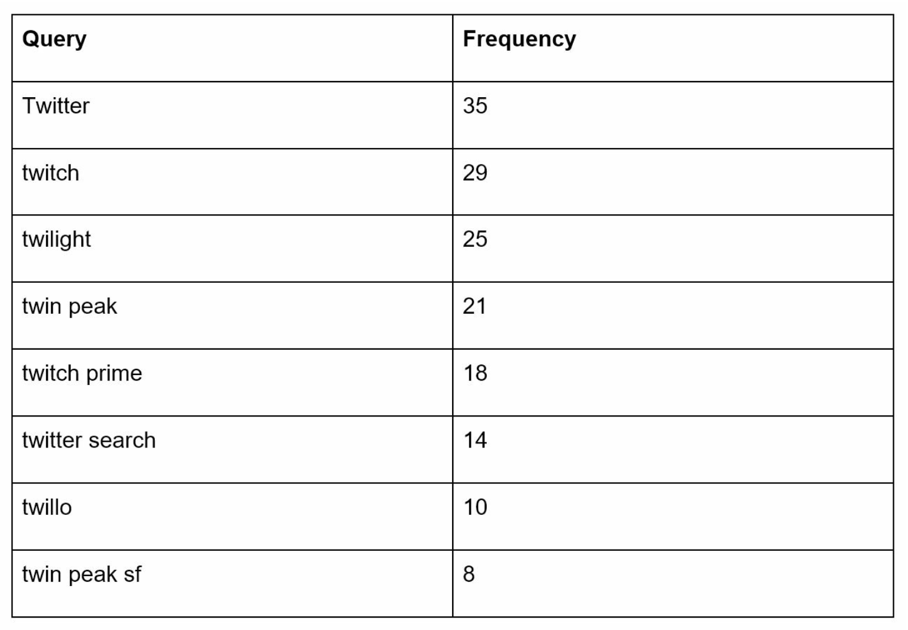
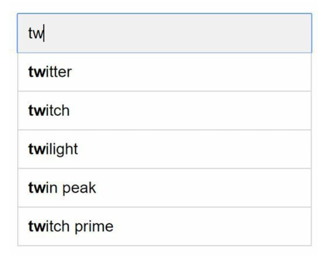
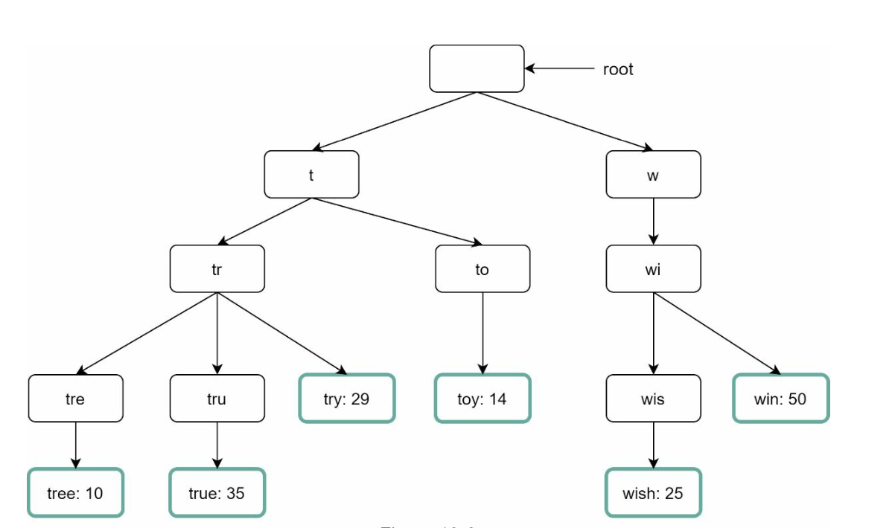
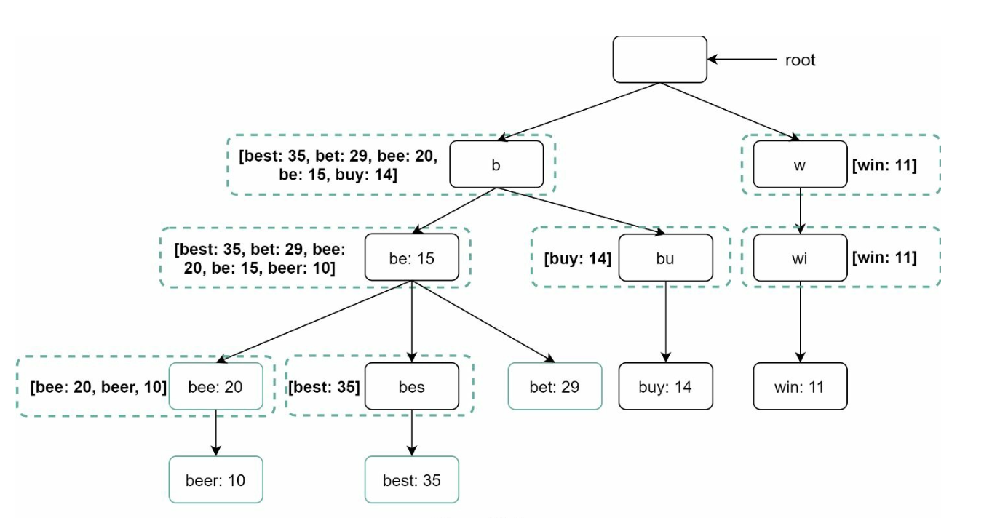
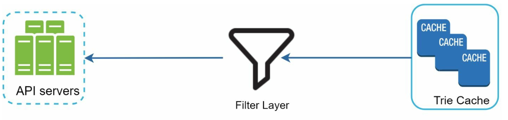
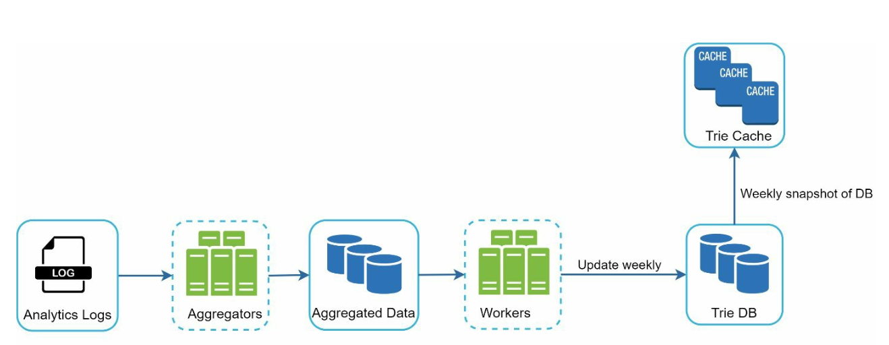
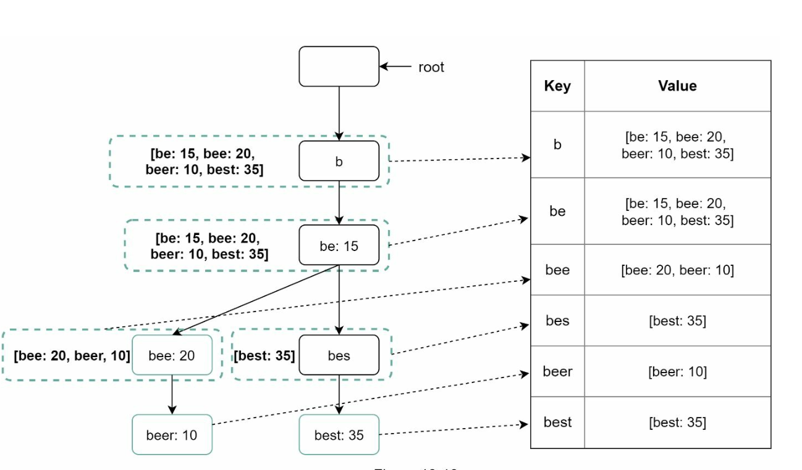
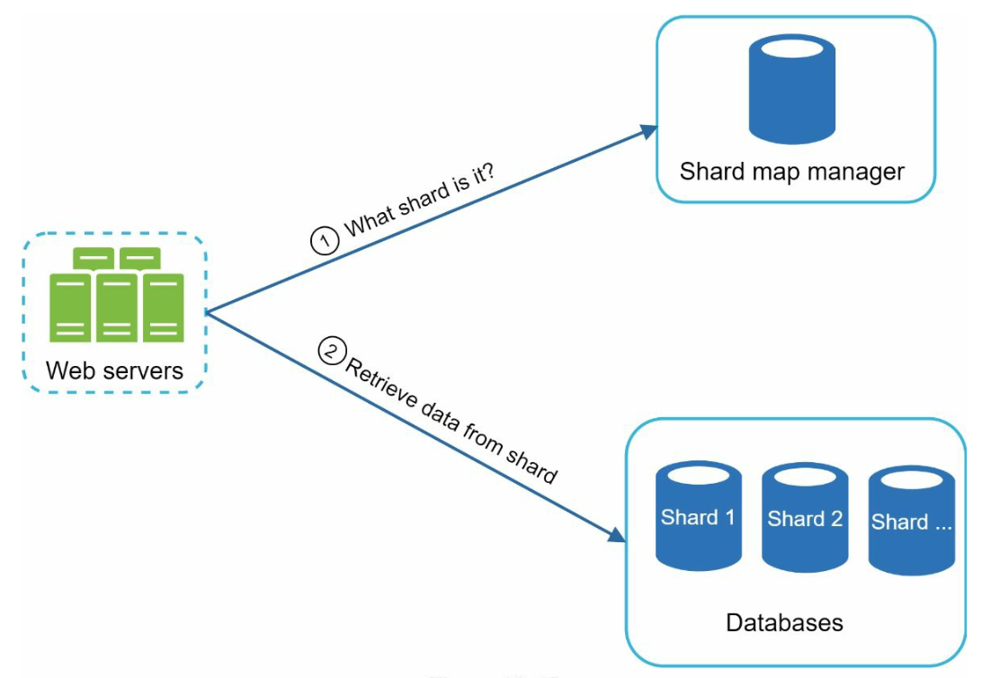

# Chương 13: Thiết kế hệ thống gợi ý tìm kiếm tự động (Design a Search Autocomplete System)

## Giới thiệu
**Gợi ý tìm kiếm tự động (Search Autocomplete)** — còn được gọi là *Typeahead* hoặc *Search-as-you-type* — là tính năng cung cấp danh sách các từ khóa gợi ý theo thời gian thực ngay khi người dùng đang gõ từng ký tự vào ô tìm kiếm (như trên Google hay Amazon). Hệ thống cần trả về nhanh chóng danh sách `top-k` câu truy vấn liên quan và phổ biến nhất dựa trên dữ liệu lịch sử tìm kiếm.

### Các đặc điểm cốt lõi của bài toán
- Trả về tối đa **5 gợi ý tìm kiếm (`k = 5`)** có tiền tố (prefix) khớp với chuỗi người dùng vừa nhập.
- Xếp hạng độ ưu tiên dựa trên **mức độ phổ biến (tần suất tìm kiếm — query frequency)** trong lịch sử.
- Chỉ xét **các ký tự tiếng Anh viết thường (lowercase English characters)**.
- Thời gian phản hồi cực nhanh (**Latency < 100 ms**) để không gây cảm giác giật lag khi gõ phím, đồng thời có khả năng mở rộng cao.

---

## Bước 1: Thấu hiểu bài toán (Understanding the Problem)

### Yêu cầu hệ thống
1. **Gợi ý theo thời gian thực (Real-Time Suggestions):** Hiển thị kết quả khớp tiền tố ngay khi người dùng gõ từng chữ cái.
2. **Kết quả Top-k:** Trả về 5 cụm từ được tìm kiếm nhiều nhất khớp với tiền tố.
3. **Khả năng mở rộng (Scalability):** Phục vụ **10 triệu người dùng hoạt động hàng ngày (10M DAU)** với lưu lượng truy vấn lúc cao điểm (**Peak QPS**) lên tới **~48.000 QPS**.
4. **Tính sẵn sàng cao (High Availability):** Hệ thống vẫn hoạt động liên tục không bị downtime ngay cả khi một số server gặp sự cố.
5. **Tốc độ tăng trưởng dữ liệu:** Xử lý khoảng **0.4 GB dữ liệu từ khóa hoàn toàn mới** phát sinh thêm mỗi ngày.

---

## Bước 2: Thiết kế tổng quan (High-Level Design)
Ở mức tổng quan, hệ thống được chia thành hai dịch vụ chính:
1. **Dịch vụ thu thập dữ liệu (Data Gathering Service):** 
    - Thu thập các câu truy vấn tìm kiếm của người dùng và tổng hợp chúng theo thời gian thực để thống kê tần suất xuất hiện.
    - *(Lưu ý: Việc cập nhật trực tiếp theo thời gian thực cho từng lượt gõ sẽ không khả thi khi quy mô dữ liệu quá lớn, nhưng đây là điểm khởi đầu tốt để hiểu luồng dữ liệu).*

2. **Dịch vụ truy vấn gợi ý (Query Service):** Nhận chuỗi tiền tố (prefix) từ người dùng và trả về 5 từ khóa gợi ý phổ biến nhất.

---

### Dịch vụ thu thập dữ liệu (Data Gathering Service)

    

- Tổng hợp dữ liệu tìm kiếm từ nhật ký phân tích (Analytics Logs) và cập nhật vào bảng tần suất (**Frequency Table**) gồm 2 cột: `query` (câu truy vấn) và `frequency` (số lần được tìm kiếm).
- Trong thiết kế hoàn chỉnh, dữ liệu lịch sử này sẽ được xử lý định kỳ để xây dựng cấu trúc cây tiền tố (**Trie**).

### Dịch vụ truy vấn gợi ý (Query Service)

    
    

- Sử dụng dữ liệu tần suất đã thu thập từ Data Gathering Service.
- Khi người dùng gõ một chuỗi tiền tố (ví dụ `"tw"`), nếu dùng SQL thông thường sẽ tương đương câu lệnh `SELECT * FROM frequency_table WHERE query LIKE 'tw%' ORDER BY frequency DESC LIMIT 5` để hiển thị 5 kết quả đứng đầu (như `twitter`, `twitch`, `twilight`, `twin peak`, `twitch prime`).
- Tuy nhiên, truy vấn `LIKE 'prefix%'` kết hợp `ORDER BY` trên bảng SQL khổng lồ sẽ cực kỳ chậm và gây nghẽn cổ chai ở mức 48.000 QPS. Do đó ở Bước 3, ta sẽ chuyển sang sử dụng cấu trúc dữ liệu **Trie** kết hợp với bộ nhớ đệm (**Caching**).

---

## Bước 3: Đi sâu vào thiết kế chi tiết (Design Deep Dive)

### Cấu trúc dữ liệu Trie (Cây tiền tố)
**Trie** (đọc là "try", hay còn gọi là Prefix Tree) là một cấu trúc dữ liệu dạng cây chuyên dụng để lưu trữ chuỗi ký tự một cách nhỏ gọn và tìm kiếm các chuỗi có chung tiền tố với tốc độ cực nhanh.

#### Đặc điểm chính của Trie
1. **Lưu trữ tối ưu (Compact Storage):** Nút gốc (root) biểu diễn chuỗi rỗng, mỗi nút con tiếp theo lưu thêm một ký tự và biểu diễn một tiền tố theo cấu trúc phân cấp, giúp tiết kiệm không gian lưu trữ các tiền tố trùng nhau.
2. **Lưu kèm tần suất (Frequency Information):** Lưu trữ số lượt tìm kiếm (mức độ phổ biến) ngay tại các nút tương ứng với từ khóa hoàn chỉnh.

4. **Các bước tìm Top-k câu truy vấn phổ biến nhất trên Trie cơ bản**
   

      
   

    - **Bước 1:** Tìm nút tương ứng với tiền tố (prefix) mà người dùng nhập vào (độ phức tạp $O(p)$ với $p$ là độ dài tiền tố).
    - **Bước 2:** Duyệt toàn bộ cây con (subtree) tính từ nút tiền tố đó để gom tất cả các từ khóa hợp lệ (độ phức tạp $O(c)$ với $c$ là tổng số nút con).
    - **Bước 3:** Sắp xếp các từ khóa thu được theo tần suất giảm dần và lấy ra `k` kết quả cao nhất (độ phức tạp $O(c \log c)$).

3. **Hai kỹ thuật tối ưu hóa đột phá cho Trie:**
   Trong trường hợp xấu nhất (ví dụ người dùng mới gõ 1 chữ cái `"a"`), việc phải duyệt toàn bộ cây con khổng lồ và sắp xếp lại là quá chậm. Ta giải quyết bằng 2 tối ưu hóa sau:
   - **Lưu bộ nhớ đệm danh sách Top-k ngay tại mỗi nút (Cache top-k queries at each node):** Lưu sẵn 5 từ khóa phổ biến nhất của nhánh đó ngay bên trong mỗi nút của cây Trie. Nhờ vậy, hệ thống không cần phải duyệt cây con nữa mà lấy ngay được kết quả chỉ sau khi đi tới nút tiền tố! (Đánh đổi tốn thêm dung lượng bộ nhớ để lấy tốc độ truy xuất tức thì $O(1)$ tại nút).

        

   - **Giới hạn độ dài tối đa của tiền tố (Limit the max length of a prefix):** Người dùng thực tế hiếm khi gõ một câu tìm kiếm quá dài (ví dụ quá 50 ký tự) để xem gợi ý. Bằng cách giới hạn độ dài tiền tố tối đa là một hằng số nhỏ (ví dụ `50` ký tự), độ phức tạp tìm nút tiền tố giảm từ $O(p)$ xuống thành hằng số $O(1)$. Kết hợp cả hai tối ưu hóa này, tổng độ phức tạp để lấy Top-k gợi ý cho bất kỳ tiền tố nào trở thành **$O(1)$**!

#### Các thao tác quản lý vòng đời của Trie (Trie Operations)
1. **Khởi tạo (Create):** 
    - Được hệ thống Workers xây dựng định kỳ (ví dụ hàng tuần) dựa trên dữ liệu đã tổng hợp từ Analytics Logs.
2. **Cập nhật (Update):** 
    - Có hai cách cập nhật Trie: (1) Xây dựng lại toàn bộ một cây Trie mới hàng tuần để thay thế cây cũ (đơn giản, hiệu quả); hoặc (2) Cập nhật trực tiếp từng nút riêng lẻ trên cây (nhưng cách này rất chậm vì khi một nút lá thay đổi tần suất, toàn bộ các nút cha đi ngược lên gốc cũng phải cập nhật lại danh sách cache `top-k` của chúng).
3. **Xóa từ khóa độc hại (Delete):** 
      

         
      

    - Chúng ta bắt buộc phải loại bỏ các gợi ý vi phạm chính sách (như ngôn từ thù ghét, bạo lực, nội dung đồi trụy hoặc yêu cầu gỡ bỏ pháp lý).
    - Đặt một **Tầng bộ lọc (Filter Layer)** ngay phía trước **Trie Cache** trên API Servers để chặn tức thì các từ khóa không mong muốn dựa trên các bộ quy tắc lọc linh hoạt.
    - Sau đó, các từ khóa vi phạm này sẽ được xóa vật lý khỏi Database một cách bất đồng bộ (asynchronously) để trong chu kỳ build tiếp theo chúng không còn xuất hiện trên cây Trie nữa.
    

---

### Quy trình xử lý truy vấn (Query Processing Flow)
1. **Tìm kiếm tiền tố (Prefix Search):**
   - Tra cứu nút tiền tố tương ứng với chuỗi ký tự người dùng vừa nhập.
2. **Lấy danh sách Top-k đã sắp xếp:**
   - Đọc trực tiếp danh sách 5 gợi ý phổ biến nhất đã được lưu sẵn (cached) ngay tại nút tiền tố đó.
3. **Trả kết quả về Client:**
   - Đóng gói dữ liệu JSON và phản hồi trong vài mili-giây.

---

### Tối ưu hóa tốc độ phía Client và Mạng (Client & Network Optimizations)
1. **Sử dụng AJAX Requests:**
   - Gửi các request bất đồng bộ gọn nhẹ để cập nhật danh sách gợi ý mà không làm tải lại toàn bộ trang web (non-refresh).
2. **Lưu bộ nhớ đệm trên trình duyệt (Browser Caching):**
   - Đối với nhiều ứng dụng (như Google Search), kết quả gợi ý cho cùng một tiền tố ít thay đổi trong thời gian ngắn. Do đó, có thể lưu kết quả gợi ý vào **Browser Cache** phía client thông qua HTTP header `Cache-Control: private, max-age=3600` (lưu trong 1 giờ), giúp lần gõ tiếp theo hiển thị tức thì mà không cần gọi lên server.
3. **Lấy mẫu dữ liệu (Data Sampling):**
   - Ở quy mô lớn, việc ghi log cho mọi lượt gõ của mọi người dùng tiêu tốn quá nhiều CPU và ổ cứng. Thay vào đó, chỉ cần lấy mẫu (sample) ghi log cho mỗi `1 trên N` request (ví dụ 1/10 hoặc 1/100) vẫn đủ tính đại diện thống kê để xây dựng bảng tần suất chính xác.

---

### Luồng thu thập dữ liệu cải tiến (Updated Data Gathering Pipeline)
Trong thiết kế sơ bộ ban đầu, mỗi khi người dùng gõ tìm kiếm thì Trie được cập nhật theo thời gian thực. Cách này không thực tế vì:
- Người dùng nhập hàng tỷ truy vấn mỗi ngày; việc khóa và cập nhật cây Trie trên từng câu truy vấn sẽ làm nghẽn toàn bộ Query Service.
- Một khi cây Trie đã được xây dựng ổn định, danh sách `top-k` của các tiền tố phổ biến thực chất ít khi biến động từng giây.

#### Kiến trúc Pipeline thu thập dữ liệu thực tế

   

1. **Analytics Logs:**
   - Lưu trữ dữ liệu truy vấn thô kèm timestamp. Các file log này chỉ ghi nối tiếp (**append-only**) và không đánh index để đạt tốc độ ghi tối đa.
2. **Aggregators (Bộ tổng hợp dữ liệu):**
   - Đọc dữ liệu thô từ Analytics Logs, gom nhóm và cộng dồn tần suất theo từng chu kỳ thời gian.
   - Với các ứng dụng cần bắt kịp xu hướng thời gian thực nhanh như Twitter, chu kỳ tổng hợp có thể ngắn (ví dụ 30 phút/lần). Với hầu hết các công cụ tìm kiếm thông thường, tổng hợp định kỳ mỗi tuần một lần là đủ.
3. **Workers:**
   - Cụm máy chủ chạy ngầm hàng tuần, đọc dữ liệu đã tổng hợp để dựng cây **Trie** mới và lưu xuống tầng lưu trữ bền vững (**Trie DB**).
4. **Các tầng lưu trữ Trie (Storage Options):**
    - **Trie Cache:** Cụm bộ nhớ đệm phân tán (Distributed Cache) giữ bản snapshot hàng tuần của cây Trie ngay trên RAM để phục vụ tải đọc siêu tốc cho Query Service.
    - **Trie DB** (Lưu trữ bền vững trên đĩa để khôi phục khi Cache bị sập): Có 2 phương án thiết kế Trie DB:
        1. **Document Store (ví dụ: MongoDB):** Vì cây Trie mới được tạo định kỳ mỗi tuần, ta có thể chụp bản snapshot của nó, tuần tự hóa (serialize) toàn bộ cây và lưu dưới dạng các document trong MongoDB.
        2. **Key-Value Store:** 
            - Một cây Trie hoàn toàn có thể được biểu diễn dưới dạng bảng băm (Hash Table) bằng cách:
            - Ánh xạ mỗi **tiền tố (prefix)** trên cây thành một **`key`** trong Key-Value Store.
            - Ánh xạ **danh sách 5 gợi ý `top-k`** đã lưu tại nút đó thành **`value`** tương ứng.

                
---

### Mở rộng quy mô lưu trữ (Scale the Storage)
Khi kích thước cây Trie vượt quá dung lượng bộ nhớ của một server đơn lẻ, ta cần thực hiện **Sharding**:
1. **Chiến lược Sharding thông minh:**
   - Cách đơn giản nhất là chia theo chữ cái đầu tiên (ví dụ Server 1 giữ `'a'` đến `'m'`, Server 2 giữ `'n'` đến `'z'`), nhưng cách này bị giới hạn tối đa ở 26 server và gây lệch tải nặng nề (vì số lượng từ bắt đầu bằng chữ `'c'` hay `'s'` nhiều hơn gấp bội so với chữ `'x'` hay `'z'`).
   - **Giải pháp:** Phân tích phân bố dữ liệu lịch sử thông qua một **Shard Map Manager** để chia các dải tiền tố có khối lượng tương đương nhau (ví dụ: chữ `'s'` có lượng dữ liệu quá lớn sẽ được chia nhỏ thành `'sa' - 'sg'`, `'sh' - 'sn'`, `'so' - 'sz'`, trong khi `'u' - 'z'` có thể gộp chung vào một shard duy nhất).
2. **Điều hướng truy vấn:**
   

      
   

   - Sử dụng **Shard Map Manager** (lưu trong Redis/ZooKeeper) để định tuyến chính xác tiền tố người dùng nhập về đúng Shard Server đang quản lý dải ký tự đó.

---

## Bước 4: Các tính năng mở rộng nâng cao (Advanced Features)

### Hỗ trợ đa ngôn ngữ (Multi-Language Support)
1. **Hỗ trợ ký tự Unicode:** Để hỗ trợ các ngôn ngữ không phải tiếng Anh (như tiếng Việt có dấu, tiếng Nhật, tiếng Trung), ta lưu trữ các ký tự trong nút Trie theo chuẩn **Unicode** (mỗi ký tự có thể chiếm nhiều byte thay vì chỉ 1 byte ASCII).
2. **Tách Trie theo Quốc gia/Khu vực:** Xây dựng các cây Trie riêng biệt cho từng quốc gia/ngôn ngữ và đẩy ra các CDN/Data Center địa phương gần người dùng nhất.

### Xử lý các từ khóa xu hướng thời gian thực (Trending Search Queries)
- Kiến trúc batch xử lý hàng tuần không thể bắt kịp các sự kiện tin tức nóng hổi vừa xảy ra (breaking news). Để hỗ trợ Trending Queries, ta có thể bổ sung một luồng xử lý dòng dữ liệu thời gian thực (Stream Processing với Kafka + Flink/Spark Streaming), đồng thời áp dụng thuật toán đánh trọng số cao hơn cho các truy vấn mới xuất hiện gần đây (exponential moving average / time-decay weight).
