# Chương 14: Thiết kế YouTube (Design YouTube)

## Giới thiệu
YouTube là nền tảng chia sẻ và phát trực tuyến video (video streaming) khổng lồ hỗ trợ tải video lên, xem video và tương tác cộng đồng. Chương này tập trung vào việc thiết kế một hệ thống video streaming có khả năng mở rộng quy mô lớn với các yêu cầu cốt lõi sau:
- **Tải video lên nhanh chóng (Fast video uploads)**
- **Phát video mượt mà không bị giật lag (Smooth video streaming)**
- **Khả năng chuyển đổi linh hoạt chất lượng phân giải video (Ability to change video quality)**
- **Chi phí vận hành hạ tầng thấp (Low infrastructure cost)**
- **Tính sẵn sàng và độ tin cậy cao (High availability and reliability)**

### Các con số thống kê ấn tượng của YouTube (2020)
- **2 tỷ người dùng hoạt động hàng tháng (MAU)**
- **5 tỷ lượt xem video mỗi ngày**
- **Chiếm tới 37% tổng lưu lượng truy cập Internet di động toàn cầu**
- Hỗ trợ **80 ngôn ngữ**
- **Doanh thu quảng cáo đạt \$15.1 tỷ** vào năm 2019

---

## Bước 1: Thấu hiểu bài toán và Xác định phạm vi (Understand the Problem and Scope)

### Các chức năng cốt lõi
1. Tải video lên (Upload videos)
2. Xem/Phát video (Watch videos)

### Các nền tảng hỗ trợ
- Ứng dụng di động (Mobile apps), trình duyệt Web (Web browsers) và Smart TV.

### Các giả định và Ước lượng sơ bộ (Assumptions & Estimations)
- **Người dùng hoạt động hàng ngày (DAU):** 5 triệu người.
- Mỗi người dùng xem trung bình 5 video/ngày; 10% DAU tải lên 1 video/ngày.
- **Kích thước trung bình mỗi video:** 300 MB.
- **Giới hạn dung lượng tải lên:** Tối đa 1 GB cho mỗi video.
- **Nhu cầu lưu trữ tăng thêm mỗi ngày:** `5 triệu * 10% * 300 MB = 150 TB/ngày`.
- **Chi phí băng thông CDN ước tính:** `5 triệu * 5 video * 0.3 GB * $0.02 = $150,000/ngày` (tính theo biểu phí chuẩn của Amazon CloudFront — cho thấy chi phí CDN là bài toán cực kỳ lớn cần tối ưu).

---

## Bước 2: Thiết kế tổng quan (High-Level Design)

### Các thành phần chính (Components)

    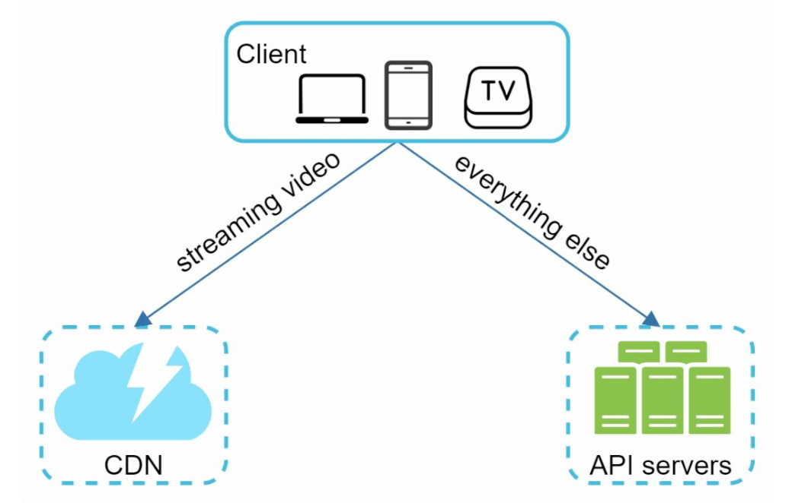

1. **Client:** Các thiết bị đầu cuối của người dùng như điện thoại thông minh, máy tính và Smart TV.
2. **CDN (Content Delivery Network):** Lưu trữ phân tán và phát trực tuyến (stream) các video có lượt xem cao tới người dùng.
3. **API Servers:** Xử lý toàn bộ các tương tác của người dùng ngoại trừ luồng phát video (ví dụ: xử lý yêu cầu upload, cập nhật metadata, gợi ý video, quản lý tài khoản).
4. **Metadata Database:** Lưu trữ thông tin mô tả của video (như tiêu đề, mô tả, kích thước file, định dạng, thông tin người đăng). Được mở rộng bằng Sharding và Replication.
5. **Original Storage:** Hệ thống lưu trữ đối tượng nhị phân (**Blob Storage** như Amazon S3/GCS) dùng để chứa các file video gốc vừa được tải lên.
6. **Transcoding Servers (Encoding Servers):** Cụm máy chủ chuyên chuyển đổi định dạng video gốc sang nhiều độ phân giải (1080p, 720p, 480p...) và định dạng nén khác nhau để tương thích với mọi thiết bị và tốc độ mạng.
7. **Transcoded Storage:** Hệ thống Blob Storage lưu trữ các file video đã hoàn tất quá trình chuyển đổi định dạng (transcoded videos).

---

### Các luồng nghiệp vụ cốt lõi (Core Workflows)
#### 1. Luồng tải video lên (Video Uploading Flow)
Quá trình này được chia thành **2 luồng chạy song song (Parallel Processes)**:
  1. Tải file nội dung video thực tế lên **Original Storage**.
  2. Cập nhật thông tin mô tả (metadata) của video vào **Metadata Database**.

- **Luồng 1 — Xử lý file Video (Steps):**

    

        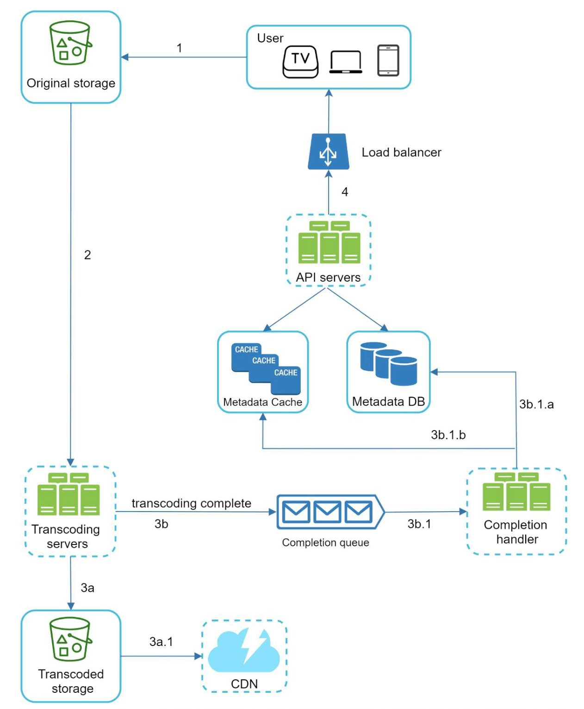
    

    - `[1]` Video gốc được tải trực tiếp lên **Original Storage**. 
    - `[2]` **Transcoding Servers** lấy video từ Original Storage về và tiến hành chuyển đổi (transcode) sang nhiều độ phân giải và định dạng khác nhau.
    - `[3]` Ngay khi quá trình Transcoding hoàn tất, hai bước sau được thực thi song song:
        - `[3a]` Các file video đã chuyển đổi được lưu vào **Transcoded Storage**.
        - `[3b]` Sự kiện hoàn tất chuyển đổi được đẩy vào hàng đợi **Completion Queue**. 
    - `[3a.1]` Các video đã chuyển đổi được phân phối ra mạng lưới **CDN**. 
    - `[3b.1]` Cụm **Completion Handler** kéo sự kiện từ hàng đợi để cập nhật trạng thái vào **Metadata Database & Cache**, đồng thời thông báo cho client biết video đã sẵn sàng để phát.

- **Luồng 2 — Cập nhật Metadata (Steps):**

    

        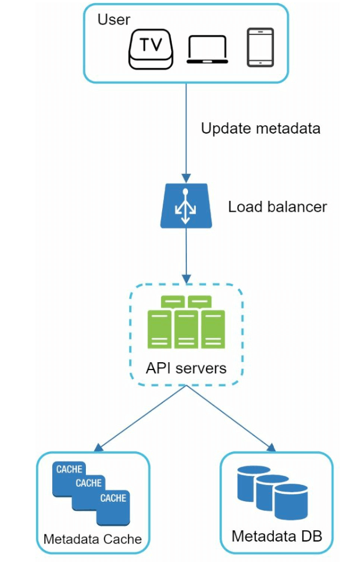
    

    - Trong lúc file video đang được upload lên Original Storage, ứng dụng Client gửi song song một request tới **API Servers** để cập nhật thông tin metadata. 
    - Request này bao gồm tên file, kích thước, định dạng, tiêu đề, mô tả, v.v. để lưu vào Metadata DB.
    
       

#### 2. Luồng phát trực tuyến video (Video Streaming Flow)

  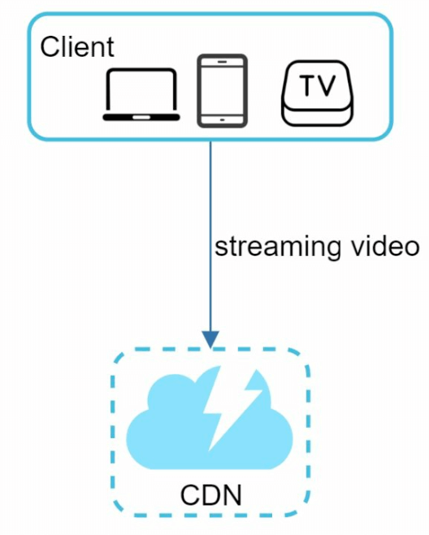

- Khác với việc tải trọn vẹn một file về máy mới xem được, **Streaming** cho phép thiết bị client nhận và phát liên tục từng phần nhỏ (chunks) của video từ server từ xa.
- Các phân đoạn video được truyền phát trực tiếp từ máy chủ biên (**Edge Server**) gần người dùng nhất trên mạng lưới **CDN** để đạt Latency tối thiểu.
- Các giao thức phát trực tuyến thích ứng (Adaptive Bitrate Streaming protocols) phổ biến nhất hiện nay bao gồm:
  - **MPEG-DASH** (Dynamic Adaptive Streaming over HTTP)
  - **Apple HLS** (HTTP Live Streaming)
  - **Microsoft Smooth Streaming**
  - **Adobe HDS** (HTTP Dynamic Streaming)
- *Lưu ý: Mỗi giao thức streaming hỗ trợ các chuẩn mã hóa video (video encodings) và trình phát (video players) khác nhau; chúng ta cần chọn giao thức phù hợp nhất với các nền tảng thiết bị mục tiêu.*

---

## Bước 3: Đi sâu vào thiết kế chi tiết (Design Deep Dive)

### Chuyển đổi định dạng Video (Video Transcoding)
#### Tại sao Video Transcoding lại quan trọng?
1. **Tiết kiệm dung lượng lưu trữ và băng thông:** Video thô (raw video) quay từ thiết bị tiêu tốn dung lượng cực lớn (hàng chục GB cho một video 1080p tốc độ 60fps nếu không nén).
2. **Đảm bảo tính tương thích đa thiết bị:** Nhiều thiết bị và trình duyệt chỉ hỗ trợ một số định dạng video nhất định.
3. **Thích ứng chất lượng theo điều kiện mạng:** Nhờ có nhiều phiên bản độ phân giải, hệ thống có thể tự động hạ độ phân giải xuống thấp hơn khi mạng của người dùng yếu và nâng lên HD/4K khi mạng mạnh để đảm bảo video luôn phát mượt mà không bị dừng (buffering).

#### Hai khái niệm kỹ thuật trong Encoding
- **Container (Định dạng đóng gói):** Giống như một chiếc hộp đóng gói chung luồng hình ảnh (video), âm thanh (audio) và metadata vào một file duy nhất (ví dụ: `.mp4`, `.avi`, `.mov`).
- **Codecs (Thuật toán nén/giải nén):** Các thuật toán nén và giải nén dữ liệu hình ảnh để giảm kích thước file mà vẫn giữ chất lượng hiển thị (ví dụ: `H.264`, `VP9`, `HEVC/H.265`, `AV1`).

#### Mô hình Đồ thị có hướng không chu trình (Directed Acyclic Graph - DAG Model)

    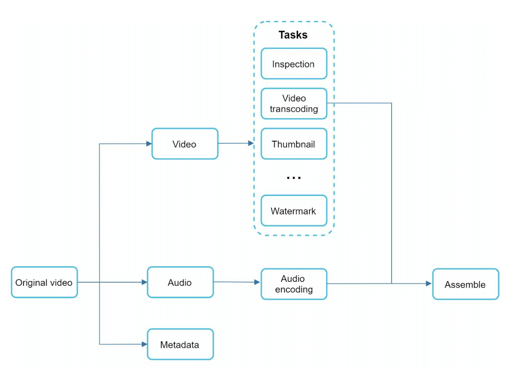

- Việc transcode một video tiêu tốn rất nhiều tài nguyên tính toán CPU/GPU và mất nhiều thời gian. Hơn nữa, mỗi nhà sáng tạo nội dung lại có các yêu cầu xử lý hậu kỳ khác nhau (người thì tự tải ảnh thu nhỏ lên, người thì muốn hệ thống tự cắt ảnh thumbnail, người cần gắn watermark bản quyền, người chỉ cần độ phân giải 720p thay vì 4K).
- Để hỗ trợ các pipeline xử lý tùy biến linh hoạt và tận dụng tối đa **khả năng xử lý song song (high parallelism)**, hệ thống áp dụng mô hình **DAG (Directed Acyclic Graph)** để định nghĩa các tác vụ theo từng giai đoạn.

- Trong mô hình DAG này, video gốc đầu vào được tách thành 3 nhánh xử lý độc lập: **Video**, **Audio** và **Metadata**: 
    - **Nhánh Video:** Thực hiện kiểm tra chất lượng (Inspection), chuyển đổi sang nhiều độ phân giải/bitrates (`360p.mp4`, `480p.mp4`, `720p.mp4`, `1080p.mp4`, `4k.mp4`), trích xuất ảnh thu nhỏ (**Thumbnail**) và chèn hình mờ định danh (**Watermark**).
    - **Nhánh Audio:** Mã hóa luồng âm thanh (Audio Encoding).
    - Sau khi các nhánh con hoàn thành, chúng sẽ được ghép nối lại thành các file video hoàn chỉnh ở bước cuối cùng.

---

### Kiến trúc chi tiết hệ thống Video Transcoding

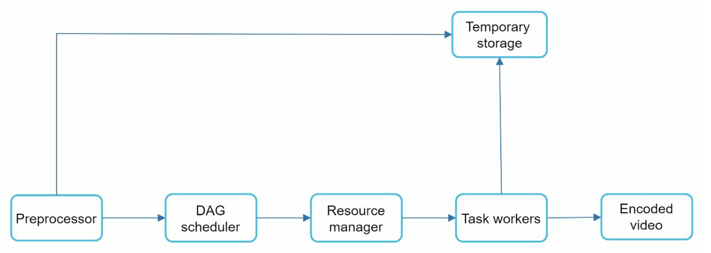

1. **Preprocessor (Bộ tiền xử lý):** Đảm nhiệm 4 chức năng chính trước khi đưa vào mã hóa:

    

        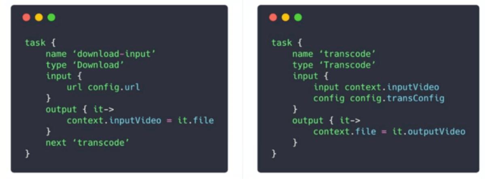
    

    - **Chia nhỏ Video (Video Splitting):** Cắt luồng video thành các đoạn nhỏ độc lập gọi là **GOP (Group of Pictures)** — một nhóm các khung hình (frames) được sắp xếp theo trình tự cụ thể có thể phát độc lập (thường dài vài giây).
    - Tương thích ngược cho các thiết bị/client đời cũ chưa hỗ trợ tự cắt GOP ở phía client.
    - **Khởi tạo đồ thị DAG (DAG Generation):** Đọc các file cấu hình do lập trình viên định nghĩa để tự động sinh ra sơ đồ thực thi DAG tương ứng. 
    - **Lưu trữ tạm dữ liệu (Cache Data):** Lưu các đoạn GOP và metadata vào **Temporary Storage** để nếu một bước encoding bị lỗi giữa chừng, hệ thống có thể lấy lại dữ liệu trung gian này để thử lại (retry) mà không phải chạy lại từ đầu.

2. **DAG Scheduler (Bộ lập lịch DAG):** Chia tách đồ thị DAG thành các giai đoạn (stages) tuần tự hoặc song song.
    

        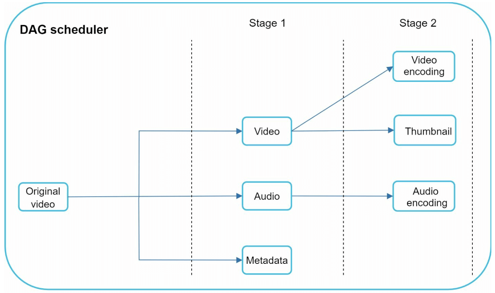
    

    - Tách một đồ thị DAG thành từng Stage và đẩy các tác vụ của từng Stage vào hàng đợi **Task Queue** bên trong **Resource Manager**. 
    - Ví dụ ở **Stage 1**: tách luồng Video, Audio và Metadata.
    - Sau khi Stage 1 hoàn tất, file video được đẩy tiếp sang **Stage 2** gồm 2 tác vụ chạy song song: mã hóa video (Video Encoding) và tạo ảnh thu nhỏ (Thumbnail generation). 

3. **Resource Manager (Bộ quản lý tài nguyên):** Chịu trách nhiệm phân bổ tài nguyên tính toán hiệu quả nhất thông qua 3 hàng đợi và 1 bộ lập lịch tác vụ:
    

        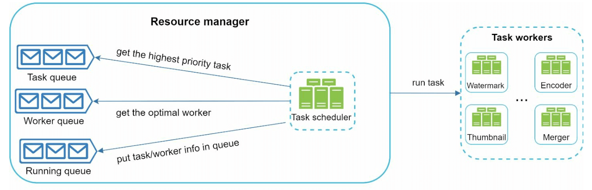
    

    - **Task Queue:** Hàng đợi ưu tiên (Priority Queue) chứa các tác vụ đang chờ được thực thi.
    - **Worker Queue:** Hàng đợi ưu tiên chứa thông tin về mức độ sử dụng tài nguyên (CPU/RAM utilization) hiện tại của các Worker servers.
    - **Running Queue:** Lưu thông tin về các tác vụ đang chạy và Worker nào đang đảm nhiệm tác vụ đó.
    - **Task Scheduler:** Chọn ra cặp Task và Worker tối ưu nhất, đưa vào Running Queue và ra lệnh cho Worker thực thi công việc.

4. **Task Workers:** Cụm máy chủ thực thi các tác vụ được định nghĩa trong DAG.
    

        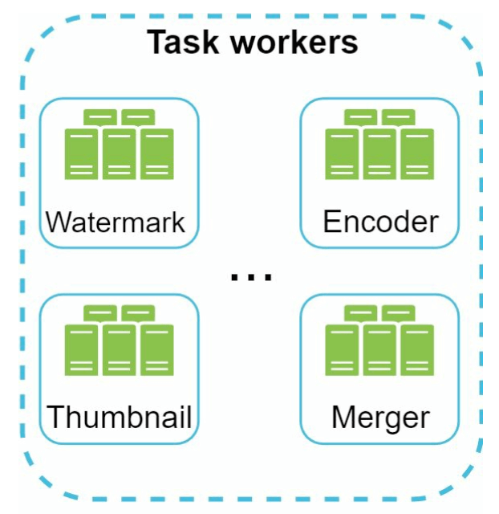
   

    - Các loại Task Workers khác nhau sẽ chuyên trách chạy các tác vụ khác nhau (Watermark, Thumbnail, Encoding, Merger) tùy theo yêu cầu CPU hay GPU.

5. **Temporary Storage (Lưu trữ tạm thời):** Lưu dữ liệu trung gian giữa các bước để hỗ trợ retry nhanh.
    - Việc chọn loại lưu trữ phụ thuộc vào kích thước và tần suất truy xuất: Metadata nhỏ và được worker đọc/ghi liên tục nên lưu trong **RAM/Cache**; còn dữ liệu Video/Audio dung lượng lớn nên lưu trên **Blob Storage**. Dữ liệu tạm này sẽ được xóa ngay khi toàn bộ quá trình xử lý video hoàn tất.
6. **Output (Đầu ra):** Các file video đã được chuyển đổi hoàn chỉnh và sẵn sàng phân phối lên Transcoded Storage / CDN.

---

## Các kỹ thuật tối ưu hóa toàn hệ thống (System Optimizations)

### 1. Tối ưu hóa tốc độ (Speed Optimizations)
1. **Tải video lên song song (Parallel Video Uploads):** Nếu upload cả một file video lớn nguyên khối, chỉ cần rớt mạng giữa chừng là phải tải lại từ đầu. Giải pháp là để chính ứng dụng **Client cắt nhỏ video thành các đoạn GOP (chunks)** ngay trên thiết bị, sau đó upload song song nhiều đoạn cùng lúc và hỗ trợ tải tiếp khi mất kết nối (**Resumable Uploads**).

    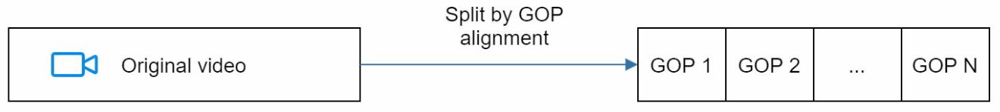

2. **Đặt trung tâm tiếp nhận Upload gần người dùng (Upload Centers Close to Users):** Tận dụng chính các điểm hiện diện của **CDN (Edge Servers)** trên toàn cầu làm trạm tiếp nhận upload để rút ngắn quãng đường truyền mạng của người dùng.
3. **Xử lý song song hóa toàn diện (Parallelism Everywhere):** Để đạt Latency thấp, hệ thống tách rời sự phụ thuộc (decouple) giữa các bước (Download → Encode → Upload → CDN) bằng cách đặt các **Message Queues** ở giữa. Nhờ đó, ngay khi một đoạn GOP vừa được tải lên, bước Encode có thể bắt đầu xử lý ngay đoạn đó mà không cần chờ toàn bộ file video tải xong!

    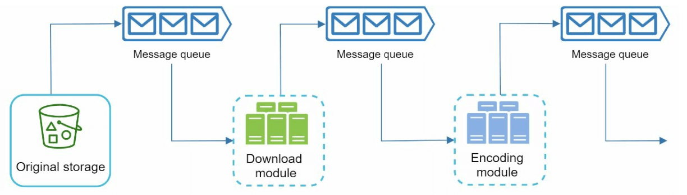
    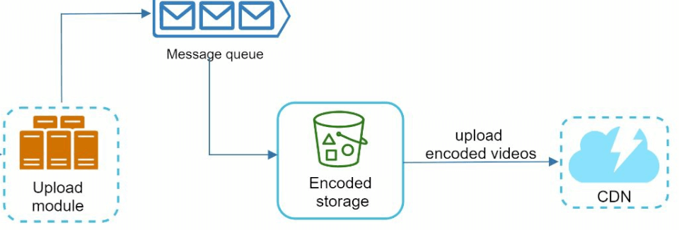

### 2. Tối ưu hóa bảo mật và an toàn nội dung (Safety Optimizations)
1. **Sử dụng Pre-Signed URLs khi Upload:** Để đảm bảo chỉ những người dùng đã được xác thực và cấp quyền mới có thể tải video trực tiếp lên Cloud Storage (mà không làm nghẽn API Servers), Client sẽ gọi API Server trước để xin một **Pre-Signed URL** (hoặc Shared Access Signature) có thời hạn ngắn, sau đó dùng URL này để đẩy thẳng file lên S3/Blob Storage.

    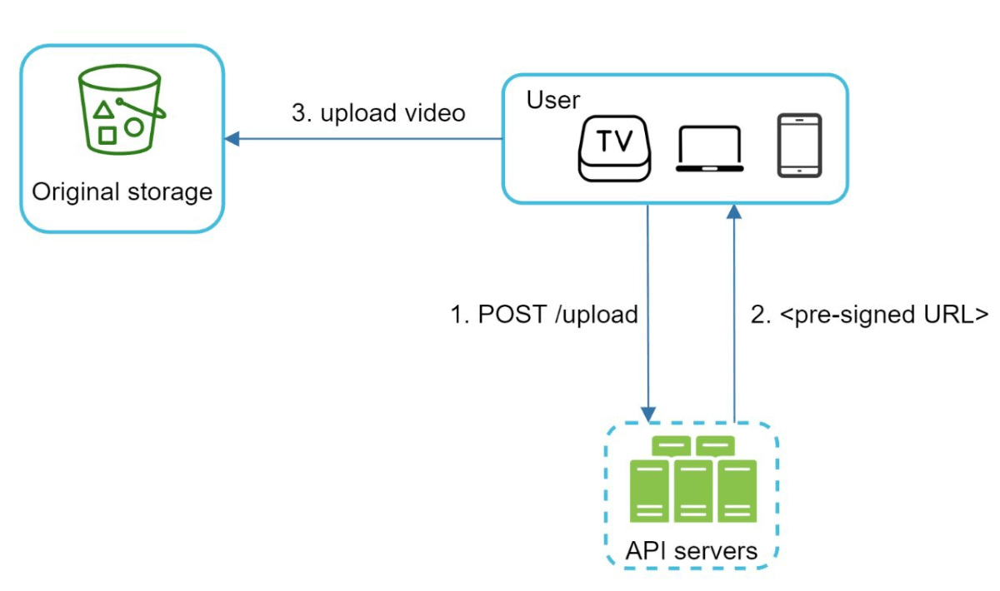

2. **Bảo vệ bản quyền Video (Protect Copyrighted Videos):**
   - **Hệ thống quản lý bản quyền số (DRM Systems):** Sử dụng Apple FairPlay, Google Widevine hoặc Microsoft PlayReady.
   - **Mã hóa AES (AES Encryption):** Mã hóa luồng video và chỉ cấp khóa giải mã khi người dùng được xác thực lúc phát.
   - **Đóng dấu bản quyền trực quan (Visual Watermarking):** Chèn logo hoặc thông tin định danh chủ sở hữu lên khung hình video.

### 3. Tối ưu hóa tiết kiệm chi phí hạ tầng (Cost-Saving Optimizations)
Lưu lượng video tuân theo **quy luật phân phối đuôi dài (Long-tail distribution)**: một số ít video cực kỳ nổi tiếng chiếm phần lớn lượt xem, trong khi hàng tỷ video còn lại hầu như có rất ít hoặc không có ai xem. Dựa trên đặc điểm này, ta áp dụng 4 chiến lược cắt giảm chi phí:
1. **Chỉ lưu các video phổ biến trên CDN:** Các video có lượt xem thấp sẽ được phục vụ trực tiếp từ các cụm máy chủ lưu trữ dung lượng cao (High-capacity Storage Servers) của hệ thống để tiết kiệm chi phí CDN đắt đỏ.
2. **Giảm số phiên bản mã hóa cho video ít người xem:** Những video ngắn hoặc ít lượt xem có thể chỉ cần mã hóa sẵn ở 1-2 độ phân giải cơ bản, và chỉ mã hóa theo yêu cầu (**On-demand encoding**) khi thực sự có người bấm xem.
3. **Phân phối theo khu vực địa lý (Regional Distribution):** Một số video chỉ phổ biến ở một quốc gia hoặc khu vực nhất định, do đó không cần nhân bản tràn lan ra tất cả các CDN trên toàn cầu.
4. **Tự xây dựng CDN riêng và hợp tác với các nhà mạng (ISPs):** Khi đạt quy mô khổng lồ như YouTube hay Netflix (Open Connect), việc tự xây dựng hạ tầng CDN và đặt máy chủ cache ngay bên trong mạng lưới của các ISP giúp tiết kiệm hàng trăm triệu đô la chi phí băng thông mỗi năm.

---

## Xử lý lỗi (Error Handling)
### 1. Lỗi có thể tự phục hồi (Recoverable Errors)
- Các lỗi tạm thời như lỗi mạng khi upload, một node Transcoding bị sập, hay lỗi kết nối Database: Hệ thống tự động **thử lại (Retry)** một vài lần (ví dụ 3 lần). Nếu vẫn thất bại thì trả mã lỗi chuẩn về cho client.
- Nếu một đoạn GOP bị lỗi trong lúc transcode, Worker chỉ cần lấy lại đoạn đó từ Temporary Storage để chạy lại thay vì hủy bỏ cả video.

### 2. Lỗi không thể phục hồi (Non-Recoverable Errors)
- Ví dụ: File video tải lên bị hỏng định dạng nghiêm trọng (malformed video format) không thể đọc được. Hệ thống sẽ dừng ngay lập tức toàn bộ các tác vụ DAG liên quan đến video đó và trả về thông báo lỗi cụ thể cho người dùng.
