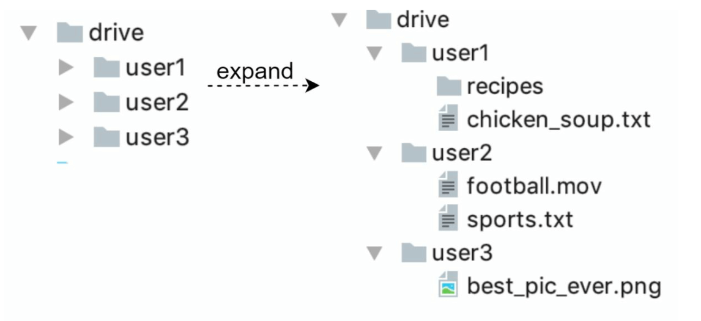
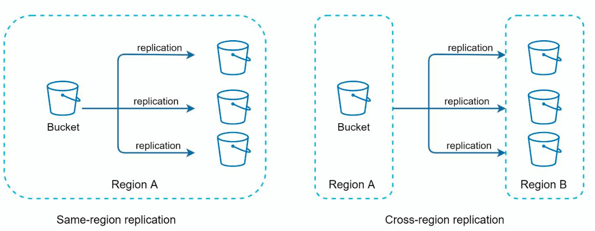
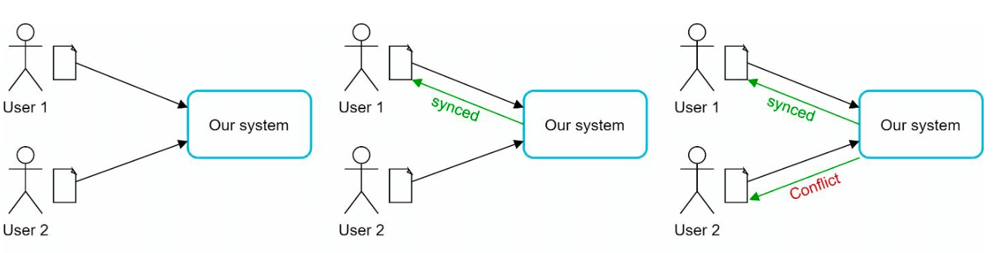
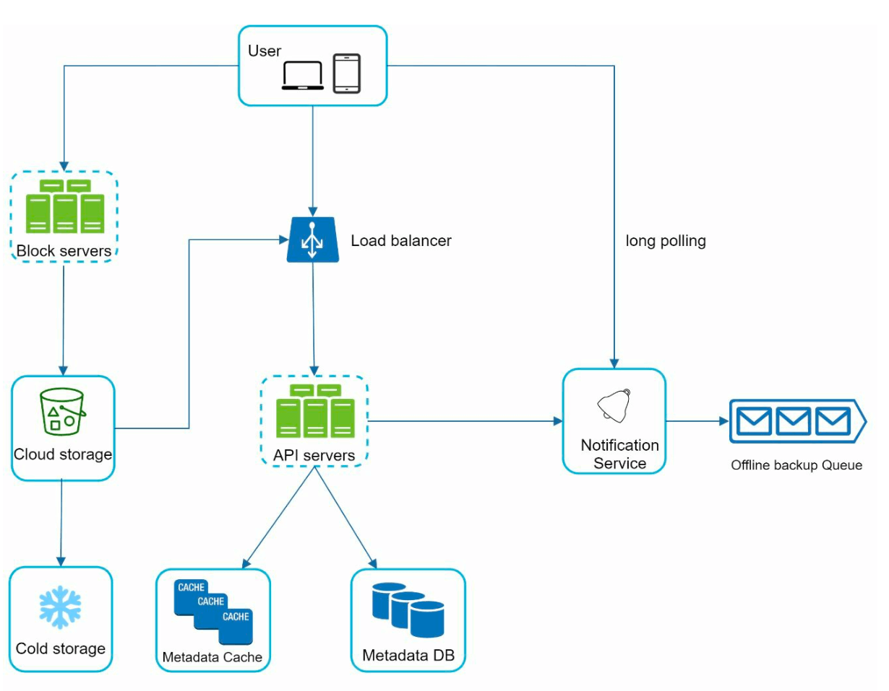
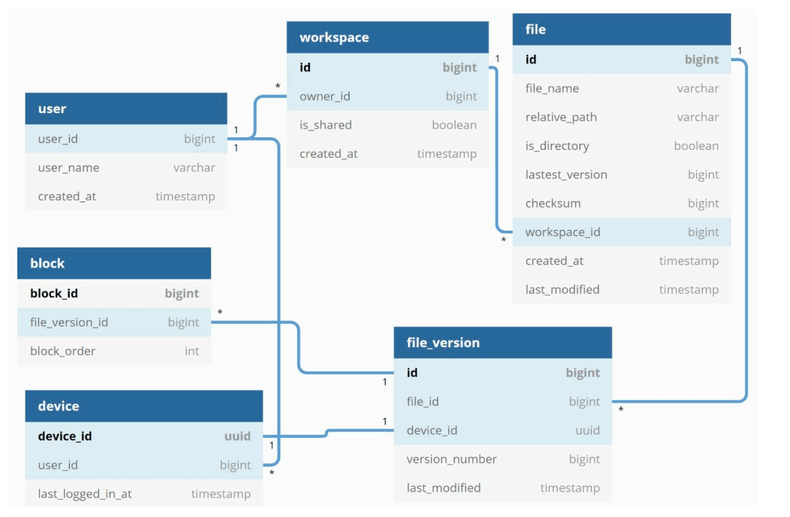
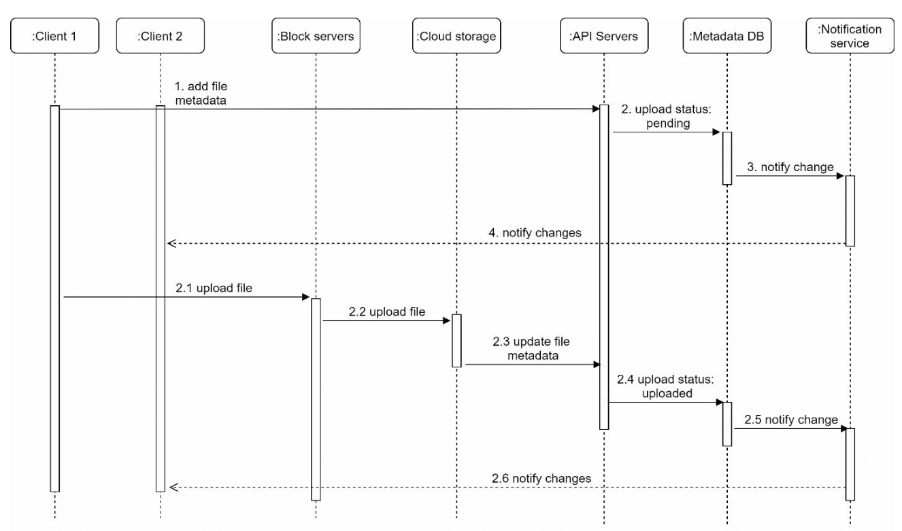
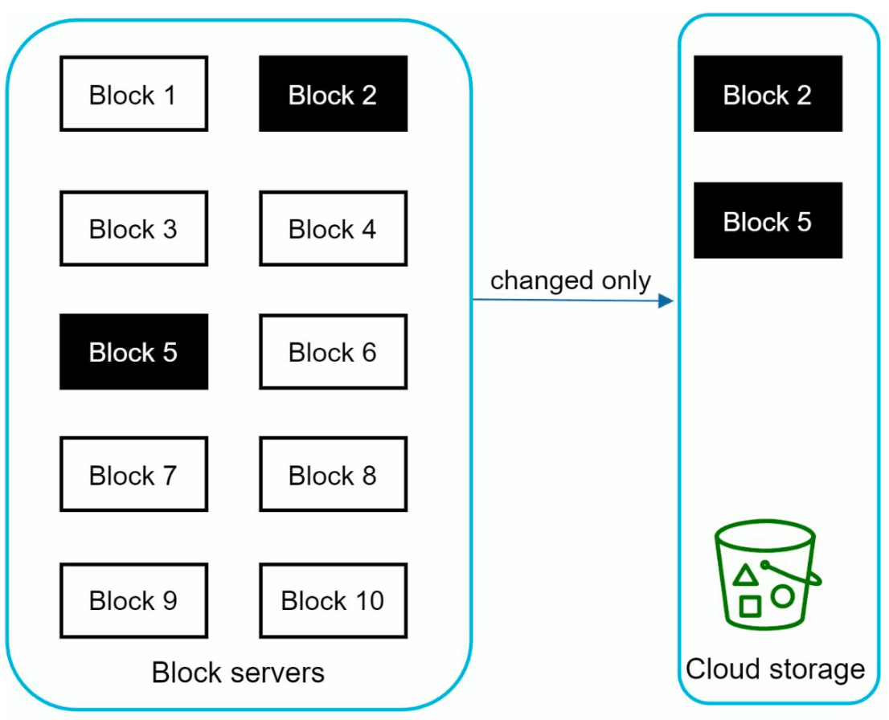
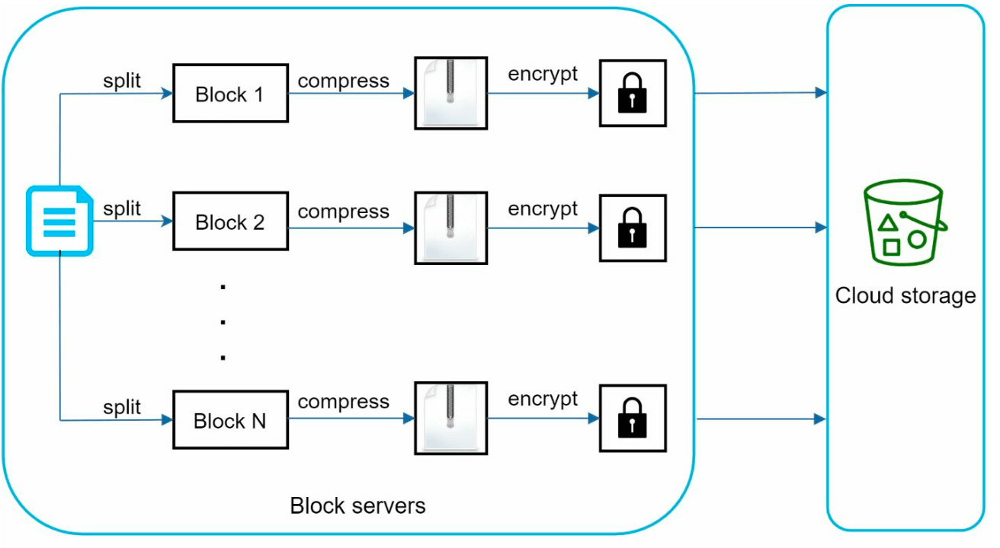
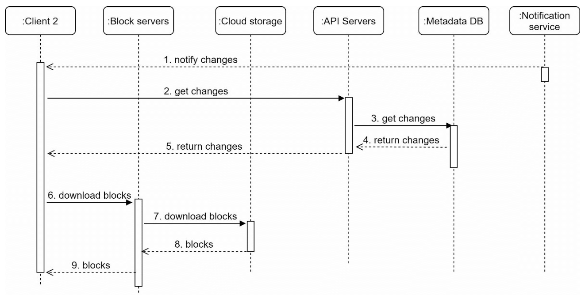

# Chương 15: Thiết kế Google Drive (Design Google Drive)

## Giới thiệu
Google Drive (hay Dropbox, OneDrive) là dịch vụ lưu trữ và đồng bộ hóa tập tin trên đám mây (cloud file storage and synchronization service), cho phép người dùng lưu trữ, truy cập và chia sẻ tài liệu xuyên suốt trên nhiều thiết bị khác nhau. Chương này trình bày cách thiết kế một hệ thống lưu trữ đám mây có khả năng mở rộng cao với các tính năng cốt lõi sau:
- **Tải file lên và Tải file xuống (File Upload and Download)**
- **Đồng bộ hóa file tự động giữa nhiều thiết bị (File Sync Across Devices)**
- **Chia sẻ file (File Sharing)**
- **Lưu lịch sử phiên bản chỉnh sửa (File Revision History)**
- **Gửi thông báo khi file được chỉnh sửa, xóa hoặc chia sẻ (Notifications)**

---

## Bước 1: Thấu hiểu bài toán (Understanding the Problem)

### Các yêu cầu cốt lõi
#### Yêu cầu chức năng (Functional Requirements):
- Thêm/Tải file lên (Upload) và tải file về (Download) với mọi định dạng file bất kỳ.
- Tự động đồng bộ hóa file (Sync) giữa nhiều thiết bị của người dùng.
- Lưu trữ lịch sử các phiên bản sửa đổi của file (File revisions).
- Cho phép chia sẻ file với bạn bè và đồng nghiệp.
- Gửi thông báo theo thời gian thực khi file được sửa đổi, xóa hoặc chia sẻ mới.

#### Yêu cầu phi chức năng (Non-Functional Requirements):
- **Độ tin cậy tuyệt đối (Reliability):** Độ bền vững của dữ liệu là ưu tiên số một; việc mất mát dữ liệu (Data Loss) là hoàn toàn không thể chấp nhận được.
- **Tốc độ đồng bộ nhanh (Fast Sync Speed):** Nếu việc đồng bộ mất quá nhiều thời gian, người dùng sẽ mất kiên nhẫn và từ bỏ sản phẩm.
- **Tối ưu băng thông mạng (Bandwidth Efficiency):** Nếu một file lớn chỉ sửa một vài dòng mà phải truyền tải lại toàn bộ file sẽ làm tốn rất nhiều băng thông và dung lượng 4G/5G của người dùng.
- **Khả năng mở rộng (Scalability):** Phục vụ **10 triệu người dùng hoạt động hàng ngày (10M DAU)** (trong tổng số 50 triệu người dùng đã đăng ký).
- **Tính sẵn sàng cao (High Availability):** Người dùng vẫn phải truy cập được file ngay cả khi một số server bị sập hoặc mạng bị chậm/lỗi một phần.

### Các ràng buộc và Ước lượng sơ bộ (Constraints and Assumptions)
- Mỗi người dùng được cấp **10 GB dung lượng lưu trữ miễn phí**.
- Kích thước tối đa của một file: **10 GB**.
- Kích thước trung bình của một file tải lên: **500 KB**.
- Tần suất tải lên trung bình: **2 file mỗi ngày cho mỗi người dùng** (Peak QPS cho thao tác upload là khoảng `~480 QPS`).
- Tổng dung lượng lưu trữ cần thiết cho 50 triệu người dùng: `50 triệu * 10 GB =` **500 PB**.

---

## Bước 2: Thiết kế tổng quan (High-Level Design)
### Khởi đầu với thiết lập máy chủ đơn lẻ (Single-Server Setup)
Một kiến trúc khởi đầu đơn giản chạy trên một server duy nhất bao gồm:
1. **Web Server:** Xử lý toàn bộ các request upload và download file.
2. **Metadata Database:** Lưu trữ thông tin quản lý như tài khoản người dùng, thông tin đăng nhập, tên file, kích thước file.
3. **Hệ thống lưu trữ cục bộ (Storage Directory):** Chứa các file thực tế được tổ chức theo không gian tên (**Namespaces**).

    

- Trên Web Server, ta tạo một thư mục gốc tên là `drive/` để lưu các file tải lên. 
- Bên dưới thư mục `drive/` là danh sách các thư mục con được gọi là các **namespaces**, mỗi namespace tương ứng với một người dùng. 
- Mỗi file hoặc thư mục của người dùng có thể được xác định duy nhất bằng cách ghép nối `namespace` với đường dẫn tương đối (`relative path`).

Thiết kế này rất dễ hiểu ở giai đoạn khởi đầu nhưng không thể mở rộng khi ổ cứng đầy hoặc lưu lượng tăng cao.

#### Thiết kế các API cốt lõi
1. **API Tải file lên Google Drive (Upload API):** Hỗ trợ 2 chế độ upload:
    - **Simple upload:** Dùng khi kích thước file nhỏ, đẩy toàn bộ file trong 1 request.
    - **Resumable upload (Tải lên có thể tiếp tục khi gián đoạn):** Dùng khi file có dung lượng lớn và nguy cơ rớt mạng cao.
        - Endpoint: `https://api.example.com/files/upload?uploadType=resumable`
        - Bước 1: Gửi request khởi tạo ban đầu để lấy về một đường dẫn phiên tải lên (`resumable URL`).
        - Bước 2: Đẩy dữ liệu từng phần lên qua URL đó và liên tục theo dõi trạng thái tiến độ upload.
        - Bước 3: Nếu kết nối mạng bị đứt giữa chừng, truy vấn lại vị trí byte đã nhận trên server và tiếp tục upload phần còn lại thay vì phải tải lại từ đầu.
2. **API Tải file từ Google Drive về máy (Download API):**
    - Endpoint: `https://api.example.com/files/download` (Params: `{ "path": "/recipes/soup/best_soup.txt" }`)
3. **API Lấy lịch sử phiên bản của file (Get File Revisions API):**
    - Endpoint: `https://api.example.com/files/list_revisions` (Params: `{ "path": "/recipes/soup/best_soup.txt", "limit": 20 }`)

### Chuyển dịch sang Hệ thống Phân tán (Moving to Distributed Systems)

#### Các bước nâng cấp kiến trúc:
1. **Sharding:** Phân mảnh lưu trữ dữ liệu qua nhiều server dựa trên khóa `user_id`.
2. **Sử dụng Cloud Object Storage (như Amazon S3):** Lưu trữ file trên hệ thống Object Storage đạt chuẩn công nghiệp với cơ chế tự động sao chép dữ liệu trong cùng khu vực (same-region) và liên khu vực (**Cross-region replication**) để chống mất dữ liệu.

    
     
3. **Load Balancer:** Đặt trước cụm Web Servers để phân phối lưu lượng truy cập đồng đều và tự động chuyển đổi dự phòng (failover).
4. **Tách biệt và Nhân bản Metadata Database:** Tách Database ra khỏi Web Servers, áp dụng Replication và Sharding để tránh SPOF.

#### Xử lý xung đột khi đồng bộ (Sync Conflicts):
Trong một hệ thống lưu trữ lớn như Google Drive, hiện tượng **xung đột đồng bộ (Sync Conflicts)** chắc chắn sẽ xảy ra khi hai người dùng (hoặc hai thiết bị của cùng một người) sửa đổi cùng một file tại cùng một thời điểm.

- Chiến lược giải quyết của chúng ta là: **Phiên bản nào được hệ thống xử lý trước sẽ thắng (First processed version wins)**, phiên bản đến sau sẽ nhận thông báo xung đột.
- Trong ví dụ trên, `User 1` và `User 2` cùng cập nhật một file đồng thời, nhưng bản cập nhật của `User 1` đi tới server trước nên được chấp nhận lưu thành công.
- Khi bản cập nhật của `User 2` tới sau, hệ thống phát hiện xung đột phiên bản. Lúc này, hệ thống sẽ không ghi đè làm mất công sức của `User 2` mà giữ lại cả **hai bản sao**: bản cục bộ của `User 2` (`local copy`) và bản mới nhất trên server của `User 1` (`latest version`).
- `User 2` sau đó có quyền lựa chọn gộp (merge) nội dung cả hai file lại hoặc chọn giữ lại một phiên bản.

### Kiến trúc tổng quan hoàn chỉnh (Improved High-Level Design)

1. **Client (Người dùng):** Sử dụng ứng dụng qua trình duyệt Web, ứng dụng cài đặt trên Desktop hoặc ứng dụng Mobile.

2. **Block Servers (Máy chủ xử lý khối dữ liệu):**
   - Chịu trách nhiệm chia nhỏ các file lớn thành nhiều khối dữ liệu độc lập (**Blocks / Chunks**, kích thước tối đa mỗi block thường là **4 MB** — tương tự thiết kế của Dropbox).
   - Nén (compress), mã hóa (encrypt) từng block và gán cho mỗi block một giá trị băm duy nhất (`hash value`), sau đó đẩy các block này lên Cloud Storage.
   - Khi cần tải file về, Block Servers sẽ ghép nối các block lại theo đúng thứ tự ban đầu để tái tạo lại file gốc.

3. **Cloud Storage:** Các block dữ liệu đã tách nhỏ và mã hóa được lưu trữ bền vững trên Cloud Object Storage (như Amazon S3) và nhân bản liên khu vực.

4. **Cold Storage (Lưu trữ lạnh):** Những file cũ không được người dùng truy cập trong một thời gian dài (ví dụ hàng tháng hoặc hàng năm) sẽ được chuyển sang tầng lưu trữ lạnh (như Amazon S3 Glacier) với chi phí rẻ hơn rất nhiều.

5. **Load Balancer:** Phân phối request đồng đều tới cụm API Servers.

6. **API Servers:**
   - Đảm nhiệm tất cả các luồng nghiệp vụ ngoại trừ việc truyền tải luồng dữ liệu file (như xác thực người dùng, quản lý thông tin tài khoản, cập nhật metadata của file).

7. **Metadata Database và Metadata Cache:**
   - Database lưu trữ thông tin metadata của người dùng, files, danh sách blocks và lịch sử các phiên bản (versions) —*không lưu nội dung file thực tế*.
   - **Metadata Cache** lưu bộ nhớ đệm các metadata thường xuyên truy cập để phản hồi tức thì.

8. **Notification Service:**
   - Hệ thống thông báo theo mô hình **Publisher/Subscriber** (sử dụng **Long Polling** hoặc WebSocket) để báo ngay cho các thiết bị client biết mỗi khi có một file được thêm mới, chỉnh sửa hoặc xóa bỏ ở nơi khác, giúp client chủ động kéo bản cập nhật mới nhất về.

9. **Offline Backup Queue:** Nếu một thiết bị client đang ngoại tuyến (offline) khi file bị thay đổi, hàng đợi này sẽ lưu giữ tạm thông tin các thay đổi đó để ngay khi thiết bị kết nối mạng trở lại, nó sẽ đồng bộ đầy đủ.

---

## Bước 3: Đi sâu vào thiết kế chi tiết (Design Deep Dive)

### Thiết kế Metadata Database
Vì hệ thống đòi hỏi **Tính nhất quán mạnh (Strong Consistency)** và hỗ trợ các giao dịch nguyên tử (**ACID transactions**) để quản lý phiên bản file chính xác, chúng ta lựa chọn **Cơ sở dữ liệu quan hệ (RDBMS)** cho Metadata Database.
#### Thiết kế lược đồ bảng (Schema Design):
- **Bảng `user`:** Lưu thông tin cơ bản về tài khoản người dùng (tên, email, ảnh đại diện, dung lượng đã dùng).
- **Bảng `device`:** Lưu thông tin các thiết bị của người dùng và `push_id` để gửi thông báo đẩy (một người dùng có thể có nhiều thiết bị).
- **Bảng `namespace`:** Thư mục gốc của từng người dùng.
- **Bảng `file`:** Lưu thông tin mới nhất của từng file (tên file, đường dẫn `relative_path`, trạng thái `latest_version`, v.v.).
- **Bảng `file_version`:** Lưu lịch sử các phiên bản sửa đổi của một file. Các dòng trong bảng này là **chỉ đọc (read-only)** để bảo vệ tính toàn vẹn của lịch sử chỉnh sửa.
- **Bảng `block`:** Lưu thông tin từng khối dữ liệu 4 MB liên kết với một `file_version` cụ thể kèm theo thứ tự ghép nối (`block_order`). Một file ở bất kỳ phiên bản nào cũng được tái tạo lại bằng cách nối các block theo đúng thứ tự này.

---

### Luồng tải file lên (File Upload Flow)
Khi `Client 1` tải một file lên, hai yêu cầu được gửi đi song song: **(1) Yêu cầu thêm metadata của file** và **(2) Yêu cầu tải nội dung file lên Cloud Storage**.

1. **Cập nhật Metadata (Luồng 1):**
   - `Client 1` gửi request thêm metadata của file mới lên **API Servers**.
   - API Server lưu metadata của file mới vào **Metadata DB** và cập nhật trạng thái tải lên (`upload_status`) thành `"pending"` (đang xử lý).
   - API Server thông báo cho **Notification Service** rằng có một file đang được tải lên, và Notification Service báo cho `Client 2` biết.
2. **Tải nội dung File (Luồng 2 - chạy song song):**
   - `Client 1` đẩy nội dung file lên **Block Servers**.
   - **Block Servers** chia nhỏ file thành các blocks (tối đa 4 MB), nén, mã hóa từng block rồi tải lên **Cloud Storage**.
3. **Hoàn tất quá trình Upload:**
   - Ngay khi file được lưu xong trên Cloud Storage, một sự kiện **Callback (Webhook)** được kích hoạt gọi ngược về **API Servers**.
   - API Server đổi trạng thái của file trong Metadata DB từ `"pending"` sang `"uploaded"`, đồng thời báo cho **Notification Service** để thông báo cho `Client 2` rằng file đã tải lên hoàn tất.

---

### Kỹ thuật đồng bộ hóa File tối ưu (File Sync & Block Servers)
Đối với các file có dung lượng lớn được cập nhật thường xuyên, việc gửi lại toàn bộ file mỗi lần sửa đổi sẽ tiêu tốn rất nhiều băng thông mạng. Block Servers tối ưu hóa bằng hai kỹ thuật:
1. **Đồng bộ vi sai (Delta Sync):** Khi một file bị chỉnh sửa, thay vì tải lại toàn bộ các block, chỉ có **những block thực sự bị thay đổi (modified blocks)** mới được truyền lên Cloud Storage bằng thuật toán đồng bộ hóa truyền nhận.

    

    
    

2. **Nén dữ liệu (Compression):** Nén từng block giúp giảm đáng kể kích thước truyền tải. Thuật toán nén được chọn tùy theo loại file: ví dụ `gzip` hoặc `bzip2` dùng để nén các file văn bản/tài liệu, trong khi các thuật toán chuyên biệt được dùng cho ảnh và video. 
3. **Quy trình xử lý tại Block Server:** Chia file thành các block 4MB → Nén từng block → Mã hóa bảo mật từng block → Chỉ đẩy các block mới/thay đổi lên Cloud Storage.

---

### Luồng tải file xuống (File Download Flow)
Luồng Download được kích hoạt tự động khi một file được thêm mới hoặc chỉnh sửa từ một thiết bị khác. Có hai cách để thiết bị `Client A` biết được có thay đổi:
- Nếu `Client A` đang **Online** lúc file bị thay đổi bởi thiết bị khác, **Notification Service** sẽ báo ngay cho `Client A` biết cần kéo dữ liệu mới về.
- Nếu `Client A` đang **Offline**, thông tin thay đổi được lưu vào Cache/Offline Queue; ngay khi `Client A` có mạng trở lại, nó sẽ chủ động kéo các thay đổi mới nhất về.

Khi `Client A` biết có file thay đổi, quy trình tải về diễn ra như sau:
1. **Nhận thông báo (Trigger):** Notification Service báo cho `Client A` rằng một file vừa được cập nhật ở nơi khác.
2. **Lấy Metadata (Metadata Fetch):** `Client A` gửi request tới **API Servers** để lấy danh sách metadata các block đã thay đổi (API Server đọc từ Metadata Cache/DB).
3. **Tải các Block và Tái tạo File (Block Download):** Sau khi có danh sách các block cần cập nhật, `Client A` liên hệ với **Block Servers** để tải các block đó từ Cloud Storage về và ghép lại thành file mới hoàn chỉnh trên máy.

---

### Thiết kế chi tiết Notification Service
1. **Mục đích:** Đảm bảo tính nhất quán của file giữa các thiết bị bằng cách thông báo tức thì cho các client mỗi khi có sự kiện thay đổi file, giảm thiểu nguy cơ xảy ra xung đột phiên bản.
2. **Giao thức lựa chọn:** Giữa hai lựa chọn là **Long Polling** và **WebSocket**, chúng ta chọn **Long Polling** cho Google Drive bởi vì:
   - Giao tiếp của Notification Service ở đây là **một chiều** (chỉ cần server báo tin xuống cho client), và tần suất thông báo sửa file không diễn ra dồn dập từng giây như hệ thống Chat, nên không cần thiết phải duy trì kết nối hai chiều phức tạp của WebSocket.
3. **Cơ chế hoạt động:** Mỗi client thiết lập một kết nối Long Polling tới Notification Service. Ngay khi phát hiện có thay đổi đối với một file, Notification Service sẽ đóng kết nối Long Polling đó lại (trả về phản hồi có thay đổi). Hành động đóng kết nối này là tín hiệu kích hoạt để client lập tức gọi lên Metadata Server lấy thông tin mới nhất, sau đó mở lại một request Long Polling mới để chờ tiếp.

---

### Tối ưu hóa chi phí lưu trữ (Storage Optimization)
Để hỗ trợ lưu lịch sử phiên bản và đảm bảo độ tin cậy với chi phí hạ tầng thấp nhất, ta áp dụng 3 kỹ thuật:
1. **Chống trùng lặp dữ liệu (Data De-duplication):** Loại bỏ các khối dữ liệu (blocks) bị trùng lặp ở cấp độ tài khoản bằng cách so sánh giá trị băm (`hash value`) của hai block. Nếu block mới có mã hash trùng khớp với một block đã có trên hệ thống, ta chỉ cần trỏ metadata vào block cũ mà không cần lưu thêm bản sao vật lý mới.
2. **Chiến lược quản lý phiên bản thông minh (Intelligent Data Backup Strategy):**
   - **Đặt giới hạn số lượng phiên bản (Set a limit):** Giới hạn số lượng lịch sử phiên bản tối đa được lưu cho mỗi file; nếu vượt ngưỡng, phiên bản mới nhất sẽ thay thế phiên bản cũ nhất.
   - **Chỉ giữ lại các phiên bản có giá trị (Keep valuable versions only):** Một số tài liệu có thể được tự động lưu nháp hàng nghìn lần trong thời gian ngắn; thay vì lưu mọi lần sửa nhỏ gây lãng phí dung lượng, hệ thống gộp hoặc gán trọng số cao hơn cho các phiên bản quan trọng gần đây.
3. **Di chuyển dữ liệu ít truy cập sang Lưu trữ lạnh (Moving Infrequently Used Data to Cold Storage):** Các phiên bản file cũ không được mở trong nhiều tháng hoặc nhiều năm sẽ được tự động chuyển từ Amazon S3 chuẩn sang **Amazon S3 Glacier** có chi phí lưu trữ rẻ hơn hàng chục lần.

---

### Xử lý sự cố hệ thống (Failure Handling)
1. **Sự cố sập Load Balancer:** Load Balancer dự phòng (Secondary) sẽ tự động kích hoạt thông qua cơ chế theo dõi nhịp tim (heartbeat) giữa các Load Balancers.
2. **Sự cố sập Block Server:** Các Block Servers khác sẽ tiếp nhận các tác vụ đang dang dở hoặc chưa hoàn thành.
3. **Sự cố sập Cloud Storage:** Vì các bucket trên S3 đã được nhân bản xuyên qua nhiều khu vực địa lý (Cross-Region Replication), nếu một khu vực gặp sự cố, hệ thống sẽ tự động lấy file từ khu vực dự phòng.
4. **Sự cố sập API Server:** Đây là dịch vụ Stateless; Load Balancer sẽ ngừng gửi lưu lượng tới server bị lỗi và điều hướng toàn bộ sang các API Servers khỏe mạnh còn lại.
5. **Sự cố sập Metadata Cache:** Các dữ liệu metadata đã được nhân bản trên nhiều node cache; nếu một node sập, client vẫn đọc được từ các node khác và một node cache mới sẽ được dựng lên thay thế.
6. **Sự cố sập Metadata Database:**
   - **Nếu Master DB bị sập:** Nâng cấp (promote) một Slave DB lên làm Master mới và khởi tạo một Slave mới để bù vào.
   - **Nếu Slave DB bị sập:** Chuyển hướng các thao tác đọc sang các Slave DB khỏe mạnh khác và dựng server mới thay thế.
7. **Sự cố sập Notification Service:** Mỗi Notification Server đang giữ hàng trăm nghìn kết nối Long Polling với người dùng. Nếu một server bị sập, tất cả các kết nối Long Polling trên đó sẽ bị đứt và các client sẽ phải kết nối lại (reconnect) sang một server khác. Do việc đồng thời tái kết nối hàng triệu client rất chậm, việc khôi phục kết nối Long Polling sẽ được thực hiện rải dần để tránh gây nghẽn mạng.
8. **Sự cố đầy hàng đợi Offline Backup Queue:** Nếu một hàng đợi bị đầy hoặc lỗi, các hàng đợi dự phòng có thể đăng ký nhận dữ liệu thay thế.
