# Chương 16: Dịch vụ tìm kiếm lân cận (Proximity Service)

## Giới thiệu
Một **dịch vụ tìm kiếm lân cận (Proximity Service)** được thiết kế để tìm kiếm các địa điểm ở gần vị trí hiện tại của người dùng như nhà hàng, khách sạn, trạm xăng, rạp chiếu phim hoặc các cơ sở kinh doanh khác. Tính năng cốt lõi này được sử dụng rộng rãi trong các ứng dụng như **Google Maps**, **Yelp** hay **GrabFood** nhằm giúp người dùng khám phá các địa điểm xung quanh trong một bán kính xác định.


## Bước 1: Thấu hiểu bài toán và Xác lập phạm vi (Understanding the Problem and Establishing Scope)

### **Yêu cầu chức năng (Functional Requirements)**
1. **Tìm kiếm các địa điểm kinh doanh (businesses)** dựa trên tọa độ vị trí hiện tại của người dùng (`latitude` - vĩ độ, `longitude` - kinh độ) và bán kính tìm kiếm (`radius`).
2. **Cho phép chủ doanh nghiệp** thêm mới, cập nhật hoặc xóa thông tin địa điểm kinh doanh (các thay đổi này không bắt buộc phải có hiệu lực ngay lập tức theo thời gian thực, có thể cập nhật vào ngày hôm sau).
3. **Xem thông tin chi tiết của một địa điểm kinh doanh** khi người dùng nhấp vào.

### **Yêu cầu phi chức năng (Non-Functional Requirements)**
- **Latency thấp:** Người dùng phải nhận được kết quả tìm kiếm địa điểm lân cận một cách nhanh chóng (dưới vài trăm mili-giây).
- **Bảo mật quyền riêng tư dữ liệu (Data Privacy):** Tuân thủ chặt chẽ các quy định pháp lý về dữ liệu vị trí cá nhân như GDPR và CCPA.
- **Tính sẵn sàng cao (High Availability) & Khả năng mở rộng:** Xử lý tốt các đợt lưu lượng tăng đột biến vào giờ cao điểm (như giờ ăn trưa/ăn tối) tại các khu vực đô thị đông đúc.

### **Ước lượng sơ bộ (Back-of-the-Envelope Estimation)**
- **100 triệu người dùng hoạt động hàng ngày (100M DAU).**
- **200 triệu địa điểm kinh doanh (businesses)** trên toàn hệ thống.
- **Tính toán Search QPS:**
  - Giả sử mỗi người dùng thực hiện trung bình **5 lượt tìm kiếm mỗi ngày**.
  - **Search QPS** = `(100M × 5) / 86,400` ≈ **5,000 QPS**.

---

## Bước 2: Thiết kế tổng quan (High-Level Design)

### **Thiết kế API (API Design)**
#### **1. Tìm kiếm địa điểm lân cận (Search Nearby Businesses)**
`GET /v1/search/nearby`

- **Các tham số truy vấn (Request Parameters):**
  - `latitude`: Vĩ độ hiện tại của người dùng (kiểu `decimal`).
  - `longitude`: Kinh độ hiện tại của người dùng (kiểu `decimal`).
  - `radius`: Bán kính tìm kiếm tính bằng mét (mặc định: `5000m`, tức khoảng 5 km).

#### **2. Các API quản lý địa điểm kinh doanh (Business APIs)**
| API Endpoint                     | Mô tả chức năng                                  |
|-----------------------------------|--------------------------------------------------|
| `GET /v1/businesses/{id}`         | Lấy thông tin chi tiết của một địa điểm kinh doanh |
| `POST /v1/businesses`             | Thêm mới một địa điểm kinh doanh                 |
| `PUT /v1/businesses/{id}`         | Cập nhật thông tin chi tiết của địa điểm         |
| `DELETE /v1/businesses/{id}`      | Xóa một địa điểm kinh doanh khỏi hệ thống        |


### **Mô hình dữ liệu (Data Model) — Đọc/Ghi**
- Khối lượng truy vấn đọc (**Read volume**) của hệ thống này cực kỳ cao vì hai tính năng: (1) Tìm kiếm địa điểm lân cận và (2) Xem chi tiết địa điểm được người dùng sử dụng liên tục.
- Ngược lại, tần suất ghi (**Write volume**) lại rất thấp vì các chủ cửa hàng hiếm khi thay đổi địa chỉ hay thông tin quán hàng ngày. Với hệ thống thiên hẳn về đọc (**Read-heavy**) và dữ liệu có cấu trúc rõ ràng, một cơ sở dữ liệu quan hệ (RDBMS) như **MySQL** hoặc **PostgreSQL** là lựa chọn rất phù hợp.

### **Lược đồ dữ liệu (Data Schema)**
- Hai bảng cơ sở dữ liệu cốt lõi nhất là bảng thông tin doanh nghiệp (`business` table) và bảng chỉ mục không gian địa lý (`geospatial_index` table).
- Bảng `business` lưu trữ toàn bộ thông tin chi tiết về một địa điểm (`business_id`, địa chỉ, thành phố, bang, quốc gia, `latitude`, `longitude`, giờ mở cửa...).

### **Kiến trúc hệ thống tổng quan (High-Level System Architecture)**
Hệ thống được tách thành hai dịch vụ độc lập: **Location-Based Service (LBS)** và **Business Service**.

<div style="margin-left:3rem">
    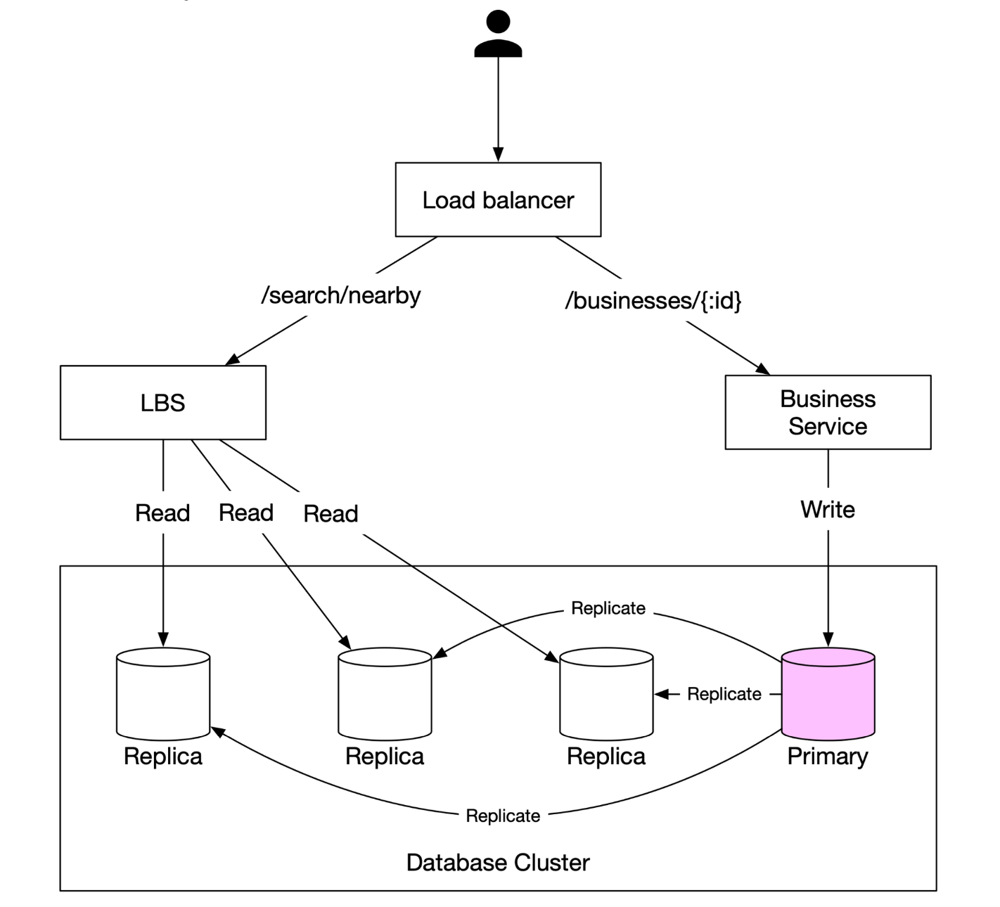
</div>

- **Location-Based Service (LBS - Dịch vụ định vị):** 
  - Chuyên xử lý các truy vấn tìm kiếm địa điểm lân cận theo tọa độ và bán kính.
  - Là dịch vụ thuần đọc (**Read-only service**), hoàn toàn không có thao tác ghi.
  - Chịu tải QPS rất cao vào giờ cao điểm và được thiết kế hoàn toàn **Stateless** nên rất dễ mở rộng theo chiều ngang.
- **Business Service (Dịch vụ quản lý địa điểm):** Xử lý hai nhóm request:
  - Chủ doanh nghiệp tạo mới, cập nhật hoặc xóa địa điểm (chủ yếu là thao tác ghi, QPS thấp).
  - Khách hàng xem thông tin chi tiết của một cửa hàng (thao tác đọc, QPS cao vào giờ cao điểm).
- **Load Balancer:** Tự động phân tích đường dẫn API để điều hướng lưu lượng truy cập tới cụm LBS hoặc cụm Business Service tương ứng.
- **Cụm Database (Database Cluster):** 
  - Sử dụng kiến trúc **Primary-Replica (Master-Slave)** để tách tải đọc và tải ghi: Primary Database nhận toàn bộ lệnh ghi, sau đó sao chép dữ liệu sang các Read Replicas để phục vụ LBS và truy vấn đọc.
  - Do độ trễ sao chép (replication lag), có thể có sự chênh lệch nhỏ tạm thời giữa dữ liệu vừa ghi vào Primary DB và dữ liệu đọc ra từ Replicas (**Eventual Consistency**).
  - Sự thiếu nhất quán ngắn hạn này hoàn toàn không phải là vấn đề vì thông tin địa điểm kinh doanh không đòi hỏi phải cập nhật tức thì theo thời gian thực.


---

## Bước 3: Các thuật toán tìm kiếm địa điểm lân cận (Algorithms for Fetching Nearby Businesses)

Trong thực tế, hầu hết các công ty tận dụng sẵn các cơ sở dữ liệu hỗ trợ chỉ mục không gian địa lý như Redis Geohash hoặc Postgres với tiện ích mở rộng PostGIS. Tuy nhiên trong buổi phỏng vấn System Design, việc giải thích rõ cơ chế hoạt động bên dưới của các thuật toán đánh chỉ mục không gian sẽ giúp bạn ghi điểm tuyệt đối.

### **Phương án 1: Tìm kiếm hai chiều trên mặt phẳng (Two-Dimensional Search — Cách tiếp cận ngây thơ)**

<div style="margin-left:3rem">
    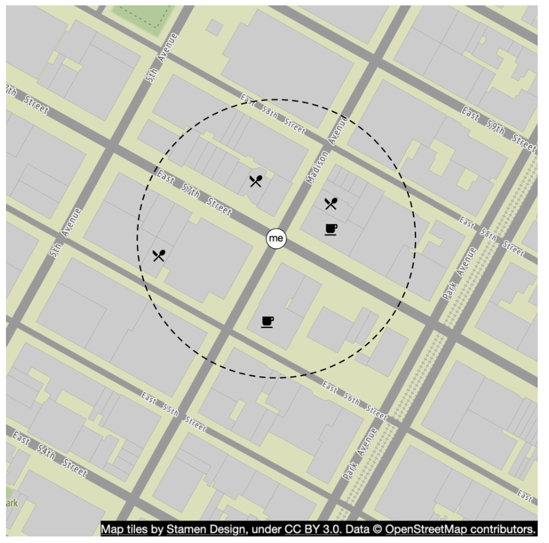
</div>

Cách trực quan nhất là vẽ một hình tròn (hoặc khung hình chữ nhật bao quanh) có bán kính cho trước lấy người dùng làm tâm, sau đó tìm tất cả các địa điểm nằm trong vùng vĩ độ và kinh độ đó.

**Câu truy vấn SQL giả (Pseudo SQL Query):**
```
SELECT business_id, latitude, longitude
FROM business
WHERE (latitude BETWEEN :lat - radius AND :lat + radius)
AND (longitude BETWEEN :long - radius AND :long + radius);
```
**Vấn đề của cách tiếp cận này:**
- **Cực kỳ kém hiệu quả:** Với 200 triệu bản ghi, việc quét toàn bộ bảng (full table scan) là quá chậm.
- **Giới hạn của chỉ mục một chiều (1D Index):** Kể cả khi ta đánh index riêng trên hai cột `latitude` và `longitude`, tốc độ vẫn không cải thiện được nhiều. Lý do là mỗi index truyền thống (B-Tree) chỉ lọc nhanh được trên một chiều: Tập kết quả thứ nhất (nằm trong dải kinh độ) và tập kết quả thứ hai (nằm trong dải vĩ độ) đều chứa hàng triệu địa điểm trải dài khắp thế giới; việc thực hiện phép giao (**Intersection**) giữa hai tập dữ liệu khổng lồ này vẫn rất tốn kém.

### Hướng tiếp cận tốt hơn: Chỉ mục không gian địa lý (Geospatial Indexing)
- Điểm yếu của database index thông thường là chỉ tối ưu cho tìm kiếm 1 chiều. Vậy làm sao để ánh xạ dữ liệu tọa độ 2 chiều (`latitude`, `longitude`) về thành **dữ liệu 1 chiều** để có thể đánh index và truy xuất nhanh?
- Các thuật toán đánh chỉ mục không gian địa lý (Geospatial Indexing) được chia thành 2 nhóm chính:
  - **Nhóm dựa trên Băm (Hash-based):** Chia lưới đều (Even Grid), **Geohash**, Cartesian Tiers.
  - **Nhóm dựa trên Cây (Tree-based):** **Quadtree**, **Google S2**, R-Tree.

  <div style="margin-left:3rem">
    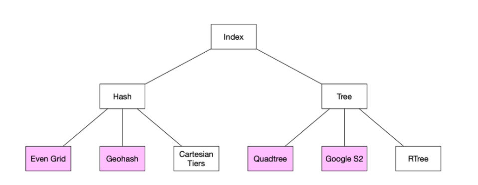
  </div>


### **Phương án 2: Chia lưới kích thước đều (Evenly Divided Grid)**

  <div style="margin-left:3rem">
    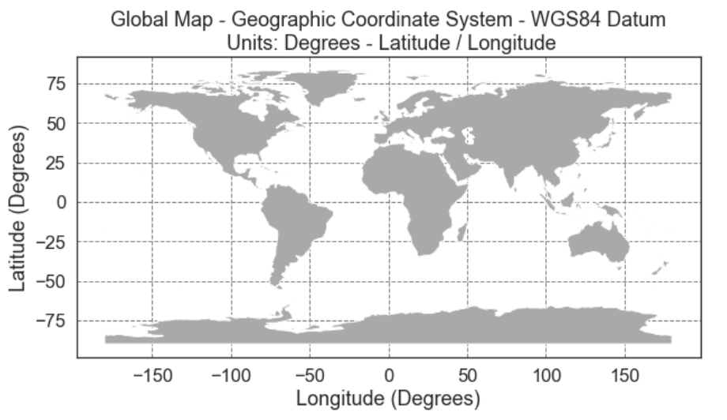
  </div>

- **Cách hoạt động:** Chia bản đồ toàn thế giới thành các ô lưới chữ nhật có kích thước cố định bằng nhau. Mỗi ô lưới chứa danh sách các địa điểm nằm trong nó.
- **Nhược điểm lớn:** Sự phân bố của các cơ sở kinh doanh trong thực tế **rất không đồng đều**: vùng đại dương hay sa mạc hầu như không có cửa hàng nào, trong khi một ô lưới nhỏ ở trung tâm New York hay Tokyo lại chứa hàng chục nghìn địa điểm, gây lệch tải nghiêm trọng.

### **Phương án 3: Geohash**
**Geohash** là phiên bản cải tiến vượt bậc từ phương pháp chia lưới đều, hoạt động bằng cách chia đệ quy không gian 2D thành các ô lưới nhỏ dần:
- Đầu tiên, chia bề mặt Trái Đất thành 4 phần tư (quadrants) dọc theo kinh tuyến gốc (Prime Meridian) và đường xích đạo (Equator): nửa Tây gán bit `0`, nửa Đông gán bit `1`; nửa Nam gán bit `0`, nửa Bắc gán bit `1`.
- Tiếp tục chia nhỏ từng ô thành 4 ô con nhỏ hơn và lặp lại quy trình gán bit xen kẽ giữa kinh độ (longitude) và vĩ độ (latitude).

  <div style="margin-left:3rem">
    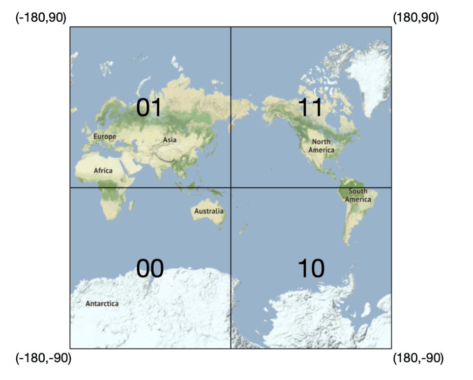
    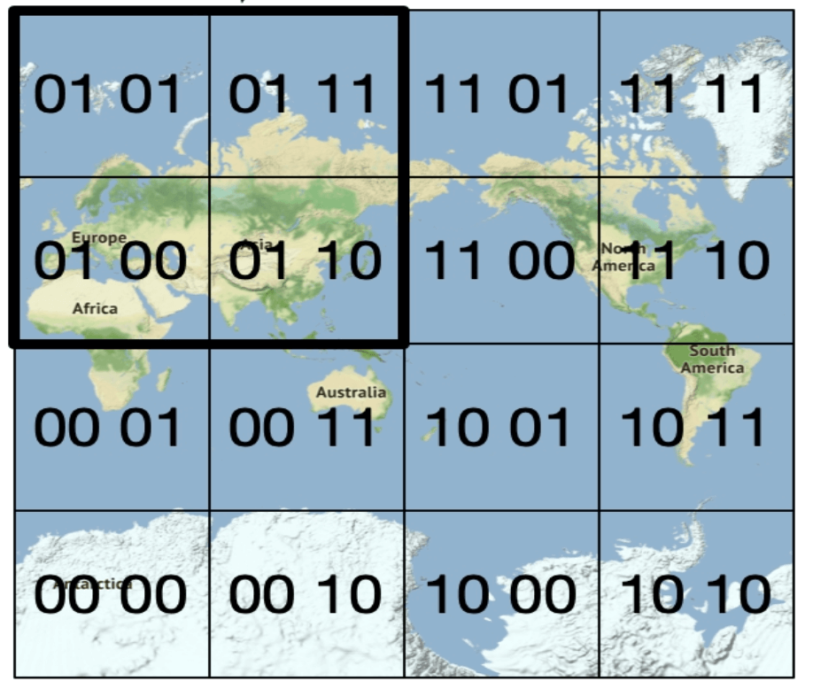
  </div>


- **Mã hóa tọa độ 2D thành một chuỗi ký tự chữ và số (Base32 alphanumeric string) duy nhất:** Chuỗi Geohash thường có **12 cấp độ chính xác (precision levels — độ dài từ 1 đến 12 ký tự)**.
- Trong bài toán tìm kiếm lân cận, chúng ta chỉ quan tâm đến các cấp độ từ **4 đến 6** (cấp 6 tương ứng ô lưới khoảng `1.2km × 609.4m`, cấp 4 tương ứng khoảng `39.1km × 19.5km`).
- Ta chọn độ dài chuỗi Geohash tối ưu tương ứng với bán kính tìm kiếm mà người dùng yêu cầu dựa vào bảng ánh xạ chuẩn:
  <div style="margin-left:3rem">
    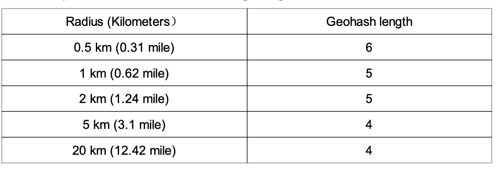
  </div>
- **Đặc tính cốt lõi:** Geohash đảm bảo rằng phần tiền tố chung (shared prefix) giữa hai mã Geohash càng dài thì hai vị trí đó càng gần nhau (nằm trong cùng một ô lưới cha).

- **Các vấn đề biên giới của Geohash (Boundary Issues) và Giải pháp:**
  <div style="margin-left:3rem">
    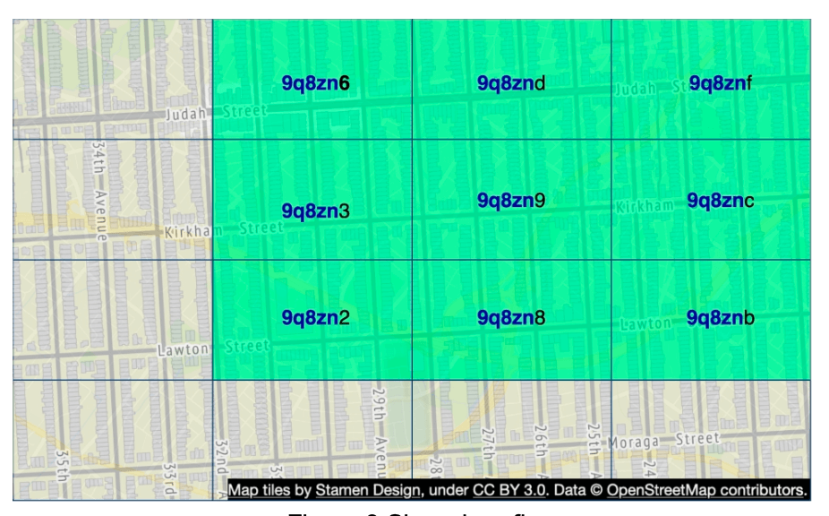
  </div>

  - **Vấn đề biên giới 1:** Hai địa điểm nằm rất gần nhau ngoài đời thực nhưng lại nằm ở hai phía đối diện của đường biên phân chia (ví dụ hai bên đường xích đạo hoặc kinh tuyến gốc) sẽ có hai chuỗi Geohash hoàn toàn khác nhau, không có chung bất kỳ ký tự tiền tố nào!
  - **Vấn đề biên giới 2:** Hai vị trí nằm sát mép biên giới của hai ô lưới cạnh nhau sẽ không tìm thấy nhau nếu chỉ dùng câu lệnh `WHERE geohash LIKE '9q8zn%'`.
  - **Giải pháp triệt để:** Khi tìm kiếm, thay vì chỉ lấy các địa điểm nằm trong duy nhất ô Geohash của người dùng, ta tính toán và lấy danh sách địa điểm của **cả ô hiện tại lẫn 8 ô Geohash hàng xóm bao quanh nó (tổng cộng 9 ô)**; việc tính toán 8 ô Geohash lân cận có thể thực hiện trong thời gian hằng số $O(1)$.


### **Phương án 4: Cây tứ phân (Quadtree)**

  Một **Quadtree** là cấu trúc dữ liệu dạng cây dùng để phân hoạch không gian 2 chiều bằng cách chia đệ quy một vùng thành 4 phần tư (quadrants): mỗi nút trong (internal node) có đúng 4 nút con đại diện cho 4 góc Đông Bắc (`NE`), Tây Bắc (`NW`), Đông Nam (`SE`), Tây Nam (`SW`).
  - Khác với Geohash là chuỗi lưu trong DB, **Quadtree là một cấu trúc dữ liệu nằm hoàn toàn trên bộ nhớ RAM (In-memory data structure)** được dựng lên trên mỗi máy chủ LBS ngay khi khởi động server.

  <div style="margin-left:3rem">
    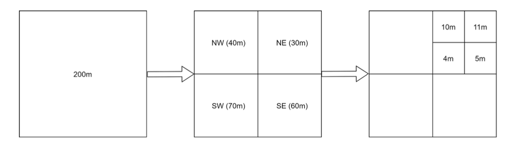
  </div>

  - **Quy tắc dựng cây thích ứng mật độ:** Nút gốc đại diện cho toàn thế giới sẽ liên tục được chia nhỏ đệ quy thành 4 phần tư cho đến khi số lượng địa điểm kinh doanh nằm trong mỗi nút lá không vượt quá một ngưỡng quy định (ví dụ tối đa `100` địa điểm mỗi nút lá). Nhờ đó, những thành phố đông đúc sẽ tự động có ô lưới cực nhỏ và chi tiết, còn vùng đại dương/nông thôn thưa thớt sẽ có ô lưới rất lớn.

  <div style="margin-left:3rem">
    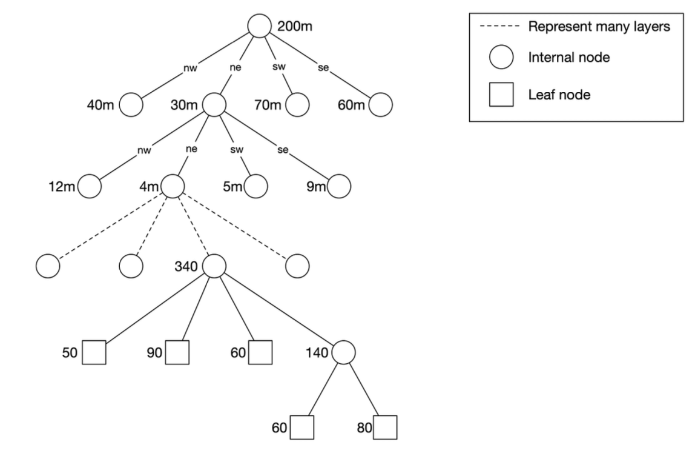
  </div>

- **Chi phí bộ nhớ thấp:** Đối với 200 triệu địa điểm, toàn bộ cây Quadtree trên RAM chỉ chiếm khoảng **~1.7 GB bộ nhớ**, hoàn toàn nằm gọn gàng trong RAM của một server thông thường.
- Độ phức tạp thời gian để dựng cây là $O(n \log n)$, có thể mất vài phút khi server khởi động.
- **Rất mạnh cho bài toán tìm `k` địa điểm gần nhất ($k$-nearest neighbors):** Ví dụ người dùng đang sắp hết xăng và chỉ muốn tìm "trạm xăng gần nhất" bất kể nó cách 500m hay 20km, cấu trúc cây của Quadtree dễ dàng mở rộng sang các nút lân cận cho đến khi gom đủ $k$ kết quả.

  <div style="margin-left:3rem">
    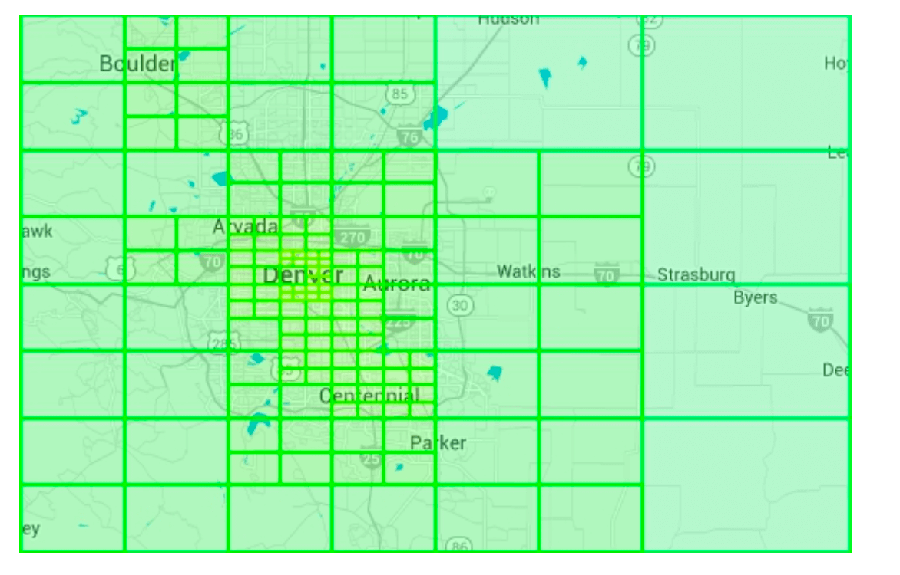
  </div>

#### Các lưu ý vận hành thực tế với Quadtree (Operational Considerations)
 - Vì việc dựng cây Quadtree cho 200 triệu địa điểm mất vài phút lúc khởi động và trong thời gian đó server chưa thể nhận traffic, khi triển khai bản cập nhật mới (deployment), ta phải thực hiện **triển khai cuốn chiếu (Rolling Deployment)** từng nhóm nhỏ LBS servers để tránh làm sập dịch vụ.
 - Làm sao để cập nhật cây Quadtree khi có địa điểm mới hoặc thay đổi? Do yêu cầu đề bài cho phép cập nhật vào ngày hôm sau, cách đơn giản nhất là chạy job dựng lại cây định kỳ hàng đêm theo từng cụm server.
 - Ngoài ra cũng có thể cập nhật trực tiếp nút trên cây theo thời gian thực (on-the-fly), nhưng sẽ phức tạp hơn rất nhiều vì phải cài đặt cơ chế khóa (Locking/Mutex) khi nhiều luồng cùng đọc và chia tách/gộp nút trên cây.

### **Phương án 5: Google S2 Geometry**
Giống như Quadtree, **Google S2** cũng là một giải pháp đánh chỉ mục trên bộ nhớ (in-memory), nhưng nó ánh xạ các điểm trên **bề mặt hình cầu (sphere)** sang **chỉ mục 1 chiều (1D index)** dựa trên thuật toán toán học gọi là **Đường cong lấp đầy không gian Hilbert (Hilbert Curve)**.
- Đường cong Hilbert có một tính chất tuyệt vời: **Hai điểm nằm gần nhau trên đường cong Hilbert 1 chiều thì cũng chắc chắn nằm gần nhau trong không gian thực tế!**


  <div style="margin-left:3rem">
    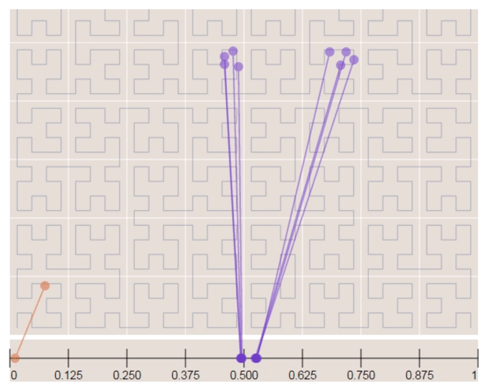
    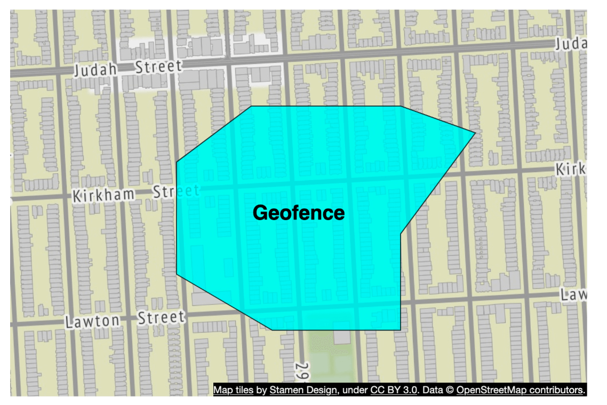
  </div>

- **Ưu điểm vượt trội cho bài toán Hàng rào địa lý (Geofencing):** S2 có thể phủ kín một khu vực có hình dạng bất kỳ (như ranh giới một thành phố hay khu vực giao hàng) bằng các ô (cells) có kích thước/cấp độ linh hoạt khác nhau.
- Thay vì bị bó buộc vào một cấp độ chính xác cố định như Geohash, trong Google S2 ta có thể chỉ định `min_level`, `max_level` và `max_cells` thông qua thuật toán **Region Coverer** để bao phủ vùng tìm kiếm một cách chính xác nhất.


## Bảng so sánh đánh đổi: Geohash vs. Quadtree

#### Geohash
- Rất dễ sử dụng và triển khai — không cần viết logic dựng và cân bằng cây trên RAM.
- Hỗ trợ tốt bài toán tìm kiếm trong bán kính cố định.
- Việc cập nhật/thêm/xóa địa điểm cực kỳ đơn giản (chỉ là một câu lệnh `INSERT`/`DELETE` vào bảng index hoặc Redis).
- Không thể tự động co giãn kích thước ô lưới theo mật độ dân số/cửa hàng.

#### Quadtree
- Khó cài đặt hơn vì phải tự quản lý cấu trúc cây trên bộ nhớ.
- Hỗ trợ tự nhiên bài toán tìm kiếm `k` địa điểm gần nhất ($k$-nearest businesses) mà không phụ thuộc bán kính cố định.
- Tự động điều chỉnh kích thước ô lưới thích ứng hoàn hảo với mật độ dân cư thực tế.
- Việc cập nhật chỉ mục phức tạp hơn (thường phải rebuild lại cây định kỳ hoặc dùng cơ chế khóa phức tạp).

---

## Bước 4: Mở rộng tầng Database và Chiến lược Caching (Scaling the Database and Caching Strategy)

### **1. Mở rộng bảng Business (`business` table)**
- Dữ liệu chi tiết của 200 triệu doanh nghiệp có thể không vừa trong một server duy nhất hoặc một server không chịu nổi tải đọc/ghi.
- Giải pháp: **Sharding bảng `business` dựa trên khóa `business_id`**, giúp phân tán dữ liệu và tải hoàn toàn đồng đều giữa tất cả các shards.

### **2. Mở rộng bảng Chỉ mục không gian địa lý (`geospatial_index` table)**
Giả sử chúng ta chọn phương án **Geohash** cho hệ thống. Thay vì lưu tất cả `business_id` của một Geohash thành một mảng JSON trong một dòng (rất dễ bị lỗi Race Condition khi cập nhật đồng thời), ta tách mỗi doanh nghiệp thành **một dòng riêng biệt (Compound Key: `geohash`, `business_id`)**:

| Geohash | Business ID |
|---------|------------|
| 9q9hvu  | 343        |
| 9q9hvu  | 347        |
| 9q9hvu  | 112        |

- Vì bảng `geospatial_index` này chỉ có 2 cột rất nhỏ nên toàn bộ 200 triệu dòng chỉ chiếm vài GB dung lượng, hoàn toàn **nằm vừa vặn trên một database server duy nhất**, do đó không cần thiết phải Sharding bảng này (tránh việc phải fan-out truy vấn qua nhiều shard).
- Để chịu tải đọc 5.000 QPS, ta chỉ cần triển khai một cụm **Read Replicas** nhân bản bảng này ra nhiều máy chủ đọc.

---

### **3. Chiến lược Caching (Cache Strategy)**
Trước khi thêm lớp Cache, hãy tự hỏi: Có thực sự cần Cache không? Với dữ liệu thuần đọc (Read-heavy) và kích thước nhỏ gọn, việc đặt một lớp **Redis Cache** phía trước Database sẽ giúp giảm Latency xuống mức vài mili-giây và tiết kiệm chi phí mở rộng Read Replicas.
- **Chọn Cache Key nào?** Nhiều người nghĩ ngay đến việc dùng tọa độ GPS `(latitude, longitude)` của người dùng làm Cache Key, nhưng cách này **sai lầm** vì:
  1. Tọa độ GPS trả về từ điện thoại không tuyệt đối chính xác và dao động nhẹ ở các chữ số thập phân cuối trong mỗi lần đo.
  2. Người dùng chỉ cần bước đi vài bước chân là tọa độ đã thay đổi, dẫn đến tỷ lệ Cache Hit gần như bằng 0.
- **Giải pháp chuẩn:** Sử dụng chính mã **`geohash`** (đại diện cho cả một ô lưới khu vực) làm Cache Key! Hệ thống sử dụng **2 loại Cache trong Redis Cluster**:

| Loại Cache | Cache Key | Cache Value |
|------------|-----------|-------------|
| **Geohash Cache** (Ánh xạ lưới -> ID) | `geohash` (lưu ở cả 3 độ dài: 4, 5, 6) | Danh sách các `business_id` nằm trong ô lưới đó |
| **Business Info Cache** (Chi tiết quán) | `business_id` | Đối tượng chi tiết của địa điểm (tên, địa chỉ, ảnh, đánh giá...) |

*(Lưu ý: Với 200 triệu địa điểm nhân với 3 mức độ dài Geohash (4, 5, 6), toàn bộ Geohash Cache chỉ tốn khoảng `~5 GB` RAM trên Redis!)*

---

## Bước 5: Chiến lược triển khai và Kiến trúc hoàn chỉnh (Deployment Strategy and Final Architecture)

### **Triển khai đa khu vực (Regions and Availability Zones)**
- Triển khai cụm LBS, Business Service và Redis Cache trên **nhiều khu vực địa lý (Multi-Region)** và nhiều **Availability Zones (AZs)** để người dùng ở châu Á hay châu Âu đều được kết nối tới server gần nhất với Latency thấp nhất, đồng thời đảm bảo High Availability.

### **Cập nhật dữ liệu hàng ngày**
- Các thay đổi về địa điểm kinh doanh được cập nhật vào Primary DB và chạy một **công việc xử lý theo lô hàng đêm (Nightly Batch Job)** để làm mới lại Geohash Cache.

### **Kiến trúc hệ thống hoàn chỉnh (Final System Architecture)**


  <div style="margin-left:3rem">
    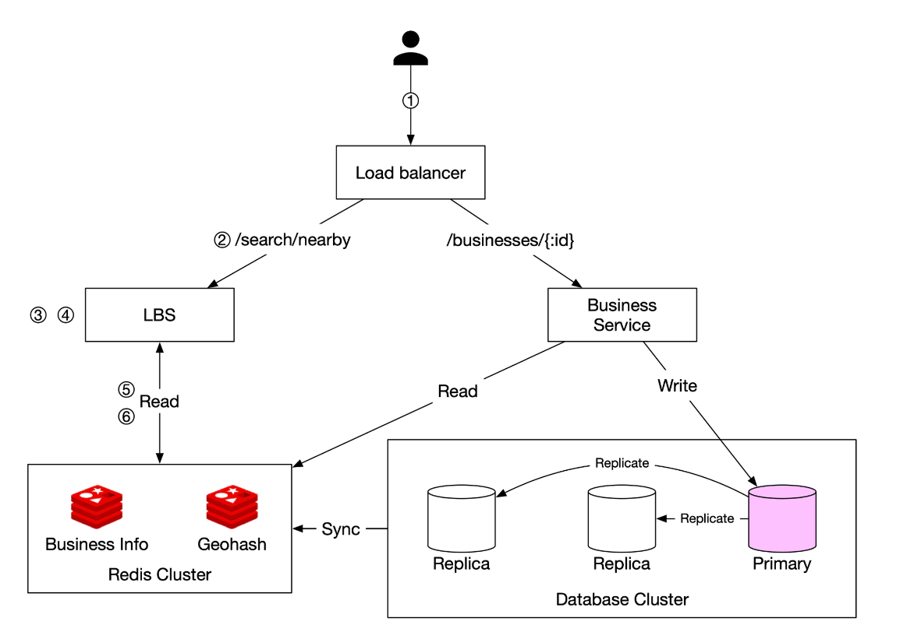
  </div>


Dưới đây là toàn bộ luồng chạy từng bước của kiến trúc cuối cùng:

## Quy trình 6 bước truy vấn địa điểm lân cận
1. **Người dùng gửi Request:**  
   - Một người dùng tìm kiếm các nhà hàng trong bán kính **500 mét**.  
   - Ứng dụng Client gửi request `GET /v1/search/nearby` kèm theo `latitude = 37.776720`, `longitude = -122.416730` và `radius = 500` tới **Load Balancer**.

2. **Điều hướng Request:**  
   - **Load Balancer** chuyển tiếp request tới một máy chủ trong cụm **Location-Based Service (LBS)**.

3. **Tính toán độ dài Geohash:**  
   - LBS đối chiếu bán kính `radius = 500m` với bảng cấu hình và xác định độ dài Geohash phù hợp là **`length = 6`**.

4. **Tính toán các ô Geohash lân cận:**  
   - LBS chuyển đổi tọa độ của người dùng thành mã `my_geohash` độ dài 6, đồng thời tính toán luôn **8 mã Geohash hàng xóm bao quanh** để tránh lỗi biên giới (Boundary issues).  
   - Kết quả thu được danh sách gồm 9 mã Geohash:  
     ```
     [my_geohash, neighbor1_geohash, neighbor2_geohash, ..., neighbor8_geohash]
     ```

5. **Lấy danh sách `business_id` từ Geohash Redis:**  
   - Đối với 9 mã Geohash trong danh sách, LBS gửi các truy vấn **song song (parallel queries)** tới cụm **Geohash Redis Server** để lấy ra toàn bộ danh sách `business_id` nằm trong 9 ô đó, giúp giảm thiểu Latency tối đa.

6. **Lấy chi tiết, Xếp hạng và Phản hồi:**  
   - Dựa trên danh sách `business_id` vừa thu được, LBS truy vấn sang cụm **Business Info Redis Server** để lấy thông tin chi tiết của từng cửa hàng.  
   - LBS tính toán khoảng cách thực tế giữa người dùng và từng cửa hàng, loại bỏ những điểm vượt quá 500m, **sắp xếp kết quả theo khoảng cách gần nhất** (hoặc điểm đánh giá) và trả kết quả về cho Client.

## Tóm tắt các điểm tối ưu hóa cốt lõi
- **Gọi Redis song song (Parallel Redis Calls):** Rút ngắn tối đa thời gian chờ mạng khi lấy 9 ô Geohash.  
- **Đánh chỉ mục bằng Geohash / Quadtree:** Chuyển bài toán tìm kiếm không gian 2 chiều phức tạp về tra cứu 1 chiều tốc độ cao.  
- **Hai tầng Caching trên RAM:** Giúp gần như 100% lưu lượng tìm kiếm được phục vụ trực tiếp từ bộ nhớ RAM mà không làm nghẽn Database.  

---

### **Bảng tổng kết lựa chọn phương pháp đánh chỉ mục không gian**
| Phương pháp Indexing | Ưu điểm (Pros) | Nhược điểm (Cons) |
|----------------|------|------|
| **Geohash** | Dễ cài đặt, lưu trực tiếp trong Redis/DB, rất hiệu quả cho tìm kiếm bán kính cố định | Có vấn đề ở biên giới (cần lấy 9 ô), kích thước ô lưới cố định không co giãn theo mật độ |
| **Quadtree** | Tự động chia nhỏ ô theo mật độ thực tế, hỗ trợ tìm $k$ điểm gần nhất ($k$-NN) | Cài đặt phức tạp hơn trên RAM, cập nhật hoặc cân bằng lại cây tốn công sức |
| **Google S2** | Rất mạnh cho Geofencing (bao phủ đa giác bất kỳ), được chứng minh ở quy mô Google Maps | Thuật toán toán học phức tạp, khó tự cài đặt từ đầu |

---

## Tài liệu tham khảo (References)
1. [Geohash Algorithm](https://www.movable-type.co.uk/scripts/geohash.html)
2. [Quadtree Indexing](https://en.wikipedia.org/wiki/Quadtree)
3. [Google S2 Geometry](https://s2geometry.io/)
