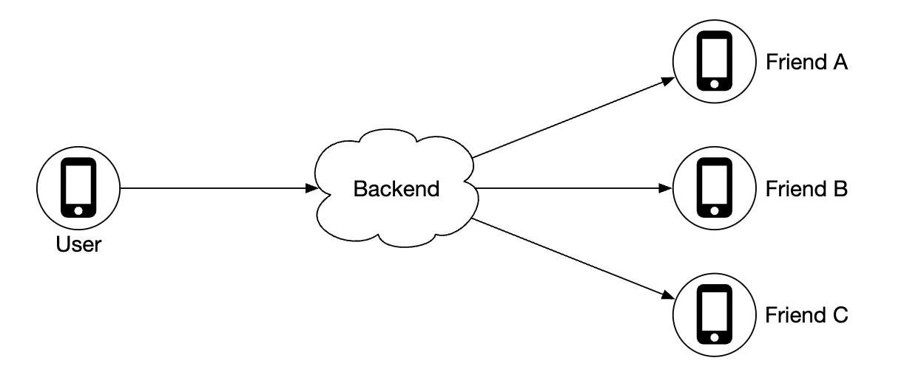
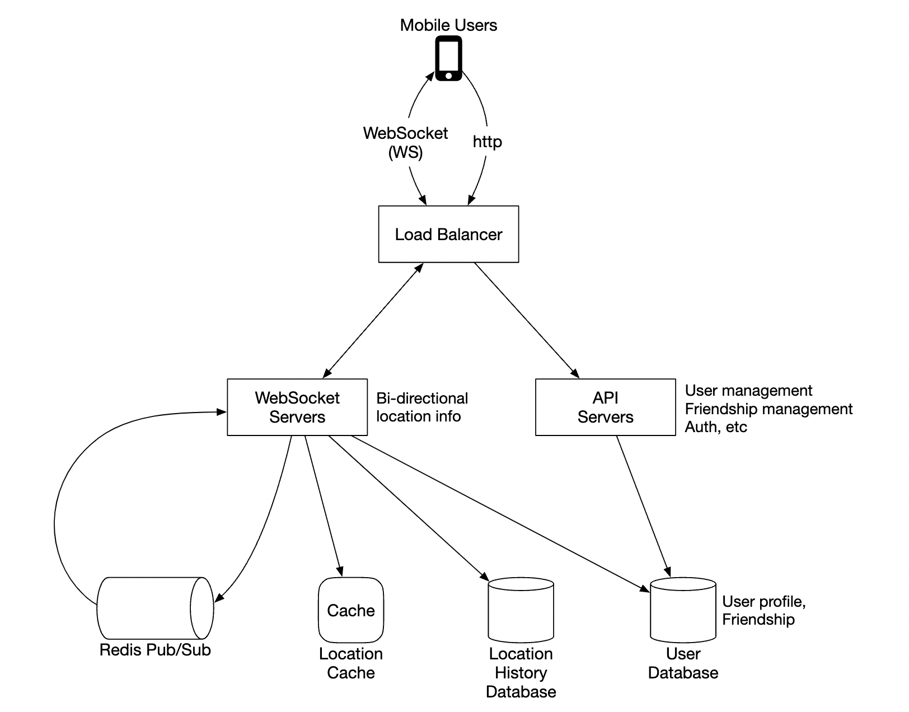
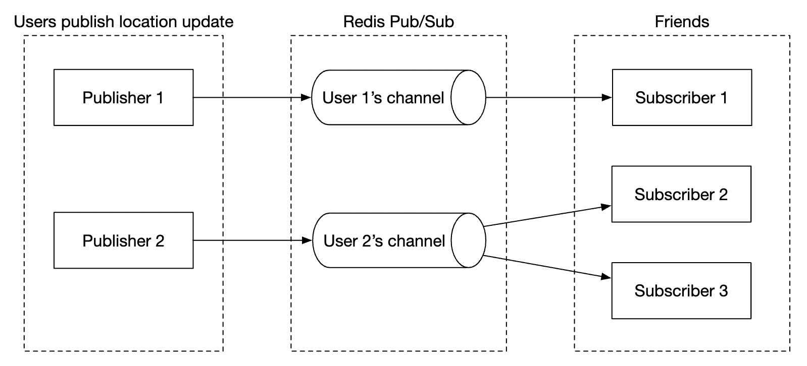
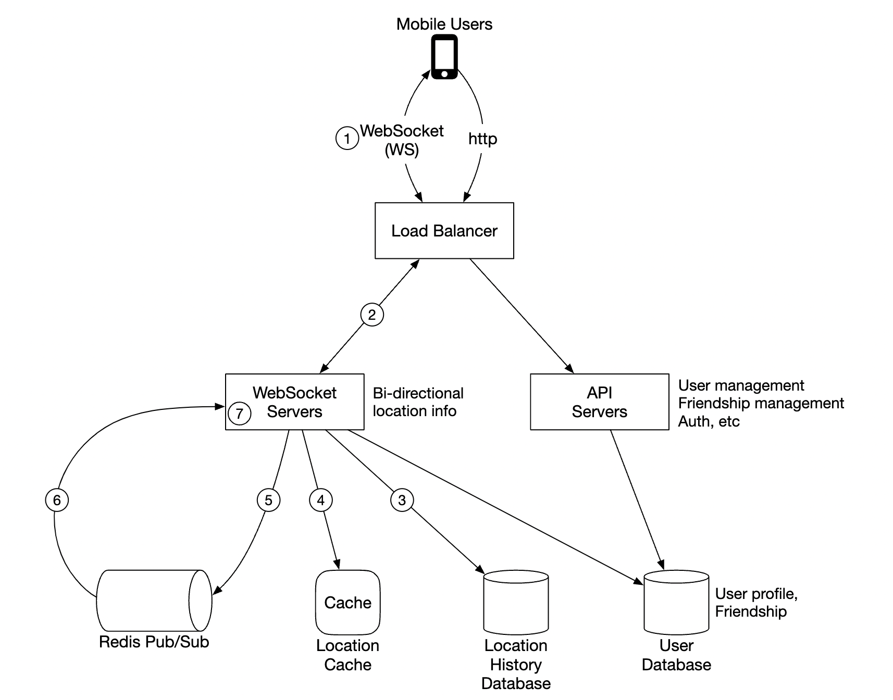
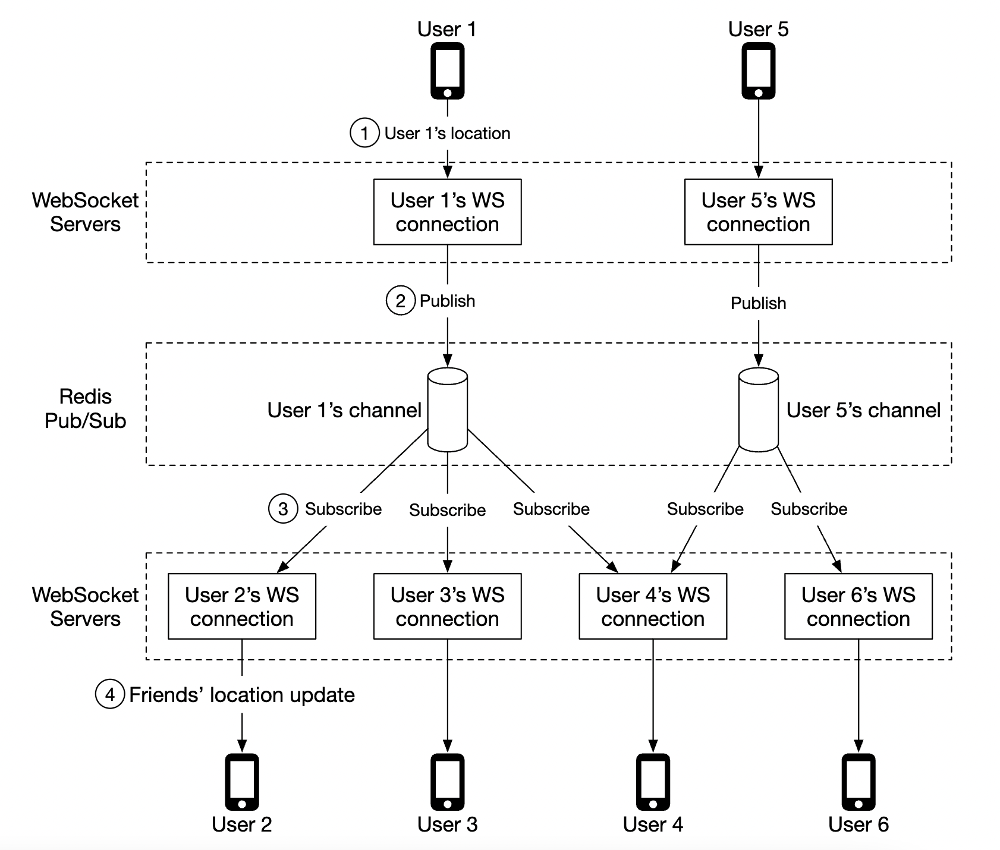
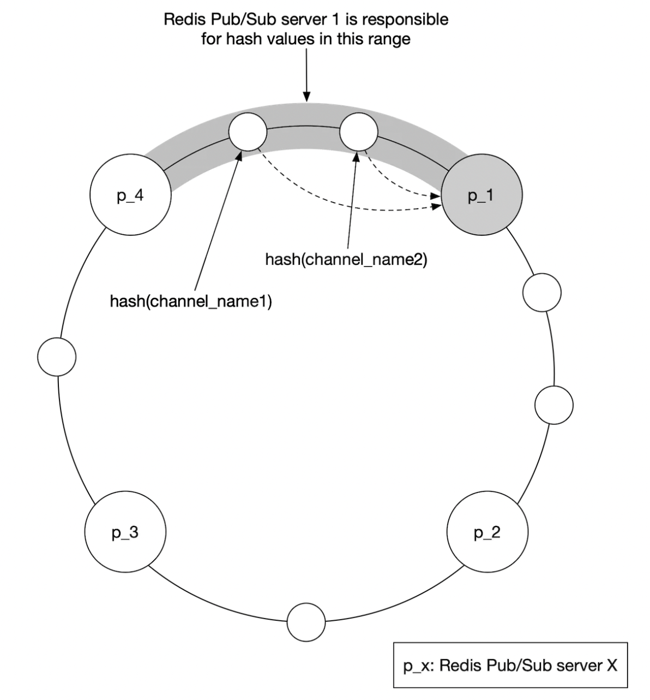
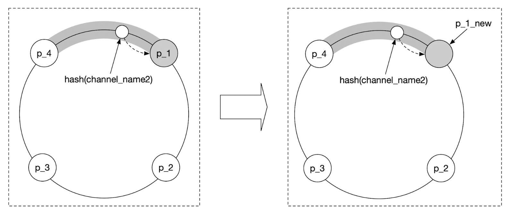
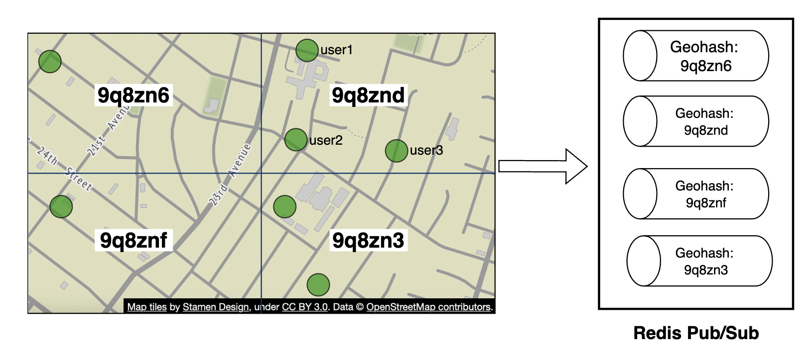
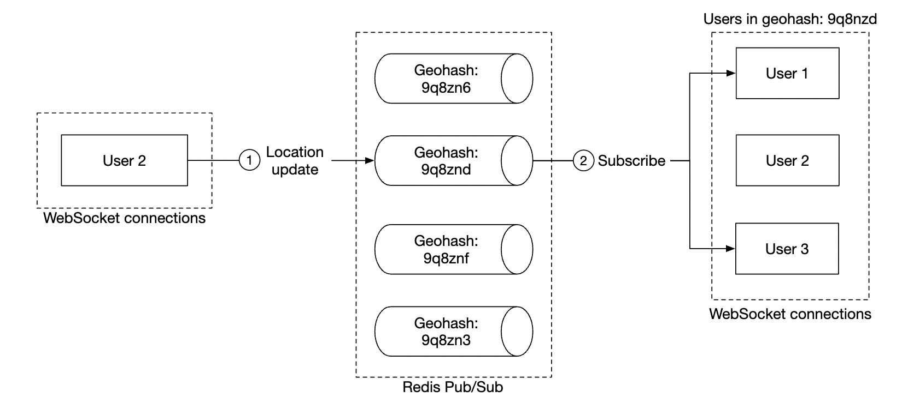
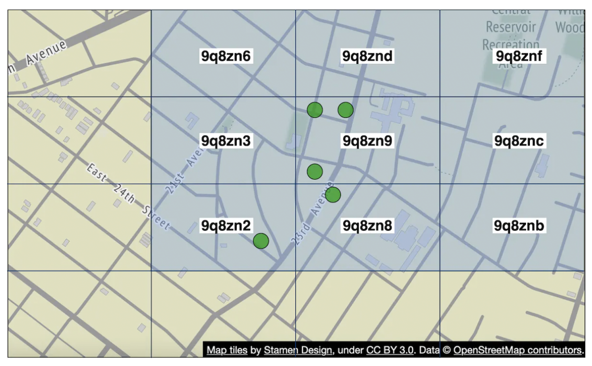

# Chương 17: Tìm bạn quanh đây (Nearby Friends)

## Giới thiệu

Chương này tập trung vào việc thiết kế hệ thống Backend có khả năng mở rộng cao cho một tính năng ứng dụng di động cho phép người dùng chia sẻ vị trí trực tiếp và phát hiện những người bạn đang ở **gần mình (Nearby Friends)**.

Điểm khác biệt cốt lõi nhất giữa bài toán này với Chương 16 (Proximity Service) nằm ở chỗ: Trong Proximity Service, địa chỉ của các nhà hàng/cửa hàng là **tĩnh (cố định)**; còn trong bài toán Nearby Friends, **vị trí của tất cả người dùng liên tục di chuyển và thay đổi theo từng giây!**

---

## Bước 1: Thấu hiểu bài toán và Xác lập phạm vi thiết kế (Understand the Problem and Establish Design Scope)

Dưới đây là đoạn hội thoại mẫu giữa Ứng viên (C) và Người phỏng vấn (I) để làm rõ yêu cầu:
 * **C:** Khoảng cách địa lý bao xa thì được coi là "ở gần" (nearby)?
 * **I:** Trong bán kính 5 dặm (~8 km). Con số này nên cho phép cấu hình linh hoạt.
 * **C:** Khoảng cách được tính theo đường chim bay (straight-line distance) giữa hai tọa độ GPS chứ không tính theo lộ trình đường đi bộ thực tế (ví dụ có con sông ngăn cách ở giữa), đúng không ạ?
 * **I:** Đúng vậy, giả định tính theo đường thẳng là hoàn toàn hợp lý.
 * **C:** Ứng dụng có tổng cộng bao nhiêu người dùng?
 * **I:** 1 tỷ người dùng, và 10% trong số đó (100 triệu người) sử dụng tính năng Nearby Friends.
 * **C:** Chúng ta có cần lưu lại lịch sử di chuyển (location history) của người dùng không?
 * **I:** Có, dữ liệu lịch sử vị trí rất có giá trị cho các bài toán phân tích và Machine Learning về sau.
 * **C:** Nếu một người bạn tắt ứng dụng hoặc mất kết nối quá 10 phút, ta có thể coi họ là không còn hoạt động (inactive) và ẩn họ khỏi danh sách bạn bè ở gần không?
 * **I:** Có, hoàn toàn hợp lý.
 * **C:** Chúng ta có cần đi sâu vào các quy định quyền riêng tư như GDPR/CCPA trong phạm vi buổi phỏng vấn này không?
 * **I:** Không cần, hãy giữ cho bài toán đơn giản và tập trung vào kiến trúc kỹ thuật.

### **Yêu cầu chức năng (Functional Requirements)**

 * Người dùng có thể nhìn thấy danh sách những người bạn đang ở gần mình (trong bán kính 5 dặm) trên ứng dụng di động. Mỗi người bạn hiển thị kèm khoảng cách hiện tại và dấu thời gian (`timestamp`) cho biết vị trí đó được cập nhật lúc nào.
 * Danh sách bạn bè ở gần phải được cập nhật liên tục sau mỗi vài chục giây.

### **Yêu cầu phi chức năng (Non-Functional Requirements)**

- **Latency thấp:** Việc nhận các bản cập nhật vị trí mới từ bạn bè phải diễn ra nhanh chóng, không bị trễ quá lâu.
- **Độ tin cậy (Reliability):** Hệ thống nhìn chung phải luôn sẵn sàng; tuy nhiên việc thỉnh thoảng bị rơi rớt một vài điểm dữ liệu tọa độ (data point loss) là hoàn toàn chấp nhận được vì vài chục giây sau thiết bị sẽ lại gửi tọa độ mới.
- **Tính nhất quán cuối cùng (Eventual Consistency):** Kho lưu trữ dữ liệu vị trí không đòi hỏi Strong Consistency; việc các replica nhận dữ liệu lệch nhau vài giây là chấp nhận được.

### **Ước lượng sơ bộ (Back-of-the-Envelope Estimation)**

Các con số giả định để xác định quy mô tải của hệ thống:
 * Bạn bè ở gần là những người nằm trong bán kính 5 dặm.
 * Chu kỳ làm mới vị trí (**Location refresh interval**) là **30 giây/lần**. Tốc độ đi bộ hoặc di chuyển của con người không quá nhanh đến mức thay đổi đáng kể chỉ sau 1-2 giây, nên chu kỳ 30 giây là điểm cân bằng hợp lý giữa độ chính xác và tiết kiệm pin/băng thông.
 * Trung bình có 100 triệu người dùng sử dụng tính năng này mỗi ngày (DAU), và giả sử tại một thời điểm bất kỳ có 10% trong số đó đang mở tính năng đồng thời (**10 triệu người dùng đồng thời — Concurrent Users**).
 * Trung bình một người dùng có 400 người bạn trên hệ thống, và tất cả đều dùng tính năng này.
 * Ứng dụng hiển thị 20 người bạn ở gần trên mỗi trang màn hình.
 * **Lưu lượng cập nhật vị trí đầu vào (Location Update QPS)** = `10 triệu người dùng đồng thời / 30 giây` ≈ **334.000 QPS (~334k updates/giây)!**

---

## Bước 2: Đề xuất thiết kế tổng quan và Thống nhất phương án (Propose High-Level Design and Get Buy-In)

Trước khi đi vào thiết kế API và Database, chúng ta cần xác định mô hình truyền thông vì bài toán này không thể dùng mô hình Request-Response một chiều thông thường.

### **Thiết kế tổng quan (High-Level Design)**

Ở mức khái niệm, mỗi người dùng muốn gửi vị trí mới của mình cho những người bạn đang online và nhận lại vị trí của họ. Về mặt lý thuyết, có thể dùng kết nối ngang hàng (**Peer-to-Peer - P2P**) trực tiếp giữa các điện thoại, nhưng điều này **không khả thi** trên thiết bị di động vì sóng di động chập chờn, địa chỉ IP thay đổi liên tục sau tường lửa NAT, và việc duy trì hàng백 kết nối P2P sẽ vắt kiệt pin điện thoại ngay lập tức.

Do đó, giải pháp thực tế là sử dụng một **Backend dùng chung (Shared Backend)** đóng vai trò trung tâm tiếp nhận và khuếch tán (**Fan-out**) vị trí tới những người bạn đang hoạt động:

    

Hệ thống Backend này thực hiện 3 nhiệm vụ chính:
 * Nhận các bản cập nhật vị trí từ tất cả người dùng đang hoạt động (active users).
 * Với mỗi bản cập nhật vị trí nhận được, tìm tất cả những người bạn đang online của người đó và chuyển tiếp (forward) tọa độ mới tới các thiết bị của họ.
 * Nếu khoảng cách tính toán được giữa hai người bạn lớn hơn ngưỡng cấu hình (5 dặm), không hiển thị/không chuyển tiếp thông tin.

Nghe có vẻ đơn giản, nhưng hãy làm một phép tính: Có 10 triệu người dùng online cùng lúc, mỗi người cập nhật vị trí mỗi 30 giây (`334k QPS`), mỗi người có 400 bạn bè và 10% trong số bạn bè đó đang online (tức là `40` người bạn đang online). Như vậy, mỗi bản cập nhật vị trí cần được fan-out tới 40 người bạn:
`334.000 × 40` ≈ **14 triệu lượt đẩy dữ liệu vị trí mỗi giây (14 million location broadcasts/sec)!**

Chúng ta sẽ bắt đầu với một thiết kế tổng quan đơn giản trước, sau đó đi sâu vào cách mở rộng cụm hạ tầng ở Bước 3 để chịu được mức tải 14 triệu thông điệp/giây này:

    

- **Load Balancer:** Đứng trước cả cụm RESTful API Servers lẫn cụm WebSocket Servers hai chiều để phân phối lưu lượng đồng đều.
- **RESTful API Servers:** Cụm máy chủ Stateless xử lý các tác vụ phụ trợ truyền thống như thêm/xóa bạn bè, quản lý thông tin tài khoản, cập nhật hồ sơ.
- **WebSocket Servers:** Cụm máy chủ **Stateful** duy trì kết nối thời gian thực liên tục với từng thiết bị di động. Nó nhận vị trí mới từ client và đẩy vị trí của bạn bè xuống client. Ngoài ra nó cũng đảm nhiệm bước khởi tạo ban đầu (**Client Initialization**) — nạp danh sách vị trí của tất cả bạn bè đang ở gần ngay khi người dùng vừa mở ứng dụng.
- **Redis Location Cache:** Lưu trữ **tọa độ vị trí mới nhất** của từng người dùng đang hoạt động dưới dạng Key-Value (`user_id` -> `(latitude, longitude, timestamp)`). Mỗi bản ghi trong cache đều được gắn một thời gian sống (**TTL**, ví dụ 10 phút). Mỗi khi người dùng gửi vị trí mới, TTL được gia hạn lại; nếu người dùng đóng app và TTL hết hạn, bản ghi tự động bị xóa khỏi Redis (đồng nghĩa người dùng đã inactive).
- **User Database:** Lưu trữ dữ liệu hồ sơ người dùng và danh sách quan hệ bạn bè (có thể dùng RDBMS đã Sharding hoặc NoSQL).
- **Location History Database:** Lưu trữ toàn bộ lịch sử di chuyển theo thời gian của người dùng phục vụ phân tích dữ liệu lớn và Machine Learning (cần database tối ưu cho tải ghi cực nặng như **Apache Cassandra**).
- **Redis Pub/Sub Server:** Được sử dụng như một hệ thống truyền tin (**Message Bus**) siêu nhẹ. Mỗi người dùng được cấp một kênh (channel/topic) riêng trên Redis Pub/Sub để phát sóng các bản cập nhật vị trí của mình cho bạn bè đang lắng nghe.

    

Trong sơ đồ trên, các **WebSocket Servers** sẽ đăng ký lắng nghe (subscribe) vào kênh Redis Pub/Sub của tất cả những người bạn thuộc về người dùng đang kết nối vào server đó. Bất cứ khi nào một người bạn phát tọa độ mới vào kênh của họ, các WebSocket Servers đang lắng nghe sẽ nhận được sự kiện, tính toán lại khoảng cách và đẩy xuống màn hình điện thoại của người dùng tương ứng.

### **Luồng cập nhật vị trí định kỳ (Periodic Location Update Flow)**

Dưới đây là quy trình từng bước khi một người dùng gửi bản cập nhật vị trí định kỳ (mỗi 30 giây):

    

 1. Thiết bị di động gửi gói tin cập nhật vị trí qua kết nối thông qua Load Balancer.
 2. Load Balancer chuyển tiếp gói tin trên kết nối cố định tới **WebSocket Server** đang giữ phiên của client đó.
 3. WebSocket Server ghi bất đồng bộ tọa độ này vào **Location History Database** (Cassandra).
 4. WebSocket Server cập nhật tọa độ mới nhất vào **Redis Location Cache** (và làm mới lại TTL). Đồng thời, WebSocket Server cũng lưu tọa độ mới này vào biến trong bộ nhớ cục bộ của kết nối để dùng tính khoảng cách với bạn bè.
 5. WebSocket Server đẩy (**publish**) tọa độ mới cùng timestamp vào kênh riêng của người dùng đó trên **Redis Pub/Sub**.
 6. **Redis Pub/Sub** phát tán (**broadcast**) sự kiện vị trí này tới tất cả các WebSocket Servers đang đăng ký lắng nghe (subscribers) kênh đó — tức là những WebSocket Servers đang giữ kết nối của các người bạn đang online.
 7. Các WebSocket Servers nhận được bản cập nhật vị trí của người bạn, lấy tọa độ mới so sánh và tính khoảng cách đường thẳng với tọa độ hiện tại của người dùng mà nó đang quản lý. Nếu khoảng cách $\le 5$ dặm, nó gửi tọa độ mới cùng timestamp xuống thiết bị di động của người dùng để cập nhật lên bản đồ.

Sơ đồ luồng chạy chi tiết với ví dụ cụ thể:

    

Trung bình mỗi lần một người dùng cập nhật vị trí sẽ có khoảng 40 thông điệp được đẩy qua Redis Pub/Sub tới các WebSocket Servers của bạn bè họ (400 bạn bè $\times$ 10% online = 40 người).

### **Thiết kế API (API Design)**

**1. Các sự kiện qua giao thức WebSocket:**
 * `Periodic location update` (Client $\rightarrow$ Server): Client gửi `latitude`, `longitude`, `timestamp` lên WebSocket Server.
 * `Client receives location update` (Server $\rightarrow$ Client): Server đẩy dữ liệu vị trí mới của một người bạn kèm `timestamp` xuống Client.
 * `WebSocket client initialization` (Client $\leftrightarrow$ Server): Khi mới mở app, Client gửi vị trí hiện tại của mình lên; Server trả về danh sách vị trí của tất cả bạn bè đang ở gần ngay thời điểm đó.
 * `Subscribe to a new friend` (Server $\rightarrow$ Client): WebSocket Server báo cho Client theo dõi thêm một `friend_id` mới (khi người bạn đó vừa mới online).
 * `Unsubscribe a friend` (Server $\rightarrow$ Client): WebSocket Server báo cho Client ngừng hiển thị một `friend_id` (khi người bạn đó đã offline).

**2. Các HTTP RESTful API:** Phục vụ các tác vụ CRUD cơ bản như quản lý danh sách bạn bè, cập nhật thông tin cá nhân, đăng nhập/đăng xuất.

### **Mô hình dữ liệu (Data Model)**

 * **Location Cache (Redis):** Chỉ lưu trạng thái vị trí hiện tại đang active, không cần lưu xuống ổ cứng bền vững:
   - Key: `user_id`
   - Value: `{latitude, longitude, timestamp}` (kèm TTL = 10 phút). Nhờ tính năng tự động xóa key khi hết hạn TTL của Redis, chúng ta không cần viết cron job dọn dẹp người dùng offline.
 * **Location History Database (Cassandra):** Lưu lịch sử di chuyển lâu dài với cấu trúc 4 cột: `user_id`, `timestamp`, `latitude`, `longitude`. Chọn **Apache Cassandra** vì nó đáp ứng hoàn hảo mức tải ghi 334.000 QPS và dễ dàng scale ngang bằng cách thêm node.

---

## Bước 3: Đi sâu vào thiết kế chi tiết (Design Deep Dive)

Hãy phân tích cách mở rộng từng thành phần trong kiến trúc tổng quan để chịu được quy mô hàng trăm triệu người dùng.

### **Đánh giá khả năng mở rộng của từng thành phần**

- **API Servers:** Là tầng Stateless hoàn toàn, dễ dàng mở rộng tự động qua các nhóm Auto-scaling theo mức tải CPU/Network.
- **WebSocket Servers:** Có thể mở rộng ngang bằng cách thêm server mới, nhưng vì đây là tầng **Stateful** (giữ kết nối dài hạn), khi muốn gỡ bỏ (scale down) hoặc nâng cấp một server, ta bắt buộc phải đóng kết nối một cách êm thấm (**Graceful Shutdown**): đánh dấu node đó sang trạng thái `"draining"` trên Load Balancer để ngừng nhận kết nối mới, sau đó chờ hoặc báo cho các client hiện tại chủ động kết nối lại sang server khác trước khi tắt máy.
- **Khởi tạo kết nối Client (Client Initialization):** Khi thiết bị vừa mở app và kết nối vào một WebSocket Server:
  1. Server cập nhật vị trí của người dùng vào Location Cache.
  2. Server tải danh sách toàn bộ bạn bè của người dùng đó từ **User Database** và gửi yêu cầu hàng loạt (**pipelined/batch request**) tới Location Cache để lấy vị trí hiện tại của tất cả bạn bè đang online.
  3. Server tính khoảng cách giữa người dùng và từng người bạn, lọc ra những người trong bán kính 5 dặm và trả về cho thiết bị hiển thị.
  4. Cuối cùng, đối với **tất cả** bạn bè của người dùng (kể cả những người đang ở xa hơn 5 dặm hoặc đang offline), WebSocket Server đều đăng ký lắng nghe (**subscribe**) vào kênh của họ trên **Redis Pub/Sub** (bởi vì một người bạn đang ở cách 5.1 dặm có thể di chuyển vào vùng 5 dặm chỉ sau vài giây, hoặc một người bạn đang offline có thể bật app lên bất cứ lúc nào!).
- **User Database:** Chứa dữ liệu người dùng và danh sách bạn bè; dễ dàng mở rộng bằng cách **Sharding** theo `user_id`.
- **Location Cache (Redis):** Với 10 triệu người dùng đồng thời, mỗi bản ghi tốn khoảng vài trăm bytes thì tổng dung lượng RAM chỉ tốn vài GB. Tuy nhiên mức tải ghi **334.000 updates/giây** là quá lớn cho một Redis server đơn lẻ, do đó ta phải **Sharding** dữ liệu Location Cache ra một cụm nhiều Redis nodes dựa trên `user_id`.

### **Đi sâu vào bài toán mở rộng cụm Redis Pub/Sub (Scaling Redis Pub/Sub)**

Vì sao chúng ta chọn Redis Pub/Sub làm tầng định tuyến? Bởi vì việc khởi tạo một kênh (channel) trên Redis Pub/Sub cực kỳ rẻ và hầu như không tốn tài nguyên cho đến khi có dữ liệu truyền qua. Ta gán cố định cho mỗi người dùng dùng tính năng này 1 kênh duy nhất theo `user_id`.
- **Tính toán nhu cầu Bộ nhớ (Memory Usage):** Giả sử có 100 triệu người dùng dùng tính năng (100 triệu kênh), mỗi kênh cần khoảng 20 bytes cho các con trỏ nội bộ lắng nghe $\times 100$ bạn bè đang theo dõi = khoảng **200 GB RAM**. Chỉ cần 2 máy chủ Redis cấu hình 100 GB RAM là đủ chứa toàn bộ các kênh!
- **Tính toán nhu cầu CPU (Nút cổ chai thực sự!):** Như đã ước lượng ở Bước 2, cụm Redis Pub/Sub phải đẩy khoảng **14 triệu bản cập nhật vị trí mỗi giây** tới các subscribers. Giả sử một server hiện đại có card mạng Gigabit xử lý được khoảng **100.000 lượt đẩy (pushes)/giây**, thì số lượng máy chủ Redis Pub/Sub cần thiết tính theo CPU là:
  `14.000.000 / 100.000` = **140 máy chủ Redis Pub/Sub!**
- **Kết luận quan trọng:** Nút cổ chai của Redis Pub/Sub trong bài toán này nằm ở **CPU và Network I/O** chứ không phải ở RAM. Do đó, chúng ta bắt buộc phải thiết kế một **Cụm Redis Pub/Sub phân tán (Distributed Redis Pub/Sub Cluster)** gồm hàng trăm node độc lập!

Làm sao để phân phối hàng trăm triệu kênh độc lập lên 140 máy chủ Redis Pub/Sub?
- Vì các kênh của từng người dùng hoàn toàn độc lập với nhau, ta thực hiện **Sharding các kênh theo `user_id` của người phát (publisher)** bằng thuật toán **Băm nhất quán (Consistent Hashing)**.
- Chúng ta sử dụng một dịch vụ điều phối và khám phá dịch vụ (**Service Discovery**) như **Apache ZooKeeper** hoặc **etcd** để thực hiện hai nhiệm vụ:
  1. Lưu trữ danh sách các máy chủ Redis Pub/Sub đang hoạt động trên Vòng băm (**Hash Ring**) và cung cấp giao diện để cập nhật vòng băm này.
  2. Cho phép các **WebSocket Servers** đăng ký lắng nghe bất kỳ sự thay đổi nào trên vòng băm (Value/State change notifications).

    

Các WebSocket Servers sẽ tải thông tin Vòng băm (Hash Ring) từ ZooKeeper về và lưu cache ngay trên RAM cục bộ. Khi cần `publish` vị trí của `User A` hoặc cần `subscribe` vào kênh của `User B`, WebSocket Server chỉ cần tra cứu trên vòng băm trong RAM để biết chính xác kênh đó đang nằm ở node Redis Pub/Sub nào và kết nối thẳng tới node đó!

#### Lưu ý vận hành khi mở rộng hoặc thu hẹp cụm Redis Pub/Sub (Scaling Considerations)
Lưu lượng truy cập của ứng dụng tìm bạn quanh đây thường biến động mạnh theo khung giờ trong ngày (cao điểm vào buổi tối/cuối tuần và thấp điểm vào ban đêm). Khác với các Stateless API Servers, cụm Redis Pub/Sub tuy không lưu dữ liệu xuống đĩa nhưng nó vẫn là **Stateful** vì đang nắm giữ trạng thái danh sách các kết nối đăng ký lắng nghe (`subscribers`) trên từng kênh!
Nếu ta thêm mới hoặc gỡ bỏ node trong cụm Redis Pub/Sub, một số kênh sẽ bị dịch chuyển sang node khác trên vòng băm Consistent Hashing:
 * Khi ZooKeeper thông báo vòng băm thay đổi, các WebSocket Servers sẽ phải thực hiện hàng loạt lệnh hủy đăng ký (`unsubscribe`) ở node cũ và đăng ký lại (`subscribe`) ở node mới cho các kênh bị dịch chuyển.
 * Trong khoảnh khắc chuyển giao đó, một vài bản cập nhật vị trí của khách hàng có thể bị lỡ, điều này hoàn toàn chấp nhận được theo yêu cầu phi chức năng ban đầu.
 * Để giảm thiểu tối đa tác động:
   1. Nhờ sử dụng **Consistent Hashing**, chỉ một phần nhỏ số kênh trên vòng băm bị ảnh hưởng khi thêm/bớt node.
   2. Nên thực hiện việc thay đổi quy mô cụm theo lịch định kỳ vào thời điểm lưu lượng thấp nhất trong ngày, và cung cấp dư tài nguyên một chút (**Over-provisioning**) để chịu được các đợt tăng tải đột xuất trong ngày mà không cần resharding liên tục.

    

### **Xử lý khi Thêm hoặc Xóa bạn bè (Adding/Removing Friends)**

Khi người dùng kết bạn mới hoặc hủy kết bạn trên ứng dụng:
- Ứng dụng di động hoặc API Server sẽ kích hoạt một sự kiện callback gửi tới **WebSocket Server** đang giữ kết nối của người dùng đó.
- Nếu là **Kết bạn mới:** WebSocket Server lập tức gửi lệnh `subscribe` tới kênh Redis Pub/Sub của người bạn mới, đồng thời lấy tọa độ mới nhất của người bạn đó từ Location Cache trả về cho client.
- Nếu là **Hủy kết bạn:** WebSocket Server gửi lệnh `unsubscribe` khỏi kênh Redis Pub/Sub của người bạn vừa bị xóa và báo cho client xóa người đó khỏi bản đồ.

### **Người dùng có quá nhiều bạn bè (Users with Many Friends)**

Điều gì xảy ra nếu một người dùng có quá nhiều bạn bè?
- Trong thực tế, các mạng xã hội luôn đặt giới hạn tối đa cho số lượng bạn bè hai chiều (ví dụ Facebook giới hạn tối đa **5.000 bạn bè**; lưu ý rằng "bạn bè hai chiều - friends" khác với "người theo dõi một chiều - followers" của người nổi tiếng).
- Ngay cả với những người dùng có tối đa 5.000 bạn bè ("whale" users), tải phát sinh chỉ là việc WebSocket Server của họ phải lắng nghe 5.000 kênh và nhận cập nhật từ các kênh đó. Vì tải này được chia đều trên hàng trăm WebSocket Servers và hàng trăm node Redis Pub/Sub trong cụm nên sẽ không gây ra điểm nóng làm nghẽn một node cụ thể nào.

### **Mở rộng câu hỏi phỏng vấn: Tính năng "Người lạ ở gần" (Nearby Random Person)**

Điều gì xảy ra nếu người phỏng vấn muốn mở rộng đề bài: *"Hãy cập nhật thiết kế để hiển thị thêm những người dùng ngẫu nhiên (không phải bạn bè) cũng đang ở gần vị trí của bạn (tương tự tính năng Tìm quanh đây của Zalo/WeChat hay Radar của Tinder)?"*

Để giải quyết bài toán này mà không làm thay đổi thiết kế cốt lõi, ta chỉ cần bổ sung **một cụm kênh Redis Pub/Sub mới được chia theo các ô lưới Geohash**:

    

1. Bản đồ được chia thành các ô lưới **Geohash** cố định, và mỗi mã Geohash sẽ có một kênh Pub/Sub riêng (ví dụ kênh `9q8zn`).
2. Bất kỳ người dùng nào bật chế độ chia sẻ vị trí với người lạ đều sẽ tính mã Geohash tại tọa độ hiện tại của mình và **publish** vị trí của mình vào kênh Geohash đó.
3. Đồng thời, để nhìn thấy những người lạ xung quanh mà không gặp lỗi ở ranh giới ô lưới (Boundary issues), WebSocket Server của người dùng đó sẽ đăng ký lắng nghe (**subscribe**) vào **kênh Geohash hiện tại của họ cùng với 8 kênh Geohash hàng xóm xung quanh (tổng cộng 9 kênh Geohash)**:

    

    

### **Giải pháp thay thế cho Redis Pub/Sub: Sử dụng Erlang**

Có giải pháp nào tốt hơn cả Redis Pub/Sub cho bài toán này không? Câu trả lời là **Erlang** (hoặc Elixir chạy trên máy ảo BEAM) — ngôn ngữ lập trình và môi trường thực thi được thiết kế chuyên biệt cho các hệ thống phân tán thời gian thực chịu lỗi cao (được WhatsApp và Discord sử dụng).
- Thế mạnh cốt lõi của Erlang là các **tiến trình siêu nhẹ (Lightweight Erlang Processes)**: một tiến trình Erlang nhẹ hơn một luồng hệ điều hành (OS thread) của Linux hàng triệu lần và chỉ tốn khoảng ~300 bytes bộ nhớ! Một máy chủ Erlang đơn lẻ có thể dễ dàng tạo và duy trì **hàng chục triệu tiến trình chạy đồng thời**.
- Nếu sử dụng Erlang:
  - Mỗi người dùng trong số 10 triệu người dùng online sẽ được đại diện bởi một tiến trình Erlang riêng biệt (kiêm luôn vai trò giữ kết nối WebSocket).
  - Các tiến trình của bạn bè có thể gửi thông điệp trực tiếp cho nhau trong cụm Erlang phân tán mà **không cần đến tầng Redis Pub/Sub trung gian nữa**, giúp giảm cả độ trễ lẫn số lượng thành phần hạ tầng!
- **Nhược điểm duy nhất:** Erlang/Elixir là ngôn ngữ ngách, việc tuyển dụng đội ngũ kỹ sư giỏi Erlang trên thị trường khó hơn nhiều so với hệ sinh thái Java/Go/Node.js + Redis phổ biến.

---

## Bước 4: Tổng kết (Wrap Up)

Chúng ta đã thiết kế thành công hệ thống Backend cho tính năng Tìm bạn quanh đây (Nearby Friends) với khả năng mở rộng quy mô lớn.

Các thành phần cốt lõi của kiến trúc:
- **WebSocket Servers:** Đảm bảo kênh giao tiếp hai chiều theo thời gian thực giữa thiết bị di động và server.
- **Redis Location Cache:** Lưu trữ vị trí mới nhất với tốc độ đọc/ghi cực nhanh và tự động loại bỏ người dùng offline nhờ cơ chế TTL.
- **Cụm Redis Pub/Sub phân tán (hoặc Erlang):** Đóng vai trò là tầng định tuyến và khuếch tán (Fan-out) 14 triệu bản cập nhật vị trí mỗi giây giữa người dùng và bạn bè của họ.

Chúng ta cũng đã phân tích sâu cách mở rộng từng tầng từ Stateless API, Stateful WebSocket, Database, Location Cache cho đến việc dùng ZooKeeper + Consistent Hashing để scale cụm Redis Pub/Sub, cũng như giải quyết bài toán mở rộng "Tìm người lạ quanh đây" bằng Geohash Pub/Sub.
