# Chương 18: Thiết kế Google Maps (Design Google Maps)

## Giới thiệu

Trong chương này, chúng ta sẽ thiết kế một phiên bản tinh gọn nhưng đầy đủ chiều sâu kỹ thuật của hệ thống **Google Maps**.

Một vài thông tin thực tế về quy mô của Google Maps:
 * Ra mắt lần đầu vào năm 2005.
 * Cung cấp hàng loạt dịch vụ phức tạp: ảnh vệ tinh, bản đồ đường phố, tình trạng giao thông theo thời gian thực, lập lộ trình dẫn đường (route planning).
 * Tính đến năm 2021, hệ thống phục vụ **1 tỷ người dùng hoạt động hàng ngày (1B DAU)**, bao phủ 99% bề mặt thế giới và xử lý 25 triệu bản cập nhật thông tin bản đồ thời gian thực mỗi ngày.

---

## Bước 1: Thấu hiểu bài toán và Xác lập phạm vi thiết kế (Understand the Problem and Establish Design Scope)

Đoạn hội thoại mẫu giữa Ứng viên (C) và Người phỏng vấn (I):
 * **C:** Quy mô người dùng hoạt động hàng ngày mà chúng ta cần thiết kế là bao nhiêu?
 * **I:** 1 tỷ DAU.
 * **C:** Vì Google Maps có rất nhiều tính năng, chúng ta nên tập trung vào những tính năng cốt lõi nào trong buổi phỏng vấn hôm nay?
 * **I:** Hãy tập trung vào 3 tính năng quan trọng nhất: **Cập nhật vị trí người dùng (Location update)**, **Dẫn đường kèm tính toán thời gian đến dự kiến (Navigation & ETA)**, và **Hiển thị bản đồ (Map rendering)**.
 * **C:** Dữ liệu mạng lưới đường bộ lớn cỡ nào? Chúng ta có thể giả định là hệ thống đã thu thập sẵn dữ liệu đường bộ thô không?
 * **I:** Có, chúng ta đã thu thập dữ liệu đường bộ từ nhiều nguồn khác nhau với dung lượng hàng Terabytes (TBs) dữ liệu thô.
 * **C:** Hệ thống có cần tính đến tình trạng giao thông thực tế (kẹt xe, tai nạn) khi dẫn đường không?
 * **I:** Có, điều này rất quan trọng để ước tính thời gian đến (ETA) một cách chính xác.
 * **C:** Còn về các phương thức di chuyển khác nhau như đi bộ, đi xe đạp, lái ô tô thì sao?
 * **I:** Chúng ta cần hỗ trợ các phương thức đó.
 * **C:** Chúng ta có cần hỗ trợ lộ trình dừng qua nhiều điểm (multi-stop directions) hoặc hiển thị thông tin/hình ảnh các cửa hàng kinh doanh không?
 * **I:** Câu hỏi rất hay, nhưng không cần đưa vào phạm vi buổi phỏng vấn này để tập trung thời gian cho 3 tính năng chính.

Như vậy, chúng ta sẽ tập trung giải quyết 3 bài toán cốt lõi: **Cập nhật vị trí người dùng (User Location Update)**, **Dịch vụ dẫn đường & tính ETA (Navigation Service including ETA)** và **Kết xuất hiển thị bản đồ (Map Rendering)**.

### **Yêu cầu phi chức năng (Non-Functional Requirements)**

- **Độ chính xác cao (Accuracy):** Người dùng tuyệt đối không được nhận chỉ dẫn đường đi sai lệch.
- **Hiển thị và điều hướng mượt mà (Smooth Navigation):** Bản đồ trên màn hình phải cuộn và phóng to/thu nhỏ mượt mà, không bị giật lag.
- **Tiết kiệm dữ liệu mạng và pin (Data and Battery Usage):** Ứng dụng Client trên điện thoại phải tiêu tốn ít băng thông 4G/5G và ít pin nhất có thể — đây là yếu tố sống còn đối với các ứng dụng dẫn đường di động.
- Đảm bảo tính sẵn sàng cao (High Availability) và khả năng mở rộng (Scalability) ở quy mô toàn cầu.

### **Kiến thức nền tảng về Bản đồ số (Map 101)**

Trước khi bắt tay vào vẽ kiến trúc, hãy nắm vững một số khái niệm nền tảng trong lĩnh vực bản đồ số:

#### 1. Hệ thống định vị (Positioning System)

Trái Đất là một hình cầu quay quanh trục của nó. Mọi vị trí địa lý trên bề mặt đều được xác định bởi hai tọa độ: **Vĩ độ (`Latitude` — nằm cách xích đạo bao xa về phía Bắc hoặc Nam)** và **Kinh độ (`Longitude` — nằm cách kinh tuyến gốc bao xa về phía Đông hoặc Tây)**:

<div style="margin-left:3rem">
    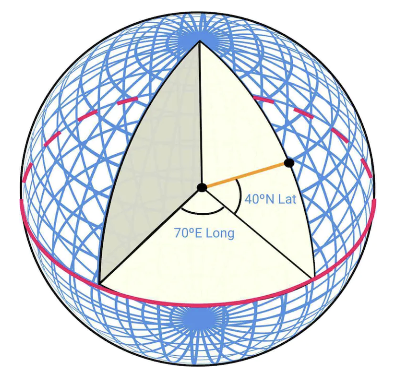
</div>

#### 2. Phép chiếu bản đồ: Chuyển từ không gian 3D sang mặt phẳng 2D (Going from 3D to 2D)

Quá trình ánh xạ các điểm từ bề mặt hình cầu 3 chiều lên một mặt phẳng 2 chiều được gọi là **Phép chiếu bản đồ (Map Projection)**.

Có nhiều phép chiếu khác nhau (như Mercator, Peirce Quincuncial, Winkel Tripel) và mỗi phép chiếu đều có ưu/nhược điểm riêng, nhưng hầu hết đều làm biến dạng một phần hình học thực tế (ví dụ vùng gần hai cực bị phóng đại).

<div style="margin-left:3rem">
    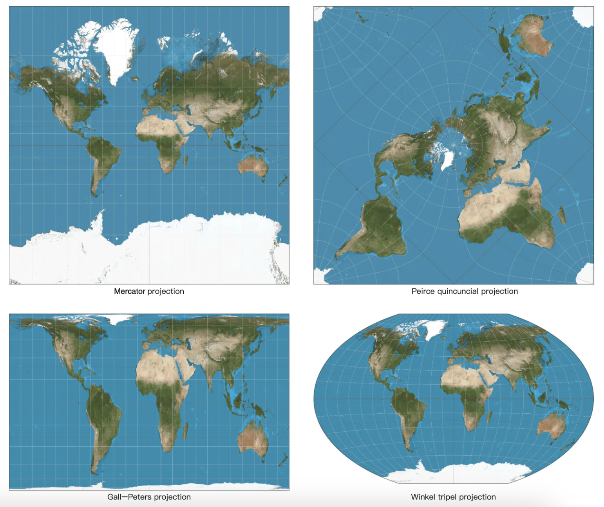
</div>

Google Maps đã lựa chọn phiên bản tinh chỉnh của phép chiếu Mercator gọi là **Web Mercator**.

#### 3. Mã hóa địa lý (Geocoding & Reverse Geocoding)

**Geocoding** là quá trình chuyển đổi một địa chỉ văn bản con người đọc được (ví dụ: `"1600 Amphitheatre Parkway, Mountain View, CA"`) thành cặp tọa độ địa lý `(latitude, longitude)`. 

Quá trình ngược lại — chuyển từ cặp tọa độ `(lat, long)` thành địa chỉ tên đường — được gọi là **Reverse Geocoding**.

Một phương pháp phổ biến để thực hiện việc này là phép nội suy (**Interpolation**), tận dụng dữ liệu từ các Hệ thống thông tin địa lý (GIS) nơi mạng lưới đường phố được ánh xạ vào không gian tọa độ.

#### 4. Geohashing

**Geohashing** là hệ thống mã hóa một khu vực địa lý thành một chuỗi ngắn các chữ cái và chữ số bằng cách coi bản đồ thế giới phẳng là một hình chữ nhật và chia đệ quy thành 4 phần tư (xem chi tiết tại Chương 16):

<div style="margin-left:3rem">
    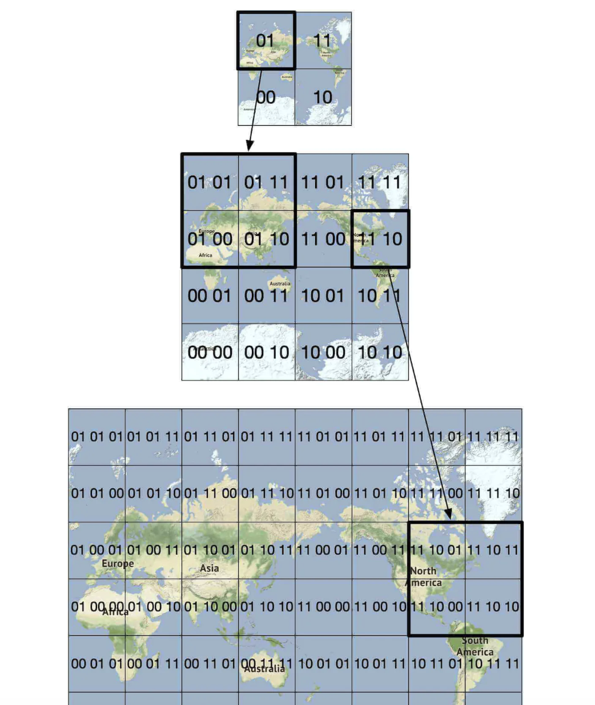
</div>

#### 5. Kết xuất bản đồ bằng kỹ thuật Chia ô ảnh (Map Rendering via Tiling)

Một nguyên tắc nền tảng trong hiển thị bản đồ là **chia ô bản đồ (Map Tiling)**. Thay vì dựng toàn bộ bản đồ thế giới thành một bức ảnh khổng lồ duy nhất hàng Petabytes, thế giới được cắt nhỏ thành hàng triệu ô vuông nhỏ gọi là **Map Tiles** (mỗi tile thường có kích thước chuẩn là `256x256` pixels).

Ứng dụng Client chỉ cần tải về đúng một vài ô Map Tiles tương ứng với khu vực màn hình người dùng đang nhìn thấy và ghép chúng lại với nhau như ghép tranh mosaic.

Có nhiều bộ Map Tiles khác nhau tương ứng với từng **mức độ thu phóng (Zoom Levels — từ mức 0 đến mức 21)**:
- Ở **Zoom Level 0** (thu nhỏ hết cỡ nhìn toàn bộ Trái Đất), cả thế giới được biểu diễn gọn trong **1 ô tile duy nhất** kích thước `256x256` pixels.
- Mỗi khi tăng thêm 1 mức Zoom Level, số lượng ô Map Tiles tăng gấp 4 lần (chiều ngang nhân 2, chiều dọc nhân 2): ở Zoom Level 1 có $2 \times 2 = 4$ tiles; ở Zoom Level 2 có $4 \times 4 = 16$ tiles... cho đến Zoom Level 21 có tới $4^{21}$ tiles cực kỳ chi tiết!

#### 6. Xử lý dữ liệu đường bộ cho các thuật toán tìm đường (Road Data Processing for Navigation Algorithms)

Trong hầu hết các thuật toán tìm đường (Routing Algorithms), các **ngã tư/giao lộ (intersections)** được biểu diễn thành các **đỉnh (nodes)** và các **đoạn đường (roads)** nối giữa chúng được biểu diễn thành các **cạnh (edges)** của một đồ thị có trọng số:

<div style="margin-left:3rem">
    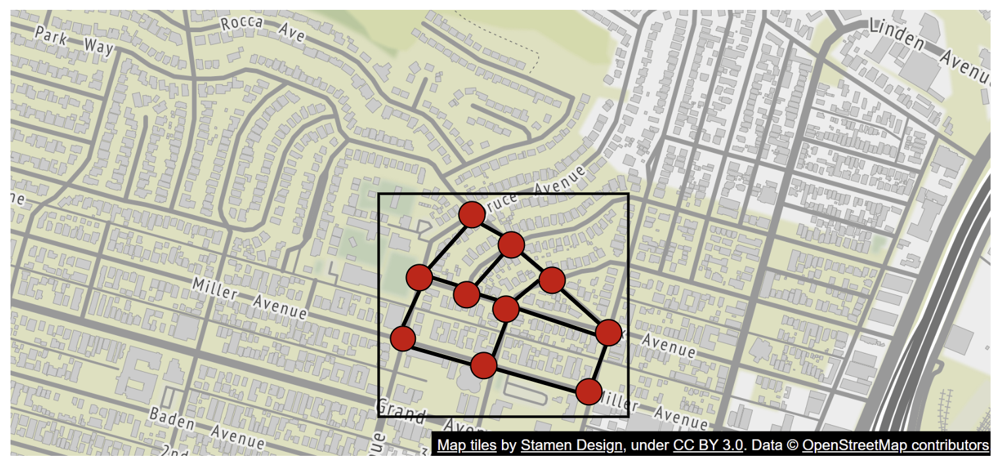
</div>

Các thuật toán dẫn đường thường sử dụng biến thể của thuật toán **Dijkstra** hoặc **A\* (A-Star)**.

Tuy nhiên, hiệu năng của thuật toán tìm đường trên đồ thị phụ thuộc rất lớn vào kích thước đồ thị (số đỉnh và số cạnh). Chúng ta **không thể nạp đồ thị đường bộ của toàn bộ thế giới vào RAM** rồi chạy thuật toán A\* trên đó được!

Thay vào đó, Google Maps áp dụng kỹ thuật tương tự như Map Tiling nhưng dành cho đồ thị đường bộ, gọi là **Các ô định tuyến (Routing Tiles)**:
- Chia nhỏ mạng lưới đường bộ toàn thế giới thành các đồ thị nhỏ độc lập ứng với từng vùng địa lý (Geohash).
- Mỗi **Routing Tile** chứa các nút và cạnh đường bộ trong ô đó, đồng thời giữ các con trỏ tham chiếu (**references**) sang các Routing Tiles hàng xóm liền kề để thuật toán A\* có thể nối tiếp và mở rộng đường đi khi băng qua ranh giới giữa các ô:

<div style="margin-left:3rem">
    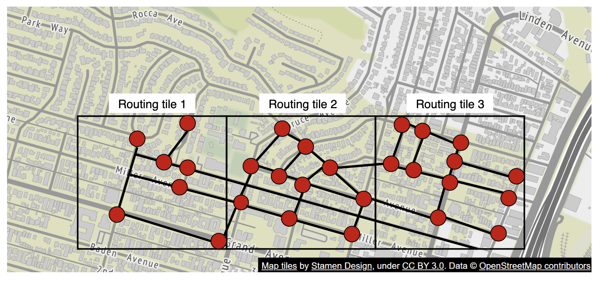
</div>

Kỹ thuật này giúp giảm đáng kể lượng bộ nhớ cần thiết vì thuật toán chỉ cần tải theo yêu cầu (on-demand) những Routing Tiles nằm trên hành trình từ điểm xuất phát đến điểm đích.

Thậm chí, để tối ưu cho các chuyến đi xuyên bang/xuyên quốc gia dài hàng nghìn km (nếu ghép hàng trăm nghìn ô đường hẻm nhỏ sẽ vẫn rất chậm), hệ thống tạo sẵn **3 cấp độ Routing Tiles phân cấp (Hierarchical Routing Tiles)** với độ chi tiết khác nhau:
1. **Routing Tiles chi tiết cao (Local roads):** Ô kích thước nhỏ, chứa toàn bộ các con đường nhỏ và ngõ hẻm địa phương (dùng cho chặng đầu xuất phát và chặng cuối gần đích).
2. **Routing Tiles trung bình (Arterial roads):** Ô kích thước lớn hơn, chỉ chứa các trục đường chính nối giữa các quận/huyện.
3. **Routing Tiles độ phủ rộng (Highways):** Ô kích thước rất lớn, chỉ chứa các tuyến đường cao tốc (Highways/Freeways) nối giữa các thành phố và tiểu bang.

<div style="margin-left:3rem">
    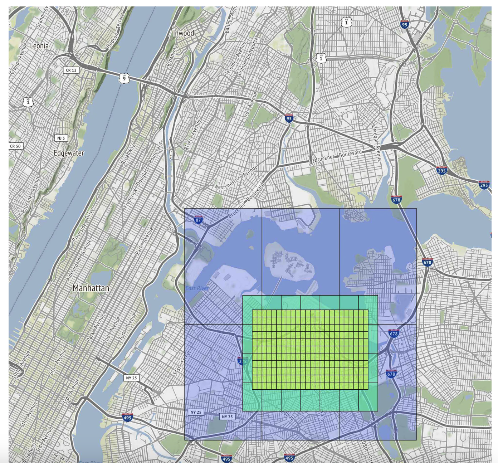
</div>

### **Ước lượng sơ bộ (Back-of-the-Envelope Estimation)**

1. **Nhu cầu Lưu trữ (Storage):** Chúng ta cần lưu trữ 3 loại dữ liệu:
   * **Bản đồ thế giới (Map Tiles):** Từ Zoom Level 0 đến 21 có tổng cộng khoảng $\sim 5.8 \times 10^{12}$ tiles. Giả sử mỗi ảnh tile nặng 100 KB thì tổng dung lượng thô khoảng ~580 PB. Tuy nhiên, vì 80-90% bề mặt Trái Đất là đại dương, sa mạc, rừng núi hoặc vùng băng tuyết không người ở có hình ảnh đồng màu nén cực tốt, dung lượng lưu trữ thực tế giảm xuống chỉ còn khoảng **~67 PB đến 100 PB**.
   * **Metadata của Server:** Không đáng kể.
   * **Thông tin đường bộ (Routing Tiles):** Hàng Terabytes dữ liệu thô được biên dịch thành hàng tỷ Routing Tiles lưu trên Object Storage.

2. **Nhu cầu Băng thông và QPS:**
   * **Lưu lượng cập nhật vị trí GPS (Location Updates):** 1 tỷ DAU, mỗi người dùng dẫn đường trung bình 35 phút/tuần $\rightarrow$ 5 tỷ phút/ngày ($\sim 300$ tỷ giây/ngày). Nếu mỗi giây đều gửi 1 request thì QPS sẽ là 3 triệu QPS. Tuy nhiên, bằng cách **gom nhóm theo lô ở phía Client (Client-side Batching)** — chỉ gửi 1 gói tin gom dữ liệu của mỗi **15 giây/lần** — lưu lượng ghi trung bình giảm xuống còn **200.000 QPS** (và **Peak QPS = 1 triệu QPS**).

---

## Bước 2: Đề xuất thiết kế tổng quan và Thống nhất phương án (Propose High-Level Design and Get Buy-In)

<div style="margin-left:3rem">
    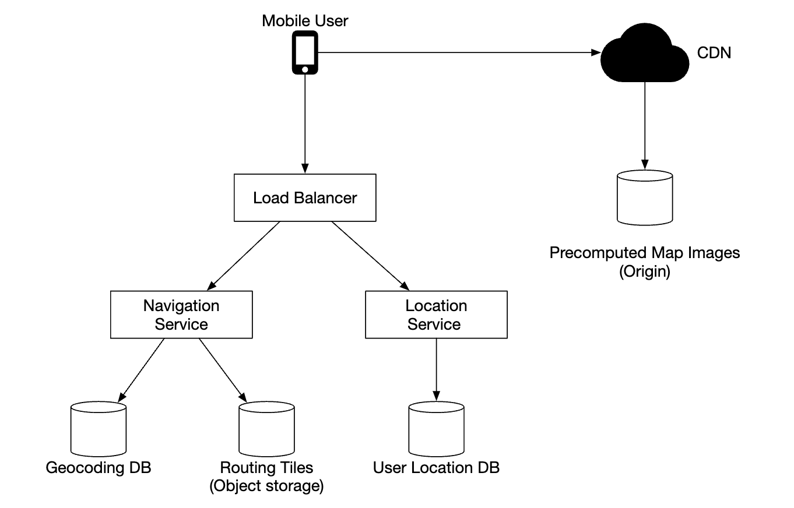
</div>

Kiến trúc tổng quan bao gồm 3 thành phần chính: **Location Service**, **Navigation Service** và **Map Rendering**.

### **1. Dịch vụ cập nhật vị trí (Location Service)**

<div style="margin-left:3rem">
    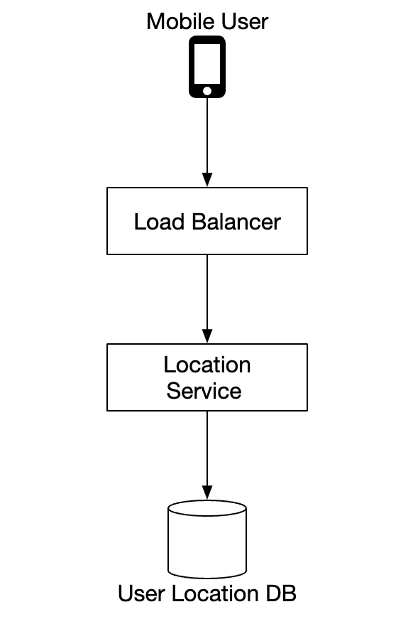
</div>

Chịu trách nhiệm tiếp nhận và ghi lại luồng dữ liệu vị trí của người dùng đang di chuyển:
 * Client ghi nhận tọa độ GPS mỗi giây nhưng **gom nhóm (batch)** lại và gửi lên server định kỳ mỗi `t` giây (ví dụ `t = 15s`).
 * Dữ liệu vị trí thời gian thực này là mỏ vàng để cải thiện hệ thống: dùng để theo dõi tình trạng kẹt xe trực tiếp (live traffic), tính toán ETA chính xác hơn, tự động phát hiện đường mới mở hoặc đường đang bị phong tỏa.

<div style="margin-left:3rem">
    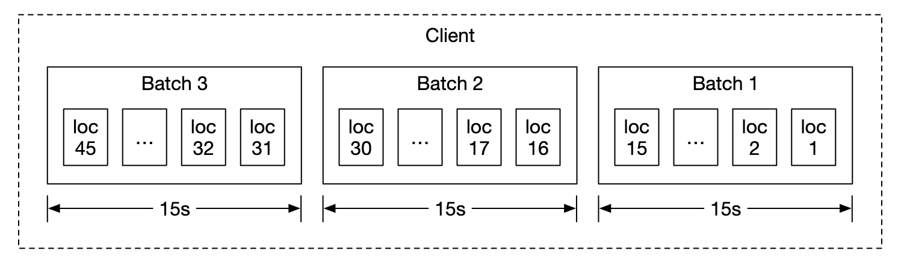
</div>

Ngay cả khi đã gom theo lô 15 giây, ở quy mô Google Maps thì mức tải ghi vẫn lên tới 1 triệu QPS lúc cao điểm. Do đó, chúng ta sử dụng cơ sở dữ liệu NoSQL tối ưu hóa cho tải ghi cực nặng là **Apache Cassandra**, đồng thời đẩy luồng sự kiện vào **Apache Kafka** để phục vụ các hệ thống xử lý dòng dữ liệu (Stream Processing) phía sau.

Ví dụ HTTP Request gửi cập nhật vị trí theo lô:

```
POST /v1/locations
Parameters
  locs: JSON encoded array of (latitude, longitude, timestamp) tuples.
```

### **2. Dịch vụ dẫn đường (Navigation Service)**

Chịu trách nhiệm tìm tuyến đường nhanh nhất từ điểm A đến điểm B trong khoảng thời gian phản hồi hợp lý (người dùng chấp nhận chờ 1-2 giây khi bấm nút "Bắt đầu chỉ đường", nhưng kết quả lộ trình phải chuẩn xác).

Ví dụ HTTP Request tìm đường:

```
GET /v1/nav?origin=1355+market+street,SF&destination=Disneyland
```

Ví dụ JSON Response trả về (tương tự chuẩn của Google Maps API):

```json
{
  "distance": {"text":"0.2 mi", "value": 259},
  "duration": {"text": "1 min", "value": 83},
  "end_location": {"lat": 37.4038943, "Ing": -121.9410454},
  "html_instructions": "Head <b>northeast</b> on <b>Brandon St</b> toward <b>Lumin Way</b><div style=\"font-size:0.9em\">Restricted usage road</div>",
  "polyline": {"points": "_fhcFjbhgVuAwDsCal"},
  "start_location": {"lat": 37.4027165, "lng": -121.9435809},
  "geocoded_waypoints": [
    {
       "geocoder_status" : "OK",
       "partial_match" : true,
       "place_id" : "ChIJwZNMti1fawwRO2aVVVX2yKg",
       "types" : [ "locality", "political" ]
    },
    {
       "geocoder_status" : "OK",
       "partial_match" : true,
       "place_id" : "ChIJ3aPgQGtXawwRLYeiBMUi7bM",
       "types" : [ "locality", "political" ]
    }
  ],
  "travel_mode": "DRIVING"
}
```

*(Lưu ý: Việc cập nhật lại ETA khi đang đi giữa đường và tự động đổi lộ trình khi gặp tắc đường sẽ được giải quyết chi tiết ở Bước 3).*

### **3. Hiển thị bản đồ (Map Rendering)**

Vì kho ảnh Map Tiles ở 21 mức zoom nặng tới hàng chục Petabytes nên không thiết bị nào lưu sẵn được mà phải tải theo yêu cầu (on-demand) từ server dựa trên tọa độ và mức zoom hiện tại của client.
- **Khi nào Client tải Map Tiles mới?** Khi người dùng đang phóng to/thu nhỏ (zoom in/out) hoặc đang kéo bản đồ/di chuyển sang vùng đất mới.
- **Cách thức phân phối Map Tiles:**
  * Thay vì dựng ảnh động theo từng request gây quá tải server và không thể cache, toàn bộ các ô **Map Tiles được tính toán và tạo sẵn từ trước (Precomputed Static Tiles)** ứng với từng mã **Geohash** ở từng mức Zoom.
  * Toàn bộ các file ảnh tĩnh này được lưu trên Amazon S3 và phân phối qua mạng lưới **CDN (Content Delivery Network)** toàn cầu:

<div style="margin-left:3rem">
    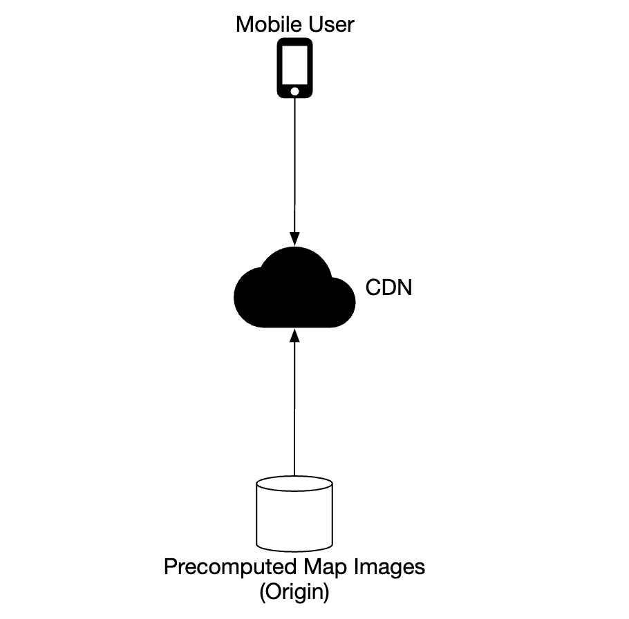
</div>

Việc phục vụ Map Tiles qua các máy chủ biên (**Point of Presence - POP**) của CDN giúp giảm thiểu tối đa Latency cho người dùng ở mọi châu lục:

<div style="margin-left:3rem">
    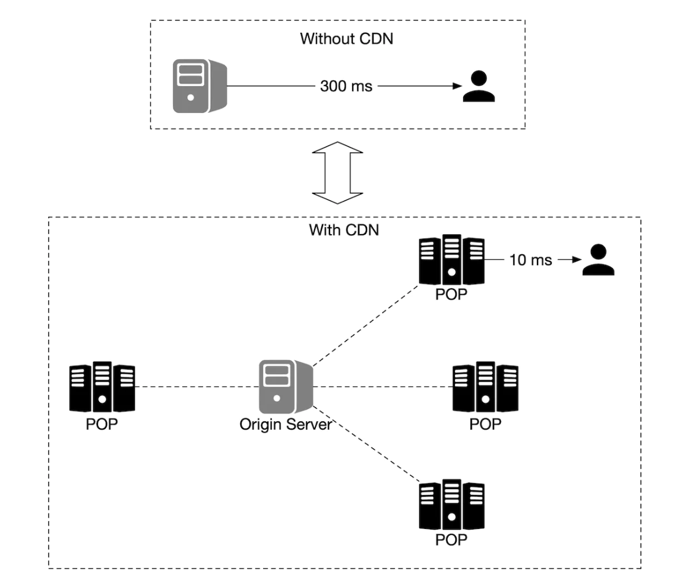
</div>

**Làm sao Client biết phải tải URL nào trên CDN?** Có 2 phương án:
 * **Phương án 1 (Tính Geohash ở phía Client):** Client tự tính mã Geohash từ `(lat, long, zoom_level)` rồi ghép thành URL tải thẳng từ CDN (ví dụ `https://cdn.mapprovider.com/tiles/9q8zn.png`). Ưu điểm là không tốn thêm 1 lệnh gọi API, nhưng nhược điểm lớn là thuật toán tính URL bị đóng cứng vào code của ứng dụng di động — sau này nếu muốn thay đổi cách mã hóa URL sẽ cực kỳ khó vì không thể ép mọi người dùng cập nhật app ngay lập tức.
 * **Phương án 2 (Sử dụng dịch vụ trung gian Map Tile Service — Khuyến nghị):** Thêm một dịch vụ Stateless siêu nhẹ gọi là **Map Tile Service** để nhận `(lat, long, zoom_level)` từ client và trả về danh sách các URL ảnh trên CDN cần tải. Đánh đổi thêm 1 cuộc gọi API nhỏ nhưng mang lại sự linh hoạt vận hành tuyệt đối cho phía Backend:

<div style="margin-left:3rem">
    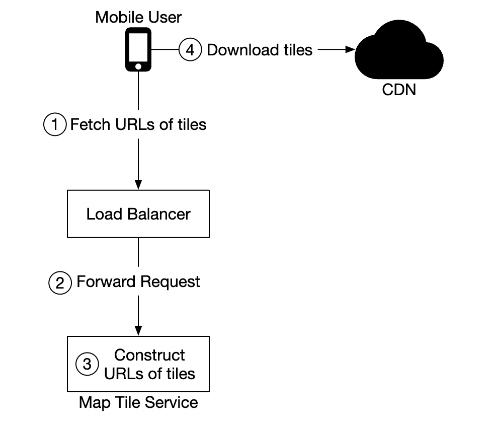
</div>

---

## Bước 3: Đi sâu vào thiết kế chi tiết (Design Deep Dive)

### **1. Thiết kế Mô hình dữ liệu (Data Model)**

Hãy đi sâu vào cách lưu trữ 4 loại dữ liệu cốt lõi của hệ thống:

#### a. Các ô định tuyến đường bộ (Routing Tiles)
- Dữ liệu đường bộ thô thu thập từ hàng trăm nguồn trên thế giới là phi cấu trúc và không thể dùng trực tiếp cho thuật toán đồ thị.
- Chúng ta xây dựng một **Pipeline xử lý ngoại tuyến định kỳ (Periodic Offline Processing Pipeline — gọi là Routing Tile Processing Service)** để biến đổi dữ liệu thô này thành các **Routing Tiles** ở 3 cấp độ phân cấp (Local, Arterial, Highway).
- Mỗi Routing Tile chứa danh sách các đỉnh (giao lộ) và các cạnh (con đường). Thay vì lưu vào Database quan hệ cồng kềnh (vì ta không cần truy vấn SQL trên đồ thị), cách hiệu quả nhất là **tuần tự hóa (serialize) danh sách kề (adjacency lists) của đồ thị thành một file nhị phân (binary file) đã nén**, đặt tên theo mã Geohash và lưu trữ trên **Object Storage (Amazon S3)** kết hợp lưu bộ nhớ đệm tích cực (aggressive caching) ngay trên cụm Navigation Service!

#### b. Dữ liệu vị trí người dùng (User Location Data)
- Dữ liệu này cực kỳ quan trọng để xây dựng bản đồ giao thông trực tiếp (Live Traffic DB) và huấn luyện mô hình dự đoán ETA.
- Sử dụng **Apache Cassandra** để chịu tải ghi 1 triệu QPS. Cấu trúc một dòng bản ghi gồm:

<div style="margin-left:3rem">
    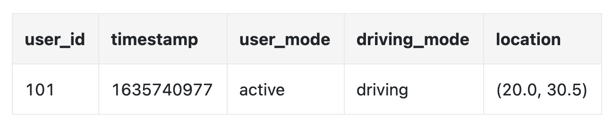
</div>

#### c. Cơ sở dữ liệu Mã hóa địa lý (Geocoding Database)
- Lưu trữ các cặp ánh xạ Key-Value giữa địa chỉ tên đường và tọa độ `(latitude, longitude)`.
- Tần suất đọc rất cao (mỗi lần tìm đường đều phải geocode điểm đi và điểm đến), trong khi địa chỉ đường phố rất hiếm khi thay đổi. Do đó, sử dụng **Redis** là lựa chọn hoàn hảo.

#### d. Kho ảnh bản đồ tính toán sẵn (Precomputed Map Tile Images)
- Lưu trữ trên **Amazon S3** và phân phối qua **CDN** theo từng cấp độ thu phóng.

<div style="margin-left:3rem">
    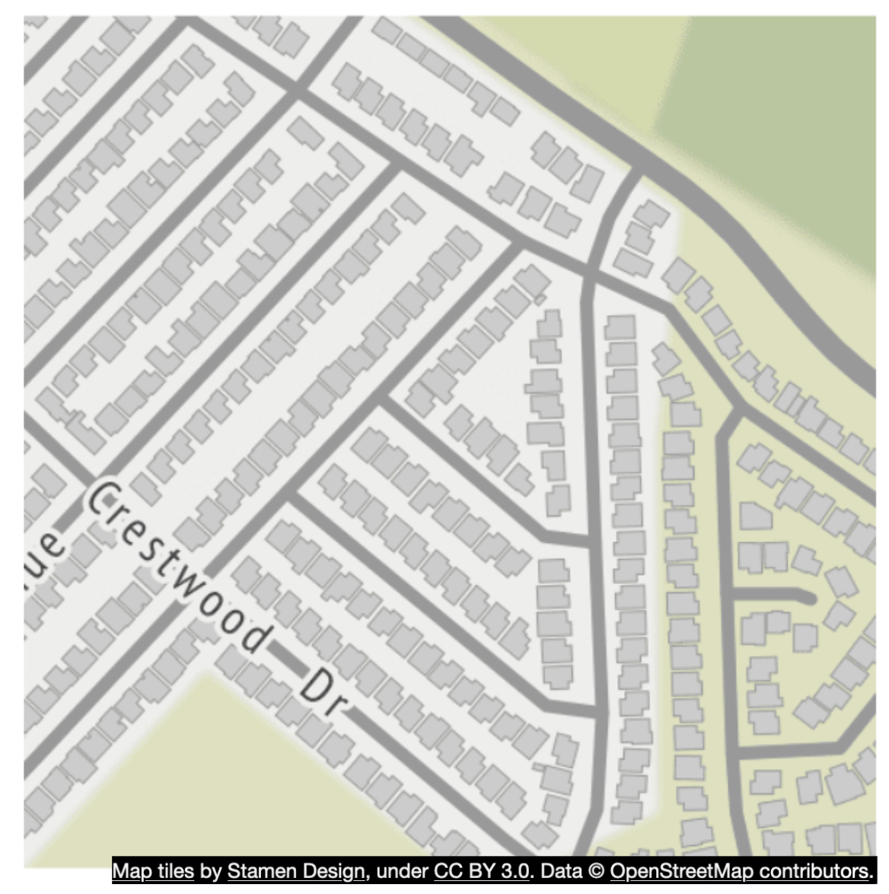
</div>

---

### **2. Thiết kế chi tiết các Dịch vụ (Services)**

#### a. Location Service và Pipeline xử lý dòng dữ liệu

<div style="margin-left:3rem">
    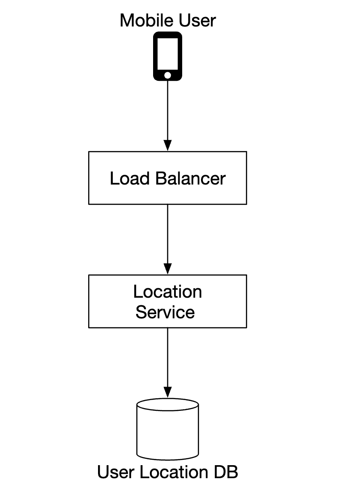
</div>

- Theo Định lý CAP, đối với dữ liệu vị trí người dùng, chúng ta ưu tiên **Tính sẵn sàng (Availability)** hơn là Tính nhất quán (Consistency) vì tọa độ GPS thay đổi liên tục sau mỗi vài giây.
- Trong bảng **Cassandra** lưu lịch sử vị trí:

<div style="margin-left:3rem">
    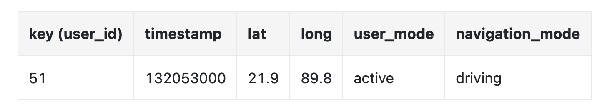
</div>

 * `user_id` được chọn làm **Partition Key** để gom toàn bộ dữ liệu di chuyển của cùng một người dùng vào cùng một phân vùng, giúp truy xuất nhanh hành trình của người đó.
 * `timestamp` được chọn làm **Clustering Key** để tự động sắp xếp các điểm tọa độ theo đúng trình tự thời gian nhận được.

Đồng thời, **Location Service** đẩy toàn bộ luồng sự kiện vị trí vào một Message Queue tốc độ cao là **Apache Kafka**. Từ Kafka, hàng loạt dịch vụ hạ nguồn (downstream services) sẽ cùng tiêu thụ luồng dữ liệu này cho các mục đích chuyên biệt:
- **Traffic Update Service:** Phân tích tốc độ di chuyển thực tế của dòng xe trên từng con đường để cập nhật tình trạng giao thông trực tiếp vào **Traffic DB**.
- **Routing Tile Processing Service:** Phát hiện các con đường mới mở hoặc đường bị đóng tạm thời để cập nhật lại các Routing Tiles.
- **Machine Learning & Analytics Service:** Học quy luật giao thông theo giờ/ngày để cải thiện mô hình dự báo ETA.

<div style="margin-left:3rem">
    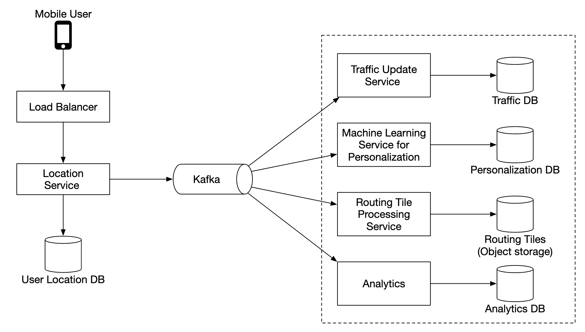
</div>

#### b. Tối ưu hóa hiển thị bản đồ: Vector Tiles (Map Rendering Optimization)

Ở mỗi cấp độ Zoom tăng lên, số lượng ô bản đồ tăng gấp 4 lần:

<div style="margin-left:3rem">
    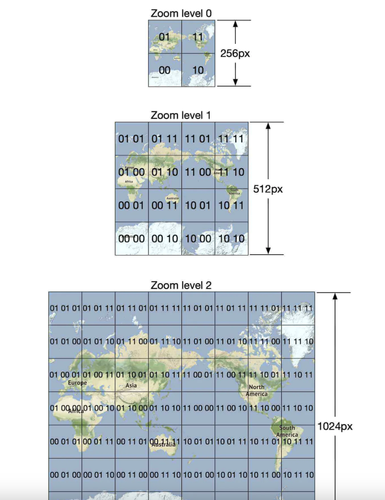
</div>

Thay vì gửi các file ảnh điểm ảnh tĩnh (**Raster Images** như PNG/JPEG) qua mạng, một cải tiến đột phá hiện đại (được Google Maps áp dụng) là sử dụng **Vector Tiles** (kết hợp WebGL):
- Thay vì truyền bức ảnh đã vẽ sẵn, server chỉ gửi dữ liệu hình học vector gồm **các đường dẫn (paths), đa giác (polygons) và nhãn chữ** đã được nén cực nhỏ, sau đó GPU của điện thoại Client sẽ tự vẽ (render) bản đồ động ngay trên màn hình!
- **Ưu điểm vượt trội của Vector Tiles:**
  1. **Tiết kiệm băng thông mạng khổng lồ** (dung lượng file vector nhỏ hơn ảnh raster rất nhiều).
  2. **Trải nghiệm phóng to/thu nhỏ siêu mượt (Smooth Zooming):** Khi người dùng dùng 2 ngón tay phóng to giữa hai mức zoom, ảnh raster truyền thống sẽ bị vỡ hạt và mờ nhoè trong lúc chờ tải ảnh mới, còn Vector Tiles cho phép co giãn hình học sắc nét tuyệt đối ở mọi tỷ lệ!

#### c. Kiến trúc chi tiết của Navigation Service

<div style="margin-left:3rem">
    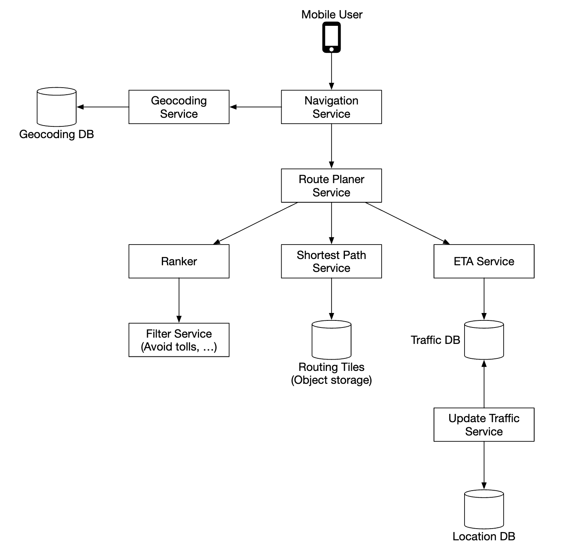
</div>

Hãy đi qua từng thành phần bên trong hệ thống con Navigation Service:

1. **Geocoding Service:** Chuyển đổi địa chỉ điểm đi (`origin`) và điểm đến (`destination`) do người dùng nhập vào thành cặp tọa độ `(lat, long)` tương ứng.
   Ví dụ Request:
   ```
   https://maps.googleapis.com/maps/api/geocode/json?address=1600+Amphitheatre+Parkway,+Mountain+View,+CA
   ```
   Ví dụ Response:
   ```json
   {
      "results" : [
         {
            "formatted_address" : "1600 Amphitheatre Parkway, Mountain View, CA 94043, USA",
            "geometry" : {
               "location" : {
                  "lat" : 37.4224764,
                  "lng" : -122.0842499
               },
               "location_type" : "ROOFTOP",
               "viewport" : {
                  "northeast" : {
                     "lat" : 37.4238253802915,
                     "lng" : -122.0829009197085
                  },
                  "southwest" : {
                     "lat" : 37.4211274197085,
                     "lng" : -122.0855988802915
                  }
               }
            },
            "place_id" : "ChIJ2eUgeAK6j4ARbn5u_wAGqWA",
            "plus_code": {
               "compound_code": "CWC8+W5 Mountain View, California, United States",
               "global_code": "849VCWC8+W5"
            },
            "types" : [ "street_address" ]
         }
      ],
      "status" : "OK"
   }
   ```

2. **Route Planner Service (Dịch vụ điều phối lộ trình):** Nhận request từ người dùng, gọi Geocoding Service để lấy tọa độ, sau đó điều phối gọi sang **Shortest-Path Service**, **ETA Service** và **Ranker Service** để tổng hợp ra các lộ trình tối ưu nhất.

3. **Shortest-Path Service (Dịch vụ tìm đường đi ngắn nhất):** Chạy biến thể của thuật toán **A\*** trên các **Routing Tiles** lưu trong Object Storage để tìm ra `top-k` tuyến đường ngắn nhất:
   * Nhận cặp tọa độ `(origin, destination)`, chuyển đổi chúng thành mã Geohash để tải các Routing Tiles tương ứng.
   * Bắt đầu duyệt đồ thị từ ô xuất phát, đi qua các ô lân cận (và chuyển lên các ô cấp cao Highway nếu đi xa) cho đến khi tìm được các tuyến đường tốt nhất tới ô đích.

<div style="margin-left:3rem">
    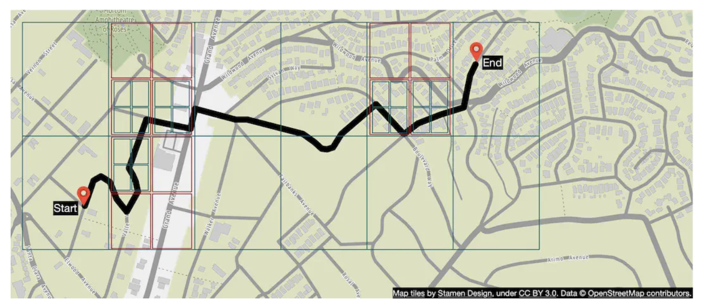
</div>

4. **ETA Service (Dịch vụ tính thời gian đến dự kiến):** Được Route Planner gọi tới cho từng tuyến đường tiềm năng. ETA Service truy vấn **Traffic DB** (tình trạng giao thông hiện tại) và sử dụng các mô hình **Machine Learning** để dự đoán chính xác thời gian di chuyển của từng đoạn đường trong hiện tại cũng như trong 10-30 phút tới.

5. **Ranker Service (Dịch vụ lọc và xếp hạng lộ trình):** Nhận danh sách các tuyến đường kèm thời gian ETA, áp dụng các bộ lọc tùy chọn của người dùng (ví dụ: tránh trạm thu phí `avoid toll roads`, tránh đường cao tốc `avoid freeways`) rồi sắp xếp các tuyến đường từ nhanh nhất đến chậm nhất để trả về cho Route Planner.

---

#### d. Cải tiến nâng cao: Cập nhật ETA thích ứng và Tự động đổi lộ trình (Adaptive ETA and Rerouting)

Bài toán khó tiếp theo: Khi người dùng đang lái xe trên đường, nếu phía trước cách đó 5 km bất ngờ xảy ra một vụ tai nạn gây tắc nghẽn nghiêm trọng, làm sao hệ thống biết **những người dùng nào đang đi trên lộ trình đi qua điểm tai nạn đó** để chủ động tính lại ETA và gợi ý đổi lộ trình mới (**Rerouting**) cho họ?

- **Cách tiếp cận ngây thơ:** Lưu lại danh sách tất cả các Routing Tiles nằm trên lộ trình của từng người dùng đang di chuyển vào Database:
  ```
  user_1: r_1, r_2, r_3, …, r_k
  user_2: r_4, r_6, r_9, …, r_n
  user_3: r_2, r_8, r_9, …, r_m
  ...
  user_n: r_2, r_10, r21, ..., r_l
  ```
  Giả sử có một vụ tai nạn xảy ra tại ô `r_2`, để tìm tất cả người dùng bị ảnh hưởng, ta phải quét toàn bộ các bản ghi hoặc đánh index khổng lồ vì một lộ trình dài có thể đi qua hàng nghìn ô nhỏ!

- **Giải pháp tối ưu bằng phân cấp đệ quy (Hierarchical Super-Tiles):** Thay vì lưu hàng nghìn ô nhỏ trên lộ trình, với mỗi người dùng đang dẫn đường, chúng ta chỉ lưu **ô xuất phát hiện tại (`r_1`) và các ô cha bao hàm nó ở các cấp độ phóng to dần (`super(r_1)`, `super(super(r_1))`...) cho đến khi ô cha cuối cùng bao trùm luôn cả điểm đích**:

```
user_1, r_1, super(r_1), super(super(r_1)), ...
```

<div style="margin-left:3rem">
    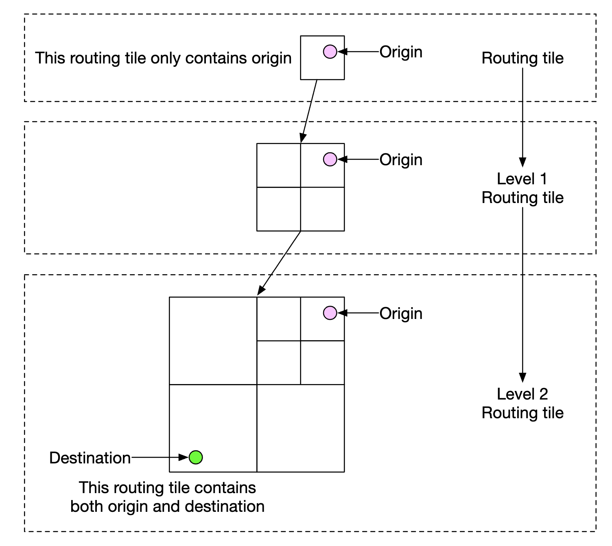
</div>

Nhờ thiết kế thông minh này, để kiểm tra xem một người dùng có khả năng bị ảnh hưởng bởi sự cố giao thông tại một ô bất kỳ hay không, ta chỉ cần kiểm tra xem **ô sự cố đó có nằm bên trong ô cha cuối cùng (`last bounding box tile`) của người dùng đó hay không** — giảm khối lượng dữ liệu phải lưu và kiểm tra đi hàng백 lần! Ngoài ra, với những người dùng đang di chuyển, hệ thống luôn lưu giữ một vài tuyến đường thay thế (possible routes) để ngay khi tuyến đường phụ trở nên thông thoáng hơn tuyến chính, hệ thống lập tức thông báo gợi ý rẽ sang đường mới nhanh hơn.

#### e. Giao thức truyền tải thông báo đổi lộ trình (Delivery Protocols)

Trong lúc dẫn đường, Server cần chủ động đẩy (push) cảnh báo kẹt xe và lộ trình mới xuống Client. Ta chọn giao thức nào?
 * **Mobile Push Notifications:** Không phù hợp vì kích thước payload bị giới hạn rất nhỏ và không hỗ trợ ứng dụng Web.
 * **WebSocket vs. Long Polling / SSE:** Chúng ta lựa chọn **WebSocket** vì nó tiêu tốn ít tài nguyên server hơn Long Polling và hỗ trợ giao tiếp hai chiều theo thời gian thực (rất tiện lợi vì đằng nào Client cũng đang phải gửi các gói cập nhật vị trí GPS lên Server liên tục!).

---

## Bước 4: Tổng kết (Wrap Up)

Dưới đây là sơ đồ kiến trúc hoàn chỉnh cuối cùng của hệ thống Google Maps:

<div style="margin-left:3rem">
    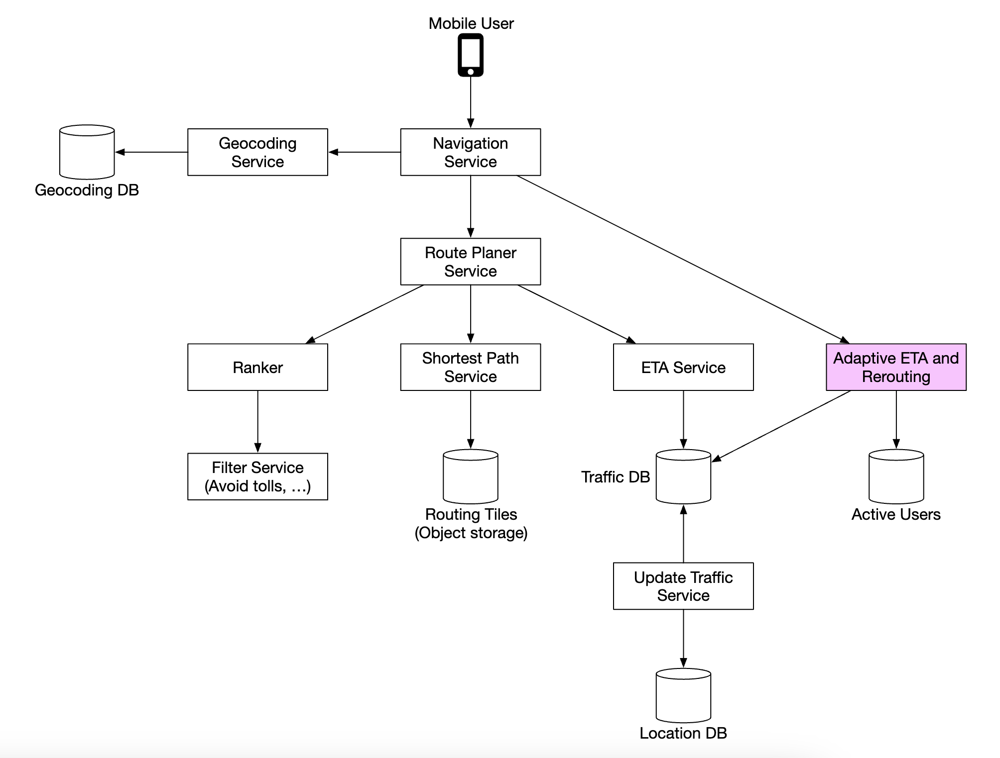
</div>

Một hướng mở rộng rất thú vị có thể thảo luận thêm ở cuối buổi phỏng vấn là bài toán **Dẫn đường qua nhiều điểm dừng (Multi-stop Navigation / Traveling Salesperson Problem)** dành cho các khách hàng doanh nghiệp vận tải và giao hàng (như Uber, Grab, Lyft, DoorDash, FedEx) nhằm tối ưu hóa thứ tự ghé thăm một tập hợp các địa điểm giao nhận với tổng thời gian và chi phí nhiên liệu thấp nhất.
