# Chương 19: Hàng đợi tin nhắn phân tán (Distributed Message Queue)

## Giới thiệu

Trong chương này, chúng ta sẽ đi sâu vào việc thiết kế một hệ thống **Hàng đợi tin nhắn phân tán (Distributed Message Queue)** hiện đại ở quy mô lớn (tương tự như Apache Kafka).

Các lợi ích cốt lõi của việc sử dụng Message Queue trong kiến trúc hệ thống:
- **Tách biệt sự phụ thuộc (Decoupling):** Loại bỏ sự phụ thuộc chặt chẽ (tight coupling) giữa các thành phần; cho phép các dịch vụ được phát triển, cập nhật và bảo trì hoàn toàn độc lập với nhau.
- **Cải thiện khả năng mở rộng (Improved Scalability):** Các hệ thống gửi tin (**Producers**) và các hệ thống nhận tin (**Consumers**) có thể tự động mở rộng quy mô độc lập dựa trên lưu lượng tải thực tế.
- **Tăng tính sẵn sàng (Increased Availability):** Nếu một dịch vụ Consumer ở hạ nguồn bị sập tạm thời, các dịch vụ Producer ở thượng nguồn vẫn tiếp tục đẩy dữ liệu vào Message Queue bình thường mà không bị gián đoạn.
- **Tối ưu hiệu năng (Better Performance):** Nhờ giao tiếp bất đồng bộ, Producer chỉ cần đẩy message vào queue là xong việc ngay lập tức mà không phải đứng chờ Consumer xử lý xong mới phản hồi.

Một số hệ thống Message Queue và Event Streaming phổ biến nhất trên thị trường hiện nay: **Apache Kafka**, **RabbitMQ**, **Apache RocketMQ**, **Apache Pulsar**, **ActiveMQ**, **ZeroMQ**.

*(Lưu ý kỹ thuật: Xét một cách chặt chẽ, Apache Kafka và Pulsar là các **Nền tảng truyền phát sự kiện (Event Streaming Platforms)** chứ không chỉ là Message Queue truyền thống như RabbitMQ. Tuy nhiên trong thực tế hiện nay, ranh giới tính năng giữa hai nhóm này ngày càng hội tụ. Trong chương này, chúng ta sẽ thiết kế một Distributed Message Queue hỗ trợ cả các tính năng nâng cao của nền tảng streaming như lưu giữ dữ liệu lâu dài trên đĩa và cho phép đọc lại tin nhắn nhiều lần).*

---

## Bước 1: Thấu hiểu bài toán và Xác lập phạm vi thiết kế (Understand the Problem and Establish Design Scope)

Dưới đây là đoạn hội thoại mẫu giữa Ứng viên (C) và Người phỏng vấn (I) để xác định rõ yêu cầu:
 * **C:** Định dạng và kích thước trung bình của một message là bao nhiêu? Chỉ là văn bản hay có cả dữ liệu đa phương tiện lớn?
 * **I:** Các message chủ yếu là định dạng văn bản/nhị phân nhỏ, kích thước thông thường chỉ vài Kilobytes (KBs).
 * **C:** Một message sau khi đã được đọc thì có thể được đọc lại nhiều lần (repeatedly consumed) bởi các consumers khác không?
 * **I:** Có, một message có thể được đọc nhiều lần bởi các nhóm consumers khác nhau. Đây là yêu cầu bổ sung quan trọng mà các message queue truyền thống không hỗ trợ.
 * **C:** Các message có bắt buộc phải được đọc theo đúng thứ tự mà chúng được gửi vào không?
 * **I:** Có, thứ tự tin nhắn (message ordering) cần được bảo toàn.
 * **C:** Yêu cầu về thời gian lưu giữ dữ liệu (data retention) là bao lâu?
 * **I:** Hệ thống cần lưu giữ các message trên đĩa trong vòng **2 tuần (14 ngày)**.
 * **C:** Hệ thống cần hỗ trợ bao nhiêu Producers và Consumers?
 * **I:** Càng nhiều càng tốt (khả năng mở rộng cao).
 * **C:** Chúng ta cần hỗ trợ ngữ nghĩa chuyển phát dữ liệu (data delivery semantics) nào: **Chuyển phát nhiều nhất một lần (At-most-once)**, **Chuyển phát ít nhất một lần (At-least-once)**, hay **Chuyển phát chính xác một lần (Exactly-once)**?
 * **I:** Chúng ta chắc chắn phải hỗ trợ `At-least-once`. Lý tưởng nhất là hỗ trợ cả 3 mức và cho phép người dùng cấu hình linh hoạt.
 * **C:** Mục tiêu về Throughput và End-to-End Latency là như thế nào?
 * **I:** Hệ thống cần hỗ trợ cả bài toán đòi hỏi Throughput cực cao (như thu thập log - Log Aggregation) lẫn bài toán cần Latency thấp như hàng đợi truyền thống.

### **Yêu cầu chức năng (Functional Requirements)**

 * Producers gửi messages vào Message Queue.
 * Consumers lấy và xử lý messages từ Message Queue.
 * Messages có thể chỉ được đọc một lần hoặc được đọc lặp lại nhiều lần.
 * Dữ liệu lịch sử cũ quá hạn (2 tuần) có thể được cắt bỏ (truncated) tự động.
 * Kích thước mỗi message nằm trong khoảng vài KB.
 * Đảm bảo thứ tự của các messages khi chuyển phát.
 * Cho phép cấu hình linh hoạt ngữ nghĩa chuyển phát: `At-most-once`, `At-least-once` hoặc `Exactly-once`.

### **Yêu cầu phi chức năng (Non-Functional Requirements)**

- **Throughput cao hoặc Latency thấp:** Có thể tinh chỉnh cấu hình (tunable) tùy theo bài toán sử dụng thực tế.
- **Khả năng mở rộng (Scalable):** Hệ thống phải phân tán hoàn toàn và chịu được các đợt lưu lượng message tăng vọt đột ngột (traffic surges).
- **Tính bền vững và Độ tin cậy cao (Persistent and Durable):** Dữ liệu không được mất khi mất điện; phải được ghi xuống ổ cứng (disk) và sao chép (replicated) qua nhiều node trong cụm.

---

## Bước 2: Đề xuất thiết kế tổng quan và Thống nhất phương án (Propose High-Level Design and Get Buy-In)

Các thành phần cơ bản nhất của một Message Queue:

    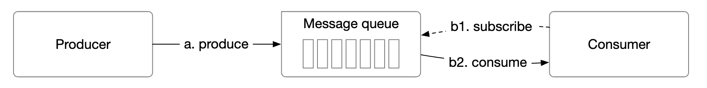

 * **Producer** đẩy các messages vào hàng đợi.
 * **Consumer** đăng ký (subscribe) vào hàng đợi và tiêu thụ các messages đó.
 * **Message Queue** là dịch vụ trung gian ở giữa giúp tách rời sự phụ thuộc giữa Producers và Consumers.
 * Cả Producer và Consumer đều đóng vai trò là **Client**, trong khi cụm Message Queue đóng vai trò là **Server**.

### **1. Các mô hình nhắn tin (Messaging Models)**

#### a. Mô hình Điểm-tới-Điểm (Point-to-Point Model)
Thường thấy trong các hệ thống Message Queue truyền thống (như SQS hay RabbitMQ queue cơ bản):

    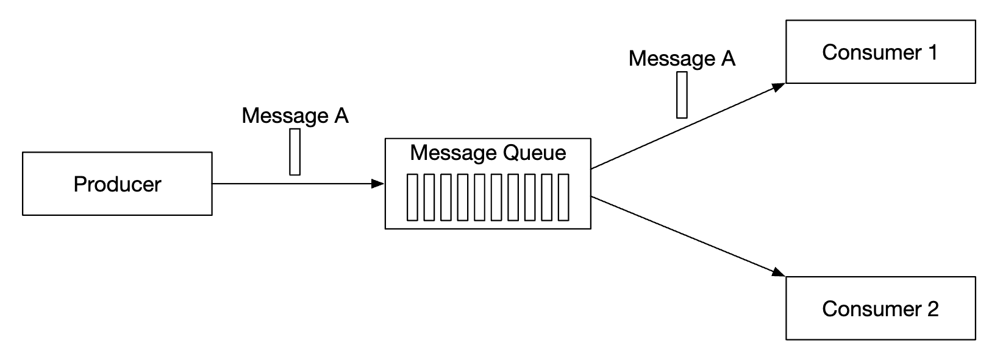

 * Một message gửi vào queue sẽ chỉ được tiêu thụ bởi **duy nhất một Consumer**.
 * Có thể có nhiều Consumers cùng lắng nghe một queue để chia tải công việc, nhưng mỗi message cụ thể chỉ có một Consumer lấy được.
 * Ngay khi Consumer gửi xác nhận (ACK) đã xử lý xong, message đó sẽ bị xóa vĩnh viễn khỏi queue (không lưu giữ lại dữ liệu).

#### b. Mô hình Xuất bản - Đăng ký (Publish-Subscribe / Pub-Sub Model)
Phổ biến trong các nền tảng Event Streaming hiện đại:

    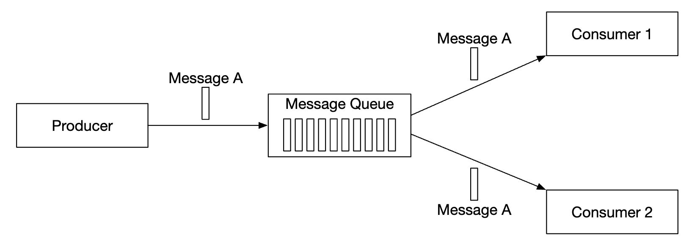

 * Trong mô hình này, khái niệm mới là **Chủ đề (Topic)** được đưa vào để phân loại và tổ chức các messages theo từng nhóm nghiệp vụ.
 * Producers gửi messages vào một **Topic** cụ thể, và tất cả các Consumers (hoặc các nhóm Consumers) đăng ký lắng nghe Topic đó đều sẽ nhận được toàn bộ bản sao của các messages trong Topic.

### **2. Topics, Partitions và Brokers**

Điều gì xảy ra nếu khối lượng dữ liệu đổ vào một Topic quá khổng lồ, vượt quá sức chứa của một máy chủ vật lý? Giải pháp mở rộng quy mô là chia nhỏ một Topic thành nhiều phần gọi là các **Phân vùng (Partitions — tức kỹ thuật Sharding)**:

    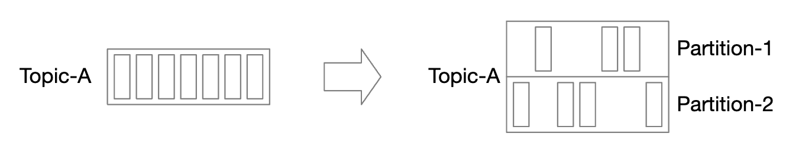

 * Các messages gửi vào một Topic sẽ được chia nhỏ và phân bổ đồng đều qua nhiều **Partitions** nằm trên các máy chủ khác nhau.
 * Các máy chủ vật lý lưu trữ và quản lý các Partitions này được gọi là các **Brokers**. Việc phân phối các Partitions qua nhiều Brokers chính là chìa khóa giúp hệ thống đạt được khả năng mở rộng cao.
 * Mỗi Partition hoạt động như một hàng đợi **FIFO (First-In-First-Out)** độc lập. Nhờ vậy, **thứ tự của các messages luôn được đảm bảo nghiêm ngặt bên trong phạm vi của cùng một Partition**.
 * Vị trí thứ tự của mỗi message bên trong một Partition được gọi là một **`offset`** (một số nguyên tăng dần tuần tự: `0, 1, 2, 3...`).
 * Khi một message được Producer gửi đi, nếu có đính kèm một **`partition_key`** (ví dụ `user_id`), hệ thống sẽ băm khóa đó (`hash(key) % numPartitions`) để gửi vào một Partition cố định; nhờ đó mọi sự kiện của cùng một `user_id` luôn nằm chung một Partition và luôn được xử lý đúng thứ tự thời gian!

### **3. Nhóm người tiêu thụ (Consumer Groups)**

Làm sao để vừa hỗ trợ mô hình **Publish-Subscribe** (nhiều hệ thống cùng đọc một Topic) lại vừa hỗ trợ mô hình **Point-to-Point** (chia tải xử lý song song trong cùng một hệ thống)? Chúng ta giải quyết bằng khái niệm **Consumer Group**:

    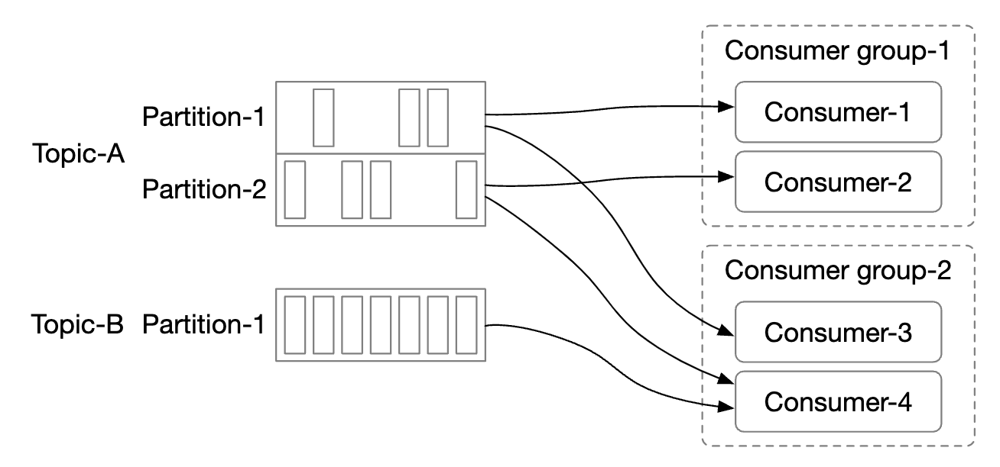

 * Một **Consumer Group** là một tập hợp các tiến trình Consumer phối hợp cùng nhau để tiêu thụ dữ liệu từ các Topics.
 * Các instances bên trong cùng một Consumer Group có thể đọc dữ liệu song song từ các Partitions khác nhau để tăng Throughput.
 * Tuy nhiên, nếu nhiều Consumers trong cùng một Group cùng đọc chung một Partition thì thứ tự xử lý messages sẽ bị xáo trộn. Để khắc phục triệt để và bảo toàn thứ tự, chúng ta áp đặt quy tắc: **Bên trong một Consumer Group, mỗi Partition chỉ được phép gán cho tối đa một Consumer duy nhất đọc tại một thời điểm!**
 * Hệ quả: Nếu số lượng Consumers trong một Group nhiều hơn tổng số Partitions của Topic đó, những Consumers dư ra sẽ ở trạng thái nghỉ (idle). Trong thực tế, ta luôn khởi tạo dư số lượng Partitions ngay từ đầu để dễ dàng scale thêm Consumers khi cần.
 * Mỗi Consumer Group tự duy trì con trỏ vị trí đọc (**commit offset**) hoàn toàn độc lập của riêng mình.

### **4. Kiến trúc tổng quan (High-Level Architecture)**

    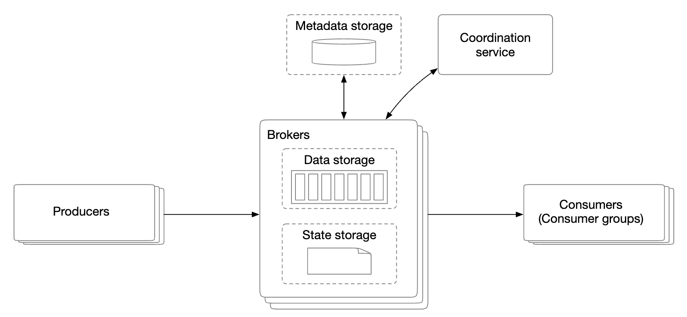

- **Clients:** Bao gồm **Producers** (đẩy messages vào Topic chỉ định) và **Consumer Groups** (đăng ký lắng nghe Topic và kéo messages từ Brokers về xử lý).
- **Brokers:** Cụm máy chủ lưu trữ nhiều Partitions. Mỗi Partition lưu một tập con các messages của một Topic.
- **Data Storage:** Lưu trữ bền vững các messages trong từng Partition dưới dạng các phân đoạn file (**Segments**) trên ổ cứng.
- **State Storage:** Lưu trữ trạng thái hiện tại của các Consumers (bao gồm sơ đồ phân công Partition và vị trí `offset` đã đọc tới đâu của từng Consumer Group).
- **Metadata Storage:** Lưu trữ thông tin cấu hình và thuộc tính của các Topics (số lượng Partitions, thời gian lưu trữ 14 ngày, sơ đồ phân bổ các bản sao Replicas).
- **Coordination Service (như Apache ZooKeeper / KRaft):** Chịu trách nhiệm khám phá dịch vụ (**Service Discovery** — theo dõi những Brokers nào đang sống) và bầu chọn nút trưởng (**Leader Election** — chọn ra một Broker đóng vai trò Controller/Leader để điều phối phân bổ Partitions trong cụm).

---

## Bước 3: Đi sâu vào thiết kế chi tiết (Design Deep Dive)

Để đạt được đồng thời **Throughput cực cao** và khả năng **lưu giữ dữ liệu dung lượng lớn trong 14 ngày**, chúng ta đưa ra 3 quyết định thiết kế nền tảng sau:
 1. Sử dụng cấu trúc dữ liệu trên đĩa tận dụng tối đa tốc độ đọc/ghi tuần tự (**Sequential I/O**) của ổ cứng và cơ chế bộ nhớ đệm trang (**OS Page Cache**) của hệ điều hành hiện đại.
 2. Thiết kế cấu trúc dữ liệu của Message là **bất biến (Immutable)** đi xuyên suốt từ lúc Producer tạo ra cho đến lúc gửi xuống Consumer để tránh việc phải giải nén/sao chép lại vùng nhớ (**Zero-Copy**), giúp tiết kiệm tối đa CPU ở quy mô lưu lượng cao.
 3. Thiết kế toàn bộ luồng gửi và nhận xoay quanh kỹ thuật **Gom nhóm theo lô (Batching)**, bởi vì các thao tác I/O nhỏ lẻ chính là kẻ thù số một của Throughput.

### **1. Thiết kế tầng Lưu trữ dữ liệu trên đĩa (Data Storage)**

Để chọn phương án lưu trữ tốt nhất cho các messages, hãy phân tích đặc điểm truy cập dữ liệu (Traffic Pattern) của một Message Queue:
 * Vừa nặng về ghi (**Write-heavy**), vừa nặng về đọc (**Read-heavy**).
 * **Hoàn toàn không có thao tác sửa (`UPDATE`) hay xóa lẻ tẻ (`DELETE`)!** (Khác với queue truyền thống phải xóa từng message sau khi đọc, ở đây ta giữ nguyên suốt 14 ngày và chỉ cắt bỏ cả file cũ khi hết hạn).
 * Mô hình đọc và ghi chiếm ưu thế tuyệt đối là **Truy cập tuần tự (Sequential Read/Write)**.

Các lựa chọn lưu trữ:
- **Database (SQL hoặc NoSQL):** Không phù hợp vì các cơ sở dữ liệu đa dụng khó xử lý tốt đồng thời cả tải đọc và tải ghi tuần tự tốc độ hàng trăm MB/s mỗi node, lại phát sinh chi phí đánh index không cần thiết.
- **Nhật ký ghi trước (Write-Ahead Log - WAL):** Một file nhật ký thuần túy chỉ cho phép **ghi nối tiếp vào cuối file (Append-only)**. Đây chính là lựa chọn hoàn hảo!
  * Mỗi Partition được lưu trữ dưới dạng một thư mục chứa các file WAL. Vì một file không thể phình to vô hạn, ta chia mỗi Partition thành nhiều file nhỏ có kích thước cố định (ví dụ `1 GB/file`) gọi là các **Phân đoạn (Segments)**.
  * Chỉ có duy nhất một Segment mới nhất đang mở (**Active Segment**) nhận các thao tác ghi nối tiếp; toàn bộ các Segments cũ hơn đều chuyển sang trạng thái **Chỉ đọc (Read-only)** phục vụ việc đọc hoặc chờ hết hạn 14 ngày để xóa gọn cả file.

    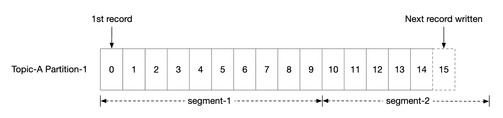

**Phá bỏ lầm tưởng về hiệu năng ổ cứng (Disk Performance):** Nhiều kỹ sư thường mặc định rằng ổ cứng (HDD/SSD) rất chậm so với RAM. Thực tế, ổ cứng chỉ chậm khi phải **truy cập ngẫu nhiên (Random Access / Disk Seek)**; còn khi truy cập hoàn toàn **tuần tự (Sequential Access)** trên file WAL như thiết kế của chúng ta, một cụm ổ cứng RAID hiện đại dễ dàng đạt tốc độ đọc/ghi hàng trăm MB mỗi giây với chi phí cực rẻ! Hơn thế nữa, hệ điều hành Linux tự động lưu đệm các khối đĩa vừa ghi vào phần RAM trống gọi là **OS Page Cache**, và nhờ kỹ thuật truyền dữ liệu trực tiếp từ Page Cache ra Card mạng (**`sendfile` system call / Zero-Copy**), hệ thống hầu như không tốn chu kỳ CPU nào để copy dữ liệu giữa User Space và Kernel Space.

### **2. Cấu trúc dữ liệu của một Message (Message Data Structure)**

Cấu trúc gói tin của một Message phải được chuẩn hóa đồng nhất giữa Producer, Broker và Consumer để tránh việc phải parse và đóng gói lại ở từng chặng:

    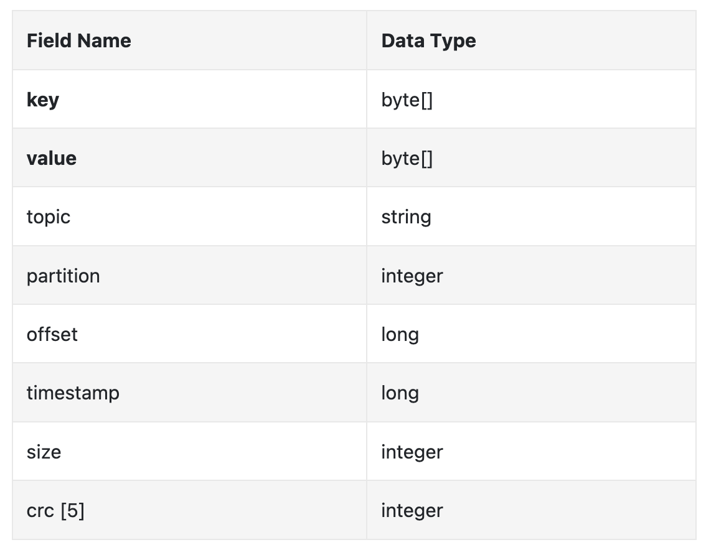

| Tên trường (Field) | Kiểu dữ liệu | Mô tả vai trò |
|--------------------|--------------|---------------|
| `key` | `byte[]` | Dùng để xác định Partition đích của message (`hash(key) % numPartitions`). Nếu không có `key`, hệ thống chọn Partition theo Round-robin hoặc ngẫu nhiên. |
| `value` | `byte[]` | Phần nội dung dữ liệu thực tế (**Payload**) của message (văn bản hoặc khối nhị phân đã nén). |
| `topic` | `string` | Tên của Topic mà message này thuộc về. |
| `partition` | `integer` | ID của Partition mà message này nằm trong đó. |
| `offset` | `long` | Vị trí tuần tự của message trong Partition. Bộ ba `(topic, partition, offset)` định danh duy nhất mọi message. |
| `timestamp` | `long` | Dấu thời gian khi message được tạo hoặc được lưu vào Broker. |
| `size` | `integer` | Kích thước tính bằng bytes của message này. |
| `crc` | `integer` | Mã kiểm tra dư thừa chu kỳ (**Cyclic Redundancy Check - Checksum**) dùng để đảm bảo tính toàn vẹn của dữ liệu (phát hiện bit bị lỗi trên mạng hoặc trên đĩa). |

*(Lưu ý: Khác với Key-Value Store, trường `key` của một message không bắt buộc phải là duy nhất và thậm chí có thể bỏ trống `null`).*

### **3. Kỹ thuật gom nhóm theo lô (Batching)**

**Batching** là yếu tố sống còn quyết định hiệu năng của toàn bộ hệ thống và được áp dụng xuyên suốt ở cả 3 thành phần: **Producer**, **Broker** và **Consumer**:
 * Giúp gom nhiều messages nhỏ lại để gửi trong một gói tin mạng duy nhất, khấu hao chi phí đắt đỏ của các chuyến khứ hồi mạng (Network Round-Trips).
 * Broker ghi cả một lô (batch) messages vào file WAL trong một lần gọi I/O tuần tự duy nhất, tối ưu hóa tối đa băng thông đĩa và OS Page Cache.

**Sự đánh đổi kinh điển giữa Throughput và Latency khi cấu hình Batch Size:**
 * **Batch Size lớn:** Hệ thống phải chờ lâu hơn để gom đủ số lượng messages vào lô $\rightarrow$ **Throughput rất cao** nhưng **Latency cao hơn** (phù hợp cho bài toán Log Aggregation / Streaming).
 * **Batch Size nhỏ:** Gửi lô đi sớm hơn ngay khi có ít messages $\rightarrow$ **Latency thấp** nhưng **Throughput giảm xuống** (phù hợp khi dùng như một Message Queue thời gian thực truyền thống).

### **4. Luồng xử lý phía Producer (Producer Flow)**

Khi một Producer muốn gửi message vào một Partition, làm sao nó biết phải kết nối tới Broker nào?

#### Phương án 1: Đặt một Tầng định tuyến riêng biệt (Dedicated Routing Layer)

    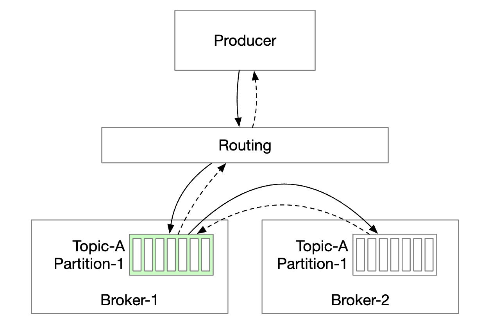

 * Tầng Routing Layer đọc sơ đồ phân bổ Replicas từ Metadata Store và lưu cache cục bộ.
 * Producer gửi message tới Routing Layer; Routing Layer chuyển tiếp message tới đúng Broker đang giữ vai trò **Leader Replica** của Partition đó.
 * Các **Follower Replicas** kéo dữ liệu từ Leader về đồng bộ; khi đủ số lượng xác nhận, Leader commit dữ liệu và trả ACK về cho Producer.
 * **Nhược điểm của Phương án 1:** Phát sinh thêm một chặng nhảy mạng (**extra network hop**) làm tăng Latency, và không tận dụng được khả năng gom lô (Batching) theo từng Partition ngay tại nguồn.

#### Phương án 2: Nhúng trực tiếp Buffer và Routing Layer vào bên trong SDK của Producer (Khuyến nghị)

    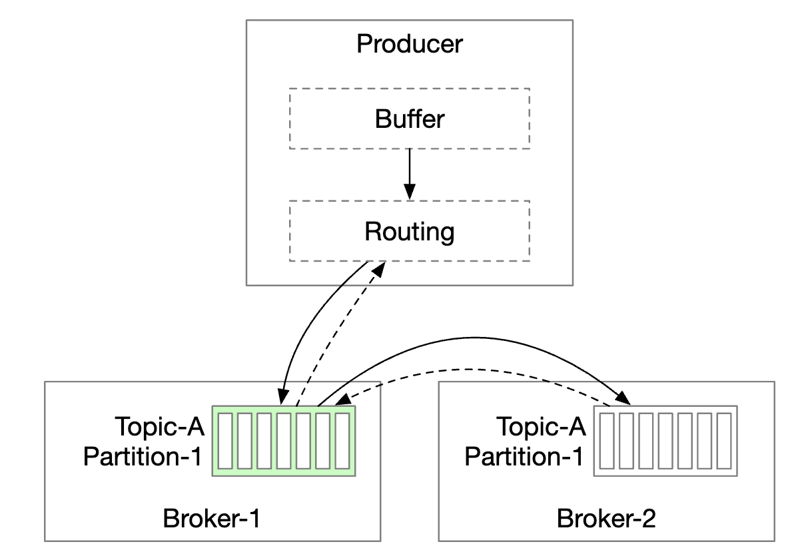

 * Đưa cả thành phần **Routing Component** và **Memory Buffer** vào bên trong thư viện Client SDK của Producer:
   1. Giảm bớt số chặng mạng (Producer kết nối thẳng tới Leader Broker), giúp giảm Latency đáng kể.
   2. Producer có thể chủ động cài đặt logic chọn Partition tùy biến.
   3. Bộ đệm **Buffer** trên RAM của Producer cho phép gom các messages cùng thuộc một Partition thành các lô lớn (**Batching**) trước khi bắn đi trong một request duy nhất, giúp tăng vọt Throughput!

    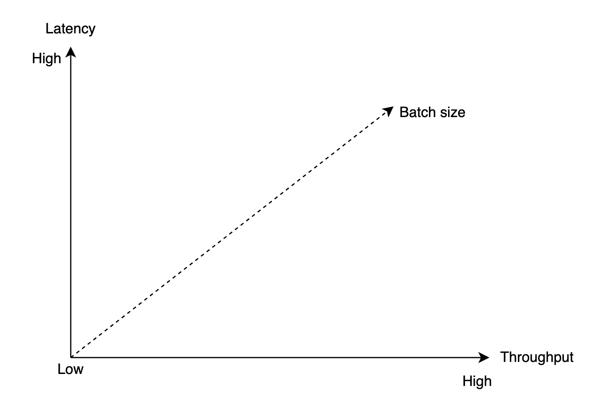

### **5. Luồng xử lý phía Consumer (Consumer Flow): Mô hình Push hay Pull?**

Consumer chỉ định vị trí `offset` hiện tại của nó trong một Partition và nhận về một mảng các messages bắt đầu từ `offset` đó:

    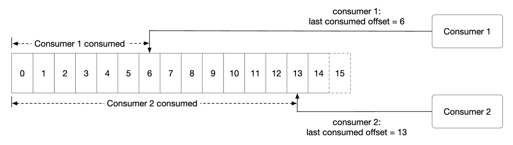

Quyết định thiết kế quan trọng: Nên để Broker chủ động đẩy dữ liệu xuống (**Push Model**) hay để Consumer chủ động kéo dữ liệu về (**Pull Model**)?
- **Mô hình Đẩy (Push Model):**
  * **Ưu điểm:** Latency thấp vì Broker đẩy ngay message cho Consumer ngay khi vừa nhận được từ Producer.
  * **Nhược điểm:** Nếu tốc độ Producer bắn tin nhanh hơn tốc độ xử lý của Consumer, Consumer sẽ bị **quá tải và đánh sập (overwhelmed / thiếu cơ chế Backpressure tự nhiên)**. Ngoài ra, vì mỗi Consumer có cấu hình phần cứng và tốc độ xử lý khác nhau, Broker rất khó điều chỉnh tốc độ đẩy cho phù hợp với từng Consumer.
- **Mô hình Kéo (Pull Model — Được lựa chọn):**
  * **Ưu điểm:** Consumer hoàn toàn làm chủ tốc độ tiêu thụ dữ liệu theo đúng năng lực xử lý của mình. Nếu tải tăng cao, Consumer không bị sập mà ta có thể dễ dàng scale thêm nodes vào Consumer Group để bắt kịp. Hơn nữa, Pull Model cực kỳ phù hợp với xử lý theo lô (**Batch Processing**): Consumer có thể kéo một lần cả ngàn messages đang nằm chờ sau vị trí `offset` hiện tại về xử lý một mạch!
  * **Nhược điểm và Cách khắc phục:** Nếu thời điểm kéo về không có message nào mới trong queue, Consumer sẽ tốn các cuộc gọi mạng rỗng lãng phí CPU. Để khắc phục triệt để nhược điểm này, hệ thống tích hợp kỹ thuật **Long Polling**: Cho phép Consumer truyền tham số chờ trong một khoảng thời gian nhất định (hoặc chờ đến khi gom đủ `min_bytes` dữ liệu mới trả về), nhờ đó vừa giữ được mọi ưu điểm của Pull Model vừa có Latency thấp gần như Push Model!

    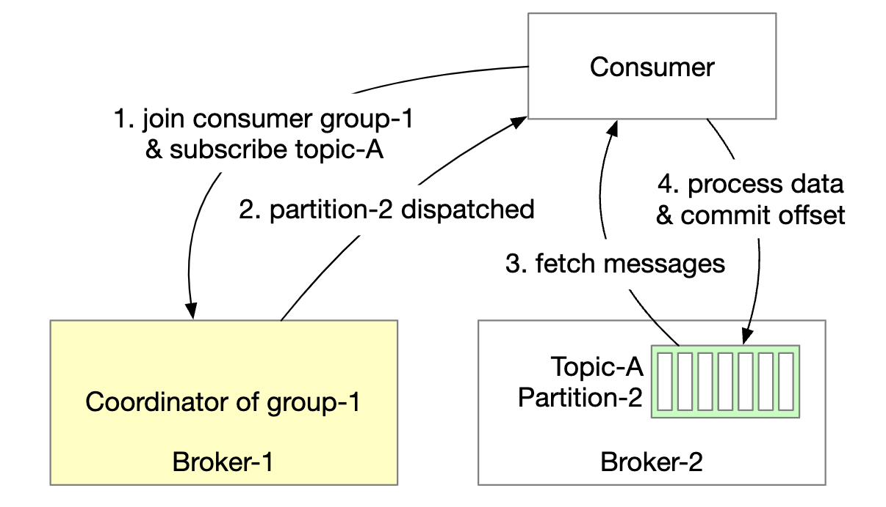

Quy trình hoạt động chi tiết của một Consumer trong Consumer Group:
 1. Một Consumer mới muốn tham gia vào `Group 1` và đăng ký đọc `Topic A`. Nó thực hiện băm tên nhóm (`hash("Group 1")`) để tìm ra chính xác Broker đang đóng vai trò làm **Điều phối viên của nhóm đó (Group Coordinator)**. Nhờ hàm băm này, mọi Consumers thuộc cùng một Group luôn kết nối về cùng một Coordinator Broker.
 2. Coordinator xác nhận Consumer gia nhập nhóm và phân công (assign) `Partition 2` của `Topic A` cho Consumer đó phụ trách (theo chiến lược phân chia như Round-robin hoặc Range).
 3. Consumer truy vấn **State Storage** để lấy vị trí `last_committed_offset` lần trước của `Group 1` trên `Partition 2`, sau đó kéo các messages mới từ vị trí đó trở đi.
 4. Consumer xử lý xong messages và gửi lệnh xác nhận lưu lại vị trí mới (**commit offset**) lên Broker.

### **6. Tái cân bằng nhóm người tiêu thụ (Consumer Rebalancing)**

**Consumer Rebalancing** là quy trình tính toán và phân bổ lại xem Consumer nào trong một Consumer Group sẽ chịu trách nhiệm đọc Partition nào.
Quy trình này được kích hoạt tự động mỗi khi:
- Có một Consumer mới **gia nhập (joins)** nhóm;
- Một Consumer hiện tại chủ động **rời khỏi (leaves)** nhóm;
- Một Consumer **bị sập (crashes)** và ngừng gửi nhịp tim (heartbeat); hoặc
- Số lượng **Partitions** của Topic bị thay đổi (thêm/bớt).

Broker đóng vai trò **Coordinator** sẽ điều phối quy trình Rebalancing như sau:

    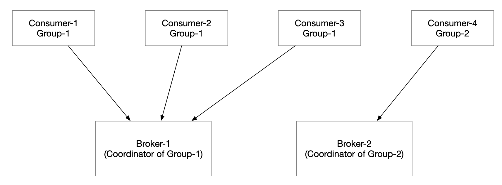

 * Tất cả các Consumers trong cùng một Group đều duy trì kết nối và gửi nhịp tim (**Heartbeat**) định kỳ về cho **Coordinator** của nhóm đó.
 * Khi danh sách thành viên trong nhóm thay đổi, Coordinator sẽ chọn một Consumer trong nhóm làm **Trưởng nhóm (Group Leader)**.
 * **Group Leader** chịu trách nhiệm chạy thuật toán tính toán **Kế hoạch phân bổ Partition mới (Partition Dispatch Plan)** và gửi kế hoạch đó lại cho Coordinator.
 * Coordinator phát tán (broadcast) bản kế hoạch phân bổ mới này cho tất cả các Consumers còn lại trong nhóm để mỗi node bắt đầu đọc từ các Partitions mới được giao.

    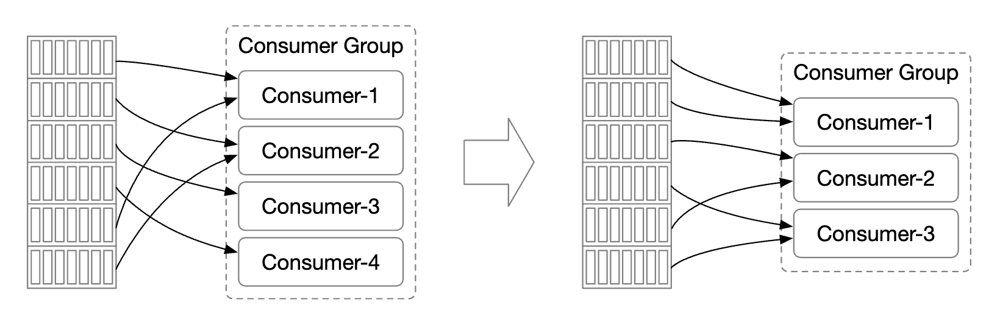

Hãy xem xét 3 kịch bản Rebalancing cụ thể:

1. **Kịch bản 1 — Khi một Consumer mới (`Consumer B`) gia nhập nhóm:**

    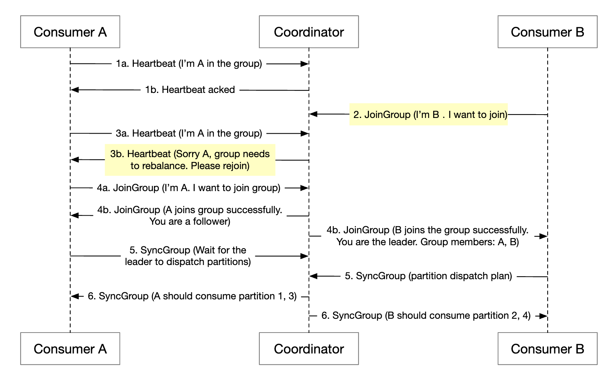

 * Ban đầu nhóm chỉ có `Consumer A` đang đọc cả 2 Partitions.
 * `Consumer B` gửi request `JoinGroup` tới Coordinator.
 * Khi `Consumer A` gửi gói tin Heartbeat định kỳ lên, Coordinator trả lời lại rằng: *"Đã đến lúc phải Rebalance, hãy gửi lại request `JoinGroup`"*.
 * Khi cả `A` và `B` đều đã gửi `JoinGroup`, Coordinator bầu chọn `Consumer A` làm Group Leader và báo cho cả hai biết kết quả.
 * `Consumer A` tính toán bản kế hoạch chia đều mỗi người 1 Partition rồi gửi lên Coordinator qua lệnh `SyncGroup`; Coordinator trả bản kế hoạch đó về cho cả `A` và `B` bắt đầu đọc dữ liệu.

2. **Kịch bản 2 — Khi một Consumer (`Consumer B`) chủ động rời nhóm:**

    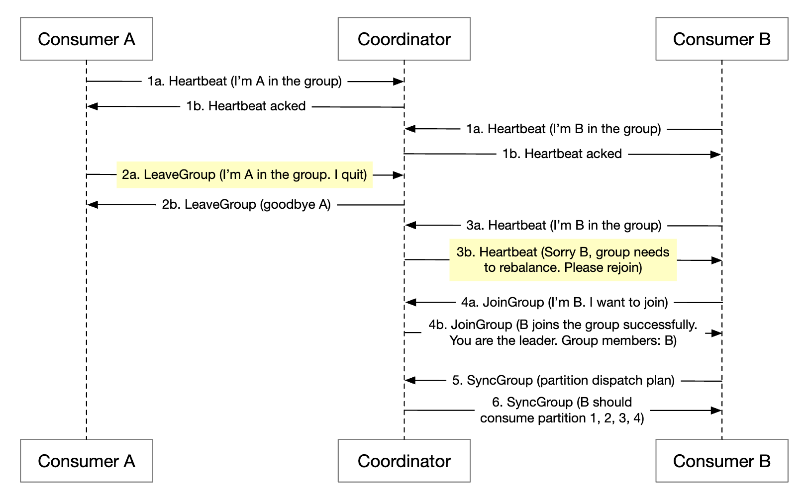

 * `Consumer B` gửi request `LeaveGroup` tới Coordinator trước khi tắt máy.
 * Trong lần nhận Heartbeat tiếp theo từ `Consumer A`, Coordinator báo cho `A` thực hiện Rebalance để tiếp quản lại toàn bộ các Partitions mà `B` vừa bỏ lại.

3. **Kịch bản 3 — Khi một Consumer bị sập đột ngột (Mất kết nối Heartbeat):**

    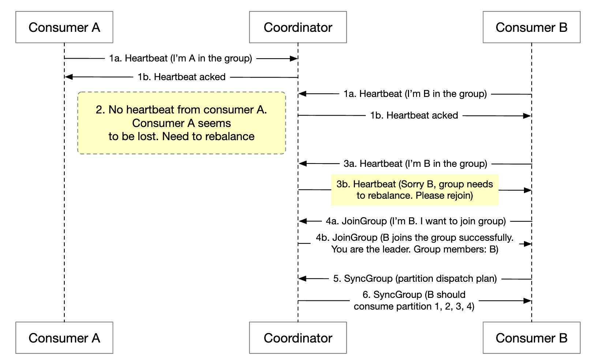

 * Nếu quá ngưỡng thời gian timeout mà Coordinator không nhận được Heartbeat từ `Consumer B`, nó đánh dấu `B` đã chết và lập tức kích hoạt quy trình Rebalance với các thành viên còn sống trong nhóm.

### **7. State Storage, Metadata Storage và Vai trò của ZooKeeper**

#### a. State Storage (Lưu trữ trạng thái Consumer)
Lưu trữ ánh xạ giữa các Partitions với Consumers và quan trọng nhất là **vị trí `offset` cuối cùng đã được tiêu thụ (last consumed offset)** của từng Consumer Group trên từng Partition:

    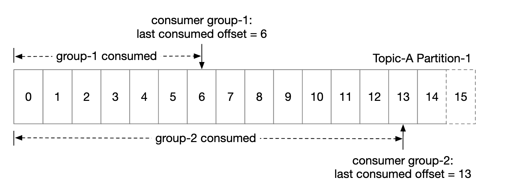

Ví dụ trên hình, `Group 1` đã commit tới `offset = 6`, nghĩa là các messages từ 0 đến 6 đã được xử lý xong; nếu Consumer hiện tại bị crash, Consumer mới vào thay thế sẽ đọc tiếp từ `offset = 7`. Vì dữ liệu offset được đọc/ghi rất thường xuyên nhưng dung lượng rất nhỏ và đòi hỏi tính nhất quán cao, ta có thể lưu trong một Key-Value Store tốc độ cao như **ZooKeeper** (hoặc như các phiên bản Kafka mới là lưu thẳng vào một Topic nội bộ đặc biệt trong Broker tên là `__consumer_offsets`).

#### b. Metadata Storage và Apache ZooKeeper
**Metadata Storage** lưu trữ cấu hình Topic, số lượng Partitions, thời gian lưu trữ và sơ đồ phân bổ Replicas. Dữ liệu này ít thay đổi nhưng đòi hỏi **Tính nhất quán mạnh (Strong Consistency)**.
Hệ thống sử dụng **Apache ZooKeeper** (một dịch vụ lưu trữ Key-Value phân cấp có tính đồng thuận cao) để đảm nhiệm cả State Storage, Metadata Storage, Service Discovery lẫn việc bầu chọn Leader cho cụm Brokers:

    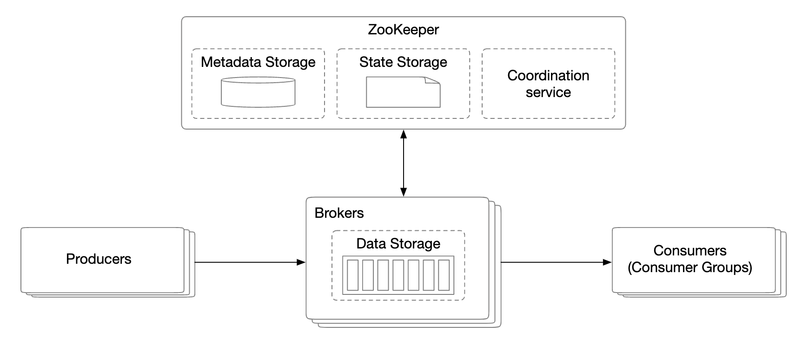

Nhờ có ZooKeeper quản lý trạng thái và metadata tập trung, các Brokers chỉ cần tập trung vào việc lưu trữ và truyền tải luồng dữ liệu messages.

---

### **8. Sao chép dữ liệu và Danh sách bản sao đồng bộ (Replication & In-Sync Replicas - ISR)**

Để chống lại sự cố hỏng ổ cứng hoặc sập máy chủ vật lý trong hệ thống phân tán, mỗi Partition được nhân bản (**Replicated**) qua nhiều Brokers khác nhau:

    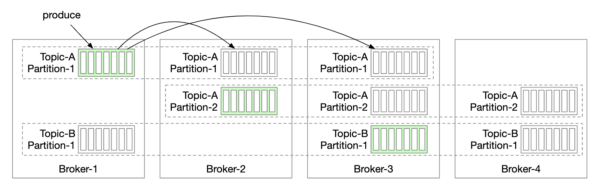

 * Mỗi Partition có `N` bản sao (ví dụ `N = 3`) nằm trên các Brokers khác nhau, trong đó có **1 bản sao chính (Leader Replica)** và **`N - 1` bản sao phụ (Follower Replicas)**.
 * **Producers chỉ gửi messages mới tới Leader Replica.**
 * Các **Follower Replicas** liên tục kéo (pull) các messages mới từ Leader về để cập nhật bản sao của mình.
 * Sau khi đủ số lượng Replicas đã đồng bộ xong message, Leader mới trả phản hồi xác nhận (**ACK**) về cho Producer.

#### Khái niệm Các bản sao đồng bộ kịp thời (In-Sync Replicas - ISR)
Làm sao để định nghĩa một Follower đang "đồng bộ kịp" với Leader?
- Chúng ta định nghĩa **In-Sync Replicas (ISR)** là tập hợp các Replicas của một Partition (bao gồm cả Leader) luôn bắt kịp tốc độ của Leader trong một ngưỡng cho phép (ví dụ cấu hình qua tham số `replica.lag.max.messages` — số lượng messages tối đa mà Follower được phép trễ hơn so với Leader).

    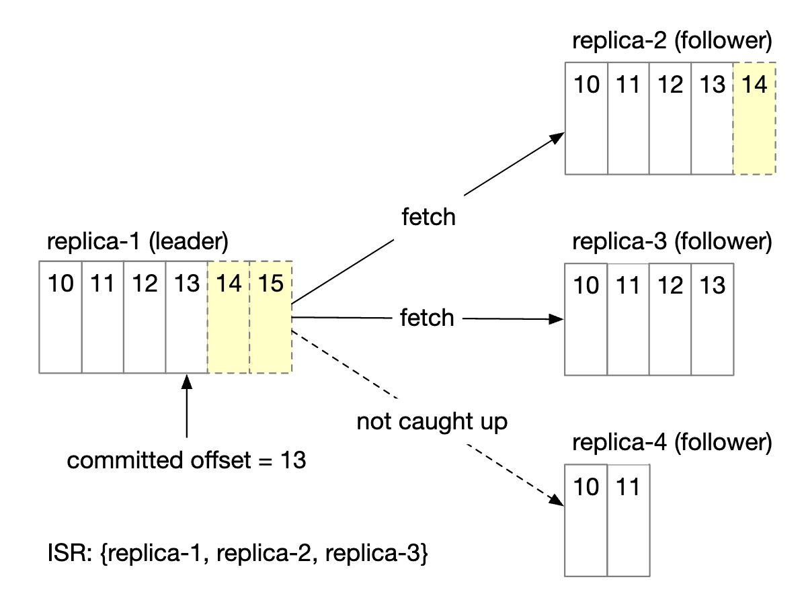

- Trong sơ đồ minh họa trên:
  * Vị trí `Committed offset` hiện tại là `13` (đã được mọi node trong ISR đồng bộ xong).
  * Có 2 messages mới (`14` và `15`) vừa được ghi vào Leader nhưng chưa được commit.
  * `Replica 2` và `Replica 3` đã kéo kịp đầy đủ đến `15` nên chúng nằm trong danh sách **ISR**.
  * `Replica 4` bị chậm mạng hoặc quá tải nên tụt lại quá xa phía sau (`replica.lag.max.messages = 3`), vì vậy nó bị **loại tạm thời ra khỏi danh sách ISR** (và khi nào bắt kịp lại thì được đưa trở lại vào ISR).

**Tại sao thiết kế ISR lại quan trọng?** Nó giải quyết bài toán đánh đổi giữa **Hiệu năng (Performance)** và **Độ bền vững dữ liệu (Durability)**: Nếu không có khái niệm ISR mà bắt buộc phải chờ *tất cả* các Replicas xác nhận, chỉ cần 1 node bị chậm sẽ kéo tụt tốc độ của toàn bộ Partition; ngược lại nhờ ISR, hệ thống chỉ cần chờ các node khỏe mạnh trong ISR xác nhận là đủ an toàn!

#### Ba cấu hình xác nhận ghi từ Producer (`ACK` Configurations)
Producer có thể tự chọn mức độ đánh đổi giữa Latency và Durability thông qua tham số `ACK`:

1. **`ACK = all` (hoặc `ACK = -1`):** Producer chỉ nhận được phản hồi thành công khi **tất cả các Replicas trong danh sách ISR** đã ghi xong message.
   - **Ưu/Nhược điểm:** Latency gửi tin cao nhất (chậm nhất), nhưng **độ bền vững dữ liệu (Durability) đạt mức tuyệt đối** (không mất dữ liệu miễn là còn ít nhất 1 node trong ISR sống sót).

    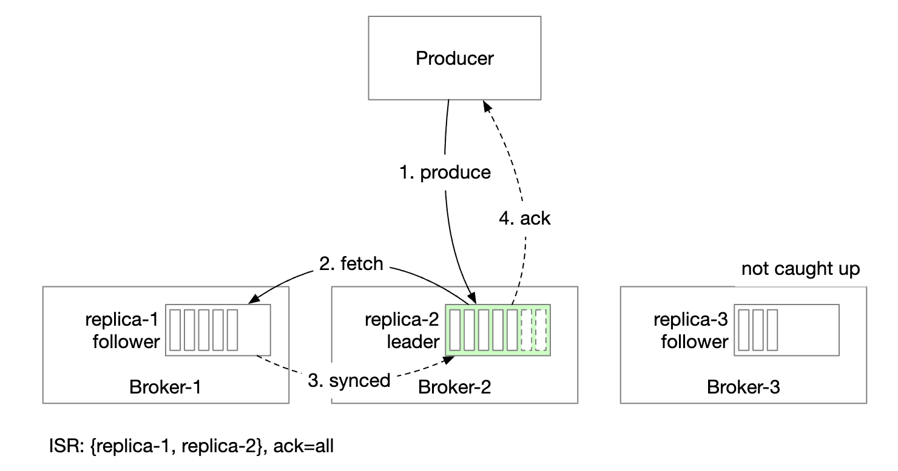

2. **`ACK = 1`:** Producer nhận được phản hồi ACK ngay khi **Leader Replica** ghi xong message vào WAL của nó mà không cần chờ các Followers kéo về.
   - **Ưu/Nhược điểm:** Latency thấp và cân bằng tốt; nhưng nếu đúng khoảnh khắc Leader vừa trả `ACK=1` xong mà bị sập nguồn trước khi bất kỳ Follower nào kịp kéo message đó về, thì message đó sẽ bị mất!

    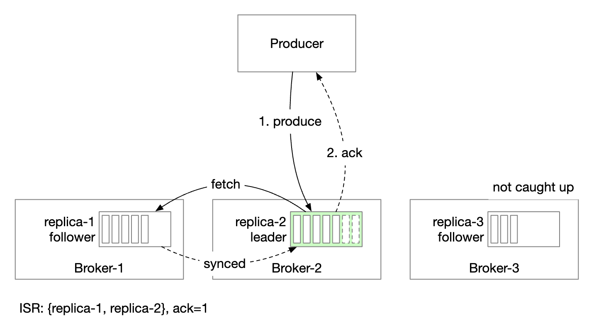

3. **`ACK = 0`:** Producer bắn message đi liên tục mà **không thèm chờ bất kỳ phản hồi xác nhận nào** từ Broker (`Fire-and-forget`).
   - **Ưu/Nhược điểm:** Đạt **Throughput tối đa và Latency thấp nhất**, nhưng chấp nhận rủi ro mất dữ liệu bất cứ lúc nào (rất phù hợp cho việc thu thập chỉ số Metrics hoặc Clickstream logs số lượng lớn).

    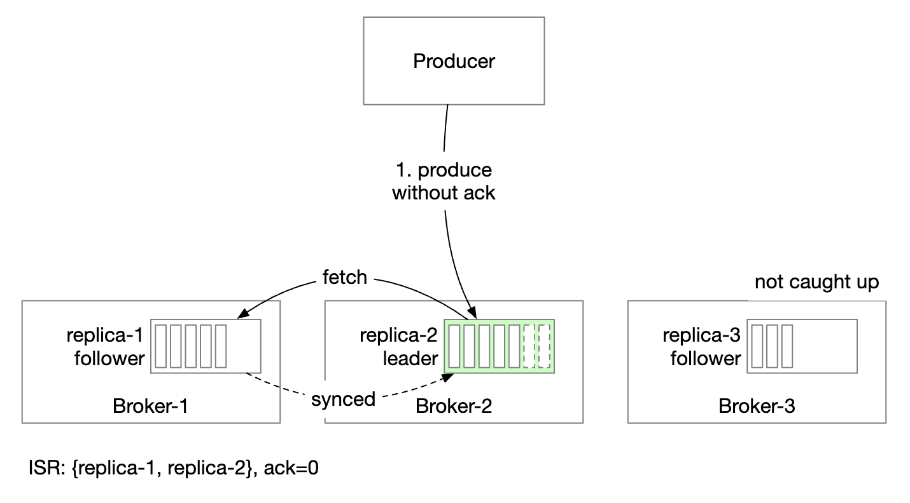

*(Về phía Consumer: Để thiết kế đơn giản và dễ vận hành nhất, mặc định mọi Consumers cũng chỉ đọc các messages đã committed trực tiếp từ **Leader Replica** của Partition đó).*

---

### **9. Khả năng mở rộng quy mô của từng thành phần (Scalability)**

1. **Mở rộng Producers:** Producers không cần phối hợp với nhau nên có thể thêm/bớt số lượng instances bất cứ lúc nào.
2. **Mở rộng Consumers:** Các Consumer Groups hoàn toàn độc lập; việc thêm hoặc bớt Consumer trong một Group được xử lý tự động và mượt mà nhờ cơ chế **Consumer Rebalancing**.
3. **Mở rộng và Phục hồi sự cố của Brokers:**
   - **Khi một Broker bị sập (Broker Failure Recovery):**
     

         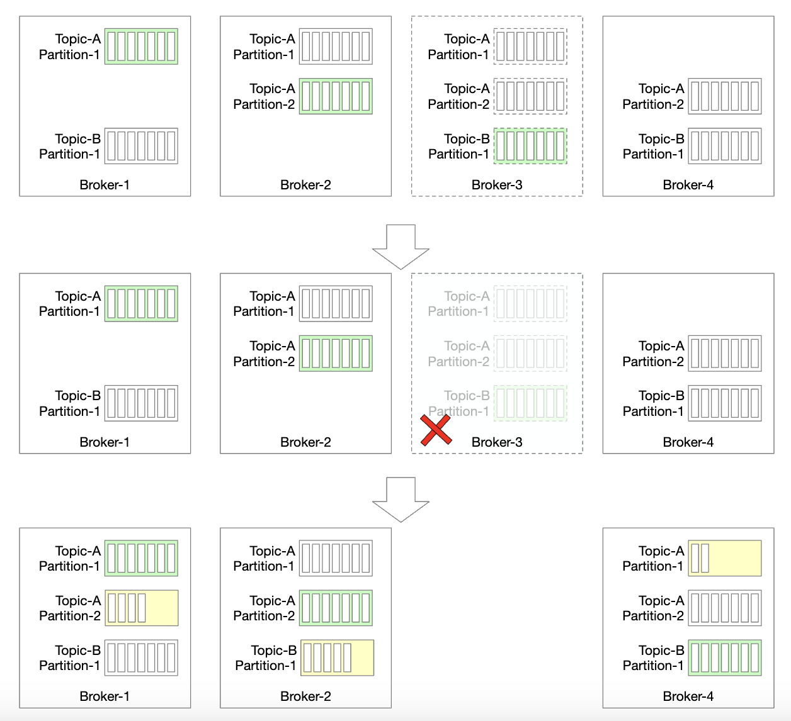
     

     Giả sử `Broker 1` bị sập, bộ điều phối Broker Coordinator (cùng ZooKeeper) sẽ lập tức bầu chọn một **Leader mới** từ danh sách ISR trên các Brokers còn sống cho các Partitions bị mất Leader, đồng thời khởi tạo các bản sao Follower mới trên các Brokers khỏe mạnh khác để bù đắp đủ số lượng Replicas quy định.
   - **Khi thêm một Broker mới vào cụm (Broker Replica Redistribution):**
     

         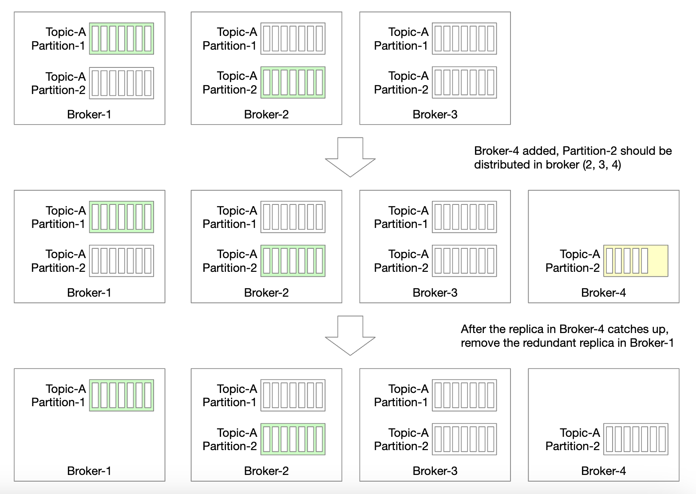
     

     Khi thêm `Broker 4` mới để chia tải, hệ thống tạm thời cho phép tạo thêm bản sao thứ 4 trên `Broker 4` để nó kéo dữ liệu đuổi theo Leader. Ngay khi `Broker 4` đã bắt kịp hoàn toàn và vào danh sách ISR, bản sao cũ trên Broker muốn giảm tải sẽ được xóa đi một cách an toàn mà không gây gián đoạn hay mất dữ liệu.

4. **Mở rộng hoặc thu hẹp số lượng Partitions (Partition Scaling):**
   - **Khi tăng thêm Partition mới (Increase Partitions):**
     

         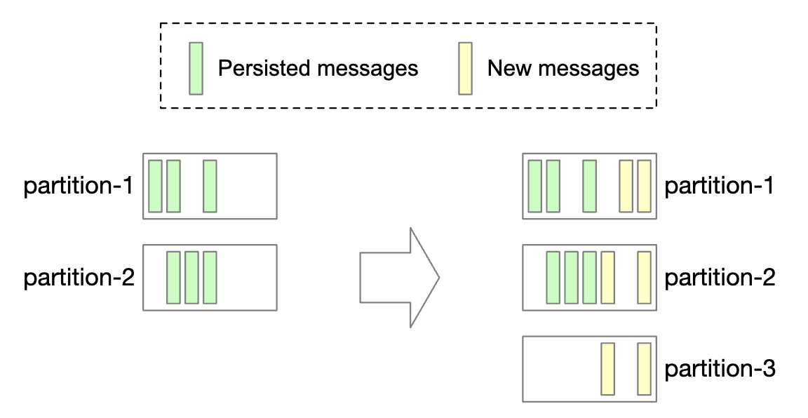
     

     Để tránh việc phải di chuyển và sắp xếp lại hàng Terabytes dữ liệu lịch sử cũ, các messages cũ trên `Partition 1` và `Partition 2` được giữ nguyên hoàn toàn; hệ thống chỉ bắt đầu phân bổ các **messages mới phát sinh từ thời điểm đó trở đi** qua cả 3 Partitions (`1, 2, 3`) đồng thời kích hoạt Consumer Rebalancing.
   - **Khi giảm bớt Partition (Decrease Partitions — phức tạp hơn):**
     

         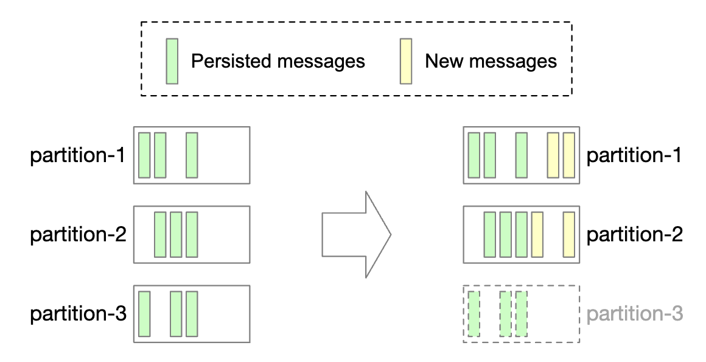
     

     Khi muốn ngừng sử dụng (decommission) `Partition 3`, hệ thống không thể xóa ngay lập tức vì các Consumers vẫn đang đọc dở dữ liệu trong đó và dữ liệu cần được lưu giữ đủ 14 ngày! Do đó trong giai đoạn chuyển giao: **Producers ngừng gửi tin mới vào `Partition 3`** (chỉ gửi vào `Partition 1` và `2`), nhưng **Consumers vẫn tiếp tục đọc từ cả 3 Partitions**. Chỉ sau khi hết thời hạn lưu trữ 14 ngày (retention period expires), dữ liệu của `Partition 3` mới chính thức bị xóa bỏ để giải phóng ổ cứng.

---

### **10. Ba ngữ nghĩa chuyển phát dữ liệu (Data Delivery Semantics)**

#### a. Chuyển phát nhiều nhất một lần (At-most-once)
Phù hợp cho các bài toán chấp nhận mất một vài điểm dữ liệu nhưng tuyệt đối không muốn xử lý lặp lại (như thu thập chỉ số giám sát hạ tầng):

    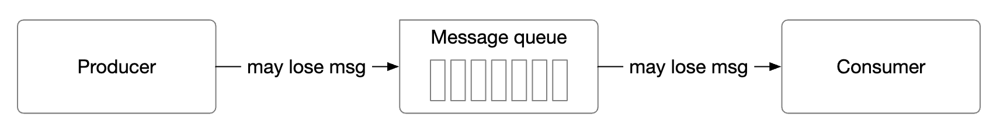

 * **Phía Producer:** Gửi message bất đồng bộ với cấu hình `ACK = 0`. Nếu gửi lỗi, không thử lại (no retry).
 * **Phía Consumer:** Kéo message về và **lập tức commit offset ngay trước khi xử lý dữ liệu**. Nếu Consumer bị crash trong lúc đang xử lý, khi khởi động lại nó sẽ bỏ qua luôn message đó (message được xử lý tối đa 1 lần hoặc 0 lần).

#### b. Chuyển phát ít nhất một lần (At-least-once — Phổ biến nhất)
Đảm bảo không có bất kỳ message nào bị mất, nhưng cùng một message có thể được chuyển phát nhiều hơn một lần:

    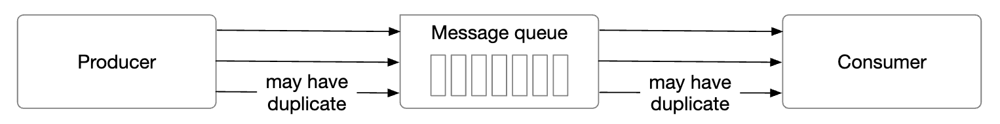

 * **Phía Producer:** Gửi message với cấu hình `ACK = 1` hoặc `ACK = all`. Nếu gặp lỗi mạng hoặc không nhận được ACK trước khi timeout, Producer sẽ liên tục gửi lại (**retry**).
 * **Phía Consumer:** Kéo message về, **hoàn tất toàn bộ quá trình xử lý nghiệp vụ rồi mới thực hiện commit offset**. Nếu Consumer xử lý xong xuôi nhưng bị sập ngay trước tích tắc kịp commit offset, khi sống dậy nó sẽ đọc và xử lý lại message đó một lần nữa (do đó dịch vụ phía Consumer nên được thiết kế có **Tính lũy đẳng - Idempotency** hoặc khử trùng lặp).

#### c. Chuyển phát chính xác một lần (Exactly-once)
Đảm bảo mỗi message chỉ được chuyển phát và xử lý đúng 1 lần duy nhất (không mất và không trùng lặp) — rất quan trọng cho các bài toán thanh toán, tài chính, đối soát quảng cáo nhưng chi phí hiệu năng và độ phức tạp cài đặt rất cao:

    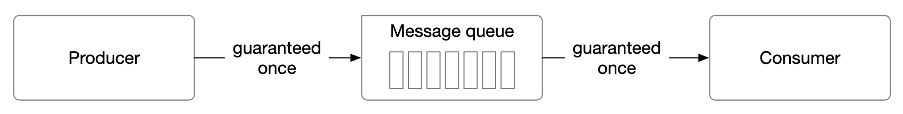

 * Đòi hỏi sự kết hợp của **Idempotent Producer** (Broker tự khử trùng lặp khi Producer retry thông qua `producer_id` và `sequence_number` gắn trên từng lô) cùng với giao thức **Giao dịch nguyên tử hai pha (Two-Phase Commit / Transactional Coordinator)** giữa bước xử lý dữ liệu đầu ra và bước commit offset của Consumer.

---

### **11. Các tính năng nâng cao (Advanced Features)**

#### a. Lọc tin nhắn (Message Filtering)
Đôi khi một Consumer Group chỉ muốn nhận một tập con các messages thuộc một phân loại cụ thể bên trong một Topic (ví dụ Topic `orders` chứa mọi đơn hàng, nhưng dịch vụ Thanh toán chỉ muốn đọc các sự kiện có trạng thái `paid` hoặc `refunded`).
- Nếu tách thành hàng chục Topics nhỏ cho từng nhu cầu thì vừa tốn dung lượng lưu trữ trùng lặp vừa làm Producer bị phụ thuộc chặt vào logic của từng Consumer.
-Nếu để Consumer kéo toàn bộ messages về rồi tự lọc ở phía Client thì lại gây lãng phí băng thông mạng.
- **Giải pháp chuẩn (như trên Apache RocketMQ):** Cho phép Producer đính kèm các thẻ phân loại (**`tags`** hoặc metadata headers) vào phần khung của mỗi message (không cần giải mã phần `payload` đã mã hóa), và Broker sẽ lọc cực nhanh theo `tags` ngay tại thời điểm đọc để chỉ trả về đúng các messages mà Consumer đăng ký!

    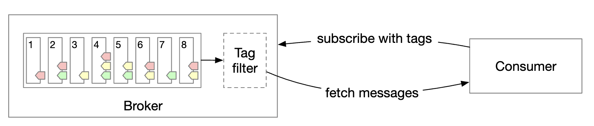

#### b. Tin nhắn trễ và Tin nhắn hẹn giờ (Delayed & Scheduled Messages)
Trong thương mại điện tử rất hay gặp bài toán: *"Sau khi khách hàng đặt đơn hàng mà sau 30 phút vẫn chưa thanh toán, hãy tự động hủy đơn hàng và hoàn lại kho"*. Thay vì quét Database liên tục, Producer có thể bắn một **Delayed Message** hẹn giờ đúng 30 phút sau mới chuyển phát tới Consumer!
- **Cách triển khai:** Khi nhận được một Delayed Message, Broker chưa ghi nó vào Topic đích của Consumer ngay mà lưu tạm vào một **vùng lưu trữ chờ đặc biệt (Temporary Storage / Dedicated Delay Topics)** kết hợp với cấu trúc dữ liệu **Bánh xe thời gian phân cấp (Hierarchical Timing Wheel)** chạy trên bộ nhớ để đếm ngược thời gian với độ phức tạp $O(1)$. Đúng thời điểm hẹn giờ điểm, thành phần Timing Function sẽ đẩy message đó sang Partition đích để Consumer đọc và xử lý!

    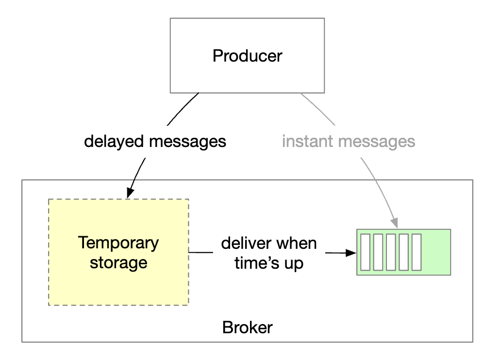

---

## Bước 4: Tổng kết (Wrap Up)

Một số điểm mở rộng nâng cao có thể thảo luận thêm nếu còn thời gian:
- **Giao thức truyền thông nhị phân (Communication Protocol):** Các hệ thống như AMQP hay Kafka Protocol tự định nghĩa giao thức nhị phân riêng chạy trên TCP để đạt hiệu năng đóng gói/giải mã cao nhất và hỗ trợ Zero-Copy.
- **Thử lại khi Consumer xử lý lỗi (Retry Consumption & Dead-Letter Queue):** Nếu Consumer gặp lỗi tạm thời khi xử lý một message cụ thể, thay vì chặn đứng toàn bộ Partition đó, Consumer có thể đẩy message lỗi sang một **`retry_topic`** chuyên biệt (hoặc `Dead-Letter Queue - DLQ` nếu đã thử lại quá số lần quy định) để xử lý sau.
- **Lưu trữ dữ liệu lịch sử dài hạn (Tiered Storage / Historical Data Archive):** Các phân đoạn file Segments cũ hơn 14 ngày thay vì xóa bỏ hoàn toàn có thể được tự động đẩy sang tầng lưu trữ giá rẻ dung lượng cao như **HDFS** hoặc **Amazon S3 (Tiered Storage)**.
