# Chương 20: Hệ thống giám sát Metrics và cảnh báo (Metrics Monitoring and Alerting System)

## Giới thiệu
Chương này tập trung vào việc thiết kế một **Hệ thống giám sát chỉ số và cảnh báo (Metrics Monitoring and Alerting System)** có khả năng mở rộng cao — một thành phần hạ tầng tối quan trọng giúp đội ngũ kỹ sư nắm bắt rõ tình trạng sức khỏe của hệ thống, đảm bảo tính sẵn sàng cao (High Availability) và độ tin cậy trong vận hành.

---

## Bước 1: Thấu hiểu bài toán và Xác lập phạm vi thiết kế (Understand the Problem and Establish Design Scope)
Một "hệ thống giám sát" có thể bao hàm rất nhiều mảng khác nhau (thu thập Metrics, thu thập Logs như ELK Stack, hay truy vết phân tán Distributed Tracing như Jaeger/Zipkin). Vì vậy, bước đầu tiên là phải đặt câu hỏi để khoanh vùng chính xác phạm vi đề bài:
 - **C:** Chúng ta đang xây dựng hệ thống này cho đối tượng nào? Là một hệ thống giám sát nội bộ (in-house) cho một tập đoàn công nghệ lớn hay là một sản phẩm SaaS thương mại như Datadog?
 - **I:** Chúng ta xây dựng hệ thống phục vụ nội bộ cho chính công ty mình.
 - **C:** Chúng ta cần thu thập những loại chỉ số (metrics) nào?
 - **I:** Các chỉ số vận hành hệ thống và hạ tầng (**Operational system metrics**) như tải CPU (`CPU load`), mức sử dụng bộ nhớ (`Memory usage`), dung lượng ổ cứng còn trống (`Disk space`); cùng với các chỉ số dịch vụ mức cao như số lượng request mỗi giây (**RPS/QPS**), số lượng message tồn đọng trong queue. Các chỉ số kinh doanh (Business metrics) không nằm trong phạm vi này.
 - **C:** Quy mô hạ tầng mà chúng ta đang giám sát lớn cỡ nào?
 - **I:** Công ty phục vụ **100 triệu DAU**, có **1.000 cụm máy chủ (server pools)**, mỗi cụm có **100 máy chủ vật lý/ảo** (tổng cộng 100.000 máy chủ).
 - **C:** Chúng ta cần lưu giữ dữ liệu metrics trong bao lâu?
 - **I:** Giả định thời gian lưu trữ là **1 năm (1-year retention)**.
 - **C:** Để tối ưu dung lượng lưu trữ dài hạn, chúng ta có thể giảm độ phân giải của dữ liệu cũ (downsampling) không?
 - **I:** Ý kiến rất hay! Hãy giữ dữ liệu thô mới nhận (độ phân giải 10 giây) trong **7 ngày**. Sau đó gộp (roll up) lại thành độ phân giải **1 phút** và giữ trong **30 ngày** tiếp theo. Sau 30 ngày, tiếp tục gộp thành độ phân giải **1 giờ** và lưu cho đến hết **1 năm**.
 - **C:** Hệ thống cần hỗ trợ những kênh gửi cảnh báo (alert channels) nào?
 - **I:** Email, tin nhắn SMS/cuộc gọi điện thoại, PagerDuty hoặc Webhooks (như Slack/Microsoft Teams).
 - **C:** Chúng ta có cần thu thập Logs (error logs, access logs) hay hỗ trợ Distributed Tracing không?
 - **I:** Không, cả hai mảng đó đều nằm ngoài phạm vi buổi phỏng vấn này.

### **Tóm tắt các yêu cầu và Ước lượng quy mô**
Hạ tầng cần giám sát có quy mô rất lớn:
 - **100 triệu DAU**.
 - `1.000 server pools × 100 máy/pool = 100.000 máy chủ`. Giả sử mỗi máy thu thập `~100 metrics` mỗi 10 giây $\rightarrow$ có tổng cộng **10 triệu metrics (10M metrics)** được thu thập liên tục, tương đương lưu lượng ghi trung bình khoảng **1 triệu điểm dữ liệu mỗi giây (1M writes/sec QPS)**!
 - Lưu trữ dữ liệu trong **1 năm** với chính sách giảm mẫu (**Downsampling policy**): Dữ liệu thô (7 ngày) $\rightarrow$ Độ phân giải 1 phút (30 ngày) $\rightarrow$ Độ phân giải 1 giờ (1 năm).

### **Yêu cầu phi chức năng (Non-Functional Requirements)**
 - **Khả năng mở rộng (Scalability):** Hệ thống phải dễ dàng mở rộng khi số lượng máy chủ, metrics và quy tắc cảnh báo tăng lên.
 - **Latency thấp:** Phản hồi truy vấn cực nhanh để hiển thị biểu đồ trên Dashboard và kích hoạt cảnh báo kịp thời khi xảy ra sự cố.
 - **Độ tin cậy cao (Reliability):** Hệ thống giám sát không được phép bỏ lỡ các cảnh báo nghiêm trọng.
 - **Tính linh hoạt (Flexibility):** Dễ dàng tích hợp thêm các nguồn thu thập dữ liệu hoặc kênh cảnh báo mới trong tương lai.

---

## Bước 2: Đề xuất thiết kế tổng quan và Thống nhất phương án (Propose High-Level Design and Get Buy-In)

### **1. Năm thành phần nền tảng (Fundamentals)**
Mọi hệ thống giám sát và cảnh báo đều xoay quanh 5 thành phần cốt lõi:

<div style="margin-left:3rem">
    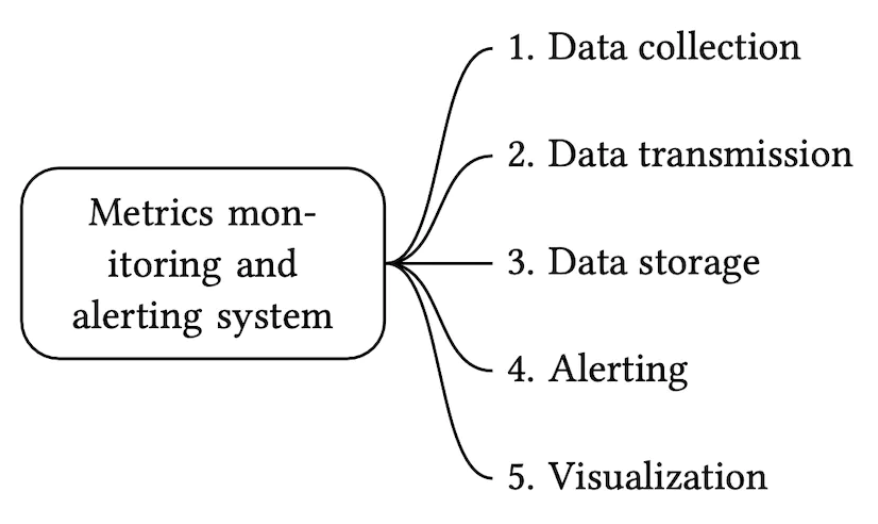
</div>

 1. **Thu thập dữ liệu (Data Collection):** Thu thập các chỉ số metrics từ hàng trăm nghìn nguồn khác nhau.
 2. **Truyền tải dữ liệu (Data Transmission):** Vận chuyển an toàn dòng dữ liệu từ các nguồn về hệ thống giám sát trung tâm.
 3. **Lưu trữ dữ liệu (Data Storage):** Tổ chức, nén và lưu trữ dữ liệu theo chuỗi thời gian.
 4. **Hệ thống cảnh báo (Alerting):** Phân tích dữ liệu đi vào, phát hiện bất thường vượt ngưỡng và phát cảnh báo.
 5. **Hệ thống trực quan hóa (Visualization):** Hiển thị dữ liệu dưới dạng các biểu đồ, đồ thị trực quan trên bảng điều khiển (Dashboard).

### **2. Mô hình dữ liệu Chuỗi thời gian (Time-Series Data Model)**
Dữ liệu metrics luôn được ghi nhận dưới dạng **Dữ liệu chuỗi thời gian (Time-Series Data)** — bao gồm một tập hợp các giá trị số gắn liền với dấu thời gian (`timestamp`).
Mỗi chuỗi thời gian được định danh duy nhất bởi **tên chỉ số (`metric name`)** và một tập hợp các **nhãn/thẻ phân loại (`tags` / `labels`)** dưới dạng cặp `key:value`.

**Ví dụ 1:** *Tải CPU trên máy chủ production `i631` vào lúc 20:00 là bao nhiêu?*

<div style="margin-left:3rem">
    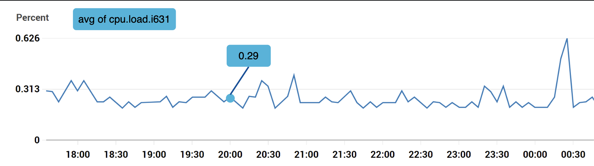
</div>

Điểm dữ liệu này được cấu thành từ các thuộc tính sau:

<div style="margin-left:3rem">
    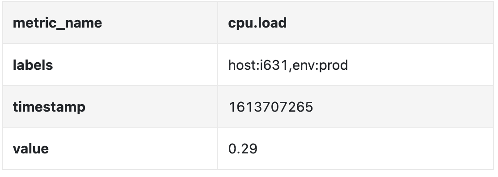
</div>

**Ví dụ 2:** *Tải CPU trung bình trên tất cả các web servers thuộc khu vực `us-west` trong 10 phút vừa qua là bao nhiêu?*

```
CPU.load host=webserver01,region=us-west 1613707265 50

CPU.load host=webserver01,region=us-west 1613707265 62

CPU.load host=webserver02,region=us-west 1613707265 43

CPU.load host=webserver02,region=us-west 1613707265 53

...

CPU.load host=webserver01,region=us-west 1613707265 76

CPU.load host=webserver01,region=us-west 1613707265 83
```

Định dạng văn bản trên được gọi là **Line Protocol** (được sử dụng rộng rãi bởi Prometheus, InfluxDB, OpenTSDB). Cấu trúc chuẩn của mọi điểm dữ liệu chuỗi thời gian bao gồm:

<div style="margin-left:3rem">
    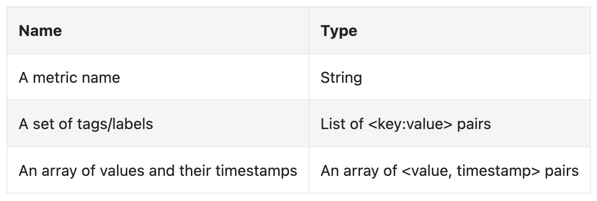
</div>

Cách hình dung trực quan nhất về dữ liệu chuỗi thời gian trong không gian 2 chiều:

<div style="margin-left:3rem">
    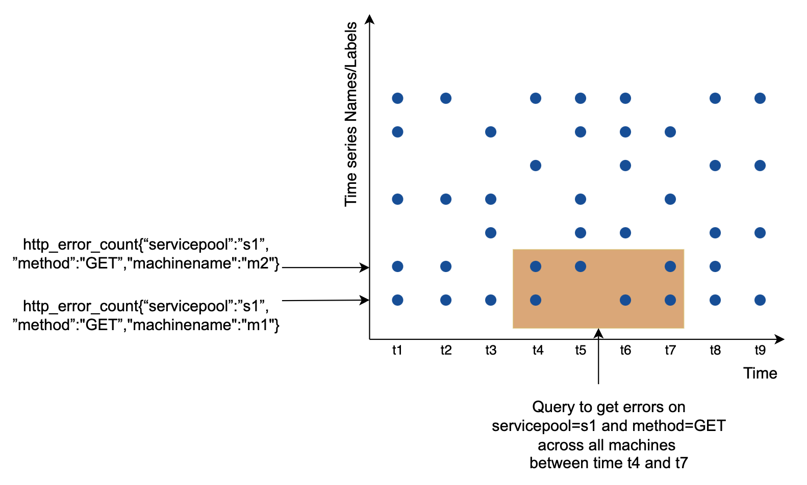
</div>

 - **Trục hoành (X-axis):** Là trục thời gian (`timestamps`).
 - **Trục tung (Y-axis):** Là các tổ hợp tên chỉ số và nhãn (`metric_name + tags/labels`).

#### Phân tích mô hình truy cập (Data Access Pattern) và Lựa chọn Database
- **Đặc điểm truy cập:** Tải ghi (**Write load**) cực kỳ nặng và liên tục không ngừng nghỉ (1 triệu điểm dữ liệu mỗi giây); trong khi đó tải đọc (**Read load**) bình thường chỉ ở mức vừa phải (từ các job kiểm tra cảnh báo) nhưng sẽ **tăng vọt đột biến (spiky reads)** khi hệ thống xảy ra sự cố và hàng trăm kỹ sư cùng mở Dashboard lên để tra cứu, debug!
- **Lựa chọn cơ sở dữ liệu:**
  - **RDBMS đa dụng:** Không được khuyến nghị vì việc thực hiện các phép tổng hợp thời gian thực trên hàng tỷ dòng dữ liệu chuỗi thời gian bằng SQL rất phức tạp và chậm.
  - **NoSQL đa dụng (Cassandra / Bigtable):** Có thể dùng được nếu đội ngũ có kiến thức chuyên sâu để tự thiết kế schema phân vùng theo thời gian, nhưng vẫn tốn nhiều công sức xây dựng tầng truy vấn.
  - **Cơ sở dữ liệu chuỗi thời gian chuyên dụng (Time-Series Database - TSDB — Khuyến nghị):** Được tối ưu hóa riêng cho việc ghi nối tiếp, nén dữ liệu thời gian và đánh chỉ mục theo nhãn (`labels`). Các TSDB phổ biến nhất gồm có **InfluxDB**, **Prometheus**, **Facebook Gorilla (Beringei)**, **OpenTSDB**, **Amazon Timestream**, **VictoriaMetrics**.
  - Ví dụ thực tế về hiệu năng của **InfluxDB**: Chỉ cần **1 máy chủ đơn lẻ** cấu hình 8 cores CPU và 32 GB RAM đã có thể xử lý nhẹ nhàng **hơn 250.000 lượt ghi mỗi giây (250k writes/sec)**!

<div style="margin-left:3rem">
    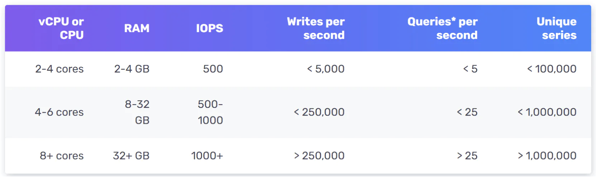
</div>

*(Lưu ý quan trọng khi dùng TSDB: Vì TSDB như InfluxDB hay Prometheus xây dựng bộ chỉ mục trên RAM cho từng tổ hợp nhãn `labels`, một nguyên tắc sống còn là phải giữ cho **Lực lượng tập hợp của nhãn (Label Cardinality) ở mức thấp** — nghĩa là tuyệt đối không đưa các giá trị có hàng triệu biến thể như `user_id` hay `request_id` vào làm `label` của metric, nếu không sẽ làm nổ bộ nhớ chỉ mục!).*

### **3. Kiến trúc tổng quan (High-Level Design)**

<div style="margin-left:3rem">
    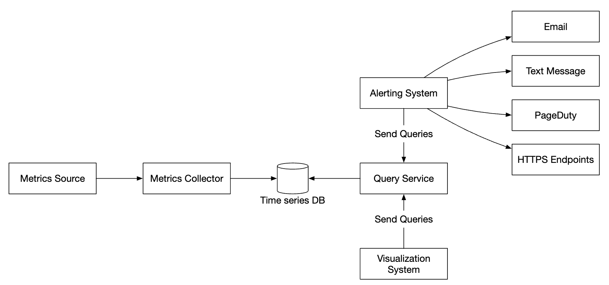
</div>

 - **Metrics Source (Nguồn phát sinh chỉ số):** Có thể là các Application Servers, SQL Databases, Message Queues, Web Servers...
 - **Metrics Collector (Bộ thu thập chỉ số):** Tiếp nhận dữ liệu metrics từ các nguồn và ghi vào Time-Series Database.
 - **Time-Series Database (TSDB):** Lưu trữ toàn bộ dữ liệu metrics dưới dạng chuỗi thời gian và cung cấp giao diện truy vấn chuyên biệt.
 - **Query Service (Dịch vụ truy vấn):** Tầng dịch vụ trung gian giúp Alerting System và Visualization System truy vấn và tổng hợp dữ liệu từ TSDB một cách dễ dàng.
 - **Alerting System (Hệ thống cảnh báo):** Kiểm tra các ngưỡng quy tắc và gửi cảnh báo tới các kênh đích (Email, SMS, PagerDuty, Webhooks).
 - **Visualization System (Hệ thống trực quan hóa):** Hiển thị các biểu đồ và bảng điều khiển giám sát (như Grafana).

---

## Bước 3: Đi sâu vào thiết kế chi tiết (Design Deep Dive)

### **1. Cơ chế thu thập chỉ số (Metrics Collection): Mô hình Pull hay Push?**
Đối với dữ liệu giám sát metrics, việc thỉnh thoảng bị mất một vài điểm dữ liệu do rớt mạng là hoàn toàn không nghiêm trọng (khác với dữ liệu giao dịch thanh toán).

<div style="margin-left:3rem">
    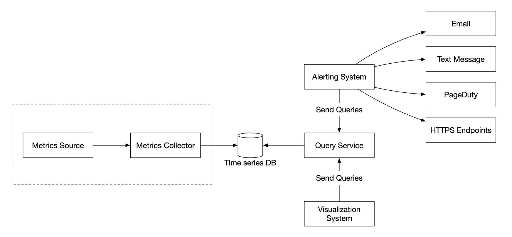
</div>

Có 2 mô hình kiến trúc kinh điển để thu thập metrics: **Mô hình Kéo (Pull Model)** và **Mô hình Đẩy (Push Model)**.

#### a. Mô hình Kéo (Pull Model — đại diện tiêu biểu: Prometheus)
Các máy chủ **Metrics Collector** chủ động gọi HTTP request định kỳ tới từng Application Server để kéo dữ liệu metrics về:

<div style="margin-left:3rem">
    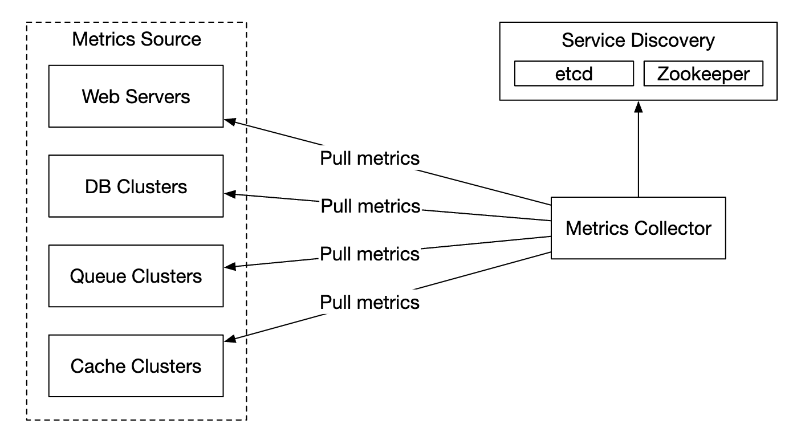
</div>

Để biết phải kéo dữ liệu từ những máy chủ nào trong môi trường đám mây nơi các servers được thêm/bớt liên tục, Metrics Collector tích hợp với hệ thống **Service Discovery (như ZooKeeper, etcd hoặc Kubernetes API)**:

<div style="margin-left:3rem">
    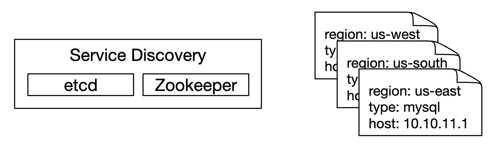
</div>

Luồng hoạt động chi tiết của mô hình Pull:

<div style="margin-left:3rem">
    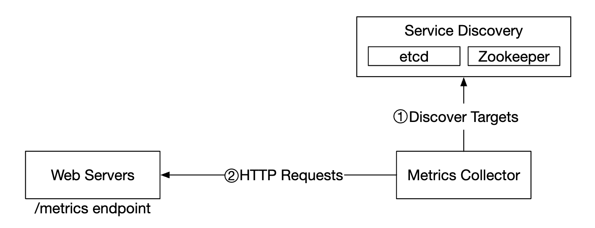
</div>

 1. **Metrics Collector** lấy danh sách IP và cấu hình thu thập (chu kỳ kéo, timeout, đường dẫn endpoint) từ **Service Discovery**.
 2. **Metrics Collector** gửi HTTP GET request tới endpoint định sẵn (ví dụ `/metrics`) trên Application Server (do thư viện Client SDK gắn sẵn trong ứng dụng cung cấp).
 3. **Metrics Collector** đăng ký nhận thông báo sự kiện thay đổi từ Service Discovery để tự động cập nhật mỗi khi có server mới khởi tạo hoặc tắt đi.

**Làm sao để chạy nhiều Metrics Collectors cùng lúc mà không bị kéo trùng lặp dữ liệu?**
Ở quy mô 100.000 máy chủ, một Metrics Collector đơn lẻ không thể kéo xuể. Khi chạy một cụm nhiều Metrics Collectors, để đảm bảo hai Collectors không kéo trùng lặp cùng một server, chúng ta đặt cả **các Metrics Collectors lẫn các Servers cần giám sát lên cùng một Vòng băm nhất quán (Consistent Hash Ring)** thông qua ZooKeeper: mỗi Collector chỉ chịu trách nhiệm kéo dữ liệu từ các servers nằm trong phân đoạn vòng băm được giao cho nó!

<div style="margin-left:3rem">
    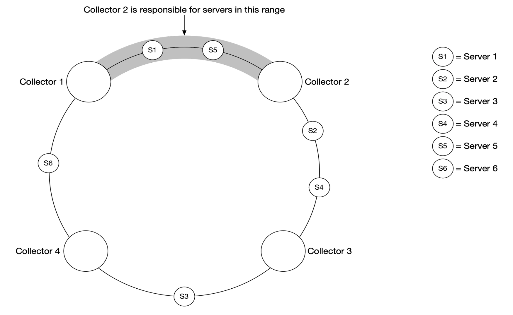
</div>

#### b. Mô hình Đẩy (Push Model — đại diện tiêu biểu: Amazon CloudWatch, Graphite)
Trong mô hình Push, các máy chủ được giám sát sẽ chủ động đẩy dữ liệu metrics của mình lên **Metrics Collector**:

<div style="margin-left:3rem">
    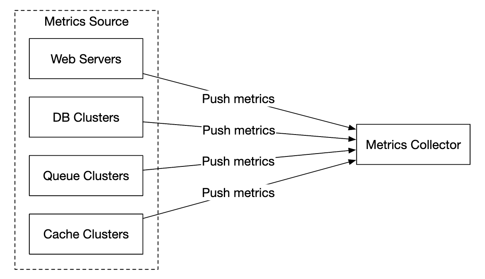
</div>

Thông thường, một tiến trình thu thập nhẹ gọi là **Collection Agent** (như Telegraf hoặc CloudWatch Agent) sẽ được cài đặt chạy ngầm ngay trên mỗi máy chủ. Agent này gom các chỉ số từ hệ điều hành và các ứng dụng chạy trên máy đó, tổng hợp sơ bộ (pre-aggregate) rồi định kỳ đẩy lên cụm **Metrics Collector** đứng sau một Load Balancer:

<div style="margin-left:3rem">
    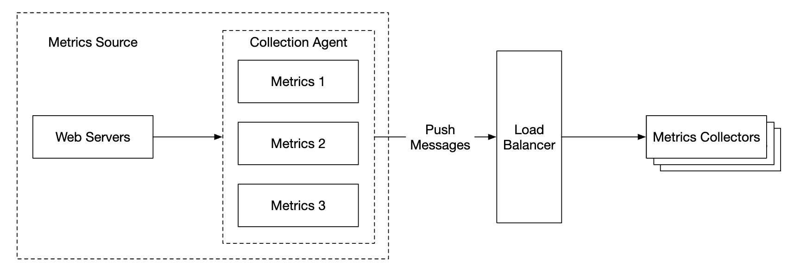
</div>

*(Lưu ý: Trong mô hình Push, nếu lưu lượng đẩy lên quá lớn vượt quá sức chứa của Metrics Collector, Collector có thể bị quá tải; do đó cụm Metrics Collector phải được đặt trong nhóm Auto-scaling phía sau Load Balancer).*

#### Bảng so sánh chi tiết giữa Mô hình Pull và Mô hình Push
| Tiêu chí so sánh | Mô hình Kéo (Pull Model - Prometheus) | Mô hình Đẩy (Push Model - CloudWatch/Graphite) |
|----------------------------------------|---------------------------------------------------------------------------------------------------------------------------------------------------------------------------------------------------------|-----------------------------------------------------------------------------------------------------------------------------------------------------------------------------------------------------------------------------------------|
| **Độ dễ dàng khi Debug** | Endpoint `/metrics` trên từng application server có thể được mở xem trực tiếp bằng trình duyệt hoặc lệnh `curl` trên laptop bất cứ lúc nào. **Pull thắng.** | Nếu Collector không nhận được metrics, khó biết ngay là do ứng dụng lỗi hay do lỗi mạng ở giữa. |
| **Kiểm tra tình trạng sống (Health Check)** | Nếu một application server không phản hồi lệnh pull, Collector biết ngay lập tức là server đó đang bị sập (down). **Pull thắng.** | Nếu không nhận được gói tin push, khó phân biệt được là server bị sập hay do nghẽn mạng không gửi tới được. |
| **Các tác vụ chạy ngắn hạn (Short-lived Batch Jobs)** | Các cron job / serverless functions chỉ chạy trong vài giây rồi tắt ngay trước khi Collector kịp tới kỳ kéo dữ liệu. (Phải dùng thêm Pushgateway trung gian). | Job vừa chạy xong có thể chủ động đẩy ngay metrics lên Collector trước khi kết thúc. **Push thắng.** |
| **Cấu hình Tường lửa (Firewall) & Đa Data Center** | Đòi hỏi Metrics Collector phải có quyền truy cập mạng mở tới mọi endpoints của tất cả các máy chủ trong mọi mạng nội bộ (VPCs/Data Centers), cấu hình mạng phức tạp. | Chỉ cần mở địa chỉ của Load Balancer đứng trước Collector là mọi máy chủ từ bất cứ đâu đều có thể gửi dữ liệu về dễ dàng. **Push thắng.** |
| **Hiệu năng truyền tải (Performance)** | Thường sử dụng giao thức **TCP** (HTTP). | Thường có thể sử dụng **UDP** gọn nhẹ, giúp giảm độ trễ truyền tải gói tin. |
| **Độ xác thực của dữ liệu (Data Authenticity)** | Danh sách các servers cần thu thập được định nghĩa trước trong Service Discovery nên dữ liệu kéo về luôn đảm bảo xác thực 100%. **Pull thắng.** | Bất kỳ client nào biết địa chỉ cũng có thể đẩy dữ liệu giả mạo lên nếu không cấu hình Whitelist IP hoặc cơ chế xác thực chữ ký/token. |

**Kết luận:** Không có mô hình nào thắng tuyệt đối trong mọi hoàn cảnh. Một tập đoàn công nghệ lớn thường hỗ trợ kết hợp cả hai (ví dụ dùng Pull cho Kubernetes clusters và dùng Push cho các thiết bị biên hoặc Serverless jobs).

---

### **2. Mở rộng đường ống truyền tải dữ liệu (Scale the Metrics Transmission Pipeline)**

<div style="margin-left:3rem">
    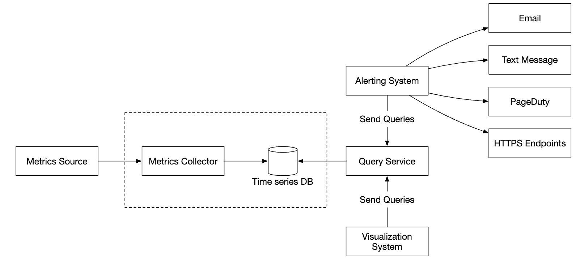
</div>

Dù dùng Pull hay Push, cụm **Metrics Collector** đều được cấu hình Auto-scaling. Tuy nhiên, nếu cụm **Metrics Collector** ghi trực tiếp vào **Time-Series DB**, khi TSDB gặp sự cố bảo trì hoặc quá tải vào giờ cao điểm, dữ liệu metrics sẽ bị rơi rớt và mất mát.
Để giải quyết triệt để và chống mất dữ liệu, chúng ta đặt một hệ thống hàng đợi phân tán là **Apache Kafka** ở giữa:

<div style="margin-left:3rem">
    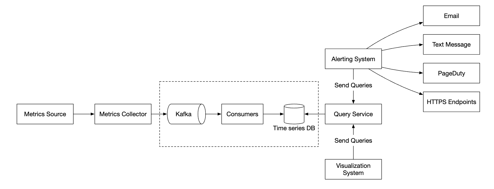
</div>

 1. **Metrics Collectors** sau khi thu thập dữ liệu sẽ đẩy ngay vào **Apache Kafka**.
 2. Các dịch vụ xử lý dòng dữ liệu (**Stream Processing Services** như **Apache Flink**, **Spark Streaming** hoặc **Storm**) đóng vai trò Consumers đọc dữ liệu từ Kafka, thực hiện tổng hợp/làm sạch rồi mới ghi vào **Time-Series Database**.

Kiến trúc này mang lại 3 lợi ích to lớn:
 - Sử dụng Kafka làm bộ đệm chịu tải cực kỳ bền bỉ và có khả năng mở rộng cao.
 - Tách biệt hoàn toàn (decouple) tốc độ thu thập dữ liệu đầu vào với tốc độ ghi của Database đầu ra.
 - Ngăn chặn mất dữ liệu hoàn toàn: nếu Time-Series DB bị sập tạm thời, toàn bộ metrics vẫn được lưu giữ an toàn trong Kafka và sẽ được đẩy bù vào DB ngay khi DB phục hồi.

Chúng ta có thể cấu hình phân vùng (Partition) trên Kafka theo tên metric (`metric_name`) hoặc theo nhãn (`tags/labels`), đồng thời phân loại các metrics quan trọng sống còn vào các Topics ưu tiên cao để xử lý trước:

<div style="margin-left:3rem">
    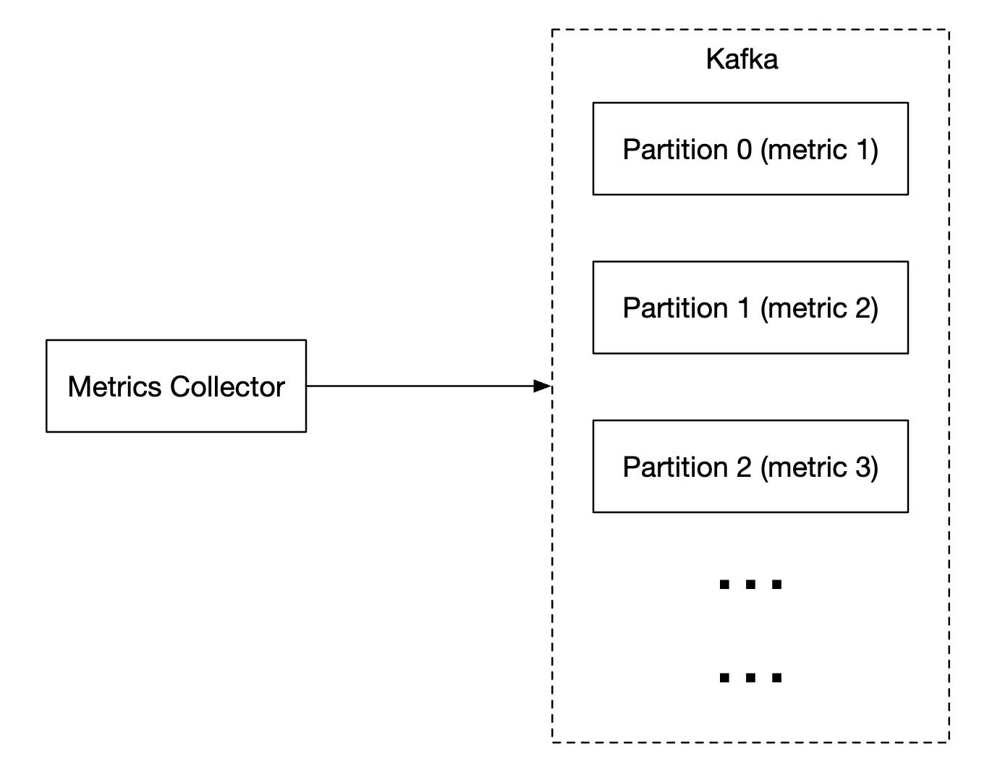
</div>

*(Phương án thay thế nếu không muốn vận hành cụm Kafka: Sử dụng hệ thống cơ sở dữ liệu chuỗi thời gian lưu trực tiếp trên bộ nhớ có khả năng chịu tải ghi khổng lồ như **Facebook Gorilla**, vốn có thể tiếp nhận hàng triệu điểm dữ liệu mỗi giây mà vẫn hoạt động tốt ngay cả khi một số trung tâm dữ liệu bị đứt mạng).*

---

### **3. Dữ liệu nên được tổng hợp ở đâu? (Where Aggregations Can Happen)**
Việc tính toán tổng hợp dữ liệu (ví dụ tính trung bình mỗi phút) có thể đặt ở 3 vị trí khác nhau với những sự đánh đổi rõ rệt:
 1. **Ngay tại Collection Agent trên máy chủ (Client-side):** Agent chỉ hỗ trợ các phép gộp đơn giản (như cộng dồn counter trong 1 phút trước khi gửi đi). Giảm băng thông mạng nhưng mất chi tiết từng giây.
 2. **Tại đường ống truyền tải (Ingestion Pipeline — Flink):** Dùng Flink tính toán gộp dữ liệu trên dòng chảy trước khi ghi xuống TSDB. Giảm mạnh khối lượng dữ liệu ghi vào ổ cứng, nhưng đánh đổi là có độ trễ xử lý stream và không lưu lại dữ liệu thô ban đầu (raw data).
 3. **Tại thời điểm truy vấn (Query Side):** Lưu 100% dữ liệu thô nguyên bản vào TSDB và chỉ tính toán tổng hợp khi người dùng mở Dashboard chạy câu truy vấn. Không mất bất kỳ chi tiết dữ liệu nào (linh hoạt tuyệt đối), nhưng câu truy vấn có thể chạy chậm hơn và cần thêm lớp Cache.

---

### **4. Tối ưu hóa Dịch vụ truy vấn (Query Service)**
Tách một cụm **Query Service** riêng đứng giữa TSDB và hệ thống Visualization/Alerting giúp giảm sự phụ thuộc chặt vào một loại TSDB cụ thể, đồng thời cho phép đặt một tầng **Cache Server (Redis)** để lưu kết quả của các câu truy vấn Dashboard phổ biến (vì khi có sự cố, hàng chục kỹ sư sẽ cùng mở đi mở lại một biểu đồ giống hệt nhau!):

<div style="margin-left:3rem">
    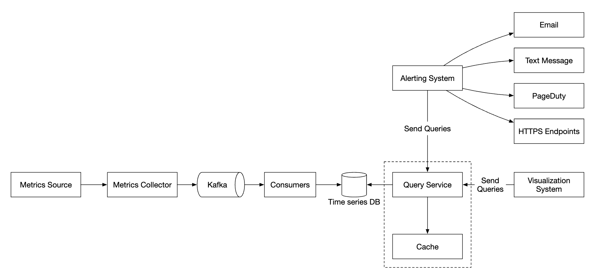
</div>

*(Lưu ý: Tại sao hầu hết các Time-Series Databases không dùng chuẩn SQL truyền thống mà tự thiết kế ngôn ngữ truy vấn riêng như **PromQL** của Prometheus hay **Flux** của InfluxDB? Bởi vì việc viết truy vấn chuỗi thời gian — ví dụ tính trung bình trượt theo cấp số nhân `Exponential Moving Average` — bằng SQL cực kỳ dài dòng, khó hiểu và kém hiệu quả).*

Hãy xem sự khác biệt rõ rệt khi viết cùng một truy vấn tính trung bình trượt bằng **SQL** so với ngôn ngữ **Flux**:
```
select id,
       temp,
       avg(temp) over (partition by group_nr order by time_read) as rolling_avg
from (
  select id,
         temp,
         time_read,
         interval_group,
         id - row_number() over (partition by interval_group order by time_read) as group_nr
  from (
    select id,
    time_read,
    "epoch"::timestamp + "900 seconds"::interval * (extract(epoch from time_read)::int4 / 900) as interval_group,
    temp
    from readings
  ) t1
) t2
order by time_read;
```

Cũng chính phép tính đó khi viết bằng **Flux (InfluxDB)** chỉ gói gọn trong 4 dòng trực quan:
```
from(db:"telegraf")
  |> range(start:-1h)
  |> filter(fn: (r) => r._measurement == "foo")
  |> exponentialMovingAverage(size:-10s)
```

---

### **5. Tối ưu hóa Tầng lưu trữ (Storage Layer Optimizations)**
Theo công bố nghiên cứu nổi tiếng từ Facebook (bài báo Gorilla), **ít nhất 85% tổng số lượng truy vấn vào hệ thống giám sát chỉ tập trung vào dữ liệu mới phát sinh trong vòng 26 giờ gần nhất!** Do đó, việc chọn một TSDB giữ dữ liệu mới nhất trên bộ nhớ RAM (như Gorilla hay bộ đệm của InfluxDB/Prometheus) sẽ mang lại tốc độ truy vấn vượt trội.

Bên cạnh đó, để lưu trữ 1 năm dữ liệu cho 10 triệu metrics mà không làm nổ chi phí ổ cứng, chúng ta áp dụng **3 kỹ thuật tối ưu lưu trữ cốt lõi**:

#### a. Mã hóa và Nén dữ liệu (Data Encoding and Compression — Double-Delta Encoding)
Thay vì lưu từng dấu thời gian `timestamp` đầy đủ tốn 64 bits (8 bytes) cho mỗi điểm dữ liệu, vì các điểm dữ liệu được thu thập đều đặn mỗi 10 giây, chúng ta chỉ cần lưu **độ chênh lệch của độ chênh lệch (Delta of Deltas / Double-Delta Encoding)**:

<div style="margin-left:3rem">
    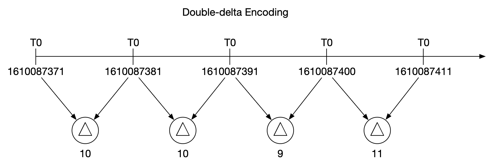
</div>

Trong ví dụ trên, khoảng cách giữa các lần đo liên tiếp đều là `10s`, nên giá trị `delta_of_deltas` bằng `0` (chỉ tốn đúng **1 bit** để lưu thay vì 64 bits!), giúp nén dung lượng dữ liệu xuống nhỏ hơn tới hơn 10 lần!

#### b. Giảm độ phân giải dữ liệu theo tuổi thọ (Downsampling / Rollup)
Dữ liệu càng cũ thì càng ít được xem chi tiết từng 10 giây. Hệ thống chạy các tiến trình tự động gộp dữ liệu cũ sang độ phân giải thấp hơn theo đúng quy tắc đã thống nhất với người phỏng vấn:
 - **Trong 7 ngày đầu:** Giữ nguyên độ phân giải gốc (`10 giây/điểm`).
 - **Từ ngày thứ 8 đến 30 ngày:** Giảm mẫu (**Downsample**) xuống độ phân giải `1 phút/điểm`.
 - **Từ sau 30 ngày đến 1 năm:** Giảm mẫu xuống độ phân giải `1 giờ/điểm`.

Ví dụ minh họa bảng dữ liệu độ phân giải 10 giây ban đầu:
| metric | timestamp            | hostname | Metric_value |
|--------|----------------------|----------|--------------|
| cpu    | 2021-10-24T19:00:00Z | host-a   | 10           |
| cpu    | 2021-10-24T19:00:10Z | host-a   | 16           |
| cpu    | 2021-10-24T19:00:20Z | host-a   | 20           |
| cpu    | 2021-10-24T19:00:30Z | host-a   | 30           |
| cpu    | 2021-10-24T19:00:40Z | host-a   | 20           |
| cpu    | 2021-10-24T19:00:50Z | host-a   | 30           |

Sau khi thực hiện Downsampling xuống độ phân giải 30 giây (lấy giá trị trung bình), 6 dòng rút gọn chỉ còn 2 dòng:
| metric | timestamp            | hostname | Metric_value (avg) |
|--------|----------------------|----------|--------------------|
| cpu    | 2021-10-24T19:00:00Z | host-a   | 19                 |
| cpu    | 2021-10-24T19:00:30Z | host-a   | 25                 |

#### c. Lưu trữ lạnh (Cold Storage)
Đẩy các dữ liệu lịch sử rất cũ ít khi truy cập sang các dịch vụ lưu trữ lạnh giá rẻ (như Amazon S3 Glacier) để cắt giảm tối đa chi phí tài chính.

---

### **6. Hệ thống Cảnh báo (Alerting System)**

<div style="margin-left:3rem">
    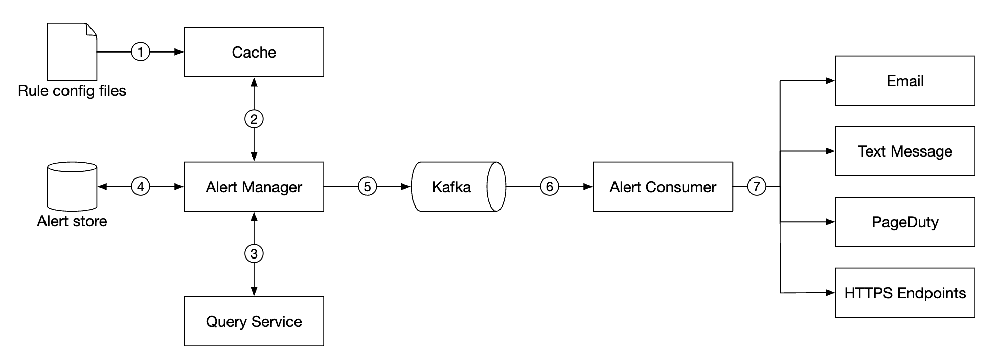
</div>

1. Các quy tắc cảnh báo (**Alert Rules**) được định nghĩa dưới dạng các file cấu hình **YAML** và nạp vào **Cache Servers**. Ví dụ một quy tắc cảnh báo khi một máy chủ không phản hồi quá 5 phút:
```
- name: instance_down
  rules:

  # Alert for any instance that is unreachable for >5 minutes.
  - alert: instance_down
    expr: up == 0
    for: 5m
    labels:
      severity: page
```

2. **Alert Manager** đọc các quy tắc từ Cache và định kỳ gọi sang **Query Service** để kiểm tra điều kiện. Nếu phát hiện điều kiện vượt ngưỡng kéo dài đủ thời gian (`for: 5m`), một sự kiện cảnh báo (**Alert Event**) sẽ được khởi tạo.
3. Các trách nhiệm sống còn của **Alert Manager**:
   - **Lọc, Gộp và Khử trùng lặp cảnh báo (Filtering, Merging & Deduplicating):** Nếu một máy chủ bị sập kéo dài 1 tiếng, hệ thống không được phép bắn hàng trăm email/tin nhắn lặp đi lặp lại mỗi phút làm tê liệt điện thoại của kỹ sư trực ca (hiện tượng *Alert Fatigue*), mà phải khử trùng lặp và gộp các cảnh báo cùng nguyên nhân lại thành một thông báo duy nhất!
   - **Kiểm soát quyền truy cập (Access Control):** Chỉ những cá nhân có thẩm quyền mới được phép sửa đổi hoặc tắt các quy tắc cảnh báo quan trọng.
   - **Đảm bảo gửi ít nhất một lần (Retry / At-least-once delivery):** Lưu trạng thái của mọi cảnh báo (`inactive`, `pending`, `firing`, `resolved`) vào **Alert Store** (như Cassandra) và đẩy sự kiện vào **Kafka** để cụm **Alert Consumers** gửi thông báo tới Email, SMS, PagerDuty hoặc Webhooks một cách đáng tin cậy.

---

### **7. Hệ thống Trực quan hóa (Visualization System)**
Hệ thống trực quan hóa hiển thị dữ liệu metrics theo thời gian dưới dạng biểu đồ và trạng thái cảnh báo. Dưới đây là ví dụ về một bảng điều khiển được xây dựng bằng **Grafana**:

<div style="margin-left:3rem">
    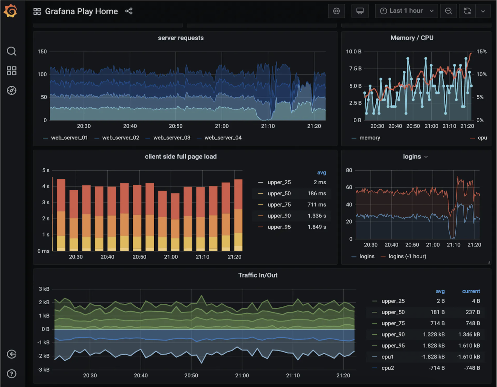
</div>

Trong thực tế, việc tự viết một công cụ vẽ biểu đồ chất lượng cao hỗ trợ hàng chục nguồn dữ liệu từ con số 0 là rất tốn kém và không cần thiết; câu trả lời chuẩn xác của một System Architect thực thụ là tích hợp giải pháp mã nguồn mở hàng đầu như **Grafana** kết nối thẳng vào Query Service/TSDB của chúng ta (**Buy vs. Build**).

---

## Bước 4: Tổng kết (Wrap Up)
Dưới đây là sơ đồ kiến trúc hoàn chỉnh cuối cùng của Hệ thống giám sát Metrics và cảnh báo:

<div style="margin-left:3rem">
    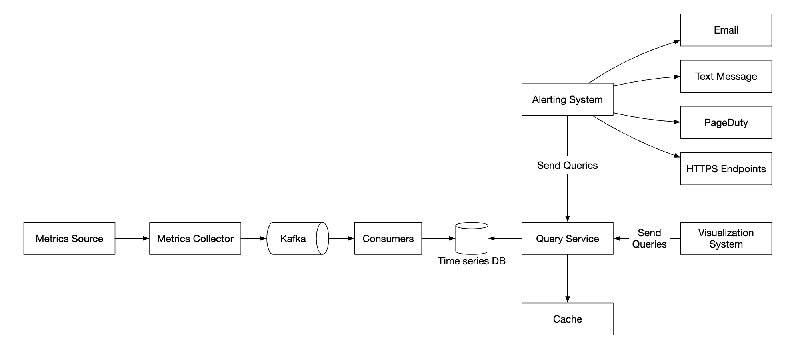
</div>
