# Chương 21: Tổng hợp sự kiện click quảng cáo (Ad Click Event Aggregation)

## Giới thiệu
**Quảng cáo kỹ thuật số (Digital Advertising)** là ngành công nghiệp trị giá hàng trăm tỷ đô la đứng sau doanh thu của Facebook, Google, YouTube, TikTok.

Trong hệ sinh thái này, việc theo dõi và tổng hợp chính xác các sự kiện nhấp chuột vào quảng cáo (**Ad Click Event Aggregation**) đóng vai trò sống còn. Chương này đi sâu vào việc thiết kế một hệ thống xử lý và tổng hợp sự kiện click quảng cáo theo thời gian thực ở quy mô Facebook/Google.

Một khái niệm cốt lõi trong quảng cáo trực tuyến là **Đấu giá theo thời gian thực (Real-Time Bidding - RTB)** — quy trình mà vị trí hiển thị quảng cáo được mua và bán tự động ngay khi người dùng vừa tải trang:

<div style="margin-left:3rem">
    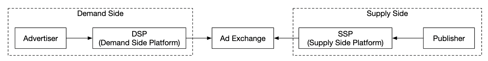
</div>

Tốc độ của quá trình RTB là cực kỳ quan trọng vì toàn bộ phiên đấu giá thường phải hoàn tất trong **chưa đầy 1 giây**.
Đồng thời, **độ chính xác của dữ liệu tổng hợp click quảng cáo** cũng mang tính quyết định, bởi vì số liệu này trực tiếp quyết định số tiền mà các nhà quảng cáo (advertisers) phải trả cho nền tảng (billing) cũng như giúp họ điều chỉnh chiến dịch, ngân sách và tệp khách hàng mục tiêu.

---

## Bước 1: Thấu hiểu bài toán và Xác lập phạm vi thiết kế (Understand the Problem and Establish Design Scope)
Đoạn hội thoại mẫu giữa Ứng viên (C) và Người phỏng vấn (I):
 - **C:** Định dạng và quy mô dữ liệu đầu vào của chúng ta như thế nào?
 - **I:** Hệ thống ghi nhận **1 tỷ lượt click quảng cáo mỗi ngày (1B ad clicks/day)** trên tổng số **2 triệu mẫu quảng cáo** đang chạy. Số lượng sự kiện click tăng trưởng khoảng 30% mỗi năm.
 - **C:** Những câu truy vấn quan trọng nhất mà hệ thống của chúng ta cần hỗ trợ là gì?
 - **I:** Hệ thống cần hỗ trợ 3 loại truy vấn cốt lõi sau:
   1. Trả về tổng số lượt click của một mẫu quảng cáo `ad_id = X` trong `Y` phút gần nhất.
   2. Trả về danh sách **Top 100 mẫu quảng cáo được click nhiều nhất** trong vòng `1 phút` vừa qua (cả số lượng `N = 100` và khoảng thời gian `M` phút đều phải cho phép cấu hình). Việc tổng hợp dữ liệu diễn ra mỗi phút một lần.
   3. Hỗ trợ lọc dữ liệu (**data filtering**) theo các thuộc tính `ip`, `user_id` và `country` cho cả hai loại truy vấn trên.
 - **C:** Chúng ta có cần xử lý các trường hợp biên (edge cases) đặc thù của hệ thống phân tán không? Tôi đang nghĩ tới các kịch bản như:
   - Các sự kiện click đến trễ hơn dự kiến do mạng chậm (**delayed / late-arriving events**).
   - Các sự kiện bị gửi trùng lặp (**duplicate events**).
   - Một số node trong hệ thống bị sập giữa chừng đòi hỏi cơ chế tự phục hồi (**fault tolerance & recovery**).
 - **I:** Danh sách rất chuẩn xác, hãy đưa tất cả các yếu tố đó vào thiết kế của bạn.
 - **C:** Yêu cầu về độ trễ toàn trình (End-to-End Latency) là bao lâu?
 - **I:** Toàn bộ quá trình tổng hợp dữ liệu click quảng cáo cho phép độ trễ **vài phút (a few minutes of end-to-end latency)** dùng cho Dashboard báo cáo và tính phí; riêng hệ thống RTB và kiểm soát ngân sách quảng cáo có thể cần số liệu trong dưới vài giây.

### **Yêu cầu chức năng (Functional Requirements)**
 - Tổng hợp số lượng lượt click của một `ad_id` cụ thể trong `M` phút gần nhất.
 - Trả về danh sách Top `N` (mặc định 100) `ad_id` được click nhiều nhất trong mỗi phút.
 - Hỗ trợ lọc kết quả tổng hợp theo các thuộc tính khác nhau (`ip`, `user_id`, `country`).
 - Xử lý khối lượng dữ liệu ở quy mô Facebook hoặc Google (1 tỷ lượt click/ngày).

### **Yêu cầu phi chức năng (Non-Functional Requirements)**
 - **Tính đúng đắn và chính xác của dữ liệu (Correctness):** Tối quan trọng vì dữ liệu này được dùng trực tiếp để tính tiền (billing) với khách hàng.
 - Xử lý chuẩn xác các sự kiện đến trễ (**delayed events**) hoặc bị trùng lặp (**duplicate events**).
 - **Tính bền bỉ (Robustness):** Hệ thống phải có khả năng chịu lỗi một phần (partial failures) mà không làm mất dữ liệu đang xử lý.
 - **Latency:** Độ trễ toàn trình tối đa chỉ vài phút.

### **Ước lượng sơ bộ (Back-of-the-Envelope Estimation)**
 - **1 tỷ DAU**, giả sử trung bình mỗi người click 1 quảng cáo/ngày $\rightarrow$ **1 tỷ sự kiện Ad Click mỗi ngày**.
 - **Ad Click QPS trung bình** = $10^9 / 86.400 \approx$ **10.000 QPS**.
 - **Peak Ad Click QPS** (giả sử gấp 5 lần trung bình) = **50.000 QPS**.
 - Giả sử mỗi bản ghi sự kiện click chiếm `0.1 KB` dung lượng lưu trữ $\rightarrow$ Nhu cầu lưu trữ tăng thêm mỗi ngày là **$0.1\text{ KB} \times 10^9 = 100\text{ GB/ngày}$** (tương đương **~3 TB/tháng**).

---

## Bước 2: Đề xuất thiết kế tổng quan và Thống nhất phương án (Propose High-Level Design and Get Buy-In)

### **1. Thiết kế API truy vấn (Query API Design)**
Đối tượng gọi các API này là giao diện Dashboard dành cho các nhà quảng cáo và đội ngũ Data Scientist/Analyst. Chúng ta thiết kế 2 RESTful endpoints chính:

#### **API 1 — Lấy tổng số lượt click của một `ad_id` trong `M` phút gần nhất:**
```
GET /v1/ads/{:ad_id}/aggregated_count
```
**Tham số truy vấn (Query Parameters):**
 - `from`: Phút bắt đầu (mặc định là `now - 1 min`).
 - `to`: Phút kết thúc (mặc định là `now`).
 - `filter`: Mã định danh chiến lược lọc (ví dụ `filter = 001` nghĩa là chỉ lọc các lượt click ngoài nước Mỹ).

**Phản hồi (Response):**
 - `ad_id` (`string`): Định danh của mẫu quảng cáo.
 - `count` (`long`): Tổng số lượt click đã gộp trong khoảng thời gian từ `from` đến `to`.

#### **API 2 — Lấy danh sách Top `N` mẫu quảng cáo được click nhiều nhất trong `M` phút gần nhất:**
```
GET /v1/ads/popular_ads
```
**Tham số truy vấn (Query Parameters):**
 - `count` (`integer`): Số lượng `N` quảng cáo đứng đầu cần lấy.
 - `window` (`integer`): Kích thước cửa sổ thời gian tổng hợp `M` tính bằng phút.
 - `filter` (`long`): Mã định danh bộ lọc.

**Phản hồi (Response):**
 - `ad_ids` (`array`): Danh sách các mã quảng cáo được click nhiều nhất.

---

### **2. Mô hình dữ liệu (Data Model): Dữ liệu thô vs. Dữ liệu đã tổng hợp**
Hệ thống của chúng ta xử lý hai loại dữ liệu: **Dữ liệu sự kiện thô (Raw Data)** và **Dữ liệu đã tổng hợp (Aggregated Data)**.

**a. Dữ liệu thô (Raw Data)** ghi nhận từ log có dạng như sau:
```
[AdClickEvent] ad001, 2021-01-01 00:00:01, user 1, 207.148.22.22, USA
```
Khi biểu diễn dưới dạng bảng có cấu trúc:
| ad_id | click_timestamp     | user  | ip            | country |
|-------|---------------------|-------|---------------|---------|
| ad001 | 2021-01-01 00:00:01 | user1 | 207.148.22.22 | USA     |
| ad001 | 2021-01-01 00:00:02 | user1 | 207.148.22.22 | USA     |
| ad002 | 2021-01-01 00:00:02 | user2 | 209.153.56.11 | USA     |

**b. Dữ liệu đã tổng hợp theo từng phút (Aggregated Data):**
| ad_id | click_minute | filter_id | count |
|-------|--------------|-----------|-------|
| ad001 | 202101010000 | 0012      | 2     |
| ad001 | 202101010000 | 0023      | 3     |
| ad001 | 202101010001 | 0012      | 1     |
| ad001 | 202101010001 | 0023      | 6     |

Để hỗ trợ lọc dữ liệu nhanh chóng, chúng ta định nghĩa bảng bộ lọc `filter` liên kết qua khóa `filter_id`:
| filter_id | region | IP        | user_id |
|-----------|--------|-----------|---------|
| 0012      | US     | *         | *       |
| 0013      | *      | 123.1.2.3 | *       |

Đồng thời, để trả về tức thì **Top N quảng cáo được click nhiều nhất trong M phút**, ta lưu bảng `most_clicked_ads`:
| most_clicked_ads   |           |                                                  |
|--------------------|-----------|--------------------------------------------------|
| window_size        | integer   | Kích thước cửa sổ tổng hợp (`M`) tính bằng phút  |
| update_time_minute | timestamp | Dấu thời gian cập nhật gần nhất (độ mịn 1 phút)  |
| most_clicked_ads   | array     | Mảng danh sách các `ad_id` dưới định dạng JSON   |

#### Sự đánh đổi: Nên lưu Raw Data hay Aggregated Data?
 - **Nếu chỉ lưu Raw Data:** Bảo toàn 100% thông tin gốc, lọc kiểu gì cũng được và tính toán lại lúc nào cũng được; nhưng kích thước dữ liệu khổng lồ và truy vấn trực tiếp trên hàng tỷ dòng sẽ cực kỳ chậm!
 - **Nếu chỉ lưu Aggregated Data:** Dung lượng nhỏ gọn, truy vấn Dashboard siêu nhanh; nhưng đây là dữ liệu phái sinh (derived data) nên nếu thuật toán tổng hợp có bug thì không còn dữ liệu gốc để tính toán lại.
 - **Giải pháp chuẩn:** **Lưu trữ cả hai!**
   1. Lưu **Aggregated Data** trong cơ sở dữ liệu hoạt động chính để phục vụ các truy vấn thời gian thực với tốc độ cực nhanh.
   2. Lưu **Raw Data** làm dữ liệu sao lưu dự phòng (backup/audit log): nếu phát hiện bug trong logic tổng hợp, ta có thể đọc lại Raw Data để tính toán bù (**backfill / recalculation**). Vì Raw Data hiếm khi được đọc, ta có thể đẩy dữ liệu cũ sang **Cold Storage (Amazon S3 với định dạng cột Parquet/ORC)** để tiết kiệm chi phí.
 - **Chọn Database nào?** Với tải ghi 10k–50k QPS cho Raw Data và tải vừa đọc vừa ghi liên tục mỗi phút cho Aggregated Data, chúng ta chọn **Apache Cassandra** (hoặc các cơ sở dữ liệu OLAP chuyên dụng như **ClickHouse** / **Apache Druid**) vì khả năng mở rộng ghi theo chiều ngang xuất sắc.

---

### **3. Thiết kế kiến trúc tổng quan (High-Level Design)**

<div style="margin-left:3rem">
    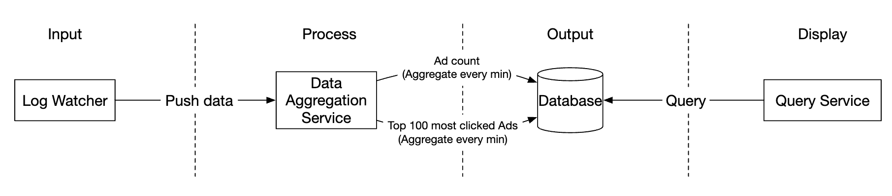
</div>

Trong hệ thống xử lý dòng dữ liệu không giới hạn (unbounded data streams), nếu các thành phần gọi đồng bộ trực tiếp nhau, chỉ cần Database hoặc dịch vụ phía sau chậm lại sẽ làm nghẽn toàn bộ luồng thu thập. Vì vậy, chúng ta đặt **2 tầng Message Queue (Apache Kafka)** ở cả đầu vào và đầu ra của **Data Aggregation Service** để tách rời sự phụ thuộc hoàn toàn:

<div style="margin-left:3rem">
    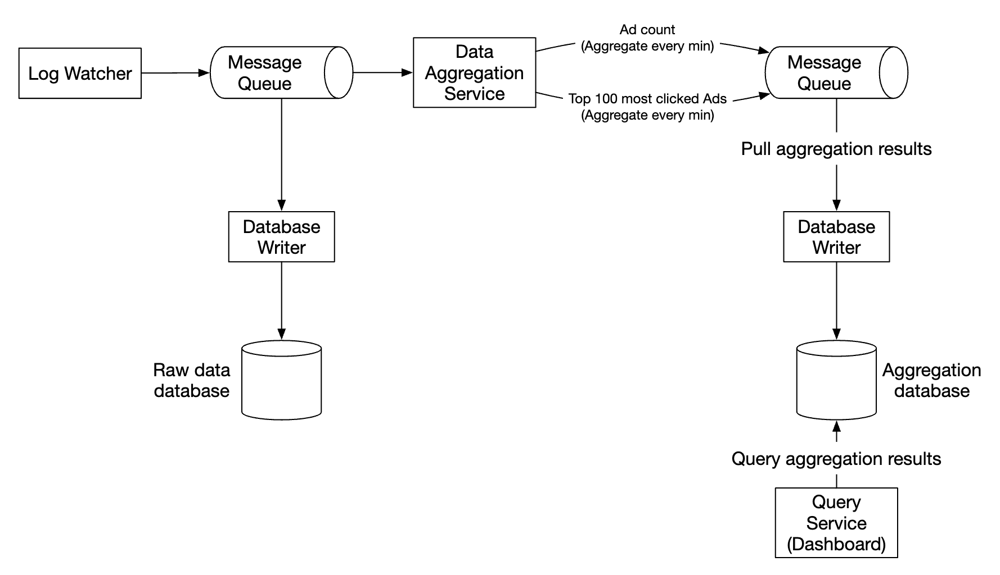
</div>

1. **Message Queue thứ nhất (Đầu vào):** Nhận các sự kiện Ad Click thô từ Log Watcher:
| ad_id | click_timestamp | user_id | ip | country |
|-------|-----------------|---------|----|---------|

2. **Message Queue thứ hai (Đầu ra của Aggregation Service):** Lưu kết quả đã tổng hợp theo từng phút:
| ad_id | click_minute | count |
|-------|--------------|-------|
cùng với danh sách Top N quảng cáo được click nhiều nhất mỗi phút:
| update_time_minute | most_clicked_ads |
|--------------------|------------------|

**Tại sao không để Data Aggregation Service ghi thẳng kết quả vào Database mà lại phải đẩy qua Message Queue thứ hai?**
Bởi vì giống như một nhật ký giao dịch (Commit Log), Message Queue thứ hai giúp hệ thống đạt được ngữ nghĩa **Chuyển phát và cam kết nguyên tử chính xác một lần từ đầu đến cuối (End-to-End Exactly-Once Atomic Commit Semantics)**:

<div style="margin-left:3rem">
    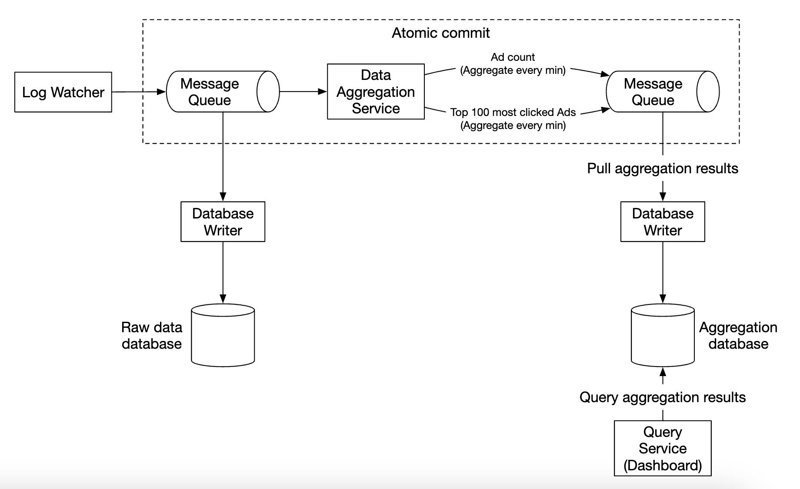
</div>

---

### **4. Thiết kế bên trong Data Aggregation Service (Mô hình MapReduce DAG)**
Để tổng hợp dữ liệu lớn theo thời gian thực một cách có hệ thống, chúng ta thiết kế **Data Aggregation Service** dưới dạng một **Đồ thị có hướng không chu trình (DAG - Directed Acyclic Graph)** theo mô hình **MapReduce** gồm 3 loại nút: **Map Node**, **Aggregate Node** và **Reduce Node**.

<div style="margin-left:3rem">
    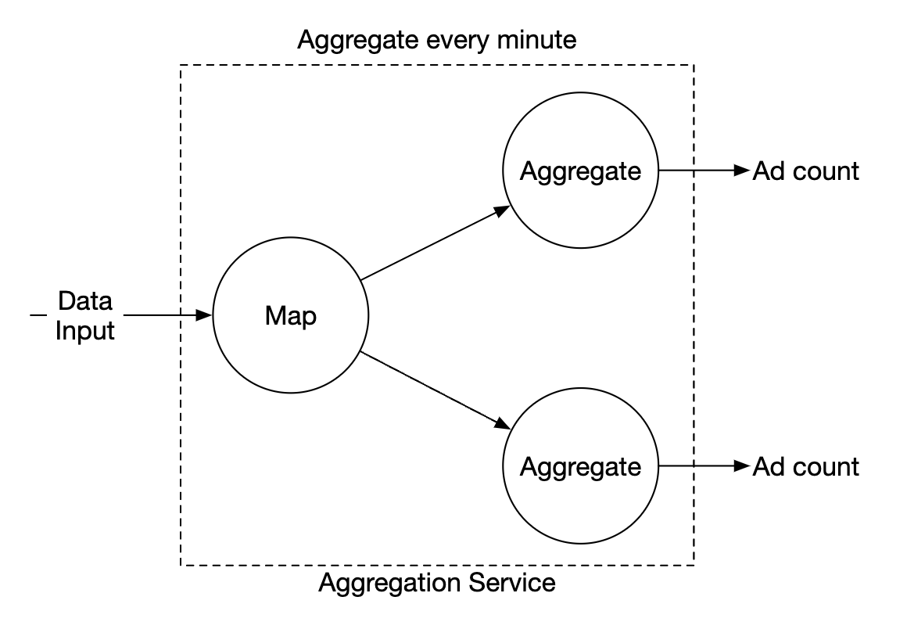
</div>

<div style="margin-left:3rem">
    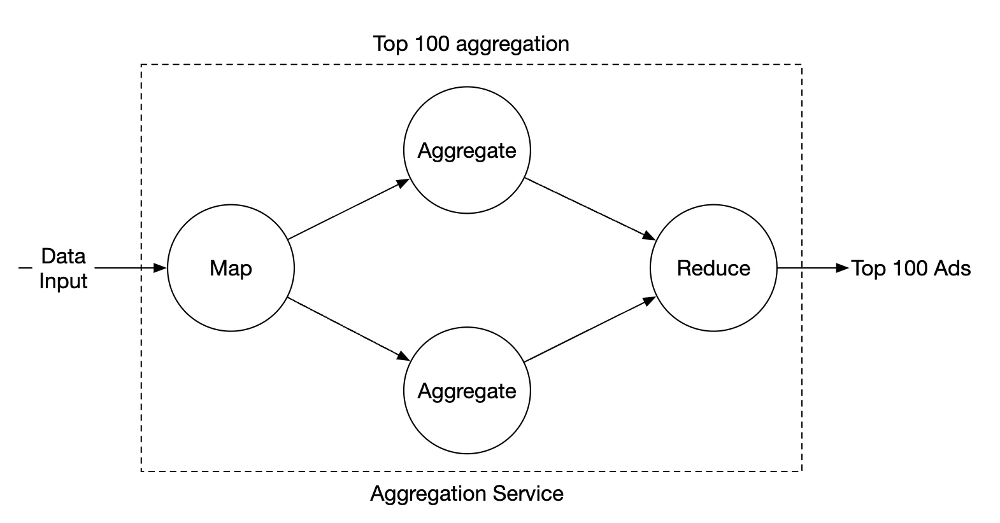
</div>

#### Vai trò của từng loại nút trong DAG:
1. **Map Node:** Đọc dữ liệu thô từ Message Queue đầu vào, thực hiện làm sạch (sanitize), lọc hoặc biến đổi dữ liệu, sau đó phân phối các sự kiện về đúng **Aggregate Node** dựa trên phép chia lấy dư `ad_id % num_aggregate_nodes` để đảm bảo mọi lượt click của cùng một `ad_id` luôn đi về cùng một Aggregate Node:
<div style="margin-left:3rem">
    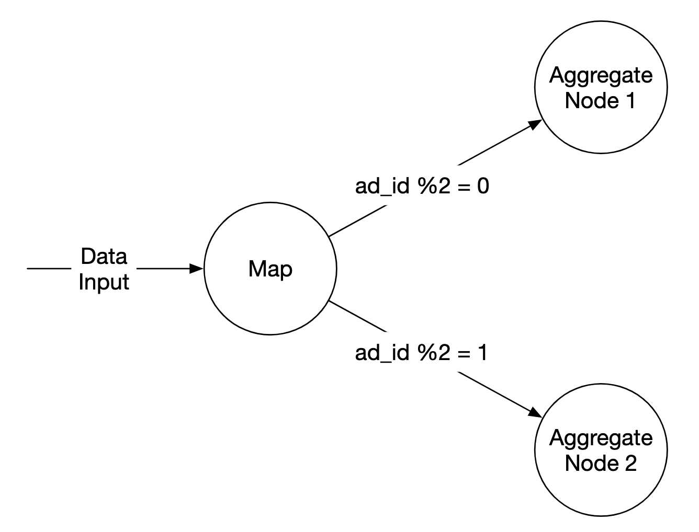
</div>
*(Lưu ý: Nếu Kafka đầu vào đã được phân vùng chuẩn theo `ad_id` ngay từ phía Producer thì có thể bỏ qua bước chia lại của Map Node; nhưng trong thực tế ta thường không kiểm soát được cách Producer bên ngoài bắn dữ liệu vào Kafka, nên việc có tầng Map Node làm nhiệm vụ chuẩn hóa và định tuyến lại là rất cần thiết).*

2. **Aggregate Node:** Đếm số lượng sự kiện click cho từng `ad_id` trực tiếp trên bộ nhớ RAM (**in-memory**) theo từng cửa sổ thời gian 1 phút. Trong mô hình MapReduce chuẩn, bước này chính là một phần của quá trình `Map-Combine`.

3. **Reduce Node:** Thu thập kết quả trung gian từ tất cả các Aggregate Nodes và hợp nhất lại thành kết quả cuối cùng (ví dụ gom danh sách Top 100 của từng node lại để chọn ra **Top 100 toàn cục**):
<div style="margin-left:3rem">
    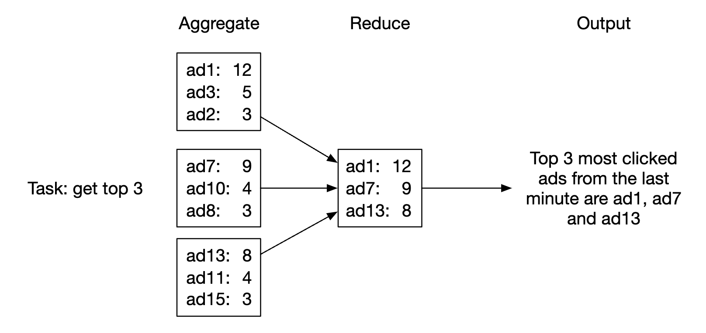
</div>

#### Minh họa 3 kịch bản sử dụng (Use Cases) với mô hình DAG:

- **Use Case 1 — Tổng hợp số lượt click theo `ad_id`:**
<div style="margin-left:3rem">
    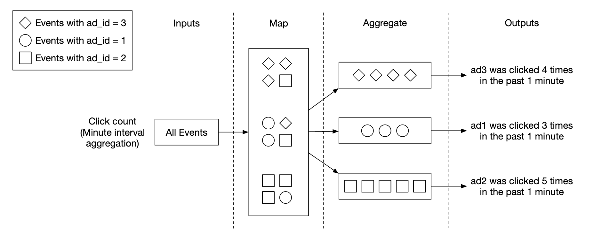
</div>
  Các sự kiện đầu vào được Map Node chia theo `ad_id % 3` về các Aggregate Nodes tương ứng để cộng dồn số lượt click.

- **Use Case 2 — Tìm Top N mẫu quảng cáo được click nhiều nhất:**
<div style="margin-left:3rem">
    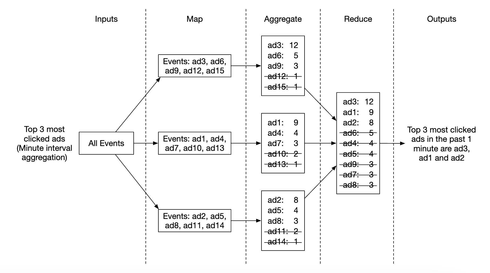
</div>
  Thay vì gửi toàn bộ hàng triệu mã quảng cáo về một node duy nhất gây nghẽn mạng, mỗi **Aggregate Node** tự duy trì một cấu trúc dữ liệu **Đống (Min-Heap)** trên RAM để tìm ra `Top 3` (hoặc `Top 100`) quảng cáo cao nhất cục bộ tại node đó trong thời gian $O(n \log k)$, sau đó chỉ gửi đúng 3 ứng viên đứng đầu này sang **Reduce Node**. Reduce Node chỉ việc gộp 9 ứng viên từ 3 Aggregate Nodes để lấy ra 3 quảng cáo đứng đầu toàn hệ thống!

- **Use Case 3 — Lọc dữ liệu nhanh theo thuộc tính (Data Filtering với Star Schema):**
  Để hỗ trợ lọc tức thì theo quốc gia (`country`), IP hoặc người dùng mà không phải quét tính toán lại từ đầu, ta áp dụng kỹ thuật **Tính toán tổng hợp trước theo các chiều lọc (Pre-aggregation)** tạo thành cấu trúc bảng như sau:
| ad_id | click_minute | country | count |
|-------|--------------|---------|-------|
| ad001 | 202101010001 | USA     | 100   |
| ad001 | 202101010001 | GPB     | 200   |
| ad001 | 202101010001 | others  | 3000  |
| ad002 | 202101010001 | USA     | 10    |
| ad002 | 202101010001 | GPB     | 25    |
| ad002 | 202101010001 | others  | 12    |

  Kỹ thuật thiết kế này được gọi là **Lược đồ hình sao (Star Schema)** — rất phổ biến trong các kho dữ liệu phân tích (Data Warehouses), trong đó các trường dùng để lọc (`country`, `ip`, `user_id`) được gọi là các **Chiều dữ liệu (Dimensions)**.
  - **Ưu điểm:** Truy vấn lọc cực kỳ nhanh vì kết quả theo từng tổ hợp lọc đã được tính sẵn.
  - **Nhược điểm (Bài toán bùng nổ tổ hợp — Curse of Dimensionality):** Nếu có quá nhiều tiêu chí lọc kết hợp với nhau, số lượng dòng bản ghi (buckets) sinh ra sẽ tăng theo cấp số nhân.

---

## Bước 3: Đi sâu vào thiết kế chi tiết (Design Deep Dive)

### **1. Streaming vs. Batching: Kiến trúc Lambda và Kiến trúc Kappa**
Bảng so sánh sự khác biệt giữa 3 loại hệ thống xử lý dữ liệu:
| Tiêu chí | Dịch vụ trực tuyến (Online Services) | Hệ thống xử lý theo lô (Batch System - Offline) | Hệ thống xử lý dòng (Streaming System - Near Real-Time) |
|-------------------------|-------------------------------|--------------------------------------------------------|----------------------------------------------|
| **Độ phản hồi (Responsiveness)** | Phản hồi ngay lập tức cho Client | Không cần phản hồi trực tiếp cho Client | Không cần phản hồi trực tiếp cho Client |
| **Đầu vào (Input)** | Các request của người dùng | Dữ liệu hữu hạn có ranh giới xác định (Bounded input), kích thước lớn | Dòng dữ liệu vô hạn không có điểm kết thúc (Unbounded streams) |
| **Đầu ra (Output)** | Phản hồi HTTP/RPC cho Clients | Các bảng Materialized views, chỉ số tổng hợp, báo cáo | Các bảng Materialized views, chỉ số tổng hợp, cảnh báo thời gian thực |
| **Thước đo hiệu năng** | Availability, Latency | Throughput | Throughput, Latency |
| **Ví dụ điển hình** | Mua sắm trực tuyến | Hadoop MapReduce, Spark Batch | Apache Flink, Kafka Streams |

Trong lịch sử phát triển các hệ thống Big Data, có hai mô hình kiến trúc nổi tiếng để kết hợp xử lý thời gian thực và xử lý dữ liệu lịch sử:
- **Kiến trúc Lambda (Lambda Architecture):** Duy trì **hai đường ống xử lý song song** — một đường **Streaming (Speed Layer)** tính toán gần đúng theo thời gian thực, và một đường **Batch (Batch Layer)** chạy định kỳ trên dữ liệu gốc để đảm bảo độ chính xác tuyệt đối.
  * **Nhược điểm lớn của Lambda:** Bạn phải viết, kiểm thử và bảo trì **2 bộ mã nguồn (codebases) hoàn toàn khác nhau** trên 2 frameworks khác nhau (ví dụ vừa viết code Flink cho Streaming, vừa viết code Spark/MapReduce cho Batch) cho cùng một logic nghiệp vụ!
<div style="margin-left:3rem">
    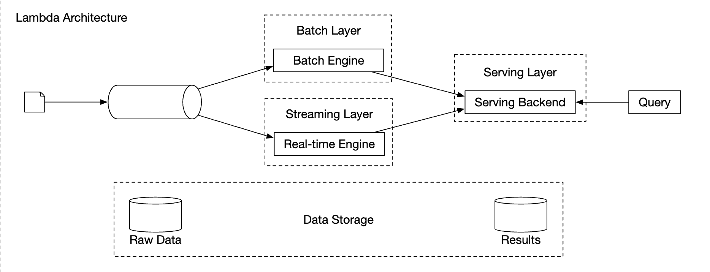
</div>

- **Kiến trúc Kappa (Kappa Architecture — Thiết kế chúng ta lựa chọn):** Loại bỏ hoàn toàn đường Batch riêng biệt và hợp nhất mọi thứ vào **một đường ống xử lý dòng (Single Stream Processing Engine) duy nhất**.
<div style="margin-left:3rem">
    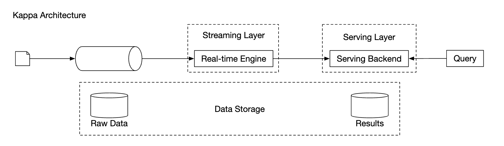
</div>

**Làm thế nào để tính toán lại dữ liệu lịch sử (Recalculation / Backfill) trong Kiến trúc Kappa của chúng ta?**
Giả sử chúng ta phát hiện một bug nghiêm trọng trong code của Aggregation Service làm tính sai số liệu từ ngày hôm qua. Sau khi sửa bug xong, quy trình tính toán lại diễn ra như sau:
 1. **Recalculation Service** đọc lại các sự kiện thô trong khoảng thời gian bị lỗi từ kho lưu trữ **Raw Data Storage** và đẩy vào một队列 Kafka phụ.
 2. Dữ liệu này được xử lý bởi một cụm **Aggregation Service dành riêng cho việc tính lại** (chạy cùng một codebase mới đã sửa bug, nhưng tách riêng phần cứng để không làm ảnh hưởng đến luồng thời gian thực đang chạy!).
 3. Kết quả tính toán lại được đẩy qua Message Queue thứ hai và ghi đè (**override**) lên các bản ghi bị sai trong **Aggregation Database**:

<div style="margin-left:3rem">
    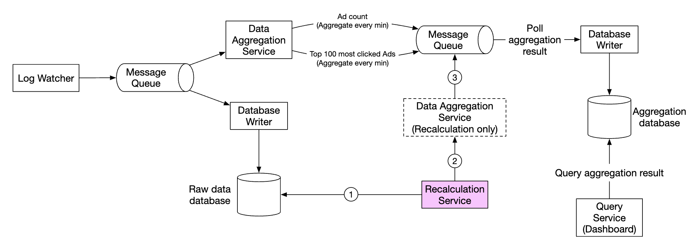
</div>

---

### **2. Bài toán Thời gian: Event Time vs. Processing Time và Kỹ thuật Watermark**
Để gom nhóm các lượt click theo từng phút, hệ thống có thể dựa vào một trong hai loại dấu thời gian:
 - **Thời gian xảy ra sự kiện (`Event Time`):** Thời điểm người dùng thực sự nhấp chuột vào quảng cáo trên thiết bị.
 - **Thời gian xử lý (`Processing Time`):** Thời điểm máy chủ Aggregation Server thực sự đọc và xử lý sự kiện đó.

Do độ trễ mạng di động chập chờn và việc đi qua hàng đợi bất đồng bộ, có thể có khoảng cách chênh lệch đáng kể giữa `Event Time` và `Processing Time`:
| Loại thời gian | Ưu điểm (Pros) | Nhược điểm (Cons) |
|-----------------|---------------------------------------|--------------------------------------------------------------------------------------|
| **Event Time** | Kết quả tổng hợp theo từng phút **chính xác tuyệt đối** theo thực tế diễn ra | Phải giải quyết bài toán các sự kiện đến trễ (**Late-arriving events**); đồng hồ phía client có thể bị sai hoặc bị kẻ gian làm giả |
| **Processing Time** | Đồng hồ của Server luôn chuẩn xác và rất dễ cài đặt | Kết quả tổng hợp theo phút **bị sai lệch** nếu sự kiện bị trễ mạng sang phút sau mới tới server |

Vì **độ chính xác dữ liệu (Data Accuracy)** dùng để tính tiền quảng cáo là ưu tiên số một, chúng ta bắt buộc phải chọn **`Event Time`** để tổng hợp!

#### Giải quyết sự kiện đến trễ bằng kỹ thuật Mốc đánh dấu thời gian (Watermark)
Khi dùng `Event Time`, điều gì xảy ra nếu cửa sổ tổng hợp của phút thứ 1 (`00:01:00 - 00:02:00`) đã đóng lại, mà lúc `00:02:05` mới có một sự kiện có `event_time = 00:01:35` đi tới server (như `Event 2` trong hình dưới)?

<div style="margin-left:3rem">
    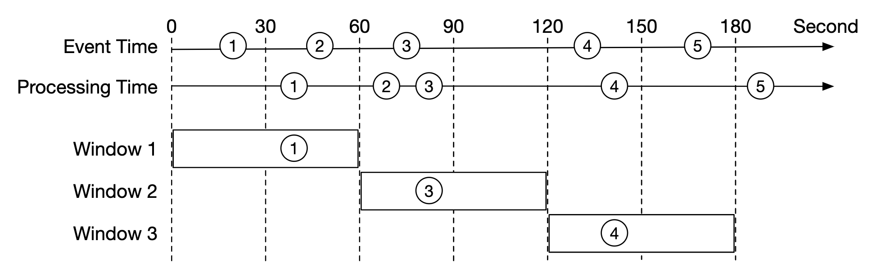
</div>

Để không bỏ lỡ các sự kiện bị trễ mạng nhẹ như vậy, hệ thống áp dụng kỹ thuật **Mốc đánh dấu thời gian chờ (Watermark)**:
- Thay vì đóng ngay lập tức cửa sổ tổng hợp vào đúng giây thứ 60, chúng ta chủ động **kéo dài thêm một khoảng thời gian đệm chờ (ví dụ cộng thêm `15 giây` Watermark)** trước khi chính thức chốt sổ và xuất kết quả của cửa sổ đó:

<div style="margin-left:3rem">
    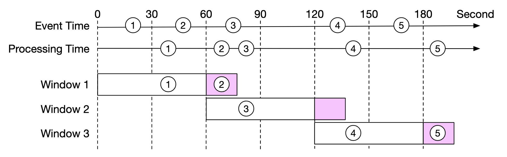
</div>

- **Đánh đổi khi chọn độ dài Watermark:**
  * **Watermark ngắn:** Giảm Latency xuất kết quả, nhưng dễ bỏ sót các sự kiện trễ hơn ngưỡng.
  * **Watermark dài:** Bắt được hầu hết các sự kiện đến trễ (tăng độ chính xác), nhưng làm tăng Latency hiển thị kết quả.
- **Mẹo thiết kế thực tế:** Không nên dùng Watermark quá dài chỉ để cố bắt 0.01% các sự kiện bị trễ hàng giờ đồng hồ (do người dùng đi máy bay ngoại tuyến). Thay vào đó, hãy dùng **Watermark nhỏ (ví dụ 15 giây)** cho luồng thời gian thực, và xử lý phần sai số cực nhỏ còn lại bằng quy trình **Đối soát cuối ngày (End-of-day Reconciliation)**!

---

### **3. Lựa chọn Cửa sổ tổng hợp (Aggregation Window): Tumbling vs. Sliding Window**
Trong xử lý dòng dữ liệu (Stream Processing), có 4 loại cửa sổ thời gian phổ biến: *Tumbling Window*, *Hopping Window*, *Sliding Window* và *Session Window*. Chúng ta sử dụng 2 loại phù hợp nhất với 2 yêu cầu đề bài:

1. **Cửa sổ trượt không chồng lấp (Tumbling / Fixed Window):** Dùng cho yêu cầu **Tổng hợp số lượt click của từng quảng cáo trong mỗi phút**. Thời gian được chia thành các khung cố định 1 phút nối tiếp nhau, hoàn toàn không chồng lấp lên nhau, và mỗi sự kiện chỉ thuộc về đúng 1 cửa sổ duy nhất:
<div style="margin-left:3rem">
    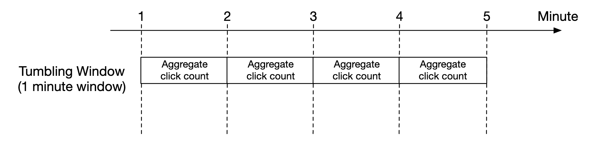
</div>

2. **Cửa sổ trượt (Sliding Window):** Dùng cho yêu cầu **Tìm Top N quảng cáo được click nhiều nhất trong M phút vừa qua**. Cửa sổ có độ rộng `M` phút này trượt liên tục theo thời gian, giúp luôn lấy được danh sách thịnh hành mới nhất:
<div style="margin-left:3rem">
    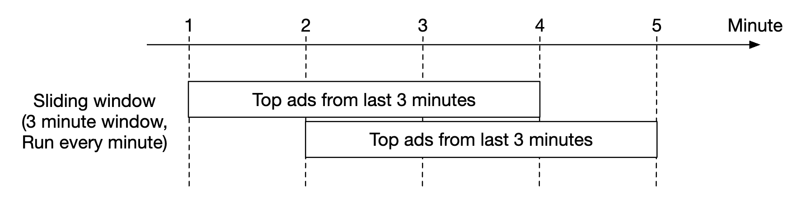
</div>

---

### **4. Đảm bảo chuyển phát chính xác một lần và Khử trùng lặp (Delivery Guarantees & Data Deduplication)**
Vì sai số dù chỉ 1% trong số liệu click quảng cáo cũng có thể dẫn đến tranh chấp hàng triệu đô la tiền phí giữa nền tảng và nhà quảng cáo, chúng ta không thể chấp nhận việc đếm trùng lặp (`At-least-once`) hay làm mất lượt click (`At-most-once`), mà phải đảm bảo **Ngữ nghĩa xử lý chính xác một lần (Exactly-Once Semantics)**!

Tại sao dữ liệu bị trùng lặp ngay cả khi Client chỉ gửi 1 lần?
Hãy xem kịch bản lỗi kinh điển khi một **Aggregation Service Node bị sập ngay trước bước gửi ACK cuối cùng**:

<div style="margin-left:3rem">
    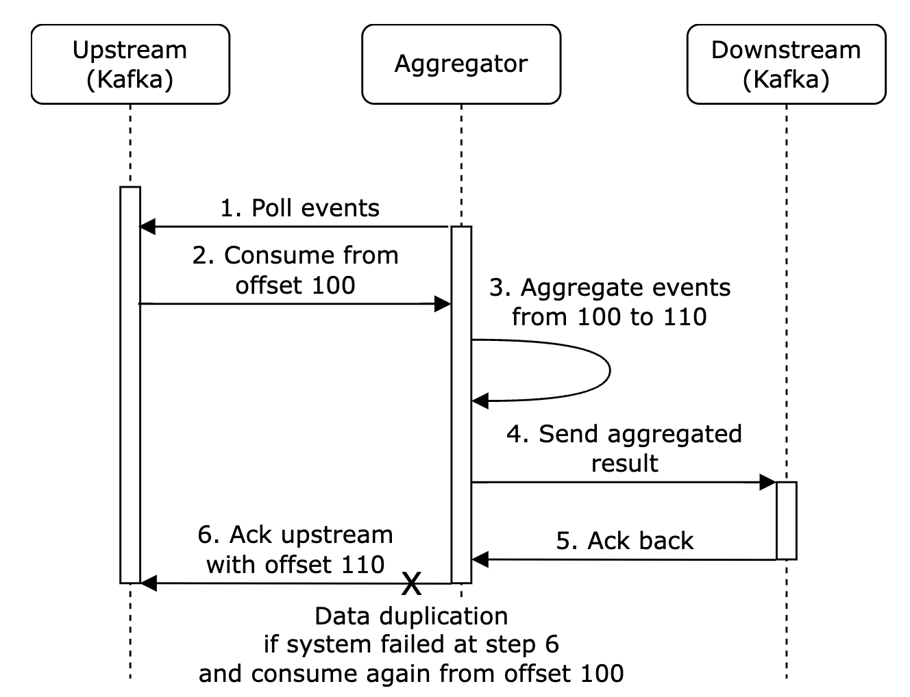
</div>

1. Aggregation Node kéo các sự kiện đến `offset = 100` từ Kafka thượng nguồn (bước 1), tính toán xong và đẩy kết quả tổng hợp sang Kafka hạ nguồn thành công ở bước 3.
2. Nhưng trước khi kịp thực hiện **bước 6 (gửi commit `offset = 100` ngược về cho Kafka thượng nguồn)**, Aggregation Node này bất ngờ bị sập nguồn!
3. Khi một node mới lên thay thế, nó thấy offset commit cuối cùng vẫn là `90`, nên nó kéo lại các sự kiện từ `91` đến `100`, tính toán lại và **đẩy trùng lặp một lần nữa sang hạ nguồn!**

Nếu ta đảo ngược thứ tự — lưu `offset = 100` vào HDFS/S3 trước rồi mới gửi kết quả sang hạ nguồn — thì nếu node sập trước bước gửi hạ nguồn, kết quả của đoạn `91-100` sẽ **không bao giờ tới được hạ nguồn (mất dữ liệu)**:

<div style="margin-left:3rem">
    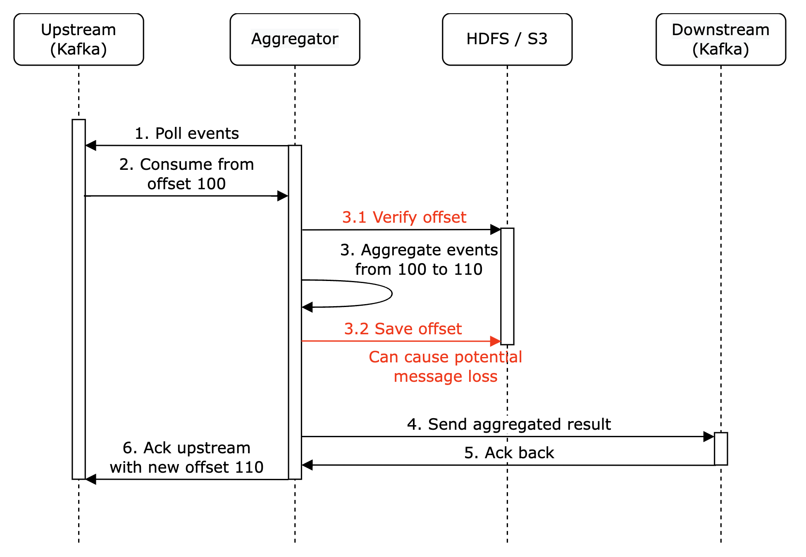
</div>

**Giải pháp chuẩn (Distributed Transaction / Atomic Commit trong Apache Flink & Kafka Transactions):**
Để tránh cả mất dữ liệu lẫn trùng lặp dữ liệu, bước lưu `offset` đã đọc ở thượng nguồn và bước ghi kết quả ra hạ nguồn phải được gói chung vào **một giao dịch phân tán nguyên tử (Distributed Transaction — hoặc cả hai cùng thành công, hoặc cả hai cùng hủy bỏ)**:

<div style="margin-left:3rem">
    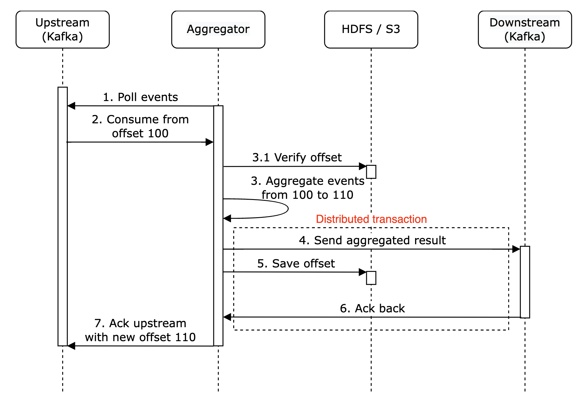
</div>

*(Góc nhìn thực tế của System Architect: Ngoài việc dùng giao dịch phân tán của Kafka/Flink, một cách đơn giản và hiệu quả không kém là gắn cho mỗi cửa sổ thời gian của một `ad_id` một khóa định danh duy nhất `(ad_id, click_minute)` để thao tác ghi xuống Database hạ nguồn mang **Tính lũy đẳng - Idempotent Upsert**: ghi đè `count = 50` thay vì cộng dồn `count = count + 50`, nhờ đó dù node có tính lại và ghi lại bao nhiêu lần thì kết quả trong DB vẫn chính xác tuyệt đối!).*

---

### **5. Mở rộng quy mô hệ thống (Scale the System) và Giải quyết bài toán Điểm nóng (Hotspot Issue)**

Nhờ 3 thành phần (Message Queue, Aggregation Service, Database) đã được tách rời hoàn toàn, ta có thể scale độc lập từng phần:

#### a. Mở rộng Message Queue (Kafka)
 - Tạo sẵn số lượng Partitions đủ lớn và mở rộng số lượng Consumers trong Consumer Group.
 - Khi cần thêm/bớt Consumers gây ra Rebalancing, nên thực hiện vào khung giờ thấp điểm để tránh gián đoạn dòng chảy.

<div style="margin-left:3rem">
    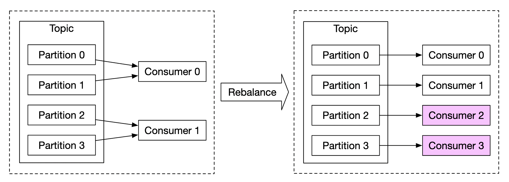
</div>

#### b. Mở rộng Aggregation Service
<div style="margin-left:3rem">
    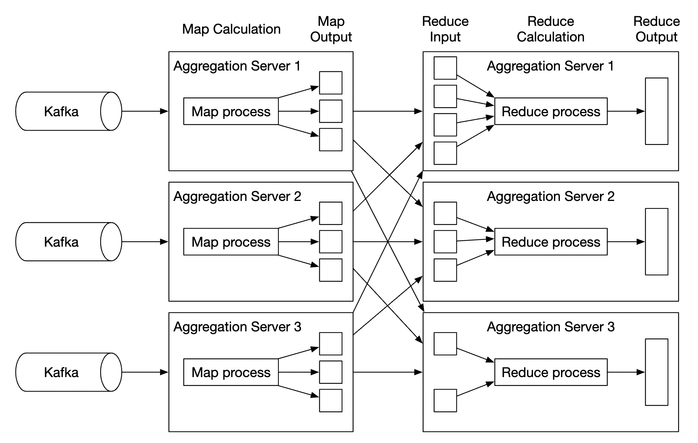
</div>

 - Tăng Throughput trên mỗi node bằng cách sử dụng **Đa luồng (Multi-threading)** chia tải theo từng nhóm `ad_id`, và tăng số lượng nodes trong cụm thông qua các trình quản lý tài nguyên phân tán như **Apache YARN** hoặc **Kubernetes**:

<div style="margin-left:3rem">
    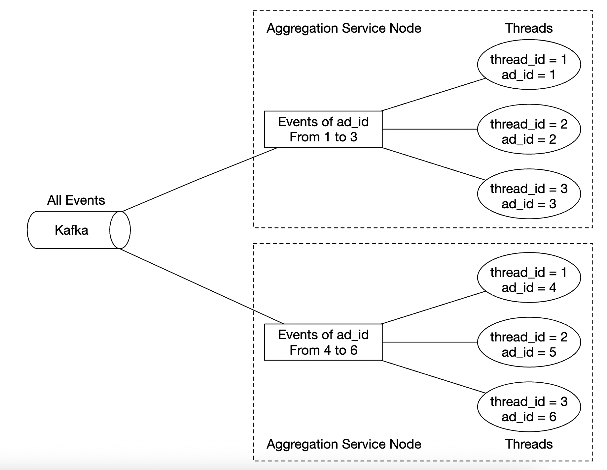
</div>

#### c. Mở rộng Database (Cassandra)
 - Cassandra hỗ trợ mở rộng ngang tự động dựa trên **Consistent Hashing** với các Virtual Nodes; khi thêm node mới vào cụm, dữ liệu sẽ tự động được cân bằng lại mà không cần resharding thủ công:

<div style="margin-left:3rem">
    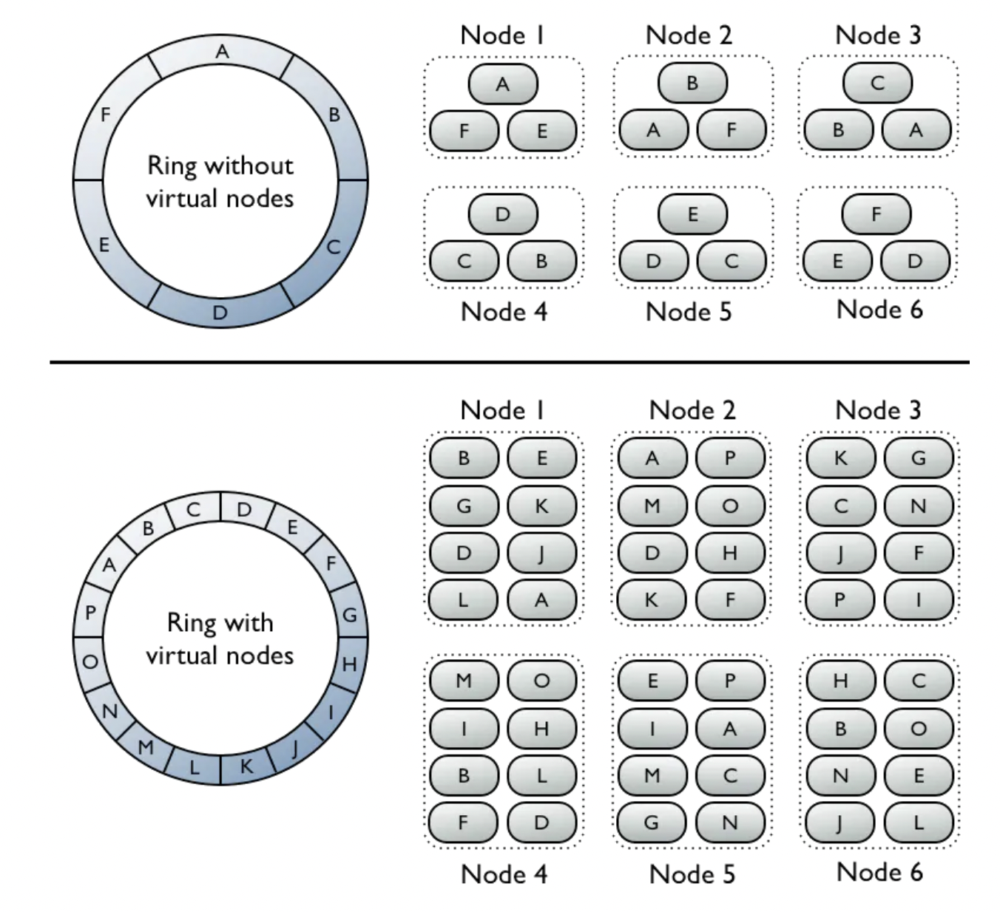
</div>

#### d. Giải quyết bài toán Điểm nóng (Mitigating the Hotspot Issue / Celebrity Ads)
Điều gì xảy ra khi một thương hiệu lớn (như Apple hay Nike) tung ra chiến dịch quảng cáo siêu khủng vào dịp Super Bowl khiến hàng triệu người dùng cùng click vào duy nhất một mã `ad_id` cùng lúc?
Vì các sự kiện được định tuyến theo `ad_id`, toàn bộ hàng triệu lượt click đó sẽ đổ dồn vào **duy nhất một Aggregate Node**, làm quá tải và đánh sập node đó!
**Giải pháp (Split / Global-Local Aggregation):**

<div style="margin-left:3rem">
    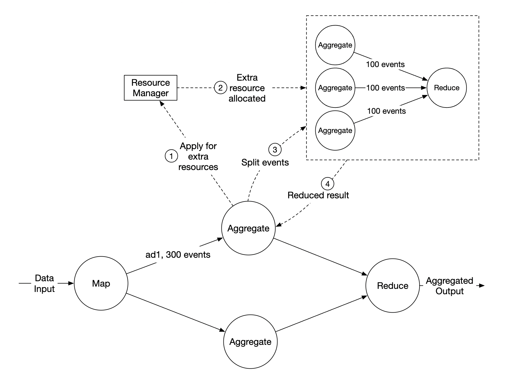
</div>

 1. Khi một Aggregate Node phát hiện lượng sự kiện đổ vào nó vượt quá ngưỡng chịu tải (ví dụ 300 sự kiện trong khi năng lực chỉ xử lý được 100), nó gửi yêu cầu xin cấp thêm tài nguyên tới **Resource Manager**.
 2. **Resource Manager** cấp phát thêm các Aggregate Nodes phụ trợ tạm thời.
 3. Node gốc chia nhỏ (split) các sự kiện của mẫu quảng cáo nóng đó thành các lô nhỏ (ví dụ gắn thêm hậu tố ngẫu nhiên `ad001_1`, `ad001_2`, `ad001_3`) và phân tải cho 3 Aggregate Nodes cùng đếm song song trên RAM.
 4. Cuối cùng, kết quả đếm cục bộ từ 3 nodes được trả về gộp lại tại node gốc (chỉ cần cộng 3 con số lại với nhau)!

---

### **6. Khả năng chịu lỗi (Fault Tolerance với Snapshot)**
Vì các **Aggregate Nodes** cộng dồn số lượt click trực tiếp trên bộ nhớ RAM (ví dụ trong cửa sổ trượt 5 phút), nếu một node bị sập ở phút thứ 4 thì toàn bộ số đếm trong RAM của 4 phút trước đó sẽ biến mất!
Để phục hồi trạng thái mà không phải đọc lại từ đầu lịch sử, chúng ta sử dụng kỹ thuật **Chụp ảnh trạng thái định kỳ (Checkpointing / Snapshotting)**:

<div style="margin-left:3rem">
    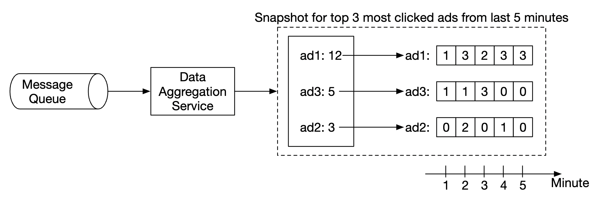
</div>

- Ở mỗi mốc thời gian ngắn, Aggregate Node chụp lại trạng thái bộ đếm hiện tại trên RAM (gồm số đếm từng `ad_id`, danh sách Top N hiện tại) kèm theo vị trí `offset` tương ứng của Kafka và lưu bền vững xuống bộ nhớ phân tán (**Snapshot Storage** như HDFS/S3).
- Nếu Aggregate Node đó bị sập, node mới được dựng lên thay thế chỉ cần tải bản **Snapshot mới nhất** về RAM, rồi kéo tiếp các sự kiện từ vị trí `offset` ngay sau bản Snapshot đó trên Kafka là có thể tiếp tục công việc một cách hoàn hảo:

<div style="margin-left:3rem">
    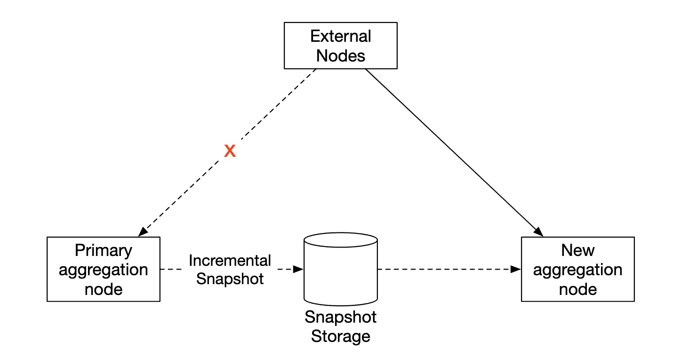
</div>

---

### **7. Giám sát dữ liệu và Quy trình đối soát cuối ngày (Data Monitoring and Reconciliation)**

#### a. Các chỉ số cần giám sát liên tục
 - **Latency:** Gắn dấu thời gian tại từng chặng để theo dõi độ trễ toàn trình (End-to-End Latency) từ lúc sự kiện vào Kafka đầu tiên đến lúc ghi xong xuống DB.
 - **Độ trễ tiêu thụ của hàng đợi (`records-lag` trên Kafka):** Nếu con số lag này tăng vọt chứng tỏ tốc độ xử lý của cụm Aggregation Service đang không theo kịp tốc độ click đầu vào, cần lập tức scale thêm nodes.
 - **Tài nguyên máy chủ:** CPU, RAM, Disk I/O, và thời gian dừng dọn rác bộ nhớ (JVM Garbage Collection pauses).

#### b. Quy trình đối soát cuối ngày (End-of-Day Reconciliation Flow)
Như đã thảo luận ở phần Watermark, luôn có một tỷ lệ rất nhỏ các sự kiện đến quá trễ không lọt vào cửa sổ thời gian thực. Để đảm bảo số liệu tính tiền (billing) đạt độ chính xác **100%**, chúng ta triển khai một luồng **Đối soát (Reconciliation)** chạy dưới dạng Batch Job vào cuối mỗi ngày:
- Cuối ngày, **Reconciliation Service** đọc toàn bộ các bản ghi **Raw Data** đã lưu trữ đầy đủ trong ngày hôm đó, sắp xếp chuẩn theo `event_time` để tính ra kết quả tổng hợp thực tế chính xác tuyệt đối, sau đó đem đối chiếu và cập nhật bù các phần chênh lệch vào **Aggregation Database**:

<div style="margin-left:3rem">
    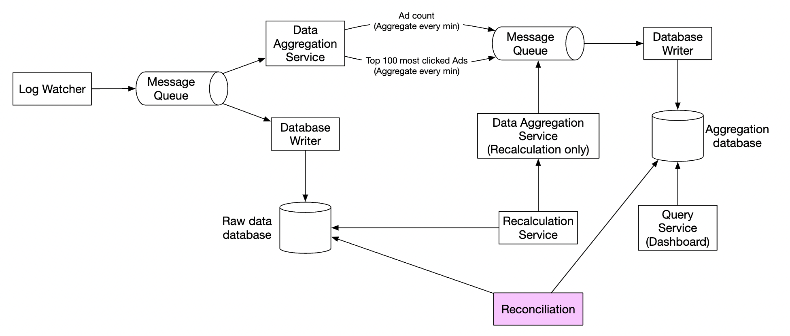
</div>

---

### **8. Phương án thiết kế thay thế sử dụng các công cụ chuyên dụng (Alternative Design)**
Trong phỏng vấn System Design, việc giải thích rõ nguyên lý hoạt động bên dưới (MapReduce DAG, Watermark, Snapshot, Reconciliation) luôn quan trọng hơn việc chỉ liệt kê tên công cụ. Tuy nhiên, bạn cũng nên đề cập tới kiến trúc thực tế sử dụng các hệ thống mã nguồn mở hiện đại:
- Đẩy dữ liệu thô vào **Apache Hive / S3** cho lưu trữ dài hạn kết hợp **Elasticsearch** để tìm kiếm nhanh.
- Sử dụng **Apache Flink** hoặc **Spark Streaming** cho tầng Stream Processing và ghi kết quả trực tiếp vào các cơ sở dữ liệu phân tích thời gian thực (**OLAP Databases**) như **ClickHouse** hoặc **Apache Druid**:

<div style="margin-left:3rem">
    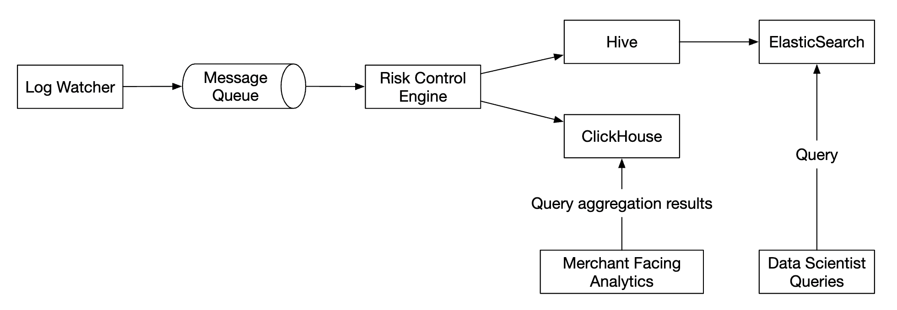
</div>

---

## Bước 4: Tổng kết (Wrap Up)
Những điểm trọng tâm chúng ta đã giải quyết trong chương này:
 - Thiết kế Data Model (lưu cả Raw Data và Aggregated Data) và Query APIs.
 - Thiết kế mô hình **MapReduce DAG** để tổng hợp lượt click, tính Top N bằng Heap và lọc dữ liệu nhanh bằng **Star Schema**.
 - So sánh **Kiến trúc Lambda** và **Kiến trúc Kappa** (và cách tính toán lại dữ liệu lịch sử khi có bug).
 - Xử lý bài toán `Event Time` và các sự kiện đến trễ bằng kỹ thuật **Watermark** kết hợp **Tumbling / Sliding Windows**.
 - Đảm bảo ngữ nghĩa **Exactly-Once** chống mất mát và trùng lặp dữ liệu.
 - Mở rộng quy mô từng tầng, giải quyết bài toán **Hotspot (quảng cáo viral)** bằng kỹ thuật chia tải động, chịu lỗi bằng **Snapshot**, và đảm bảo độ chính xác tài chính tuyệt đối bằng **Reconciliation cuối ngày**.
