# Chương 22: Hệ thống Đặt phòng Khách sạn (Hotel Reservation System)

## Giới thiệu
Trong chương này, chúng ta sẽ thiết kế một **hệ thống đặt phòng khách sạn (hotel reservation system)**, tương tự như Marriott International.

Các kỹ thuật thiết kế trong chương này cũng có thể áp dụng cho các hệ thống liên quan đến đặt chỗ khác như Airbnb, đặt vé máy bay, hoặc đặt vé xem phim.

---

## Bước 1: Thấu hiểu bài toán và Xác lập phạm vi thiết kế (Understand the Problem and Establish Design Scope)
Trước khi đi sâu vào thiết kế hệ thống, chúng ta nên đặt câu hỏi với người phỏng vấn để làm rõ phạm vi bài toán:
 - **C:** Quy mô của hệ thống như thế nào ạ?
 - **I:** Chúng ta đang xây dựng một website cho một chuỗi khách sạn gồm 5.000 khách sạn và tổng cộng 1 triệu phòng.
 - **C:** Khách hàng thanh toán ngay khi đặt phòng hay khi đến nhận phòng tại khách sạn?
 - **I:** Họ thanh toán toàn bộ chi phí ngay tại thời điểm đặt phòng.
 - **C:** Khách hàng chỉ đặt phòng qua website thôi hay chúng ta có cần hỗ trợ các kênh đặt phòng khác như gọi điện thoại không?
 - **I:** Họ chỉ đặt phòng qua website hoặc ứng dụng di động (mobile app).
 - **C:** Khách hàng có thể hủy đặt phòng không?
 - **I:** Có.
 - **C:** Còn yếu tố nào khác cần cân nhắc nữa không ạ?
 - **I:** Có, chúng ta cho phép đặt vượt số lượng phòng thực tế (Overbooking) ở mức 10%. Khách sạn sẽ bán nhiều phòng hơn số phòng thực có để dự phòng trường hợp khách hủy đặt phòng.
 - **C:** Vì thời gian có hạn, chúng ta sẽ tập trung vào các tính năng cốt lõi: hiển thị trang thông tin khách sạn, trang chi tiết phòng khách sạn, đặt phòng, trang quản trị (Admin panel), và hỗ trợ Overbooking.
 - **I:** Nghe hợp lý đấy.
 - **I:** Thêm một điểm nữa — giá phòng khách sạn thay đổi liên tục. Hãy giả định giá của một phòng khách sạn thay đổi theo từng ngày.
 - **C:** Vâng, tôi đã rõ.

### **Yêu cầu phi chức năng (Non-functional requirements)**
 - **Hỗ trợ độ đồng thời cao (High concurrency):** Trong mùa cao điểm hoặc có sự kiện lớn, có thể có rất nhiều khách hàng cùng cố gắng đặt một phòng tại cùng một khách sạn.
 - **Latency ở mức vừa phải (Moderate latency):** Lý tưởng nhất là có Latency thấp khi người dùng thực hiện đặt phòng, nhưng việc hệ thống mất vài giây để xử lý giao dịch đặt phòng vẫn hoàn toàn chấp nhận được.

### **Ước lượng sơ bộ (Back-of-the-envelope estimation)**
 - Tổng cộng 5.000 khách sạn và 1 triệu phòng.
 - Giả sử công suất lấp đầy là 70% số phòng và thời gian lưu trú trung bình là 3 ngày.
 - Số lượt đặt phòng ước tính mỗi ngày: $\frac{1\text{ triệu} \times 0.7}{3} \approx 240.000$ lượt đặt phòng mỗi ngày.
 - Số lượt đặt phòng mỗi giây (TPS): $\frac{240.000}{10^5\text{ giây/ngày}} \approx 3$. Như vậy, TPS đặt phòng trung bình là khá thấp.

Hãy ước lượng QPS cho các trang trong phễu người dùng (user funnel). Nếu giả sử có 3 bước để đi đến trang hoàn tất đặt phòng và tỷ lệ chuyển đổi (conversion rate) là 10% qua mỗi bước, ta có thể ước tính rằng: nếu có 3 lượt đặt phòng thành công mỗi giây thì sẽ có khoảng 30 lượt xem trang đặt phòng và 300 lượt xem trang chi tiết phòng mỗi giây.

<div style="margin-left:3rem">
    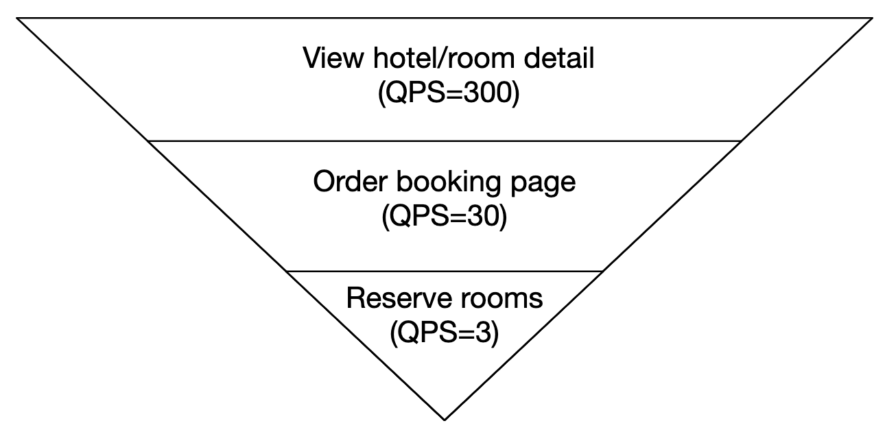
</div>

---

## Bước 2: Đề xuất Thiết kế Tổng quan và Thống nhất Phương án (Propose High-Level Design and Get Buy-In)
Chúng ta sẽ lần lượt đi qua: Thiết kế API, Mô hình dữ liệu (Data model) và Thiết kế kiến trúc tổng quan (High-level design).

### **Thiết kế API (API Design)**
Thiết kế API dưới đây tập trung vào các Endpoint cốt lõi (theo chuẩn RESTful) cần thiết để vận hành hệ thống đặt phòng khách sạn.

Một hệ thống hoàn chỉnh trong thực tế sẽ đòi hỏi bộ API phong phú hơn nhiều để hỗ trợ tìm kiếm phòng theo hàng loạt tiêu chí lọc khác nhau, nhưng chúng ta sẽ không tập trung vào phần đó trong chương này vì chúng không mang tính thách thức cao về mặt kỹ thuật trong bối cảnh bài toán đặt chỗ.

**Các API liên quan đến Khách sạn (Hotel-related API)**
 - `GET /v1/hotels/{id}` - lấy thông tin chi tiết về một khách sạn.
 - `POST /v1/hotels` - thêm mới một khách sạn. Chỉ dành cho đội ngũ vận hành (Ops/Admin).
 - `PUT /v1/hotels/{id}` - cập nhật thông tin khách sạn. Chỉ dành cho đội ngũ vận hành.
 - `DELETE /v1/hotels/{id}` - xóa một khách sạn. Chỉ dành cho đội ngũ vận hành.

**Các API liên quan đến Phòng (Room-related API)**
 - `GET /v1/hotels/{id}/rooms/{id}` - lấy thông tin chi tiết về một phòng.
 - `POST /v1/hotels/{id}/rooms` - thêm một phòng mới. Chỉ dành cho đội ngũ vận hành.
 - `PUT /v1/hotels/{id}/rooms/{id}` - cập nhật thông tin phòng. Chỉ dành cho đội ngũ vận hành.
 - `DELETE /v1/hotels/{id}/rooms/{id}` - xóa một phòng. Chỉ dành cho đội ngũ vận hành.

**Các API liên quan đến Đặt phòng (Reservation-related API)**
 - `GET /v1/reservations` - lấy lịch sử đặt phòng của người dùng hiện tại.
 - `GET /v1/reservations/{id}` - lấy thông tin chi tiết về một đơn đặt phòng.
 - `POST /v1/reservations` - tạo một đơn đặt phòng mới.
 - `DELETE /v1/reservations/{id}` - hủy một đơn đặt phòng.

Dưới đây là ví dụ về Payload của một Request đặt phòng:

```
{
  "startDate":"2021-04-28",
  "endDate":"2021-04-30",
  "hotelID":"245",
  "roomID":"U12354673389",
  "reservationID":"13422445"
}
```

Lưu ý rằng `reservationID` đóng vai trò là khóa lũy đẳng (Idempotency key) nhằm ngăn chặn tình trạng đặt trùng phòng (double booking). Chi tiết cơ chế này sẽ được giải thích trong phần [Các vấn đề về xử lý đồng thời](#các-vấn-đề-về-xử-lý-đồng-thời-concurrency-issues).

### **Mô hình dữ liệu (Data model)**
Trước khi quyết định chọn loại Database nào, hãy xem xét các mẫu truy cập dữ liệu (access patterns) của hệ thống.

Chúng ta cần hỗ trợ các truy vấn chính sau:
 - Xem thông tin chi tiết của một khách sạn.
 - Tìm các loại phòng còn trống trong một khoảng thời gian nhất định.
 - Ghi nhận một đơn đặt phòng mới.
 - Tra cứu chi tiết một đơn đặt phòng hoặc xem lại lịch sử đặt phòng.

Từ bước ước lượng sơ bộ, chúng ta biết quy mô dữ liệu của hệ thống không quá lớn, nhưng hệ thống cần sẵn sàng ứng phó với các đợt lưu lượng tăng đột biến (traffic surges).

Dựa trên các đặc điểm này, chúng ta sẽ chọn **Relational Database (Cơ sở dữ liệu quan hệ)** vì:
 - Relational Database hoạt động rất hiệu quả với các hệ thống thiên về đọc (read-heavy) và ít ghi (write-light) hơn.
 - Các NoSQL Database thường được tối ưu hóa cho tác vụ ghi tốc độ cao, trong khi chúng ta biết rằng lượng ghi thực tế không lớn vì chỉ một tỷ lệ nhỏ người dùng truy cập trang web thực sự tiến hành đặt phòng.
 - Relational Database cung cấp các đảm bảo **ACID**. Điều này cực kỳ quan trọng đối với hệ thống đặt phòng/thanh toán, vì nếu không có ACID, chúng ta sẽ rất khó ngăn chặn các lỗi nghiêm trọng như số lượng phòng tồn kho bị âm (negative balance), trừ tiền hai lần (double charge), v.v.
 - Relational Database dễ dàng mô hình hóa dữ liệu nghiệp vụ khách sạn vì cấu trúc thực thể và mối quan hệ giữa chúng rất rõ ràng.

Dưới đây là thiết kế Schema ban đầu của chúng ta:

<div style="margin-left:3rem">
    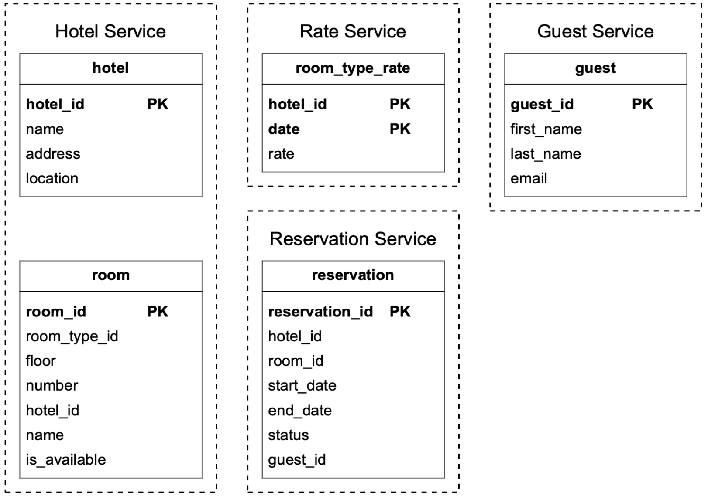
</div>

Hầu hết các trường dữ liệu đều đã tự giải thích ý nghĩa. Trường duy nhất đáng lưu ý là `status`, biểu diễn máy trạng thái (state machine) của một đơn đặt phòng:

<div style="margin-left:3rem">
    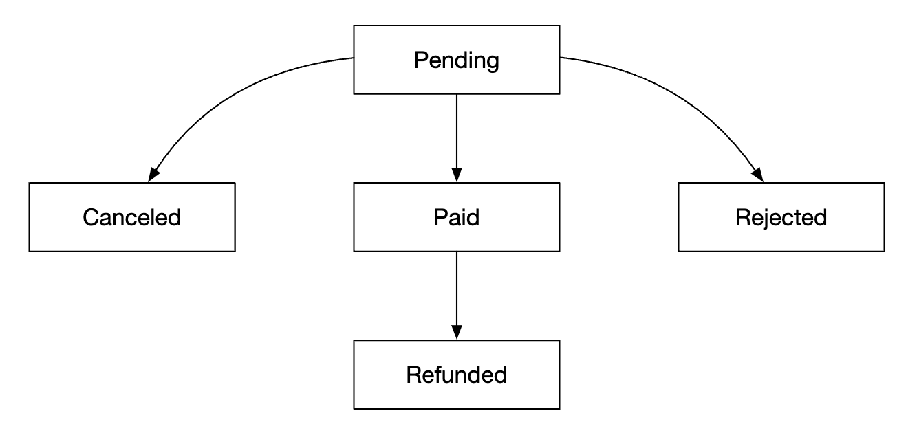
</div>

Mô hình dữ liệu này hoạt động tốt cho một hệ thống như Airbnb (nơi người dùng đặt đích danh một căn hộ/phòng cụ thể theo `room_id`), nhưng lại chưa phù hợp với mô hình khách sạn truyền thống — nơi khách hàng không đặt một số phòng vật lý cụ thể ngay từ đầu mà đặt theo **hạng phòng / loại phòng (room type)** (ví dụ: phòng Standard, Deluxe, King-size). Số phòng cụ thể chỉ được gán khi khách làm thủ tục nhận phòng (check-in).

Hạn chế này sẽ được giải quyết triệt để trong phần [Mô hình dữ liệu cải tiến](#mô-hình-dữ-liệu-cải-tiến-improved-data-model).

### **Thiết kế kiến trúc tổng quan (High-level Design)**
Chúng ta lựa chọn kiến trúc Microservices cho hệ thống này — một mô hình rất phổ biến và phù hợp cho các hệ thống phân tán hiện đại:

<div style="margin-left:3rem">
    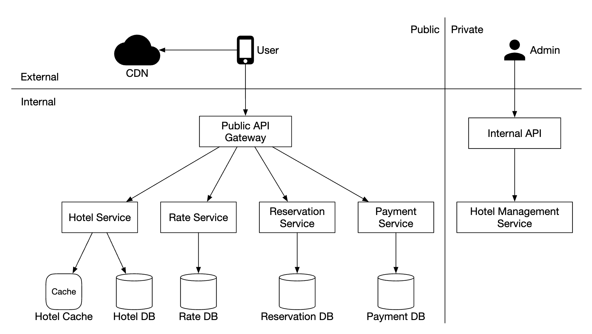
</div>

 - **Users**: Người dùng đặt phòng khách sạn trên điện thoại hoặc máy tính.
 - **Admin**: Nhân viên vận hành thực hiện các tác vụ quản trị như hoàn tiền/hủy thanh toán, cập nhật thông tin khách sạn, v.v.
 - **CDN**: Lưu Cache các tài nguyên tĩnh như JS bundles, hình ảnh khách sạn, video, v.v.
 - **Public API Gateway**: Dịch vụ được quản lý hoàn toàn (fully-managed service) hỗ trợ Rate Limiting, xác thực (Authentication), định tuyến Request, v.v.
 - **Internal APIs**: Các API nội bộ chỉ dành cho nhân sự được cấp quyền truy cập, thường được bảo vệ sau lớp mạng riêng ảo (VPN).
 - **Hotel Service**: Cung cấp thông tin chi tiết về các khách sạn và hạng phòng. Dữ liệu khách sạn và phòng nhìn chung mang tính tĩnh nên có thể được Cache mạnh mẽ.
 - **Rate Service**: Cung cấp giá phòng cho các ngày khác nhau trong tương lai. Một đặc thù thú vị của nghiệp vụ khách sạn là giá phòng thường biến động linh hoạt (dynamic pricing) phụ thuộc vào công suất lấp đầy dự kiến của khách sạn vào ngày hôm đó.
 - **Reservation Service**: Tiếp nhận các yêu cầu đặt phòng và thực hiện giữ phòng. Service này cũng quản lý tồn kho phòng (room inventory) khi có đơn đặt phòng mới hoặc khi khách hủy đặt phòng.
 - **Payment Service**: Xử lý giao dịch thanh toán và cập nhật trạng thái đơn đặt phòng khi thanh toán thành công hoặc thất bại.
 - **Hotel Management Service**: Chỉ dành cho nhân sự có thẩm quyền, cho phép thực hiện các chức năng quản trị như xem và quản lý đơn đặt phòng, cấu hình khách sạn, v.v.

Giao tiếp liên dịch vụ (inter-service communication) bên trong hệ thống có thể được thực hiện thông qua một RPC framework hiệu năng cao như **gRPC**.

---

## Bước 3: Đi sâu vào Thiết kế Chi tiết (Design Deep Dive)
Hãy cùng đi sâu vào các khía cạnh kỹ thuật quan trọng sau:
 - Mô hình dữ liệu cải tiến (Improved data model)
 - Các vấn đề về xử lý đồng thời (Concurrency issues)
 - Khả năng mở rộng (Scalability)
 - Giải quyết sự bất nhất dữ liệu giữa các Microservices (Resolving data inconsistency in microservices)

### **Mô hình dữ liệu cải tiến (Improved data model)**
Như đã đề cập ở phần trước, chúng ta cần điều chỉnh lại API và Database Schema để cho phép khách hàng đặt theo **loại phòng (`roomTypeID`)** thay vì đặt một phòng cụ thể (`roomID`).

Đối với Reservation API, thay vì truyền `roomID`, người dùng sẽ truyền `roomTypeID` và số lượng phòng muốn đặt (`roomCount`):

```
POST /v1/reservations
{
  "startDate":"2021-04-28",
  "endDate":"2021-04-30",
  "hotelID":"245",
  "roomTypeID":"12354673389",
  "roomCount":"3",
  "reservationID":"13422445"
}
```

Dưới đây là Schema đã được cập nhật:

<div style="margin-left:3rem">
    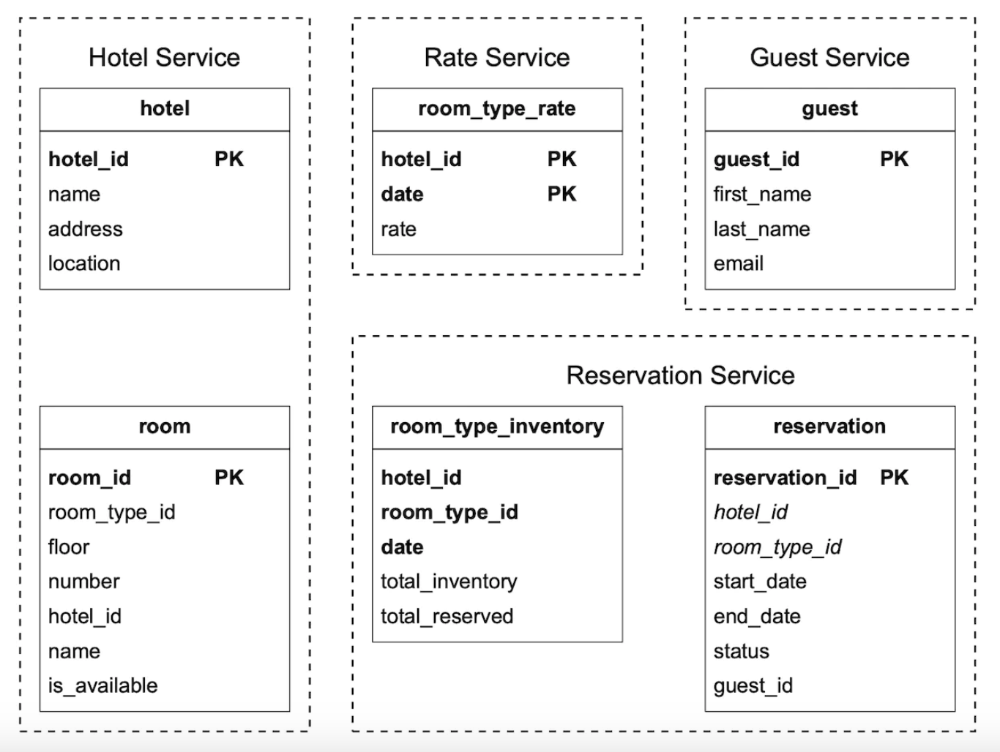
</div>

 - **room**: Chứa thông tin về từng phòng vật lý cụ thể.
 - **room_type_rate**: Chứa thông tin giá của một loại phòng theo từng ngày.
 - **reservation**: Lưu trữ dữ liệu đơn đặt phòng của khách.
 - **room_type_inventory**: Lưu trữ dữ liệu tồn kho (số lượng phòng trống/đã đặt) của từng loại phòng tại khách sạn theo từng ngày.

Hãy xem xét kỹ hơn các cột của bảng `room_type_inventory` vì đây là bảng quan trọng nhất trong bài toán này:
 - **hotel_id**: ID của khách sạn.
 - **room_type_id**: ID của loại phòng.
 - **date**: Một ngày cụ thể.
 - **total_inventory**: Tổng số phòng thuộc loại đó của khách sạn trừ đi những phòng đang tạm thời ngừng khai thác (ví dụ: đang bảo trì, sửa chữa).
 - **total_reserved**: Tổng số phòng đã được đặt cho bộ khóa `(hotel_id, room_type_id, date)` tương ứng.

Có nhiều cách khác để thiết kế bảng này, nhưng việc lưu một dòng cho mỗi tổ hợp khóa chính phức hợp `(hotel_id, room_type_id, date)` giúp việc quản lý đặt phòng và viết câu lệnh truy vấn kiểm tra phòng trống trong một khoảng ngày trở nên cực kỳ đơn giản và hiệu quả.

Các dòng dữ liệu cho những ngày trong tương lai (ví dụ: trong vòng 2 năm tới) sẽ được khởi tạo sẵn (pre-populated) thông qua một Cron job chạy hàng ngày.

Dữ liệu mẫu của bảng `room_type_inventory`:

| hotel_id | room_type_id | date       | total_inventory | total_reserved |
|----------|--------------|------------|-----------------|----------------|
| 211      | 1001         | 2021-06-01 | 100             | 80             |
| 211      | 1001         | 2021-06-02 | 100             | 82             |
| 211      | 1001         | 2021-06-03 | 100             | 86             |
| 211      | 1001         | ...        | ...             |                |
| 211      | 1001         | 2023-05-31 | 100             | 0              |
| 211      | 1002         | 2021-06-01 | 200             | 16             |
| 2210     | 101          | 2021-06-01 | 30              | 23             |
| 2210     | 101          | 2021-06-02 | 30              | 25             |

Câu truy vấn SQL mẫu để kiểm tra tình trạng phòng trống của một loại phòng trong khoảng thời gian lưu trú:

```
SELECT date, total_inventory, total_reserved
FROM room_type_inventory
WHERE room_type_id = ${roomTypeId} AND hotel_id = ${hotelId}
AND date between ${startDate} and ${endDate}
```

Cách kiểm tra xem có đủ số lượng phòng trống theo yêu cầu hay không từ kết quả truy vấn trên (lưu ý rằng hệ thống hỗ trợ Overbooking 10%):

```
if (total_reserved + ${numberOfRoomsToReserve}) <= 110% * total_inventory
```

Bây giờ hãy ước lượng dung lượng lưu trữ cho bảng này:
 - Chúng ta có 5.000 khách sạn.
 - Mỗi khách sạn có trung bình 20 loại phòng.
 - Lưu trữ dữ liệu tồn kho cho 2 năm tới: $5.000 \times 20 \times 2\text{ (năm)} \times 365\text{ (ngày)} = 73\text{ triệu dòng (rows)}$.

73 triệu dòng không phải là một con số lớn đối với một Relational Database hiện đại và chỉ một Database server đơn lẻ cũng hoàn toàn có thể xử lý tốt. Tuy nhiên, chúng ta vẫn nên thiết lập cơ chế sao chép đọc (Read Replication) trải rộng trên nhiều Availability Zones (AZ) để phục vụ tải đọc và đảm bảo tính sẵn sàng cao (High Availability).

**Câu hỏi mở rộng (Follow-up question):** Nếu dữ liệu đặt phòng quá lớn không thể chứa vừa trên một Database server đơn lẻ thì bạn sẽ xử lý như thế nào?
 - Chỉ lưu dữ liệu đặt phòng hiện tại và tương lai trong Database chính (Hot storage). Lịch sử các đơn đặt phòng trong quá khứ có thể được chuyển sang kho lưu trữ lạnh (Cold storage).
 - Áp dụng **Database Sharding**: Chúng ta có thể phân mảnh dữ liệu theo công thức `hash(hotel_id) % servers_cnt` vì mọi truy vấn của chúng ta đều có điều kiện lọc theo `hotel_id`.

### **Các vấn đề về xử lý đồng thời (Concurrency issues)**
Một bài toán cực kỳ quan trọng khác cần giải quyết là tình trạng **đặt trùng phòng (double booking)**.

Có hai kịch bản chính dẫn đến vấn đề này:
 1. Cùng một người dùng bấm nút "Đặt phòng" (Book) hai lần liên tiếp.
 2. Nhiều người dùng cùng cố gắng đặt những phòng cuối cùng vào cùng một thời điểm.

Dưới đây là minh họa cho kịch bản đầu tiên:

<div style="margin-left:3rem">
    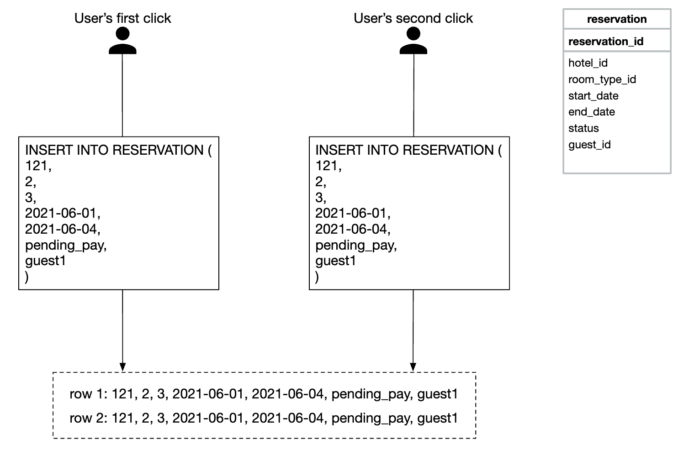
</div>

Có hai hướng tiếp cận để giải quyết kịch bản thứ nhất:
 - **Xử lý phía Client (Client-side handling):** Front-end có thể vô hiệu hóa (disable / làm mờ) nút "Đặt phòng" ngay sau khi người dùng vừa bấm vào. Tuy nhiên, cách này không hoàn toàn đáng tin cậy — ví dụ nếu người dùng tắt JavaScript hoặc thao tác qua công cụ gọi API trực tiếp, Request vẫn có thể bị gửi đi nhiều lần.
 - **API có tính lũy đẳng (Idempotent API):** Bổ sung một khóa lũy đẳng (`idempotency key`) vào API Request, đảm bảo rằng dù người dùng có gọi Endpoint đó bao nhiêu lần đi nữa với cùng một khóa thì tác vụ đặt phòng cũng chỉ được thực thi đúng một lần duy nhất:

<div style="margin-left:3rem">
    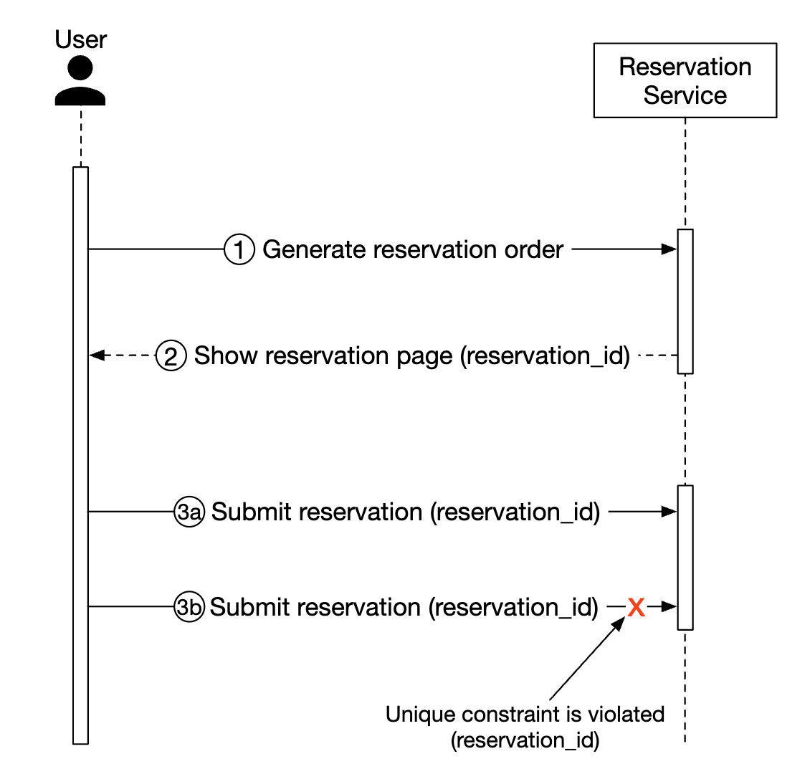
</div>

Luồng hoạt động chi tiết của cơ chế Idempotency này như sau:
 - Khi người dùng chuyển sang bước điền thông tin chi tiết để xác nhận đặt phòng, hệ thống tạo trước một đơn đặt phòng nháp (reservation order) kèm theo một mã định danh duy nhất toàn cục (`reservation_id`).
 - Khách hàng gửi Request đặt phòng lần 1 kèm theo `reservation_id` đã được cấp ở bước trước.
 - Nếu khách hàng vô tình bấm nút "Hoàn tất đặt phòng" lần thứ hai, cùng một mã `reservation_id` đó sẽ được gửi lên và phía Backend sẽ nhận diện ngay đây là Request bị trùng lặp.
 - Việc chống trùng lặp ở tầng dữ liệu được đảm bảo bằng cách đánh ràng buộc duy nhất (**Unique Constraint**) trên cột `reservation_id` trong Database, ngăn chặn tuyệt đối việc lưu hai bản ghi có cùng `reservation_id`.

<div style="margin-left:3rem">
    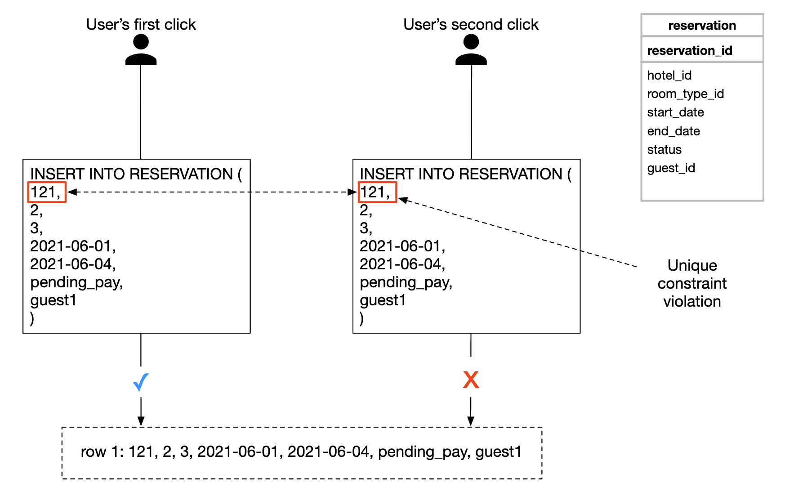
</div>

Vậy còn kịch bản thứ hai: **Điều gì xảy ra nếu có nhiều người dùng khác nhau cùng đặt phòng cuối cùng vào cùng một thời điểm?**

<div style="margin-left:3rem">
    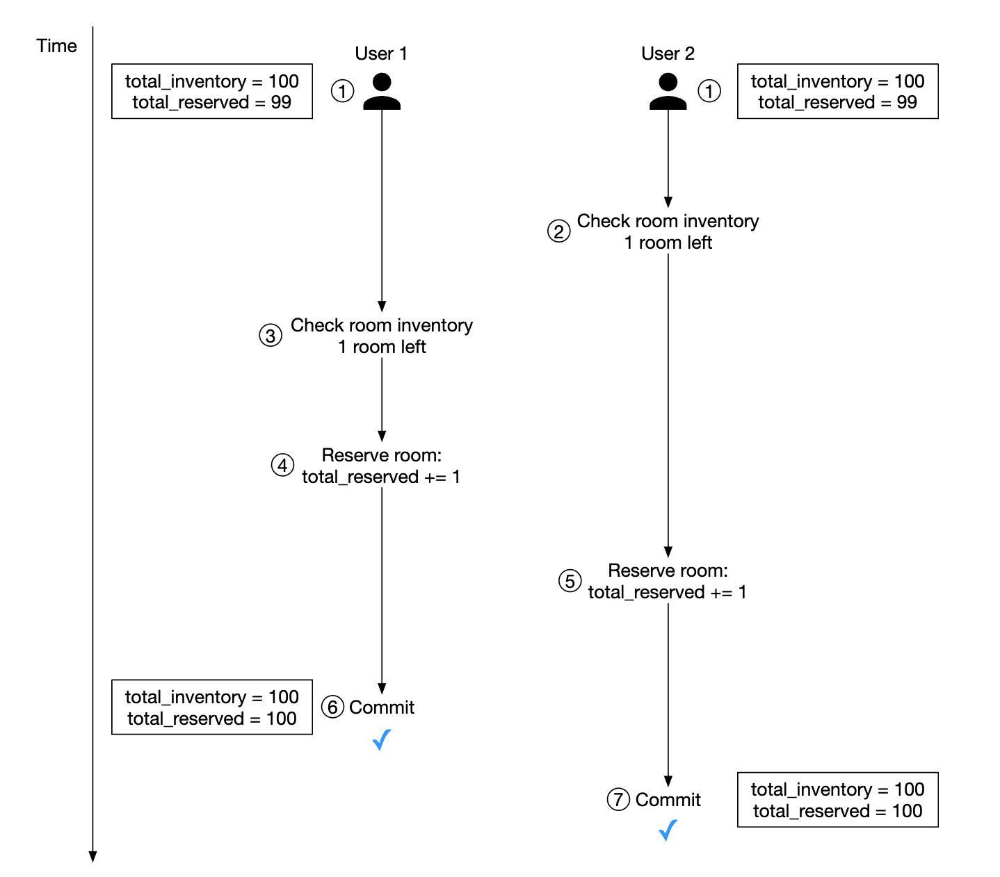
</div>

 - Giả sử mức cô lập giao dịch (Transaction Isolation Level) của Database không phải là `Serializable`.
 - User 1 và User 2 cùng cố gắng đặt 1 phòng vào đúng thời điểm chỉ còn 1 phòng trống cuối cùng (99/100 phòng đã được đặt, giả sử không tính Overbooking trong ví dụ này).
 - Transaction 1 kiểm tra xem còn đủ phòng trống không — thấy `total_reserved = 99`, tức là vẫn còn phòng.
 - Transaction 2 cũng kiểm tra xem còn đủ phòng trống không — tại thời điểm đó Transaction 1 chưa Commit nên Transaction 2 vẫn thấy `total_reserved = 99`, tức là vẫn còn phòng.
 - Transaction 2 tiến hành đặt phòng và cập nhật tồn kho lên 100.
 - Transaction 1 cũng tiến hành đặt phòng và cập nhật tồn kho dựa trên trạng thái mà nó đã đọc.
 - Cả hai Transaction đều Commit thành công, dẫn đến việc bán lố số phòng cho phép (Race Condition).

Bài toán tranh chấp đồng thời này có thể được giải quyết bằng một trong ba cơ chế khóa / kiểm soát sau:
 - Khóa bi quan (Pessimistic Locking)
 - Khóa lạc quan (Optimistic Locking)
 - Ràng buộc cơ sở dữ liệu (Database Constraints)

Trước hết, hãy nhìn lại đoạn mã giả SQL dùng để đặt phòng:

```sql
# step 1: check room inventory
SELECT date, total_inventory, total_reserved
FROM room_type_inventory
WHERE room_type_id = ${roomTypeId} AND hotel_id = ${hotelId}
AND date between ${startDate} and ${endDate}

# For every entry returned from step 1
if((total_reserved + ${numberOfRoomsToReserve}) > 110% * total_inventory) {
  Rollback
}

# step 2: reserve rooms
UPDATE room_type_inventory
SET total_reserved = total_reserved + ${numberOfRoomsToReserve}
WHERE room_type_id = ${roomTypeId}
AND date between ${startDate} and ${endDate}

Commit
```

#### Phương án 1: Khóa bi quan (Pessimistic Locking)
Khóa bi quan (Pessimistic Locking) ngăn chặn các cập nhật đồng thời bằng cách đặt một khóa độc quyền lên bản ghi ngay khi nó đang được đọc để chuẩn bị cập nhật.

Trong MySQL (InnoDB), cơ chế này được thực hiện bằng câu lệnh `SELECT ... FOR UPDATE`, giúp khóa toàn bộ các dòng dữ liệu được chọn bởi câu truy vấn cho đến khi Transaction hiện tại được Commit hoặc Rollback.

<div style="margin-left:3rem">
    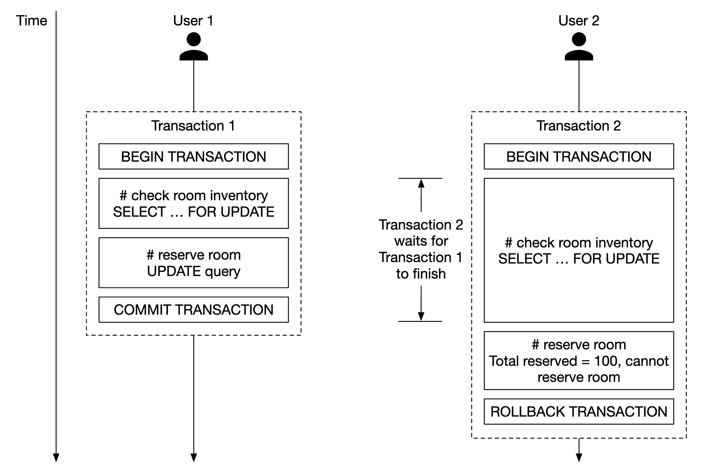
</div>

**Ưu điểm:**
 - Ngăn chặn triệt để việc ứng dụng cập nhật dữ liệu đang bị thay đổi bởi một tiến trình khác.
 - Dễ triển khai và tránh xung đột bằng cách tuần tự hóa (serialize) các thao tác cập nhật. Rất hữu ích khi mức độ tranh chấp dữ liệu (data contention) diễn ra gay gắt.

**Nhược điểm:**
 - Có thể xảy ra **Deadlock** khi nhiều Transaction cùng khóa nhiều dòng dữ liệu theo thứ tự khác nhau.
 - Khả năng mở rộng (Scalability) kém: nếu một Transaction giữ khóa quá lâu, tất cả các Transaction khác muốn truy cập vào cùng bản ghi đó đều bị chặn và phải chờ đợi.
 - Tác động tiêu cực càng nghiêm trọng khi câu truy vấn quét qua nhiều dòng dữ liệu hoặc khi Transaction kéo dài.

Do những hạn chế về khả năng mở rộng, phương án này thường không được khuyến nghị cho hệ thống của chúng ta.

#### Phương án 2: Khóa lạc quan (Optimistic Locking)
Khóa lạc quan (Optimistic Locking) cho phép nhiều người dùng cùng đọc và cố gắng cập nhật một bản ghi vào cùng một thời điểm mà không khóa cứng bản ghi trong lúc đọc.

Có hai cách phổ biến để triển khai Optimistic Locking: dùng số phiên bản (`version` number) hoặc dấu thời gian (`timestamp`). Việc sử dụng số `version` được khuyến nghị hơn vì đồng hồ giữa các Server có thể bị lệch (clock skew).

<div style="margin-left:3rem">
    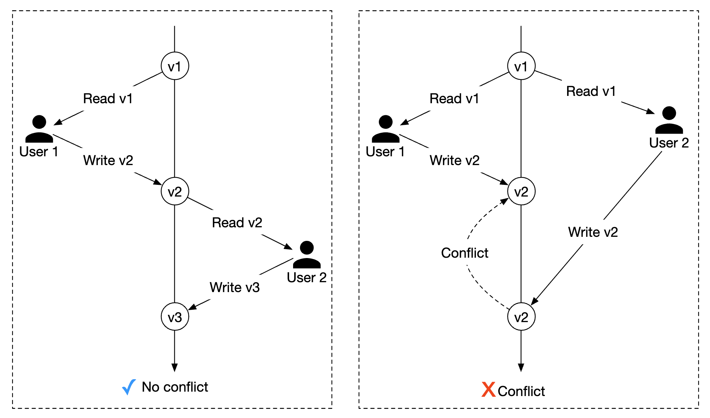
</div>

 - Một cột `version` mới được thêm vào bảng Database.
 - Trước khi người dùng sửa đổi một dòng dữ liệu, ứng dụng đọc giá trị `version` hiện tại của dòng đó.
 - Khi người dùng cập nhật dòng dữ liệu, câu lệnh `UPDATE` sẽ tăng `version` lên 1 kèm theo điều kiện `WHERE version = old_version`.
 - Nếu tại thời điểm cập nhật, `version` trong Database đã bị một Transaction khác thay đổi (không còn khớp với `old_version`), câu lệnh cập nhật sẽ không tác động lên dòng nào và Transaction sẽ được Rollback để thử lại.

Optimistic Locking thường nhanh hơn Pessimistic Locking vì chúng ta không phải giữ khóa ở tầng Database. Tuy nhiên, hiệu năng của nó sẽ suy giảm mạnh nếu độ đồng thời (concurrency) trên cùng một bản ghi quá cao, vì khi đó sẽ có rất nhiều Transaction bị Rollback và phải Retry.

**Ưu điểm:**
 - Ngăn chặn ứng dụng ghi đè lên dữ liệu cũ (stale data).
 - Không cần giữ khóa tài nguyên trong Database.
 - Là lựa chọn tối ưu khi mức độ tranh chấp dữ liệu (data contention) thấp — tức là hiếm khi có nhiều người cùng sửa một bản ghi vào đúng một mili-giây.

**Nhược điểm:**
 - Hiệu năng kém khi mức độ tranh chấp dữ liệu cao (do tốn tài nguyên cho việc Rollback và Retry liên tục).

Optimistic Locking là một lựa chọn rất tốt cho hệ thống đặt phòng khách sạn vì QPS đặt phòng thực tế không quá cao.

#### Phương án 3: Ràng buộc cơ sở dữ liệu (Database Constraints)
Hướng tiếp cận này có bản chất rất giống với Optimistic Locking, nhưng rào chắn bảo vệ được triển khai trực tiếp bằng một ràng buộc kiểm tra (`CHECK constraint`) ngay trong bảng Database:

```
CONSTRAINT `check_room_count` CHECK((`total_inventory - total_reserved` >= 0))
```

<div style="margin-left:3rem">
    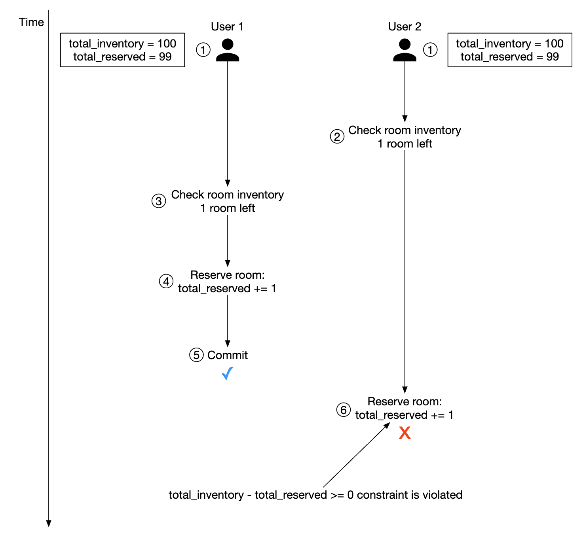
</div>

**Ưu điểm:**
 - Cực kỳ dễ triển khai.
 - Hoạt động rất hiệu quả khi mức độ tranh chấp dữ liệu thấp.

**Nhược điểm:**
 - Tương tự như Optimistic Locking, hiệu năng sẽ giảm khi tranh chấp dữ liệu cao.
 - Các ràng buộc trong Database (Database constraints) khó quản lý phiên bản (version control) và kiểm thử hơn so với logic viết trong code ứng dụng.
 - Không phải mọi hệ quản trị cơ sở dữ liệu đều hỗ trợ đầy đủ `CHECK constraint`.

Nhờ sự đơn giản trong việc triển khai, đây cũng là một phương án rất phù hợp cho hệ thống đặt phòng khách sạn.

### **Khả năng mở rộng (Scalability)**
Thông thường, tải của một hệ thống đặt phòng cho một chuỗi khách sạn riêng lẻ là không quá cao.

Tuy nhiên, người phỏng vấn có thể đặt câu hỏi nâng cao: *Bạn sẽ xử lý thế nào nếu hệ thống này được mở rộng thành một nền tảng đặt phòng du lịch toàn cầu khổng lồ như Booking.com hay Expedia?* Trong trường hợp đó, QPS có thể lớn gấp 1.000 lần!

Khi đối mặt với bài toán tăng trưởng quy mô lớn như vậy, điều quan trọng là phải xác định chính xác đâu là điểm nghẽn cổ chai (bottleneck). Tất cả các tầng dịch vụ ứng dụng (Web/API services) của chúng ta đều là **Stateless**, nên chúng có thể dễ dàng mở rộng theo chiều ngang bằng cách nhân bản thêm nhiều Server.

Tuy nhiên, **Database** là thành phần **Stateful** và việc mở rộng nó phức tạp hơn nhiều.

Cách đầu tiên để mở rộng Database là triển khai **Database Sharding** — chia nhỏ dữ liệu ra nhiều Database Server (Shards), trong đó mỗi Shard chỉ lưu trữ một phần dữ liệu.

Chúng ta có thể chọn khóa phân mảnh (Shard key) là `hotel_id` vì hầu hết mọi câu truy vấn đều lọc theo `hotel_id`. Giả sử QPS lúc cao điểm lên tới 30.000 QPS; sau khi chia Database thành 16 Shards, mỗi Shard chỉ phải xử lý khoảng $30.000 / 16 = 1.875\text{ QPS}$ — hoàn toàn nằm trong ngưỡng chịu tải thoải mái của một cụm MySQL.

<div style="margin-left:3rem">
    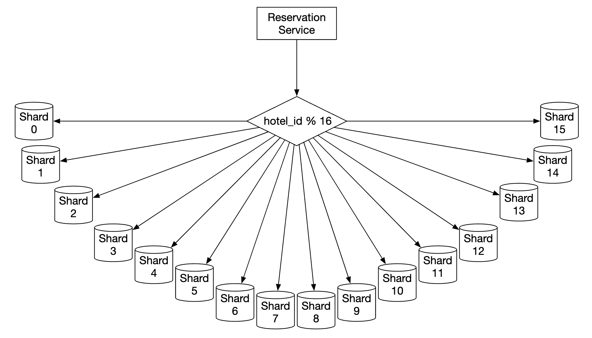
</div>

Bên cạnh đó, chúng ta có thể tận dụng **Caching** (sử dụng Redis) cho dữ liệu tồn kho phòng (`room_type_inventory`) để giảm tải đọc cho Database. Chúng ta cũng có thể thiết lập TTL (Time-To-Live) để dữ liệu của những ngày đã qua tự động hết hạn và giải phóng bộ nhớ.

<div style="margin-left:3rem">
    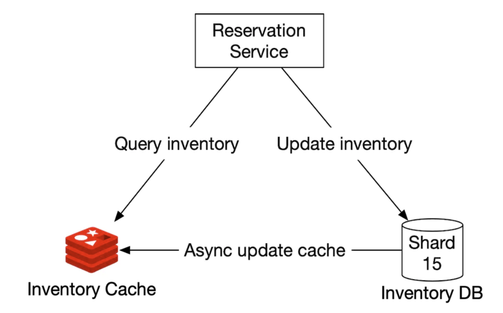
</div>

Cấu trúc lưu trữ tồn kho trên Redis được thiết kế dựa trên `hotel_id`, `room_type_id` và `date`:

```
key: hotelID_roomTypeID_{date}
value: the number of available rooms for the given hotel ID, room type ID and date.
```

Việc đồng bộ dữ liệu từ Database sang Cache diễn ra bất đồng bộ thông qua cơ chế **CDC (Change Data Capture)** — đọc luồng thay đổi từ binlog của Database và áp dụng sang hệ thống đích. **Debezium** là một giải pháp mã nguồn mở rất phổ biến để đồng bộ các thay đổi từ MySQL sang Redis.

Khi sử dụng cơ chế đồng bộ bất đồng bộ này, sẽ có những khoảng thời gian ngắn mà dữ liệu trên Cache và Database chưa kịp đồng nhất với nhau. Tuy nhiên, điều này hoàn toàn không gây hại cho tính đúng đắn của hệ thống vì **Database vẫn là chốt chặn cuối cùng (Source of Truth)** thực hiện kiểm tra tồn kho khi Commit đơn đặt phòng, ngăn chặn mọi giao dịch đặt lố không hợp lệ.

Tác động duy nhất về mặt trải nghiệm người dùng (UI) là đôi khi người dùng thấy trên trang tìm kiếm báo còn 1 phòng trống (do đọc từ Cache), nhưng khi bấm vào thanh toán thì hệ thống báo hết phòng và họ phải làm mới (refresh) lại trang. Thực tế, ngay cả khi không dùng Cache thì tình huống này vẫn có thể xảy ra nếu người dùng chần chừ vài phút trước khi bấm nút đặt phòng và bị người khác đặt mất.

**Ưu điểm của Caching:**
 - Giảm đáng kể tải đọc cho Database.
 - Hiệu năng đọc cực cao vì Redis quản lý dữ liệu hoàn toàn trên bộ nhớ RAM (in-memory).

**Nhược điểm của Caching:**
 - Việc duy trì tính nhất quán dữ liệu giữa Cache và Database phức tạp hơn. Cần đánh giá kỹ xem độ trễ đồng bộ có ảnh hưởng lớn đến trải nghiệm người dùng hay không.

### **Tính nhất quán dữ liệu giữa các dịch vụ (Data consistency among services)**
Một ứng dụng nguyên khối (Monolithic) cho phép sử dụng chung một Relational Database duy nhất để đảm bảo tính nhất quán dữ liệu một cách dễ dàng.

Trong thiết kế Microservices của chúng ta ở trên, chúng ta đã chọn một **phương án lai (hybrid approach)**: tách riêng nhiều Service độc lập, nhưng gom chung nghiệp vụ Đặt phòng (Reservation) và Quản lý tồn kho (Inventory) vào trong cùng một `Reservation Service` sử dụng chung một Database.

Chúng ta chủ đích thiết kế như vậy để tận dụng trực tiếp các đảm bảo ACID của Relational Database nhằm giữ cho việc tạo đơn đặt phòng và trừ tồn kho luôn nhất quán tuyệt đối trong một Local Transaction.

Tuy nhiên, người phỏng vấn có thể chất vấn lựa chọn này nếu họ muốn hướng tới một kiến trúc Microservices thuần túy (pure microservice architecture) — nơi mỗi Service (`Reservation Service` và `Inventory Service`) tách rời nhau và mỗi bên sở hữu một Database riêng biệt:

<div style="margin-left:3rem">
    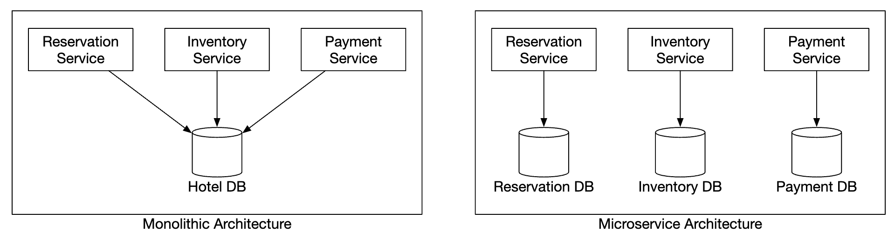
</div>

Việc tách rời này sẽ làm phát sinh bài toán nhất quán dữ liệu phân tán. Trong một hệ thống dùng chung Database, chúng ta dễ dàng dùng Transaction của Relational DB để đảm bảo tính nguyên tử (Atomicity):

<div style="margin-left:3rem">
    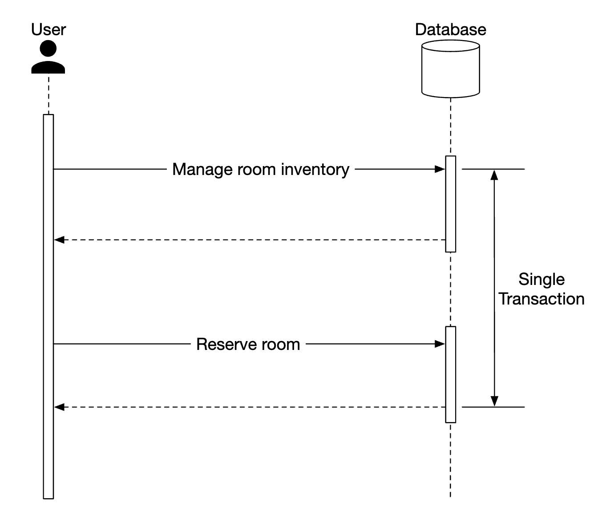
</div>

Nhưng khi một thao tác nghiệp vụ trải rộng qua nhiều Microservices với các Database độc lập, việc đảm bảo tính nguyên tử trở nên khó khăn hơn rất nhiều:

<div style="margin-left:3rem">
    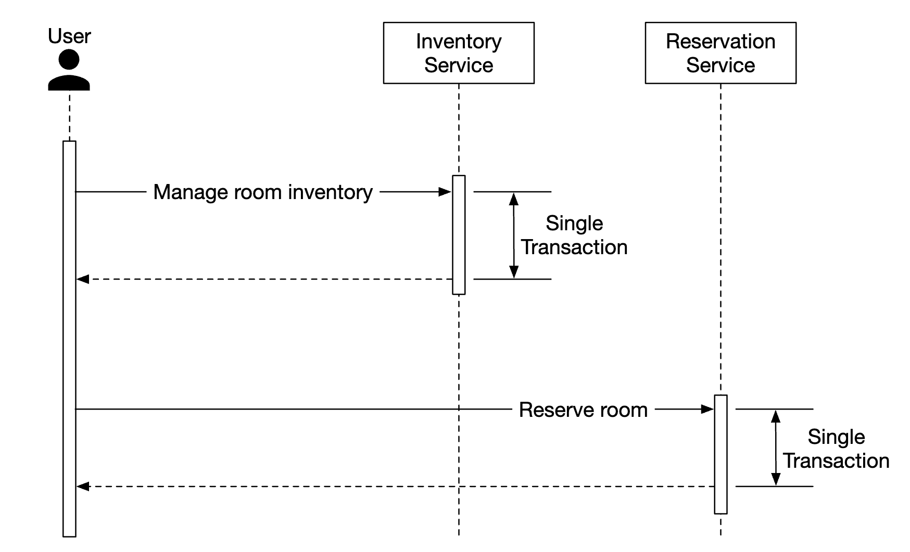
</div>

Để xử lý sự bất nhất dữ liệu giữa các Microservices trong trường hợp này, có hai kỹ thuật kinh điển:
 - **Cam kết hai pha (Two-Phase Commit - 2PC):** Một giao thức cấp cơ sở dữ liệu đảm bảo việc Commit giao dịch diễn ra nguyên tử trên tất cả các Node. Tuy nhiên, 2PC có hiệu năng thấp và mang tính chặn (blocking), vì chỉ cần một Node phản hồi chậm hoặc gặp sự cố là toàn bộ các Node khác đều bị khóa chờ.
 - **Mẫu thiết kế Saga (Saga Pattern):** Một chuỗi các giao dịch cục bộ (local transactions) nối tiếp nhau; nếu bất kỳ bước nào trong quy trình gặp lỗi, hệ thống sẽ kích hoạt các giao dịch bù trừ (compensating transactions) theo chiều ngược lại để hoàn tác những thay đổi trước đó. Đây là hướng tiếp cận hướng tới **Tính nhất quán cuối cùng (Eventual Consistency)**.

Cần lưu ý rằng việc giải quyết bài toán nhất quán dữ liệu xuyên suốt nhiều Microservices luôn làm tăng đáng kể độ phức tạp của hệ thống. Với tư cách là một System Architect thựcagmatic (thực tế), chúng ta luôn nên cân nhắc xem liệu chi phí phức tạp đó có đáng đánh đổi hay không, khi mà phương án đóng gói các thao tác phụ thuộc chặt chẽ vào chung một Service và một Relational Database đã giải quyết bài toán một cách gọn gàng, tin cậy hơn rất nhiều.

---

## Bước 4: Tổng kết (Wrap Up)
Chúng ta đã hoàn thành thiết kế hệ thống đặt phòng khách sạn.

Dưới đây là các bước chính mà chúng ta đã đi qua:
 - Thu thập yêu cầu chức năng/phi chức năng và thực hiện ước lượng sơ bộ (back-of-the-envelope calculations) để nắm bắt quy mô thực tế của hệ thống.
 - Trình bày thiết kế API, Mô hình dữ liệu và Kiến trúc tổng quan (High-level design).
 - Trong phần đi sâu chi tiết (Deep dive), chúng ta đã cải tiến lại Database Schema từ việc đặt từng phòng cụ thể sang đặt theo hạng phòng (`room_type_inventory`).
 - Thảo luận sâu về các tình huống tranh chấp đồng thời (Race conditions / Double booking) và phân tích các giải pháp: Idempotency key, Khóa bi quan (Pessimistic Locking), Khóa lạc quan (Optimistic Locking), và Ràng buộc Database (Database Constraints).
 - Đề xuất phương án mở rộng quy mô hệ thống lên gấp hàng nghìn lần thông qua Database Sharding và Redis Caching kết hợp CDC (Debezium).
 - Cuối cùng, phân tích bài toán nhất quán dữ liệu giữa các Microservices với 2PC và Saga Pattern.
