# Chương 23: Dịch vụ Email Phân tán (Distributed Email Service)

## Giới thiệu

Trong chương này, chúng ta sẽ thiết kế một **dịch vụ email phân tán (distributed email service)** quy mô lớn, tương tự như **Gmail** hay **Outlook**.

Vào năm 2020, **Gmail** có hơn 1,8 tỷ người dùng hoạt động (active users), trong khi **Outlook** phục vụ khoảng 400 triệu người dùng trên toàn thế giới.

---

## Bước 1: Thấu hiểu bài toán và Xác lập phạm vi thiết kế (Understand the Problem and Establish Design Scope)

- **C:** Có bao nhiêu người dùng sử dụng hệ thống này ạ?
- **I:** 1 tỷ người dùng.
- **C:** Tôi nghĩ các tính năng sau đây là quan trọng: xác thực người dùng (Authentication), gửi/nhận email, tải danh sách email, lọc email theo thư mục/trạng thái, tìm kiếm email và chống thư rác (anti-spam protection).
- **I:** Danh sách rất đầy đủ. Hiện tại bạn không cần bận tâm về phần xác thực người dùng (Auth).
- **C:** Người dùng kết nối với các Mail Server bằng cách nào ạ?
- **I:** Thông thường, các ứng dụng email client gốc (native clients) kết nối qua giao thức SMTP, POP, IMAP; nhưng trong khuôn khổ bài toán này, chúng ta sẽ sử dụng **HTTP** (cho Webmail và ứng dụng hiện đại).
- **C:** Email có thể đính kèm tệp (attachments) không?
- **I:** Có.

### **Yêu cầu phi chức năng (Non-functional requirements)**

- **Độ tin cậy (Reliability):** Tuyệt đối không được làm mất dữ liệu email của người dùng.
- **Tính sẵn sàng cao (Availability):** Cần sử dụng cơ chế sao chép dữ liệu (Replication) để ngăn chặn điểm lỗi đơn lẻ (Single Point of Failure - SPOF), đồng thời hệ thống phải có khả năng chịu đựng được các sự cố một phần (partial system failures).
- **Khả năng mở rộng (Scalability):** Khi lượng người dùng và số lượng email tăng lên, hệ thống phải dễ dàng mở rộng để đáp ứng tải.
- **Tính linh hoạt và khả năng mở rộng tính năng (Flexibility and extensibility):** Hệ thống cần linh hoạt để dễ dàng bổ sung thêm các tính năng mới. Đây cũng là một trong những lý do chính khiến chúng ta chọn giao tiếp qua HTTP thay vì chỉ bó buộc vào SMTP hay các giao thức mail truyền thống ở tầng Client.

### **Ước lượng sơ bộ (Back-of-the-envelope estimation)**

- **1 tỷ người dùng**.
- Giả sử trung bình mỗi người gửi 10 email mỗi ngày $\rightarrow$ QPS gửi email $\approx \frac{10^9 \times 10}{10^5\text{ giây}} = \mathbf{100.000\text{ email/giây}}$.
- Giả sử trung bình mỗi người nhận 40 email mỗi ngày và mỗi email có khoảng 50 KB dữ liệu Metadata (bao gồm tiêu đề, nội dung văn bản) $\rightarrow$ Dung lượng lưu trữ Metadata mỗi năm: $10^9 \times 40 \times 365 \times 50\text{ KB} = \mathbf{730\text{ PB/năm}}$.
- Giả sử 20% số email nhận được có tệp đính kèm với kích thước trung bình là 500 KB $\rightarrow$ Dung lượng lưu trữ tệp đính kèm mỗi năm: $10^9 \times 40 \times 365 \times 20\% \times 500\text{ KB} = \mathbf{1.460\text{ PB/năm}}$.

---

## Bước 2: Đề xuất Thiết kế Tổng quan và Thống nhất Phương án (Propose High-Level Design and Get Buy-In)

### **Kiến thức nền tảng về Email (Email knowledge 101)**

Có nhiều giao thức chuẩn được sử dụng để gửi và nhận email:
- **SMTP (Simple Mail Transfer Protocol):** Giao thức chuẩn để chuyển tiếp (gửi) email từ Mail Server này sang Mail Server khác.
- **POP (Post Office Protocol):** Giao thức chuẩn để nhận và tải email từ một Mail Server từ xa về máy Client cục bộ. Sau khi tải về máy, email thường sẽ bị xóa khỏi Server từ xa.
- **IMAP (Internet Message Access Protocol):** Tương tự như POP, dùng để nhận và đọc email từ Mail Server từ xa, nhưng IMAP giữ nguyên email trên Server và đồng bộ trạng thái giữa nhiều thiết bị.
- **HTTPS:** Về mặt kỹ thuật không phải là một giao thức email chuyên biệt, nhưng được sử dụng rộng rãi cho các ứng dụng email nền web (Webmail như Gmail trên trình duyệt).

Ngoài các giao thức gửi/nhận thư, chúng ta còn cần cấu hình bản ghi DNS **MX (Mail Exchanger) record** cho tên miền để chỉ định Mail Server nào chịu trách nhiệm tiếp nhận email gửi đến tên miền đó:

<div style="margin-left:3rem">
    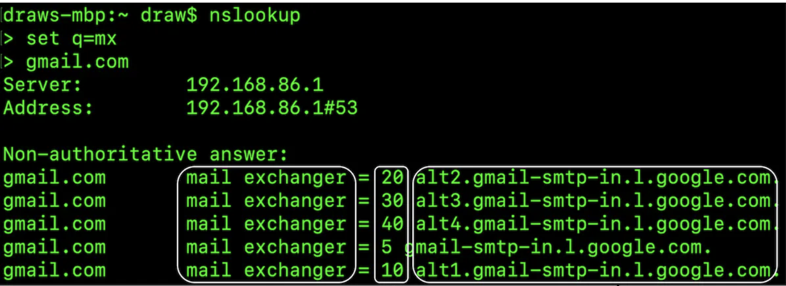
</div>

Các tệp đính kèm trong email (attachments) được mã hóa dưới dạng **Base64** khi truyền đi và hầu hết các dịch vụ email thường giới hạn kích thước tệp đính kèm ở mức khoảng 25 MB (có thể cấu hình thay đổi tùy thuộc vào tài khoản cá nhân hay doanh nghiệp).

### **Các máy chủ thư truyền thống (Traditional mail servers)**

Kiến trúc Mail Server truyền thống hoạt động tốt khi số lượng người dùng ít và tất cả cùng kết nối vào một Server đơn lẻ.

<div style="margin-left:3rem">
    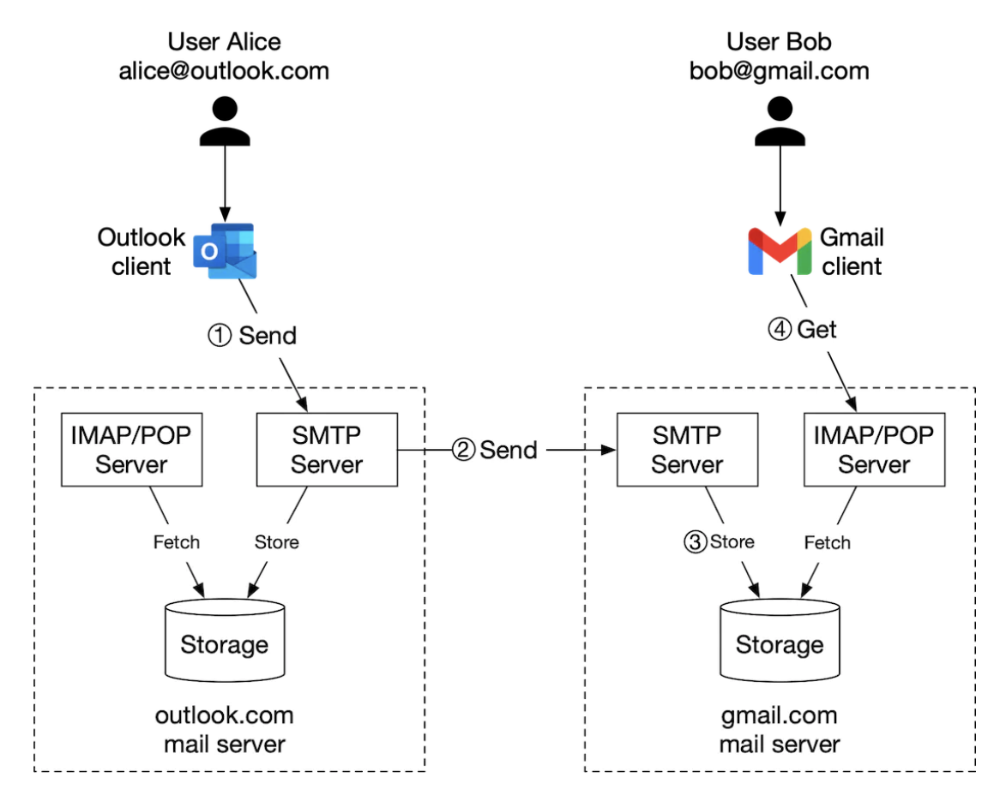
</div>

- Alice đăng nhập vào tài khoản Outlook của cô ấy và bấm nút "Send". Email được gửi tới Outlook Mail Server thông qua giao thức SMTP.
- Outlook Server truy vấn DNS để tìm bản ghi MX của `gmail.com`, sau đó chuyển tiếp email tới các Mail Server của Gmail qua giao thức SMTP.
- Bob tải email mới từ Gmail Server về thiết bị của mình thông qua giao thức IMAP hoặc POP.

Trong các Mail Server truyền thống, email được lưu trữ trực tiếp trên hệ thống tệp cục bộ (local file system), trong đó mỗi email là một tệp riêng biệt nằm trong thư mục của người dùng:

<div style="margin-left:3rem">
    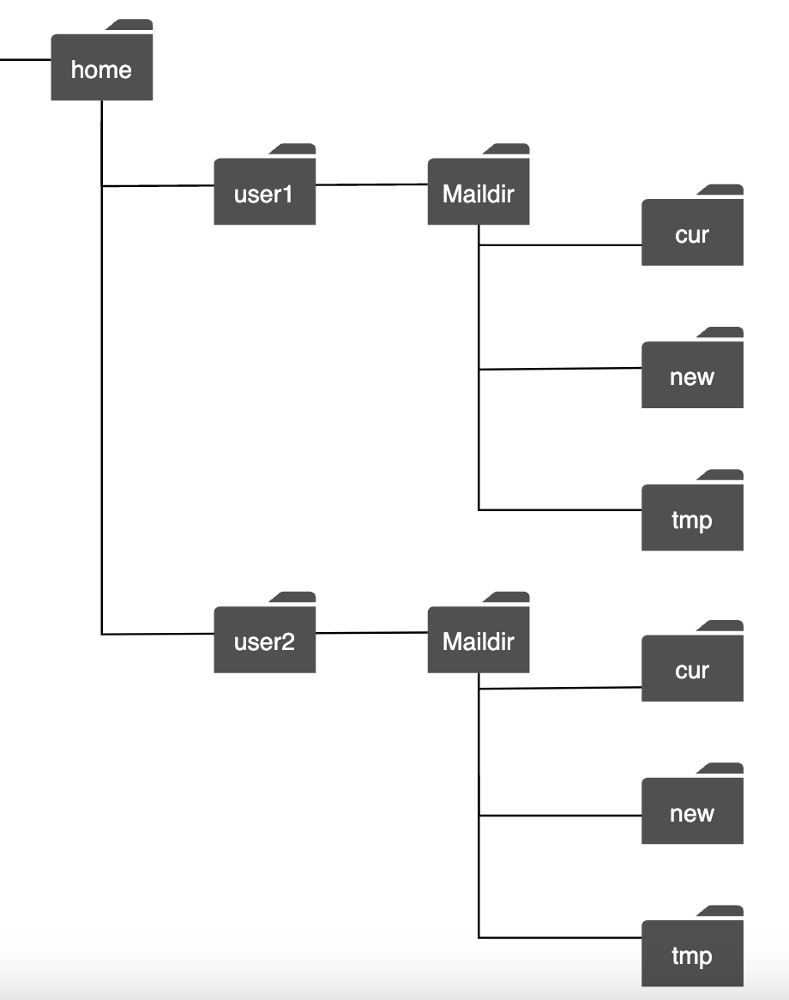
</div>

Khi quy mô người dùng tăng lên, **Disk I/O** nhanh chóng trở thành điểm nghẽn cổ chai. Hơn nữa, cách lưu trữ cục bộ này không đáp ứng được các yêu cầu về tính sẵn sàng cao (High Availability) và độ tin cậy (Reliability) — ổ cứng hoàn toàn có thể bị hỏng và Server có thể ngừng hoạt động bất cứ lúc nào.

### **Các máy chủ thư phân tán (Distributed mail servers)**

Hệ thống Mail Server phân tán được thiết kế để phục vụ các nhu cầu hiện đại và giải quyết triệt để bài toán mở rộng quy mô (Scalability).

Các Server này vẫn có thể hỗ trợ giao thức IMAP/POP cho các ứng dụng email gốc (native mail clients) và giao thức SMTP để trao đổi thư giữa các nhà cung cấp dịch vụ email khác nhau. Tuy nhiên, đối với các ứng dụng Webmail giàu tính năng hoặc ứng dụng di động hiện đại, bộ **RESTful API qua HTTP** thường được sử dụng để giao tiếp giữa Client và Server.

Một số API tiêu biểu:
- `POST /v1/messages` - gửi một email tới danh sách người nhận nằm trong các trường `To`, `Cc`, `Bcc`.
- `GET /v1/folders` - trả về toàn bộ danh sách thư mục (folders) của một tài khoản email.

Ví dụ về Response của `GET /v1/folders`:

```
[{id: string        Unique folder identifier.
  name: string      Name of the folder.
                    According to RFC6154 [9], the default folders can be one of
                    the following: All, Archive, Drafts, Flagged, Junk, Sent,
                    and Trash.
  user_id: string   Reference to the account owner
}]
```

- `GET /v1/folders/{:folder_id}/messages` - trả về danh sách các email nằm trong một thư mục cụ thể (có hỗ trợ phân trang - pagination).
- `GET /v1/messages/{:message_id}` - lấy toàn bộ thông tin chi tiết của một email cụ thể.

Ví dụ về Response của `GET /v1/messages/{:message_id}`:

```
{
  user_id: string                      // Reference to the account owner.
  from: {name: string, email: string}  // <name, email> pair of the sender.
  to: [{name: string, email: string}]  // A list of <name, email> paris
  subject: string                      // Subject of an email
  body: string                         //  Message body
  is_read: boolean                     //  Indicate if a message is read or not.
}
```

Dưới đây là thiết kế kiến trúc tổng quan của hệ thống Mail Server phân tán:

<div style="margin-left:3rem">
    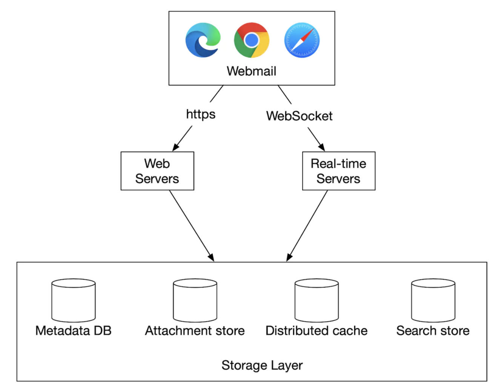
</div>

- **Webmail**: Người dùng sử dụng trình duyệt web để gửi và nhận email.
- **Web servers**: Các dịch vụ xử lý Request/Response hướng ra công chúng, chịu trách nhiệm quản lý đăng nhập, đăng ký, thông tin hồ sơ người dùng, tải danh sách email, v.v.
- **Real-time servers**: Chịu trách nhiệm đẩy (push) các cập nhật email mới tới Client theo thời gian thực. Chúng ta ưu tiên sử dụng **WebSocket** để giao tiếp hai chiều thời gian thực, và có cơ chế dự phòng (fallback) về **Long Polling** đối với các trình duyệt cũ không hỗ trợ WebSocket.
- **Metadata DB**: Lưu trữ dữ liệu đặc tả và nội dung email như tiêu đề (`subject`), nội dung (`body`), người gửi (`from`), người nhận (`to`), trạng thái đã đọc, v.v.
- **Attachment store**: Kho lưu trữ đối tượng (Object Storage như Amazon S3), rất phù hợp để lưu trữ các tệp đính kèm dung lượng lớn.
- **Distributed cache**: Lưu Cache các email gần đây trong Redis để tăng tốc độ tải hòm thư và cải thiện trải nghiệm người dùng (UX).
- **Search store**: Kho lưu trữ tài liệu phân tán (như Elasticsearch), chuyên dùng để hỗ trợ tìm kiếm toàn văn (full-text search).

#### Luồng gửi email (Email sending flow)

<div style="margin-left:3rem">
    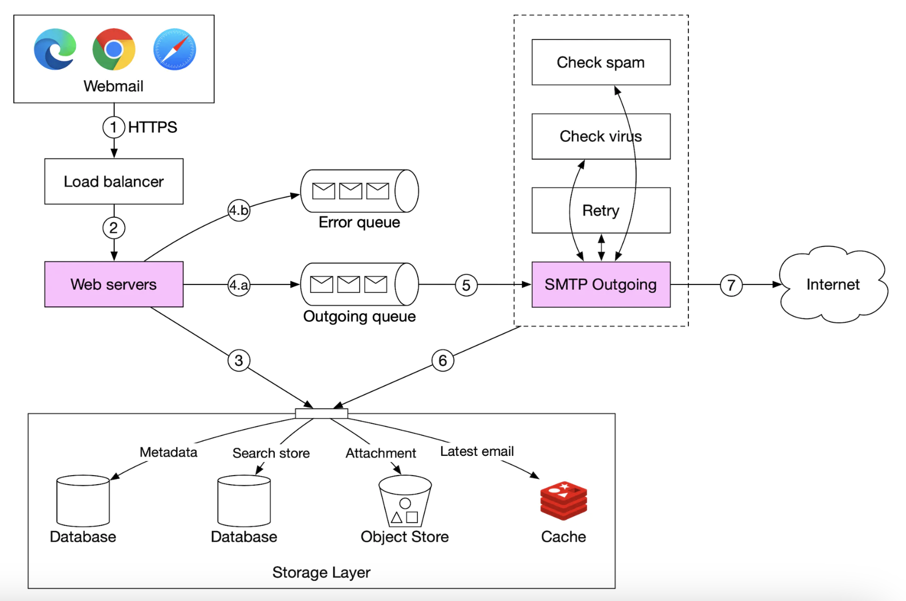
</div>

- Người dùng soạn email và bấm nút "Send". Request được gửi tới **Load Balancer**.
- Load Balancer thực hiện Rate Limiting để chặn các hành vi gửi thư quá mức cho phép, sau đó định tuyến Request tới một trong các **Web servers**.
- Web server thực hiện kiểm tra hợp lệ cơ bản (ví dụ: kiểm tra giới hạn kích thước email). Nếu người nhận có cùng tên miền (ví dụ: gửi từ một tài khoản Gmail sang một tài khoản Gmail khác), hệ thống có thể đi đường tắt (short-circuit) bỏ qua bước gửi ra ngoài mạng Internet sau khi đã kiểm tra Spam/Virus.
- Nếu qua được bước kiểm tra cơ bản, thông tin email sẽ được đẩy vào **Outgoing Message Queue** (nếu có tệp đính kèm lớn, tệp đó đã được lưu vào **Object Store** và trong Message chỉ chứa đường dẫn tham chiếu).
- Nếu bước kiểm tra cơ bản thất bại, email sẽ được đẩy vào **Error Queue**.
- Các **SMTP Outgoing Workers** kéo Message từ Outgoing Queue ra, thực hiện kiểm tra Spam và Virus chuyên sâu, sau đó gửi email tới Mail Server đích của người nhận qua giao thức SMTP.
- Đồng thời, một bản sao của email được lưu vào thư mục "Đã gửi" (`Sent Emails`) trong Metadata DB của người gửi.

Chúng ta cũng cần giám sát chặt chẽ kích thước của **Outgoing Message Queue**. Nếu hàng đợi này phình to bất thường, đó là dấu hiệu của sự cố:
- Mail Server phía người nhận đang gặp sự cố hoặc không thể kết nối. Trong trường hợp này, chúng ta cần thử gửi lại (retry) sau đó với cơ chế **Thử lại với thời gian chờ tăng theo cấp số nhân (Exponential Backoff)**.
- Không có đủ số lượng Worker/Consumer để xử lý kịp lưu lượng gửi đi — khi đó chúng ta cần mở rộng quy mô (scale out) cụm SMTP Outgoing Workers.

#### Luồng nhận email (Email receiving flow)

<div style="margin-left:3rem">
    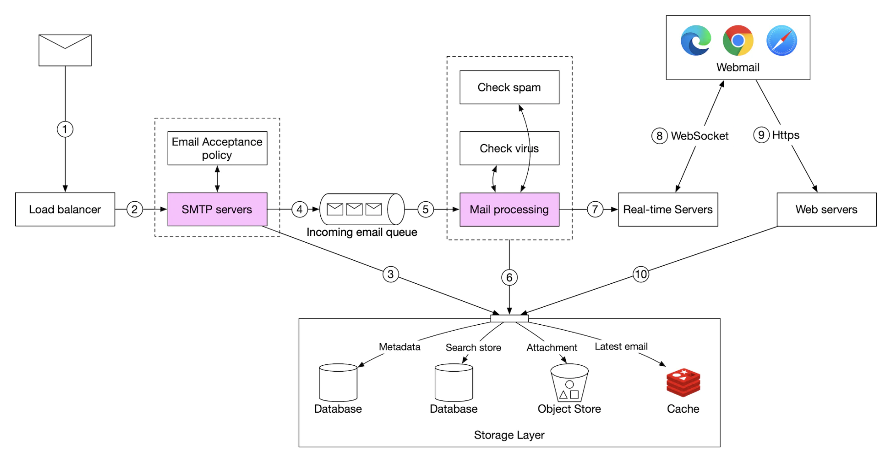
</div>

- Các email từ bên ngoài gửi đến sẽ đi vào **SMTP Load Balancer**. Lưu lượng thư được phân phối tới các **Incoming SMTP Servers**, nơi thực thi các chính sách tiếp nhận thư (mail acceptance policy — ví dụ: từ chối và hủy ngay lập tức các email gửi đến địa chỉ không tồn tại,いわゆる "bounce").
- Nếu tệp đính kèm của email quá lớn, hệ thống sẽ tách và lưu tệp đính kèm đó vào **Attachment Store (S3)**.
- Email sau đó được đưa vào **Mail Processing Queue**. Các **Mail Processing Workers** làm nhiệm vụ kiểm tra sơ bộ (lọc Spam, quét Virus), sau đó lưu email vào **Metadata DB**, cập nhật **Cache**, lập chỉ mục vào **Search Store**, và thông báo cho **Real-time Servers** để đẩy thông báo email mới tới người dùng đang trực tuyến.
- Đối với những người dùng đang ngoại tuyến (offline), khi họ mở lại ứng dụng hoặc trình duyệt, Client sẽ gọi HTTP API tới Web Server để tải các email mới về.

---

## Bước 3: Đi sâu vào Thiết kế Chi tiết (Design Deep Dive)

Bây giờ chúng ta hãy đi sâu vào thiết kế chi tiết của một số thành phần cốt lõi.

### **Cơ sở dữ liệu Metadata (Metadata database)**

Hãy điểm qua các đặc trưng quan trọng của dữ liệu Metadata email:
- Các phần Header của email thường nhỏ và được truy cập rất thường xuyên (ví dụ: hiển thị danh sách email trong hộp thư đến).
- Kích thước phần nội dung (`body`) biến thiên từ rất nhỏ đến khá lớn, nhưng thông thường mỗi email chỉ được người dùng mở ra đọc một vài lần.
- Hầu hết mọi thao tác với email (tải danh sách thư, đánh dấu đã đọc, tìm kiếm, lọc theo thư mục) đều cô lập trong phạm vi của một người dùng đơn lẻ (`user_id`).
- Tính mới của dữ liệu (data recency) quyết định tần suất truy cập: người dùng hầu như chỉ đọc các email mới nhận gần đây. Dữ liệu cũ hơn rất ít khi được đụng tới.
- Yêu cầu cực kỳ khắt khe về độ tin cậy (Reliability): việc mất dữ liệu email là điều không thể chấp nhận.

Ở quy mô khổng lồ như Gmail hay Outlook, Database lưu trữ thường được thiết kế chuyên biệt (custom-made) nhằm giảm thiểu tối đa số lượng thao tác đọc/ghi đĩa mỗi giây (**IOPS**).

Hãy cùng đánh giá các lựa chọn Database hiện có:
- **Relational Database:** Chúng ta có thể đánh Index cho các trường Header và Body để tìm kiếm nhanh, nhưng các hệ quản trị CSDL quan hệ truyền thống thường được tối ưu hóa cho các bản ghi có kích thước nhỏ, trong khi một mục email kèm nội dung HTML phong phú có thể nặng tới vài MB.
- **Distributed Object Store (như S3):** Là lựa chọn tuyệt vời để lưu trữ sao lưu (backup) hoặc lưu tệp đính kèm, nhưng không thể hỗ trợ hiệu quả các thao tác truy vấn danh sách, đánh dấu đã đọc (`is_read`), hay tìm kiếm nhanh.
- **NoSQL (Column-family):** Google sử dụng **Bigtable** cho Gmail, nhưng Bigtable không phải là phần mềm mã nguồn mở. **Apache Cassandra** là một lựa chọn mã nguồn mở tương đồng nhưng vẫn có một số hạn chế nhất định khi xử lý các giá trị cột lớn.

Dựa trên phân tích trên, rất ít giải pháp đóng gói sẵn trên thị trường đáp ứng hoàn hảo mọi yêu cầu ở quy mô hàng tỷ người dùng. Trong buổi phỏng vấn, bạn không thể tự thiết kế một Distributed Database mới từ con số 0, nhưng điều quan trọng là phải nêu bật được các đặc tính kỹ thuật mà Database này cần có:
- Một cột đơn lẻ (single column) có thể lưu trữ giá trị lớn cỡ vài MB.
- Đảm bảo **Tính nhất quán mạnh (Strong Consistency)**.
- Được thiết kế tối ưu để giảm thiểu Disk I/O.
- Có tính sẵn sàng cao (Highly Available) và khả năng chịu lỗi tốt (Fault Tolerant).
- Dễ dàng tạo các bản sao lưu tăng dần (Incremental Backups).

Để phân vùng dữ liệu (Partitioning/Sharding), chúng ta sử dụng `user_id` làm **Partition Key** để toàn bộ dữ liệu email của cùng một người dùng luôn nằm trên cùng một Shard. Điểm đánh đổi của cách này là chúng ta không thể chia sẻ chung một bản ghi email cho nhiều người nhận khác nhau (nếu một email gửi cho 10 người trong hệ thống, nó sẽ được nhân bản thành 10 bản ghi độc lập cho từng `user_id`), nhưng điều này hoàn toàn phù hợp và không phải là rào cản trong phạm vi bài toán.

Hãy định nghĩa các bảng dữ liệu (theo mô hình Wide-column của Cassandra/Bigtable):
- **Primary Key (Khóa chính)** bao gồm hai thành phần: **Partition Key** (quyết định dữ liệu nằm ở Node/Shard nào) và **Clustering Key** (quyết định thứ tự sắp xếp dữ liệu bên trong Partition đó).
- Các truy vấn cần hỗ trợ:
  1. Lấy danh sách tất cả các thư mục (`folders`) của một người dùng.
  2. Hiển thị tất cả các email nằm trong một thư mục cụ thể.
  3. Tạo mới / lấy chi tiết / xóa một email.
  4. Lọc danh sách các email đã đọc (`read`) hoặc chưa đọc (`unread`).
  5. Điểm cộng (Bonus): Lấy chuỗi hội thoại (conversation threads).

Chú giải ký hiệu cho các bảng dưới đây:

<div style="margin-left:3rem">
    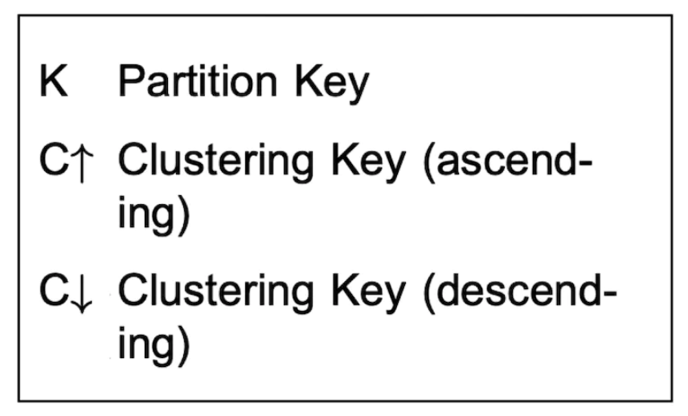
</div>

Bảng `folders_by_user`:

<div style="margin-left:3rem">
    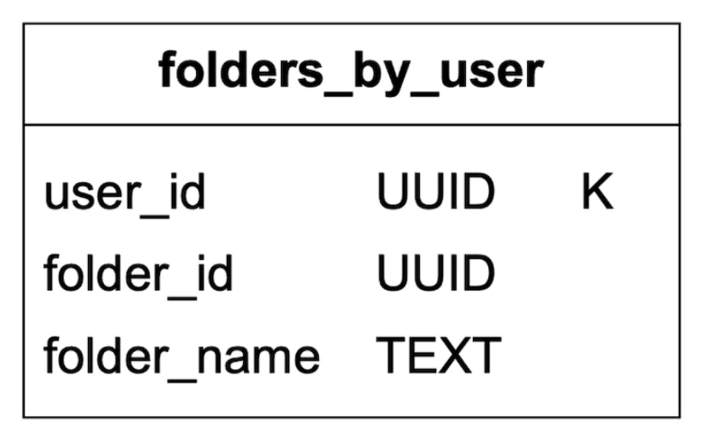
</div>

Bảng `emails_by_user`:

<div style="margin-left:3rem">
    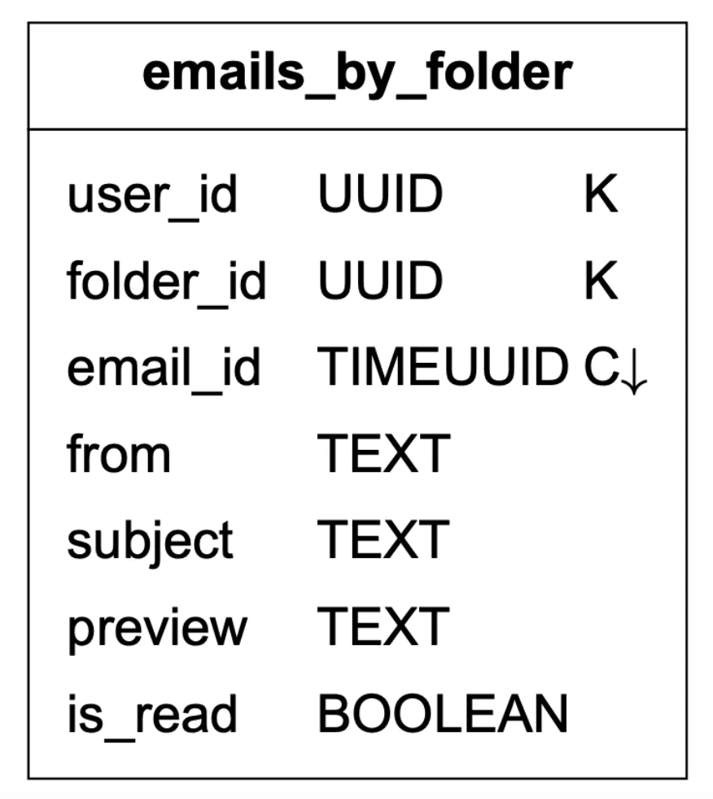
</div>

- Cột `email_id` có kiểu dữ liệu là `TIMEUUID`, giúp tự động sắp xếp các email trong cùng một thư mục theo đúng trình tự thời gian được tạo.

Các tệp đính kèm (Attachments) được tách ra lưu ở một bảng riêng biệt, định danh thêm bằng `filename`:

<div style="margin-left:3rem">
    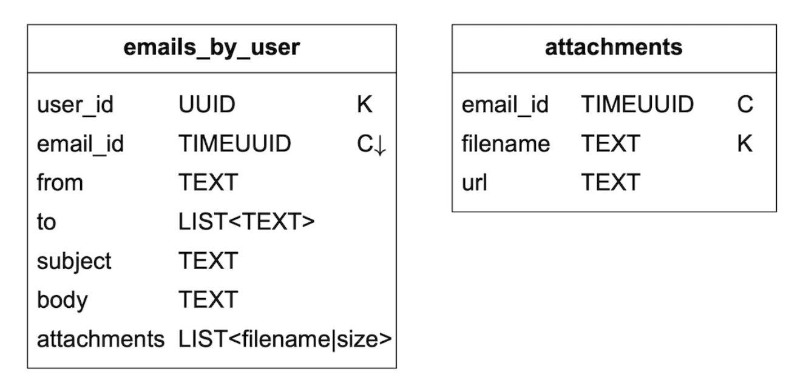
</div>

Việc truy vấn lọc các email **đã đọc / chưa đọc** rất đơn giản trong một Relational Database truyền thống, nhưng lại là thách thức trong Cassandra vì Cassandra không cho phép lọc (`WHERE`) trên các cột không thuộc Partition Key hoặc Clustering Key. Nếu tải toàn bộ email trong một thư mục lên bộ nhớ (in-memory) rồi mới lọc thì sẽ không thể mở rộng cho những hộp thư có hàng chục nghìn email.

Giải pháp chuẩn trong thiết kế NoSQL là áp dụng **Phi chuẩn hóa dữ liệu (Denormalization)**: tách bảng email thành hai bảng phụ trợ riêng cho email đã đọc (`read_emails`) và email chưa đọc (`unread_emails`). Khi người dùng đánh dấu một email là đã đọc, hệ thống sẽ xóa bản ghi đó khỏi bảng `unread_emails` và chèn vào bảng `read_emails`:

<div style="margin-left:3rem">
    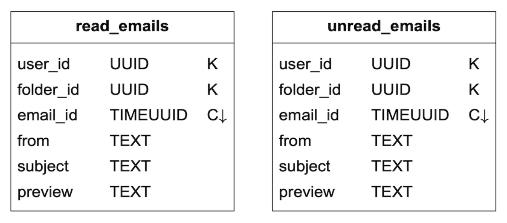
</div>

Để hỗ trợ tính năng **gộp chuỗi hội thoại (Conversation threads)** như trên Gmail, chúng ta bổ sung các trường Header chuẩn theo RFC 5322 (`Message-Id`, `In-Reply-To`, `References`) vào mỗi email. Ứng dụng Mail Client sẽ dựa vào các Header này để tái tạo lại toàn bộ luồng hội thoại:

```
{
  "headers" {
     "Message-Id": "<7BA04B2A-430C-4D12-8B57-862103C34501@gmail.com>",
     "In-Reply-To": "<CAEWTXuPfN=LzECjDJtgY9Vu03kgFvJnJUSHTt6TW@gmail.com>",
     "References": ["<7BA04B2A-430C-4D12-8B57-862103C34501@gmail.com>"]
  }
}
```

Cuối cùng, đối với Distributed Database lưu trữ Metadata email, chúng ta chọn đánh đổi **Tính sẵn sàng (Availability)** để ưu tiên **Tính nhất quán (Consistency)** (hệ thống **CP** theo định lý CAP), vì tính nhất quán và toàn vẹn dữ liệu là yêu cầu bắt buộc đối với hòm thư. Do đó, trong trường hợp xảy ra chuyển đổi dự phòng (failover) hoặc phân vùng mạng (network partition), các thao tác đồng bộ/cập nhật đối với phân vùng người dùng bị ảnh hưởng sẽ tạm thời gián đoạn trong chốc lát cho đến khi quá trình Failover hoàn tất.

### **Khả năng gửi thư vào hộp thư đến (Email deliverability)**

Việc dựng một Mail Server để bắn email đi thì rất dễ, nhưng làm sao để email đó thực sự đi vào hộp thư đến (`Inbox`) của người nhận thay vì bị đánh dấu là thư rác (`Spam`) lại là một bài toán khó hơn rất nhiều.

Nếu chúng ta chỉ vừa mới dựng một Mail Server với địa chỉ IP mới tinh và bắt đầu gửi hàng loạt email qua đó, gần như chắc chắn các email này sẽ bị chặn hoặc rơi thẳng vào mục Spam.

Dưới đây là các biện pháp kỹ thuật và vận hành bắt buộc phải thực hiện để xây dựng độ uy tín cho Mail Server:
- **Sử dụng IP chuyên dụng (Dedicated IPs):** Dùng các dải địa chỉ IP riêng biệt chuyên cho việc gửi email, tránh dùng chung IP với các dịch vụ không rõ nguồn gốc khiến các nhà cung cấp dịch vụ email lớn (như Gmail, Yahoo, Outlook) đánh giá thấp độ tin cậy.
- **Phân loại luồng email (Classify emails):** Tách biệt hoàn toàn các Server/IP gửi email tiếp thị (Marketing/Promotional) khỏi các Server/IP gửi email giao dịch quan trọng (Transactional/Personal emails) để tránh việc email quan trọng bị vạ lây điểm tín nhiệm thấp.
- **Làm ấm địa chỉ IP (IP warming):** Tăng dần lưu lượng email gửi đi từ địa chỉ IP mới một cách từ từ để xây dựng uy tín (reputation) với các nhà cung cấp email lớn. Quá trình làm ấm một IP mới thường mất từ 2 đến 6 tuần.
- **Khóa tài khoản phát tán Spam nhanh chóng (Ban spammers):** Ngăn chặn kịp thời các tài khoản lợi dụng hệ thống để phát tán thư rác trước khi uy tín IP của hệ thống bị suy giảm.
- **Xử lý phản hồi từ ISP (Feedback processing):** Thiết lập vòng lặp phản hồi (Feedback Loop) với các ISP để theo dõi tỷ lệ phàn nàn (complaint rate), xử lý các địa chỉ email không tồn tại (hard bounces) và khóa nhanh các tài khoản vi phạm.
- **Xác thực nguồn gửi email (Email authentication):** Triển khai đầy đủ các giao thức chống giả mạo (anti-phishing/spoofing) tiêu chuẩn như **SPF (Sender Policy Framework)**, **DKIM (DomainKeys Identified Mail)**, và **DMARC**.

Bạn không cần phải thuộc lòng từng chi tiết cấu hình của các giao thức này trong buổi phỏng vấn, nhưng việc nhắc đến chúng cho thấy bạn có kiến thức thực chiến sâu sắc về lĩnh vực hạ tầng Email.

### **Tìm kiếm (Search)**

Tính năng tìm kiếm email bao gồm cả tìm kiếm toàn văn (full-text search) trên nội dung email lẫn các truy vấn lọc nâng cao theo các thuộc tính như `from`, `to`, `subject`, `is_unread`, có tệp đính kèm hay không, v.v.

Một đặc điểm rất thú vị của bài toán tìm kiếm email là: phạm vi tìm kiếm luôn chỉ giới hạn trong hòm thư của chính người dùng đó, và **tải ghi (write load) lớn hơn tải đọc (read load) rất nhiều**. Lý do là mỗi khi có email mới gửi đến, gửi đi, xóa, hoặc đổi trạng thái, hệ thống đều phải cập nhật lại chỉ mục (re-index), trong khi người dùng chỉ thỉnh thoảng mới gõ vào thanh tìm kiếm.

Hãy so sánh sự khác biệt giữa Google Search (tìm kiếm web) và Email Search:

| Tiêu chí       | Phạm vi (Scope)               | Sắp xếp (Sorting)                                    | Độ chính xác & Tốc độ lập chỉ mục (Accuracy & Indexing)             |
|----------------|-------------------------------|------------------------------------------------------|---------------------------------------------------------------------|
| Google Search  | Toàn bộ mạng Internet         | Sắp xếp theo độ liên quan (Relevance)                | Quá trình lập chỉ mục mất thời gian nên kết quả không cần tức thời. |
| Email Search   | Hộp thư riêng của từng người  | Sắp xếp theo thuộc tính (ví dụ: thời gian, ngày gửi) | Việc lập chỉ mục phải diễn ra gần như tức thời và kết quả chính xác.|

Để triển khai tính năng tìm kiếm này, chúng ta có hai hướng tiếp cận chính:

#### Hướng tiếp cận 1: Sử dụng Elasticsearch
Chúng ta có thể triển khai một cụm **Elasticsearch** và sử dụng `user_id` làm Partition Key (Routing key) để gom toàn bộ chỉ mục tìm kiếm của cùng một người dùng về cùng một Node/Shard:

<div style="margin-left:3rem">
    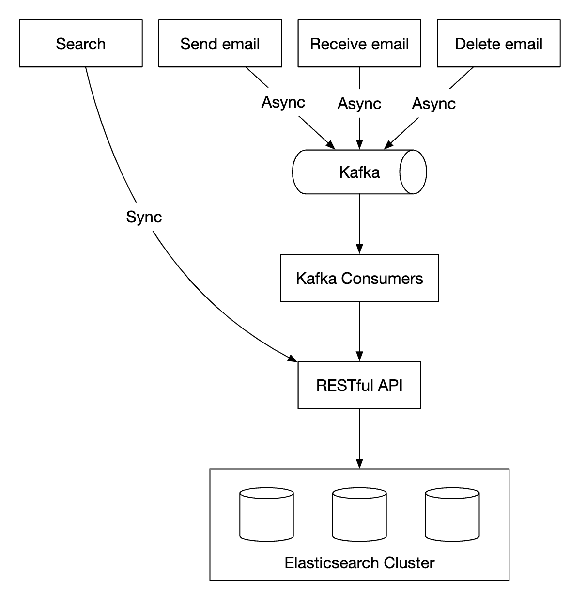
</div>

Các thao tác làm thay đổi dữ liệu (nhận email mới, xóa email...) sẽ đẩy sự kiện bất đồng bộ qua **Kafka** để tách rời (decouple) các dịch vụ cốt lõi khỏi luồng đánh chỉ mục lại (re-indexing). Trong khi đó, khi người dùng thực hiện tìm kiếm, Request sẽ được gọi đồng bộ trực tiếp tới Elasticsearch.

Elasticsearch là công cụ tìm kiếm phổ biến nhất hiện nay và hỗ trợ tìm kiếm toàn văn cho email rất tốt.

#### Hướng tiếp cận 2: Tự xây dựng công cụ tìm kiếm chuyên biệt (Custom Search Engine)
Ở quy mô cực lớn như Gmail, हम có thể cân nhắc tự phát triển một giải pháp tìm kiếm tùy chỉnh tích hợp sâu với tầng lưu trữ để đáp ứng các yêu cầu đặc thù.

Việc thiết kế chi tiết một Search Engine từ đầu nằm ngoài phạm vi buổi phỏng vấn, nhưng thách thức cốt lõi khi xây dựng nó là phải tối ưu hóa cho **tải nặng về ghi (write-heavy workloads)** và giảm thiểu Disk I/O.

Để đạt được điều đó, chúng ta có thể sử dụng cấu trúc dữ liệu **Cây hợp nhất cấu trúc nhật ký (Log-Structured Merge-Tree - LSM-Tree)** để tổ chức dữ liệu chỉ mục trên ổ đĩa. Đường dẫn ghi (write path) của LSM-Tree được tối ưu hóa hoàn toàn cho việc ghi tuần tự (sequential writes). Kỹ thuật này cũng chính là nền tảng đằng sau Bigtable, Cassandra và RocksDB.

Ý tưởng cốt lõi của LSM-Tree là ghi nhận mọi thay đổi vào bộ nhớ RAM (`MemTable`) trước; khi dung lượng đạt đến một ngưỡng định sẵn, dữ liệu mới được xả (flush) và hợp nhất tuần tự xuống tầng đĩa cứng (`SSTable`):

<div style="margin-left:3rem">
    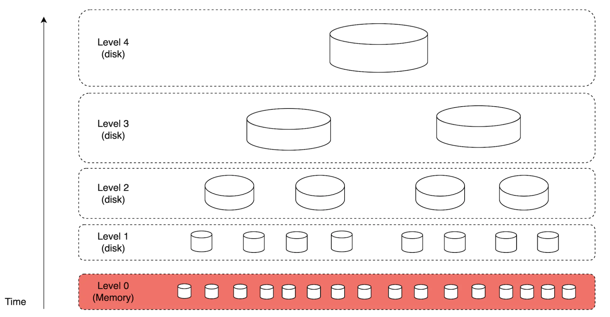
</div>

**Sự đánh đổi chính giữa hai hướng tiếp cận:**
- **Khả năng mở rộng:** Elasticsearch mở rộng tốt đến một quy mô nhất định, trong khi một Custom Search Engine có thể được tinh chỉnh chuyên sâu cho bài toán email để mở rộng tới quy mô hàng tỷ hộp thư với chi phí phần cứng thấp hơn.
- **Chi phí vận hành hệ thống:** Dùng Elasticsearch đồng nghĩa với việc phải duy trì hai hệ thống dữ liệu song song (Metadata Store + Elasticsearch Cluster) cùng luồng đồng bộ dữ liệu giữa chúng. Ngược lại, một giải pháp tùy chỉnh có thể tích hợp trực tiếp chỉ mục tìm kiếm ngay trong chính Metadata Datastore.
- **Chi phí phát triển (Engineering effort):** Elasticsearch là giải pháp có sẵn (off-the-shelf) có thể tích hợp nhanh chóng, trong khi việc tự xây dựng một Search Engine đòi hỏi nguồn lực kỹ thuật khổng lồ.

### **Khả năng mở rộng và Tính sẵn sàng cao (Scalability and availability)**

Vì các thao tác trên hòm thư của từng người dùng hoàn toàn độc lập và không xung đột với người dùng khác, hầu hết mọi thành phần trong hệ thống đều có thể mở rộng theo chiều ngang một cách độc lập.

Để đảm bảo tính sẵn sàng cao (High Availability) trước các thảm họa cấp trung tâm dữ liệu, chúng ta triển khai kiến trúc đa trung tâm dữ liệu (**Multi-DC setup**) kết hợp cơ chế chuyển đổi dự phòng **Leader-Follower Failover**:

<div style="margin-left:3rem">
    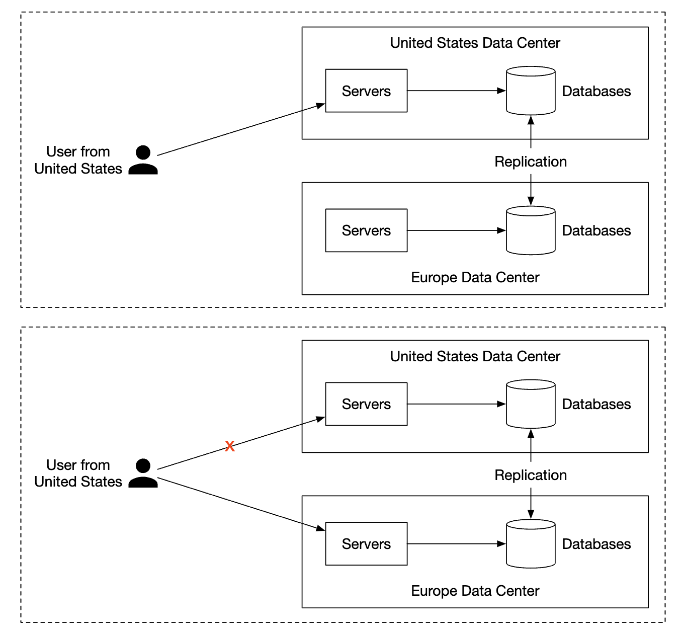
</div>

---

## Bước 4: Tổng kết (Wrap Up)

Một số chủ đề mở rộng có thể thảo luận thêm nếu còn thời gian:
- **Khả năng chịu lỗi (Fault tolerance):** Nhiều thành phần trong hệ thống có thể gặp sự cố cùng lúc; có thể thảo luận sâu hơn về cách xử lý khi các Node lưu trữ hoặc hàng đợi bị sập.
- **Tuân thủ pháp lý (Compliance):** Dữ liệu định danh cá nhân (PII) và email người dùng cần được lưu trữ tuân thủ nghiêm ngặt các quy định bảo vệ dữ liệu theo khu vực địa lý, chẳng hạn như luật GDPR tại Châu Âu.
- **Bảo mật (Security):** Mã hóa email khi truyền tải và lưu trữ, chống lừa đảo (phishing protection), cảnh báo liên kết độc hại (safe browsing), v.v.
- **Tối ưu hóa dung lượng (Storage optimizations):** Ví dụ, chống trùng lặp dữ liệu (Deduplication) đối với cùng một tệp đính kèm được gửi đi gửi lại nhiều lần hoặc chuyển tiếp cho hàng nghìn người dùng khác nhau (chỉ lưu 1 bản vật lý trên S3 và dùng cơ chế đếm tham chiếu - reference counting).
