# Chương 24: Hệ thống Lưu trữ Đối tượng tương tự S3 (S3-like Object Storage)

## Giới thiệu

Trong chương này, chúng ta sẽ thiết kế một dịch vụ **lưu trữ đối tượng (Object Storage)** tương tự như **Amazon S3**.

Nhìn chung, các hệ thống lưu trữ dữ liệu được chia thành ba nhóm chính:
- **Block Storage (Lưu trữ theo khối)**
- **File Storage (Lưu trữ theo tệp)**
- **Object Storage (Lưu trữ theo đối tượng)**

**Block Storage** ra đời từ những năm 1960; ổ cứng HDD và SSD là những ví dụ điển hình. Các thiết bị này thường được gắn vật lý trực tiếp vào một Server, hoặc gắn qua mạng tốc độ cao (như Fibre Channel, iSCSI). Server có thể định dạng (format) các khối dữ liệu thô (raw blocks) này để sử dụng như một hệ thống tệp (File System), hoặc trao quyền kiểm soát trực tiếp các khối thô đó cho ứng dụng (như các hệ quản trị Database hoặc máy ảo VM).

**File Storage** được xây dựng chồng lên trên tầng Block Storage. Nó cung cấp một mức độ trừu tượng hóa cao hơn, giúp người dùng dễ dàng quản lý dữ liệu theo cấu trúc cây thư mục và tệp tin quen thuộc (thông qua các giao thức mạng như NFS, SMB/CIFS).

**Object Storage** đánh đổi hiệu năng truy cập tức thời để lấy **độ bền dữ liệu cực cao (high durability)**, **khả năng mở rộng khổng lồ (vast scale)** và **chi phí lưu trữ thấp (low cost)**. Nó hướng tới dữ liệu "lạnh" hoặc ít thay đổi, chủ yếu dùng cho mục đích lưu trữ dài hạn (archival), sao lưu (backup) và phân phối nội dung tĩnh. Trong Object Storage không có cấu trúc thư mục phân cấp thực sự; toàn bộ dữ liệu được lưu trữ dưới dạng các đối tượng (Objects) nằm trong một cấu trúc phẳng (flat structure). Hầu hết các nhà cung cấp đám mây lớn đều có dịch vụ Object Storage riêng như Amazon S3, Google Cloud Storage (GCS), Azure Blob Storage.

<div style="margin-left:3rem">
    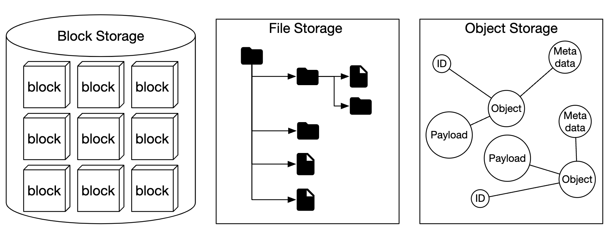
</div>

| Tiêu chí                          | Block Storage                          | File Storage                                  | Object Storage                                |
|-----------------------------------|----------------------------------------|-----------------------------------------------|-----------------------------------------------|
| Nội dung có thể sửa đổi (Mutable) | Có (Y)                                 | Có (Y)                                        | Không (N - hỗ trợ qua Object Versioning)      |
| Chi phí (Cost)                    | Cao                                    | Trung bình đến cao                            | Thấp                                          |
| Hiệu năng (Performance)           | Trung bình đến cao, rất cao            | Trung bình đến cao                            | Thấp đến trung bình                           |
| Tính nhất quán (Consistency)      | Nhất quán mạnh (Strong consistency)    | Nhất quán mạnh (Strong consistency)           | Nhất quán mạnh (Strong consistency) [5]       |
| Phương thức truy cập dữ liệu      | SAS / iSCSI / FC                       | Truy cập file tiêu chuẩn, CIFS/SMB và NFS     | RESTful API                                   |
| Khả năng mở rộng (Scalability)    | Trung bình                             | Cao                                           | Khổng lồ (Vast scalability)                   |
| Phù hợp cho                       | Máy ảo (VM), Databases                 | Truy cập hệ thống tệp đa dụng                 | Dữ liệu nhị phân (Binary), phi cấu trúc       |

Một số thuật ngữ cốt lõi liên quan đến Object Storage:
- **Bucket**: Thùng chứa logic dùng để lưu các Object. Tên của mỗi Bucket phải là duy nhất trên toàn cầu (globally unique).
- **Object**: Một đơn vị dữ liệu riêng lẻ được lưu trong một Bucket, bao gồm hai phần: dữ liệu thực tế của đối tượng (Object data/payload) và dữ liệu đặc tả (Metadata).
- **Versioning**: Tính năng cho phép lưu giữ nhiều phiên bản biến thể của cùng một Object trong cùng một Bucket theo thời gian.
- **Uniform Resource Identifier (URI)**: Mỗi tài nguyên (Bucket hoặc Object) được định danh duy nhất bằng một đường dẫn URI qua giao thức HTTP.
- **Service-Level Agreement (SLA)**: Cam kết chất lượng dịch vụ giữa nhà cung cấp và khách hàng.

Ví dụ về cam kết SLA của hạng lưu trữ Amazon S3 Standard-Infrequent Access:
- Độ bền dữ liệu (Durability) đạt **99.999999999% (11 số 9)** trải rộng trên nhiều Availability Zones (AZ).
- Dữ liệu vẫn an toàn và phục hồi được ngay cả khi toàn bộ một Availability Zone bị phá hủy hoàn toàn.
- Được thiết kế cho tính sẵn sàng (Availability) đạt **99.9%**.

---

## Bước 1: Thấu hiểu bài toán và Xác lập phạm vi thiết kế (Understand the Problem and Establish Design Scope)

- **C:** Hệ thống của chúng ta cần bao gồm những tính năng nào ạ?
- **I:** Tạo Bucket, Tải lên (Upload) và tải xuống (Download) Object, quản lý phiên bản (Versioning), và Liệt kê danh sách các Object trong một Bucket (Listing objects).
- **C:** Kích thước dữ liệu điển hình của các Object là bao nhiêu?
- **I:** Chúng ta cần lưu trữ hiệu quả cả những Object có dung lượng khổng lồ (vài GB) lẫn hàng triệu Object có kích thước rất nhỏ (vài KB).
- **C:** Chúng ta cần lưu trữ bao nhiêu dữ liệu mới mỗi năm?
- **I:** **100 Petabytes (PB)** mỗi năm.
- **C:** Chúng ta có thể giả định yêu cầu về độ bền dữ liệu (Data durability) là **6 số 9 (99.9999%)** và tính sẵn sàng của dịch vụ (Service availability) là **4 số 9 (99.99%)** không ạ?
- **I:** Vâng, con số đó hoàn toàn hợp lý.

### **Yêu cầu phi chức năng (Non-functional requirements)**

- Dung lượng tăng thêm **100 PB dữ liệu mỗi năm**.
- Độ bền dữ liệu (**Data durability**) đạt **6 số 9 (99.9999%)**.
- Tính sẵn sàng của dịch vụ (**Service availability**) đạt **4 số 9 (99.99%)**.
- Hiệu quả lưu trữ (Storage efficiency): Giảm thiểu chi phí lưu trữ phần cứng trong khi vẫn duy trì độ tin cậy và hiệu năng cao.

### **Ước lượng sơ bộ (Back-of-the-envelope estimation)**

Hệ thống Object Storage thường gặp điểm nghẽn cổ chai ở **dung lượng ổ đĩa (Disk capacity)** hoặc **số thao tác đọc/ghi trên giây của ổ đĩa (Disk IOPS)**.

Các giả định:
- Phân bổ kích thước Object:
  - 20% là Object nhỏ (dưới 1 MB) — lấy trung vị là **0.5 MB**.
  - 60% là Object trung bình (từ 1 MB đến 64 MB) — lấy trung vị là **32 MB**.
  - 20% là Object lớn (trên 64 MB) — lấy trung vị là **200 MB**.
- Một ổ cứng cơ học (SATA HDD, 7200 RPM) có khả năng thực hiện khoảng **100–150 thao tác tìm kiếm ngẫu nhiên mỗi giây (100–150 IOPS)**.

Từ các giả định trên, chúng ta có thể ước tính tổng số lượng Object mà hệ thống có thể lưu trữ:
- Kích thước trung bình gia quyền của một Object: $0.2 \times 0.5\text{ MB} + 0.6 \times 32\text{ MB} + 0.2 \times 200\text{ MB} = 59.3\text{ MB}$.
- Với tổng dung lượng 100 PB ($10^{11}\text{ MB}$) và giả sử hệ số sử dụng dung lượng là 40%, hệ thống chứa khoảng **0,68 tỷ (680 triệu) Objects**.
- Nếu mỗi Object có khoảng 1 KB dữ liệu Metadata, chúng ta chỉ cần khoảng **0,68 TB** dung lượng để lưu trữ toàn bộ thông tin Metadata.

---

## Bước 2: Đề xuất Thiết kế Tổng quan và Thống nhất Phương án (Propose High-Level Design and Get Buy-In)

Trước khi đi vào kiến trúc, hãy điểm qua một số đặc tính thú vị của Object Storage:
- **Tính bất biến của Object (Object Immutability):** Các Object trong Object Storage là **bất biến (immutable)** — khác hẳn với Block hay File Storage. Chúng ta có thể xóa hoặc ghi đè thay thế toàn bộ Object bằng một phiên bản mới, nhưng không thể sửa đổi một phần byte ở giữa Object hiện có.
- **Mô hình Key-Value Store:** URI của một Object đóng vai trò là `Key`, và chúng ta có thể lấy nội dung của nó (`Value`) thông qua một lời gọi HTTP.
- **Ghi một lần, đọc nhiều lần (Write once, read many times - WORM):** Mẫu truy cập dữ liệu điển hình là ghi một lần nhưng đọc lại rất nhiều lần. Theo nghiên cứu hạ tầng của LinkedIn, 95% tổng số Request là các thao tác đọc.
- Hỗ trợ tốt cả các Object rất nhỏ lẫn các Object cực lớn.

Triết lý thiết kế của Object Storage có nét tương đồng sâu sắc với hệ thống tệp **UNIX File System**. Trong UNIX, khi chúng ta lưu một tệp, hệ thống lưu tên tệp và siêu dữ liệu vào một cấu trúc dữ liệu gọi là **inode**, còn nội dung dữ liệu thực tế của tệp được lưu ở các khối (data blocks) khác nhau trên ổ đĩa. Cấu trúc `inode` chứa danh sách các con trỏ khối (file block pointers) trỏ tới các vị trí vật lý tương ứng trên đĩa cứng.

Khi truy cập một tệp, hệ điều hành đầu tiên sẽ tra cứu Metadata từ `inode` trước khi tìm đến đọc nội dung tệp thực tế.

Object Storage hoạt động hoàn toàn tương tự: **Metadata Store** đóng vai trò như `inode` để lưu thông tin định danh và thuộc tính của Object, trong khi dữ liệu nhị phân thực tế được lưu trữ trong **Data Store**:

<div style="margin-left:3rem">
    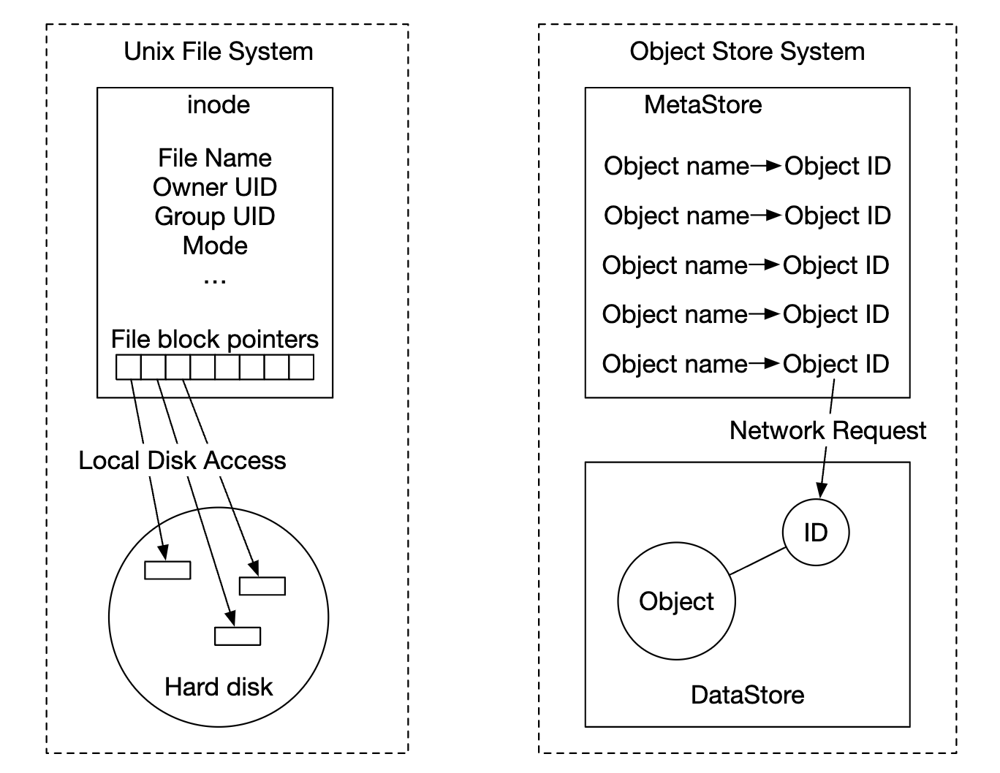
</div>

Nhờ tách biệt hoàn toàn Metadata khỏi nội dung dữ liệu của Object, chúng ta có thể mở rộng quy mô (scale) của Metadata Store và Data Store một cách độc lập:

<div style="margin-left:3rem">
    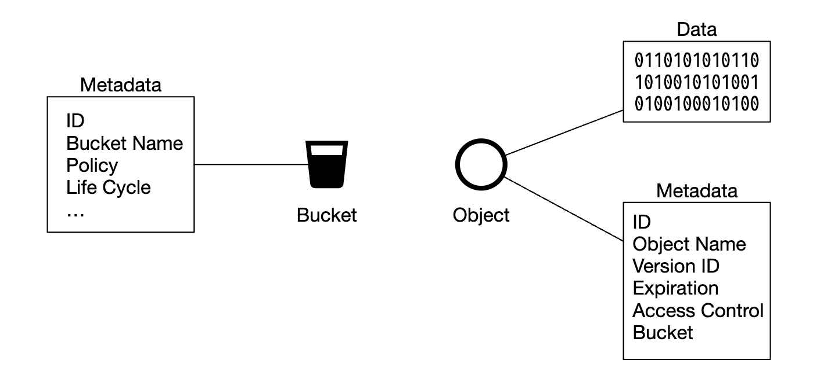
</div>

### **Thiết kế kiến trúc tổng quan (High-level design)**

<div style="margin-left:3rem">
    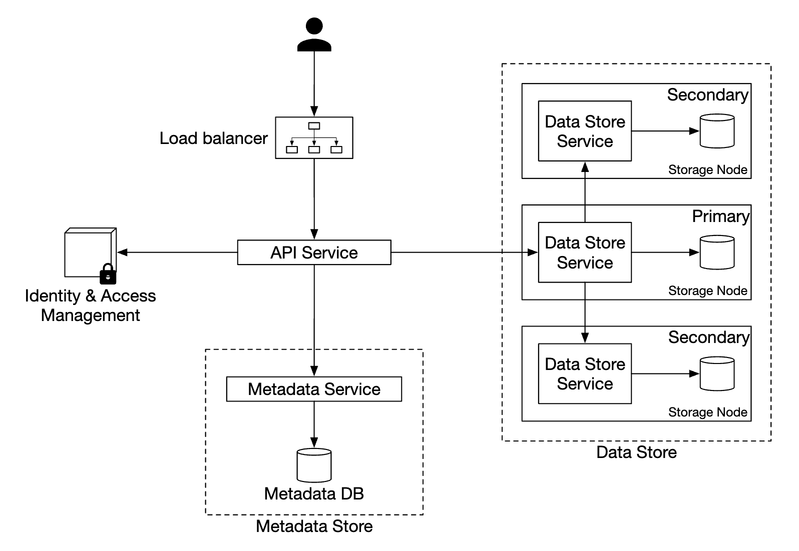
</div>

- **Load Balancer**: Phân phối các API Request tới cụm các API Service Replicas.
- **API Service**: Các Server Stateless chịu trách nhiệm điều phối (orchestrate) các lời gọi tới IAM Service, Metadata Store và Data Store.
- **Identity and Access Management (IAM)**: Hệ thống trung tâm phụ trách xác thực (Authentication), phân quyền (Authorization) và kiểm soát truy cập (Access Control).
- **Data Store**: Lưu trữ và truy xuất dữ liệu thực tế (payload) của Object. Mọi thao tác tại đây đều dựa trên định danh nội bộ của Object là `object_id` (kiểu UUID), hoàn toàn không cần biết đến tên Bucket hay đường dẫn.
- **Metadata Store**: Lưu trữ toàn bộ dữ liệu Metadata của các Bucket và Object (ánh xạ từ tên Object sang `object_id`).

### **Luồng tải lên một Object (Uploading an object)**

<div style="margin-left:3rem">
    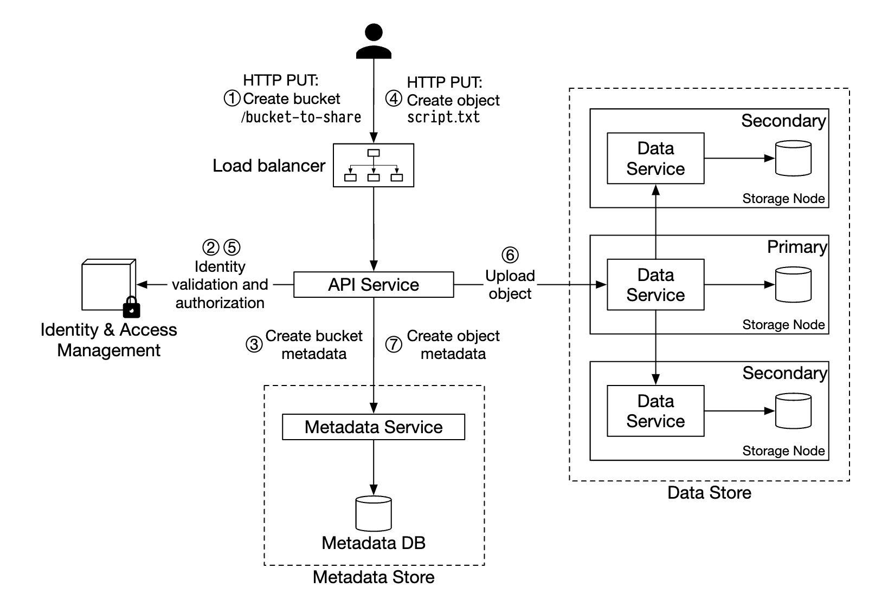
</div>

1. Client gửi HTTP `PUT` Request để tạo một Bucket có tên `"bucket-to-share"`.
2. **API Service** gọi tới **IAM** để xác minh danh tính người dùng và đảm bảo họ có quyền tạo Bucket (write permissions).
3. **API Service** gọi tới **Metadata Store** để tạo bản ghi mới trong bảng Bucket. Sau khi tạo xong, hệ thống trả về thông báo thành công cho Client.
4. Sau khi Bucket đã tồn tại, Client gửi tiếp một HTTP `PUT` Request để tải lên một Object có tên `"script.txt"`.
5. **API Service** gọi **IAM** để xác thực và kiểm tra quyền ghi của người dùng vào Bucket `"bucket-to-share"`.
6. Khi kiểm tra hợp lệ thành công, **API Service** gửi luồng dữ liệu (payload) của Object qua HTTP `PUT` tới **Data Store**. **Data Store** lưu bền vững dữ liệu này lên đĩa và trả về một mã `UUID` (`object_id`).
7. **API Service** gọi **Metadata Store** để tạo một bản ghi mới lưu mối liên kết giữa `object_id` (UUID), `bucket_id`, `bucket_name`, `object_name` (`"script.txt"`) cùng các thông tin Metadata khác.

Ví dụ về HTTP Request khi tải lên một Object:

```
PUT /bucket-to-share/script.txt HTTP/1.1
Host: foo.s3example.org
Date: Sun, 12 Sept 2021 17:51:00 GMT
Authorization: authorization string
Content-Type: text/plain
Content-Length: 4567
x-amz-meta-author: Alex

[4567 bytes of object data]
```

### **Luồng tải xuống một Object (Downloading an object)**

Như đã biết, Bucket không hề có cấu trúc thư mục phân cấp vật lý. Tuy nhiên, chúng ta có thể tạo ra một cấu trúc phân cấp logic bằng cách ghép nối tên Bucket và tên Object (sử dụng dấu gạch chéo `/`) để mô phỏng cấu trúc thư mục quen thuộc cho người dùng.

Ví dụ về HTTP `GET` Request để tải một Object:

```
GET /bucket-to-share/script.txt HTTP/1.1
Host: foo.s3example.org
Date: Sun, 12 Sept 2021 18:30:01 GMT
Authorization: authorization string
```

<div style="margin-left:3rem">
    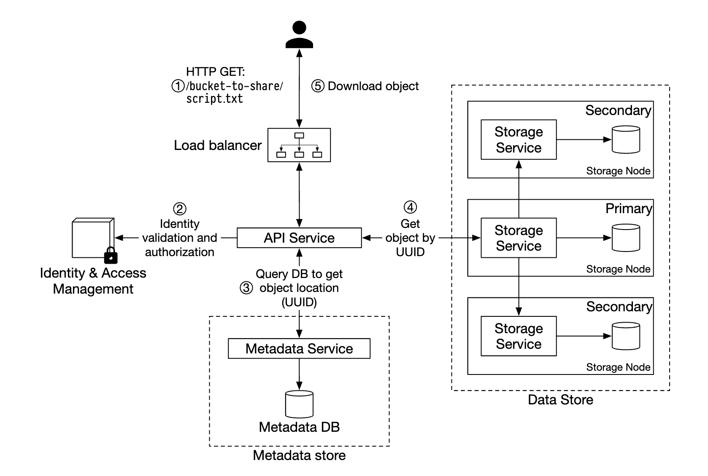
</div>

1. Client gửi HTTP `GET` Request tới Load Balancer: `GET /bucket-to-share/script.txt`.
2. **API Service** truy vấn **IAM** để xác minh người dùng có quyền đọc (`READ`) đối với Object trong Bucket này.
3. Sau khi xác thực quyền thành công, **API Service** truy vấn **Metadata Store** để tìm `UUID` (`object_id`) tương ứng với tên Object đó.
4. **API Service** lấy dữ liệu thực tế (payload) của Object từ **Data Store** dựa theo `UUID` và trả về cho Client.

---

## Bước 3: Đi sâu vào Thiết kế Chi tiết (Design Deep Dive)

### **Kho lưu trữ dữ liệu (Data store)**

Hãy xem cách API Service tương tác với Data Store ở mức chi tiết hơn:

<div style="margin-left:3rem">
    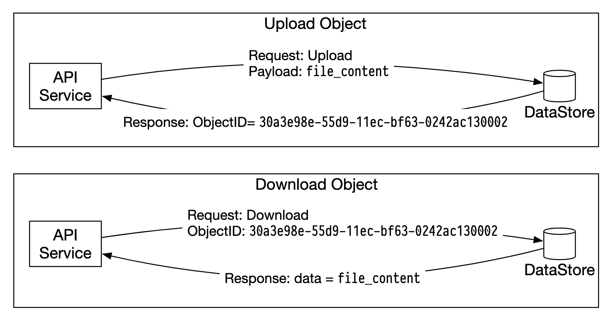
</div>

Data Store được cấu thành từ ba thành phần chính:

<div style="margin-left:3rem">
    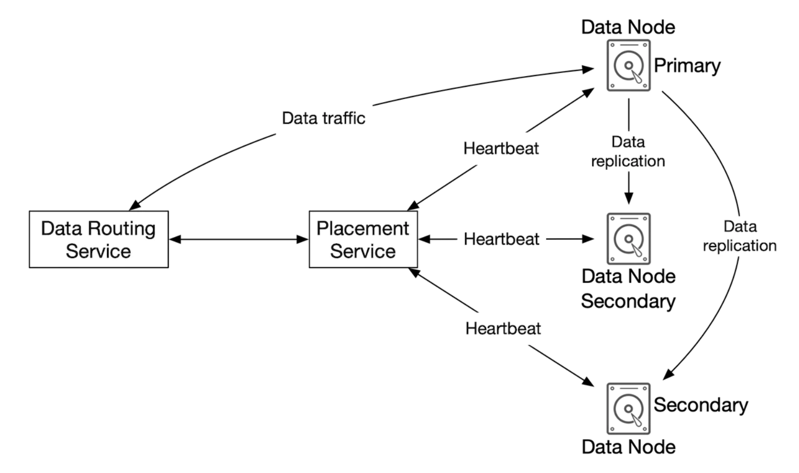
</div>

1. **Data Routing Service (Dịch vụ định tuyến dữ liệu):**
   Cung cấp các RESTful hoặc gRPC API để giao tiếp với cụm các Data Nodes. Đây là một dịch vụ **Stateless**, có thể mở rộng dễ dàng bằng cách thêm nhiều Server.
   Trách nhiệm chính của nó bao gồm:
   - Truy vấn **Placement Service** để tìm ra Data Node phù hợp nhất cho việc lưu trữ dữ liệu mới.
   - Đọc dữ liệu từ các Data Nodes và trả về cho API Service.
   - Ghi dữ liệu xuống các Data Nodes.

2. **Placement Service (Dịch vụ phân bổ vị trí):**
   Quyết định những Data Nodes nào sẽ lưu trữ một Object cụ thể. Nó duy trì một **Bản đồ cụm ảo (Virtual Cluster Map)** phản ánh cấu trúc vật lý (physical topology — trung tâm dữ liệu, tủ rack, máy chủ) của toàn bộ cụm lưu trữ:

<div style="margin-left:3rem">
    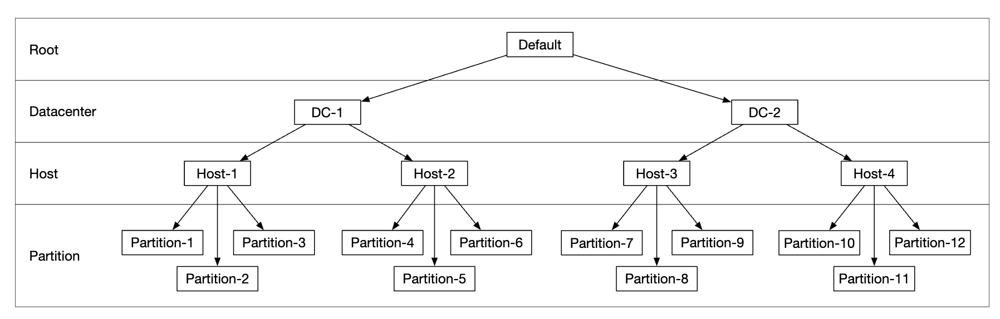
</div>

   Placement Service cũng liên tục theo dõi tín hiệu **Heartbeat** từ tất cả các Data Nodes để phát hiện sớm những Node bị sập và loại chúng khỏi Virtual Cluster Map.
   Vì đây là thành phần sống còn của tầng lưu trữ, chúng ta nên triển khai một cụm gồm 5 hoặc 7 Replicas đồng bộ với nhau qua các **Thuật toán đồng thuận (Consensus Algorithms)** như **Paxos** hoặc **Raft** (ví dụ: cụm 7 Node có thể chịu được sự cố sập đồng thời tới 3 Node mà vẫn hoạt động bình thường).

3. **Data Node (Nút lưu trữ dữ liệu):**
   Là nơi lưu trữ dữ liệu nhị phân thực tế của các Object trên các ổ cứng vật lý. Độ tin cậy và độ bền dữ liệu được đảm bảo bằng cách sao chép dữ liệu sang nhiều Data Nodes khác nhau.
   Mỗi Data Node có một tiến trình chạy ngầm (Storage Daemon) định kỳ gửi tín hiệu Heartbeat về cho Placement Service. Nội dung Heartbeat bao gồm:
   - Số lượng ổ đĩa (HDD hoặc SSD) mà Data Node đó đang quản lý.
   - Dung lượng đã sử dụng và còn trống trên từng ổ đĩa.

#### Luồng lưu trữ dữ liệu bền vững (Data persistence flow)

<div style="margin-left:3rem">
    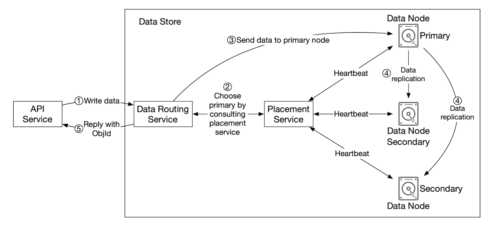
</div>

1. **API Service** chuyển tiếp dữ liệu Object xuống **Data Store** (cụ thể là tới **Data Routing Service**).
2. **Data Routing Service** tạo một `UUID` cho Object này và truy vấn **Placement Service** để biết nhóm nhân bản (Replication Group) nào sẽ lưu trữ nó, sau đó gửi dữ liệu tới **Primary Data Node** của nhóm đó.
3. **Primary Data Node** lưu dữ liệu vào ổ đĩa cục bộ của mình và đồng thời sao chép (replicate) sang hai **Secondary Data Nodes**. Chỉ sau khi việc sao chép thành công, Primary Data Node mới trả về phản hồi hoàn tất cho Data Routing Service.
4. Mã `UUID` của Object được trả ngược về cho **API Service**.

**Các điểm lưu ý quan trọng:**
- Với một `UUID` đầu vào, nhóm nhân bản (Replication Group) của nó được xác định một cách tất định bằng thuật toán **Băm nhất quán (Consistent Hashing)**.
- Ở bước 3, Primary Data Node thực hiện sao chép đồng bộ sang các Secondary Nodes trước khi trả về kết quả thành công. Thiết kế này ưu tiên **Tính nhất quán mạnh (Strong Consistency)** và chấp nhận đánh đổi bằng Latency ghi cao hơn:

<div style="margin-left:3rem">
    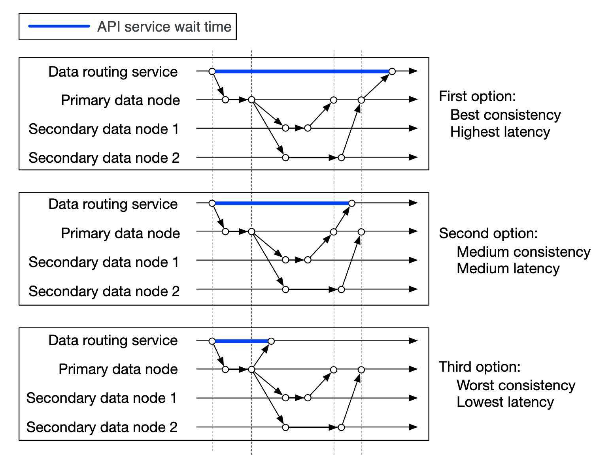
</div>

#### Cách tổ chức dữ liệu trên ổ đĩa (How data is organized)

Một cách tiếp cận đơn giản nhất để quản lý dữ liệu trên mỗi Data Node là lưu mỗi Object thành một tệp (file) riêng biệt trên hệ thống tệp cục bộ.

Cách này dễ làm nhưng sẽ gặp vấn đề nghiêm trọng về hiệu năng và lãng phí tài nguyên khi phải xử lý hàng trăm triệu **tệp có kích thước nhỏ (small files)**:
- **Lãng phí các khối dữ liệu (Data blocks) trên ổ cứng:** Hệ thống tệp chia ổ đĩa thành các khối rời rạc (kích thước khối tiêu chuẩn thường là 4 KB). Mỗi tệp dù chỉ nặng 100 bytes vẫn chiếm nguyên một khối 4 KB trên đĩa.
- **Cạn kiệt số lượng `inode`:** Nhiều tệp nhỏ đồng nghĩa với việc tiêu tốn hàng triệu `inode`. Hệ điều hành xử lý không tốt khi số lượng `inode` quá lớn, và bản thân mỗi hệ thống tệp đều có giới hạn cứng về số lượng `inode` tối đa.

Để giải quyết triệt để hai vấn đề trên, chúng ta gộp nhiều Object nhỏ vào chung một tệp lớn có kích thước cố định (chẳng hạn vài GB, chỉ cho phép đọc sau khi đã đầy) theo mô hình ghi nối tiếp như một **Write-Ahead Log (WAL)**. Khi một tệp chạm ngưỡng dung lượng tối đa (ví dụ: 2 GB), hệ thống sẽ khóa tệp đó thành chỉ đọc (read-only) và tạo một tệp mới để tiếp tục ghi nối vào cuối:

<div style="margin-left:3rem">
    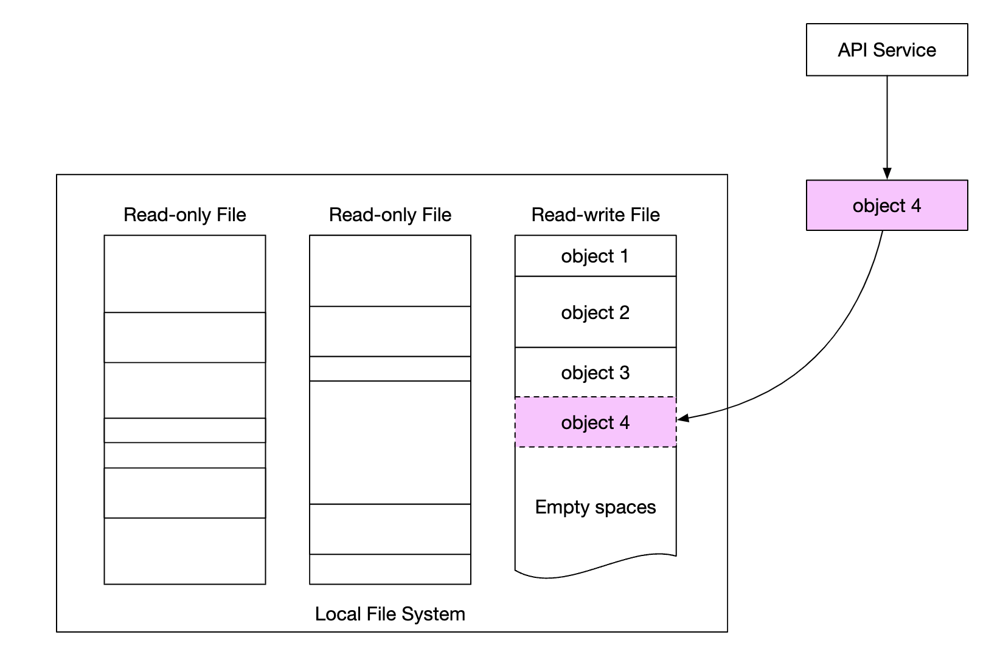
</div>

Nhược điểm duy nhất của việc ghi nối tiếp vào một tệp WAL lớn là các thao tác ghi vào cùng một tệp phải được **tuần tự hóa (serialized)** — nếu nhiều nhân CPU (cores) cùng muốn ghi vào một tệp, chúng sẽ phải xếp hàng chờ nhau. Để tránh tranh chấp khóa (lock contention), chúng ta có thể gán các tệp đang mở cho từng luồng/nhân CPU chuyên biệt xử lý độc lập.

#### Tra cứu vị trí Object trong tệp gộp (Object lookup)

Khi đã lưu hàng nghìn Object nối tiếp nhau bên trong cùng một tệp lớn, làm sao Data Node biết chính xác một Object nằm ở đâu để đọc ra? Chúng ta cần duy trì một bảng ánh xạ cục bộ (`object_mapping`) lưu giữ các thông tin sau cho mỗi Object:
- `object_id`: Mã UUID của Object.
- `file_name`: Tên tệp lớn đang chứa Object đó (ví dụ: `/data/c`).
- `start_offset`: Vị trí byte bắt đầu của Object bên trong tệp.
- `object_size`: Kích thước (số byte) của Object.

Chúng ta có thể lưu bảng `object_mapping` này trong một Key-Value Store dựa trên tệp như **RocksDB** hoặc một Relational Database truyền thống. Vì mẫu truy cập ở đây là **ghi một lần (khi tạo Object) và đọc rất nhiều lần**, một Relational Database có chỉ mục B-Tree sẽ cho hiệu năng đọc điểm (point lookup) rất tốt và tiêu tốn ít tài nguyên hơn.

**Vậy chúng ta nên triển khai Database này như thế nào?**
Nếu triển khai một cụm Relational Database tập trung dùng chung cho toàn bộ các Data Nodes, chúng ta sẽ phải mở rộng cụm DB này rất vất vả và gánh thêm độ trễ mạng (network latency) giữa Data Node và DB Cluster.

Thay vào đó, hãy tận dụng một sự thật hiển nhiên: mỗi Data Node chỉ quan tâm đến các Object đang nằm trên chính ổ đĩa của nó mà thôi! Do đó, chúng ta có thể nhúng trực tiếp một Relational Database gọn nhẹ chạy ngay bên trong từng Data Node. **SQLite** là một lựa chọn hoàn hảo cho bài toán này vì nó là một Relational Database dựa trên tệp (file-based), cực kỳ nhẹ, tin cậy và không cần tiến trình Server riêng.

#### Luồng lưu trữ dữ liệu sau khi tối ưu (Updated data persistence flow)

<div style="margin-left:3rem">
    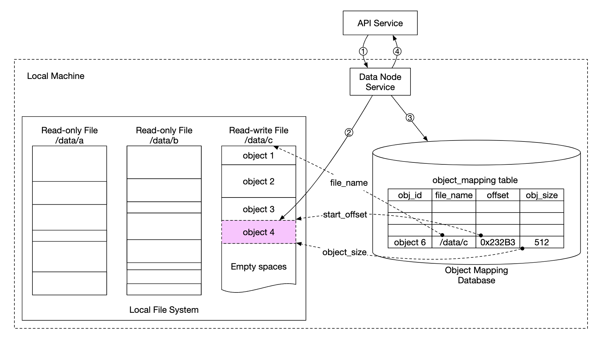
</div>

1. **API Service** gửi yêu cầu lưu một Object mới xuống Data Node.
2. Dịch vụ trên **Data Node** ghi nối tiếp (append) dữ liệu của Object mới vào cuối tệp đang mở mang tên `/data/c`.
3. Một bản ghi mới chứa `(object_id, "/data/c", start_offset, object_size)` được chèn vào bảng `object_mapping` trong SQLite cục bộ của Data Node đó.

#### Độ bền dữ liệu: Sao chép so với Mã hóa xóa (Durability: Replication vs. Erasure Coding)

Độ bền dữ liệu (Data durability) đạt 6 số 9 (hoặc lên tới 11 số 9 như S3) là yêu cầu cốt lõi của hệ thống. Để đạt được mức độ bền này, mọi kịch bản lỗi phần cứng đều phải được tính toán kỹ lưỡng.

Vấn đề đầu tiên là lỗi hỏng ổ cứng. Chúng ta giảm thiểu xác suất mất dữ liệu bằng cách sao chép dữ liệu ra nhiều bản (Replication). Tuy nhiên, việc chỉ tạo 3 bản sao trên cùng một tủ Rack hoặc cùng một Data Center là chưa đủ an toàn, vì một sự cố mất điện, hỏng Switch mạng hoặc cháy nổ có thể đánh sập toàn bộ các máy chủ trong cùng một khu vực. Do đó, dữ liệu bắt buộc phải được phân bổ cách ly qua nhiều **Miền lỗi (Failure Domains)** khác nhau (khác tủ Rack, khác phòng máy, khác Availability Zone):

<div style="margin-left:3rem">
    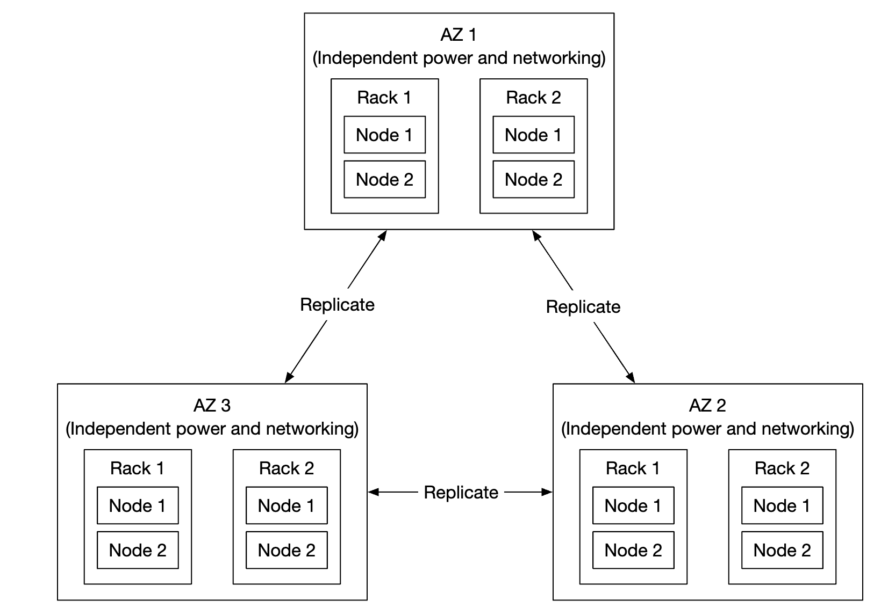
</div>

Giả sử tỷ lệ hỏng hàng năm (Annual Failure Rate - AFR) của một ổ cứng HDD điển hình là 0.81%, việc duy trì 3 bản sao độc lập trên 3 Failure Domains sẽ mang lại cho chúng ta độ bền đạt mức **6 số 9 (99.9999%)**.

Tuy nhiên, sao chép 3 bản (3x Replication) tiêu tốn tới **200% dung lượng lưu trữ phụ trội (storage overhead)** — muốn lưu 100 PB dữ liệu gốc của khách hàng, chúng ta phải mua tới 300 PB ổ cứng vật lý! Để cắt giảm mạnh chi phí lưu trữ này mà vẫn tăng cường độ bền dữ liệu, các hệ thống Object Storage hiện đại áp dụng kỹ thuật **Mã hóa xóa (Erasure Coding)**.

**Erasure Coding** hoạt động bằng cách chia nhỏ một khối dữ liệu thành các mảnh dữ liệu (data chunks) có kích thước bằng nhau, sau đó dùng thuật toán toán học (như Reed-Solomon) để tính toán ra các mảnh kiểm tra chẵn lẻ (**parity chunks**). Khi một số mảnh bị mất do hỏng ổ đĩa, hệ thống có thể tái tạo lại chính xác dữ liệu gốc từ các mảnh còn sống sót:

<div style="margin-left:3rem">
    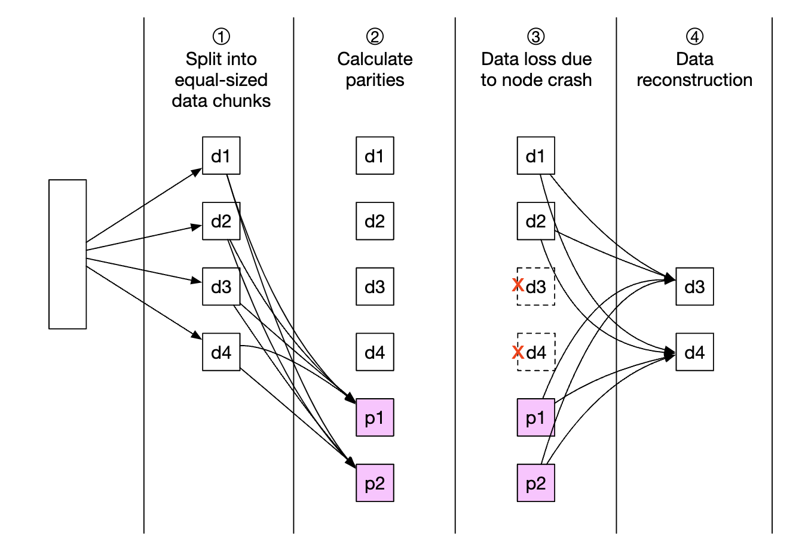
</div>

Trong minh họa trên (mô hình 4+2), dữ liệu được chia thành 4 mảnh gốc và tính thêm 2 mảnh Parity. Ngay cả khi 2 trên tổng số 6 Node bị hỏng cùng lúc, dữ liệu vẫn được khôi phục nguyên vẹn từ 4 Node còn lại.

Trong thực tế, có nhiều cấu hình Erasure Coding khác nhau. Đối với hệ thống của chúng ta, cấu hình **8+4 Erasure Coding** (8 mảnh dữ liệu gốc + 4 mảnh Parity = 12 mảnh tổng cộng), phân bổ đều trên 3 Availability Zones (mỗi AZ chứa 4 mảnh), là một lựa chọn tối ưu để cực đại hóa độ tin cậy — ngay cả khi nguyên một AZ bị sập hoàn toàn (mất 4 mảnh), chúng ta vẫn còn đủ 8 mảnh ở 2 AZ còn lại để đọc và khôi phục dữ liệu:

<div style="margin-left:3rem">
    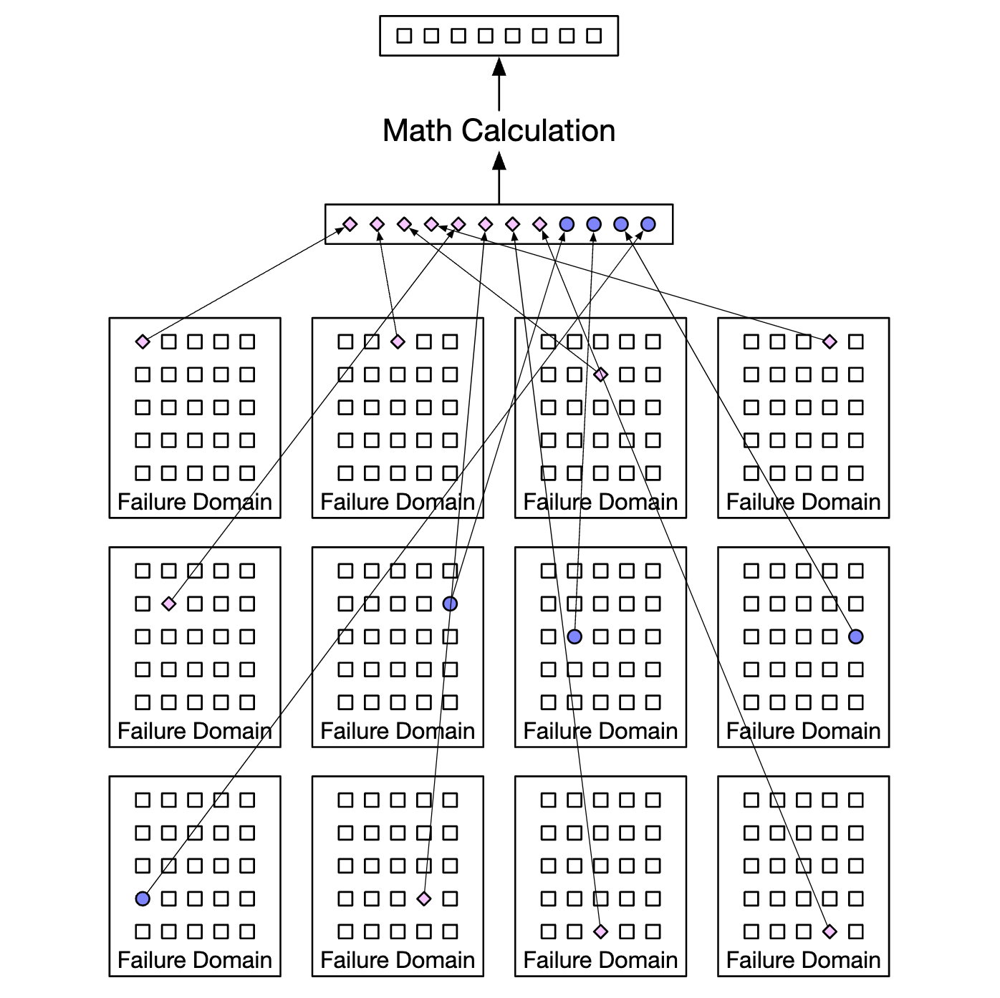
</div>

Erasure Coding giúp giảm mạnh chi phí phần cứng lưu trữ (chỉ tốn **50% overhead** thay vì 200% như 3x Replication), nhưng đánh đổi lại bằng tốc độ truy cập chậm hơn và tốn CPU hơn, do Data Routing Service phải thu thập và ghép các mảnh dữ liệu từ nhiều Node khác nhau trong mỗi lần đọc/ghi:

<div style="margin-left:3rem">
    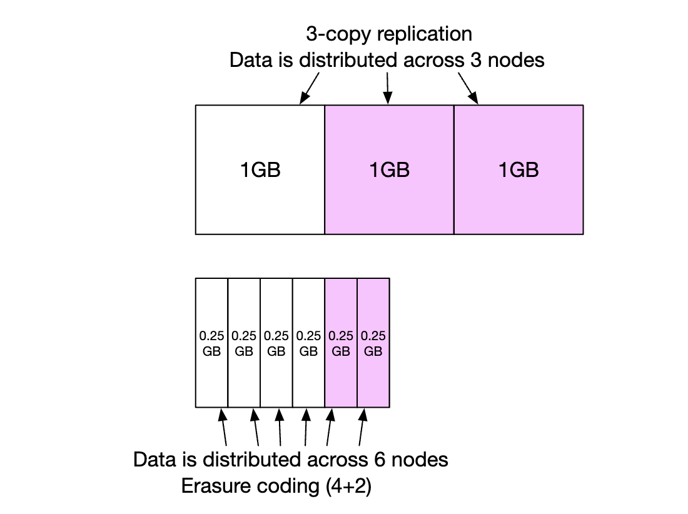
</div>

**Bảng so sánh tóm tắt giữa Replication và Erasure Coding:**
- **Chi phí lưu trữ phụ trội (Storage overhead):** 3x Replication tốn **200%** dung lượng phụ trội, trong khi Erasure Coding (8+4) chỉ tốn **50%**.
- **Độ bền dữ liệu (Durability):** Erasure Coding mang lại độ bền lên tới [**11 số 9 (99.999999999%)**](https://github.com/Backblaze/erasure-coding-durability) so với 6 số 9 của 3x Replication.
- **Chi phí tính toán & độ trễ:** Erasure Coding tiêu tốn nhiều tài nguyên CPU và băng thông mạng nội bộ hơn để tính toán và ghép nối các khối Parity.

Tóm lại, **Replication** phù hợp cho các ứng dụng nhạy cảm với độ trễ (latency-sensitive), trong khi **Erasure Coding** là vũ khí tối thượng để tối ưu hóa chi phí lưu trữ và đạt độ bền dữ liệu chuẩn công nghiệp cho Object Storage (dù việc triển khai phức tạp hơn nhiều).

#### Kiểm tra tính toàn vẹn dữ liệu (Correctness verification)

Nếu một ổ đĩa bị cháy hỏng hoàn toàn, hệ thống sẽ phát hiện ra ngay lập tức. Nhưng nếu một vài bit dữ liệu trên mặt đĩa từ bị lỗi âm thầm (bit rot / silent data corruption), làm sao chúng ta biết dữ liệu đọc lên đã bị hỏng?

Giải pháp là sử dụng **Checksum** (ví dụ: MD5, SHA-256, CRC32) — một giá trị băm ngắn gọn được tính từ nội dung dữ liệu, dùng để kiểm chứng tính toàn vẹn của tệp.

Trong thiết kế của chúng ta, hệ thống lưu Checksum ở cả hai cấp độ: ở cuối mỗi tệp WAL lớn và ở cuối từng Object riêng lẻ bên trong tệp đó:

<div style="margin-left:3rem">
    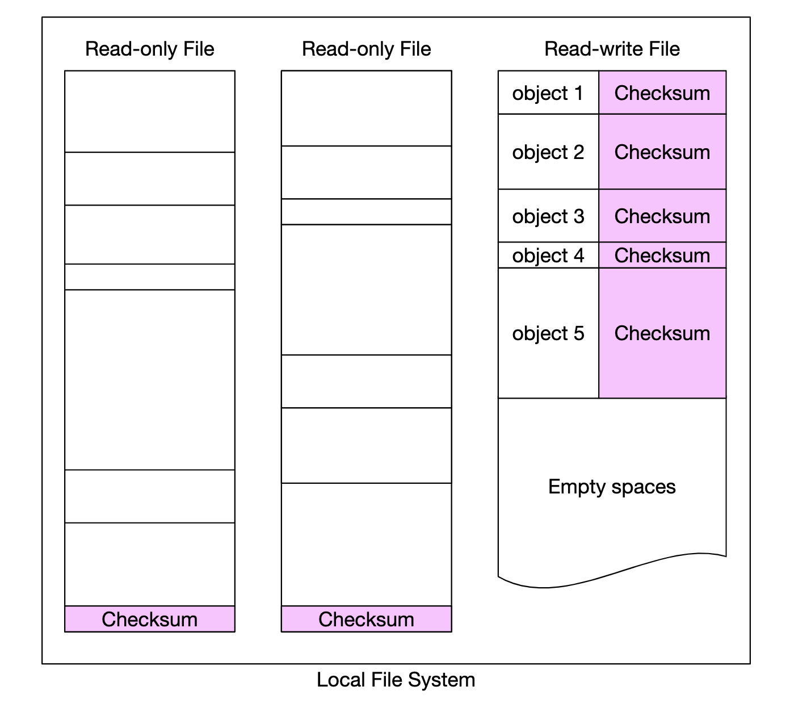
</div>

Trong trường hợp sử dụng Erasure Coding (8+4), khi đọc dữ liệu, hệ thống sẽ tải 8 mảnh dữ liệu về và kiểm tra Checksum của từng mảnh; nếu phát hiện mảnh nào bị lỗi Checksum, nó sẽ dùng các mảnh Parity để khôi phục lại mảnh bị hỏng đó.

---

### **Mô hình dữ liệu Metadata (Metadata data model)**

Schema của hai bảng trong Metadata Store (`bucket` và `object`):

<div style="margin-left:3rem">
    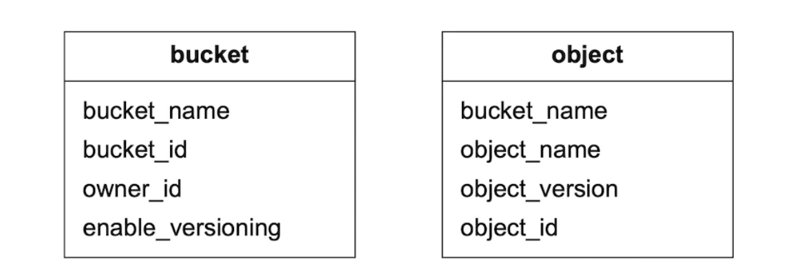
</div>

Các truy vấn chính mà Metadata Store cần hỗ trợ:
1. Tìm `object_id` dựa theo tên Object (`object_name`) và Bucket.
2. Thêm mới hoặc xóa một Object dựa trên tên của nó.
3. Liệt kê tất cả các Object trong cùng một Bucket có chung một tiền tố (`prefix`).

Thông thường, các nhà cung cấp đám mây luôn giới hạn số lượng Bucket tối đa mà một tài khoản có thể tạo (ví dụ: AWS S3 mặc định giới hạn 100 Buckets/tài khoản). Vì vậy, kích thước của bảng `bucket` là rất nhỏ và hoàn toàn nằm gọn trong một Database Server đơn lẻ (chỉ cần thêm Read Replicas để mở rộng băng thông đọc).

Ngược lại, bảng `object` chứa hàng tỷ bản ghi nên chắc chắn không thể nằm vừa trên một Database Server đơn lẻ. Chúng ta cần mở rộng bảng `object` thông qua **Sharding**:
- **Phương án 1: Sharding theo `bucket_id`:** Sẽ dẫn đến vấn đề **điểm nóng (Hotspot)** nghiêm trọng vì một Bucket của khách hàng doanh nghiệp có thể chứa hàng tỷ Objects, làm tràn một Shard.
- **Phương án 2: Sharding theo `object_id` (hoặc `object_name`):** Giúp phân bổ dữ liệu đồng đều, nhưng các truy vấn tìm kiếm hoặc liệt kê theo Bucket sẽ rất chậm vì không gom theo Bucket.
- **Phương án 3: Sharding theo tổ hợp `hash(bucket_name, object_name)`:** Chúng ta chọn phương án này vì hầu hết các thao tác cốt lõi (Upload, Download, Delete một Object cụ thể) đều truyền vào cả `bucket_name` và `object_name`, giúp định tuyến thẳng tới đúng Shard chứa Object đó và phân tán tải cực kỳ đồng đều.

Tuy nhiên, ngay cả với phương án Sharding thứ 3 này, thao tác **liệt kê danh sách các Object trong một Bucket (Listing objects)** vẫn sẽ gặp thách thức về hiệu năng.

### **Liệt kê các Object trong một Bucket (Listing objects in a bucket)**

Trong một Database đơn lẻ, việc liệt kê các Object theo tiền tố đường dẫn (mô phỏng thao tác mở một thư mục) được thực hiện dễ dàng bằng câu truy vấn SQL sau:

```
SELECT * FROM object WHERE bucket_id = "123" AND object_name LIKE `abc/%`
```

Nhưng khi bảng `object` đã bị phân mảnh theo `hash(bucket_name, object_name)`, các Object thuộc cùng một Bucket nằm rải rác trên tất cả các Shards. Nếu thực hiện truy vấn trên mọi Shard rồi gom kết quả lại trong bộ nhớ (Scatter-Gather), việc xử lý phân trang (Pagination với `LIMIT` và `OFFSET`) sẽ rất phức tạp và kém hiệu quả.

Để giải quyết triệt để bài toán này, chúng ta có thể tạo thêm một **bảng phi chuẩn hóa (denormalized table)** chuyên phục vụ riêng cho tác vụ liệt kê thư mục, được phân mảnh (sharded) theo `bucket_id` (và tổng hợp trước các tiền tố thư mục). Nhờ đó, mọi truy vấn `List Objects` của một Bucket được cô lập gọn trong một Database Instance duy nhất, giúp tăng tốc độ truy vấn và phân trang lên rất nhiều.

### **Quản lý phiên bản Object (Object versioning)**

Tính năng Versioning cho phép lưu giữ lịch sử nhiều phiên bản của cùng một Object khi người dùng ghi đè hoặc xóa. Cơ chế này hoạt động bằng cách thêm cột `object_version` có kiểu dữ liệu là `TIMEUUID` vào bảng `object`, cho phép sắp xếp các bản ghi của cùng một `(bucket_id, object_name)` theo đúng trình tự thời gian.

Mỗi khi người dùng tải lên một phiên bản mới cho cùng một `object_name`, hệ thống không ghi đè bản ghi cũ mà chèn thêm một dòng mới với `object_id` mới và `object_version` mới nhất:

<div style="margin-left:3rem">
    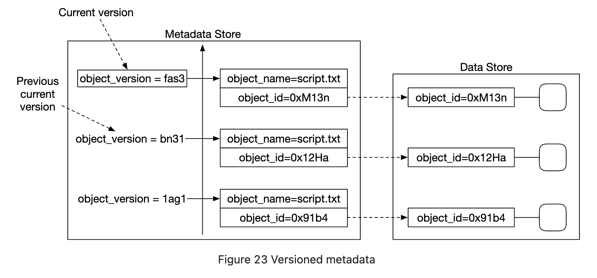
</div>

Khi người dùng xóa một Object có bật Versioning, hệ thống cũng không xóa vật lý các bản ghi cũ ngay mà chèn thêm một phiên bản mới với một giá trị `object_id` đặc biệt gọi là **Delete Marker** (đánh dấu đã xóa). Khi có truy vấn `GET` tới Object đó, thấy phiên bản mới nhất là Delete Marker, hệ thống sẽ trả về mã lỗi `404 Not Found`:

<div style="margin-left:3rem">
    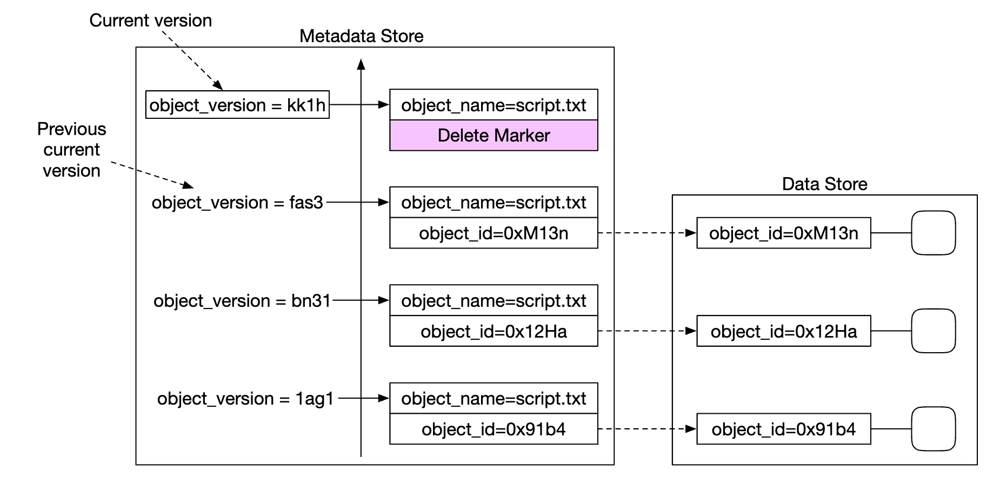
</div>

### **Tối ưu hóa việc tải lên các tệp dung lượng lớn (Optimizing uploads of large files)**

Khi người dùng cần tải lên các tệp khổng lồ (vài GB đến hàng TB), nếu gửi nguyên cả tệp trong một kết nối HTTP duy nhất rồi chẳng may mạng bị đứt ở mức 99%, họ sẽ phải tải lại từ đầu. Giải pháp tiêu chuẩn cho vấn đề này là **Tải lên đa phần (Multipart Upload)** — chia tệp lớn thành nhiều mảnh nhỏ (parts/chunks) và tải lên độc lập song song với nhau:

<div style="margin-left:3rem">
    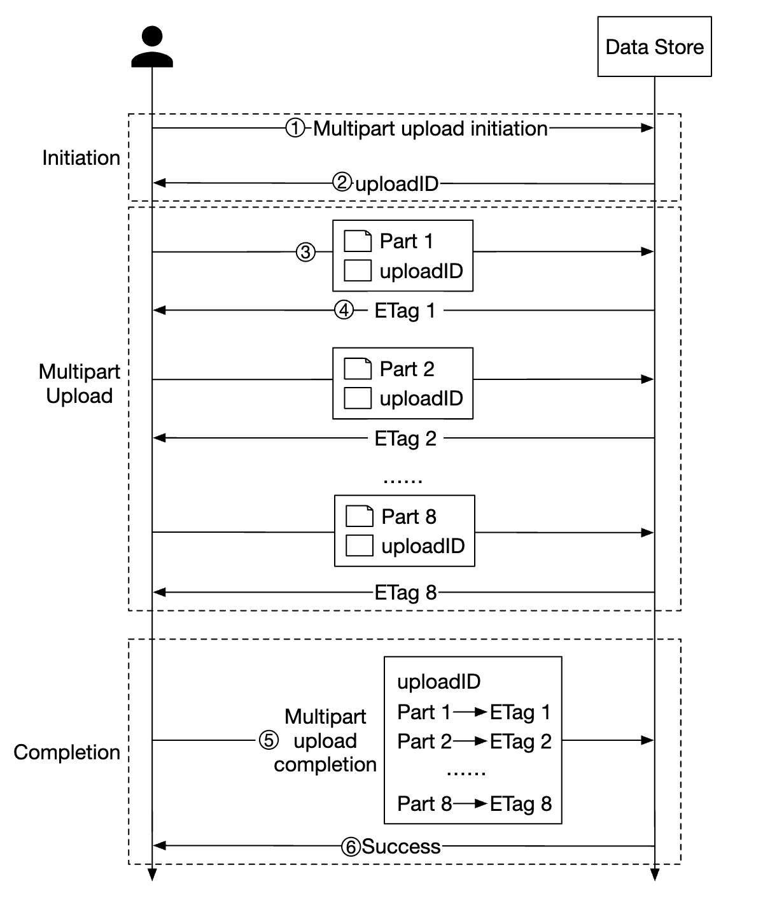
</div>

1. Client gọi API tới Data Store để khởi tạo một phiên Multipart Upload.
2. Data Store trả về một mã định danh duy nhất cho phiên tải lên đó gọi là `uploadID`.
3. Client cắt tệp lớn thành nhiều mảnh nhỏ có đánh số thứ tự (`partNumber` từ 1, 2, 3...) và tải từng mảnh lên độc lập kèm theo `uploadID`.
4. Mỗi khi một mảnh được tải lên thành công, Data Store tính toán và trả về một giá trị `ETag` (thường là mã băm MD5 Checksum của mảnh đó) để xác nhận tính toàn vẹn của mảnh.
5. Sau khi tất cả các mảnh đã được tải lên xong, Client gửi một Request hoàn tất (`Complete Multipart Upload`), truyền kèm `uploadID` cùng danh sách toàn bộ cặp `(partNumber, ETag)`.
6. Data Store kiểm tra các `ETag`, ghép nối các mảnh lại theo đúng thứ tự để tạo thành Object hoàn chỉnh (quá trình này có thể diễn ra trong vài giây đến vài phút tùy dung lượng), sau đó trả về kết quả thành công cho Client.

Sau khi ghép xong (hoặc khi một phiên Multipart Upload bị bỏ dở quá lâu), các mảnh trung gian rời rạc không còn cần thiết nữa và cần được dọn dẹp để thu hồi dung lượng ổ đĩa. Chúng ta sẽ giao việc này cho bộ **Thu gom rác (Garbage Collector)**.

### **Thu gom rác và Nén gộp (Garbage collection & Compaction)**

**Thu gom rác (Garbage Collection)** là quá trình tự động thu hồi lại không gian lưu trữ trên đĩa cứng đối với các dữ liệu không còn giá trị sử dụng. Có ba nguồn chính sinh ra "rác" trong Object Storage:
- **Xóa lười (Lazy object deletion):** Khi người dùng xóa một Object, hệ thống chỉ đánh dấu nó là đã xóa trong Metadata Store mà chưa xóa ngay các byte dữ liệu nằm giữa tệp WAL chỉ đọc trên ổ đĩa.
- **Dữ liệu mồ côi (Orphan data):** Ví dụ như các mảnh (parts) của một phiên Multipart Upload bị đứt gãy giữa chừng và khách hàng không bao giờ hoàn tất.
- **Dữ liệu bị hỏng (Corrupted data):** Các khối dữ liệu không vượt qua được bước kiểm tra Checksum định kỳ.

Garbage Collector cũng chịu trách nhiệm giải phóng dung lượng trên toàn bộ các bản sao (trong mô hình Replication) hoặc trên cả 12 Nodes (trong mô hình Erasure Coding 8+4).

Vì các Object nằm nối tiếp nhau bên trong các tệp WAL lớn chỉ đọc (immutable files), để xóa thực sự các Object đã bị đánh dấu xóa và giải phóng dung lượng ổ cứng, chúng ta sử dụng cơ chế **Nén gộp (Compaction)**:
1. Tiến trình Garbage Collector quét qua các tệp WAL cũ (ví dụ `/data/b` và `/data/e`), chỉ sao chép những Object **còn sống (chưa bị xóa)** sang một tệp mới tinh (ví dụ `/data/d`), bỏ qua hoàn toàn các Object đã bị xóa.
2. Sau khi sao chép xong, bảng `object_mapping` trong SQLite của Data Node được cập nhật lại đường dẫn tệp mới (`/data/d`) và vị trí `start_offset` mới thông qua một Database Transaction nguyên tử, rồi xóa bỏ các tệp cũ `/data/b` và `/data/e`.
3. Để tránh phát sinh quá nhiều tệp nhỏ và tối ưu hóa I/O, tiến trình Compaction chỉ chạy định kỳ trên các tệp có tỷ lệ dữ liệu rác vượt quá một ngưỡng nhất định.

<div style="margin-left:3rem">
    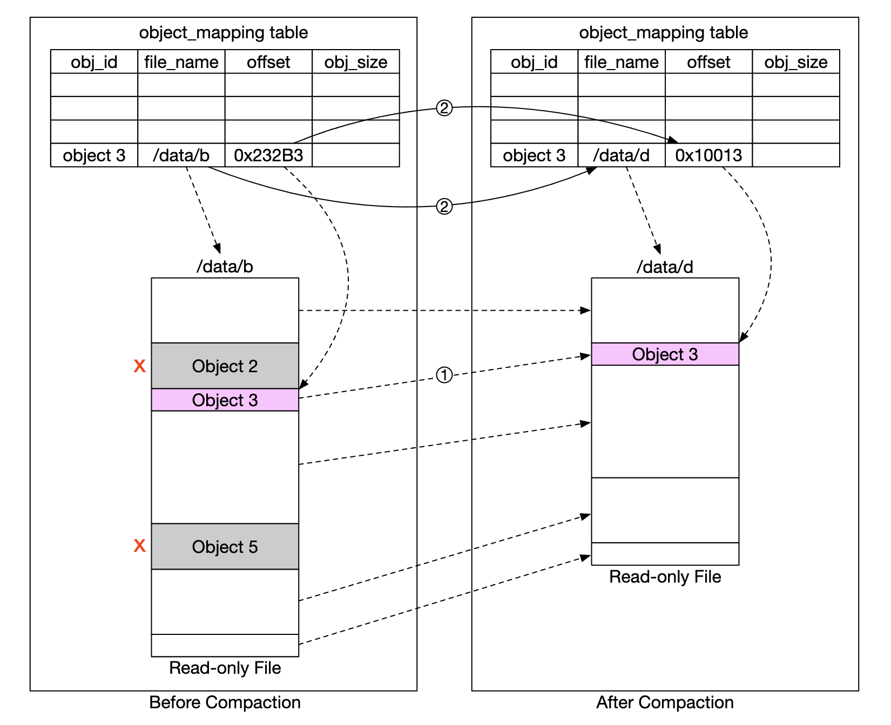
</div>

---

## Bước 4: Tổng kết (Wrap Up)

Những nội dung trọng tâm chúng ta đã giải quyết trong chương này:
- Thiết kế kiến trúc một hệ thống Object Storage quy mô lớn tương tự Amazon S3.
- Phân tích và so sánh sự khác biệt cốt lõi giữa Block Storage, File Storage và Object Storage.
- Thiết kế chi tiết các luồng nghiệp vụ: Tải lên (Upload), Tải xuống (Download), Liệt kê danh sách (Listing), và Quản lý phiên bản (Versioning) các Object trong một Bucket.
- Đi sâu vào tầng lưu trữ: tách biệt Data Store và Metadata Store, gom tệp nhỏ bằng WAL + SQLite, phân tích bài toán độ bền dữ liệu giữa Replication và Erasure Coding (8+4) qua các Failure Domains, kiểm tra toàn vẹn bằng Checksum, Sharding bảng Metadata, tối ưu tải tệp lớn bằng Multipart Upload, và thu hồi dung lượng bằng Garbage Collection & Compaction.
