# Chương 25: Bảng xếp hạng Game Thời gian thực (Real-time Gaming Leaderboard)

## Giới thiệu

Trong chương này, chúng ta sẽ thiết kế một hệ thống **bảng xếp hạng thời gian thực (real-time leaderboard)** cho một tựa game trực tuyến trên thiết bị di động:

<div style="margin-left:3rem">
    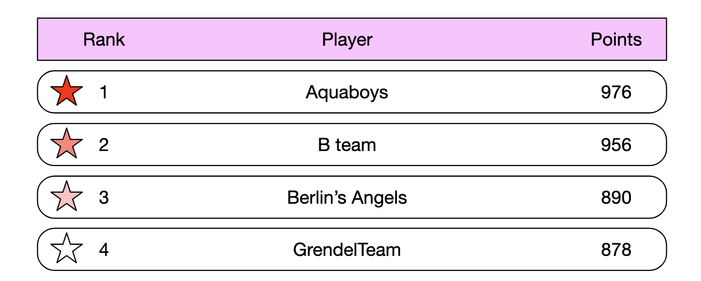
</div>

---

## Bước 1: Thấu hiểu bài toán và Xác lập phạm vi thiết kế (Understand the Problem and Establish Design Scope)

- **C:** Điểm số trên bảng xếp hạng được tính như thế nào ạ?
- **I:** Người chơi nhận được 1 điểm mỗi khi họ thắng một trận đấu (match).
- **C:** Tất cả người chơi đều được đưa vào bảng xếp hạng chứ ạ?
- **I:** Đúng vậy.
- **C:** Bảng xếp hạng có gắn với một khung thời gian (mùa giải) cụ thể nào không?
- **I:** Mỗi tháng sẽ có một giải đấu (tournament) mới bắt đầu, đồng nghĩa với việc khởi tạo một bảng xếp hạng mới tinh cho tháng đó.
- **C:** Chúng ta có thể giả định rằng chỉ cần quan tâm đến Top 10 người chơi dẫn đầu không?
- **I:** Chúng ta cần hiển thị Top 10 người chơi dẫn đầu, đồng thời hiển thị thứ hạng (rank) cụ thể của chính người dùng đang xem. Nếu còn thời gian, chúng ta có thể thảo luận thêm về việc hiển thị những người chơi đứng ngay phía trên và phía dưới người dùng đó trên bảng xếp hạng.
- **C:** Có bao nhiêu người chơi tham gia trong một giải đấu?
- **I:** **5 triệu DAU** (người dùng hoạt động hàng ngày) và **25 triệu MAU** (người dùng hoạt động hàng tháng).
- **C:** Trung bình mỗi người chơi tham gia bao nhiêu trận đấu mỗi ngày trong suốt giải đấu?
- **I:** Trung bình mỗi người chơi 10 trận mỗi ngày.
- **C:** Chúng ta xác định thứ hạng như thế nào nếu hai người chơi có cùng điểm số?
- **I:** Trong trường hợp đó, thứ hạng của họ được tính là ngang nhau. Nếu còn thời gian, chúng ta có thể thảo luận cách phân định thứ hạng khi bằng điểm (tie-breaking).
- **C:** Bảng xếp hạng có bắt buộc phải cập nhật theo thời gian thực (real-time) không?
- **I:** Có, chúng ta muốn hiển thị kết quả theo thời gian thực hoặc gần với thời gian thực nhất có thể. Việc chỉ hiển thị kết quả tổng hợp theo lô định kỳ (batch history) là không đạt yêu cầu.

### **Yêu cầu chức năng (Functional requirements)**

- Hiển thị Top 10 người chơi dẫn đầu trên bảng xếp hạng.
- Hiển thị thứ hạng cụ thể của một người dùng.
- Điểm cộng (Bonus): Hiển thị danh sách những người chơi đứng liền kề (4 vị trí phía trên và 4 vị trí phía dưới) người dùng hiện tại.

### **Yêu cầu phi chức năng (Non-functional requirements)**

- Cập nhật điểm số theo thời gian thực.
- Thay đổi điểm số được phản ánh ngay lập tức lên thứ hạng trên bảng xếp hạng.
- Đảm bảo khả năng mở rộng (Scalability), tính sẵn sàng cao (Availability) và độ tin cậy (Reliability) chung của hệ thống.

### **Ước lượng sơ bộ (Back-of-the-envelope estimation)**

Với 5 triệu DAU, nếu lượng người chơi phân bổ đều trong suốt 24 giờ ($86.400 \approx 10^5\text{ giây}$), trung bình mỗi giây sẽ có khoảng $\frac{5 \times 10^6}{10^5} = 50$ người dùng hoạt động. Tuy nhiên, lưu lượng thực tế luôn có tính chu kỳ theo múi giờ, nên chúng ta ước tính lượng người dùng lúc cao điểm (Peak) gấp 5 lần trung bình, tức là khoảng **250 người dùng/giây**.

- **QPS ghi điểm (Users scoring a point):** Giả sử trung bình mỗi người chơi 10 trận mỗi ngày $\rightarrow$ QPS cập nhật điểm trung bình $= 50 \times 10 = \mathbf{500\text{ QPS}}$. **Peak QPS cập nhật điểm** $= 500 \times 5 = \mathbf{2.500\text{ QPS}}$.
- **QPS tải bảng xếp hạng Top 10:** Giả sử mỗi người dùng mở xem bảng xếp hạng trung bình 1 lần mỗi ngày $\rightarrow$ **QPS đọc khoảng 50 QPS**.

---

## Bước 2: Đề xuất Thiết kế Tổng quan và Thống nhất Phương án (Propose High-Level Design and Get Buy-In)

### **Thiết kế API (API Design)**

API đầu tiên chúng ta cần là Endpoint để cập nhật điểm số của người chơi khi họ thắng một trận đấu:

```
POST /v1/scores
```

API này nhận hai tham số trong Request body: `user_id` và `points` (số điểm giành được khi thắng trận).
Lưu ý bảo mật quan trọng: API này chỉ được phép gọi nội bộ từ các **Game Servers**, tuyệt đối không mở cho ứng dụng Client của người chơi gọi trực tiếp.

API thứ hai dùng để lấy danh sách Top 10 người chơi dẫn đầu bảng xếp hạng:

```
GET /v1/scores
```

Ví dụ về Response:

```
{
  "data": [
    {
      "user_id": "user_id1",
      "user_name": "alice",
      "rank": 1,
      "score": 12543
    },
    {
      "user_id": "user_id2",
      "user_name": "bob",
      "rank": 2,
      "score": 11500
    }
  ],
  ...
  "total": 10
}
```

API thứ ba dùng để lấy điểm số và thứ hạng của một người chơi cụ thể:

```
GET /v1/scores/{:user_id}
```

Ví dụ về Response:

```
{
    "user_info": {
        "user_id": "user5",
        "score": 1000,
        "rank": 6,
    }
}
```

### **Kiến trúc tổng quan (High-level architecture)**

<div style="margin-left:3rem">
    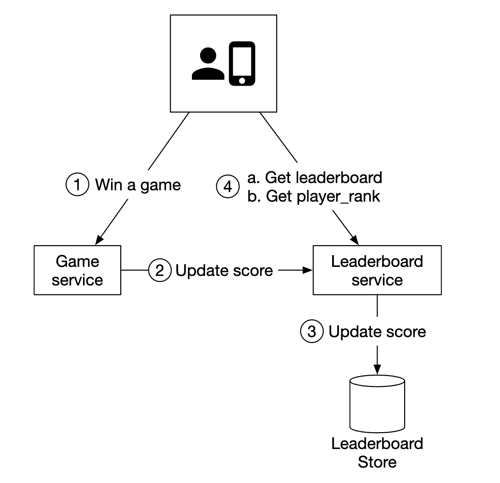
</div>

1. Khi một người chơi thắng trận, ứng dụng Client gửi thông báo kết thúc trận đấu tới **Game Service**.
2. **Game Service** kiểm tra tính hợp lệ của chiến thắng đó, sau đó gọi nội bộ sang **Leaderboard Service** để cộng điểm cho người chơi.
3. **Leaderboard Service** cập nhật điểm số của người chơi vào **Leaderboard Store**.
4. Khi người chơi muốn xem bảng xếp hạng, Client gọi trực tiếp tới **Leaderboard Service** để lấy danh sách Top 10 và thứ hạng hiện tại của mình.

Một phương án thiết kế thay thế đã được cân nhắc là để ứng dụng Client gọi thẳng tới Leaderboard Service để tự cập nhật điểm:

<div style="margin-left:3rem">
    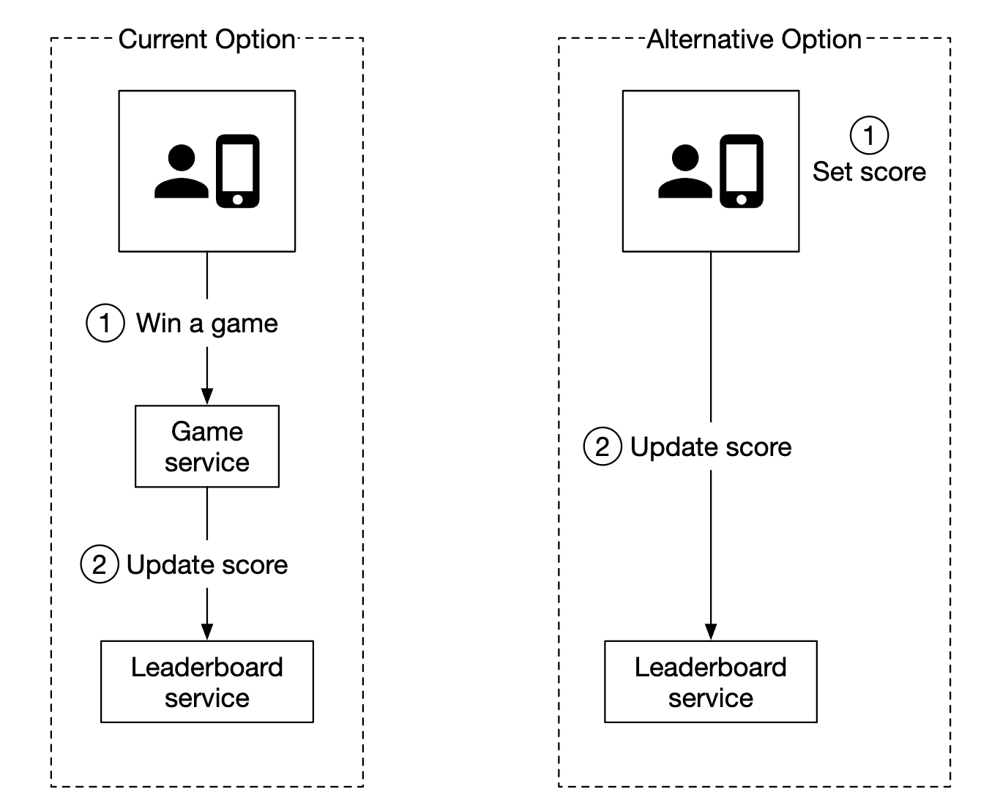
</div>

Phương án này **không an toàn** vì rất dễ bị tấn công xen giữa (**Man-in-the-Middle attack** / gian lận): người chơi có thể dựng một Proxy chặn ở giữa để giả mạo Request và tự cộng cho mình bao nhiêu điểm tùy thích. Do đó, điểm số bắt buộc phải do **Game Service** (Server-authoritative) xác nhận và thiết lập. Thực tế, đối với hầu hết các game trực tuyến hiện đại nơi logic trận đấu chạy trên Server, bản thân Game Server đã tự biết ai thắng trận và tự động gọi sang Leaderboard Service mà không cần Client phải báo lên.

Một điểm cân nhắc thêm là liệu chúng ta có nên đặt một **Message Queue** (như Kafka) ở giữa Game Service và Leaderboard Service hay không. Kiến trúc dùng Message Queue sẽ rất hữu ích nếu kết quả trận đấu cần được đẩy sang nhiều dịch vụ khác nhau (như Analytics, Notification, Push Replay) hoặc khi cần làm phẳng các đợt tải đột biến. Tuy nhiên, vì đây chưa phải là yêu cầu bắt buộc trong phạm vi bài toán hiện tại và chúng ta ưu tiên cập nhật thời gian thực với độ trễ thấp nhất, chúng ta chưa đưa Message Queue vào sơ đồ chính:

<div style="margin-left:3rem">
    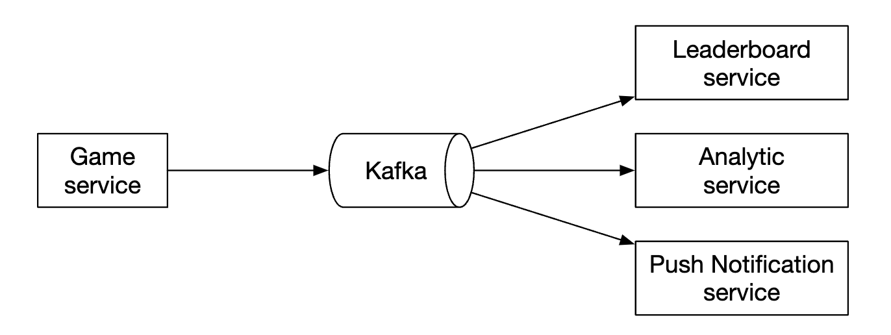
</div>

### **Mô hình dữ liệu (Data models)**

Hãy thảo luận về các phương án lưu trữ dữ liệu bảng xếp hạng: **Relational Database**, **Redis**, và **NoSQL**. (Phương án NoSQL sẽ được phân tích kỹ ở phần Deep Dive).

#### Phương án 1: Sử dụng Relational Database (Cơ sở dữ liệu quan hệ)

Nếu quy mô hệ thống nhỏ và số lượng người dùng không nhiều, một Relational Database hoàn toàn có thể đáp ứng được.

Chúng ta có thể bắt đầu với một bảng `leaderboard` đơn giản cho mỗi tháng (Ghi chú thực tế: bạn cũng có thể chỉ dùng chung một bảng và thêm cột `month_id` để tránh phải tạo bảng mới hàng tháng, dù việc tách bảng theo tháng giúp việc lưu trữ lịch sử/xóa bảng cũ nhanh hơn):

<div style="margin-left:3rem">
    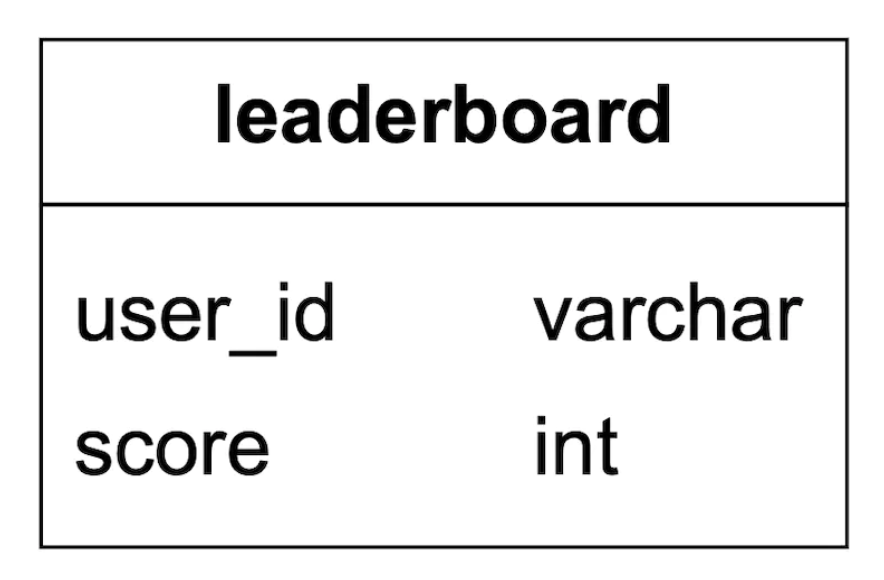
</div>

Khi người chơi giành được điểm thắng trận đầu tiên trong tháng:

<div style="margin-left:3rem">
    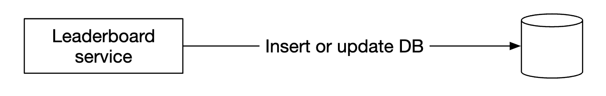
</div>

Nếu người chơi chưa tồn tại trong bảng của tháng đó, chúng ta chèn một bản ghi mới:

```
INSERT INTO leaderboard (user_id, score) VALUES ('mary1934', 1);
```

Trong các trận thắng tiếp theo, chúng ta chỉ cần cộng thêm điểm cho họ:

```
UPDATE leaderboard set score=score + 1 where user_id='mary1934';
```

**Làm thế nào để tìm ra Top người chơi dẫn đầu và thứ hạng của một người?**

<div style="margin-left:3rem">
    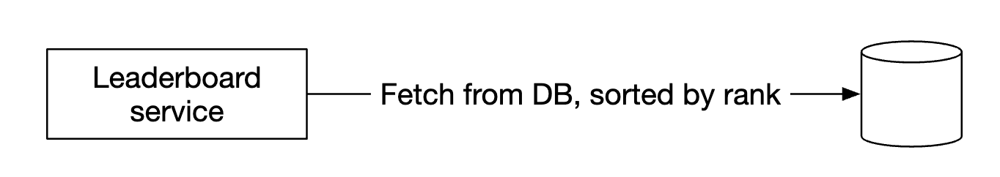
</div>

Chúng ta có thể chạy câu truy vấn SQL sau:

```
SELECT (@rownum := @rownum + 1) AS rank, user_id, score
FROM leaderboard
ORDER BY score DESC;
```

Tuy nhiên, câu truy vấn này có hiệu năng rất tệ khi bảng có hàng triệu dòng vì Database phải thực hiện quét toàn bộ bảng (full table scan) và sắp xếp toàn bộ các bản ghi để đánh số thứ tự.

Nếu chỉ cần lấy **Top 10**, chúng ta có thể tối ưu bằng cách đánh **Index** trên cột `score` và sử dụng mệnh đề `LIMIT 10`:

```
SELECT (@rownum := @rownum + 1) AS rank, user_id, score
FROM leaderboard
ORDER BY score DESC
LIMIT 10;
```

Thế nhưng, hướng tiếp cận bằng Relational Database sẽ **vỡ trận khi cần tìm thứ hạng cụ thể của một người chơi bất kỳ** đang đứng ở vị trí thứ hàng triệu ở giữa bảng xếp hạng:

```
SELECT *,(SELECT COUNT(*) FROM leaderboard lb2
WHERE lb2.score >= lb1.score) RANK
FROM leaderboard lb1
WHERE lb1.user_id = {:user_id};
```

Việc đếm xem có bao nhiêu triệu người có điểm cao hơn người chơi hiện tại mỗi khi họ mở bảng xếp hạng sẽ tạo ra tải CPU và I/O khổng lồ cho Database, không thể đáp ứng yêu cầu thời gian thực ở quy mô 25 triệu người chơi.

#### Phương án 2: Sử dụng Redis (Sorted Set)

Chúng ta cần một giải pháp hoạt động mượt mà ngay cả với hàng chục triệu người chơi mà không phải dựa vào các câu truy vấn đếm/sắp xếp nặng nề trên đĩa cứng.

**Redis** là một kho lưu trữ dữ liệu trên bộ nhớ (in-memory data store) có tốc độ cực nhanh và cung cấp sẵn một cấu trúc dữ liệu sinh ra để giải quyết trọn vẹn bài toán bảng xếp hạng: **Sorted Set (Tập hợp có thứ tự - ZSET)**.

Một **Sorted Set** là cấu trúc dữ liệu tương tự như `Set` (mỗi phần tử là duy nhất), nhưng mỗi phần tử (`member` — ở đây là `user_id`) được gắn kèm với một điểm số (`score`) dùng để tự động duy trì thứ tự sắp xếp từ thấp đến cao.

Bên dưới tầng triển khai nội bộ, Redis Sorted Set kết hợp hai cấu trúc dữ liệu:
1. Một **Hash Table (Bảng băm)** ánh xạ từ `user_id` sang `score` (giúp tra cứu điểm của một người dùng trong thời gian $O(1)$).
2. Một **Danh sách nhảy (Skip List)** ánh xạ từ `score` sang danh sách `user_id` theo thứ tự đã sắp xếp:

<div style="margin-left:3rem">
    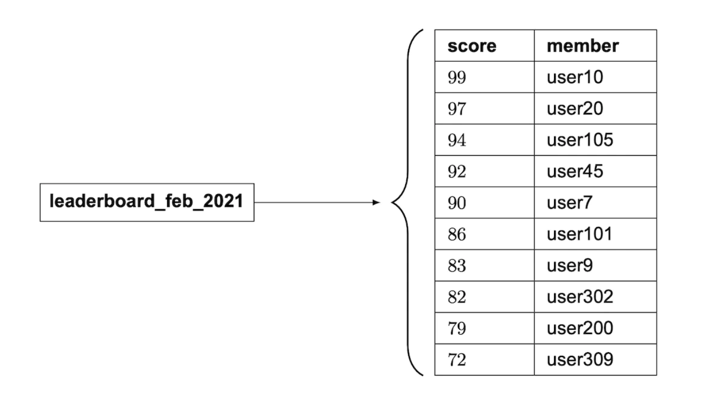
</div>

**Cấu trúc Danh sách nhảy (Skip List) hoạt động như thế nào?**
- Nó là một dạng danh sách liên kết (linked list) cải tiến cho phép tìm kiếm nhị phân cực nhanh với độ phức tạp $O(\log N)$.
- Nó bao gồm một danh sách liên kết cơ sở đã được sắp xếp ở tầng đáy, kèm theo nhiều tầng chỉ mục (multi-level indexes) nhảy cóc ở phía trên:

<div style="margin-left:3rem">
    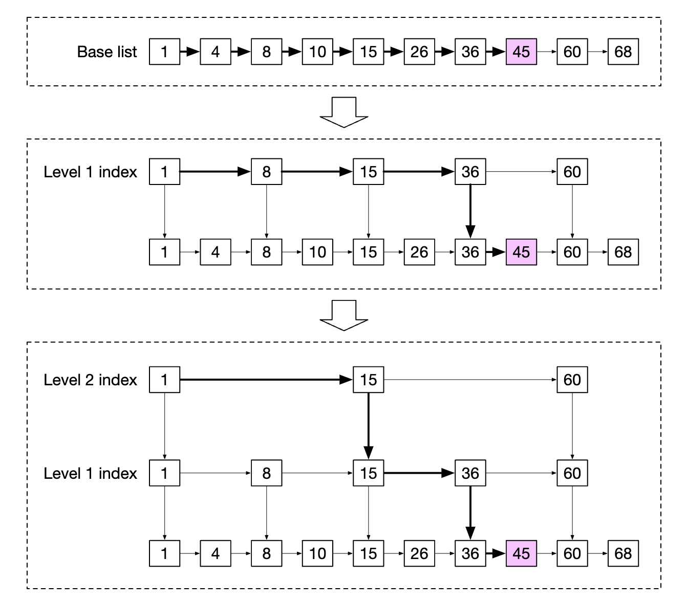
</div>

Cấu trúc này giúp rút ngắn đáng kể số bước duyệt khi tập dữ liệu lớn. Trong ví dụ minh họa dưới đây (với 64 Node), nếu dùng danh sách liên kết đơn thông thường, chúng ta phải duyệt qua 62 Node mới tìm thấy giá trị cần tìm; nhưng với Skip List, chúng ta chỉ cần nhảy qua đúng **11 Node**:

<div style="margin-left:3rem">
    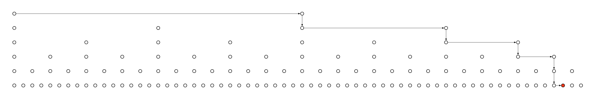
</div>

Sorted Set vượt trội hoàn toàn so với Relational Database trong bài toán này vì mọi phần tử luôn được duy trì đúng thứ tự sắp xếp ngay tại thời điểm chèn/cập nhật, với độ phức tạp chỉ là **$O(\log N)$** cho cả thao tác thêm mới, cập nhật điểm lẫn tra cứu thứ hạng.

**Các câu lệnh Redis cốt lõi để vận hành bảng xếp hạng:**
- **`ZADD`**: Thêm mới một người chơi vào Sorted Set nếu chưa tồn tại, hoặc cập nhật lại điểm số nếu đã có. Độ phức tạp: $O(\log N)$.
- **`ZINCRBY`**: Tăng điểm số của một người chơi lên một lượng nhất định. Nếu người chơi chưa có trong bảng xếp hạng, Redis tự động khởi tạo điểm ban đầu bằng `0` rồi cộng thêm. Độ phức tạp: $O(\log N)$.
- **`ZRANGE` / `ZREVRANGE`**: Lấy một dải người chơi liên tiếp theo vị trí thứ hạng, sắp xếp tăng dần (`ZRANGE`) hoặc giảm dần (`ZREVRANGE`), có hỗ trợ `offset` và số lượng kết quả trả về ($M$). Độ phức tạp: $O(\log N + M)$.
- **`ZRANK` / `ZREVRANK`**: Lấy ngay vị trí thứ hạng (rank) của một người chơi cụ thể theo thứ tự điểm tăng dần (`ZRANK`) hoặc giảm dần (`ZREVRANK`). Độ phức tạp: $O(\log N)$.

**Cách vận hành thực tế với Redis Sorted Set:**
- **Khi một người chơi ghi được 1 điểm thắng trận:**
  ```
  ZINCRBY leaderboard_feb_2021 1 'mary1934'
  ```
  (Mỗi tháng chúng ta chỉ cần dùng một Key mới theo tên tháng, còn dữ liệu tháng cũ được chuyển sang kho lưu trữ lịch sử).

- **Khi lấy danh sách Top 10 người chơi dẫn đầu bảng xếp hạng (từ vị trí 0 đến 9 theo chiều giảm dần):**
  ```
  ZREVRANGE leaderboard_feb_2021 0 9 WITHSCORES
  ```
  Kết quả trả về:
  ```
  [(user2,score2),(user1,score1),(user5,score5)...]
  ```

- **Khi người chơi muốn xem thứ hạng của bản thân và 4 người đứng liền trên / 4 người đứng liền dưới:**

<div style="margin-left:3rem">
    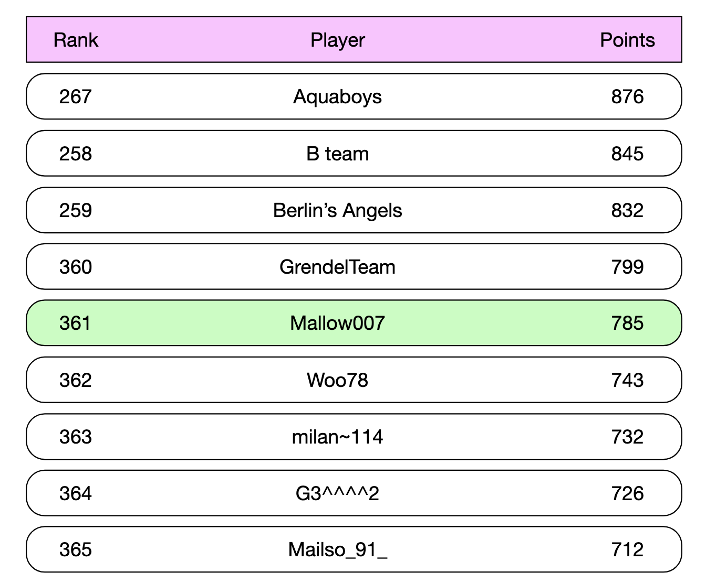
</div>

  Đầu tiên, chúng ta lấy vị trí hiện tại của người dùng bằng lệnh `ZREVRANK leaderboard_feb_2021 'marty123'` (giả sử trả về vị trí `361`). Sau đó, chỉ cần gọi lệnh lấy dải 9 người xung quanh vị trí 361 (từ `361 - 4 = 357` đến `361 + 4 = 365`):
  ```
  ZREVRANGE leaderboard_feb_2021 357 365
  ```

**Ước lượng dung lượng bộ nhớ RAM cho Redis:**
- Giả sử kịch bản xấu nhất là toàn bộ **25 triệu MAU** đều thắng ít nhất 1 trận và có mặt trên bảng xếp hạng của tháng đó.
- Mỗi `user_id` là chuỗi dài 24 ký tự (24 bytes) và `score` là số nguyên 16-bit (2 bytes) $\rightarrow$ Cần ít nhất $26\text{ bytes} \times 25\text{ triệu} \approx \mathbf{650\text{ MB}}$ bộ nhớ.
- Ngay cả khi chúng ta nhân đôi con số này lên (~1.3 GB) để tính cả phần bộ nhớ phụ trội (overhead) của các con trỏ Skip List và Hash Table trong Redis, toàn bộ bảng xếp hạng 25 triệu người chơi vẫn nằm gọn gàng trong bộ nhớ RAM của **một Redis Server đơn lẻ** hiện đại!

Về mặt hiệu năng xử lý (Throughput): mức tải đỉnh **2.500 thao tác cập nhật/giây** cũng hoàn toàn nằm trong khả năng xử lý nhẹ nhàng của một Redis Instance đơn lẻ (vốn có thể xử lý hàng chục nghìn đến cả trăm nghìn QPS).

**Các lưu ý quan trọng về độ bền dữ liệu và các bảng phụ trợ:**
- Chúng ta cần cấu hình **Redis Persistence** (RDB/AOF) và duy trì ít nhất một **Redis Replica** để đảm bảo không mất dữ liệu và có thể chuyển đổi dự phòng (Failover) ngay nếu Node Redis chính gặp sự cố.
- Vì Redis Sorted Set chỉ lưu cặp `(user_id, score)`, chúng ta vẫn cần duy trì hai bảng phụ trợ trong Relational Database (như **MySQL**):
  1. Bảng **`user`**: Lưu thông tin hồ sơ chi tiết của người chơi như `username`, `display_name`, ảnh đại diện (`avatar`) để hiển thị lên UI.
  2. Bảng **`point`** (lịch sử ghi điểm): Lưu lại bản ghi nhật ký mỗi khi người chơi thắng trận (`user_id`, `score`, `timestamp`). Bảng này đóng vai trò là nguồn dữ liệu gốc (Source of Truth) để có thể chạy kịch bản tái tạo lại toàn bộ bảng xếp hạng trên Redis trong trường hợp thảm họa hạ tầng làm sập toàn bộ cụm Redis.
- Như một bước tối ưu hóa nhỏ, chúng ta có thể lưu Cache thông tin hồ sơ (tên hiển thị, ảnh đại diện) của Top 10 người chơi dẫn đầu ngay trên Redis vì danh sách này được mọi người chơi truy cập liên tục.

---

## Bước 3: Đi sâu vào Thiết kế Chi tiết (Design Deep Dive)

### **Tự quản lý hạ tầng hay sử dụng Dịch vụ Đám mây (To use a cloud provider or not)**

Tùy thuộc vào định hướng hạ tầng, chúng ta có hai phương án triển khai chính:

#### Phương án 1: Tự quản lý các dịch vụ (Self-managed services)
Trong phương án này, chúng ta tự triển khai và quản lý các Web/Game/Leaderboard Servers, dùng Redis lưu trữ bảng xếp hạng, và dùng MySQL (kèm Cache) để lưu trữ thông tin hồ sơ người chơi cùng lịch sử trận đấu:

<div style="margin-left:3rem">
    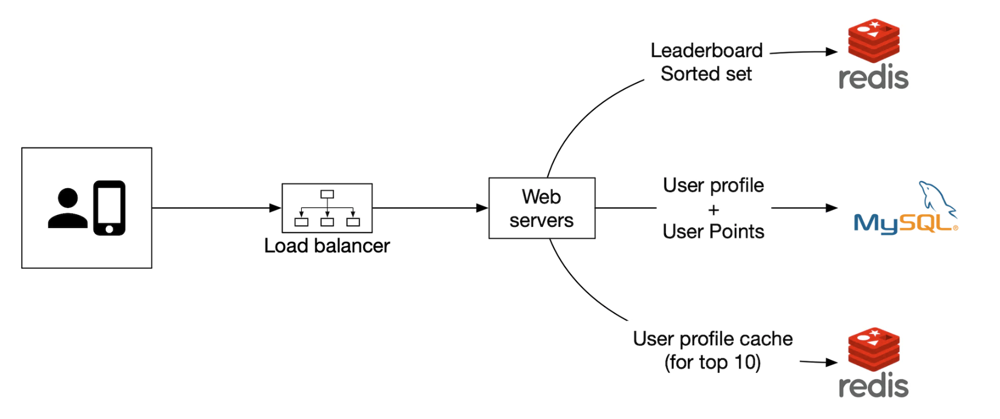
</div>

#### Phương án 2: Sử dụng dịch vụ đám mây không máy chủ (Cloud Serverless Architecture)
Chúng ta có thể tận dụng tối đa các dịch vụ được quản lý hoàn toàn (fully-managed services) trên Cloud như AWS. Ví dụ, kết hợp **Amazon API Gateway** để định tuyến các RESTful API calls trực tiếp tới các hàm **AWS Lambda**:

<div style="margin-left:3rem">
    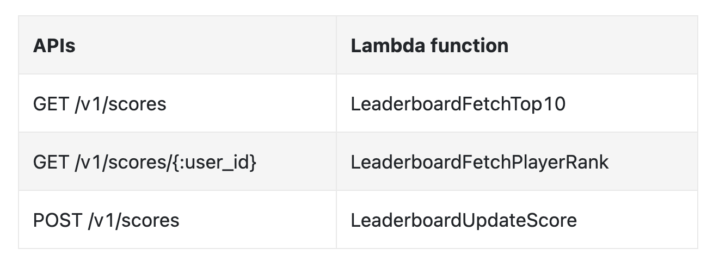
</div>

**AWS Lambda** cho phép chạy code xử lý nghiệp vụ mà không cần phải cấp phát hay quản lý bất kỳ máy chủ nào. Nó chỉ chạy khi có Request gọi tới và tự động mở rộng quy mô (auto-scale) theo lưu lượng người chơi thực tế.

Luồng người chơi ghi điểm thắng trận trên kiến trúc Serverless:

<div style="margin-left:3rem">
    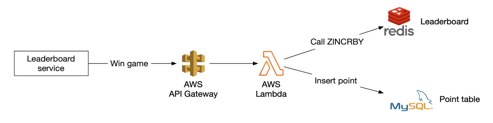
</div>

Luồng người chơi tải bảng xếp hạng trên kiến trúc Serverless:

<div style="margin-left:3rem">
    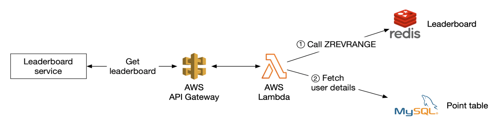
</div>

Nếu chúng ta đang xây dựng một tựa game mới từ đầu, kiến trúc Serverless là lựa chọn rất đáng giá vì giúp đội ngũ kỹ thuật thoát khỏi gánh nặng vận hành máy chủ và tự động co giãn theo các đợt tăng trưởng người chơi đột biến.

### **Mở rộng quy mô Redis (Scaling Redis)**

Với 5 triệu DAU (25 triệu MAU), một Redis Instance đơn lẻ hoàn toàn đáp ứng tốt cả về dung lượng bộ nhớ lẫn QPS.

Tuy nhiên, hãy tưởng tượng người phỏng vấn nâng bài toán lên gấp 100 lần: **500 triệu DAU!** Khi đó:
- Dung lượng bộ nhớ lưu trữ tăng lên khoảng **65 GB**.
- Tải cập nhật điểm lúc cao điểm vọt lên tới **250.000 QPS**.

Ở quy mô khổng lồ này, một Redis Server đơn lẻ chắc chắn không thể gánh nổi, bắt buộc chúng ta phải thực hiện **Sharding (Phân mảnh dữ liệu)** trên nhiều Redis Nodes. Có hai chiến lược phân mảnh chính cần phân tích:

#### Chiến lược 1: Phân vùng theo khoảng điểm (Range Partitioning / Fixed Partitions)

<div style="margin-left:3rem">
    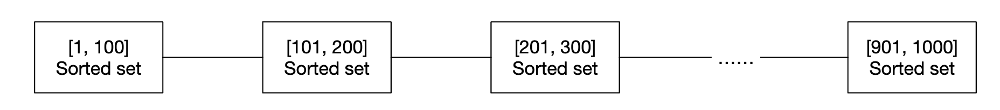
</div>

Trong chiến lược này, chúng ta chia bảng xếp hạng thành nhiều phân vùng (Shards) dựa theo **khoảng điểm số của người chơi** — ví dụ: Shard 1 chứa người chơi có điểm từ `[1, 100]`, Shard 2 chứa `[101, 200]`, ..., Shard 10 chứa `[901, 1000]` (tất nhiên cần phân chia khoảng điểm sao cho lượng người chơi được phân bổ tương đối đều giữa các Shards).

Tầng Application sẽ tự quản lý việc điều phối dữ liệu giữa các Shards:
- **Khi cập nhật điểm:** Chúng ta cần biết người chơi hiện đang nằm ở Shard nào. Thông tin ánh xạ `user_id -> current_score` (hoặc `user_id -> shard_id`) có thể được lưu trong MySQL hoặc một cụm Redis Cache phụ trợ dạng Key-Value. Khi người chơi tăng điểm vượt qua ngưỡng của Shard hiện tại (ví dụ từ 100 lên 101 điểm), ứng dụng sẽ xóa người chơi đó khỏi Shard `[1, 100]` và chèn họ vào Shard `[101, 200]`.
- **Khi lấy Top 10 người chơi dẫn đầu:** Rất đơn giản! Chúng ta chỉ cần truy vấn duy nhất vào Shard chứa khoảng điểm cao nhất (`[901, 1000]`).
- **Khi tính thứ hạng cụ thể của một người chơi:** Thứ hạng toàn cục của người chơi sẽ bằng **(thứ hạng nội bộ của người đó bên trong Shard hiện tại)** cộng với **(tổng số lượng người chơi đang nằm ở tất cả các Shards có khoảng điểm cao hơn)**. Con số thứ hai có thể lấy trong thời gian $O(1)$ thông qua lệnh `INFO keyspace` (hoặc `ZCARD`) trên từng Shard điểm cao hơn!

#### Chiến lược 2: Phân vùng theo hàm băm (Hash Partitioning - Redis Cluster)

Một cách khác là sử dụng cơ chế **Redis Cluster**, tự động phân tán dữ liệu qua nhiều Node dựa trên hàm băm `CRC16(key) % 16384` (chia không gian khóa thành 16.384 hash slots):

<div style="margin-left:3rem">
    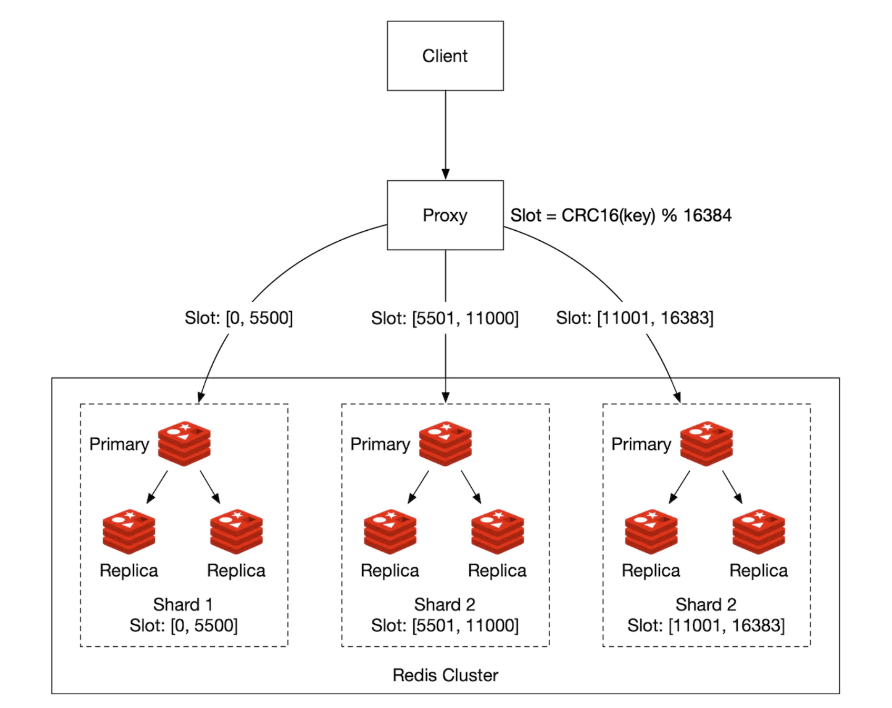
</div>

Nếu phân mảnh người chơi theo hàm băm trên nhiều Node, mỗi Node sẽ giữ một Sorted Set chứa một tập con ngẫu nhiên các người chơi. Khi đó, để lấy được **Top 10 người chơi toàn cục**, chúng ta phải áp dụng kỹ thuật **Phân tán - Tập hợp (Scatter-Gather)**: truy vấn lấy Top 10 từ tất cả các Shards rồi gộp và sắp xếp lại (merge sort) ở tầng Application:

<div style="margin-left:3rem">
    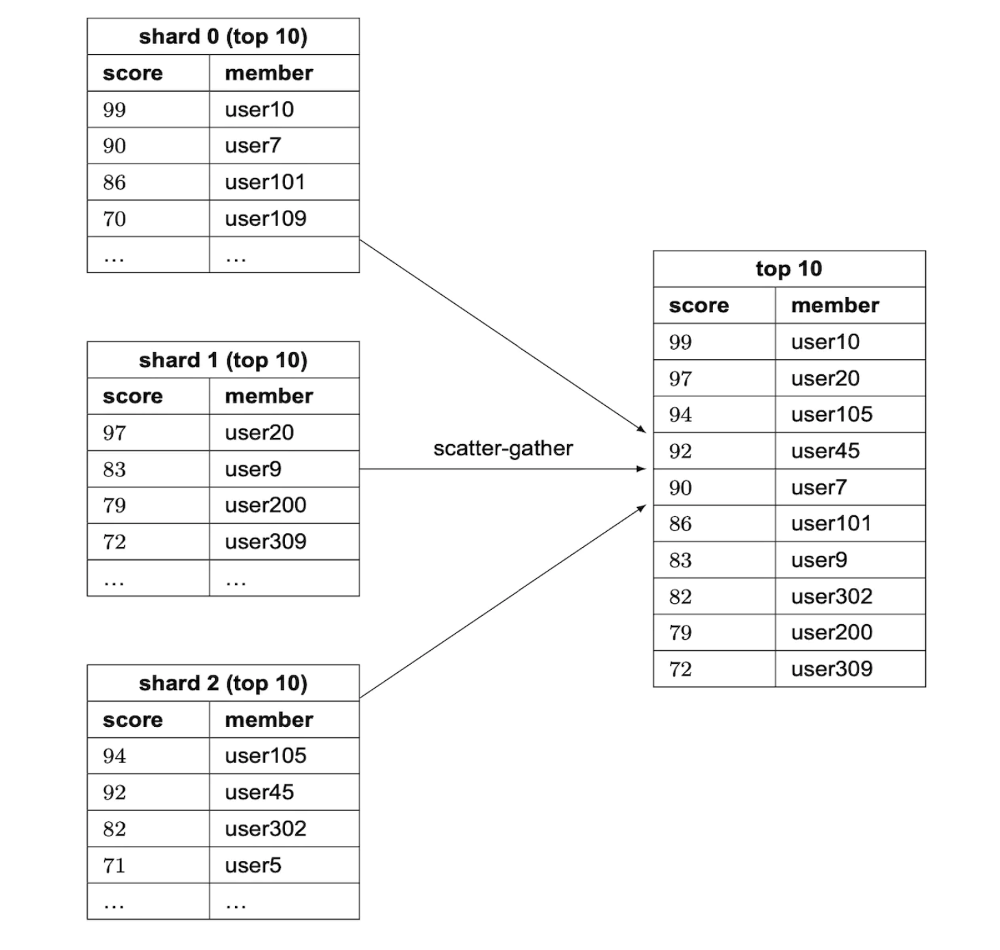
</div>

Chiến lược Hash Partitioning này có những hạn chế rất lớn đối với bài toán bảng xếp hạng:
- Nếu cần lấy Top $K$ với $K$ lớn, độ trễ sẽ tăng cao vì phải đọc rất nhiều dữ liệu từ mọi Shard.
- Độ trễ đọc luôn bị phụ thuộc vào Shard phản hồi chậm nhất (tail latency) và tăng lên khi số lượng Partition nhiều lên.
- **Đặc biệt nghiêm trọng:** Không có cách nào đơn giản và hiệu quả để tính được **thứ hạng chính xác (rank)** của một người chơi bất kỳ trên toàn bảng xếp hạng.

Do những hạn chế trên, đối với bài toán mở rộng bảng xếp hạng Redis, chiến lược **Phân vùng theo khoảng điểm cố định (Fixed Range Partitions)** là lựa chọn vượt trội hơn hẳn.

**Một số lưu ý vận hành thực tế với Redis quy mô lớn:**
- Đối với các Redis Node có tải ghi nặng (write-heavy), một Best Practice quan trọng là phải cấp phát dung lượng bộ nhớ RAM **gấp đôi** lượng dữ liệu thực tế để dự phòng cho cơ chế Copy-on-Write khi Redis tạo bản chụp nhanh (Snapshot) hoặc đồng bộ hoàn toàn (Full Sync) sang Replica.
- Sử dụng công cụ **`redis-benchmark`** để mô phỏng tải thực tế của nhiều Client đồng thời và đưa ra quyết định chính xác về số lượng Node cần thiết.

### **Giải pháp thay thế: Sử dụng NoSQL (Alternative solution: NoSQL)**

Một giải pháp thay thế đáng cân nhắc khác nếu không muốn tự quản lý phân vùng Redis là sử dụng một cơ sở dữ liệu NoSQL hỗ trợ:
- Tối ưu hóa cho tải ghi nặng (Write-heavy).
- Có khả năng sắp xếp hiệu quả các bản ghi trong cùng một Partition theo khóa sắp xếp (Sort Key) là điểm số.

Các ứng cử viên sáng giá bao gồm **Amazon DynamoDB**, **Apache Cassandra** hoặc **MongoDB**.

Trong phần này, chúng ta sẽ lấy **Amazon DynamoDB** làm ví dụ minh họa (kết hợp rất ăn ý với kiến trúc Serverless đã nêu ở trên). DynamoDB là một NoSQL Database được quản lý hoàn toàn (fully-managed), cung cấp hiệu năng ổn định ở quy mô lớn và hỗ trợ tính năng **Global Secondary Index (GSI)** giúp truy vấn hiệu quả trên các thuộc tính không thuộc khóa chính của bảng gốc:

<div style="margin-left:3rem">
    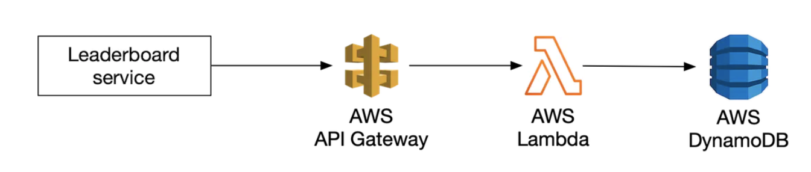
</div>

1. Hãy bắt đầu với thiết kế bảng đơn giản nhất cho bảng xếp hạng cờ vua, dùng `game_name#year-month` làm Partition Key và `user_id` làm Sort Key:

<div style="margin-left:3rem">
    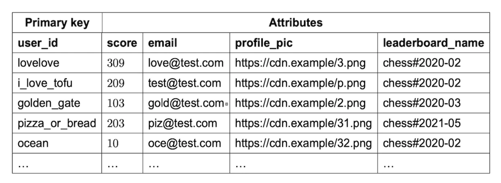
</div>

   Thiết kế này cập nhật điểm cho `user_id` rất dễ, nhưng không thể truy vấn lấy Top điểm cao hiệu quả vì không sắp xếp theo `score`.

2. Để truy vấn theo điểm số, chúng ta tạo một **Global Secondary Index (GSI)** với `game_name#year-month` làm Partition Key và `score` làm **Sort Key**:

<div style="margin-left:3rem">
    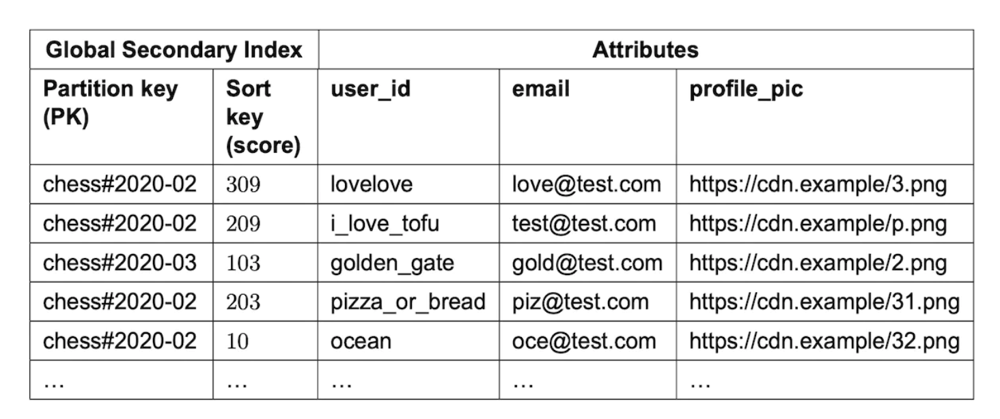
</div>

   Nhờ đó, các bản ghi trong cùng một tháng được sắp xếp sẵn theo `score`. Nhưng thiết kế này lại gặp một vấn đề nghiêm trọng khác: toàn bộ dữ liệu của tháng hiện tại đều có cùng một Partition Key (`chess#2021-04`), dẫn đến việc dồn 100% tải đọc/ghi vào một phân vùng vật lý duy nhất — gây ra hiện tượng **Phân vùng nóng (Hot Partition / Hotspot)** làm nghẽn giới hạn IOPS của DynamoDB!

3. Để xóa bỏ điểm nóng này, chúng ta áp dụng kỹ thuật **Phân mảnh ghi (Write Sharding)**: nối thêm một con số phân vùng (`partition_number`, tính bằng `user_id % number_of_partitions`) vào đuôi của Partition Key (ví dụ: `chess#2021-04#1`, `chess#2021-04#2`, ..., `chess#2021-04#10`):

<div style="margin-left:3rem">
    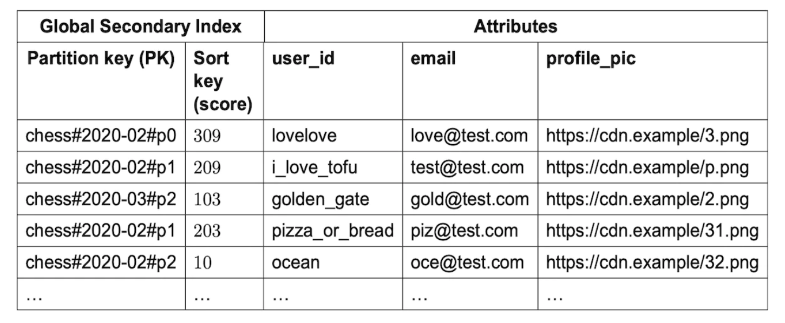
</div>

Chúng ta cần cân nhắc sự đánh đổi khi chọn số lượng phân vùng (`number_of_partitions`):
- Càng chia nhiều phân vùng thì tải ghi (Write scalability) càng được san sẻ mượt mà.
- Ngược lại, việc đọc (Read complexity) sẽ phức tạp hơn vì để lấy Top 10 toàn cục, chúng ta phải áp dụng mô hình **Phân tán - Tập hợp (Scatter-Gather)**: đọc Top 10 từ tất cả $N$ phân vùng của tháng đó rồi gộp kết quả lại:

<div style="margin-left:3rem">
    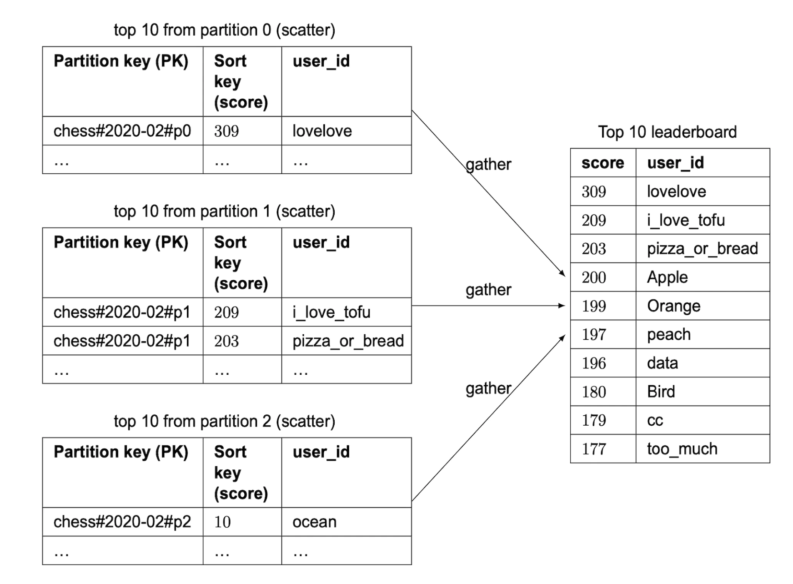
</div>

Nhược điểm lớn nhất của phương án NoSQL (DynamoDB) này cũng giống như Hash Partitioning: **không thể tính nhanh được thứ hạng tuyệt đối chính xác (exact rank)** của một người chơi trên tổng số 25 triệu người.

Tuy nhiên, trong thực tế thiết kế sản phẩm game quy mô cực lớn, thay vì trả về thứ hạng chính xác kiểu *"Bạn đang đứng thứ 12.453.891"*, chúng ta có thể chuyển sang hiển thị **Thứ hạng phần trăm (Percentile rank)** — ví dụ: *"Bạn đang nằm trong Top 10% người chơi xuất sắc nhất!"*. Một Cron job chạy định kỳ có thể phân tích phân phối điểm số trên toàn bộ các Shards và cập nhật bảng ngưỡng phần trăm vào Cache rất nhẹ nhàng:

```
10th percentile = score < 100
20th percentile = score < 500
...
90th percentile = score < 6500
```

---

## Bước 4: Tổng kết (Wrap Up)

Một số điểm mở rộng thú vị có thể thảo luận thêm nếu còn thời gian:
- **Tối ưu tốc độ lấy thông tin hồ sơ người chơi (Faster retrieval):** Lưu Cache đối tượng thông tin người dùng (username, avatar) trong một **Redis Hash** ánh xạ `user_id -> user object` để khi hiển thị Top 10 không cần phải gọi vào MySQL.
- **Phân định thứ hạng khi bằng điểm (Breaking ties):** Khi hai người chơi có cùng điểm số (`score`), ai đạt được mốc điểm đó sớm hơn (hoặc mới chơi trận gần nhất) sẽ được xếp trên. Với Redis Sorted Set (chỉ nhận một số thực 64-bit làm `score`), chúng ta có thể ghép mốc thời gian (`timestamp`) vào phần thập phân hoặc các bit thấp của `score` (ví dụ: `score_with_tie_breaker = actual_score + (MAX_TIMESTAMP - current_timestamp) / 10^10`), hoặc dùng một Redis Hash phụ lưu `user_id -> last_win_timestamp`.
- **Khôi phục sau sự cố thảm họa (System failure recovery):** Trong trường hợp toàn bộ cụm Redis bị sập và mất sạch dữ liệu trên RAM, bởi vì bảng `point` trong MySQL đã ghi nhận mọi sự kiện thắng trận kèm `user_id` và `timestamp`, chúng ta chỉ cần chạy một kịch bản (script) ngoại tuyến quét qua dữ liệu của tháng hiện tại trong MySQL và gọi `ZINCRBY` để tái tạo lại chính xác 100% bảng xếp hạng trên Redis.
