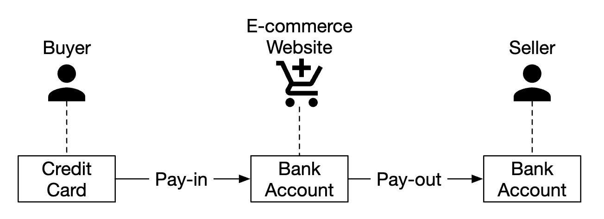
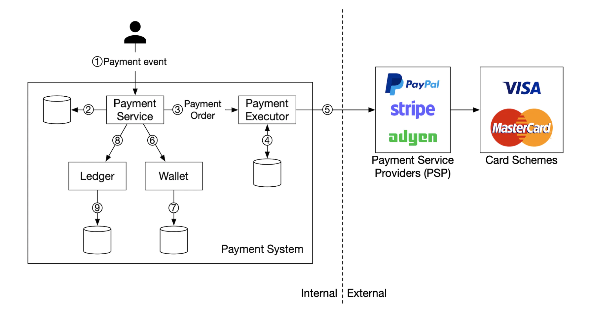
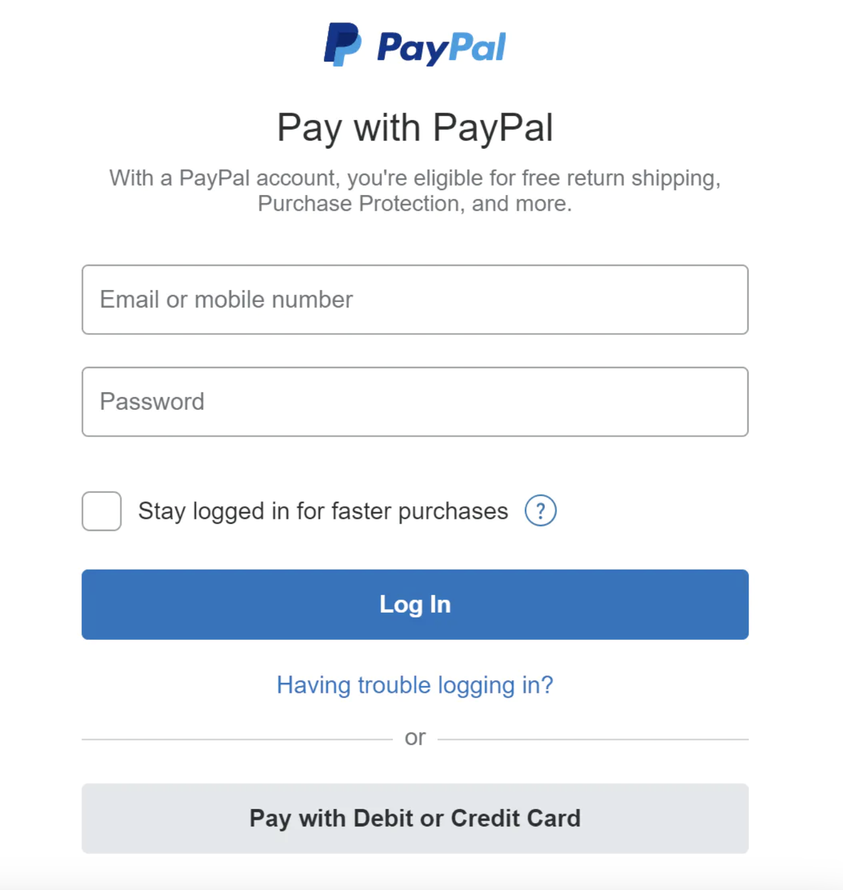
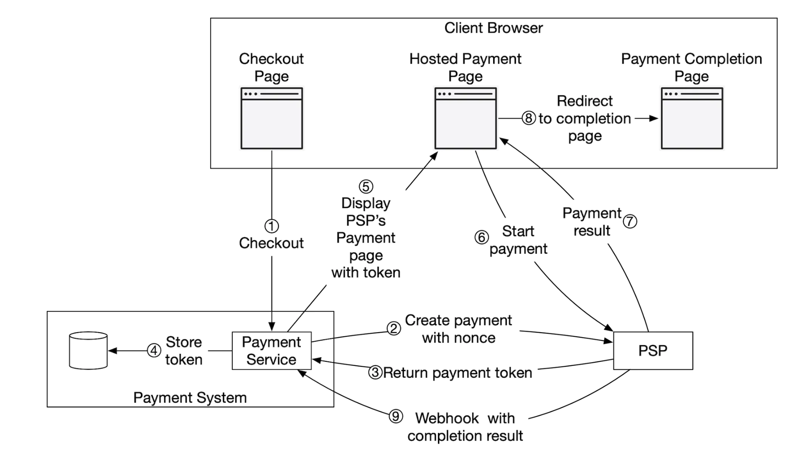
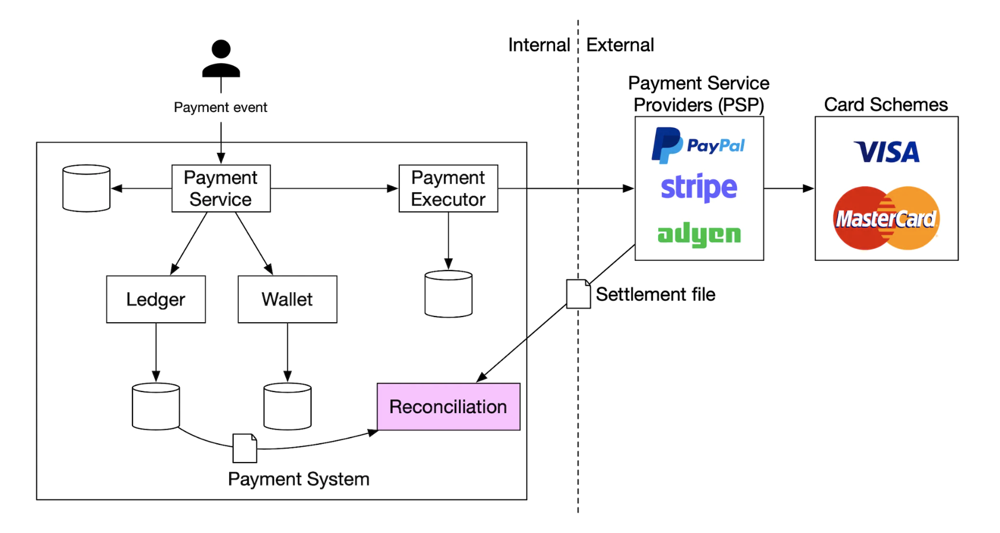
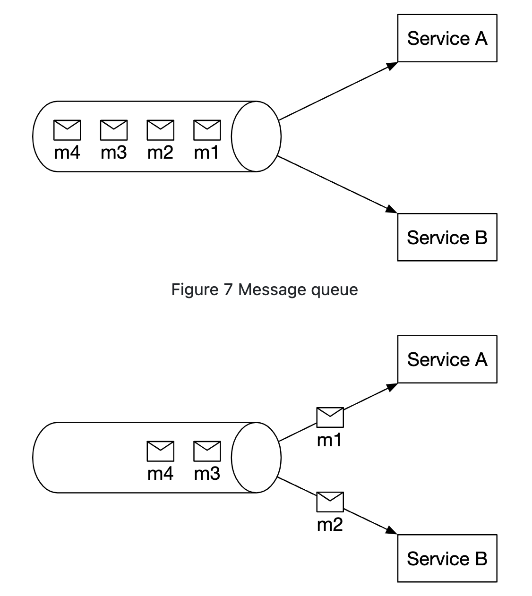
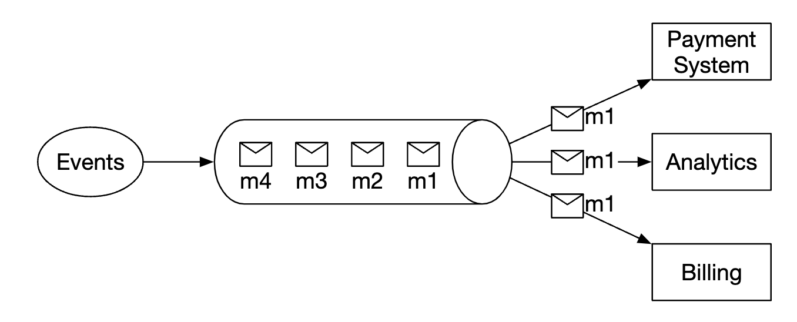
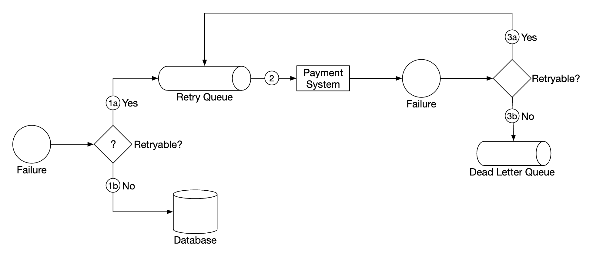
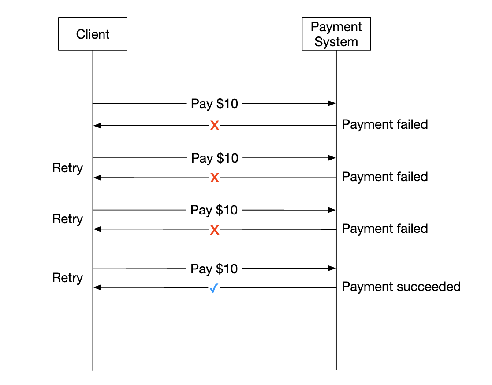
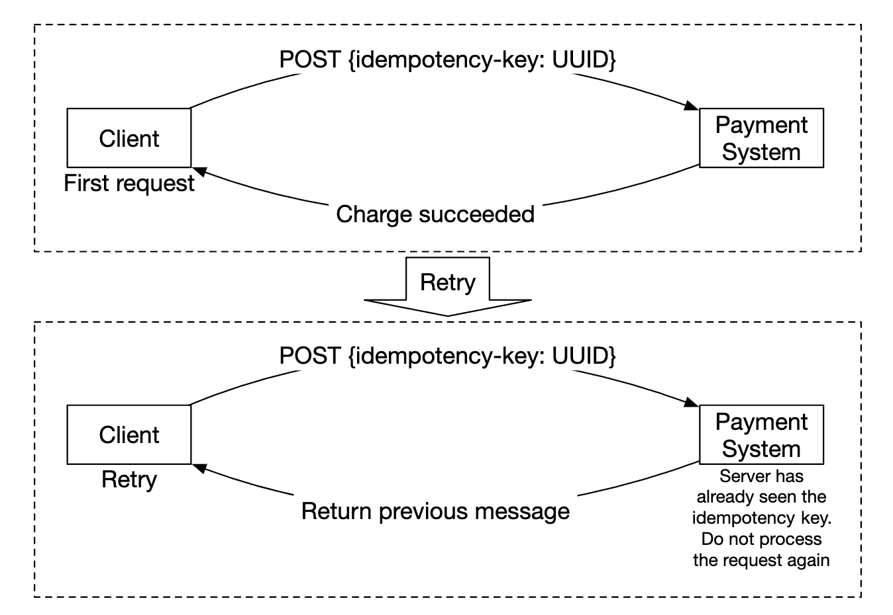

# Chương 26: Hệ thống Thanh toán (Payment System)

## Giới thiệu
Trong chương này, chúng ta sẽ thiết kế một **hệ thống thanh toán (payment system)** — nền tảng xương sống của mọi hoạt động **thương mại điện tử (e-commerce)** hiện đại.

Một **hệ thống thanh toán** được sử dụng để quyết toán các giao dịch tài chính thông qua việc dịch chuyển giá trị tiền tệ từ bên này sang bên khác một cách tin cậy và chính xác tuyệt đối.

---

## Bước 1: Thấu hiểu bài toán và Xác lập phạm vi thiết kế (Understand the Problem and Establish Design Scope)
 * **C:** Chúng ta đang xây dựng loại hệ thống thanh toán nào ạ?
 * **I:** Một hệ thống Payment Backend cho một nền tảng thương mại điện tử tương tự như Amazon.com. Nó chịu trách nhiệm xử lý mọi nghiệp vụ liên quan đến luồng di chuyển dòng tiền.
 * **C:** Những phương thức thanh toán nào cần được hỗ trợ — thẻ tín dụng (credit cards), PayPal, thẻ ngân hàng nội địa, v.v.?
 * **I:** Trong thực tế, hệ thống cần hỗ trợ tất cả các phương thức đó. Tuy nhiên, trong khuôn khổ buổi phỏng vấn này, chúng ta có thể tập trung vào thanh toán bằng **thẻ tín dụng (credit card payments)**.
 * **C:** Chúng ta có tự trực tiếp xử lý giao dịch thẻ tín dụng (credit card processing) không?
 * **I:** Không, chúng ta tích hợp với các nhà cung cấp dịch vụ thanh toán bên thứ ba (Payment Service Providers - PSP) như Stripe, Braintree, Square, Adyen, v.v.
 * **C:** Chúng ta có lưu trữ thông tin thẻ tín dụng nhạy cảm trực tiếp trong hệ thống của mình không?
 * **I:** Vì các yêu cầu tuân thủ bảo mật khắt khe (như tiêu chuẩn PCI DSS), chúng ta **không** lưu trữ dữ liệu thẻ tín dụng thô trực tiếp trong hệ thống mà ủy thác hoàn toàn cho các bên xử lý thanh toán thứ ba.
 * **C:** Ứng dụng có hoạt động trên toàn cầu không? Chúng ta có cần hỗ trợ đa tiền tệ và thanh toán quốc tế không?
 * **I:** Ứng dụng có quy mô toàn cầu, nhưng để đơn giản hóa cho buổi phỏng vấn, hãy giả định hệ thống chỉ sử dụng một loại tiền tệ duy nhất.
 * **C:** Hệ thống cần xử lý bao nhiêu giao dịch thanh toán mỗi ngày?
 * **I:** **1 triệu giao dịch mỗi ngày**.
 * **C:** Chúng ta có cần hỗ trợ luồng chi trả tiền (Pay-out flow) — ví dụ như giải ngân doanh thu hàng tháng cho các nhà bán hàng (merchants/sellers) trên sàn không?
 * **I:** Có, chúng ta cần hỗ trợ cả luồng đó.
 * **C:** Còn điểm nào khác tôi cần đặc biệt lưu ý không ạ?
 * **I:** Chúng ta cần hỗ trợ cơ chế **Đối soát (Reconciliation)** để phát hiện và xử lý mọi sự sai lệch dữ liệu khi giao tiếp giữa các hệ thống nội bộ và hệ thống bên ngoài.

### **Yêu cầu chức năng (Functional requirements)**
 * **Luồng thu tiền (Pay-in flow):** Hệ thống thanh toán nhận tiền từ khách hàng mua sắm thay mặt cho các nhà bán hàng (merchants).
 * **Luồng chi tiền (Pay-out flow):** Hệ thống thanh toán chuyển trả tiền doanh thu cho các nhà bán hàng trên khắp thế giới.

### **Yêu cầu phi chức năng (Non-functional requirements)**
 * **Độ tin cậy và khả năng chịu lỗi (Reliability and fault-tolerance):** Các giao dịch thanh toán bị lỗi phải được xử lý hết sức cẩn trọng (không mất tiền, không trừ tiền hai lần).
 * Thiết lập quy trình **Đối soát (Reconciliation)** định kỳ giữa các dịch vụ nội bộ (Wallet, Ledger) và hệ thống thanh toán bên ngoài (PSP, Ngân hàng).

### **Ước lượng sơ bộ (Back-of-the-envelope estimation)**
Hệ thống cần xử lý 1 triệu giao dịch mỗi ngày, tương đương khoảng $\frac{10^6}{10^5\text{ giây}} = \mathbf{10\text{ giao dịch mỗi giây (TPS)}}$.

10 TPS là một mức tải rất nhẹ đối với bất kỳ hệ quản trị cơ sở dữ liệu hiện đại nào. Vì vậy, bài toán chịu tải băng thông cao (High Throughput) **không** phải là trọng tâm của buổi phỏng vấn thiết kế hệ thống thanh toán; thay vào đó, trọng tâm nằm ở **độ tin cậy, tính nhất quán dữ liệu, xử lý lỗi thanh toán và đối soát**.

---

## Bước 2: Đề xuất Thiết kế Tổng quan và Thống nhất Phương án (Propose High-Level Design and Get Buy-In)
Ở góc độ tổng quan, có ba chủ thể tham gia vào dòng chảy tiền tệ: **Người mua (Buyer)**, **Nền tảng Thương mại điện tử (E-commerce網站)** và **Người bán (Seller/Merchant)**:

<div style="margin-left:3rem">
    
</div>

### **Luồng thu tiền (Pay-in flow)**
Dưới đây là kiến trúc tổng quan của luồng thu tiền (Pay-in flow):

<div style="margin-left:3rem">
    
</div>

 * **Payment Service (Dịch vụ thanh toán):** Tiếp nhận các sự kiện thanh toán (`payment events`) từ người dùng và điều phối toàn bộ quy trình thanh toán. Thông thường, bước đầu tiên nó làm là gọi tới một dịch vụ kiểm soát rủi ro (**Risk Check Service** — thường tích hợp bên thứ ba) để đánh giá tuân thủ chống rửa tiền (AML - Anti-Money Laundering) và phát hiện gian lận thẻ tín dụng.
 * **Payment Executor (Bộ thực thi thanh toán):** Chịu trách nhiệm thực thi từng lệnh thanh toán đơn lẻ (`payment order`) thông qua nhà cung cấp dịch vụ thanh toán (PSP). Lưu ý rằng một sự kiện thanh toán (`payment event` — một giỏ hàng khi Checkout) có thể bao gồm nhiều lệnh thanh toán (`payment orders`) của nhiều nhà bán hàng khác nhau.
 * **Payment Service Provider (PSP - Nhà cung cấp dịch vụ thanh toán):** Thực hiện dịch chuyển tiền từ tài khoản của người mua (ví dụ: thẻ tín dụng của khách hàng) về tài khoản ngân hàng thương mại của sàn E-commerce.
 * **Card Schemes (Tổ chức thẻ):** Các mạng lưới tài chính xử lý nghiệp vụ thẻ tín dụng như Visa, MasterCard, American Express, v.v.
 * **Ledger (Sổ cái):** Lưu trữ bản ghi kế toán tài chính bất biến của toàn bộ mọi giao dịch thanh toán trong hệ thống.
 * **Wallet (Ví điện tử của Merchant):** Lưu giữ và cập nhật số dư tài khoản (account balance) của tất cả các nhà bán hàng trên sàn.

**Diễn giải từng bước của một luồng Pay-in điển hình:**
 1. Khi người dùng bấm nút "Đặt hàng" (Place order), một sự kiện thanh toán (`payment event`) được gửi tới **Payment Service**.
 2. **Payment Service** lưu sự kiện thanh toán này vào Database của nó.
 3. Một sự kiện thanh toán có thể chứa nhiều lệnh thanh toán (`payment orders` — ứng với từng người bán trong giỏ hàng). **Payment Service** gọi tới **Payment Executor** cho từng lệnh thanh toán đó.
 4. **Payment Executor** lưu lệnh thanh toán (`payment order`) vào Database của nó.
 5. **Payment Executor** gọi API tới **PSP** bên ngoài để xử lý giao dịch trừ tiền trên thẻ tín dụng của khách hàng.
 6. Sau khi **Payment Executor** thực thi thanh toán thành công với PSP, **Payment Service** sẽ gọi tới **Wallet Service** để cộng số dư tương ứng vào ví của nhà bán hàng (Seller).
 7. **Wallet Service** lưu thông tin số dư đã cập nhật vào Database của nó.
 8. Cuối cùng, **Payment Service** gọi tới **Ledger Service** để ghi nhận bút toán kế toán vào cơ sở dữ liệu Sổ cái.

### **Thiết kế API cho Payment Service (APIs for payment service)**
**1. API khởi tạo một sự kiện thanh toán (`POST /v1/payments`):**
```
POST /v1/payments
{
  "buyer_info": {...},
  "checkout_id": "some_id",
  "credit_card_info": {...},
  "payment_orders": [{...}, {...}, {...}]
}
```

Cấu trúc chi tiết của từng phần tử `payment_order` bên trong danh sách `payment_orders`:
```
{
  "seller_account": "SELLER_IBAN",
  "amount": "3.15",
  "currency": "USD",
  "payment_order_id": "globally_unique_payment_id"
}
```

**Các lưu ý kỹ thuật cực kỳ quan trọng khi thiết kế API thanh toán:**
 * Trường `payment_order_id` sẽ được chuyển tiếp sang cho PSP để chống trùng lặp giao dịch — tức là nó đóng vai trò làm **khóa lũy đẳng (Idempotency key)**.
 * Kiểu dữ liệu của trường `amount` (số tiền) bắt buộc phải là **`string`** (chuỗi) chứ **không dùng kiểu `double` hay `float`**. Lý do là các kiểu số thực dấu phẩy động nhị phân theo chuẩn IEEE 754 luôn tiềm ẩn sai số làm tròn (floating-point precision errors), tuyệt đối không phù hợp cho các phép tính tiền tệ. Ở tầng lưu trữ và tính toán, chuỗi này sẽ được chuyển thành kiểu `Decimal`/`BigDecimal` hoặc lưu dưới dạng số nguyên đơn vị nhỏ nhất (như `cents`).

**2. API truy vấn trạng thái thực thi của một lệnh thanh toán (`GET /v1/payments/{:id}`):**
```
GET /v1/payments/{:id}
```
Endpoint này trả về trạng thái thực thi hiện tại của một lệnh thanh toán đơn lẻ dựa trên `payment_order_id`.

### **Mô hình dữ liệu của Payment Service (Payment service data model)**
Chúng ta cần duy trì hai bảng chính cho Payment Service: bảng `payment_events` và bảng `payment_orders`.

Đối với hệ thống thanh toán, hiệu năng đọc/ghi cực nhanh thường không phải là yếu tố ưu tiên số một; thay vào đó, **Tính nhất quán mạnh (Strong Consistency)** và các đảm bảo giao dịch mới là yếu tố sống còn.

Các lý do cốt lõi khiến chúng ta chọn **Relational Database (SQL truyền thống)** thay vì NoSQL:
 * Cung cấp các đảm bảo **ACID** chặt chẽ cho giao dịch tài chính.
 * Đã được kiểm chứng qua nhiều thập kỷ tại các định chế tài chính, ngân hàng lớn trên toàn cầu.
 * Hệ sinh thái công cụ hỗ trợ (sao lưu, phục hồi, kiểm toán, giám sát) vô cùng phong phú và trưởng thành.
 * Thị trường nhân sự có nguồn kỹ sư quản trị cơ sở dữ liệu (DBA) giàu kinh nghiệm rất dồi dào.

Cấu trúc bảng **`payment_events`**:
 * `checkout_id` - `string`, khóa chính (Primary Key).
 * `buyer_info` - `string` (Ghi chú thực tế: trong hệ thống chuẩn hóa, đây thường là khóa ngoại trỏ sang bảng người mua).
 * `seller_info` - `string` (Ghi chú thực tế: tương tự như trên).
 * `credit_card_info` - thông tin định danh/token của thẻ, phụ thuộc vào nhà cung cấp thẻ.
 * `is_payment_done` - `boolean`, đánh dấu toàn bộ sự kiện thanh toán đã hoàn tất hay chưa.

Cấu trúc bảng **`payment_orders`**:
 * `payment_order_id` - `string`, khóa chính (Primary Key).
 * `buyer_account` - `string`.
 * `amount` - `string`.
 * `currency` - `string`.
 * `checkout_id` - `string`, khóa ngoại (Foreign Key) tham chiếu tới `payment_events.checkout_id`.
 * `payment_order_status` - kiểu liệt kê `enum` (`NOT_STARTED`, `EXECUTING`, `SUCCESS`, `FAILED`).
 * `ledger_updated` - `boolean`, đánh dấu đã cập nhật vào Sổ cái (`Ledger`) thành công chưa.
 * `wallet_updated` - `boolean`, đánh dấu đã cập nhật vào Ví (`Wallet`) thành công chưa.

**Các điểm cần lưu ý về vòng đời trạng thái của bảng:**
 * Một `payment_event` (1 lần Checkout) có thể liên kết với nhiều `payment_orders` (1-N).
 * Khi khởi tạo lệnh thanh toán, `payment_order_status` ban đầu là `NOT_STARTED`. Khi gửi yêu cầu sang Payment Executor, trạng thái chuyển thành `EXECUTING`. Tùy thuộc vào phản hồi từ PSP mà trạng thái cuối cùng sẽ chuyển thành `SUCCESS` hoặc `FAILED`.
 * Khi trạng thái là `SUCCESS`, Payment Service gọi sang Wallet Service và đặt cờ `wallet_updated = TRUE`, sau đó gọi sang Ledger Service và đặt cờ `ledger_updated = TRUE`. Khi tất cả các `payment_orders` thuộc cùng một `checkout_id` đều hoàn tất, cờ `is_payment_done` trong bảng `payment_events` mới được cập nhật thành `TRUE`.
 * Một tiến trình chạy ngầm (Background Cron job) sẽ liên tục giám sát các lệnh thanh toán đang ở trạng thái lửng lơ (`EXECUTING`) quá thời gian quy định để bắn cảnh báo (alert) cho đội ngũ kỹ thuật kiểm tra.

### **Hệ thống sổ cái kế toán kép (Double-entry ledger system)**
Trong lĩnh vực tài chính - kế toán và thiết kế hệ thống thanh toán, nguyên tắc **Kế toán kép (Double-entry bookkeeping / accounting)** là nền tảng bất di bất dịch. Nguyên tắc này quy định rằng: mọi sự dịch chuyển tiền tệ đều phải được ghi nhận đồng thời vào ít nhất hai tài khoản kế toán, trong đó một tài khoản bị ghi Nợ (**Debit** — giảm số dư) và tài khoản kia được ghi Có (**Credit** — tăng số dư) với cùng một số tiền tương ứng:

| Tài khoản (Account) | Ghi Nợ (Debit) | Ghi Có (Credit) |
|---------------------|----------------|-----------------|
| buyer               | \$1            |                 |
| seller              |                | \$1             |

Trong hệ thống kế toán kép, **tổng đại số của mọi bút toán trong một giao dịch luôn luôn bằng 0**. Cơ chế này đảm bảo khả năng truy vết đầu-cuối (end-to-end traceability) cho từng đồng tiền dịch chuyển trong hệ thống: mỗi đồng tiền cộng thêm vào một nơi bắt buộc phải có nguồn gốc trừ đi từ một nơi khác, giúp phát hiện ngay lập tức mọi sai lệch nếu có lỗi phần mềm.

### **Trang thanh toán được lưu trữ bởi PSP (Hosted payment page)**
Để tránh việc phải trực tiếp thu thập, truyền tải hay lưu trữ thông tin thẻ tín dụng của khách hàng (vốn đòi hỏi doanh nghiệp phải đạt chứng chỉ bảo mật **PCI DSS** vô cùng tốn kém và phức tạp), hầu hết các công ty thương mại điện tử đều lựa chọn tích hợp một **Trang thanh toán hộ (Hosted Payment Page)** hoặc một Widget/Iframe/SDK do chính PSP cung cấp. PSP sẽ trực tiếp hứng dữ liệu thẻ từ trình duyệt của người dùng và xử lý thanh toán:

<div style="margin-left:3rem">
    
</div>

### **Luồng chi tiền (Pay-out flow)**
Các thành phần kiến trúc của luồng chi tiền (Pay-out flow) tương tự như luồng thu tiền (Pay-in flow), chỉ khác ở một số điểm chính:
 * Thay vì dùng PSP thu tiền từ thẻ tín dụng của người mua về ngân hàng của sàn, ở luồng Pay-out, tiền được chuyển từ tài khoản ngân hàng của sàn E-commerce sang tài khoản ngân hàng của từng nhà bán hàng (Merchant).
 * Thông thường, các sàn E-commerce sẽ tích hợp với một nhà cung cấp dịch vụ chi hộ / thanh toán khoản phải trả (Accounts Payable provider) bên thứ ba như **Tipalti** hoặc **Payoneer** để xử lý chuyển khoản ngân hàng quốc tế.
 * Luồng Pay-out đi kèm với rất nhiều yêu cầu về kê khai thuế, hóa đơn và quy định pháp lý tiền tệ tại từng quốc gia nhận tiền.

---

## Bước 3: Đi sâu vào Thiết kế Chi tiết (Design Deep Dive)
Trong phần này, chúng ta sẽ đi sâu vào cách làm cho hệ thống phân tán trở nên nhanh hơn, bền bỉ (robust) hơn và an toàn hơn trước các sự cố thực tế.

### **Tích hợp với PSP (PSP Integration)**
Nếu hệ thống của chúng ta có thể kết nối trực tiếp với hệ thống lõi của các ngân hàng hoặc mạng lưới tổ chức thẻ (Visa/MasterCard), việc thanh toán có thể diễn ra mà không cần qua trung gian PSP. Tuy nhiên, việc tự xây dựng kết nối trực tiếp như vậy cực kỳ hiếm, chỉ những tập đoàn khổng lồ toàn cầu mới đủ tiềm lực tài chính và pháp lý để đầu tư.

Với lộ trình chuẩn mực là tích hợp qua PSP, có hai phương thức tích hợp chính:
 1. **Qua API trực tiếp:** Nếu hệ thống của chúng ta tự xây dựng giao diện thu thập thông tin thẻ và đã đạt chuẩn tuân thủ PCI DSS.
 2. **Qua Hosted Payment Page:** Chuyển hướng hoặc nhúng trang của PSP để tránh gánh nặng lưu trữ thông tin thẻ nhạy cảm.

Dưới đây là luồng hoạt động chi tiết của mô hình **Hosted Payment Page**:

<div style="margin-left:3rem">
    
</div>

 1. Người dùng bấm nút "Thanh toán" (`Checkout`) trên trình duyệt.
 2. Trình duyệt Client gọi tới **Payment Service** kèm theo thông tin của đơn hàng (`payment order`).
 3. Sau khi nhận thông tin, **Payment Service** gửi một Request đăng ký phiên thanh toán (`payment registration request`) sang cho **PSP**.
 4. Request này chứa các thông tin như số tiền (`amount`), đơn vị tiền tệ (`currency`), thời gian hết hạn của phiên thanh toán, cùng một mã định danh duy nhất `UUID` (thường chính là `payment_order_id`, đóng vai trò là `nonce` / khóa lũy đẳng để đảm bảo phiên thanh toán chỉ được đăng ký đúng một lần).
 5. **PSP** trả về một chuỗi **Token** định danh duy nhất cho phiên đăng ký thanh toán đó trên hệ thống của PSP. **Payment Service** lưu Token này vào Database.
 6. Sau khi lưu Token, Client hiển thị **Trang thanh toán do PSP lưu trữ (PSP-hosted payment page)**. Trang này được khởi tạo bằng chính mã `token` vừa nhận được kèm theo một đường dẫn `redirectURL` (để điều hướng người dùng quay lại trang web của chúng ta sau khi thanh toán xong).
 7. Người dùng điền số thẻ tín dụng, ngày hết hạn, mã CVV trực tiếp trên trang của PSP và bấm xác nhận. **PSP** xử lý giao dịch thẻ với ngân hàng và trả về trạng thái thanh toán.
 8. Trình duyệt của người dùng được PSP tự động chuyển hướng (redirect) quay về `redirectURL` của chúng ta (ví dụ: `https://your-company.com/?tokenID=JIOUIQ123NSF&payResult=X324FSa`) để hiển thị trang thông báo cho người dùng.
 9. **Đồng thời và độc lập theo luồng bất đồng bộ**, máy chủ của **PSP** sẽ gọi ngược lại (callback) vào hệ thống Backend của chúng ta thông qua một **Webhook** đã đăng ký trước để thông báo chính thức kết quả của giao dịch thanh toán gắn với `token` đó.
 10. **Payment Service** kiểm tra chữ ký bảo mật của Webhook, cập nhật trạng thái của `payment_order_status` trong Database và kích hoạt các bước tiếp theo (cập nhật Wallet, Ledger).

### **Đối soát (Reconciliation)**
Phần trên đã mô tả kịch bản lý tưởng (happy path) khi mọi lời gọi mạng đều suôn sẻ. Nhưng trong hệ thống phân tán, mạng luôn có thể đứt, Webhook từ PSP có thể bị thất lạc, hoặc bản thân các dịch vụ nội bộ có thể gặp sự cố. Để phát hiện và sửa chữa các kịch bản lỗi (unhappy paths), chúng ta sử dụng quy trình **Đối soát (Reconciliation)** chạy ngầm.

Vào mỗi đêm (hoặc cuối mỗi chu kỳ quyết toán), **PSP** sẽ gửi cho hệ thống của chúng ta một **Tệp quyết toán (Settlement file)** chứa danh sách chính thức tất cả các giao dịch đã thực sự trừ tiền/chuyển tiền trong ngày hôm đó kèm số dư cuối kỳ. Dịch vụ **Reconciliation Service** của chúng ta sẽ đọc tệp này và đem so khớp từng dòng với các bản ghi trong **Ledger System** (Sổ cái nội bộ):

<div style="margin-left:3rem">
    
</div>

Cơ chế đối soát này cũng được áp dụng nội bộ để kiểm tra xem dữ liệu số dư trong **Wallet Service** có khớp tuyệt đối với tổng các bút toán trong **Ledger Service** hay không.

Khi phát hiện ra sự sai lệch (mismatch) trong quá trình đối soát, đội ngũ Tài chính - Kế toán (Finance team) sẽ được thông báo để xử lý. Các sai lệch thường được phân thành 3 nhóm:
 1. **Phân loại được và có thể tự động hóa (Classifiable & Automatable):** Các lỗi đã biết rõ nguyên nhân và quy trình xử lý chuẩn (ví dụ: Webhook bị trễ nhưng giao dịch trên Settlement file báo thành công), hệ thống có thể chạy chương trình tự động điều chỉnh bù trừ.
 2. **Phân loại được nhưng không thể tự động hóa hoàn toàn (Classifiable, Manual adjustment):** Biết rõ loại lỗi nhưng cần nhân sự bộ phận Tài chính kiểm tra xác nhận và bấm nút điều chỉnh thủ công.
 3. **Không phân loại được (Unclassifiable):** Các sai lệch bất thường chưa từng gặp; bắt buộc đội ngũ Kỹ thuật và Tài chính phải phối hợp điều tra nguyên nhân gốc rễ và xử lý thủ công.

### **Xử lý sự chậm trễ trong quá trình thanh toán (Handling payment processing delays)**
Mặc dù hầu hết các giao dịch thanh toán thẻ diễn ra chỉ trong vài giây, vẫn có những trường hợp một giao dịch mất hàng giờ hoặc thậm chí vài ngày mới hoàn tất.

Nguyên nhân thường gặp bao gồm:
 * Giao dịch bị hệ thống chống gian lận của PSP hoặc ngân hàng gắn cờ rủi ro cao (high-risk flag) và cần nhân viên ngân hàng thẩm định thủ công.
 * Thẻ tín dụng yêu cầu lớp bảo mật xác thực bổ sung — ví dụ như cơ chế **3D Secure Authentication (3DS)** đòi hỏi chủ thẻ phải nhập mã OTP hoặc xác nhận trên ứng dụng ngân hàng trước khi giao dịch được duyệt.

Cách xử lý chuẩn cho các giao dịch bị trễ này:
 * PSP sẽ trả về một trạng thái tạm thời là đang chờ xử lý (`PENDING`) cho trình duyệt của khách hàng. Hệ thống của chúng ta hiển thị trạng thái "Đang xử lý thanh toán" cho người dùng kèm một trang theo dõi trạng thái đơn hàng.
 * Backend của chúng ta không giữ kết nối đồng bộ chờ đợi, mà lắng nghe **Webhook** từ PSP bắn về khi giao dịch thực sự hoàn tất (hoặc thiết lập một Cron job định kỳ gọi API của PSP để hỏi trạng thái — **Polling** — đối với các PSP cũ không hỗ trợ Webhook).
 * Ngay khi nhận được kết quả cuối cùng từ PSP, hệ thống cập nhật trạng thái đơn hàng và gửi Email / Push Notification thông báo cho khách hàng biết thanh toán đã thành công.

### **Giao tiếp giữa các dịch vụ nội bộ (Communication among internal services)**
Có hai mô hình giao tiếp chính giữa các Microservices: **Đồng bộ (Synchronous)** và **Bất đồng bộ (Asynchronous)**.

**Giao tiếp đồng bộ (ví dụ: gọi HTTP/gRPC trực tiếp theo chuỗi)** hoạt động đơn giản ở quy mô nhỏ nhưng bộc lộ nhiều nhược điểm khi hệ thống mở rộng:
 * **Hiệu năng kém (Low performance):** Độ trễ của một chu kỳ Request-Response cộng dồn dài ra khi có thêm nhiều dịch vụ tham gia vào chuỗi gọi.
 * **Khả năng cô lập lỗi kém (Poor failure isolation):** Nếu PSP hoặc bất kỳ một dịch vụ hạ nguồn nào (như Wallet hay Ledger) bị sập, toàn bộ Request của người dùng sẽ thất bại và không nhận được phản hồi.
 * **Phụ thuộc chặt chẽ (Tight coupling):** Dịch vụ gửi bắt buộc phải biết rõ sự tồn tại và địa chỉ của dịch vụ nhận.
 * **Khó mở rộng quy mô (Hard to scale):** Khi có đợt khuyến mãi lớn làm lưu lượng thanh toán tăng vọt, do không có bộ đệm (buffer) ở giữa nên các dịch vụ phía sau rất dễ bị quá tải dây chuyền.

**Giao tiếp bất đồng bộ (qua Message Queue)** được chia thành hai mô hình phổ biến:

1. **Một người nhận (Single receiver / Point-to-Point Queue):** Nhiều Worker cùng đăng ký lắng nghe chung một Queue, nhưng mỗi Message chỉ được lấy ra và xử lý bởi **một** Worker duy nhất. Sau khi xử lý xong, Message biến mất khỏi hàng đợi:

<div style="margin-left:3rem">
    
</div>

2. **Nhiều người nhận (Multiple receivers / Pub-Sub Log như Kafka):** Nhiều dịch vụ khác nhau cùng đăng ký lắng nghe một Topic, và mỗi sự kiện thanh toán phát sinh sẽ được chuyển tới cho **tất cả** các dịch vụ đăng ký đó cùng xử lý độc lập:

<div style="margin-left:3rem">
    
</div>

Mô hình thứ hai (**Pub-Sub qua Kafka**) cực kỳ phù hợp cho hệ thống thanh toán của chúng ta, vì một sự kiện thanh toán thành công thường phải kích hoạt đồng thời hàng loạt hệ quả nghiệp vụ (side effects) được xử lý bởi các hệ thống độc lập: cập nhật Wallet, ghi sổ Ledger, gửi thông báo đẩy (Notification), cộng điểm thưởng (Loyalty), cập nhật báo cáo phân tích (Analytics/BI).

Tóm lại, giao tiếp đồng bộ dễ thiết kế nhưng làm giảm tính tự chủ của từng Service. Giao tiếp bất đồng bộ đánh đổi sự đơn giản và tính nhất quán tức thời để mang lại **khả năng mở rộng vượt trội và khả năng phục hồi sau sự cố (resilience)** — yếu tố tối quan trọng đối với kiến trúc thanh toán quy mô lớn.

### **Xử lý các giao dịch thanh toán thất bại (Handling failed payments)**
Mọi hệ thống thanh toán đều phải có cơ chế xử lý lỗi bài bản. Dưới đây là ba công cụ cốt lõi chúng ta kết hợp để xử lý các giao dịch thất bại:
 1. **Theo dõi trạng thái thanh toán (Tracking payment state):** Tại bất kỳ giai đoạn nào của chu trình thanh toán, trạng thái hiện tại đều được lưu bền vững vào bảng Database chỉ cho phép ghi nối tiếp (append-only) hoặc cập nhật trạng thái rõ ràng. Khi có lỗi xảy ra, nhìn vào trạng thái hiện tại chúng ta sẽ biết chính xác cần phải **Thử lại (Retry)** bước tiếp theo hay phải thực hiện **Hoàn tiền (Refund / Rollback)** những bước đã làm trước đó.
 2. **Hàng đợi thử lại (Retry Queue):** Các lỗi tạm thời (transient errors — như lỗi timeout mạng khi gọi sang Wallet/Ledger hoặc PSP đang bảo trì ngắn hạn) sẽ được đẩy vào một **Retry Queue** để tự động thử lại sau một khoảng thời gian.
 3. **Hàng đợi thư chết (Dead-Letter Queue - DLQ):** Những giao dịch đã thử lại nhiều lần quá ngưỡng tối đa mà vẫn liên tục thất bại sẽ được chuyển sang một **Dead-Letter Queue (DLQ)**. Đây là hàng đợi đặc biệt giúp cô lập các Message lỗi nặng để đội ngũ kỹ thuật kiểm tra log, gỡ lỗi (debug) và xử lý khắc phục thủ công.

<div style="margin-left:3rem">
    
</div>

### **Đảm bảo xử lý chính xác một lần (Exactly-once delivery)**
Một trong những vấn đề nghiêm trọng nhất mà hệ thống thanh toán phải ngăn chặn bằng mọi giá là **trừ tiền khách hàng hai lần (double charging)** cho cùng một đơn hàng. Điều này đòi hỏi hệ thống của chúng ta phải đảm bảo tính chất thực thi **Chính xác một lần (Exactly-once processing)**.

Về mặt toán học và lý thuyết hệ thống phân tán, một thao tác được thực thi **Chính xác một lần (Exactly-once)** nếu và chỉ nếu nó thỏa mãn đồng thời cả hai điều kiện:
1. Thực thi **Ít nhất một lần (At-least-once)**; VÀ
2. Thực thi **Nhiều nhất một lần (At-most-once)**.

Hãy xem cách chúng ta hiện thực hóa từng vế một:

#### Vế 1: Đảm bảo "Ít nhất một lần" (At-least-once) bằng cơ chế Thử lại (Retry)
Do kết nối mạng luôn có thể rớt gói tin, để đảm bảo giao dịch chắc chắn đến được đích ít nhất một lần, chúng ta bắt buộc phải sử dụng cơ chế **Retry (Thử lại)**:

<div style="margin-left:3rem">
    
</div>

Các chiến lược quyết định khoảng thời gian chờ giữa các lần thử lại (retry intervals):
 * **Thử lại ngay lập tức (Immediate retry):** Client gửi lại Request ngay tức khắc khi vừa thấy lỗi mạng.
 * **Khoảng thời gian cố định (Fixed intervals):** Chờ một khoảng thời gian cố định (ví dụ: cứ mỗi 5 giây) trước khi thử lại.
 * **Khoảng thời gian tăng tuyến tính (Incremental intervals):** Lần đầu chờ 2 giây, lần hai chờ 4 giây, lần ba chờ 6 giây...
 * **Thử lại với thời gian chờ tăng theo cấp số nhân (Exponential Backoff):** Nhân đôi thời gian chờ sau mỗi lần thất bại liên tiếp (ví dụ: chờ 1 giây $\rightarrow$ 2 giây $\rightarrow$ 4 giây $\rightarrow$ 8 giây...), thường kết hợp thêm độ lệch ngẫu nhiên (**Jitter**) để tránh hiện tượng hiệu ứng đàn gia súc (thundering herd).
 * **Hủy bỏ (Cancel):** Dừng hẳn việc thử lại nếu gặp lỗi vĩnh viễn không thể phục hồi (ví dụ: thẻ không đủ số dư, sai số thẻ) hoặc khi đã chạm ngưỡng số lần thử lại tối đa.

Nguyên tắc vàng trong thiết kế hệ thống là mặc định sử dụng **Exponential Backoff**. Ngoài ra, một Best Practice cho API Server khi đang quá tải là trả về mã lỗi HTTP kèm theo Header **`Retry-After`** để chỉ dẫn cho Client biết chính xác nên chờ bao nhiêu giây trước khi gọi lại.

#### Vế 2: Đảm bảo "Nhiều nhất một lần" (At-most-once) bằng Tính lũy đẳng (Idempotency)
Vấn đề cốt lõi của việc Retry là nó có thể dẫn đến việc Server xử lý một khoản thanh toán tới hai lần:
 * **Kịch bản 1:** Khách hàng sốt ruột bấm nút "Thanh toán" hai lần liên tiếp trên trình duyệt.
 * **Kịch bản 2:** PSP đã trừ tiền thẻ thành công, nhưng phản hồi trả về cho Payment Executor bị đứt mạng giữa đường. Payment Executor tưởng là thất bại nên thực hiện Retry gửi lại lệnh trừ tiền sang PSP một lần nữa!

Để triệt tiêu nguy cơ trừ tiền hai lần này và đạt được bảo chứng **At-most-once**, chúng ta áp dụng cơ chế **Tính lũy đẳng (Idempotency)** — tính chất đảm bảo rằng một thao tác dù được gọi lặp đi lặp lại bao nhiêu lần đi chăng nữa với cùng một bộ tham số thì cũng chỉ tạo ra kết quả giống hệt như khi gọi đúng một lần duy nhất.

Ở góc độ thiết kế API, Client sẽ tự sinh một mã `UUID` duy nhất và đính kèm vào HTTP Header của Request (ví dụ: `idempotency-key: <UUID>`). Đối với bản thân lệnh thanh toán nội bộ và khi gọi sang PSP, mã `payment_order_id` (hoặc `nonce`) chính là khóa lũy đẳng:

<div style="margin-left:3rem">
    
</div>

Cách triển khai Idempotency ở tầng Database vô cùng gọn gàng thông qua cơ chế **Unique Key Constraint (Ràng buộc khóa duy nhất)**:
 1. Khi nhận được một Request thanh toán mới, Server cố gắng thực hiện lệnh `INSERT` một dòng mới với khóa chính / khóa duy nhất là `idempotency_key` (`payment_order_id`) vào Database.
 2. Nếu có một Request trùng lặp thứ hai bay tới, lệnh `INSERT` thứ hai sẽ thất bại ngay lập tức do vi phạm ràng buộc khóa duy nhất (**Unique Key Constraint Violation**) ở tầng Database.
 3. Server bắt được ngoại lệ này, hiểu ngay đây là một Request bị trùng lặp, không thực thi lại giao dịch nữa mà chỉ truy vấn lấy trạng thái hiện tại của bản ghi đã tồn tại và trả kết quả về cho Client.

Tương tự, ở phía PSP, nhờ chúng ta truyền kèm mã `nonce` / `payment_order_id` trong mỗi lần gọi, bản thân hệ thống của PSP cũng kiểm tra khóa lũy đẳng này và cam kết không bao giờ trừ tiền thẻ hai lần cho cùng một `payment_order_id`. Kết hợp **Retry (At-least-once)** và **Idempotency (At-most-once)**, chúng ta chính thức đạt được bảo chứng **Exactly-once** cho toàn bộ giao dịch thanh toán!

### **Tính nhất quán dữ liệu (Consistency)**
Trong suốt vòng đời của một giao dịch thanh toán, có nhiều dịch vụ **Stateful** cùng tham gia lưu giữ trạng thái: Payment Service, Payment Executor, Wallet Service, Ledger Service, và cả hệ thống PSP bên ngoài.

Bất kỳ kênh giao tiếp mạng nào giữa hai dịch vụ trong số này đều có thể gặp sự cố. Để đảm bảo **Tính nhất quán cuối cùng (Eventual Consistency)** giữa bất kỳ hai dịch vụ nào, chúng ta dựa vào sự kết hợp chặt chẽ giữa **Cơ chế xử lý chính xác một lần (Exactly-once processing)** trong luồng thời gian thực và **Quy trình đối soát (Reconciliation)** chạy định kỳ hàng đêm.

Còn đối với việc sao chép dữ liệu (**Database Replication**) bên trong từng dịch vụ thì sao? Nếu chúng ta đọc dữ liệu từ các Read Replicas, độ trễ sao chép (**Replication lag**) có thể khiến người dùng hoặc các dịch vụ nội bộ đọc phải dữ liệu cũ chưa kịp cập nhật từ Primary DB. Để giải quyết vấn đề này trong hệ thống tài chính:
 1. Chúng ta có thể phục vụ **toàn bộ cả tác vụ Đọc và Ghi trực tiếp từ Primary Database** (vì TPS của hệ thống thanh toán chỉ khoảng 10 TPS, một Primary DB dư sức gánh cả đọc lẫn ghi), còn các Replicas chỉ dùng thuần túy cho mục đích dự phòng an toàn dữ liệu và chuyển đổi dự phòng (Failover) khi Primary gặp sự cố.
 2. Hoặc sử dụng các thuật toán đồng thuận (**Paxos** hoặc **Raft**) để đảm bảo các Replicas luôn đồng bộ tức thời với nhau, chẳng hạn bằng cách sử dụng các cơ sở dữ liệu phân tán dựa trên đồng thuận (NewSQL) như **CockroachDB**, **YugabyteDB** hoặc **Google Cloud Spanner**.

### **Bảo mật thanh toán (Payment security)**
Dưới đây là bảng tổng hợp các mối đe dọa bảo mật trong hệ thống thanh toán và các giải pháp phòng vệ tương ứng:
 * **Nghe lén dữ liệu trên đường truyền (Request/response eavesdropping):** Bắt buộc sử dụng giao thức **HTTPS (TLS)** cho toàn bộ mọi giao tiếp mạng.
 * **Giả mạo / Sửa đổi dữ liệu (Data tampering):** Áp dụng mã hóa dữ liệu (Encryption at rest & in transit), ký số (Digital signatures / HMAC) cho các gói tin Webhook và giám sát tính toàn vẹn.
 * **Tấn công xen giữa (Man-in-the-middle attack):** Sử dụng SSL/TLS kết hợp kỹ thuật ghim chứng chỉ số (**Certificate Pinning**) trên các ứng dụng Client/Mobile.
 * **Mất dữ liệu (Data loss):** Sao chép dữ liệu (Replication) qua nhiều vùng địa lý (Multi-region) và định kỳ chụp ảnh trạng thái dữ liệu (**Snapshots**).
 * **Tấn công từ chối dịch vụ phân tán (DDoS attack):** Triển khai **Rate Limiting** và tường lửa bảo vệ ứng dụng web (**WAF / Cloud Firewall**).
 * **Đánh cắp thông tin thẻ (Card theft):** Sử dụng cơ chế mã thông báo (**Tokenization**) thông qua Hosted Payment Page của PSP; tuyệt đối không lưu trữ số thẻ thật trong hệ thống của chúng ta.
 * **Tuân thủ tiêu chuẩn ngành thẻ (PCI compliance):** Tuân thủ tiêu chuẩn bảo mật dữ liệu **PCI DSS (Payment Card Industry Data Security Standard)** đối với mọi tổ chức xử lý thẻ thanh toán.
 * **Gian lận thanh toán (Fraud):** Áp dụng xác minh địa chỉ thanh toán (**AVS - Address Verification System**), kiểm tra mã bảo mật thẻ (**CVV**), xác thực 3D Secure, và phân tích hành vi người dùng bằng Machine Learning (Fraud Detection Engine).

---

## Bước 4: Tổng kết (Wrap Up)
Một số chủ đề mở rộng có thể thảo luận thêm nếu còn thời gian trong buổi phỏng vấn:
 * **Giám sát và Cảnh báo (Monitoring and alerting):** Theo dõi sát sao các chỉ số tỷ lệ thanh toán thành công, độ trễ phản hồi của từng PSP, kích thước Retry Queue và DLQ.
 * **Công cụ gỡ lỗi (Debugging tools):** Xây dựng giao diện tra cứu lịch sử dòng đời (timeline) của từng `payment_order_id` để giúp đội ngũ kỹ thuật và chăm sóc khách hàng nhanh chóng biết được vì sao một giao dịch thanh toán bị lỗi hoặc bị kẹt.
 * **Chuyển đổi ngoại tệ (Currency exchange):** Xử lý tỷ giá hối đoái khi người mua thanh toán bằng nội tệ nhưng nhà bán hàng nhận tiền bằng đồng tiền khác.
 * **Đặc thù thanh toán theo khu vực địa lý (Geography):** Mỗi quốc gia có thói quen thanh toán khác nhau (ví dụ: thẻ tín dụng phổ biến ở Mỹ, QR Code / Ví điện tử phổ biến ở Đông Nam Á và Trung Quốc).
 * **Thanh toán bằng tiền mặt (Cash payment / COD):** Rất phổ biến tại các thị trường đang phát triển như Ấn Độ, Brazil hay Việt Nam.
 * **Tích hợp ví thanh toán di động:** Hỗ trợ Google Pay và Apple Pay.
