# Chương 27: Ví Điện tử (Digital Wallet)

## Giới thiệu
Các **nền tảng thanh toán (Payment platforms)** thường cung cấp một dịch vụ **ví điện tử (Digital Wallet)**, cho phép người dùng nạp và lưu trữ tiền ngay bên trong ứng dụng để chi tiêu hoặc rút ra sau đó.

Người dùng có thể sử dụng số dư trong ví điện tử để mua sắm hàng hóa, dịch vụ hoặc chuyển tiền trực tiếp cho những người dùng khác trên cùng nền tảng. Việc chuyển tiền nội bộ giữa các ví điện tử diễn ra nhanh hơn rất nhiều và có chi phí giao dịch rẻ hơn hẳn so với việc đi qua các mạng lưới thanh toán ngân hàng/thẻ truyền thống (normal payment rails).

<div style="margin-left:3rem">
    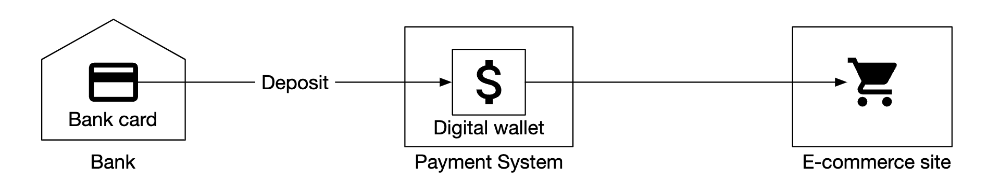
</div>

---

## Bước 1: Thấu hiểu bài toán và Xác lập phạm vi thiết kế (Understand the Problem and Establish Design Scope)
 * **C:** Chúng ta có nên chỉ tập trung vào tính năng chuyển tiền giữa các ví điện tử với nhau không, hay cần hỗ trợ thêm các nghiệp vụ khác (như nạp/rút tiền từ ngân hàng)?
 * **I:** Hãy tập trung vào nghiệp vụ **chuyển tiền trực tiếp giữa các ví điện tử (balance transfer between digital wallets)** trong buổi phỏng vấn này.
 * **C:** Hệ thống cần hỗ trợ bao nhiêu giao dịch mỗi giây (TPS)?
 * **I:** Hãy giả định hệ thống cần chịu tải **1 triệu giao dịch mỗi giây (1.000.000 TPS)**.
 * **C:** Một ví điện tử có yêu cầu cực kỳ khắt khe về tính đúng đắn của dữ liệu (strict correctness requirements). Chúng ta có thể giả định rằng hệ thống bắt buộc phải đảm bảo tính chất giao dịch (**Transactional guarantees - ACID**) không ạ?
 * **I:** Đúng vậy.
 * **C:** Chúng ta có cần chứng minh tính đúng đắn của số dư lịch sử (prove correctness / auditability) không?
 * **I:** Có. Chúng ta có thể kiểm tra sai lệch qua quy trình Đối soát (Reconciliation), nhưng đối soát chỉ giúp phát hiện ra sự chênh lệch chứ không chỉ ra được nguyên nhân gốc rễ tạo nên sự chênh lệch đó. Thay vào đó, chúng ta muốn hệ thống có khả năng **phát lại (replay) dữ liệu từ thời điểm bắt đầu để tái tạo lại toàn bộ lịch sử số dư (reconstruct history)**.
 * **C:** Chúng ta có thể giả định yêu cầu về tính sẵn sàng (Availability) là **99.99% (4 số 9)** không?
 * **I:** Đồng ý.
 * **C:** Chúng ta có cần tính đến nghiệp vụ quy đổi ngoại tệ (foreign exchange) không?
 * **I:** Không, phần đó nằm ngoài phạm vi bài toán.

**Tóm tắt các yêu cầu cốt lõi mà hệ thống phải đáp ứng:**
 * Hỗ trợ giao dịch chuyển số dư giữa hai tài khoản ví điện tử.
 * Chịu tải **1.000.000 TPS (1 triệu giao dịch/giây)**.
 * Độ tin cậy và tính sẵn sàng đạt **99.99%**.
 * Hỗ trợ giao dịch nguyên tử (**Transactions**).
 * Hỗ trợ khả năng tái lập lại trạng thái dữ liệu (**Reproducibility**) phục vụ kiểm toán.

### **Ước lượng sơ bộ (Back-of-the-envelope estimation)**
Một Relational Database truyền thống được triển khai trên hạ tầng Cloud điển hình có thể xử lý khoảng **1.000 TPS**.

Để đạt được mức tải 1 triệu giao dịch chuyển tiền mỗi giây, nếu mỗi giao dịch chỉ chạm vào 1 Node thì đã cần 1.000 Database Nodes. Nhưng vì mỗi giao dịch chuyển tiền luôn gồm 2 vế (trừ tiền tài khoản A và cộng tiền tài khoản B), hệ thống thực chất phải xử lý **2 triệu thao tác mỗi giây (2.000.000 TPS)** — tức là cần tới **2.000 Database Nodes**!

Do đó, một trong những mục tiêu thiết kế quan trọng nhất của chúng ta trong chương này là tìm cách **tăng tối đa số TPS mà một Node đơn lẻ có thể xử lý**, từ đó giảm mạnh tổng số lượng máy chủ cần vận hành:

| TPS trên mỗi Node (Per-node TPS) | Tổng số lượng Node cần thiết (Node Number) |
|----------------------------------|--------------------------------------------|
| 100                              | 20.000                                     |
| 1.000                            | 2.000                                      |
| 10.000                           | 200                                        |

---

## Bước 2: Đề xuất Thiết kế Tổng quan và Thống nhất Phương án (Propose High-Level Design and Get Buy-In)

### **Thiết kế API (API Design)**
Trong phạm vi buổi phỏng vấn này, chúng ta chỉ cần thiết kế một API Endpoint duy nhất:
```
POST /v1/wallet/balance_transfer - Chuyển số dư từ ví này sang ví khác
```

**Các tham số đầu vào (Request parameters):**
- `from_account`: Tài khoản ví chuyển tiền (`string`).
- `to_account`: Tài khoản ví nhận tiền (`string`).
- `amount`: Số tiền cần chuyển (kiểu `string` để tránh mất độ chính xác số thực).
- `currency`: Đơn vị tiền tệ (`string`, chuẩn ISO 4217 như `"USD"`).
- `transaction_id`: Mã định danh giao dịch (`uuid`), đóng vai trò là khóa lũy đẳng (**Idempotency key**).

**Ví dụ về Response trả về:**
```
{
    "status": "success"
    "transaction_id": "01589980-2664-11ec-9621-0242ac130002"
}
```

### **Phương án 1: Phân mảnh trên bộ nhớ (In-memory sharding solution — Redis)**
Ứng dụng ví điện tử của chúng ta cần duy trì số dư hiện tại cho mọi tài khoản người dùng.

Cấu trúc dữ liệu tự nhiên nhất để biểu diễn mối quan hệ này là một bảng băm (Hash Map) `<user_id, balance>`, và công cụ đầu tiên hiện lên trong đầu khi cần tốc độ cực cao là kho lưu trữ trên bộ nhớ **Redis**.

Vì một Redis Node đơn lẻ không thể chịu nổi tải 1 triệu TPS, chúng ta cần phân vùng (shard) cụm Redis ra nhiều Nodes. Để phân phối đều các tài khoản qua các phân vùng, chúng ta băm mã tài khoản (`accountID`):
```
String accountID = "A";
Int partitionNumber = 7;
Int myPartition = accountID.hashCode() % partitionNumber;
```

Chúng ta có thể sử dụng **ZooKeeper** làm kho lưu trữ cấu hình có tính sẵn sàng cao để lưu tổng số lượng phân vùng (`partitionNumber`) và địa chỉ mạng của toàn bộ các Redis Nodes. Tầng **Wallet Service** là các dịch vụ Stateless nhận Request chuyển tiền và gọi xuống các Redis Nodes tương ứng:

<div style="margin-left:3rem">
    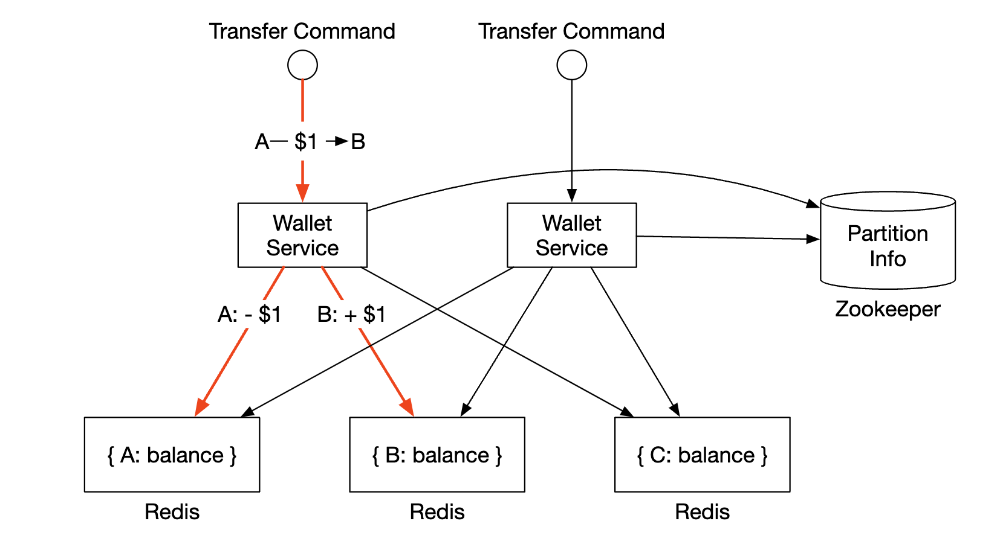
</div>

Mặc dù phương án dùng Redis giải quyết được bài toán hiệu năng (Throughput), nhưng nó có một lỗ hổng chí mạng: **không đảm bảo tính nguyên tử (Atomicity) khi cập nhật số dư trên hai Redis Nodes khác nhau**, đồng thời dữ liệu lưu thuần trên RAM không đảm bảo độ bền vững tuyệt đối cho hệ thống tài chính.

### **Phương án 2: Giao dịch phân tán với Cam kết hai pha (Distributed transactions — Two-Phase Commit / 2PC)**
Để đảm bảo độ bền vững và tính nguyên tử của giao dịch, hãy thay thế các Redis Nodes bằng các **Relational Databases đã được phân mảnh (Sharded Relational Databases)**. Khi một giao dịch chuyển tiền liên quan đến hai tài khoản nằm trên hai Database Shards khác nhau, làm sao để biến hai thao tác cục bộ đó thành một giao dịch nguyên tử (Atomic Transaction)?

Giải pháp cấp cơ sở dữ liệu kinh điển là sử dụng giao thức **Cam kết hai pha (Two-Phase Commit - 2PC)**:

<div style="margin-left:3rem">
    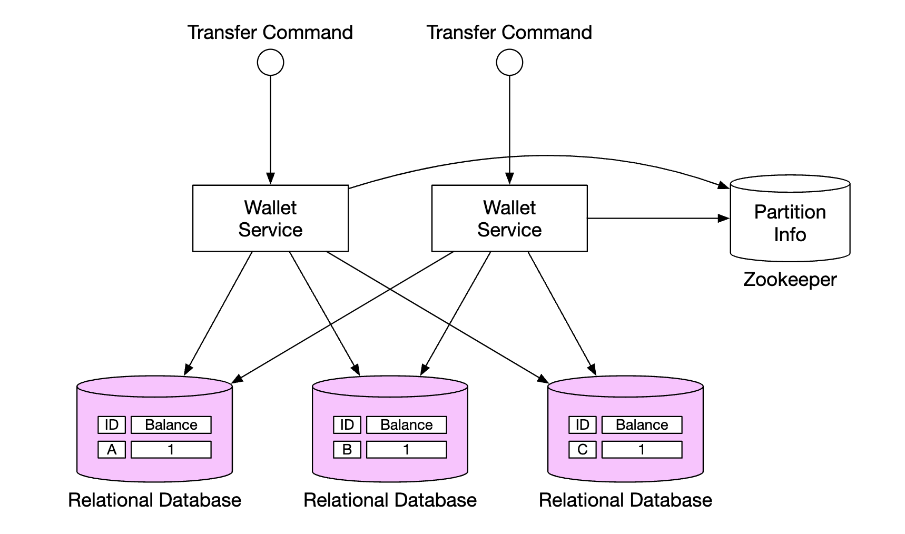
</div>

Cách thức hoạt động của giao thức **2PC** qua hai pha:

<div style="margin-left:3rem">
    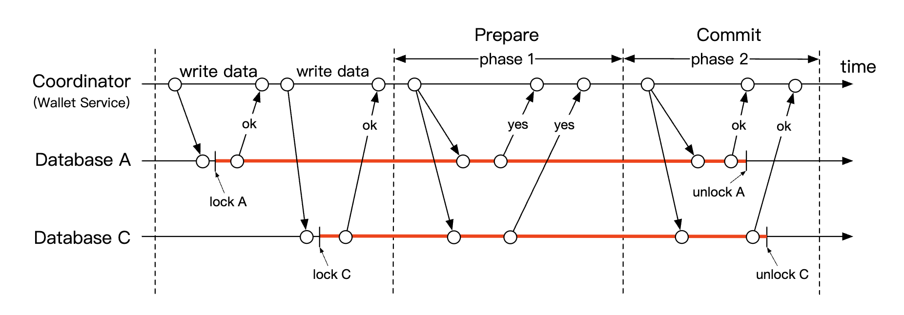
</div>

 1. **Pha chuẩn bị (Prepare phase):** Bộ điều phối (**Coordinator** — chính là Wallet Service) thực hiện các thao tác đọc/ghi trên nhiều Database Shards như bình thường. Khi ứng dụng sẵn sàng hoàn tất giao dịch, Coordinator gửi yêu cầu `Prepare` tới tất cả các Databases tham gia để yêu cầu chúng khóa tài nguyên và chuẩn bị sẵn sàng Commit.
 2. **Pha cam kết (Commit phase):**
    - Nếu **tất cả** các Databases đều phản hồi `"Yes"` (sẵn sàng), Coordinator sẽ gửi lệnh `Commit` tới toàn bộ các Databases để chính thức hoàn tất giao dịch.
    - Nếu có **bất kỳ** một Database nào phản hồi `"No"` (hoặc bị quá thời gian chờ - timeout), Coordinator sẽ gửi lệnh `Abort` (Rollback) tới tất cả các Databases để hủy bỏ toàn bộ giao dịch.

**Nhược điểm lớn của 2PC:**
 * **Hiệu năng rất kém:** Các Database Shards phải giữ khóa bản ghi (lock contention) trong suốt thời gian chờ đợi tin nhắn qua mạng từ các Node khác, không thể mở rộng lên 1 triệu TPS.
 * **Coordinator trở thành điểm lỗi đơn lẻ (Single Point of Failure - SPOF):** Nếu Coordinator bị sập ngay sau khi gửi lệnh `Prepare`, các Databases tham gia sẽ bị treo khóa vô thời hạn vì không biết nên Commit hay Abort:

### **Phương án 3: Giao dịch phân tán sử dụng Thử - Xác nhận/Hủy (Try-Confirm/Cancel - TC/C)**
**Thử - Xác nhận/Hủy (Try-Confirm/Cancel - TC/C)** là một biến thể ở tầng ứng dụng của giao thức 2PC, hoạt động dựa trên cơ chế **giao dịch bù trừ (compensating transactions)**:
 1. **Pha 1 (Try):** Coordinator yêu cầu tất cả các Databases tham gia thực hiện một giao dịch cục bộ để kiểm tra điều kiện và **phong tỏa / giữ chỗ tài nguyên (reserve resources)** cho giao dịch phân tán.
 2. **Pha 2 (Confirm hoặc Cancel):** Coordinator thu thập phản hồi từ tất cả các Databases:
    - Nếu tất cả đều trả lời `"Yes"`: Coordinator gửi lệnh **Confirm** tới các Databases để thực thi bước xác nhận cuối cùng.
    - Nếu có bất kỳ bên nào trả lời `"No"`: Coordinator gửi lệnh **Cancel** tới các Databases để chạy giao dịch đảo ngược (compensate) phần tài nguyên đã phong tỏa ở Pha 1.

**Điểm khác biệt cốt lõi giữa 2PC và TC/C:** Trong 2PC, cả hai pha đều nằm trong **cùng một** Database Transaction chưa Commit (giữ khóa lâu). Ngược lại, trong TC/C, mỗi bước (`Try`, `Confirm`, hoặc `Cancel`) đều là một **Local Transaction hoàn toàn độc lập được Commit ngay lập tức** xuống Database (không giữ khóa chờ qua mạng)!

Hãy xem cách TC/C vận hành cụ thể cho giao dịch chuyển \$1 từ tài khoản **A** sang tài khoản **C**:

| Pha (Phase) | Thao tác (Operation) | Tài khoản A (Account A)      | Tài khoản C (Account C)         |
|-------------|----------------------|------------------------------|---------------------------------|
| **1**       | **Try**              | Thay đổi số dư: **-\$1**     | Không làm gì (`NOP`)            |
| **2a**      | **Confirm**          | Không làm gì (`NOP`)         | Thay đổi số dư: **+\$1**        |
| **2b**      | **Cancel**           | Thay đổi số dư: **+\$1**     | Không làm gì (`NOP`)            |

- **Pha 1 — Try:**

<div style="margin-left:3rem">
    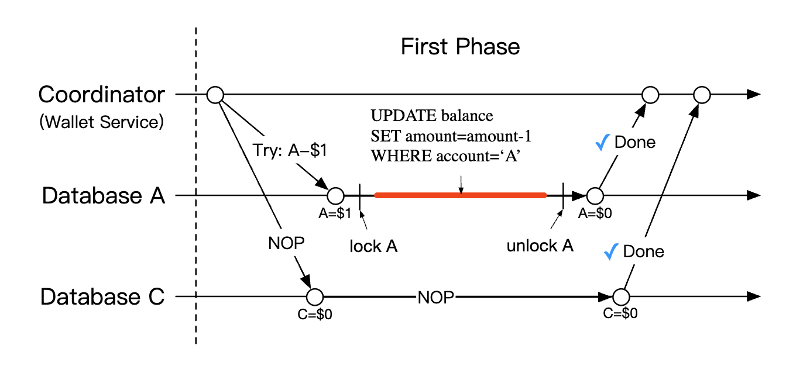
</div>

  * Coordinator khởi tạo một Local Transaction trên Database của **A** để trừ ngay số dư của A đi \$1 (kiểm tra đảm bảo A đủ tiền và phong tỏa khoản \$1 đó).
  * Đối với Database của **C**, Coordinator chỉ gửi một lệnh rỗng (`NOP` - No Operation, hoặc kiểm tra xem tài khoản C có tồn tại và hợp lệ không) chứ chưa cộng tiền cho C ngay ở Pha 1.

- **Pha 2a — Confirm (Khi Pha 1 thành công):**

<div style="margin-left:3rem">
    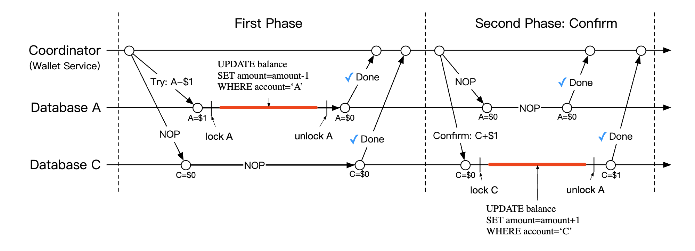
</div>

  * Nếu cả hai Databases của A và C đều phản hồi `"Yes"` ở Pha 1, Pha Confirm sẽ bắt đầu.
  * Database của **A** không cần làm gì thêm (`NOP` vì đã trừ \$1 ở Pha Try rồi), trong khi Database của **C** nhận lệnh thực thi một Local Transaction để cộng thêm \$1 vào số dư của C.

- **Pha 2b — Cancel (Khi Pha 1 thất bại):**

<div style="margin-left:3rem">
    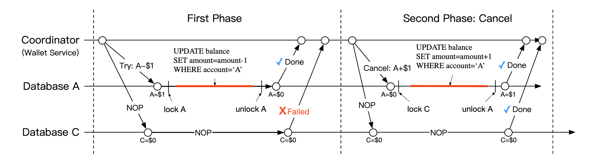
</div>

  * Giả sử ở Pha 1, tài khoản A đã trừ \$1 thành công nhưng tài khoản C lại không tồn tại hoặc bị khóa (báo lỗi). Khi đó Pha Cancel được kích hoạt.
  * Database của **A** nhận lệnh thực thi một giao dịch bù trừ để **cộng trả lại \$1** cho A, còn Database của **C** nhận `NOP`.

Bảng so sánh sự khác biệt bản chất giữa **2PC** và **TC/C**:

| Tiêu chí   | Pha thứ nhất (First Phase)                                               | Pha thứ hai: Thành công (Second Phase: success)        | Pha thứ hai: Thất bại (Second Phase: fail)                        |
|------------|--------------------------------------------------------------------------|--------------------------------------------------------|-------------------------------------------------------------------|
| **2PC**    | Các Local Transactions vẫn đang mở, **chưa** Commit (đang giữ khóa)      | Commit tất cả các Local Transactions đang mở           | Rollback (Hủy) tất cả các Local Transactions đang mở              |
| **TC/C**   | Tất cả các Local Transactions ở Pha Try **đã được Commit hoàn tất**      | Thực thi một Local Transaction mới (nếu cần, như C+\$1)| Thực thi một Local Transaction mới để **đảo ngược** cái đã Commit |

TC/C còn được gọi là **Giao dịch phân tán bằng cơ chế bù trừ (Distributed transaction by compensation)**. Các đặc tính quan trọng của TC/C:
 * **Độc lập với công nghệ Database (Database-agnostic):** Không đòi hỏi Database phải hỗ trợ chuẩn giao thức phân tán cấp thấp như XA/2PC; chỉ cần Database hỗ trợ Local Transaction cơ bản là dùng được (thậm chí cả hai Shards dùng hai loại Database khác nhau vẫn chạy tốt).
 * **Đánh đổi:** Toàn bộ sự phức tạp của việc quản lý các pha và viết logic hoàn tác/bù trừ đều bị đẩy lên tầng **Code nghiệp vụ ứng dụng (Application business logic)**.

#### Các kịch bản lỗi và góc khuất của TC/C (TC/C Failure modes)
**1. Điều gì xảy ra nếu Coordinator (Wallet Service) bị sập giữa chừng?**
Để một tiến trình Wallet Service khác có thể tiếp quản và khôi phục lại trạng thái đang chạy dở khi Coordinator cũ bị sập, chúng ta cần lưu bền vững trạng thái tiến độ của từng pha vào các **Bảng trạng thái pha (Phase status tables)** đặt ngay trong chính các Database Shards tham gia giao dịch:

<div style="margin-left:3rem">
    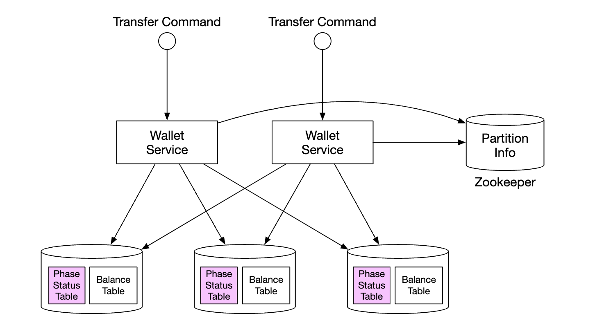
</div>

Bảng trạng thái pha (`phase_status_table`) lưu các thông tin:
 * ID và nội dung của giao dịch phân tán.
 * Trạng thái của pha `Try` (`not sent`, `has been sent`, `response received`).
 * Tên của pha thứ hai (`Confirm` hoặc `Cancel`).
 * Trạng thái của pha thứ hai (`not sent`, `has been sent`, `response received`).
 * Cờ đánh dấu thực thi sai thứ tự (`out-of-order flag` — sẽ giải thích ngay dưới đây).

**2. Trạng thái mất cân bằng tạm thời và Quy tắc chọn thao tác ở Pha Try:**
Một lưu ý khi dùng TC/C là trong khoảng thời gian ngắn khi giao dịch đang ở giữa Pha 1 và Pha 2, tổng tiền toàn hệ thống tạm thời chưa cân bằng (A đã bị trừ \$1 nhưng C chưa được cộng \$1):

<div style="margin-left:3rem">
    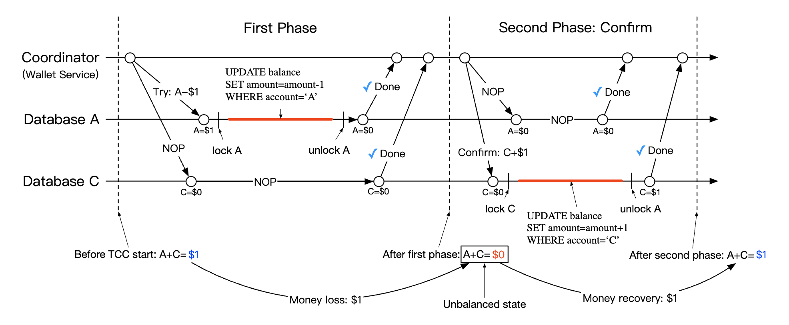
</div>

Điều này hoàn toàn an toàn trong hệ thống tài chính **miễn là chúng ta luôn tuân thủ nguyên tắc: thực hiện TRỪ TIỀN (Debit) ở Pha Try và chỉ CỘNG TIỀN (Credit) ở Pha Confirm**. Tại sao các lựa chọn khác lại sai lầm?

| Các lựa chọn thiết kế Pha Try | Tài khoản A | Tài khoản C | Đánh giá tính hợp lệ                                                                                              |
|-------------------------------|-------------|-------------|-------------------------------------------------------------------------------------------------------------------|
| **Lựa chọn 1 (Chuẩn)**        | **-\$1**    | `NOP`       | **Hợp lệ:** Tiền của A đã bị giữ lại ở Pha 1, không ai có thể tiêu khống số tiền đang chuyển.                     |
| **Lựa chọn 2 (Sai)**          | `NOP`       | **+\$1**    | **Không hợp lệ:** Nếu cộng tiền cho C ngay ở Pha 1, C có thể nhanh tay rút mất \$1 đó trước khi phát hiện A hết tiền! |
| **Lựa chọn 3 (Sai)**          | **-\$1**    | **+\$1**    | **Không hợp lệ:** Tương tự Lựa chọn 2, nếu C được cộng tiền ở Pha 1 rồi tiêu mất trước khi Pha 1 ở A báo lỗi.     |

**3. Xử lý gói tin đến sai thứ tự (Out-of-order execution):**

<div style="margin-left:3rem">
    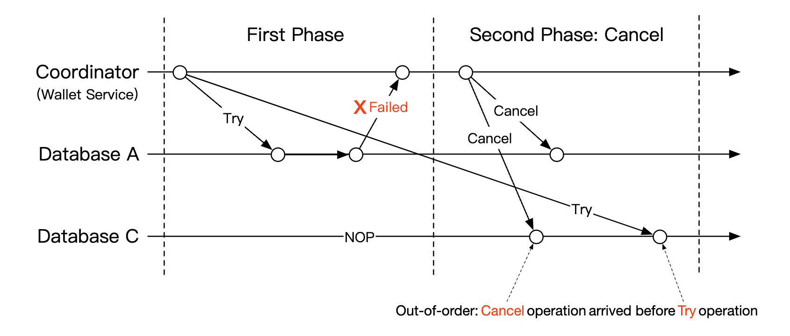
</div>

Giả sử ở Pha 1, Coordinator gửi lệnh `Try` tới Database A nhưng gói tin mạng bị nghẽn và đến rất chậm. Quá thời gian chờ (timeout), Coordinator tưởng lệnh `Try` đã thất bại nên lập tức chuyển sang Pha 2b và gửi lệnh `Cancel` tới Database A. Lúc này, gói tin `Cancel` lại đến Database A **trước** gói tin `Try` bị kẹt! Nếu Database A thấy chưa có lệnh `Try` nào mà bỏ qua lệnh `Cancel`, rồi một lát sau gói tin `Try` bị trễ mới bay tới và trừ mất \$1 của A thì số tiền đó sẽ bị trừ oan vĩnh viễn!

Để xử lý trường hợp biên (edge case) này: khi lệnh `Cancel` đến mà chưa thấy dữ liệu của lệnh `Try`, hệ thống vẫn ghi nhận vào bảng trạng thái pha một cờ **`out-of-order = TRUE`** và trả về thành công. Khi gói tin `Try` bị trễ bay tới sau đó, nó kiểm tra thấy cờ `out-of-order` đã được bật thì sẽ lập tức hủy bỏ và không thực hiện trừ tiền nữa.

### **Phương án 4: Giao dịch phân tán sử dụng Mẫu thiết kế Saga (Saga Pattern)**
Một phương pháp cực kỳ phổ biến khác trong kiến trúc Microservices là sử dụng **Mẫu thiết kế Saga (Saga Pattern)**.

Nguyên lý hoạt động của Saga:
 * Tất cả các thao tác được sắp xếp thành một chuỗi tuần tự tuyến tính: $T_1 \rightarrow T_2 \rightarrow \dots \rightarrow T_n$. Mỗi thao tác là một giao dịch cục bộ độc lập trên Database riêng của từng dịch vụ.
 * Các thao tác được thực thi lần lượt từ đầu đến cuối.
 * Nếu thao tác thứ $k$ gặp lỗi, toàn bộ quy trình sẽ quay đầu thực hiện chuỗi các **giao dịch bù trừ (compensating transactions)** theo thứ tự ngược lại ($C_{k-1} \rightarrow \dots \rightarrow C_1$) để hoàn tác mọi thay đổi đã thực hiện trước đó:

<div style="margin-left:3rem">
    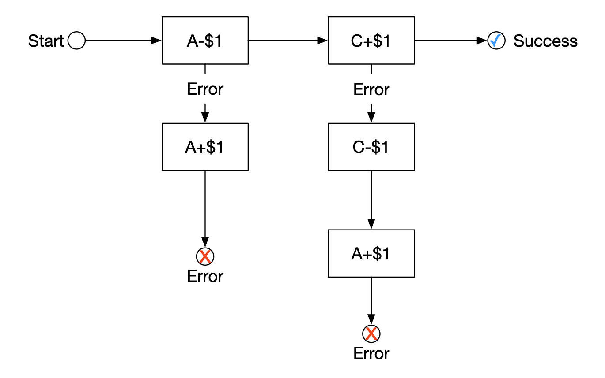
</div>

Có hai cách để điều phối luồng công việc trong một Saga:
 1. **Choreography (Vũ đạo phân tán):** Không có nhạc trưởng trung tâm; tất cả các dịch vụ tham gia Saga tự đăng ký lắng nghe sự kiện bất đồng bộ của nhau để tự thực hiện phần việc của mình. Nhược điểm lớn là khi số lượng dịch vụ nhiều lên, luồng sự kiện trở nên rối rắm và rất khó kiểm soát trạng thái.
 2. **Orchestration (Nhạc trưởng điều phối trung tâm):** Một bộ điều phối duy nhất (**Saga Coordinator / Orchestrator**) đứng ra chỉ huy các dịch vụ thực hiện từng bước theo đúng thứ tự kịch bản. Trong hệ thống ví điện tử đòi hỏi sự chặt chẽ cao, **Orchestration** luôn là lựa chọn được ưu tiên.

**Bảng so sánh giữa TC/C và Saga:**

| Tiêu chí so sánh                                              | TC/C                                | Saga (Orchestration mode)             |
|---------------------------------------------------------------|-------------------------------------|---------------------------------------|
| Hành động bù trừ (Compensating action)                        | Thực hiện trong pha `Cancel`        | Thực hiện trong pha `Rollback`        |
| Điều phối trung tâm (Central coordination)                    | Có                                  | Có                                    |
| Thứ tự thực thi các thao tác (Operation execution order)      | Bất kỳ (song song)                  | Tuần tự tuyến tính (Linear)           |
| Khả năng thực thi song song (Parallel execution possibility)  | **Có**                              | **Không** (chạy tuần tự từng bước)    |
| Có thể nhìn thấy trạng thái chưa nhất quán tạm thời không?    | Có                                  | Có                                    |
| Triển khai ở tầng Application hay Database?                   | Application                         | Application                           |

Sự khác biệt lớn nhất giúp bạn chọn giữa hai phương án là **Latency (Độ trễ)**: vì TC/C cho phép gửi lệnh tới các Shards **song song** với nhau ở từng pha, trong khi Saga phải chạy tuần tự hết bước 1 mới sang bước 2, nên nếu hệ thống có nhiều thao tác trong một giao dịch và đòi hỏi Latency cực thấp thì **TC/C** là lựa chọn tốt hơn.

Tuy nhiên, dù chọn TC/C hay Saga thì cả hai mới chỉ giải quyết được bài toán thực thi giao dịch ở mức lưu lượng vừa phải, vẫn chưa trả lời được câu hỏi: **Làm thế nào để kiểm toán lịch sử số dư (Auditability), tái tạo lại trạng thái từ đầu (Reproducibility) và đẩy hiệu năng lên mức 1.000.000 TPS?**

### **Lưu trữ sự kiện nguồn (Event Sourcing)**
Trong thực tế vận hành, một nhà cung cấp ví điện tử luôn phải chịu sự kiểm toán tài chính nghiêm ngặt (external audit) và phải trả lời được những câu hỏi hóc búa sau:
 1. Làm sao chúng ta biết chính xác số dư tài khoản của một người dùng tại một thời điểm bất kỳ trong quá khứ?
 2. Làm sao chúng ta chứng minh được số dư lịch sử và số dư hiện tại trong Database là hoàn toàn chính xác?
 3. Làm sao chúng ta chứng minh được rằng sau khi nâng cấp một phiên bản code nghiệp vụ mới, logic tính toán của hệ thống vẫn đúng đắn 100%?

Kỹ thuật kiến trúc sinh ra để giải quyết triệt để cả ba câu hỏi trên chính là **Lưu trữ sự kiện nguồn (Event Sourcing)**.

Event Sourcing bao gồm 4 khái niệm nền tảng:
 1. **Command (Mệnh lệnh):** Yêu cầu hành động có chủ đích từ thế giới bên ngoài gửi vào hệ thống — ví dụ: *"Hãy chuyển \$1 từ tài khoản A sang tài khoản C"*.
    * Để hoạt động đúng trong Event Sourcing, các Commands phải được xếp theo một thứ tự định sẵn toàn cục, do đó chúng thường được đưa vào một hàng đợi **FIFO (First-In-First-Out)**.
    * **Lưu ý quan trọng:** Một Command chỉ là một yêu cầu nên nó **có thể thất bại** (ví dụ: tài khoản A không đủ tiền) và quá trình xử lý Command có thể chứa yếu tố ngẫu nhiên hoặc gọi I/O bên ngoài. Một Command khi được xử lý có thể sinh ra $0$, $1$ hoặc nhiều Events.
 2. **Event (Sự kiện):** Là những **sự thật lịch sử đã chắc chắn xảy ra (historical facts)** bên trong hệ thống sau khi Command đã được kiểm tra hợp lệ hoàn tất — ví dụ: *"Đã chuyển thành công \$1 từ A sang C"* (hoặc tách thành 2 sự kiện: *"Tài khoản A đã giảm \$1"* và *"Tài khoản C đã tăng \$1"*).
    * Khác với Command, một Event là một sự thật lịch sử đã được xác nhận nên nó **bất biến (immutable)** và không thể thất bại.
    * Tương tự như Command, danh sách các Events cũng phải có thứ tự nghiêm ngặt trong một hàng đợi FIFO.
 3. **State (Trạng thái):** Là dữ liệu trạng thái hiện tại bị thay đổi khi áp dụng một Event — trong bài toán ví điện tử, `State` chính là bảng ánh xạ Key-Value giữa các tài khoản và số dư hiện tại của chúng (`map<account_id, balance>`).
 4. **State Machine (Máy trạng thái):** Là bộ máy điều khiển toàn bộ quy trình Event Sourcing, đảm nhiệm hai chức năng chính:
    * Đọc `Command`, kiểm tra tính hợp lệ dựa trên `State` hiện tại và phát sinh ra `Event`.
    * Đọc `Event` và áp dụng nó để cập nhật `State`.
    * **Quy tắc bất di bất dịch:** Máy trạng thái (State Machine) bắt buộc phải có **Tính tất định (Determinism)** — nghĩa là không bao giờ được phép chứa yếu tố ngẫu nhiên (như hàm `random()` hay đọc đồng hồ hệ thống `now()`) hoặc gọi I/O bên ngoài trong bước áp dụng Event vào State. Với cùng một chuỗi Events đầu vào, State Machine bắt buộc phải luôn tính ra đúng một State đầu ra giống hệt nhau!

<div style="margin-left:3rem">
    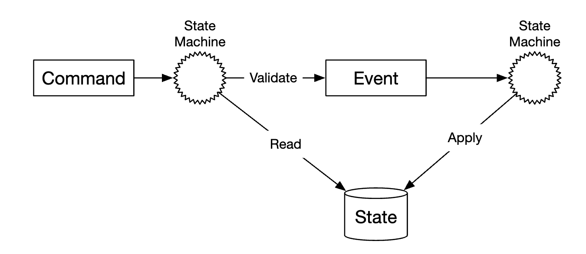
</div>

Góc nhìn động theo dòng thời gian của Event Sourcing (Trạng thái không ngừng biến đổi khi các Events mới được áp dụng nối tiếp nhau: $\text{State}_1 \xrightarrow{\text{Event}} \text{State}_2 \xrightarrow{\text{Event}} \text{State}_3 \dots$):

<div style="margin-left:3rem">
    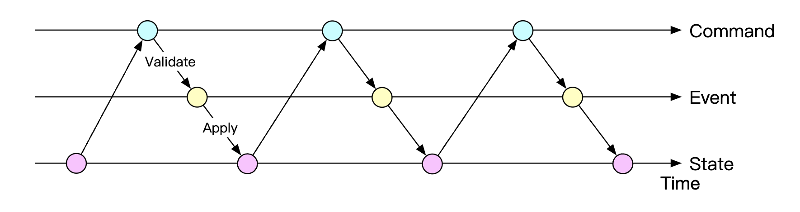
</div>

Áp dụng vào hệ thống Ví điện tử của chúng ta: các yêu cầu chuyển tiền từ Client chính là các `Commands`, được đẩy vào một hàng đợi FIFO như **Kafka**:

<div style="margin-left:3rem">
    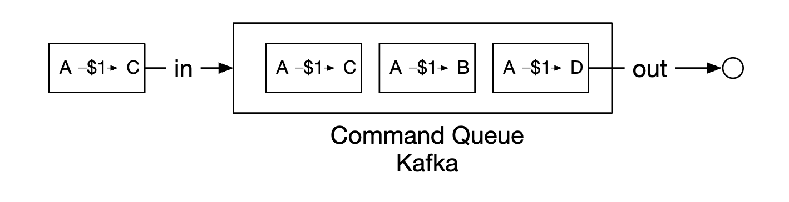
</div>

Dưới đây là bức tranh tổng thể về cách State Machine của Wallet Service vận hành:

<div style="margin-left:3rem">
    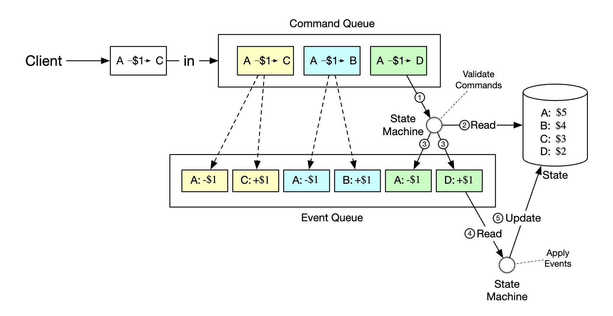
</div>

 1. **State Machine** đọc lần lượt từng `Command` từ **Command Queue**.
 2. Nó đọc trạng thái số dư (`Balance State`) hiện tại từ Database.
 3. Nó kiểm tra tính hợp lệ của `Command` (tài khoản có tồn tại không, số dư có $\ge \$1$ không). Nếu hợp lệ, nó phát sinh ra hai `Events` tương ứng cho từng tài khoản (`A - \$1` và `C + \$1`) rồi đẩy vào **Event Queue**.
 4. State Machine đọc `Event` tiếp theo từ Event Queue và áp dụng sự kiện đó bằng cách cập nhật số dư (`Balance State`) trong Database.

**Ưu điểm vượt trội của Event Sourcing — Khả năng tái lập (Reproducibility):**
Khác với thiết kế truyền thống (chỉ lưu trực tiếp số dư cuối cùng đè lên bản ghi cũ trong Database làm mất dấu vết quá khứ), trong Event Sourcing, chúng ta lưu trữ **toàn bộ chuỗi sự kiện thay đổi trạng thái như một cuốn nhật ký bất biến (immutable log)**.

Nhờ danh sách Events là bất biến và State Machine có tính tất định tuyệt đối, chúng ta có thể **tái tạo lại chính xác trạng thái số dư tại bất kỳ thời điểm lịch sử nào** chỉ bằng cách chạy phát lại (replay) các Events từ đầu cho đến thời điểm đó:

<div style="margin-left:3rem">
    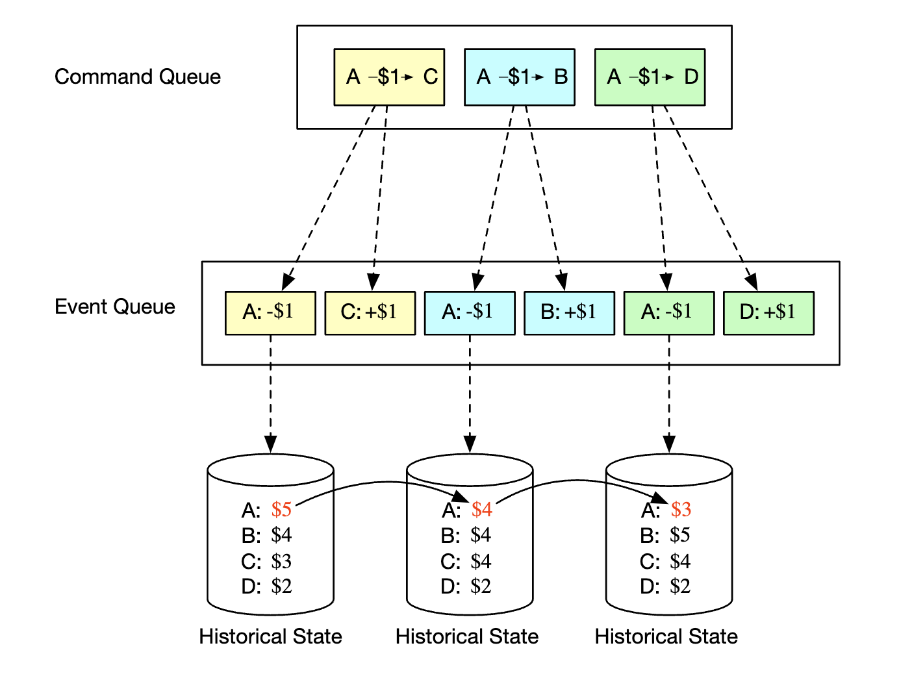
</div>

Giờ đây, cả 3 câu hỏi kiểm toán hóc búa ở đầu mục đều được giải quyết trọn vẹn:
 1. *Biết số dư tại bất kỳ thời điểm nào?* $\rightarrow$ Chỉ cần Replay các Events từ đầu đến đúng mốc thời gian cần xem.
 2. *Chứng minh số dư lịch sử và hiện tại là đúng đắn?* $\rightarrow$ Kiểm toán viên có thể tự tính toán lại toàn bộ chuỗi Events từ đầu để đối chiếu với State hiện tại.
 3. *Chứng minh logic code mới sau khi sửa đổi vẫn đúng đắn?* $\rightarrow$ Chạy bản code mới trên cùng chuỗi Events lịch sử và so sánh xem State đầu ra có khớp 100% với bản code cũ hay không.

**Vậy làm sao để phục vụ các truy vấn đọc số dư từ phía người dùng bên ngoài mà không làm ảnh hưởng đến State Machine đang xử lý giao dịch?**
Chúng ta kết hợp Event Sourcing với kiến trúc **Phân tách trách nhiệm Truy vấn và Mệnh lệnh (CQRS - Command Query Responsibility Segregation)**:
 * Thay vì chỉ có một State Machine duy nhất vừa ghi vừa đọc, chúng ta tách riêng luồng ghi (Write path) và luồng đọc (Read path).
 * Có một **State Machine chính (Read-Write)** chuyên xử lý Commands và phát sinh Events.
 * Bên ngoài có thể có **nhiều State Machines chỉ đọc (Read-only State Machines)** cùng đăng ký lắng nghe luồng Events bất biến đó để tự xây dựng các bản sao trạng thái (Views) tối ưu riêng cho các nhu cầu truy vấn khác nhau (ví dụ: một State Machine chuyên phục vụ truy vấn số dư tức thời, một State Machine chuyên xây dựng báo cáo lịch sử theo khung thời gian cho kiểm toán). Mặc dù trạng thái trên các Read-only State Machines có độ trễ nhỏ (Eventual Consistency), nhưng chúng hoàn toàn tách biệt tải đọc khỏi lõi xử lý giao dịch!

<div style="margin-left:3rem">
    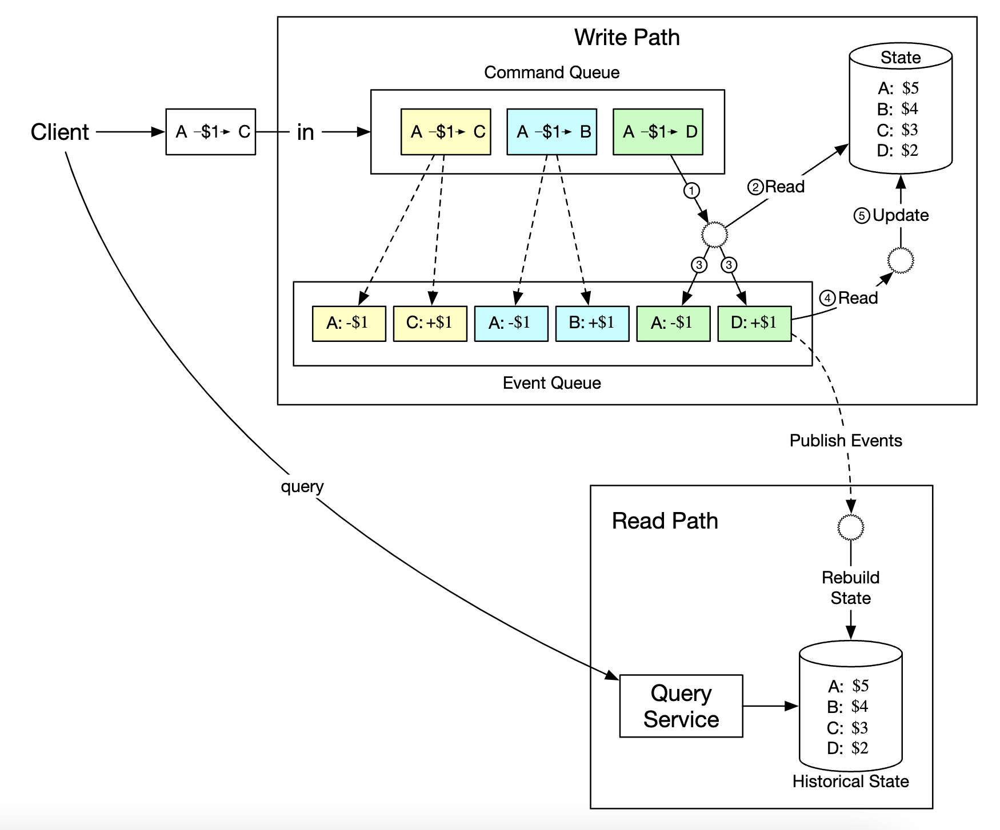
</div>

---

## Bước 3: Đi sâu vào Thiết kế Chi tiết (Design Deep Dive)
Trong phần này, chúng ta sẽ đi sâu vào các kỹ thuật tối ưu hóa hiệu năng cấp thấp để đưa kiến trúc Event Sourcing chạm tới mục tiêu **1 triệu TPS** với độ tin cậy cao nhất.

### **Event Sourcing hiệu năng cao (High-performance event sourcing)**
Trong thiết kế ở Bước 2, việc đặt Command Queue, Event Queue trên một cụm Kafka bên ngoài và lưu State trên một Relational Database tách biệt qua mạng sẽ khiến mỗi giao dịch phải chịu nhiều vòng độ trễ mạng (network round-trips). Một Node sẽ không thể xử lý được hàng chục nghìn TPS.

**Tối ưu hóa 1: Lưu trữ Command và Event trực tiếp trên ổ đĩa cục bộ (Local disk) kèm bộ nhớ đệm `mmap`**
Thay vì đẩy Commands và Events qua mạng tới Kafka bên ngoài, chúng ta lưu trực tiếp cả danh sách Commands lẫn Events vào ngay ổ đĩa cục bộ của chính máy chủ chạy State Machine!
- Điều này triệt tiêu hoàn toàn độ trễ mạng giữa ứng dụng và hàng đợi.
- Vì cả danh sách Commands và Events đều là cấu trúc **chỉ ghi nối tiếp vào cuối tệp (append-only)**, mà thao tác ghi tuần tự (sequential write) trên ổ cứng (cả SSD lẫn HDD) lại có tốc độ cực kỳ nhanh (nhanh ngang ngửa thao tác trên bộ nhớ RAM trong nhiều trường hợp).
- Đồng thời, chúng ta lưu Cache các Commands và Events vừa ghi ngay trên bộ nhớ RAM để State Machine đọc ra tức thời mà không tốn Disk Read I/O.

Ở mức hệ thống (low-level), chúng ta hiện thực hóa kỹ thuật vừa ghi nối tiếp xuống đĩa vừa Cache trên RAM này bằng lời gọi hệ thống **`mmap` (Memory-mapped file)** của hệ điều hành: `mmap` ánh xạ trực tiếp một tệp trên ổ đĩa vào không gian bộ nhớ ảo của tiến trình, cho phép đọc/ghi mảng byte ngay trên RAM trong khi hệ điều hành tự động đảm nhận việc đồng bộ (flush) xuống đĩa cứng:

<div style="margin-left:3rem">
    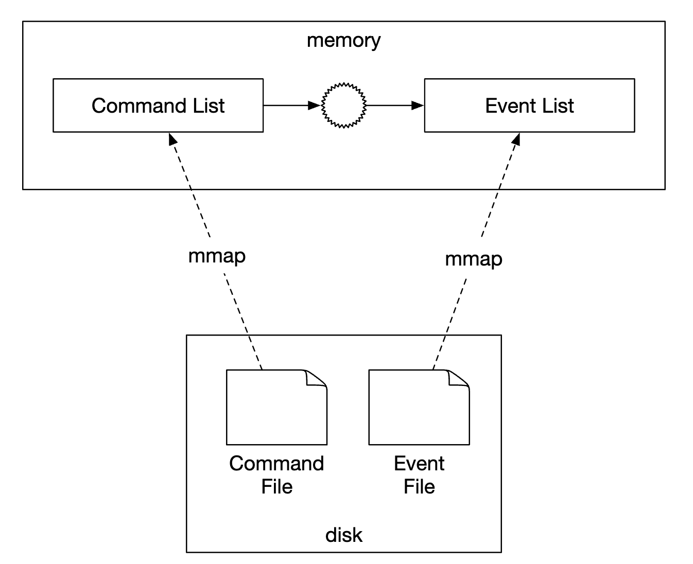
</div>

**Tối ưu hóa 2: Nhúng cơ sở dữ liệu trạng thái cục bộ với RocksDB**
Tương tự, thay vì lưu `State` (số dư tài khoản) trên một Database từ xa qua mạng, chúng ta lưu `State` ngay trên đĩa cục bộ của Node xử lý bằng một cơ sở dữ liệu nhúng (embedded database) dựa trên tệp như **SQLite** hoặc **RocksDB**.

Trong bài toán này, chúng ta chọn **RocksDB** (được phát triển bởi Facebook) vì nó sử dụng cấu trúc **Cây hợp nhất cấu trúc nhật ký (Log-Structured Merge-Tree - LSM-Tree)**, được tối ưu hóa cực hạn cho các thao tác ghi liên tục (write-heavy workloads), đồng thời tích hợp sẵn lớp Cache trong bộ nhớ giúp đọc số dư gần đây cực nhanh:

<div style="margin-left:3rem">
    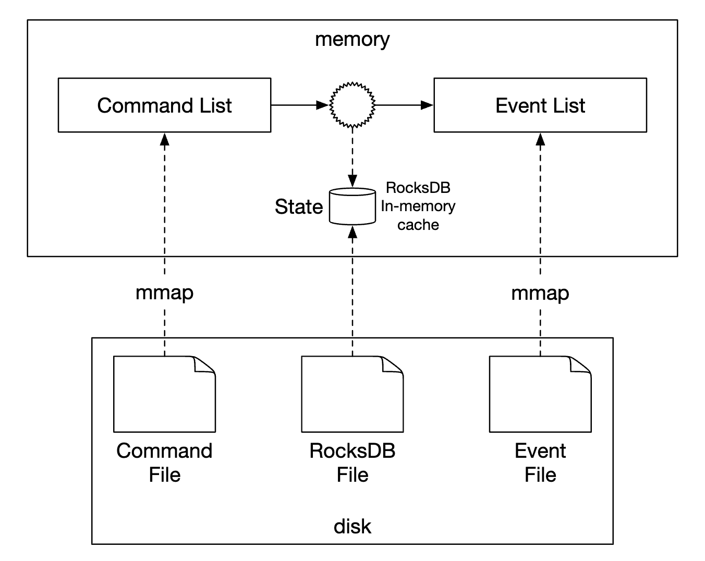
</div>

**Tối ưu hóa 3: Chụp ảnh trạng thái định kỳ (Periodic Snapshots)**
Khi mọi thứ đã chạy với tốc độ cực cao, danh sách Events sẽ dài ra rất nhanh. Nếu mỗi lần khởi động lại một Node hoặc tạo một Read-only State Machine mới để kiểm toán mà đều phải Replay lại hàng tỷ Events từ ngày đầu tiên thì sẽ mất quá nhiều thời gian.

Để tăng tốc quá trình tái tạo trạng thái (reproducibility), hệ thống định kỳ lưu lại một **Bản chụp nhanh trạng thái (Snapshot)** — là một tệp nhị phân lớn đóng băng toàn bộ `State` tại một mốc Event nhất định — lên một hệ thống lưu trữ tệp phân tán (như **HDFS** hoặc **Amazon S3**). Một khi Snapshot đã được tạo, nó hoàn toàn bất biến. Khi cần khôi phục hoặc kiểm toán, State Machine chỉ cần tải bản Snapshot gần nhất về và Replay các Events phát sinh kể từ sau mốc Snapshot đó mà thôi:

<div style="margin-left:3rem">
    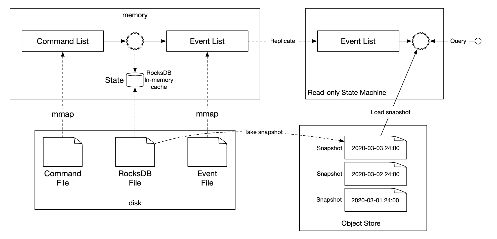
</div>

### **Đảm bảo độ tin cậy cho Event Sourcing hiệu năng cao (Reliable high-performance event sourcing)**
Các bước tối ưu hóa cục bộ bằng `mmap` và `RocksDB` ở trên đã biến mỗi Node của chúng ta thành một cỗ máy xử lý giao dịch siêu tốc, nhưng đồng thời cũng biến dịch vụ từ Stateless thành **Stateful**. Nếu một Node vật lý bị cháy ổ cứng, toàn bộ dữ liệu trên Node đó sẽ biến mất! Vì vậy, chúng ta bắt buộc phải bổ sung cơ chế **Sao chép dữ liệu (Replication)** để đảm bảo độ tin cậy (Reliability) và tính sẵn sàng đạt 99.99%.

Trước khi thiết kế cơ chế Replication, hãy phân tích xem trong 4 thành phần dữ liệu (`Command`, `Event`, `State`, `Snapshot`), **thành phần nào thực sự cần được sao chép với độ tin cậy cao nhất?**
 1. **`State` và `Snapshot`:** Luôn có thể được tái tạo lại chính xác 100% bất cứ lúc nào bằng cách Replay lại danh sách `Event`. Vì vậy, việc sao chép `State` hay `Snapshot` chỉ nhằm mục đích tăng tốc độ khôi phục chứ không phải là điều kiện sống còn để chống mất dữ liệu.
 2. **`Command`:** Thoạt nhìn, nhiều người có thể nghĩ rằng *"Chỉ cần sao chép danh sách Command là đủ, vì từ Command sẽ chạy ra lại được Event"*. **Điều này hoàn toàn sai lầm!** Như đã phân tích ở phần trước, quá trình chuyển từ `Command` sang `Event` **không hoàn toàn tất định (non-deterministic)** vì nó có thể phụ thuộc vào yếu tố thời gian, I/O bên ngoài hoặc trạng thái tranh chấp tại thời điểm đó. Do đó, Command chưa phải là sự thật lịch sử cuối cùng.
 3. **`Event`:** Là sự thật lịch sử bất biến và duy nhất đảm bảo tính tất định khi Replay ra `State`. **Kết luận:** Chúng ta chỉ cần và bắt buộc phải đảm bảo độ tin cậy tuyệt đối thông qua Replication cho **Danh sách sự kiện (Event list)**!

Để sao chép danh sách Events qua nhiều Nodes, cơ chế Replication phải đảm bảo hai tính chất:
 * Không bao giờ làm mất dữ liệu (No data loss) sau khi đã xác nhận.
 * Thứ tự tương đối của mọi Events bên trong tệp nhật ký phải **giống hệt nhau 100%** trên tất cả các bản sao (Replicas).

Để đạt được điều này, chúng ta sử dụng **Thuật toán đồng thuận Raft (Raft Consensus Algorithm)**.

Trong một cụm **Raft Group** (ví dụ gồm 3 hoặc 5 Nodes), tại một thời điểm luôn có duy nhất một Node đóng vai trò là **Leader** (chủ động tiếp nhận Commands và sinh Events) và các Nodes còn lại là **Followers** (thụ động nhận sao chép). Chỉ cần **quá bán (większość / majority)** số Nodes trong nhóm còn hoạt động (ví dụ: 2 trên 3 Nodes, hoặc 3 trên 5 Nodes), hệ thống vẫn vận hành liên tục không gián đoạn:

<div style="margin-left:3rem">
    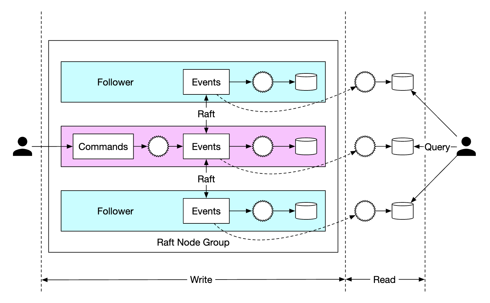
</div>

Luồng hoạt động với Raft:
 1. **Leader** nhận `Command`, xử lý qua State Machine cục bộ để sinh ra `Event` và ghi nối tiếp vào tệp `mmap` Event List của mình.
 2. **Leader** đồng bộ các `Events` mới này sang các **Followers** thông qua giao thức Raft.
 3. Ngay khi quá bán số Nodes đã ghi nhận thành công `Event` vào `mmap` của chúng, `Event` đó chính thức được coi là đã **Commit** an toàn. Tất cả các Nodes (cả Leader lẫn Followers) đều áp dụng `Event` đó vào RocksDB cục bộ để cập nhật `State` của mình.
 4. Nếu Node **Leader** chẳng may bị sập, thuật toán Raft sẽ tự động bầu chọn một trong các **Followers** lên làm **Leader mới** gần như tức thời vì Follower đó đã có sẵn đầy đủ cả `Event List` lẫn `State` mới nhất trong RocksDB!

### **Event Sourcing Phân tán (Distributed event sourcing)**
Đến đây, chúng ta đã có một cụm Raft Group đơn lẻ vừa đạt hiệu năng cực cao vừa có khả năng chịu lỗi tuyệt vời. Chúng ta còn hai bài toán cuối cùng cần giải quyết:
1. Làm sao để Client nhận được kết quả cập nhật tức thời trong kiến trúc CQRS bất đồng bộ?
2. Khi một cụm Raft Group đơn lẻ chạm ngưỡng giới hạn phần cứng, làm sao để phân mảnh (Shard) thành nhiều cụm Raft Groups và điều phối giao dịch chuyển tiền xuyên qua nhiều cụm đó?

#### Bài toán 1: Pull so với Push trong kiến trúc CQRS (Reverse Proxy)
Trong mô hình CQRS cơ bản, luồng gửi `Command` là bất đồng bộ — Client gửi lệnh chuyển tiền vào Command Queue rồi không biết chính xác khi nào lệnh đó được xử lý xong trừ khi liên tục gọi hỏi (**Polling**) vào dịch vụ Read-only State Machine:

<div style="margin-left:3rem">
    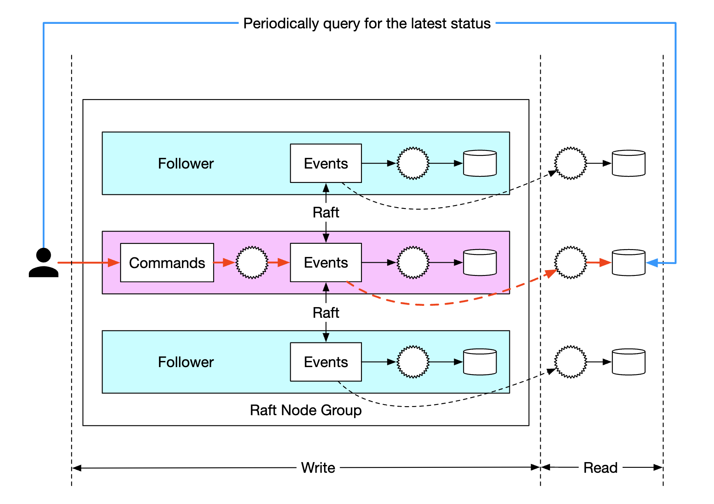
</div>

Việc để hàng triệu thiết bị Client bên ngoài tự gọi Polling liên tục vừa không mang lại phản hồi thời gian thực, vừa dễ làm quá tải tầng Read Query Service.

Để giải quyết, đầu tiên chúng ta đặt một tầng **Reverse Proxy** đứng chắn ở phía trước để đại diện cho người dùng gửi `Command` và theo dõi trạng thái giao dịch:

<div style="margin-left:3rem">
    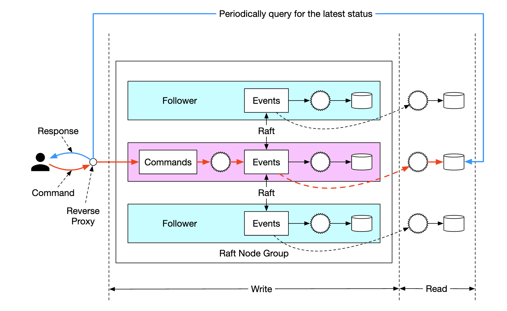
</div>

Tiếp theo, thay vì để Reverse Proxy phải đi hỏi (Pull/Poll), chúng ta sửa đổi nhẹ **Read-only State Machine**: ngay khi nó vừa nhận được một `Event` mới từ cụm Raft và cập nhật xong `State`, nó sẽ **chủ động đẩy (Push)** kết quả hoàn tất của giao dịch đó ngược về cho **Reverse Proxy**, và Reverse Proxy trả kết quả ngay lập tức cho Client đang chờ. Điều này mang lại cảm giác phản hồi đồng bộ theo thời gian thực cực nhanh cho người dùng cuối:

<div style="margin-left:3rem">
    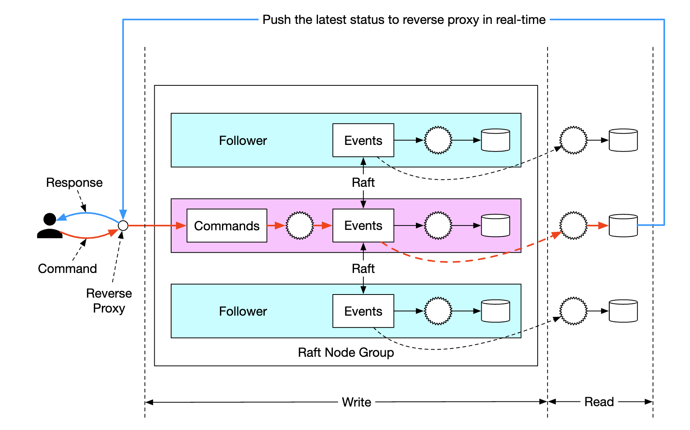
</div>

#### Bài toán 2: Phân mảnh thành nhiều cụm Raft Groups kết hợp Điều phối Saga / TC/C
Cuối cùng, để mở rộng quy mô toàn hệ thống lên **1.000.000 TPS**, chúng ta phân mảnh dữ liệu tài khoản người dùng (Sharding theo `hash(account_id) % num_partitions`) ra thành hàng trăm **Cụm Raft Groups (Sharded Raft Groups)** độc lập.

Khi người dùng A muốn chuyển \$1 sang cho người dùng C (mà tài khoản A và C nằm ở hai cụm Raft Groups khác nhau), chúng ta đặt tầng điều phối giao dịch phân tán (**Saga Orchestrator** hoặc **TC/C Coordinator**) lên trên các cụm Raft Groups này (đóng vai trò ngay tại tầng Reverse Proxy/Coordinator):

<div style="margin-left:3rem">
    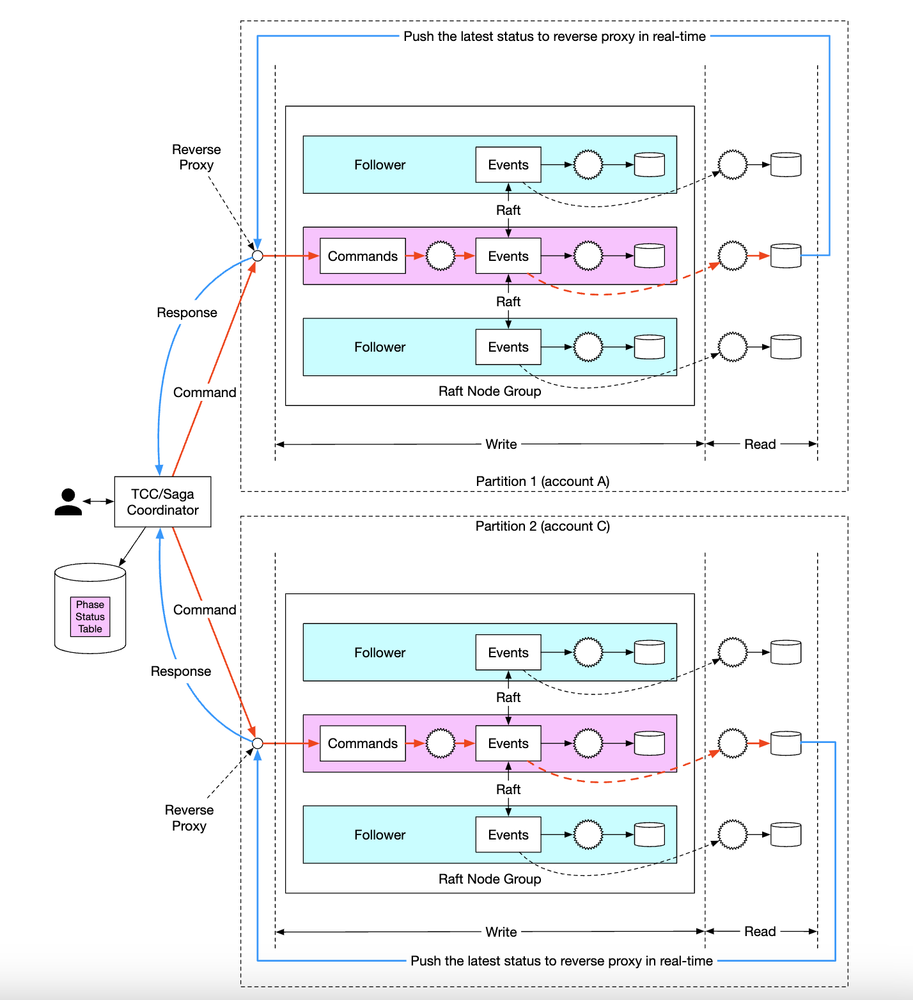
</div>

**Hãy theo dõi trọn vẹn vòng đời từ đầu đến cuối của một yêu cầu chuyển tiền trong kiến trúc hoàn chỉnh cuối cùng này (sử dụng Saga Orchestrator):**
 1. Người dùng **A** gửi một yêu cầu giao dịch chuyển tiền (`A - \$1` và `C + \$1`) tới **Saga Coordinator**.
 2. **Saga Coordinator** tạo một bản ghi trong **Bảng trạng thái pha (Phase status table)** để theo dõi tiến trình của giao dịch phân tán này.
 3. **Saga Coordinator** kiểm tra thứ tự các thao tác và xác định rằng cần xử lý lệnh trừ tiền `A - \$1` trước. Nó băm mã tài khoản A để biết A thuộc **Partition 1 (Raft Group 1)** và gửi `Command` (`A - \$1`) vào hàng đợi Command của Partition 1.
 4. **Raft Leader của Partition 1** đọc `Command` (`A - \$1`), kiểm tra tính hợp lệ trên State cục bộ (RocksDB), chuyển hóa thành `Event`, và đồng bộ `Event` đó sang các Followers trong cùng Raft Group 1. Khi đã đồng thuận xong, `Event` được áp dụng để trừ \$1 trong RocksDB của Partition 1.
 5. Ngay sau đó, `Event` được đồng bộ sang **Read-only State Machine của Partition 1**. Read-only State Machine cập nhật trạng thái đọc và **đẩy (Push)** thông báo thành công ngược về cho **Saga Coordinator**.
 6. **Saga Coordinator** nhận được phản hồi thành công của bước 1, cập nhật tiến độ vào bảng trạng thái pha, rồi tiếp tục gửi `Command` thứ hai (`C + \$1`) tới **Partition 2 (Raft Group 2)** — nơi chứa tài khoản C.
 7. **Raft Leader của Partition 2** nhận `Command` (`C + \$1`), kiểm tra hợp lệ, phát sinh `Event`, đồng bộ qua Raft, cập nhật RocksDB, và đồng bộ sang **Read-only State Machine của Partition 2** để đẩy (Push) phản hồi thành công về lại **Saga Coordinator**.
 8. **Saga Coordinator** nhận được xác nhận thành công của bước 2, đánh dấu toàn bộ giao dịch phân tán đã hoàn tất trong bảng trạng thái pha, và trả về kết quả thành công cuối cùng cho người dùng!

---

## Bước 4: Tổng kết (Wrap Up)
Hãy nhìn lại hành trình tiến hóa kiến trúc đầy ấn tượng mà chúng ta đã đi qua trong chương này:
 * Chúng ta bắt đầu từ một giải pháp đơn giản dùng **In-memory Redis Sharding**. Vấn đề của nó là không đảm bảo độ bền dữ liệu và không hỗ trợ giao dịch nguyên tử giữa các Shards.
 * Chúng ta chuyển sang sử dụng **Sharded Relational Databases**, kết hợp với các giao thức giao dịch phân tán: từ **Cam kết hai pha (2PC)** truyền thống sang **Thử - Xác nhận/Hủy (TC/C)** và **Mẫu thiết kế Saga (Distributed Saga)**.
 * Tiếp theo, để giải quyết yêu cầu kiểm toán lịch sử (Auditability) và khả năng tái lập trạng thái từ đầu (Reproducibility), chúng ta đã đưa vào kiến trúc **Lưu trữ sự kiện nguồn (Event Sourcing)** kết hợp **CQRS**.
 * Nhận thấy việc lưu trữ Commands, Events và State trên các hệ thống bên ngoài qua mạng (Kafka, Remote DB) tạo ra nút thắt cổ chai về hiệu năng, chúng ta đã tối ưu hóa đột phá bằng cách đưa toàn bộ về xử lý cục bộ trên từng Node với **`mmap` (Memory-mapped append-only logs)**, **RocksDB (LSM-Tree)** và chụp ảnh trạng thái định kỳ (**Snapshots**) trên HDFS/S3.
 * Vì lưu trữ cục bộ làm phát sinh rủi ro mất dữ liệu khi hỏng phần cứng, chúng ta đã áp dụng **Thuật toán đồng thuận Raft (Raft Consensus)** để sao chép danh sách Events qua nhiều Nodes, loại bỏ hoàn toàn điểm lỗi đơn lẻ.
 * Cuối cùng, chúng ta bổ sung cơ chế **Push từ Read-only State Machine về Reverse Proxy** và phân mảnh toàn hệ thống thành **nhiều cụm Sharded Raft Groups** được điều phối nhịp nhàng bởi **Saga / TC/C Coordinator** để chạm mốc **1 triệu TPS**!
