# Chương 28: Sàn Giao dịch Chứng khoán (Stock Exchange)

## Giới thiệu
Trong chương cuối cùng này, chúng ta sẽ thiết kế một **sàn giao dịch chứng khoán điện tử (electronic stock exchange)**.

Chức năng cốt lõi của một sàn giao dịch là **khớp lệnh (matching)** giữa người mua và người bán một cách hiệu quả, công bằng và có độ trễ cực thấp.

Các sàn giao dịch chứng khoán lớn nhất thế giới bao gồm **NYSE (Sàn giao dịch chứng khoán New York)**, **NASDAQ**, Tokyo Stock Exchange, London Stock Exchange, v.v.

<div style="margin-left:3rem">
    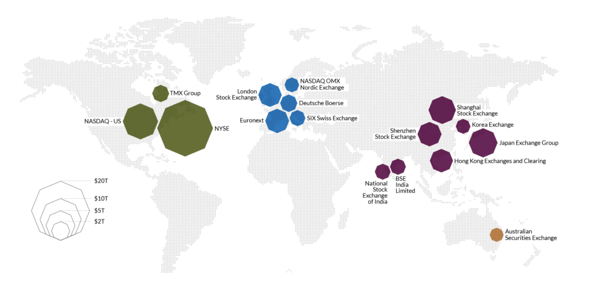
</div>

---

## Bước 1: Thấu hiểu bài toán và Xác lập phạm vi thiết kế (Understand the Problem and Establish Design scope)
 * **C:** Chúng ta sẽ giao dịch những loại chứng khoán nào ạ? Cổ phiếu (stocks), quyền chọn (options) hay hợp đồng tương lai (futures)?
 * **I:** Để đơn giản hóa, chúng ta chỉ giao dịch **cổ phiếu (stocks)**.
 * **C:** Những thao tác lệnh nào cần được hỗ trợ — đặt lệnh mới (`place`), hủy lệnh (`cancel`), sửa lệnh (`replace`)? Còn về loại lệnh thì sao ạ: lệnh giới hạn (`limit order`), lệnh thị trường (`market order`), hay lệnh điều kiện (`conditional order`)?
 * **I:** Chúng ta cần hỗ trợ **đặt lệnh mới và hủy lệnh**. Về loại lệnh, chúng ta chỉ cần xét **Lệnh giới hạn (Limit order)**.
 * **C:** Hệ thống có cần hỗ trợ giao dịch ngoài giờ (after-hours trading) không?
 * **I:** Không, chỉ cần hỗ trợ trong khung giờ giao dịch tiêu chuẩn (normal trading hours).
 * **C:** Bạn có thể mô tả các chức năng cơ bản của sàn giao dịch này được không?
 * **I:** Khách hàng có thể đặt mới hoặc hủy các lệnh giới hạn (limit orders) và nhận kết quả khớp lệnh (matched trades / executions) theo thời gian thực. Họ cũng có thể xem **Sổ lệnh (Order book)** và biểu đồ giá cập nhật theo thời gian thực.
 * **C:** Quy mô của sàn giao dịch như thế nào ạ?
 * **I:** Hàng chục nghìn người dùng giao dịch đồng thời trên khoảng **100 mã cổ phiếu (symbols)**, với hàng tỷ lệnh mỗi ngày. Ngoài ra, chúng ta cũng cần hỗ trợ kiểm tra rủi ro (risk checks) để đảm bảo tuân thủ quy định.
 * **C:** Kiểm tra rủi ro cụ thể ở đây là gì ạ?
 * **I:** Hãy làm các bước kiểm tra rủi ro đơn giản thôi — ví dụ: giới hạn một người dùng chỉ được phép giao dịch tối đa 1 triệu cổ phiếu Apple (`AAPL`) trong một ngày.
 * **C:** Còn việc quản lý số dư ví tiền/cổ phiếu của người dùng (user wallet) thì sao ạ?
 * **I:** Chúng ta cần đảm bảo khách hàng có đủ tiền mặt (hoặc cổ phiếu) khả dụng trước khi cho phép đặt lệnh. Số tiền (hoặc cổ phiếu) tương ứng với các lệnh đang chờ khớp (pending orders) phải được **phong tỏa / tạm giữ (withheld)** ngay lập tức để ngăn người dùng chi tiêu vượt quá số dư cho đến khi lệnh đó khớp xong hoặc bị hủy.

### **Yêu cầu phi chức năng (Non-functional requirements)**
Quy mô do người phỏng vấn đưa ra (100 mã cổ phiếu, hàng tỷ lệnh mỗi ngày) gợi ý rằng chúng ta cần thiết kế một sàn giao dịch quy mô vừa đến lớn, đồng thời kiến trúc phải đủ linh hoạt để mở rộng sang hàng nghìn mã cổ phiếu và nhiều người dùng hơn trong tương lai.

Các yêu cầu phi chức năng cốt lõi:
 * **Tính sẵn sàng (Availability):** Tối thiểu đạt **99.99% (4 số 9)**. Việc sàn giao dịch bị sập (downtime) dù chỉ vài phút cũng gây thiệt hại tài chính khổng lồ và ảnh hưởng nghiêm trọng đến uy tín của sàn.
 * **Khả năng chịu lỗi (Fault tolerance):** Hệ thống phải có khả năng chịu lỗi và cơ chế khôi phục cực nhanh (fast recovery mechanism) để hạn chế tối đa tác động khi xảy ra sự cố hạ tầng.
 * **Độ trễ (Latency):** Độ trễ khứ hồi (Round-trip latency) phải ở mức **mili-giây (ms) hoặc micro-giây ($\mu\text{s}$)**, đặc biệt chú trọng vào chỉ số phân vị thứ 99 (**p99 latency**). Nếu độ trễ p99 cao kéo dài, một nhóm các nhà giao dịch sẽ liên tục chịu trải nghiệm tệ và chịu thiệt thòi về giá khớp.
 * **Bảo mật (Security):** Cần có hệ thống quản lý tài khoản chặt chẽ, thực hiện định danh khách hàng (**KYC - Know Your Customer**) để tuân thủ pháp luật trước khi mở tài khoản giao dịch. Đối với các cổng công khai chứa dữ liệu thị trường (như trang web), cần có giải pháp chống tấn công từ chối dịch vụ phân tán (**DDoS**).

### **Ước lượng sơ bộ (Back-of-the-envelope estimation)**
 * **100 mã cổ phiếu (symbols)**, **1 tỷ ($10^9$) lệnh mỗi ngày**.
 * Khung giờ giao dịch tiêu chuẩn (theo chuẩn thị trường chứng khoán Mỹ): từ 09:30 đến 16:00, tức là **6,5 giờ mỗi ngày** ($6,5 \times 3.600 = 23.400\text{ giây}$).
 * **QPS trung bình:** $\frac{10^9}{6,5 \times 3.600} \approx \mathbf{43.000\text{ QPS}}$.
 * **Peak QPS (Lưu lượng lúc cao điểm):** $\approx 5 \times \text{QPS trung bình} = \mathbf{215.000\text{ QPS}}$. (Lưu lượng giao dịch luôn tăng vọt mạnh nhất vào thời điểm thị trường vừa mở cửa buổi sáng và trước lúc đóng cửa buổi chiều).

---

## Bước 2: Đề xuất Thiết kế Tổng quan và Thống nhất Phương án (Propose High-Level Design and Get Buy-In)

### **Kiến thức nền tảng về Giao dịch Chứng khoán (Business Knowledge 101)**
Trước khi bắt tay vào thiết kế kiến trúc kỹ thuật, hãy điểm qua các khái niệm và thuật ngữ nghiệp vụ cơ bản của một sàn giao dịch chứng khoán:

- **Công ty môi giới (Broker):** Là đơn vị trung gian kết nối giữa người dùng cuối (nhà đầu tư cá nhân) và sàn giao dịch chứng khoán — ví dụ: Robinhood, Fidelity, Charles Schwab, Interactive Brokers, SSI, VNDIRECT... Người dùng cá nhân đặt lệnh trên ứng dụng của Broker, sau đó Broker chuyển lệnh vào Sàn giao dịch.
- **Khách hàng tổ chức (Institutional clients):** Các quỹ đầu tư, ngân hàng đầu tư, các công ty tạo lập thị trường (Market Makers) và quỹ giao dịch tần suất cao (High-Frequency Trading - HFT). Họ giao dịch với khối lượng khổng lồ bằng các hệ thống phần mềm chuyên dụng đòi hỏi độ trễ cực thấp và các tính năng đặc biệt như tự động chia nhỏ lệnh lớn (order splitting) để tránh làm biến động giá thị trường.
- **Các loại lệnh cơ bản (Types of orders):**
  * **Lệnh giới hạn (Limit order):** Lệnh đặt mua hoặc đặt bán tại một mức giá cố định do người đặt chỉ định (hoặc tốt hơn). Lệnh giới hạn có thể không khớp ngay lập tức (nếu chưa có đối ứng cùng mức giá) hoặc chỉ khớp một phần (partially matched), phần còn lại sẽ nằm chờ trong Sổ lệnh (Order book).
  * **Lệnh thị trường (Market order):** Lệnh mua hoặc bán không chỉ định mức giá cụ thể mà chấp nhận khớp ngay lập tức tại mức giá tốt nhất hiện có trên thị trường. Nó ưu tiên tốc độ khớp lệnh và đánh đổi về giá.
- **Các mức giá trên thị trường (Prices):**
  * **Giá đặt mua (Bid price):** Mức giá cao nhất mà bên mua đang sẵn sàng trả để mua một cổ phiếu tại thời điểm hiện tại.
  * **Giá chào bán (Ask / Offer price):** Mức giá thấp nhất mà bên bán đang sẵn sàng chấp nhận để bán cổ phiếu đó.
- **Ba cấp độ dữ liệu thị trường (Market data levels: L1, L2, L3):**
  * **L1 (Level 1 market data):** Chỉ hiển thị mức giá đặt mua tốt nhất (**Best Bid**), giá chào bán tốt nhất (**Best Ask/Offer**) và tổng khối lượng đang chờ tại đúng hai mức giá đầu bảng đó:

<div style="margin-left:3rem">
    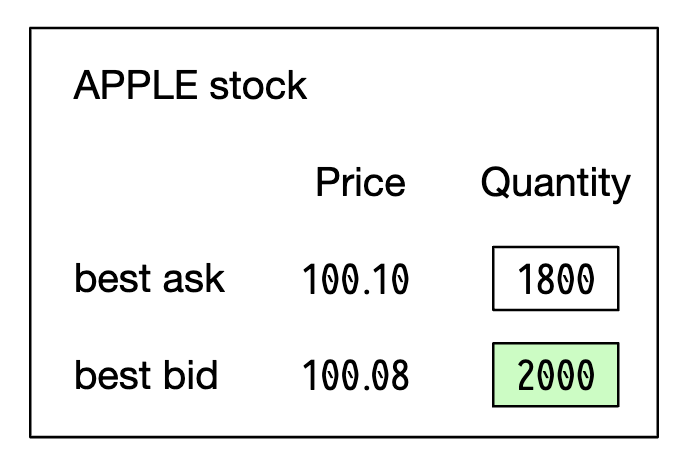
</div>

  * **L2 (Level 2 market data / Order book depth):** Hiển thị thêm nhiều mức giá chờ mua và chờ bán tiếp theo kèm tổng khối lượng gộp tại từng mức giá đó:

<div style="margin-left:3rem">
    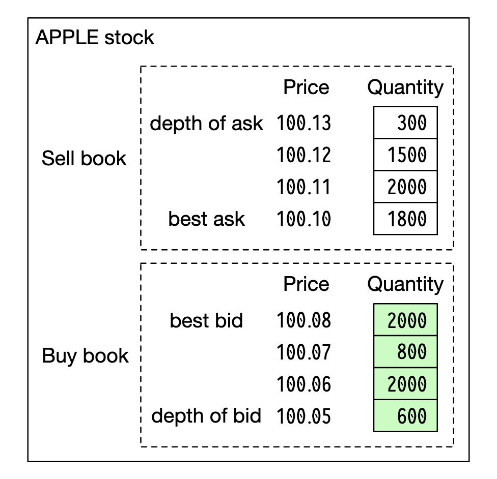
</div>

  * **L3 (Level 3 market data):** Chi tiết nhất — hiển thị từng mức giá kèm theo danh sách chi tiết khối lượng của từng lệnh đơn lẻ đang xếp hàng chờ tại mỗi mức giá:

<div style="margin-left:3rem">
    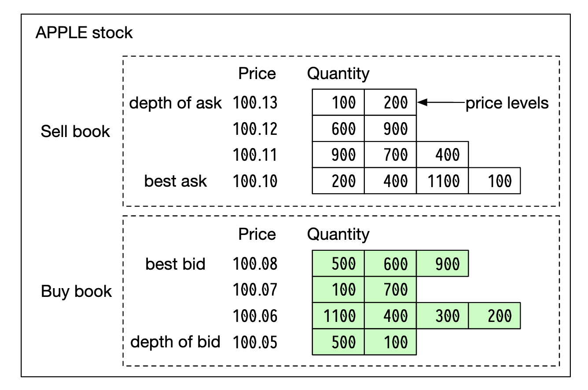
</div>

- **Biểu đồ hình nến (Candlestick chart):** Một cây nến biểu diễn biến động giá của cổ phiếu trong một khung thời gian nhất định (ví dụ: 1 phút, 5 phút, 1 giờ, 1 ngày), bao gồm 4 thông số giá: **Giá mở cửa (`Open`)**, **Giá đóng cửa (`Close`)**, **Giá cao nhất (`High`)**, và **Giá thấp nhất (`Low`)** trong khoảng thời gian đó:

<div style="margin-left:3rem">
    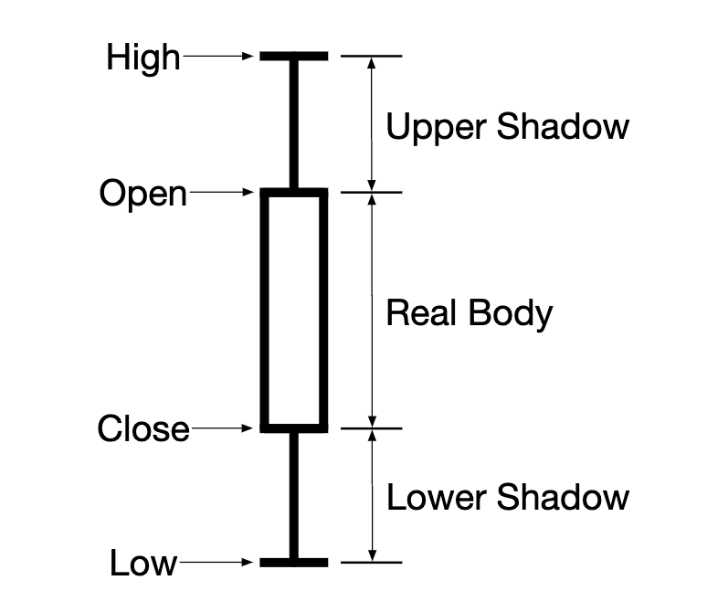
</div>

- **Giao thức FIX (Financial Information eXchange):** Giao thức truyền thông tiêu chuẩn công nghiệp ra đời từ năm 1991, được hầu hết các sàn giao dịch và công ty chứng khoán sử dụng để trao đổi thông tin giao dịch chứng khoán dưới dạng chuỗi cặp `tag=value` phân tách bởi ký tự `|`:
```
8=FIX.4.2 | 9=176 | 35=8 | 49=PHLX | 56=PERS | 52=20071123-05:30:00.000 | 11=ATOMNOCCC9990900 | 20=3 | 150=E | 39=E | 55=MSFT | 167=CS | 54=1 | 38=15 | 40=2 | 44=15 | 58=PHLX EQUITY TESTING | 59=0 | 47=C | 32=0 | 31=0 | 151=15 | 14=0 | 6=0 | 10=128 |
```

### **Thiết kế kiến trúc tổng quan (High-level design)**

<div style="margin-left:3rem">
    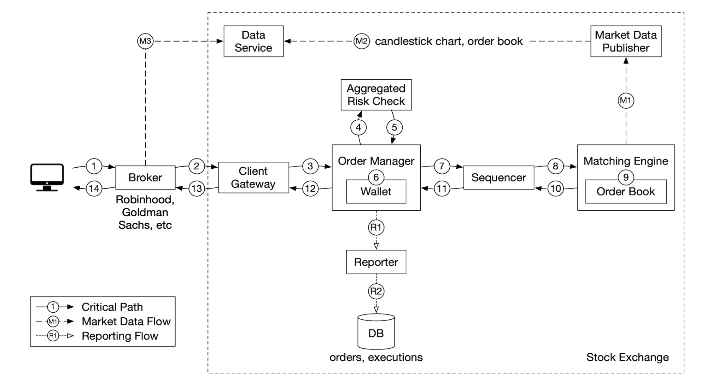
</div>

Kiến trúc tổng quan của sàn giao dịch được chia thành **ba luồng xử lý dữ liệu chính**:

**1. Luồng giao dịch (Trading flow — các bước từ 1 đến 7):**
 * **Bước 1:** Khách hàng đặt lệnh trên giao diện web hoặc ứng dụng di động của Broker.
 * **Bước 2:** Hệ thống của Broker gửi lệnh đó vào Sàn giao dịch.
 * **Bước 3:** Lệnh đi vào sàn qua cổng **Client Gateway**. Thành phần này thực hiện kiểm tra tính hợp lệ của dữ liệu đầu vào (input validation), giới hạn tốc độ (Rate Limiting), xác thực (Authentication), chuẩn hóa định dạng, rồi chuyển tiếp lệnh tới **Order Manager**.
 * **Bước 4 – 5:** **Order Manager** thực hiện kiểm tra rủi ro (Risk checks) dựa trên các quy tắc do **Risk Manager** thiết lập, sau đó kiểm tra số dư ví (**Wallet**) để xác nhận khách hàng có đủ tiền/cổ phiếu khả dụng cho lệnh đó và thực hiện phong tỏa số dư tương ứng.
 * **Bước 6:** Nếu vượt qua mọi bước kiểm tra, Order Manager gửi lệnh tới **Matching Engine (Bộ máy khớp lệnh)**. Khi tìm thấy lệnh đối ứng khớp giá, Matching Engine phát sinh ra hai bản ghi kết quả khớp lệnh (gọi là **Executions** hoặc **Fills**) — một bản cho bên mua và một bản cho bên bán. Cả lệnh đầu vào lẫn kết quả khớp lệnh đầu ra đều được đánh số thứ tự tuần tự qua bộ **Sequencer** để đảm bảo quy trình khớp lệnh mang tính tất định tuyệt đối (deterministic).
 * **Bước 7:** Kết quả khớp lệnh (Executions) được trả ngược về cho Client qua Order Manager và Client Gateway.

**2. Luồng dữ liệu thị trường (Market data flow — M1 đến M3):**
 * **M1:** Matching Engine phát ra luồng kết quả khớp lệnh và cập nhật lệnh (execution & order stream) gửi tới **Market Data Publisher**.
 * **M2:** **Market Data Publisher** xây dựng Sổ lệnh (Order book L1/L2/L3) và các biểu đồ nến (Candlestick charts) từ luồng sự kiện đó, rồi đẩy sang **Data Service**.
 * **M3:** Dữ liệu thị trường được lưu vào các kho lưu trữ chuyên dụng phục vụ phân tích thời gian thực, và các Brokers kết nối tới **Data Service** để nhận dữ liệu thị trường cập nhật liên tục.

**3. Luồng báo cáo (Reporter flow — R1 đến R2):**
 * **R1 – R2:** **Reporter** thu thập toàn bộ các trường thông tin cần thiết (như `client_id`, `price`, `quantity`, `order_type`, `filled_quantity`, `remaining_quantity`) từ các lệnh và kết quả khớp lệnh, sau đó ghi bền vững vào Database để phục vụ tra cứu lịch sử, báo cáo thuế, kiểm toán tuân thủ và quyết toán bù trừ (settlement).

**Nhận xét kiến trúc quan trọng:** Chỉ có **Luồng giao dịch (Trading flow - bước 1 đến 7)** là nằm trên **Đường găng quyết định (Critical path)** đòi hỏi độ trễ cực thấp (micro-giây đến mili-giây), trong khi Luồng dữ liệu thị trường và Luồng báo cáo tách khỏi Critical path nên có yêu cầu độ trễ nới lỏng hơn. Hãy đi sâu hơn vào từng thành phần của từng luồng!

#### Chi tiết Luồng giao dịch (Trading flow)
Vì nằm trên Critical path, toàn bộ luồng giao dịch phải được tối ưu hóa cực hạn cho độ trễ thấp.

**1. Matching Engine (Bộ máy khớp lệnh — còn gọi là Cross Engine):**
Là trái tim của sàn giao dịch, đảm nhận ba trách nhiệm chính:
 * Duy trì **Sổ lệnh (Order book)** cho từng mã cổ phiếu — tức là danh sách các lệnh chờ mua và chờ bán của mã đó theo từng mức giá.
 * Thực hiện **khớp lệnh mua và lệnh bán**: mỗi lần khớp lệnh sẽ tạo ra 2 bản ghi thực thi (`executions` / `fills`), một cho lệnh mua và một cho lệnh bán. Chức năng này phải diễn ra cực nhanh và chính xác tuyệt đối.
 * Phát tán luồng kết quả thực thi (`execution stream`) ra ngoài để làm nguồn xây dựng dữ liệu thị trường.
 * Một実装 Matching Engine đạt chuẩn bắt buộc phải tạo ra kết quả khớp lệnh theo một **thứ tự tất định (deterministic order)** — nghĩa là nếu đưa vào cùng một chuỗi sự kiện lệnh đầu vào theo đúng thứ tự đó để phát lại (replay), Matching Engine bắt buộc phải tạo ra chuỗi kết quả khớp lệnh đầu ra giống hệt 100%. Tính tất định này là nền tảng cốt lõi để xây dựng tính sẵn sàng cao (High Availability).

**2. Sequencer (Bộ đánh số thứ tự):**
Là thành phần chìa khóa giúp biến Matching Engine và Order Manager trở thành hoàn toàn tất định bằng cách đóng dấu (stamp) một mã số thứ tự tăng dần (`sequence ID`) lên mọi lệnh đầu vào (`inbound order`) trước khi vào Matching Engine, và đóng dấu `sequence ID` lên mọi kết quả khớp lệnh đầu ra (`outbound fill`) sau khi rời Matching Engine:

<div style="margin-left:3rem">
    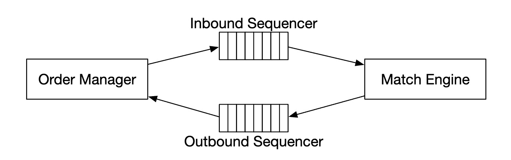
</div>

Chúng ta có cả **Inbound Sequencer** và **Outbound Sequencer** vì những lý do sống còn sau:
 * **Tính kịp thời và công bằng (Timeliness and fairness):** Đảm bảo các lệnh đến trước được xử lý trước theo đúng trình tự một cách công bằng.
 * **Khôi phục nhanh / Phát lại lịch sử (Fast recovery / Replay):** Sequencer đồng thời đóng vai trò là một kho lưu trữ nhật ký sự kiện (Message Queue / Event Store) giúp phát lại đúng thứ tự các lệnh để khôi phục trạng thái nếu hệ thống bị sập.
 * **Đảm bảo xử lý chính xác một lần (Exactly-once guarantee):** Số thứ tự liên tiếp giúp phát hiện ngay lập tức nếu có gói tin bị sót (gap detection) hoặc bị gửi trùng lặp.

Về mặt khái niệm, Sequencer hoạt động giống như một Message Queue kiểu Kafka; nhưng trong sàn giao dịch chứng khoán, chúng ta tự triển khai Sequencer ngay trong bộ nhớ/tiến trình thay vì dùng Kafka rời để đạt độ trễ ở mức micro-giây.

**3. Order Manager (Bộ quản lý lệnh):**
Đứng ở phía đầu bên kia của Sequencer để quản lý toàn bộ trạng thái vòng đời của các lệnh (`orders state`). Trách nhiệm của Order Manager bao gồm:
 * Gửi lệnh đi kiểm tra rủi ro (**Risk checks**) — ví dụ: xác minh tổng khối lượng giao dịch trong ngày của người dùng đó chưa vượt quá ngưỡng 1 triệu cổ phiếu.
 * Kiểm tra với **Wallet** để xác nhận tài khoản người dùng có đủ tiền/cổ phiếu khả dụng và thực hiện phong tỏa số dư cho lệnh đang đặt.
 * Gửi lệnh qua **Sequencer** để chuyển tới **Matching Engine**. Để tiết kiệm băng thông và tăng tốc độ xử lý cho Matching Engine, Order Manager chỉ trích xuất những thuộc tính tối thiểu cần cho việc khớp lệnh (như `order_id`, `symbol`, `side`, `price`, `quantity`) gửi xuống Matching Engine thay vì gửi toàn bộ thông tin rườm rà của khách hàng.
 * Nhận lại các kết quả khớp lệnh (`executions`/`fills`) từ **Outbound Sequencer**, cập nhật trạng thái lệnh và gửi thông báo kết quả về cho các Brokers thông qua **Client Gateway**.

Thách thức lớn nhất khi triển khai Order Manager là quản lý hàng chục trạng thái chuyển tiếp phức tạp của một lệnh (như lệnh mới, khớp một phần, hủy lệnh đang khớp dở...). Giải pháp tối ưu nhất cho bài toán này chính là áp dụng **Event Sourcing** (sẽ phân tích kỹ ở Bước 3).

**4. Client Gateway (Cổng giao tiếp khách hàng):**
Là tuyến phòng thủ biên tiếp nhận các lệnh từ Brokers/người dùng gửi vào sàn và chuyển tiếp tới Order Manager:

<div style="margin-left:3rem">
    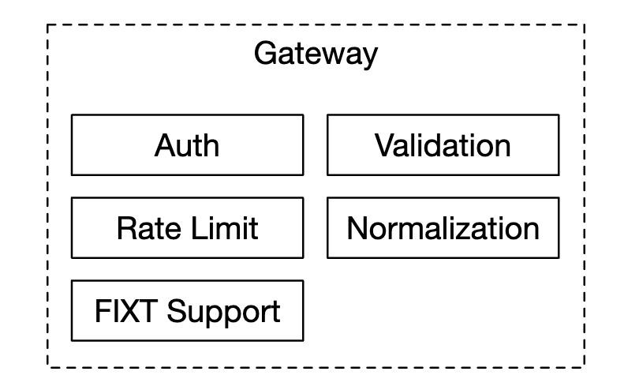
</div>

Vì nằm trên Critical path, Client Gateway phải cực kỳ gọn nhẹ (lightweight), không bao giờ thực hiện các logic nghiệp vụ nặng nề hay truy cập ổ đĩa. Trong thực tế, sàn giao dịch cung cấp nhiều loại Client Gateways khác nhau cho từng phân khúc khách hàng — từ cổng Internet công cộng cho nhà đầu tư cá nhân đến cổng kết nối trực tiếp tại chỗ (**Colocation engine**) dành cho các tổ chức giao dịch tần suất cao:

<div style="margin-left:3rem">
    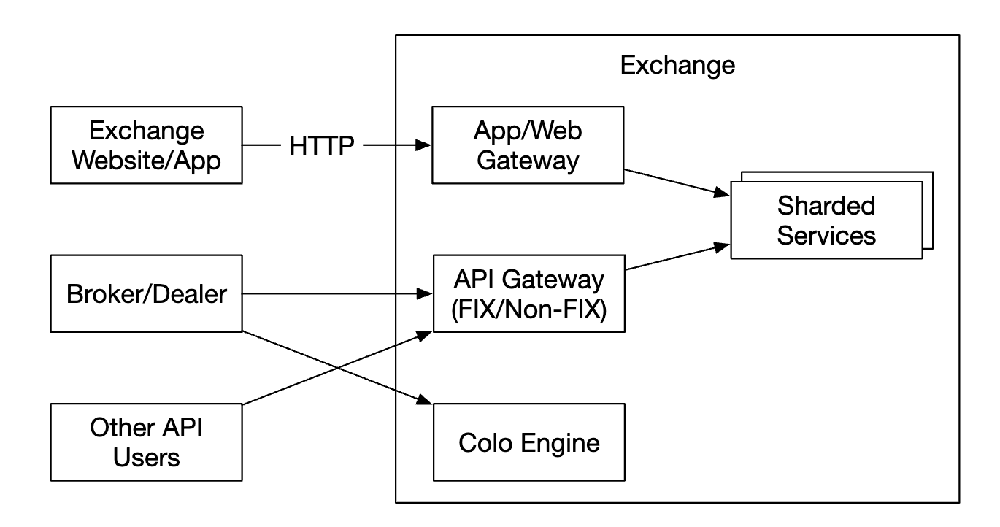
</div>

#### Chi tiết Luồng dữ liệu thị trường (Market data flow)
**Market Data Publisher (MDP)** nhận luồng kết quả thực thi và cập nhật lệnh từ Matching Engine, từ đó tự tái tạo lại Sổ lệnh (Order book L1/L2/L3) và tính toán các cây nến (Candlestick charts) theo thời gian thực, rồi gửi sang **Data Service** để phân phối tới những người đăng ký (subscribers):

<div style="margin-left:3rem">
    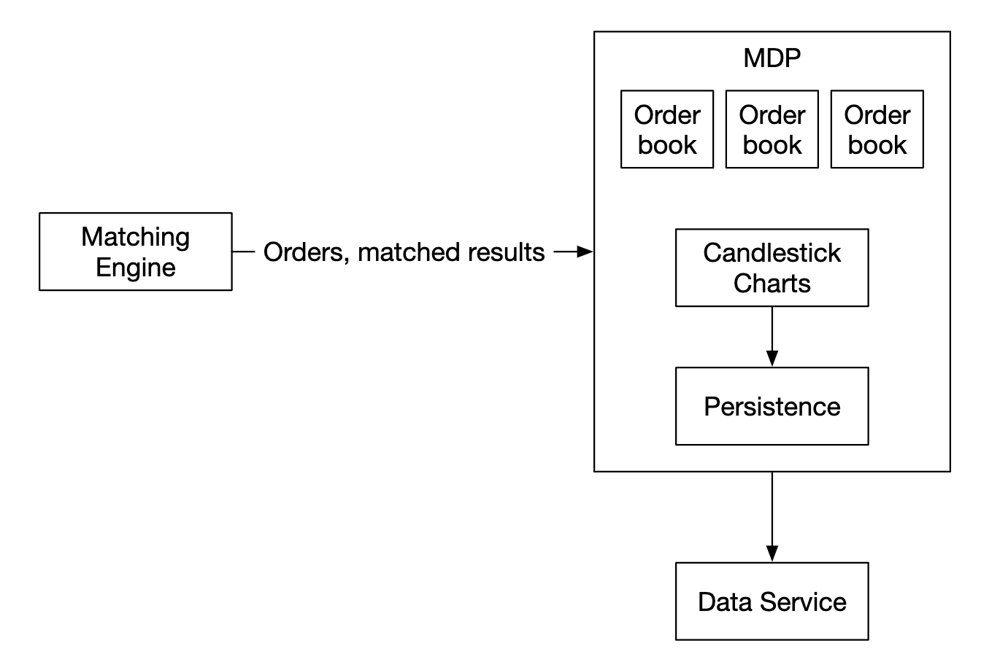
</div>

#### Chi tiết Luồng báo cáo (Reporting flow)
**Reporter** không nằm trên Critical path của việc khớp lệnh nhưng là thành phần bắt buộc về mặt pháp lý và vận hành tài chính:

<div style="margin-left:3rem">
    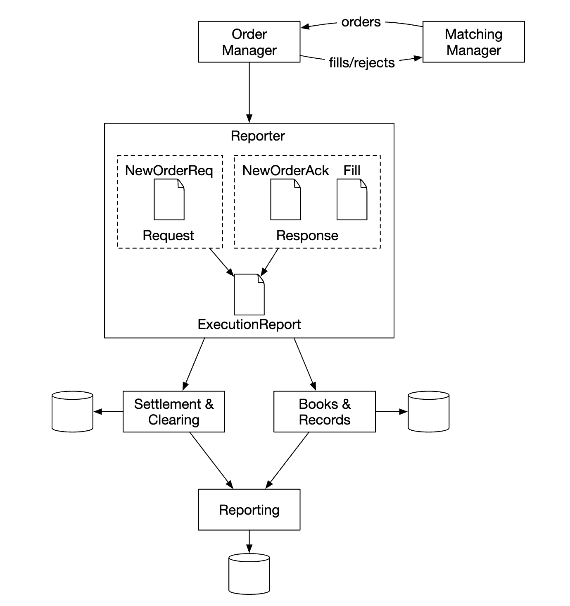
</div>

Nó ghép nối thông tin từ cả lệnh đặt vào (từ Order Manager) và kết quả thực thi (từ Matching Engine) để lưu vào Database phục vụ tra cứu lịch sử giao dịch, báo cáo thuế, báo cáo tuân thủ Ủy ban Chứng khoán và quyết toán thanh toán bù trừ. Ở luồng này, độ trễ không quá khắt khe nhưng **độ chính xác và tính tuân thủ (accuracy & compliance)** là tối quan trọng.

### **Thiết kế API (API Design)**
Khách hàng tương tác với Sàn giao dịch thông qua hệ thống của các Brokers để đặt lệnh, xem kết quả khớp lệnh, xem dữ liệu thị trường và tải dữ liệu lịch sử.

Đối với giao tiếp giữa Brokers và Client Gateway, chúng ta có thể cung cấp bộ **RESTful API** (còn đối với các khách hàng tổ chức HFT đòi hỏi độ trễ cực thấp, giao thức nhị phân chuyên dụng hoặc chuẩn **FIX** qua kết nối TCP giữ liên tục sẽ được sử dụng).

**1. API Tạo lệnh mới (`POST /v1/order`):**
```
POST /v1/order
```
*Tham số đầu vào (Parameters):*
 * `symbol` - Mã cổ phiếu (ví dụ: `"AAPL"`). Kiểu `String`.
 * `side` - Chiều giao dịch: mua (`"BUY"`) hoặc bán (`"SELL"`). Kiểu `String`.
 * `price` - Mức giá của lệnh giới hạn (biểu diễn dưới dạng số nguyên đơn vị nhỏ nhất để tránh sai số dấu phẩy động). Kiểu `Long`.
 * `orderType` - Loại lệnh: `LIMIT` hoặc `MARKET` (trong thiết kế này chúng ta chỉ hỗ trợ lệnh `LIMIT`). Kiểu `String`.
 * `quantity` - Khối lượng cổ phiếu đặt mua/bán. Kiểu `Long`.

*Phản hồi (Response):*
 * `id` - ID của lệnh vừa tạo. Kiểu `Long`.
 * `creationTime` - Thời gian hệ thống tạo lệnh (Epoch timestamp). Kiểu `Long`.
 * `filledQuantity` - Khối lượng cổ phiếu đã được khớp thành công. Kiểu `Long`.
 * `remainingQuantity` - Khối lượng cổ phiếu còn lại đang chờ khớp. Kiểu `Long`.
 * `status` - Trạng thái của lệnh (`NEW` / `CANCELED` / `FILLED`). Kiểu `String`.
 * Các thuộc tính còn lại giống với tham số đầu vào.

**2. API Truy vấn kết quả khớp lệnh (`GET /execution`):**
```
GET /execution?symbol={:symbol}&orderId={:orderId}&startTime={:startTime}&endTime={:endTime}
```
*Tham số đầu vào (Parameters):*
 * `symbol` - Mã cổ phiếu. Kiểu `String`.
 * `orderId` - ID của lệnh cần tra cứu (Tùy chọn - Optional). Kiểu `String`.
 * `startTime` - Thời gian bắt đầu truy vấn (Epoch time). Kiểu `Long`.
 * `endTime` - Thời gian kết thúc truy vấn (Epoch time). Kiểu `Long`.

*Phản hồi (Response):*
 * `executions` - Mảng chứa các bản ghi khớp lệnh thuộc phạm vi truy vấn (`Array`), mỗi phần tử gồm:
   * `id` - ID của bản ghi khớp lệnh (`execution`). Kiểu `Long`.
   * `orderId` - ID của lệnh gốc. Kiểu `Long`.
   * `symbol` - Mã cổ phiếu. Kiểu `String`.
   * `side` - Chiều mua hoặc bán. Kiểu `String`.
   * `price` - Mức giá khớp thực tế. Kiểu `Long`.
   * `orderType` - Loại lệnh (`LIMIT` hoặc `MARKET`). Kiểu `String`.
   * `quantity` - Khối lượng đã khớp trong lần thực thi này. Kiểu `Long`.

**3. API Lấy dữ liệu Sổ lệnh L2 (`GET /marketdata/orderBook/L2`):**
```
GET /marketdata/orderBook/L2?symbol={:symbol}&depth={:depth}
```
*Tham số đầu vào (Parameters):*
 * `symbol` - Mã cổ phiếu. Kiểu `String`.
 * `depth` - Độ sâu của sổ lệnh cần lấy ở mỗi bên mua/bán (ví dụ: lấy 10 mức giá tốt nhất). Kiểu `Int`.

*Phản hồi (Response):*
 * `bids` - Mảng chứa các mức giá đặt mua kèm tổng khối lượng chờ tại mỗi mức giá. Kiểu `Array`.
 * `asks` - Mảng chứa các mức giá chào bán kèm tổng khối lượng chờ tại mỗi mức giá. Kiểu `Array`.

**4. API Lấy dữ liệu Biểu đồ nến (`GET /marketdata/candles`):**
```
GET /marketdata/candles?symbol={:symbol}&resolution={:resolution}&startTime={:startTime}&endTime={:endTime}
```
*Tham số đầu vào (Parameters):*
 * `symbol` - Mã cổ phiếu. Kiểu `String`.
 * `resolution` - Độ phân giải khung thời gian của mỗi cây nến tính bằng giây (ví dụ: `60` cho nến 1 phút, `3600` cho nến 1 giờ). Kiểu `Long`.
 * `startTime` - Thời gian bắt đầu khung truy vấn (Epoch time). Kiểu `Long`.
 * `endTime` - Thời gian kết thúc khung truy vấn (Epoch time). Kiểu `Long`.

*Phản hồi (Response):*
 * `candles` - Mảng chứa dữ liệu của từng cây nến (`Array`), mỗi cây nến gồm:
   * `open` - Giá mở cửa của cây nến. Kiểu `Double`.
   * `close` - Giá đóng cửa của cây nến. Kiểu `Double`.
   * `high` - Giá cao nhất của cây nến. Kiểu `Double`.
   * `low` - Giá thấp nhất của cây nến. Kiểu `Double`.

### **Mô hình dữ liệu (Data models)**
Có ba nhóm dữ liệu chính trong sàn giao dịch chứng khoán:
 1. Sản phẩm giao dịch (`Product`), Lệnh (`Order`), và Kết quả khớp lệnh (`Execution`).
 2. Sổ lệnh (`Order book`).
 3. Biểu đồ hình nến (`Candlestick chart`).

#### 1. Product, Order, Execution
- **Product** mô tả các thuộc tính tĩnh của một mã chứng khoán được giao dịch: loại sản phẩm (`product_type`), mã giao dịch (`trading_symbol`), tên hiển thị trên UI, bước giá tối thiểu (`tick_size`), lô giao dịch tối thiểu (`lot_size`), loại tiền tệ... Dữ liệu này rất ít khi thay đổi, có thể lưu trong bất kỳ Relational Database nào và được nạp sẵn lên bộ nhớ Cache.
- **Order** đại diện cho một lệnh đặt mua hoặc đặt bán đầu vào.
- **Execution** đại diện cho một kết quả khớp lệnh đầu ra.

Dưới đây là sơ đồ quan hệ thực thể (ERD) của ba bảng này:

<div style="margin-left:3rem">
    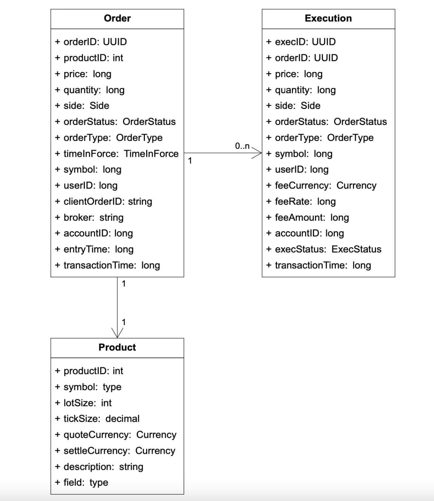
</div>

Chúng ta bắt gặp `Order` và `Execution` trong cả ba luồng của hệ thống, nhưng cách lưu trữ của chúng hoàn toàn khác nhau ở mỗi luồng:
 * **Trên Critical path (Trading flow):** Để đạt tốc độ cực đại, `Order` và `Execution` không bao giờ được ghi vào Relational Database trong lúc khớp lệnh! Chúng được xử lý hoàn toàn trên bộ nhớ RAM (in-memory) và được ghi/khôi phục tuần tự qua bộ **Sequencer**.
 * **Trên Reporter flow:** Dịch vụ **Reporter** mới là bên đọc các sự kiện này và ghi vào Relational Database để phục vụ tra cứu lịch sử và báo cáo thuế/kiểm toán.
 * **Trên Market data flow:** Các `Executions` được chuyển tới **Market Data Publisher** để dựng lại Sổ lệnh và tính toán biểu đồ nến.

#### 2. Cấu trúc dữ liệu Sổ lệnh (Order book) — Thiết kế đạt độ phức tạp $O(1)$
**Sổ lệnh (Order book)** là danh sách toàn bộ các lệnh đang chờ mua và chờ bán của một mã chứng khoán, được tổ chức phân cấp theo từng **mức giá (Price level)** và bên trong mỗi mức giá được xếp hàng theo **thứ tự thời gian đến trước phục vụ trước (FIFO / Price-Time Priority)**.

Một cấu trúc dữ liệu tối ưu cho Order Book trong Matching Engine bắt buộc phải thỏa mãn đồng thời các yêu cầu khắt khe sau:
 * Thời gian tra cứu hằng số **$O(1)$** khi lấy khối lượng tại một mức giá cụ thể.
 * Thao tác **Đặt lệnh mới (`Add`)**, **Khớp lệnh (`Execute` / `Match`)**, và **Hủy lệnh (`Cancel`)** đều phải đạt tốc độ hằng số **$O(1)$**!
 * Truy vấn lấy mức giá mua cao nhất (**Best Bid**) và mức giá bán thấp nhất (**Best Ask**) cực nhanh.
 * Duyệt tuần tự qua các mức giá (Price levels) dễ dàng.

Hãy xem một ví dụ minh họa quá trình khớp một lệnh mua lớn (2.700 cổ phiếu Apple tại giá tối đa \$100.12) quét qua các mức giá bán trên Sổ lệnh:

<div style="margin-left:3rem">
    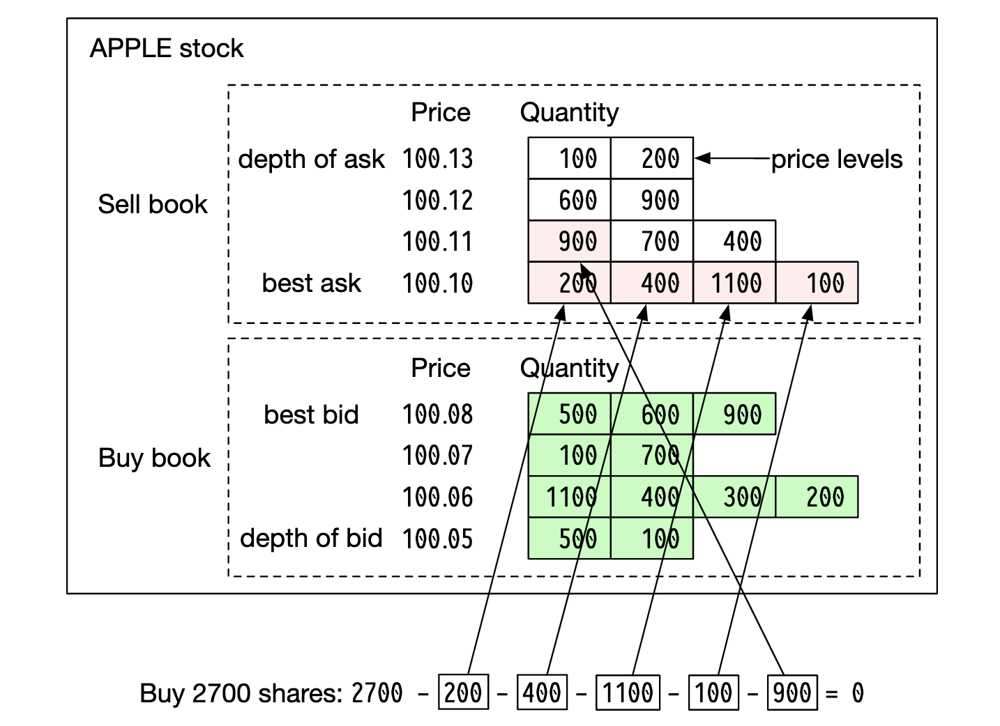
</div>

Sau khi lệnh mua lớn này ăn hết toàn bộ lượng chào bán ở mức giá `100.10` (2.000 cổ) và `100.11` (500 cổ) cùng một phần ở mức `100.12` (200 cổ), mức giá chào bán tốt nhất (**Best Ask**) tăng lên `100.12`, làm nới rộng khoảng chênh lệch giá mua - bán (Bid-Ask spread).

Hãy xem đoạn mã giả (pseudo-code) ban đầu để mô hình hóa cấu trúc `OrderBook`:
```
class PriceLevel{
    private Price limitPrice;
    private long totalVolume;
    private List<Order> orders;
}

class Book<Side> {
    private Side side;
    private Map<Price, PriceLevel> limitMap;
}

class OrderBook {
    private Book<Buy> buyBook;
    private Book<Sell> sellBook;
    private PriceLevel bestBid;
    private PriceLevel bestOffer;
    private Map<OrderID, Order> orderMap;
}
```

Làm thế nào để cả 3 thao tác **Add**, **Match** và **Cancel** một lệnh bất kỳ đều đạt độ phức tạp **$O(1)$**?
Nếu `List<Order> orders` bên trong mỗi `PriceLevel` chỉ là một mảng (`ArrayList`) hoặc danh sách liên kết đơn (`Singly-linked list`), thì khi người dùng muốn **Hủy (`Cancel`)** một lệnh đang nằm ở lưng chừng giữa hàng đợi, chúng ta sẽ mất $O(N)$ để tìm và xóa nó!

Giải pháp chuẩn mực trong các Matching Engine thực chiến là kết hợp một **Danh sách liên kết đôi (Doubly-linked list)** cho `orders` bên trong mỗi `PriceLevel` cùng một **Bảng băm (`HashMap<OrderID, Order> orderMap`)** trỏ trực tiếp tới Node lệnh đó:
 * **Đặt một lệnh mới (`Add`):** Đạt **$O(1)$** vì lệnh mới luôn được chèn vào **cuối (`tail`)** của danh sách liên kết đôi tại mức giá đó, đồng thời lưu tham chiếu vào `orderMap`.
 * **Khớp một lệnh (`Match`):** Đạt **$O(1)$** vì theo luật FIFO, lệnh được ưu tiên khớp luôn nằm ngay ở **đầu (`head`)** của danh sách liên kết đôi; khớp xong chỉ việc xóa Node ở đầu danh sách.
 * **Hủy một lệnh bất kỳ (`Cancel`):** Đạt **$O(1)$** vì đầu tiên chúng ta dùng `orderMap.get(orderId)` để tìm ra ngay con trỏ trỏ tới đối tượng `Order` trong thời gian **$O(1)$**; sau đó, vì `Order` là một Node của danh sách liên kết đôi (có sẵn cả hai con trỏ `prev` và `next`), chúng ta chỉ cần nối `order.prev.next = order.next` để rút lệnh đó ra khỏi hàng đợi ngay lập tức trong thời gian **$O(1)$** mà không cần duyệt qua bất kỳ phần tử nào khác!

<div style="margin-left:3rem">
    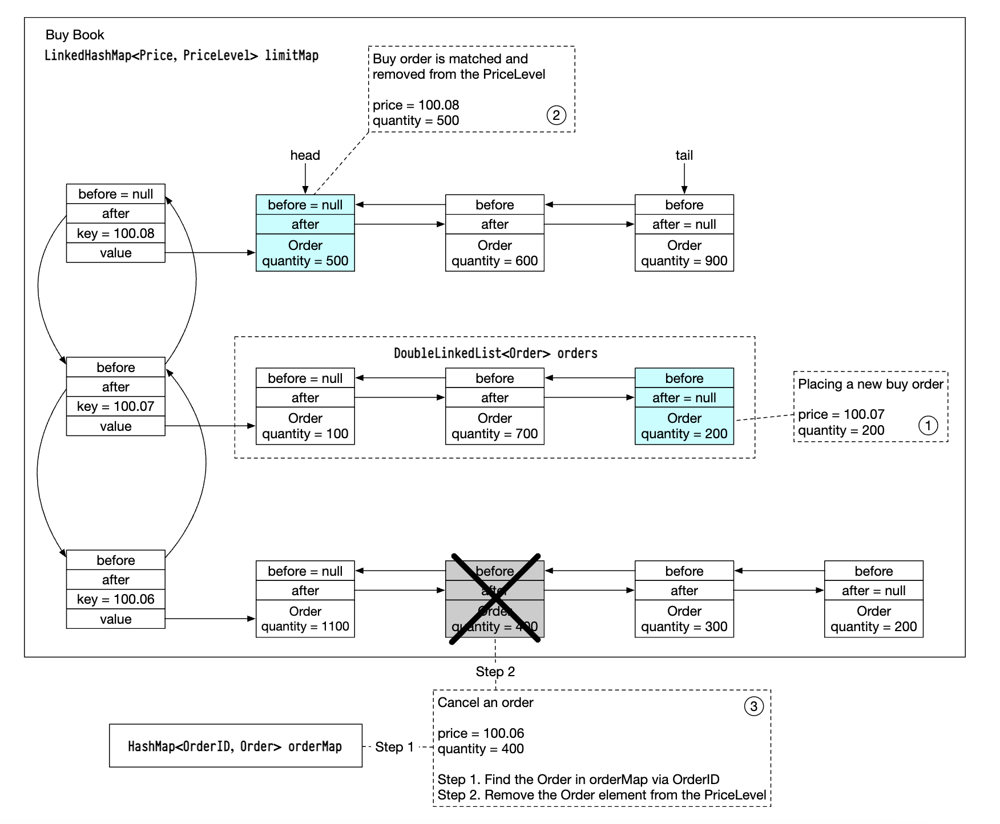
</div>

Cấu trúc dữ liệu Order Book siêu tốc này được sử dụng ở cả hai nơi: bên trong **Matching Engine** để khớp lệnh và bên trong **Market Data Publisher** để tái tạo lại Sổ lệnh L1/L2/L3 từ luồng sự kiện khớp lệnh.

#### 3. Cấu trúc dữ liệu Biểu đồ hình nến (Candlestick chart)
Dữ liệu biểu đồ hình nến được tính toán bên trong các dịch vụ **Market Data Publisher** bằng cách theo dõi các mức giá khớp trong từng khung thời gian (`interval` — 1 phút, 5 phút, 1 giờ, 1 ngày...):
```
class Candlestick {
    private long openPrice;
    private long closePrice;
    private long highPrice;
    private long lowPrice;
    private long volume;
    private long timestamp;
    private int interval;
}

class CandlestickChart {
    private LinkedList<Candlestick> sticks;
}
```

Việc theo dõi giá cho hàng trăm mã cổ phiếu ở nhiều khung thời gian khác nhau trên bộ nhớ RAM sẽ tiêu tốn rất nhiều dung lượng nếu không được quản lý khéo léo. Hai kỹ thuật tối ưu hóa bộ nhớ cho Candlestick chart:
 * Sử dụng các **Bộ đệm vòng đã cấp phát sẵn bộ nhớ (Pre-allocated Ring Buffers)** để chứa các cây nến thay vì cấp phát đối tượng mới liên tục (giúp tránh áp lực lên bộ thu gom rác Garbage Collector).
 * Giới hạn số lượng cây nến gần nhất được giữ trên bộ nhớ RAM và đẩy phần lịch sử cũ hơn xuống đĩa.

Đối với việc lưu trữ và phân tích dữ liệu chuỗi thời gian thị trường theo thời gian thực (real-time market analytics), các sàn giao dịch và tổ chức tài chính thường sử dụng các cơ sở dữ liệu hướng cột trên bộ nhớ (**In-memory Columnar Database**) chuyên dụng như **KDB+/q**; sau khi thị trường đóng cửa cuối ngày, toàn bộ dữ liệu được chuyển sang cơ sở dữ liệu lịch sử dài hạn.

---

## Bước 3: Đi sâu vào Thiết kế Chi tiết (Design Deep Dive)
Một sự thật vô cùng thú vị về các sàn giao dịch chứng khoán hiện đại: trái ngược với hầu hết các hệ thống phần mềm lớn khác (vốn chia nhỏ thành hàng trăm Microservices chạy phân tán qua mạng trên hàng nghìn máy chủ), **một sàn giao dịch chứng khoán hiện đại thường gom toàn bộ các thành phần cốt lõi chạy trên một máy chủ vật lý siêu mạnh duy nhất (one gigantic server)**!

Hãy cùng khám phá chi tiết lý do và kiến trúc đằng sau thiết kế đặc biệt này.

### **Tối ưu hóa Hiệu năng cực hạn (Performance)**
Đối với một sàn giao dịch chứng khoán, chỉ số quan trọng sống còn không chỉ là lưu lượng (Throughput) mà là **Độ trễ cực thấp (Ultra-low latency)** ở mọi phân vị (đặc biệt là p99 và p99.99).

**Làm thế nào để cắt giảm độ trễ xuống mức tối thiểu?** Có hai nguyên tắc cơ bản:
 1. **Giảm số lượng tác vụ nằm trên Đường găng (Critical path).**
 2. **Rút ngắn thời gian thực thi của từng tác vụ trên Critical path:** bằng cách loại bỏ hoàn toàn việc gọi qua mạng (Network I/O) và ghi đĩa cứng (Disk I/O), đồng thời tối ưu hóa thời gian chạy từng lệnh CPU.

Ở nguyên tắc thứ nhất, chúng ta đã gọt bỏ khỏi Critical path mọi tác vụ phụ trợ không bắt buộc (như báo cáo, phân tích dữ liệu thị trường, thậm chí bỏ luôn cả việc ghi log văn bản thông thường trên luồng khớp lệnh).

Còn ở nguyên tắc thứ hai: trong thiết kế ở Bước 2, mặc dù đã khá gọn, nhưng việc các thành phần (`Client Gateway`, `Order Manager`, `Sequencer`, `Matching Engine`) giao tiếp với nhau qua mạng (Network) và việc `Sequencer` ghi xuống ổ đĩa (Disk) vẫn sẽ tạo ra độ trễ tổng cộng ở mức **vài chục mili-giây (tens of milliseconds)**. Trong thế giới giao dịch điện tử hiện đại, mục tiêu của chúng ta là đạt độ trễ đầu-cuối ở mức **vài chục micro-giây (tens of microseconds — tức là nhanh hơn 1.000 lần)**!

Để loại bỏ cả độ trễ mạng lẫn độ trễ ổ đĩa, chúng ta đưa toàn bộ các tiến trình cốt lõi lên **cùng một máy chủ vật lý (Single Server)** và cho chúng giao tiếp với nhau thông qua một kênh truyền sự kiện siêu tốc dựa trên **`mmap` (Memory-mapped file)** đóng vai trò làm **Message Bus / Event Store**:

<div style="margin-left:3rem">
    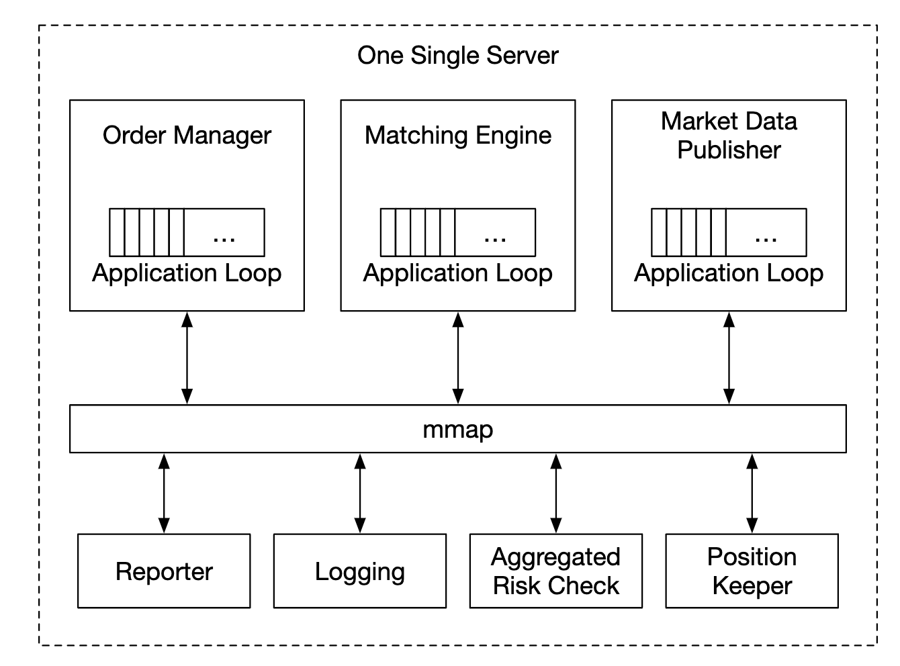
</div>

**Kỹ thuật 1: Vòng lặp ứng dụng đơn luồng ghim chặt vào nhân CPU (Application Loop with CPU Pinning)**
Để đạt hiệu năng xử lý lệnh CPU nhanh nhất và loại bỏ hoàn toàn độ trễ do chuyển ngữ cảnh luồng (**Context Switching**) của hệ điều hành cũng như sự tranh chấp khóa (**Lock Contention**), mỗi thành phần cốt lõi (như Matching Engine hay Order Manager) được thiết kế dưới dạng một **Vòng lặp ứng dụng đơn luồng (`while(true)` loop)** liên tục kéo sự kiện để xử lý (busy-polling), và luồng (thread) này được **ghim cố định (pinned / CPU affinity)** vào một nhân CPU vật lý riêng biệt!

<div style="margin-left:3rem">
    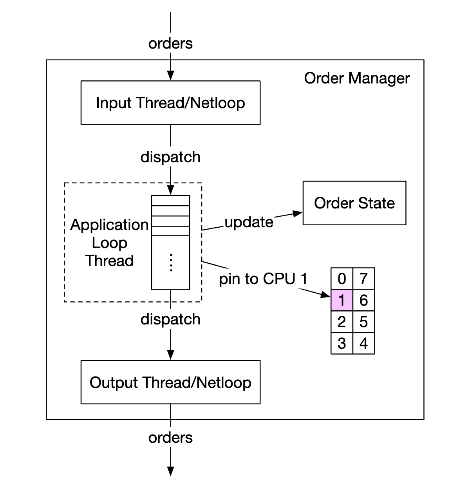
</div>

Vì chỉ có đúng một luồng duy nhất chạy tuần tự từ đầu đến cuối trên nhân CPU đó và không bao giờ nhường CPU cho tiến trình khác:
 * **Không bao giờ có Context Switching** (vốn tốn hàng micro-giây và làm hỏng bộ nhớ đệm L1/L2 CPU Cache).
 * **Không bao giờ có Lock Contention** (không cần dùng bất kỳ cơ chế `mutex`, `synchronized` hay khóa nào vì không có luồng thứ hai cùng tranh chấp trạng thái).

**Kỹ thuật 2: Sử dụng `mmap` trên `/dev/shm` (Shared Memory)**
Như đã giới thiệu ở Chương 27, `mmap(2)` là một lời gọi hệ thống (syscall) của UNIX cho phép ánh xạ một tệp vào bộ nhớ RAM để chia sẻ bộ nhớ hiệu năng cao giữa các tiến trình (Inter-Process Communication - IPC). Hơn thế nữa, trên Linux có một mẹo tối ưu hóa kinh điển: nếu chúng ta đặt tệp được `mmap` đó nằm trong thư mục **`/dev/shm`** (viết tắt của **Shared Memory** — một hệ thống tệp ảo dạng `tmpfs` nằm hoàn toàn trên bộ nhớ RAM), thì mọi thao tác ghi và đọc qua `mmap` sẽ diễn ra **100% trên bộ nhớ RAM chia sẻ với tốc độ nano-giây mà không hề chạm tới ổ đĩa cứng một chút nào**!

### **Kiến trúc Lưu trữ sự kiện nguồn (Event Sourcing)**
Chúng ta đã thảo luận rất chi tiết về nguyên lý của **Event Sourcing** trong [Chương 27: Ví Điện tử](../27.%20%20Digital%20Wallet/README.md). Hãy xem cách áp dụng nó vào Sàn giao dịch chứng khoán.

Thay vì lưu trạng thái hiện tại của lệnh vào bảng Database truyền thống (bên trái), chúng ta lưu mọi sự thay đổi trạng thái dưới dạng chuỗi các **Sự kiện bất biến (Immutable events)** nối tiếp nhau (bên phải):

<div style="margin-left:3rem">
    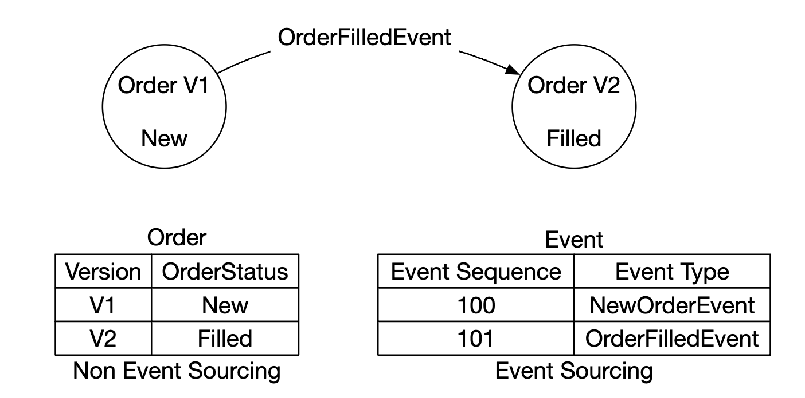
</div>

Dưới đây là kiến trúc chi tiết của Sàn giao dịch khi kết hợp **`mmap` Event Store** và **Event Sourcing**:

<div style="margin-left:3rem">
    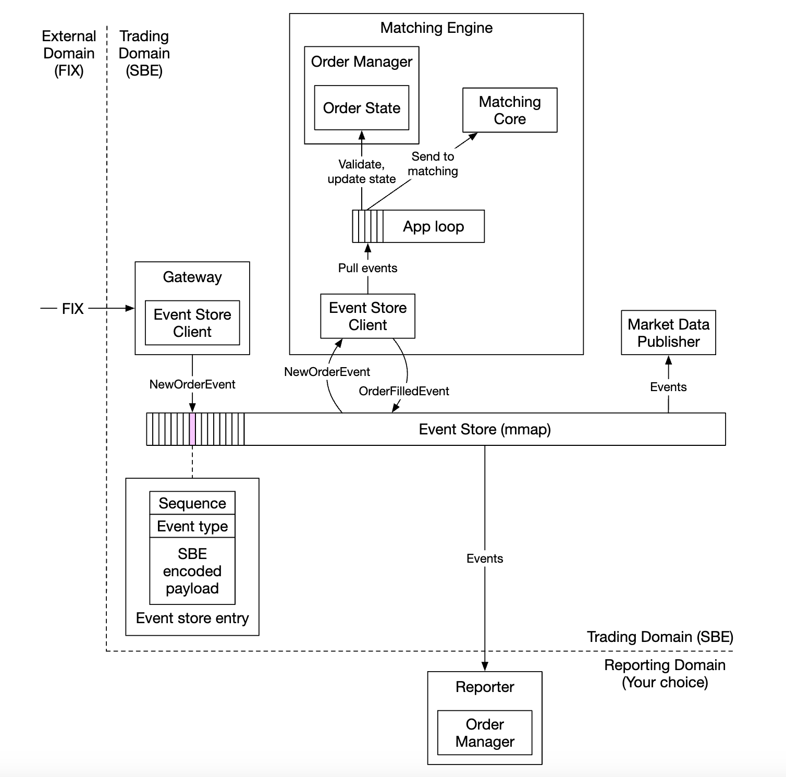
</div>

 1. Các hệ thống Broker bên ngoài kết nối vào **Client Gateway** qua giao thức **FIX**. Client Gateway thực hiện xác thực, Rate Limiting và đẩy sự kiện `NewOrderEvent` vào kênh `mmap` để gửi tới **Sequencer**.
 2. Trong kiến trúc mới này, bản thân kênh `mmap` đã là **Event Store**, nên **Sequencer** chỉ đóng vai trò là một **Bộ ghi duy nhất (Single Writer)** cực nhanh: nó kéo sự kiện từ `mmap` riêng của từng Gateway, đóng dấu số thứ tự `sequence_id` tăng dần vào sự kiện, rồi ghi tuần tự vào **Event Store (`mmap` trung tâm)**:

<div style="margin-left:3rem">
    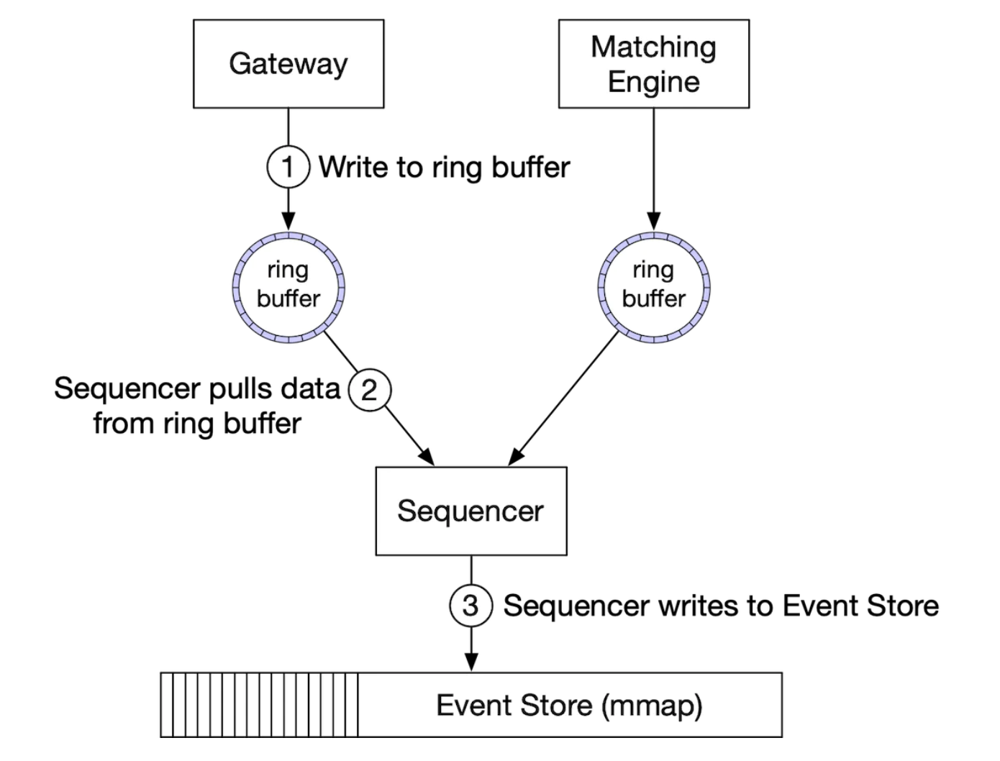
</div>

 3. **Order Manager** (được đóng gói như một thư viện nhúng ngay trong cùng tiến trình với **Matching Core** để tránh độ trễ truyền tin) đọc sự kiện `NewOrderEvent` đã có `sequence_id` từ Event Store, kiểm tra rủi ro/ví tiền, cập nhật trạng thái lệnh nội bộ và chuyển thẳng đối tượng lệnh vào **Matching Core**.
 4. Nếu lệnh được khớp trên Sổ lệnh, Matching Core phát sinh sự kiện `OrderFilledEvent` và đẩy ngược lại qua Sequencer vào Event Store.
 5. Tất cả các thành phần khác (**Market Data Publisher**, **Reporter**, và bản sao Order Manager ở phía trả kết quả cho Client Gateway) đều đăng ký đọc (subscribe) bất đồng bộ từ Event Store trung tâm để thực hiện phần việc của mình mà không làm chậm luồng khớp lệnh!

### **Tính sẵn sàng cao (High availability)**
Mục tiêu thiết kế của chúng ta là đạt tính sẵn sàng **99.99% (4 số 9)** — đồng nghĩa với việc toàn bộ sàn giao dịch chỉ được phép ngừng hoạt động tối đa **8,64 giây mỗi ngày**! Việc khôi phục sau sự cố bắt buộc phải diễn ra gần như tức thời.

Để đạt được điều này, chúng ta cần:
 1. Xác định mọi điểm lỗi đơn lẻ (Single Point of Failure) trong kiến trúc (đặc biệt là các thành phần Stateful như Matching Engine và Order Manager).
 2. Thiết lập các bản sao dự phòng nóng (**Hot-warm standby instances**) chạy song song và tự động hóa hoàn toàn việc phát hiện lỗi cũng như chuyển đổi dự phòng (**Failover**).

Đối với các thành phần **Stateless** như `Client Gateway` hay `Data Service`, chúng ta có thể mở rộng theo chiều ngang dễ dàng bằng cách thêm nhiều Instances.

Đối với các thành phần **Stateful** như `Matching Engine` và `Order Manager`, nhờ kiến trúc Event Sourcing có **tính tất định tuyệt đối**, chúng ta có thể chạy nhiều bản sao dự phòng (**Warm Replicas**) cùng đọc chung một luồng sự kiện từ **Event Store**! Tất cả các bản sao dự phòng đều xử lý mọi sự kiện đầu vào (`inbound events`) và duy trì trạng thái Sổ lệnh trong RAM giống hệt như bản chính (**Primary / Leader**), chỉ khác một điểm duy nhất: **các bản sao dự phòng (Followers) bị chặn không cho phép phát sự kiện đầu ra (`outbound events`)**:

<div style="margin-left:3rem">
    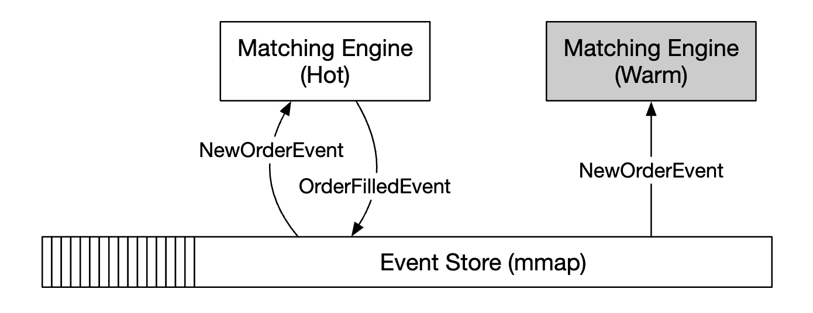
</div>

Cơ chế **Heartbeat** liên tục giám sát sức khỏe của bản chính (Leader). Nếu Leader ngừng gửi Heartbeat (do tiến trình bị treo hoặc crash), một bản sao dự phòng nóng (Follower) — vốn đã có sẵn 100% trạng thái Sổ lệnh mới nhất trong RAM — chỉ cần bật cờ sang chế độ **Leader** và bắt đầu phát sự kiện đầu ra ngay lập tức mà không tốn thời gian nạp lại dữ liệu!

Nhưng điều gì xảy ra nếu **toàn bộ chiếc máy chủ vật lý khổng lồ đó bị mất nguồn hoặc hỏng phần cứng**?
Khi đó, cơ chế dự phòng bên trong cùng một Server là không đủ. Chúng ta phải thiết lập nguyên các **Máy chủ vật lý dự phòng nóng (Hot-warm standby servers)** độc lập và sao chép luồng dữ liệu **Event Store (`mmap`)** xuyên qua mạng tới các máy chủ dự phòng này (sử dụng giao thức **Reliable UDP** để truyền phát sự kiện với độ trễ thấp nhất).

### **Khả năng chịu lỗi và Đồng thuận Raft (Fault tolerance)**
Ngay cả khi đã có máy chủ dự phòng nóng trong cùng một Data Center, xác suất nhỏ vẫn có thể xảy ra thảm họa diện rộng (cháy nổ, mất điện toàn trung tâm dữ liệu, động đất). Các sàn giao dịch lớn giải quyết bài toán này bằng cách sao chép dữ liệu cốt lõi sang các trung tâm dữ liệu ở **nhiều thành phố khác nhau (Multi-city / Multi-DC replication)**.

Khi thiết kế cơ chế chuyển đổi dự phòng giữa nhiều máy chủ, chúng ta phải giải quyết 4 câu hỏi cốt lõi:
 1. Khi máy chủ chính gặp sự cố, làm sao biết chắc chắn nó đã chết thật (tránh hiện tượng **Split-brain** — hai Leader cùng hoạt động) để quyết định Failover?
 2. Làm thế nào để bầu chọn ra Leader mới trong số các máy chủ dự phòng?
 3. Thời gian mục tiêu để khôi phục hoàn toàn hệ thống (**RTO - Recovery Time Objective**) là bao lâu?
 4. Điểm mục tiêu khôi phục dữ liệu (**RPO - Recovery Point Objective**): Hệ thống có chấp nhận mất dữ liệu không? (Đối với sàn giao dịch chứng khoán, mất dữ liệu giao dịch là không thể chấp nhận, tức là $RPO = 0$).

Để trả lời các câu hỏi này một cách chuẩn mực, chúng ta triển khai cụm **Sequencer / Event Store** của các máy chủ theo **Thuật toán đồng thuận Raft (Raft Consensus)** (ví dụ: cụm 5 máy chủ đặt tại nhiều khu vực độc lập):

<div style="margin-left:3rem">
    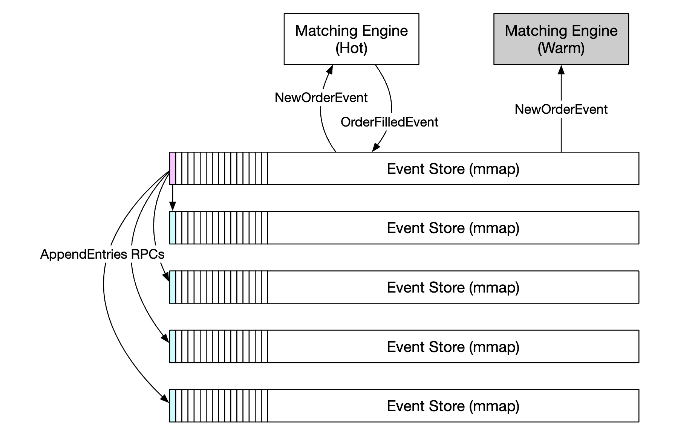
</div>

 * Máy chủ **Leader** gửi toàn bộ các sự kiện đã đóng dấu thứ tự trong Event Store sang tất cả các máy chủ **Followers**.
 * Ngay khi nhận được xác nhận đã ghi thành công vào Event Store từ **quá bán số Nodes** ($\frac{N}{2} + 1$, ví dụ 3 trên 5 máy chủ), sự kiện đó được đảm bảo an toàn tuyệt đối và không bao giờ bị mất.
 * Nếu máy chủ Leader gặp sự cố và ngừng gửi Heartbeat vượt quá ngưỡng thời gian chờ ngẫu nhiên (`Election timeout`), các máy chủ Followers sẽ tự động khởi phát một nhiệm kỳ bầu cử mới (**Term**) để bầu ra **Leader mới**:

<div style="margin-left:3rem">
    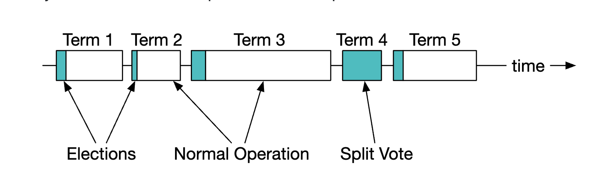
</div>

Bạn có thể xem thêm minh họa trực quan sinh động về cách Raft hoạt động tại [The Secret Lives of Data - Raft](https://thesecretlivesofdata.com/raft/). Ngoài ra, để phòng ngừa các lỗi phần mềm tiềm ẩn (software bugs) có thể làm sập cả Leader lẫn Followers cùng lúc khi gặp một gói tin dị biệt, các sàn giao dịch thường áp dụng kỹ thuật **Kỹ thuật hỗn loạn (Chaos Engineering)** để chủ động tiêm lỗi và kiểm thử khả năng tự phục hồi của hệ thống trong môi trường giả lập.

### **Thuật toán khớp lệnh (Matching algorithms)**
Hãy cùng xem đoạn mã giả (pseudo-code) cốt lõi minh họa cách thuật toán khớp lệnh theo quy tắc **FIFO (First-In-First-Out / Price-Time Priority)** hoạt động bên trong Matching Engine:
```
Context handleOrder(OrderBook orderBook, OrderEvent orderEvent) {
    if (orderEvent.getSequenceId() != nextSequence) {
        return Error(OUT_OF_ORDER, nextSequence);
    }

    if (!validateOrder(symbol, price, quantity)) {
        return ERROR(INVALID_ORDER, orderEvent);
    }

    Order order = createOrderFromEvent(orderEvent);
    switch (msgType):
        case NEW:
            return handleNew(orderBook, order);
        case CANCEL:
            return handleCancel(orderBook, order);
        default:
            return ERROR(INVALID_MSG_TYPE, msgType);

}

Context handleNew(OrderBook orderBook, Order order) {
    if (BUY.equals(order.side)) {
        return match(orderBook.sellBook, order);
    } else {
        return match(orderBook.buyBook, order);
    }
}

Context handleCancel(OrderBook orderBook, Order order) {
    if (!orderBook.orderMap.contains(order.orderId)) {
        return ERROR(CANNOT_CANCEL_ALREADY_MATCHED, order);
    }

    removeOrder(order);
    setOrderStatus(order, CANCELED);
    return SUCCESS(CANCEL_SUCCESS, order);
}

Context match(OrderBook book, Order order) {
    Quantity leavesQuantity = order.quantity - order.matchedQuantity;
    Iterator<Order> limitIter = book.limitMap.get(order.price).orders;
    while (limitIter.hasNext() && leavesQuantity > 0) {
        Quantity matched = min(limitIter.next.quantity, order.quantity);
        order.matchedQuantity += matched;
        leavesQuantity = order.quantity - order.matchedQuantity;
        remove(limitIter.next);
        generateMatchedFill();
    }
    return SUCCESS(MATCH_SUCCESS, order);
}
```

Trong thuật toán **FIFO** trên: các lệnh ở cùng một mức giá sẽ được khớp theo đúng thứ tự thời gian đặt lệnh — lệnh nào đứng ở đầu hàng đợi (`head` của Doubly-linked list) sẽ được khớp trước tiên. (Trong thực tế, ngoài thuật toán FIFO thuần túy, một số sàn giao dịch phái sinh còn dùng biến thể **FIFO with LMM** — dành một tỷ lệ phân bổ ưu tiên cho các nhà tạo lập thị trường dẫn đầu *Lead Market Makers* trước khi chạy FIFO).

### **Tính tất định về Chức năng và Độ trễ (Determinism)**
Trong thiết kế sàn giao dịch, có hai khái niệm về **Tính tất định (Determinism)** mà một System Architect cần phân biệt rõ:

1. **Tính tất định về chức năng (Functional determinism):**
   Đảm bảo thông qua kiến trúc **Sequencer + Event Sourcing**: bất kể thời gian đồng hồ vật lý lúc các sự kiện bay tới lệch nhau ra sao, một khi chúng đã được đóng dấu `sequence_id` theo đúng thứ tự cố định trên Event Store, khi phát lại (Replay) chuỗi sự kiện đó, hệ thống bắt buộc phải luôn tính ra kết quả khớp lệnh giống hệt nhau 100%:

<div style="margin-left:3rem">
    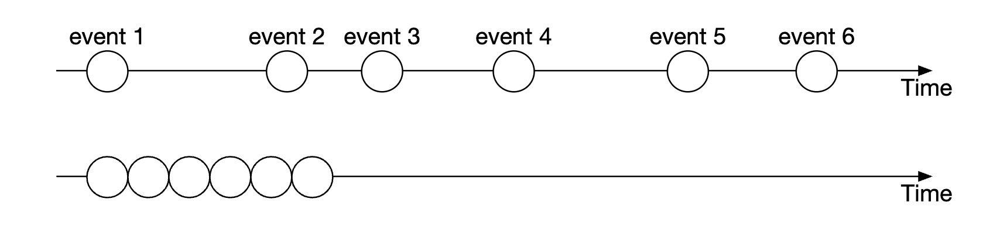
</div>

2. **Tính tất định về độ trễ (Latency determinism):**
   Có nghĩa là thời gian xử lý mỗi lệnh qua hệ thống phải **ổn định gần như tuyệt đối** giữa mọi giao dịch, không có các gai độ trễ tăng vọt bất thường (latency spikes / jitter). Chỉ số quan trọng để đo lường tính chất này là độ lệch giữa phân vị **p99** hoặc **p99.99** so với trung vị (p50).
   Nếu phát hiện độ trễ p99.99 bị vọt lên cao, nguyên nhân hàng đầu trong các ngôn ngữ có quản lý bộ nhớ tự động như Java thường đến từ các đợt dừng thế giới (**Stop-the-World pauses**) của bộ **Thu gom rác (Garbage Collector - GC)**. Đó là lý do các sàn giao dịch viết bằng Java/C++ trên Critical path thường sử dụng kỹ thuật **Object Pooling / Pre-allocated Ring Buffers** (cấp phát sẵn toàn bộ đối tượng từ lúc khởi động, tái sử dụng vùng nhớ và đạt mức **Zero-GC** trong suốt phiên giao dịch!).

### **Tối ưu hóa Market Data Publisher với Ring Buffer & Padding (Market data publisher optimizations)**
**Market Data Publisher (MDP)** nhận luồng kết quả khớp lệnh từ Matching Engine để dựng lại Sổ lệnh và biểu đồ nến rồi phát cho người đăng ký:

<div style="margin-left:3rem">
    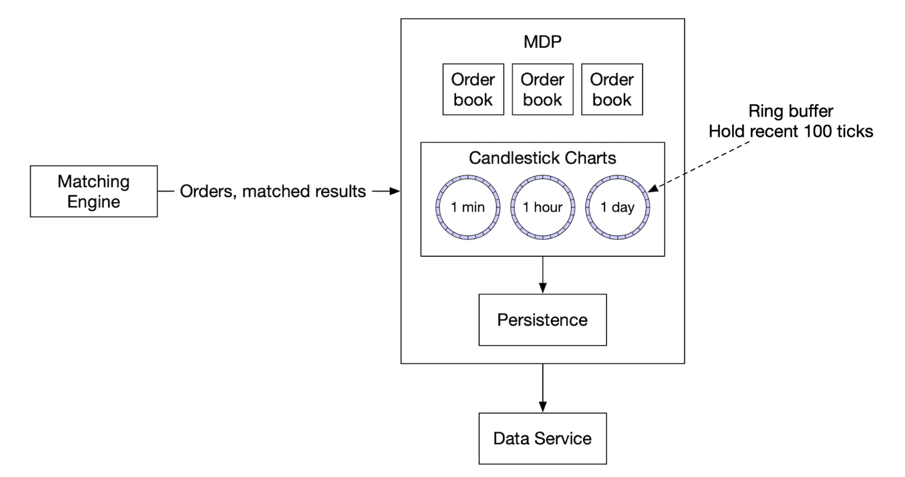
</div>

Để đạt tốc độ truyền tải dữ liệu nội bộ cao nhất giữa các giai đoạn xử lý bên trong MDP mà không dùng khóa (lock-free), chúng ta sử dụng cấu trúc **Bộ đệm vòng (Ring Buffer / Circular Buffer)** — điển hình là mẫu thiết kế **LMAX Disruptor**:
 * **Ring Buffer** là một mảng có kích thước cố định mà phần đầu (`head`) nối liền với phần đuôi (`tail`) tạo thành vòng tròn, được cấp phát sẵn toàn bộ vùng nhớ liên tiếp trên RAM ngay từ khi khởi tạo (không bao giờ cấp phát hay thu hồi bộ nhớ động khi đang chạy).
 * Hoàn toàn **không sử dụng khóa (Lock-free)**: các luồng Producer và Consumer phối hợp với nhau chỉ thông qua việc đọc/tăng các con trỏ vị trí tuần tự (`sequence numbers`) bằng các thao tác nguyên tử cấp CPU (CAS - Compare-And-Swap / Memory barriers).
 * **Kỹ thuật đệm dòng bộ nhớ đệm CPU (Cache Line Padding):** Một dòng bộ nhớ đệm của CPU (CPU Cache Line) thường có kích thước **64 bytes**. Nếu hai biến con trỏ `sequence` của Producer và Consumer vô tình nằm chung trong cùng một khối 64 bytes, khi hai nhân CPU cập nhật hai biến đó sẽ làm mất hiệu lực Cache Line của nhau liên tục — hiện tượng này gọi là **Chia sẻ giả (False Sharing)** làm sụt giảm hiệu năng nghiêm trọng. Để triệt tiêu False Sharing, các kỹ sư hiệu năng cao sử dụng kỹ thuật **Padding**: chèn thêm các biến số nguyên giả (`dummy longs`) bao quanh biến `sequence` để đảm bảo mỗi biến `sequence` luôn độc chiếm trọn vẹn một CPU Cache Line 64 bytes riêng biệt!

### **Tính công bằng khi phân phối dữ liệu thị trường và Giao thức Multicast (Distribution fairness of market data and multicast)**
Đối với dữ liệu thị trường (Market Data), ngoài tốc độ nhanh, một yêu cầu pháp lý và đạo đức cực kỳ quan trọng là **Tính công bằng trong phân phối (Distribution fairness)**: làm sao để tất cả những người đăng ký (subscribers) nhận được thông tin biến động giá **vào cùng một thời điểm như nhau**? Nếu một quỹ đầu tư luôn nhận được dữ liệu sổ lệnh sớm hơn các quỹ khác vài mili-giây do thứ tự gửi gói tin của sàn, họ sẽ có lợi thế thông tin bất chính để thao túng hoặc trục lợi trên thị trường.

Khi truyền dữ liệu qua mạng Internet/LAN, có ba phương thức truyền tải chính:
 * **Unicast (Đơn hướng):** Từ 1 nguồn gửi riêng lẻ tới từng đích một (nếu có 1.000 người nhận, Server phải lặp qua danh sách 1.000 người để gửi 1.000 lần — người đứng đầu danh sách luôn nhận được tin sớm hơn người đứng cuối danh sách!).
 * **Broadcast (Quảng bá toàn mạng con):** Từ 1 nguồn phát tới tất cả mọi thiết bị trong cùng một mạng con (subnetwork).
 * **Multicast (Đa hướng):** Từ 1 nguồn phát duy nhất tới một nhóm các máy chủ đã đăng ký lắng nghe (multicast group) có thể nằm trên các mạng con khác nhau.

Để đảm bảo tính công bằng tuyệt đối, các sàn giao dịch chứng khoán sử dụng phương thức **Multicast qua giao thức UDP**. Về mặt lý thuyết, khi gói tin UDP Multicast đi qua các thiết bị chuyển mạch mạng (Network Switches/Routers), nó được nhân bản ở tầng phần cứng mạng và đến tay tất cả các Subscribers **vào cùng một thời điểm**. Để khắc phục nhược điểm có thể rớt gói tin của UDP thuần túy, các sàn sử dụng giao thức **Reliable UDP** (bổ sung số thứ tự gói tin và dịch vụ yêu cầu truyền lại — Retransmission / NAK — khi phát hiện thiếu gói tin).

### **Đặt máy chủ tại chỗ (Colocation)**
Khi tốc độ xử lý bên trong sàn giao dịch đã được tối ưu xuống mức vài micro-giây, độ trễ lớn nhất còn lại chính là **thời gian ánh sáng truyền đi trong cáp quang** từ máy chủ của Broker đến máy chủ của Sàn giao dịch!

Do đó, hầu hết các sàn giao dịch chứng khoán đều cung cấp một dịch vụ VIP mang lại doanh thu rất lớn gọi là **Dịch vụ đặt máy chủ tại chỗ (Colocation)**: cho phép các công ty môi giới (Brokers) và các quỹ giao dịch tần suất cao (HFT) thuê chỗ đặt máy chủ giao dịch của họ **ngay bên trong cùng một tòa nhà Trung tâm dữ liệu (Data Center)** với máy chủ Matching Engine của sàn, kết nối trực tiếp bằng các sợi cáp quang có độ dài bằng nhau chính xác đến từng mét để đảm bảo tốc độ tối đa và sự công bằng tuyệt đối.

### **Bảo mật mạng (Network Security)**
Tấn công từ chối dịch vụ phân tán (**DDoS**) là mối đe dọa thường trực đối với các cổng dịch vụ hướng ra Internet công cộng của sàn giao dịch. Dưới đây là các chiến lược phòng vệ hiệu quả:
 * **Cô lập hoàn toàn các dịch vụ và dữ liệu công cộng khỏi mạng lưới dịch vụ giao dịch riêng tư (Private VIP services):** Để ngay cả khi cổng thông tin công cộng bị tấn công DDoS, các đường truyền chuyên dụng (leased lines / colocation) của các tổ chức giao dịch lớn vẫn hoạt động bình thường không bị ảnh hưởng.
 * Sử dụng tầng **Caching / CDN** mạnh mẽ để phục vụ các dữ liệu ít thay đổi (như danh sách mã chứng khoán, dữ liệu lịch sử ngày cũ) thay vì chọc thẳng vào Database.
 * **Gia cố thiết kế URL chống DDoS (Harden URLs against DDoS):** Ưu tiên thiết kế các đường dẫn API thân thiện với việc Cache như `https://my.website.com/data/recent` thay vì cho phép truyền tham số truy vấn tùy ý như `https://my.website.com/data?from=123&to=456` (vì kẻ tấn công có thể đổi ngẫu nhiên `from` và `to` liên tục để xuyên thủng lớp Cache và đánh sập Database).
 * Triển khai cơ chế danh sách cho phép / danh sách chặn (**Allowlist / Blocklist**) hiệu quả ở tầng cổng mạng (Network Gateway) cùng cơ chế **Rate Limiting** chặt chẽ.

---

## Bước 4: Tổng kết (Wrap Up)
Một số ghi chú thực tế thú vị để khép lại chương thiết kế Sàn giao dịch chứng khoán:
 * Không phải mọi sàn giao dịch đều gom hết mọi thứ lên một máy chủ duy nhất, nhưng kiến trúc **Single-server / Shared-memory (`mmap`) + Application Loop + Event Sourcing** vẫn là chuẩn mực vàng để xử lý luồng khớp lệnh cho từng phân vùng mã chứng khoán đòi hỏi độ trễ micro-giây. (Nếu sàn có hàng chục nghìn mã cổ phiếu, chúng ta có thể dễ dàng phân mảnh theo dải mã cổ phiếu — mỗi cụm Server phụ trách một nhóm `symbols` hoàn toàn độc lập với nhau!).
 * Xu hướng gần đây trong ngành tài chính hiện đại là nhiều sàn giao dịch thế hệ mới bắt đầu dịch chuyển dần hạ tầng lên **Đám mây (Cloud infrastructure)** để tận dụng khả năng mở rộng tự động, đồng thời trong lĩnh vực tài chính phi tập trung (DeFi / Crypto), mô hình **Tạo lập thị trường tự động (Automated Market Makers - AMM)** cũng nổi lên như một hướng tiếp cận thay thế không cần duy trì Sổ lệnh (Order book) truyền thống.
